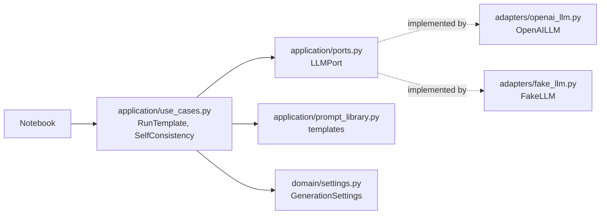

# Module 1: Prompting and Prompt Templates

Hands-on practice with prompting techniques (zero-shot, one-shot, few-shot, chain-of-thought, self-consistency). Setup is shared from the repo root: see the [root README](../README.md).

## Hands-on tutorials

Type-along study guides with code, diagrams and exercises:

- [Tutorial 1: GenAI and prompting, adapted](tutorials/01-genai-and-prompting-adapted.md) follows the course videos and lab in order.
- [Tutorial 2: build a prompt workbench](tutorials/02-build-a-prompt-workbench.md) tests prompting techniques side by side, one problem at a time.

## Files

| File | Purpose |
|---|---|
| `mod1-manual.ipynb` | Walk-through using `FakeLLM` (no API key) and then `OpenAILLM` |
| `mod1-openai.ipynb` | Same exercises against OpenAI. Needs `OPENAI_API_KEY` in the root `.env` |
| `In-Context Learning and Prompt Templates for Advanced AI.ipynb` | Course lab notebook |
| `prompting-examples.md` | Prompts to paste into a notebook cell and compare |

## Code layout (ports and adapters)



- **`LLMPort`** is a protocol with one method: `generate(prompt, settings) -> str`.
- **`OpenAILLM`** calls OpenAI through `langchain-openai`. **`FakeLLM`** returns a fixed reply and records its calls, so you can test without a key.
- **`GenerationSettings`** holds `temperature`, `max_tokens`, `top_p`, `frequency_penalty` and `presence_penalty`.
- Application code depends only on `LLMPort`, so swapping providers needs no changes to it.

## Usage

Run from inside `module1/`, because imports are top-level:

```python
from adapters.fake_llm import FakeLLM
from application import prompt_library as prompts
from application.use_cases import RunTemplate

llm = FakeLLM(reply="Short summary.")
RunTemplate(llm, prompts.SUMMARIZE).execute(content="long article text")
```

Swap in the real model:

```python
from adapters.openai_llm import OpenAILLM
from domain.settings import GenerationSettings

llm = OpenAILLM(model="gpt-4o-mini")
RunTemplate(llm, prompts.SUMMARIZE, GenerationSettings(temperature=0.2)).execute(content="...")
```
