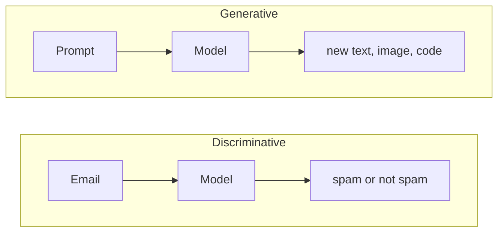
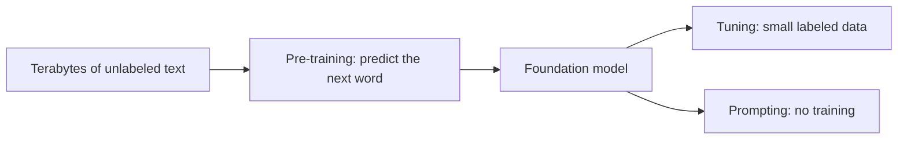
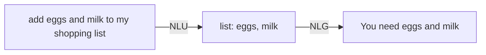
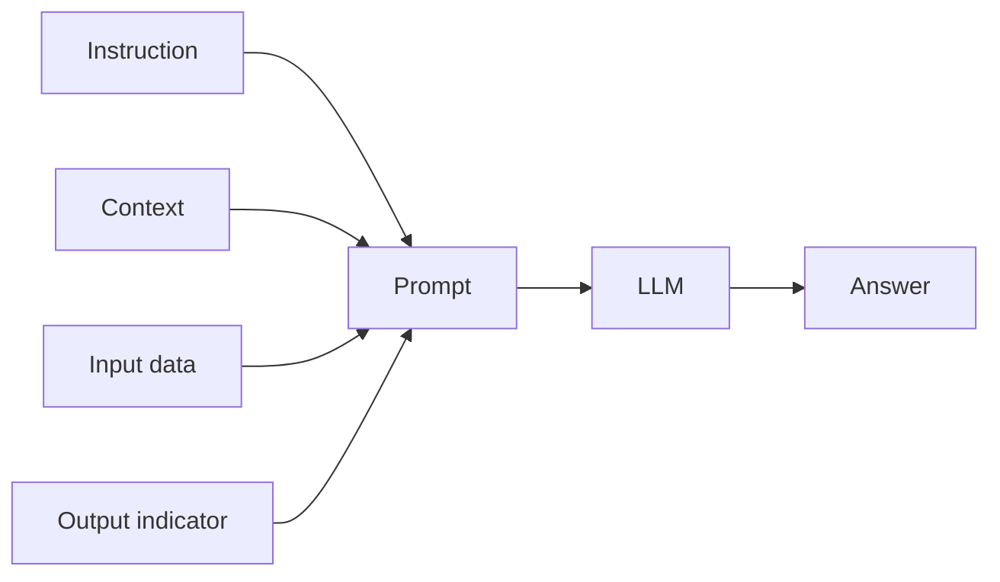
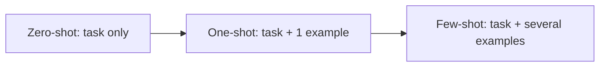
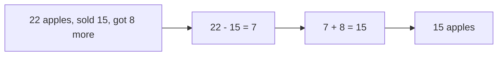
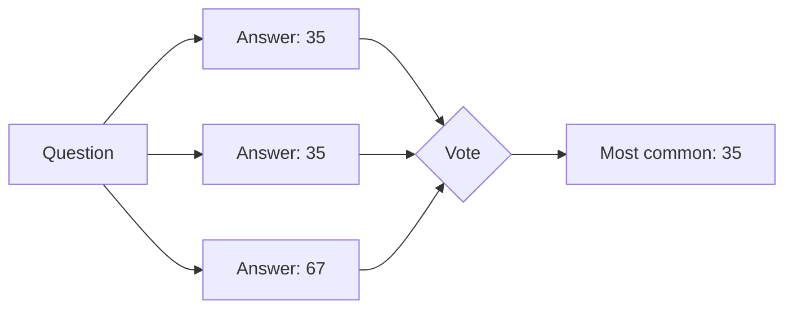
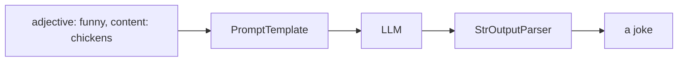
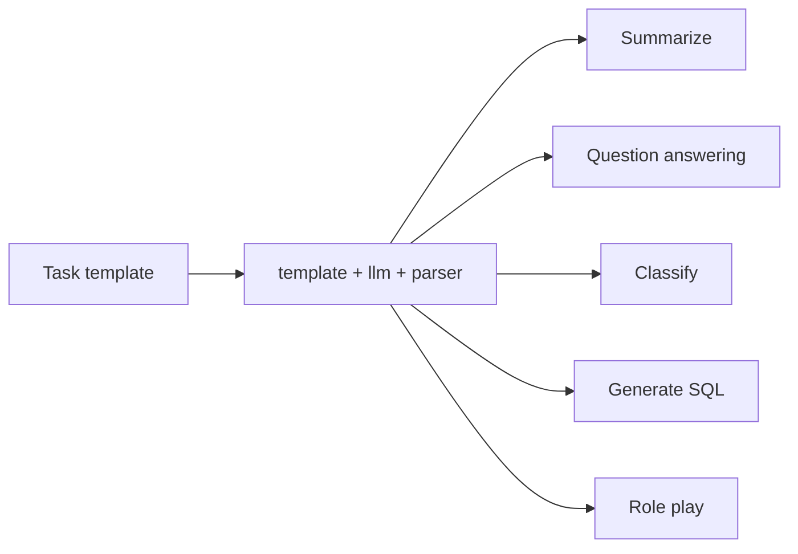

# Tutorial 1: Generative AI and Prompt Engineering, Adapted

**What this is.** A type-along version of Module 1 of the course: the videos *Introduction to Generative AI*, *What are Generative AI Models?*, *What is NLP?*, *Introduction to In-Context Learning*, *Introduction to LangChain*, *Advanced Methods of Prompt Engineering* and *LangChain LCEL Chaining*, plus the lab *Master Prompt Engineering and LangChain PromptTemplates*. It keeps the course order.

**What is different from the course.** The lab runs on IBM watsonx.ai (Granite) with LangChain 0.2. This guide uses OpenAI and current LangChain. Wherever the lab and this guide differ you will see:

> **Lab says / today we use:** ...

For a problem-first version that builds one app, see [Tutorial 2](02-build-a-prompt-workbench.md).

## How to use this guide

1. Open a new notebook in `module1/` and pick the root `.venv` as the kernel.
2. Type each **Type this** block yourself. Do not paste.
3. Compare with **Expected output**. LLM text varies, so expect similar, not identical.
4. Do **Try it** and **Check yourself** before moving on.

Real API calls cost a small amount of credit (the whole guide is a few cents with `gpt-4o-mini`).

## Contents

1. [Setup](#setup)
2. [Generative vs discriminative AI](#part-1-generative-vs-discriminative-ai)
3. [Foundation models and LLMs](#part-2-foundation-models-and-llms)
4. [NLP: unstructured to structured](#part-3-nlp-unstructured-to-structured)
5. [Prompts and in-context learning](#part-4-prompts-and-in-context-learning)
6. [Zero-shot, one-shot and few-shot](#part-5-zero-shot-one-shot-and-few-shot)
7. [Chain-of-thought](#part-6-chain-of-thought)
8. [Self-consistency](#part-7-self-consistency)
9. [Prompt templates and LCEL](#part-8-prompt-templates-and-lcel)
10. [Prompt applications](#part-9-prompt-applications)
11. [Glossary](#glossary-from-the-reading)
12. [Practice exercises](#practice-exercises)

---

## Setup

You need `OPENAI_API_KEY` in the repo-root `.env`. Packages are already installed (see the [root README](../../README.md)).

**Type this** (once, in the first cell):

```python
from dotenv import load_dotenv
from langchain_openai import ChatOpenAI

load_dotenv()
llm = ChatOpenAI(model="gpt-4o-mini", temperature=0.5, max_tokens=256)

def ask(prompt, **settings):
    """Send a prompt, optionally overriding settings like temperature or max_tokens."""
    return llm.bind(**settings).invoke(prompt).content
```

`ask` is a small helper. It stands in for the lab's `llm_model(prompt, params)` function.

> **Lab says / today we use:** the lab builds an IBM `Model` with `max_new_tokens`, `min_new_tokens`, `temperature`, `top_p` and `top_k`. OpenAI has `max_tokens`, `temperature` and `top_p`. It has no `top_k` or `min_new_tokens`. The lab also needs a pinned `pip install` cell, which you can skip.

---

## Part 1: Generative vs discriminative AI

### The idea

Both kinds of AI learn from data (that learning is called **training**), and both use deep learning (neural networks).

- **Discriminative AI** learns to tell classes apart. It draws a decision boundary and says which side new data falls on. Example: a spam filter. It cannot create new content.
- **Generative AI** learns the *pattern* of its training data so it can create new things: text, images, audio, video, code.

> **Analogy:** a discriminative model is a judge who says "nest or egg?". A generative model is an artist who draws "a nest with three eggs".



The building blocks the course names: **GANs**, **VAEs**, **transformers** and **diffusion models**. LLMs are built on transformers.

### Type this

One model can play both roles. First as a classifier (a fixed answer):

```python
print(ask("Is this email spam? Answer only 'spam' or 'not spam': 'You WON a FREE cruise, click now!!!'", temperature=0))
```

Then as a generator (new content):

```python
print(ask("Write a two-line poem about a nest with three eggs."))
```

### Expected output

"spam", then a short poem.

### Try it

Ask the classifier prompt with a normal email ("Lunch at 12?"). Does it say "not spam"?

### Check yourself

Which type of model can answer "draw a nest with three eggs"?

<details><summary>Answer</summary>A generative model. A discriminative model can only sort inputs into known classes.</details>

---

## Part 2: Foundation models and LLMs

### The idea

A **foundation model** is trained once on a huge amount of unlabeled data, then reused for many tasks. A **large language model (LLM)** is a foundation model for text. Its core training job is simple: **predict the next word** given the words before it.

"No use crying over spilled ..." leads to "milk".

You can adapt a foundation model in two ways:

| Way | What you do | Data needed |
|---|---|---|
| **Tuning** | Update the model's parameters with a small labeled set | Some |
| **Prompting** (prompt engineering) | Write the task into the input | None, or a few examples |

This guide is about prompting.

| | Advantages | Disadvantages |
|---|---|---|
| Foundation models | Strong performance, less labeled data, faster to build | Costly to train and run, trustworthiness (biased or unknown training data) |



### Type this

Watch next-word prediction happen:

```python
print(ask("Continue this sentence with a few words: No use crying over spilled", temperature=0))
```

Now the course's example of a classification task done purely by prompting:

```python
sentence = "The product arrived late but the quality exceeded my expectations."
print(ask(f"Does this sentence have a positive or negative sentiment? Reply with one word.\n\n{sentence}", temperature=0))
```

### Expected output

Something like "milk" or "milk. It's a common saying...", then "Positive".

### Try it

Replace the sentence with a sarcastic one: "Great, another delay. Just what I needed." Does the model catch the sarcasm?

### Check yourself

Why can one foundation model do sentiment analysis without being trained for it?

<details><summary>Answer</summary>It learned language patterns from enormous data, so a prompt that describes the task is enough for it to continue the text with the right answer.</details>

---

## Part 3: NLP: unstructured to structured

### The idea

**Natural language processing (NLP)** translates between how people talk (**unstructured** text) and a form computers can process (**structured** data).

- Unstructured → structured is **NLU** (understanding).
- Structured → unstructured is **NLG** (generation).

Common uses: machine translation, virtual assistants and chatbots, sentiment analysis, spam detection.



Classic NLP is a bag of tools, not one algorithm:

| Tool | What it does | Example |
|---|---|---|
| **Tokenization** | Splits text into pieces (tokens) | "add eggs and milk" gives 4 tokens |
| **Stemming** | Chops a word to a stem | running, runs, ran share stem "run" |
| **Lemmatization** | Uses a dictionary to find the root (lemma) | better gives "good" |
| **Part-of-speech tagging** | Labels the role of a word in its sentence | "make dinner" (verb) vs "what make" (noun) |
| **Named entity recognition** | Labels things like people or places | Arizona is a US state, Ralph is a person |

### Type this

NLU with an LLM, turning a sentence into a Python dict:

```python
import json

text = "Add eggs and milk to my shopping list"
raw = ask(f'Turn this into JSON like {{"list": "shopping", "items": ["a", "b"]}}. Output only JSON.\n\n{text}', temperature=0)
data = json.loads(raw)
print(data["items"])
```

NLG, going back the other way:

```python
print(ask(f"Write one friendly sentence reminding me to buy: {data['items']}"))
```

A tiny hand-made comparison of stemming and lemmatization, to see why both exist:

```python
def crude_stem(word):
    for suffix in ("ing", "ed", "s"):
        if word.endswith(suffix) and len(word) > len(suffix) + 2:
            return word[: -len(suffix)]
    return word

lemmas = {"better": "good", "ran": "run"}   # a dictionary, like real lemmatizers use

for word in ["running", "runs", "better", "ran"]:
    print(word, "-> stem:", crude_stem(word), "| lemma:", lemmas.get(word, crude_stem(word)))
```

### Expected output

`['eggs', 'milk']`, a friendly sentence, then a table where the stem of "better" stays "better" but its lemma is "good".

> **Careful:** the video says the stem of "better" is "bet". That is a loose way of saying stemming just chops letters and cannot reach "good". The idea is right even though real stemmers would not literally output "bet".

### Try it

Add `"spilled"` and `"universe"` to the word list. Which one does your crude stemmer get wrong?

### Check yourself

Which is NLU: turning "add eggs" into a list, or turning a list into a sentence?

<details><summary>Answer</summary>The first. NLU goes from unstructured to structured. The second is NLG.</details>

---

## Part 4: Prompts and in-context learning

### The idea

A **prompt** is the input that guides an LLM toward a task. A good one has four elements:

| Element | Job | Example |
|---|---|---|
| **Instruction** | What to do | "Classify the review as positive, neutral or negative." |
| **Context** | Background | "It is feedback on a newly launched product." |
| **Input data** | What to process | "The product arrived late but the quality exceeded my expectations." |
| **Output indicator** | Where the answer goes | "Sentiment:" |

**Prompt engineering** is designing and refining prompts to get relevant, accurate answers.

**In-context learning** is a kind of prompt engineering where you put examples of the task inside the prompt. No training happens. The model learns the task from the prompt at inference time. It saves time and cost compared with fine-tuning, but it is limited by how much fits in the prompt, and very complex tasks may still need real training.



### Why the prompt matters (from the reading)

Early chatbots answered only a fixed set of questions, so they often felt dull or frustrating ("AGENT!!!"). When ChatGPT arrived in November 2022 it reached a million users in five days, because its answers felt natural and useful. But all you control is the text box. The reading's rule is **garbage in, garbage out**: a vague prompt limits what the model can give you. A "naive" prompt is a plain question with no examples, which is exactly a **zero-shot** prompt.

```python
print(ask("What is prompt engineering?", max_tokens=120))
print("---")
print(ask("In three bullet points, explain prompt engineering to a new developer. Mention instructions, context and iteration.", max_tokens=120))
```

Compare the two. The second tells the model the audience, the format and the content to cover.

### Type this

The basic prompt from the lab (an open-ended continuation):

```python
print(ask("The wind is ", max_tokens=128))
```

A prompt with all four elements:

```python
prompt = """Classify the following customer review into neutral, negative, or positive sentiment.
Context: this review is feedback for a recently launched product.

Review: The product arrived late but the quality exceeded my expectations.

Sentiment:"""
print(ask(prompt, temperature=0, max_tokens=10))
```

### Expected output

A poetic sentence about wind, then "Positive" (or "Neutral").

### Try it

Remove the "Context" line and the "Sentiment:" line. Does the answer get longer or less clear?

### Check yourself

Name the four elements of a prompt.

<details><summary>Answer</summary>Instruction, context, input data, output indicator.</details>

### Settings that shape the output

| Setting | Effect |
|---|---|
| `temperature` | Low: focused, repeatable. High: varied, creative. |
| `top_p` | Keeps only the most likely words that add up to this share of probability. Lower is more focused. |
| `max_tokens` | Hard limit on answer length |

```python
for t in (0.0, 1.2):
    print(t, "->", ask("Give me a name for a pet goldfish.", temperature=t, max_tokens=12))
```

---

## Part 5: Zero-shot, one-shot and few-shot

### The idea

How many examples do you put in the prompt?

| Type | Examples in prompt | Best for |
|---|---|---|
| **Zero-shot** | 0 | Tasks the model already knows |
| **One-shot** | 1 | Showing a format |
| **Few-shot** | a handful | Teaching a pattern or label set |



### Type this

Zero-shot, from the lab:

```python
prompt = """Classify the following statement as true or false:
'The Eiffel Tower is located in Berlin.'

Answer:"""
print(ask(prompt, temperature=0.1, max_tokens=30))
```

One-shot, from the lab (one worked example for translation):

```python
prompt = """Here is an example of translating a sentence from English to French:

English: "How is the weather today?"
French: "Comment est le temps aujourd'hui ?"

Now, translate the following sentence from English to French:

English: "Where is the nearest supermarket?"
French:"""
print(ask(prompt, temperature=0.1, max_tokens=30))
```

Few-shot, from the lab (three labelled emotions):

```python
prompt = """Here are a few examples of classifying emotions in statements:

Statement: 'I just won my first marathon!'
Emotion: Joy

Statement: 'I can't believe I lost my keys again.'
Emotion: Frustration

Statement: 'My best friend is moving to another country.'
Emotion: Sadness

Now classify the emotion in the following statement:
Statement: 'That movie was so scary I had to cover my eyes.'
Emotion:"""
print(ask(prompt, temperature=0, max_tokens=10))
```

### Expected output

"False", then "Où est le supermarché le plus proche ?", then "Fear".

### Try it

Take the few-shot prompt and delete the three examples. The model may answer with a long sentence instead of one word. Few-shot examples teach the *format* as much as the content.

### Check yourself (examples)

Why is few-shot prompting called in-context learning?

<details><summary>Answer</summary>The model learns the task from the examples inside the prompt, with no change to its parameters.</details>

---

## Part 6: Chain-of-thought

### The idea

**Chain-of-thought (CoT)** prompting asks the model to reason in steps before answering. It helps with problems that need several intermediate steps, and it makes the answer easier to check.

> **Analogy:** "show your working" in maths class.



### Type this

```python
prompt = """A store had 22 apples. They sold 15 apples today and got a new delivery of 8 apples.
How many apples are there now?

Break down each step of your calculation."""
print(ask(prompt, temperature=0.3, max_tokens=300))
```

### Expected output

A numbered breakdown: 22 minus 15 is 7, 7 plus 8 is 15, so there are 15 apples.

### CoT can also be one-shot or few-shot

The reading notes that chain-of-thought is a more advanced technique, and that it can be written as a one-shot or few-shot prompt, depending on how you phrase it. In that form, your example *includes the reasoning*, not only the answer:

```python
prompt = """Q: A shop had 10 pens, sold 4 and received 6 more. How many pens now?
A: Start with 10. Sold 4, so 10 - 4 = 6. Received 6 more, so 6 + 6 = 12. The answer is 12.

Q: A store had 22 apples, sold 15 and received 8 more. How many apples now?
A:"""
print(ask(prompt, temperature=0.2, max_tokens=150))
```

The model copies the style of the example: it writes steps, then the answer.

### Try it

Run the same question without the last line ("Break down each step...") and with `max_tokens=15`. A short answer works for easy sums, but CoT matters most when the problem is harder.

### Check yourself

What does CoT change about the prompt?

<details><summary>Answer</summary>It asks the model to produce intermediate reasoning steps, not just the final answer.</details>

---

## Part 7: Self-consistency

### The idea

**Self-consistency** improves reliability. Ask for several *independent* answers to the same question, then pick the answer most of them agree on.

The lab asks for three calculations in one prompt. A stronger version runs the model several times and **votes**.



### Type this

The lab's version (three methods in one prompt):

```python
prompt = """When I was 6, my sister was half of my age. Now I am 70, what age is my sister?

Provide three independent calculations and explanations, then determine the most consistent result."""
print(ask(prompt, temperature=0.5, max_tokens=500))
```

The voting version:

```python
import re
from collections import Counter

question = "When I was 6, my sister was half of my age. Now I am 70, what age is my sister?"
prompt = f"{question}\n\nThink step by step. End with a line in exactly this form:\nFinal answer: <answer>"

def final_answer(text):
    match = re.search(r"final answer:\s*(.+)", text, re.IGNORECASE)
    return match.group(1).strip() if match else text.strip()

answers = [final_answer(ask(prompt, temperature=0.8)) for _ in range(5)]
print(answers)
print("Most common:", Counter(answers).most_common(1)[0][0])
```

### Expected output

Five answers, mostly "67", and "Most common: 67" (the correct age: when you were 6 your sister was 3, so she is 3 years younger, 70 - 3 = 67). Small formatting differences like "67" vs "67 years old" are counted as different votes, so real systems normalise the answers first.

### Try it

Print `answers` with `temperature=0`. With no randomness all five runs agree, so voting adds nothing. Self-consistency needs some variety.

### Check yourself

Why vote instead of trusting a single answer?

<details><summary>Answer</summary>A single reasoning path can go wrong. If several independent paths agree, the answer is more likely correct.</details>

> **Your own code:** this voting idea is already in the repo as the `SelfConsistency` class in `module1/application/use_cases.py`. Compare it with the loop above.

---

## Part 8: Prompt templates and LCEL

### The idea

A **prompt template** is a recipe with blanks, so you can reuse a good prompt. **LCEL** (LangChain Expression Language) connects pieces with the pipe `|`, so data flows left to right.



Four steps to build an LCEL chain:

1. Write a template with `{variables}`.
2. Create a prompt template from it.
3. Connect the parts with `|`.
4. Invoke the chain with input values.

### Type this

```python
from langchain_core.prompts import PromptTemplate

template = "Tell me a {adjective} joke about {content}."
prompt = PromptTemplate.from_template(template)
print(prompt.format(adjective="funny", content="chickens"))
```

Now the chain:

```python
from langchain_core.output_parsers import StrOutputParser

joke_chain = prompt | llm | StrOutputParser()
print(joke_chain.invoke({"adjective": "funny", "content": "chickens"}))
print(joke_chain.invoke({"adjective": "sad", "content": "fish"}))
```

The video's `RunnableLambda` version, which wraps a plain function as a step:

```python
from langchain_core.runnables import RunnableLambda

def format_prompt(variables):
    return prompt.format(**variables)

joke_chain_2 = RunnableLambda(format_prompt) | llm | StrOutputParser()
print(joke_chain_2.invoke({"adjective": "silly", "content": "robots"}))
```

The two composition **primitives** in the video are `RunnableSequence` (steps one after another) and `RunnableParallel` (steps at the same time, each receiving the same input). The pipe is just a shortcut for the first:

```python
from langchain_core.runnables import RunnableSequence

explicit = RunnableSequence(prompt, llm, StrOutputParser())   # same as prompt | llm | StrOutputParser()
print(explicit.invoke({"adjective": "silly", "content": "penguins"}))
```

A `RunnableParallel` runs several chains at once on the same input. This is the video's example, with three tasks on one `text`:

```python
from langchain_core.runnables import RunnableParallel

as_text = llm | StrOutputParser()
both = RunnableParallel(
    summary=PromptTemplate.from_template("Summarize in one sentence: {text}") | as_text,
    translation=PromptTemplate.from_template("Translate to French: {text}") | as_text,
    sentiment=PromptTemplate.from_template("Sentiment of this text (one word): {text}") | as_text,
)
print(both.invoke({"text": "LangChain connects prompts, models and tools into chains. I love it!"}))
```

You get one dict with the keys `summary`, `translation` and `sentiment`.

The video lists four strengths of LCEL: **parallel execution**, **async support**, **simplified streaming** and **automatic tracing**. You have now seen the first. Streaming:

```python
for piece in joke_chain.stream({"adjective": "silly", "content": "robots"}):
    print(piece, end="", flush=True)
```

For async, call `await joke_chain.ainvoke({...})` inside a notebook cell. For tracing, tools like LangSmith can record each step, but they need an account, so we skip them here.

### Expected output

`Tell me a funny joke about chickens.`, two jokes, one more joke, then a dict with `summary` and `french`.

> **Lab says / today we use:** the lab's `RunnableLambda(format_prompt)` is optional. A `PromptTemplate` is already a runnable, so `prompt | llm | StrOutputParser()` does the same job directly. Both work.
>
> **Type coercion:** LCEL turns a plain function into a `RunnableLambda`, and a dict into a `RunnableParallel`, for you. In the video's own words, this happens "behind the scenes". LCEL suits simple orchestration; for complex workflows the video points to LangGraph, and you keep using LCEL inside each LangGraph node. More on LCEL is in the [module2 README](../../module2/README.md#8-lcel-the-modern-way-to-chain).

### Try it

Change the template to use a third variable, `{audience}`, and pass it in the dict.

### Check yourself

What does `a | b` mean?

<details><summary>Answer</summary>Run <code>a</code>, then give its output to <code>b</code>.</details>

---

## Part 9: Prompt applications

### The idea

With a template per task you get reusable "agents" (the lab's word for single-purpose chains): summarize, answer questions, classify, generate code, play a role. Each is just `template | llm | parser`.



### Type this

A helper so every application is one line:

```python
def make_chain(template):
    return PromptTemplate.from_template(template) | llm | StrOutputParser()
```

Summarization:

```python
summarize = make_chain("Summarize the {content} in one sentence.")
print(summarize.invoke({"content": "Technology has changed healthcare, education and transport. AI, machine learning and the Internet of Things now shape how we diagnose illness, teach students and move goods."}))
```

Question answering. The "Unsure" rule keeps the model honest:

```python
qa = make_chain('Answer the {question} based on the {content}.\nRespond "Unsure about answer" if not sure about the answer.\n\nAnswer:')
content = "The solar system has the Sun, eight planets, their moons, dwarf planets and smaller objects like asteroids."
print(qa.invoke({"question": "How many planets are there?", "content": content}))
print(qa.invoke({"question": "What is the name of the largest moon?", "content": content}))
```

Classification (zero-shot):

```python
classify = make_chain("Classify the {text} into one of the {categories}.\n\nCategory:")
print(classify.invoke({
    "text": "The concert last night was an exhilarating experience with outstanding performances.",
    "categories": "Entertainment, Food and Dining, Technology, Literature, Music.",
}))
```

Code generation:

```python
sql = make_chain("Generate an SQL query based on this description:\n{description}\n\nSQL query:")
print(sql.invoke({"description": "Get the names and emails of customers who bought something in the last 30 days. Table 'purchases' has purchase_date."}))
```

Role playing:

```python
role_play = make_chain("You are an expert {role}. I have this question: {question}. I would like our conversation to be {tone}.\n\nAnswer:")
print(role_play.invoke({"role": "Dungeon & Dragons game master", "question": "I enter the tavern. What do I see?", "tone": "engaging and immersive"}))
```

### Expected output

A one-sentence summary, "Eight" then "Unsure about answer", a category such as "Entertainment" or "Music", an SQL query, and an in-character tavern scene.

### Try it

Remove the `Respond "Unsure about answer"` line from `qa` and ask about the largest moon again. The model may now guess from its own memory.

### Check yourself

What stays the same across all five applications, and what changes?

<details><summary>Answer</summary>The shape (<code>template | llm | parser</code>) stays the same. Only the template text and its variables change.</details>

---

## Glossary from the reading

| Term | Meaning |
|---|---|
| LLM | A model trained on huge text data to understand and generate language |
| Prompt template | A reusable prompt with placeholders |
| RAG | Retrieval-Augmented Generation: retrieve outside information, then generate from it (Courses 2 to 4) |
| Retriever | Fetches relevant information from a dataset |
| Agent | An AI that plans and acts using tools |
| Multi-agent system | Several agents collaborating |
| Chain-of-thought | Step-by-step reasoning prompts |
| Hallucination mitigation | Ways to reduce made-up answers (RAG, fine-tuning, prompt constraints) |
| Vector database | Stores embeddings for similarity search |
| Orchestration | Coordinating several AI components (LangChain, LlamaIndex) |
| Fine-tuning | Adapting a pre-trained model to a domain (LoRA, QLoRA) |
| Prompt chaining | Splitting a task into prompts run in order |

Tools named in the course: **LangChain**, **Hugging Face**, **LlamaIndex**, **LangGraph**, **AutoGen**, **CrewAI**, **BeeAI**, **FAISS**, **Pinecone**, **Haystack**.

---

## Practice exercises

The lab's exercises, reworded. Try them first, then ask me when you are stuck.

1. **Basic prompts.** Try the continuations "The future of artificial intelligence is", "Once upon a time in a distant galaxy", and "The secret to happiness is". Compare answers at `temperature=0.2` and `1.0`.
2. **Zero-shot.** Write zero-shot prompts to classify a movie review, summarise a paragraph on climate change, and translate English to Spanish.
3. **One-shot.** Give one example of a formal email, then ask for another. Do the same for simplifying a technical concept and for keyword extraction.
4. **Chain-of-thought.** Write CoT prompts for "should a student study tonight or go to a party?" and "explain how to make a sandwich step by step".
5. **Custom chain.** Build an LCEL chain with your own template using `RunnableLambda` to format the prompt, a model, and `StrOutputParser`.
6. **Stretch.** Wrap Part 7's voting loop in a function `vote(question, n=5)` and test it on two maths questions.

## Cheat sheet

| Idea | Remember it as |
|---|---|
| Generative vs discriminative | Creates new things vs sorts into known classes |
| Foundation model | Trained once on huge data, reused for many tasks |
| LLM | Foundation model for text, predicts the next word |
| NLU / NLG | Unstructured to structured / structured to text |
| Prompt | Instruction + context + input data + output indicator |
| In-context learning | Examples in the prompt, no training |
| Zero / one / few-shot | 0 / 1 / several examples |
| Chain-of-thought | "Show your steps" |
| Self-consistency | Ask many times, take the majority |
| Prompt template | Recipe with blanks |
| LCEL | `a \| b`: output of a feeds b |

Next: [Tutorial 2](02-build-a-prompt-workbench.md) rebuilds these ideas as one growing project.
