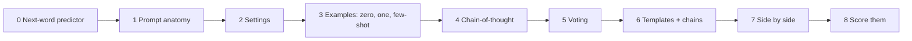
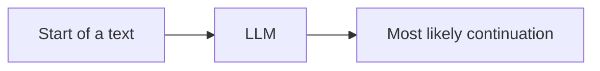
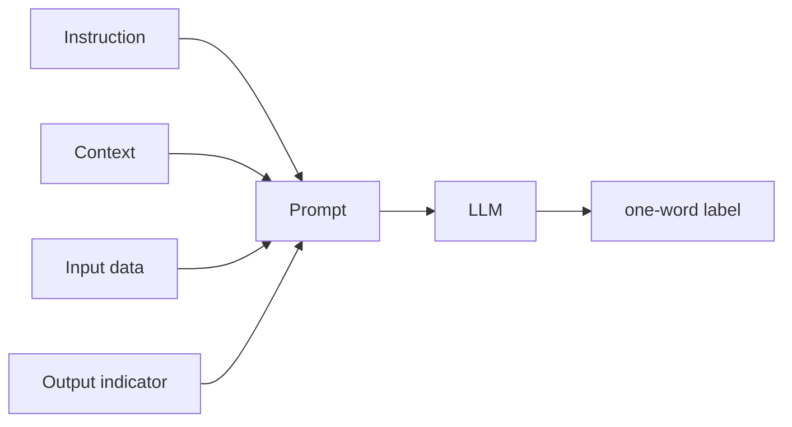
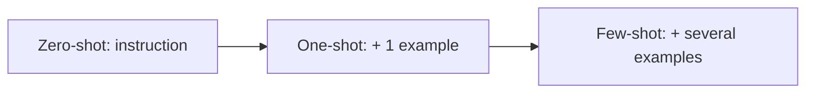
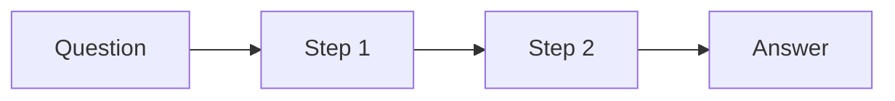
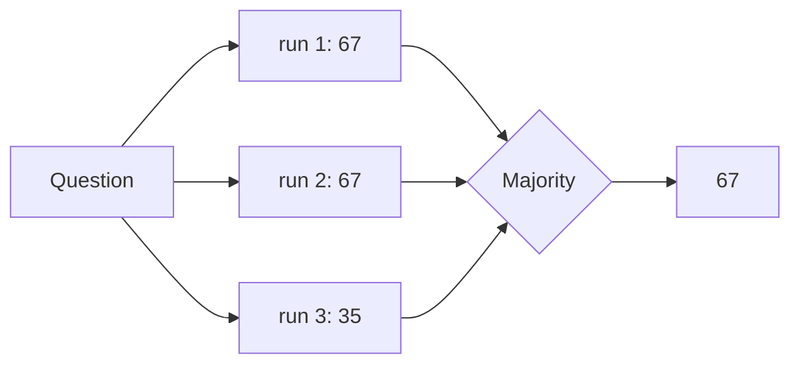
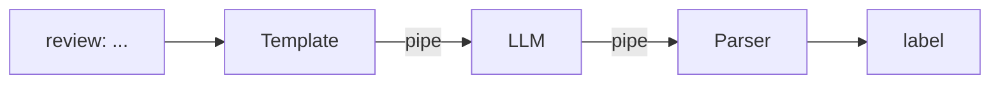
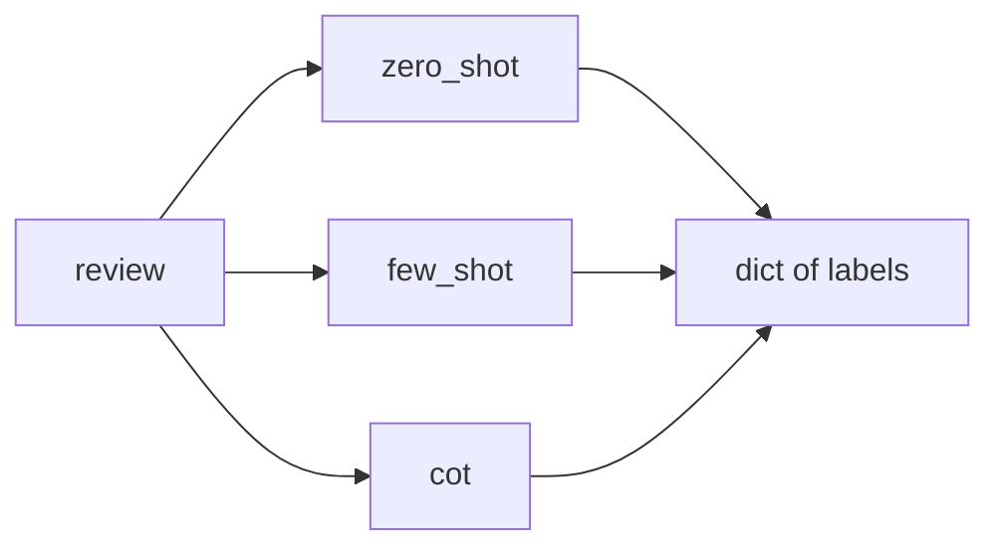
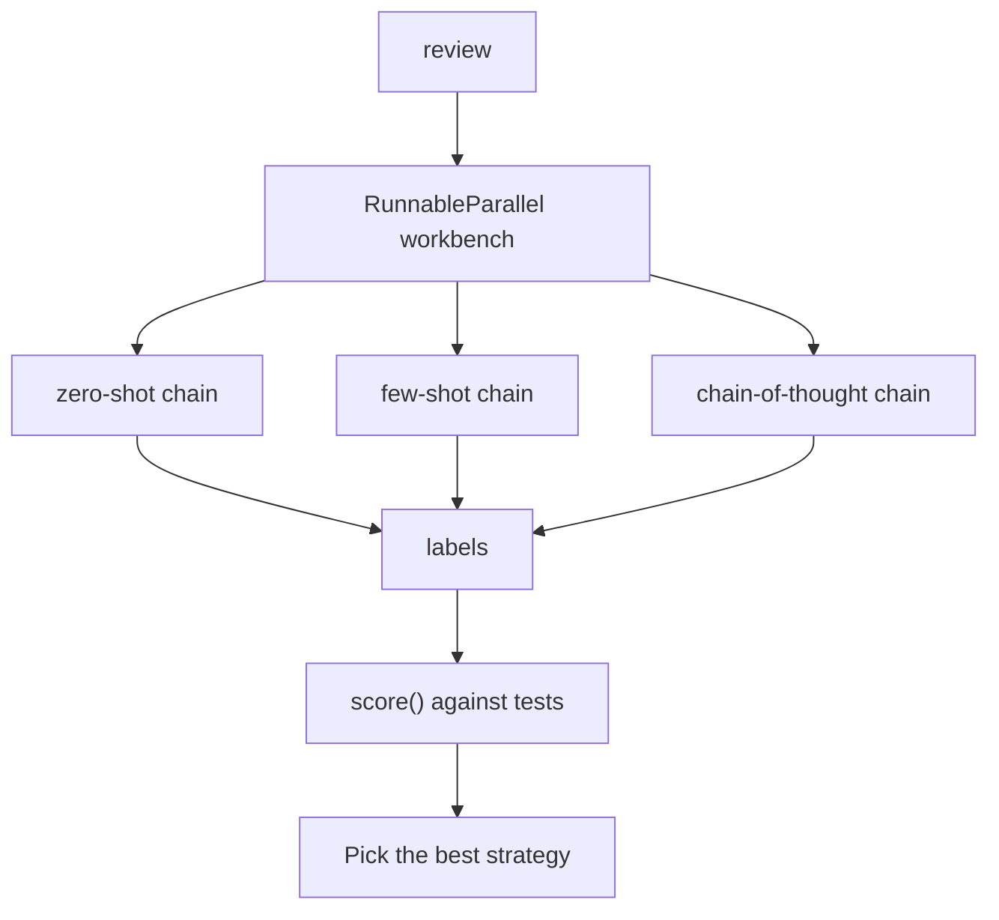
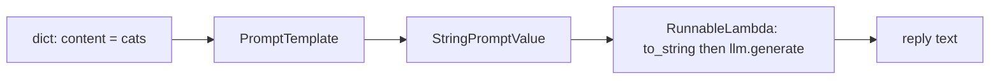

# Tutorial 2: Build a Prompt Workbench

**The idea.** Prompt engineering is easiest to understand as an experiment you run. So here you build a small **workbench** that tests different prompting techniques on the same task and tells you which works best. Each technique appears because the previous one just failed in a way you can see.

**What you will build.** A workbench that:

- classifies customer reviews using several strategies (plain, zero-shot, few-shot, chain-of-thought, voting),
- runs the strategies side by side on the same input,
- scores each strategy on a small test set, so you pick prompts with evidence instead of feeling.

For the same topics in the course's own order, see [Tutorial 1](01-genai-and-prompting-adapted.md).

## How to use this guide

1. New notebook in `module1/`, root `.venv` as the kernel.
2. Type every **Type this** block yourself.
3. Each step has: **The problem**, **The fix**, **Type this**, **What you should see**, **Why it works**, **Try it**.
4. LLM text varies. When I say what you "should see", expect the idea, not the exact words.
5. Real API calls cost a small amount (the whole guide is a few cents with `gpt-4o-mini`).

## The journey



---

## Step 0: What an LLM actually does

**The problem.** Before improving prompts, know what you are talking to.

**The fix.** See it work. An LLM is trained to predict the next words given the words so far. Everything else, including answering questions, grows out of that.

**Type this.** (Needs `OPENAI_API_KEY` in the repo-root `.env`.)

```python
from dotenv import load_dotenv
from langchain_openai import ChatOpenAI

load_dotenv()
llm = ChatOpenAI(model="gpt-4o-mini", temperature=0.5, max_tokens=256)

def ask(prompt, **settings):
    return llm.bind(**settings).invoke(prompt).content

print(ask("No use crying over spilled", temperature=0, max_tokens=5))
print(ask("The wind is ", max_tokens=60))
```

**What you should see.** "milk" (or close), then a short poetic sentence about wind.

**Why it works.** You did not ask a question. You gave a start and the model continued it. When you "ask" a question, it continues a text in which an answer follows. That is why **how you write the start matters so much**.

**Try it.** Run the wind prompt three times. Notice the answers differ. We will deal with that in Step 2.



---

## Step 1: Anatomy of a good prompt

**The problem.** A vague prompt gets a vague answer.

**Type this.**

```python
review = "The product arrived late but the quality exceeded my expectations."
print(ask(f"What about this? {review}", max_tokens=100))
```

**What you should see.** A chatty reply that guesses what you wanted ("It sounds like you had a mixed experience...").

**The fix.** Give the prompt four parts:

| Part | Job |
|---|---|
| **Instruction** | What to do |
| **Context** | The situation |
| **Input data** | The thing to process |
| **Output indicator** | Where the answer starts |

```python
prompt = f"""Classify the customer review as positive, negative or neutral.
Context: this is feedback on a recently launched product.

Review: {review}

Sentiment:"""
print(ask(prompt, temperature=0, max_tokens=10))
```

**What you should see.** One word, probably "Positive".

**Why it works.** The instruction removes guessing, the context sets the lens, the input is clearly separated, and the output indicator ("Sentiment:") makes a short label the natural continuation.

**Try it.** Remove only the output indicator. Does the answer get longer?

**Remember the rule: garbage in, garbage out.** The reading puts it this way: a text box is all you have to control a powerful tool, so a vague or poorly structured prompt limits what the model can give you.



---

## Step 2: Settings, and getting repeatable answers

**The problem.** Same prompt, different answers each run. For classification you want the same answer every time.

**The fix.** **Settings** control randomness and length.

**Type this.**

```python
for t in (0.0, 1.5):
    print(f"temperature={t}")
    for _ in range(3):
        print("  ", ask("Name a pet goldfish.", temperature=t, max_tokens=8))
```

**What you should see.** At `0.0` the three names are the same or nearly. At `1.5` they vary a lot.

| Setting | Effect |
|---|---|
| `temperature` | Low: focused and repeatable. High: varied and creative. |
| `top_p` | Only consider the most likely words that add up to this share of probability. |
| `max_tokens` | Hard limit on length. Too low cuts the answer off mid-sentence. |

**Why it works.** The model picks each next word from a ranked list. Low temperature nearly always takes the top word. High temperature samples more widely.

**Rule of thumb.** Classification and facts: `temperature` near 0. Brainstorming and stories: higher.

**Try it.** Set `max_tokens=3` on a long question to see an answer cut off.

> **Course note:** the lab also sets `top_k=1` and `min_new_tokens` on IBM Granite. OpenAI does not offer those two, so we skip them.

---

## Step 3: Examples teach the task and the format

**The problem.** The model "knows" sentiment, but its output format drifts. Try a trickier review.

**Type this.**

```python
tricky = "Fast shipping, but the box was crushed and the lamp inside is cracked."
print(ask(f"What is the sentiment of this review? {tricky}", temperature=0))
```

**What you should see.** A full sentence ("The sentiment is mixed..."), not a clean label.

**The fix.** Put **examples inside the prompt**. This is **in-context learning**: the model learns the task from the prompt, and no training happens.

| Name | Examples in the prompt |
|---|---|
| Zero-shot | 0 (just the instruction) |
| One-shot | 1 |
| Few-shot | several |

**Type this.** Zero-shot with a strict format, then few-shot:

```python
zero_shot = f"""Classify the review as positive, negative or neutral.
Reply with exactly one word.

Review: {tricky}
Sentiment:"""
print("zero-shot:", ask(zero_shot, temperature=0, max_tokens=5))
```

```python
few_shot = f"""Classify each review as positive, negative or neutral.

Review: I loved the food, will come again!
Sentiment: positive

Review: The service was awful and the soup was cold.
Sentiment: negative

Review: It was fine, nothing special.
Sentiment: neutral

Review: {tricky}
Sentiment:"""
print("few-shot:", ask(few_shot, temperature=0, max_tokens=5))
```

**What you should see.** Both give a one-word label. The few-shot version follows the format reliably, because every example ends with a single word.

**Why it works.** The examples show the pattern. The model's job is to continue the pattern. Few-shot examples teach the **format** as much as the **content**.

**Try it.** Keep only one example (one-shot). Then swap the labels in the examples to "good/bad/okay". The output labels follow your examples.



**Limit.** The examples must fit in the prompt, and very complex tasks may need real training.

---

## Step 4: Chain-of-thought for tasks that need reasoning

**The problem.** Labels are easy. Multi-step reasoning is not. Models often rush to an answer.

**Type this.**

```python
puzzle = ("A store had 22 apples. They sold 15 apples today and got a new delivery of 8 apples. "
          "How many apples are there now?")
print("direct:", ask(puzzle + " Answer with just the number.", temperature=0, max_tokens=10))
```

This one is easy, so a good model gets it right. Now a trap that people often get wrong:

```python
trap = ("A bat and a ball cost $1.10 in total. The bat costs $1.00 more than the ball. "
        "How much does the ball cost? Answer with just the number.")
print("direct:", ask(trap, temperature=0, max_tokens=10))
```

**The fix.** **Chain-of-thought (CoT)**: ask the model to write its reasoning steps first.

```python
cot = trap.replace("Answer with just the number.", "") + "\nWork through it step by step, then give the answer."
print(ask(cot, temperature=0.3, max_tokens=300))
```

**What you should see.** Numbered steps ending with the ball costing $0.05 ("0.10" is the classic wrong answer). A strong model may get the direct version right too, but steps make the answer easy to check, and CoT helps most on harder problems.

**Why it works.** The model writes one word at a time. If it must write the steps first, each step becomes input to the next, so it effectively "thinks" before it answers. It is "show your working" for models.

**Try it.** Run the direct version five times with `temperature=1`. Do the answers ever disagree? That sets up Step 5.



---

## Step 5: Voting for reliability (self-consistency)

**The problem.** Even with CoT, a single run can go wrong, and you cannot tell which runs.

**The fix.** **Self-consistency**: ask many times, then take the most common answer. If several independent reasoning paths agree, the answer is more trustworthy.

**Type this.**

```python
import re
from collections import Counter

def final_answer(text):
    match = re.search(r"final answer:\s*(.+)", text, re.IGNORECASE)
    return match.group(1).strip() if match else text.strip()

def vote(question, n=5):
    prompt = f"{question}\n\nThink step by step. End with a line in exactly this form:\nFinal answer: <answer>"
    answers = [final_answer(ask(prompt, temperature=0.8, max_tokens=300)) for _ in range(n)]
    return Counter(answers).most_common(1)[0][0], answers

winner, all_answers = vote("When I was 6, my sister was half my age. Now I am 70. How old is my sister?")
print(all_answers)
print("winner:", winner)
```

**What you should see.** A list of five answers, mostly "67", and the winner is the majority. (Check by hand: at 6 your sister was 3, so she is 3 years younger, and 70 - 3 = 67.)

**Why it works.** Wrong answers tend to scatter in different directions, while right answers tend to agree. The format line `Final answer: ...` lets code pull out a short answer to compare.

**Try it.** Run `vote` with `temperature=0`. All five runs match, so voting adds nothing. Self-consistency needs some variety. Also notice "67" and "67 years old" count as different votes, so real systems clean answers first.

> **In your repo:** `module1/application/use_cases.py` has a `SelfConsistency` class doing exactly this.



---

## Step 6: Templates and chains

**The problem.** You keep retyping the same prompts with different reviews.

**The fix.** A **prompt template** is a prompt with blanks. A **chain** connects template, model and output cleaner with the pipe `|`.

**Type this.**

```python
from langchain_core.prompts import PromptTemplate
from langchain_core.output_parsers import StrOutputParser

zero_shot_template = PromptTemplate.from_template(
    "Classify the review as positive, negative or neutral.\nReply with exactly one word.\n\n"
    "Review: {review}\nSentiment:"
)
zero_shot_chain = zero_shot_template | llm | StrOutputParser()

print(zero_shot_chain.invoke({"review": tricky}))
print(zero_shot_chain.invoke({"review": "Absolutely love it, five stars."}))
```

**What you should see.** "Negative" or "Neutral" for the first, "Positive" for the second.

**Why it works.** `a | b` means "run `a`, then pass its output to `b`". The template fills the blanks, the model answers, and the parser turns the reply into a plain string.

Make the few-shot version a chain too:

```python
few_shot_chain = PromptTemplate.from_template(
    "Classify each review as positive, negative or neutral.\n\n"
    "Review: I loved the food, will come again!\nSentiment: positive\n\n"
    "Review: The service was awful and the soup was cold.\nSentiment: negative\n\n"
    "Review: It was fine, nothing special.\nSentiment: neutral\n\n"
    "Review: {review}\nSentiment:"
) | llm | StrOutputParser()

print(few_shot_chain.invoke({"review": tricky}))
```

**Try it.** Add a `{language}` blank to the zero-shot template ("Reply in {language}") and pass it in the dict.



---

## Step 7: Run strategies side by side

**The problem.** Which strategy is best for *your* task? You are comparing by eye, one at a time.

**The fix.** A `RunnableParallel` runs several chains at once on the same input and returns one dict. LCEL turns a plain dict of chains into one automatically.

**Type this.** First, a chain-of-thought classifier that ends with a clean label:

```python
cot_chain = PromptTemplate.from_template(
    "Classify the review as positive, negative or neutral.\n"
    "Think briefly about the points in the review, then end with a line in exactly this form:\n"
    "Final answer: <label>\n\nReview: {review}"
) | llm | StrOutputParser() | final_answer
```

Note the last piece: a plain function in a chain becomes a `RunnableLambda`.

```python
from langchain_core.runnables import RunnableParallel

workbench = RunnableParallel(
    zero_shot=zero_shot_chain,
    few_shot=few_shot_chain,
    cot=cot_chain,
)

result = workbench.invoke({"review": tricky})
for name, label in result.items():
    print(f"{name:10} {label}")
```

**What you should see.** Three lines, one label per strategy. They may agree or disagree.

**Why it works.** Every chain takes the same input dict (`{"review": ...}`), so they can run in parallel. The output dict is keyed by the names you chose.

**Try it.** Add a fourth entry for the Step 5 voting approach. (Hint: `RunnableLambda(lambda x: vote(...)[0])`. You will need to build the question string from `x["review"]`.)



---

## Step 8: Measure, don't guess

**The problem.** One review proves nothing. You need evidence.

**The fix.** A tiny **test set** with known answers, and a score for each strategy.

**Type this.**

```python
tests = [
    ("Absolutely love it, works perfectly.", "positive"),
    ("Broke after two days. Total waste of money.", "negative"),
    ("It does the job. Nothing more, nothing less.", "neutral"),
    ("Fast shipping, but the lamp inside is cracked.", "negative"),
    ("Not bad at all, surprisingly good for the price!", "positive"),
    ("Arrived on time. Haven't tried it yet.", "neutral"),
]

def score(chain):
    hits = 0
    for review, expected in tests:
        label = chain.invoke({"review": review}).strip().lower().rstrip(".")
        hits += label == expected
    return hits / len(tests)

for name, chain in [("zero_shot", zero_shot_chain), ("few_shot", few_shot_chain), ("cot", cot_chain)]:
    print(f"{name:10} {score(chain):.0%}")
```

**What you should see.** A percentage per strategy. With such a small test set the differences are noisy, so treat them as hints.

**Why it works.** Prompt engineering is an experiment: change one thing, measure, keep what helps. Cleaning the label (`strip`, `lower`, `rstrip`) matters because "Positive." and "positive" are the same answer to a person but different strings to code.

**Try it.** Add three more tests of your own, especially mixed or sarcastic ones. Which strategy copes best? Then change one example in `few_shot_chain` and re-score.

---

## The whole workbench in one picture



## Common mistakes

| Symptom | Likely cause | Fix |
|---|---|---|
| Answer is a whole paragraph | No output indicator or format rule | Add "Reply with exactly one word" and `Sentiment:` |
| Same prompt gives different answers | `temperature` too high | Use 0 for classification |
| Answer cut off mid-sentence | `max_tokens` too small | Raise it |
| Few-shot ignored | Examples inconsistent in format | Make every example end the same way |
| `KeyError` when invoking a chain | Dict keys do not match `{blanks}` | Match the names exactly |
| Scores fail on "Positive." | Label not cleaned | `strip().lower().rstrip(".")` |
| Voting does nothing | `temperature=0` | Use around 0.7 to 1.0 |

## Practice (no answers here, ask me)

1. Add a one-shot chain and compare it with zero-shot and few-shot on your own tests.
2. Add a `role` blank: "You are a strict quality inspector..." Does it change the labels?
3. Add voting (Step 5) as a fourth strategy in the workbench.
4. Count how many characters each strategy's prompt uses. Is the best strategy also the most expensive?
5. Build a second workbench for **summarization**: compare "one sentence", "three bullets" and "for a 10-year-old" prompts. How would you score summaries?
6. Create a template for the lab's **role playing** application and test two tones.

## Appendix: how your module1 code works

Your repo's `RunTemplate` class takes an `llm: LLMPort` instead of creating `ChatOpenAI` inside itself, and runs `self.template | RunnableLambda(...)`. Here is a tiny, self-contained copy, so you can see each idea run. (The real code is in `module1/application/use_cases.py`.)

**Question 1: why pass the model in?** Then a fake model can replace the real one in tests, with no API key and no cost. This is called dependency injection: the class says what it *needs*, not which one it *uses*.

**Question 2: why does `FakeLLM` work without saying it implements `LLMPort`?** `LLMPort` is a `Protocol`. A protocol describes a *shape*: "has a method `generate(prompt)` that returns a string". Any class with that shape fits, with no `implements` word needed. This is called structural typing, or "duck typing": if it walks and quacks like a duck, it is a duck.

```python
from typing import Protocol

class LLMPort(Protocol):
    def generate(self, prompt: str) -> str: ...

class FakeLLM:
    def generate(self, prompt: str) -> str:
        return "fake reply"

class MisnamedLLM:
    def generate_text(self, prompt: str) -> str:   # wrong name: the shape no longer matches
        return "fake reply"
```

If you had named the method `generate_text`, the shape would not match `LLMPort`. A type checker would flag it, and at run time Python would fail with `AttributeError: ... has no attribute 'generate'` the moment `RunTemplate` calls it. So your instinct ("it will not work, the shapes will not match") was right.

**Question 3: what flows through the pipe?** Read `a | b` left to right: run `a`, hand its result to `b`.

```python
from langchain_core.prompts import PromptTemplate
from langchain_core.runnables import RunnableLambda

template = PromptTemplate.from_template("Summarize {content}.")
value = template.invoke({"content": "cats"})
print(type(value).__name__, "->", repr(value.to_string()))
```

On the left, `template` takes the dict `{"content": "cats"}` and returns a `StringPromptValue`: a wrapper holding the filled-in prompt. It is not a plain string. On the right, `generate` expects a plain `str`, so `.to_string()` unwraps it.

```python
def run(llm, content):
    chain = template | RunnableLambda(lambda prompt: llm.generate(prompt.to_string()))
    return chain.invoke({"content": content})

print(run(FakeLLM(), "cats"))
```

Try `run(MisnamedLLM(), "cats")` and read the error. Then remove `.to_string()` and pass the wrapper straight into a string function to see why it is needed.



## Cheat sheet

| Step | Idea | Remember |
|---|---|---|
| 0 | Next-word prediction | Your prompt is the start of a text |
| 1 | Prompt anatomy | Instruction, context, input data, output indicator |
| 2 | Settings | Low `temperature` for repeatable, `max_tokens` for length |
| 3 | Examples | Zero / one / few-shot; examples teach format |
| 4 | Chain-of-thought | Steps first, answer second |
| 5 | Self-consistency | Ask many times, take the majority |
| 6 | Template + chain | `template \| llm \| parser` |
| 7 | Parallel | A dict of chains runs side by side |
| 8 | Evaluate | Small test set and a score |
