# Module 2: LangChain Study Guide

A plain-language guide to LangChain: what it is, its building blocks, and how to combine them.

**How to use this guide:** read top to bottom once, then use the [Cheat Sheet](#10-cheat-sheet) and [Self-Quiz](#11-self-quiz) for revision.

## Contents

1. [What is LangChain?](#1-what-is-langchain)
2. [The big picture](#2-the-big-picture)
3. [Language Models vs Chat Models](#3-language-models-vs-chat-models)
4. [Chat Messages](#4-chat-messages)
5. [Prompt Templates](#5-prompt-templates)
6. [Output Parsers](#6-output-parsers)
7. [Chains and Memory](#7-chains-and-memory)
8. [LCEL: the modern way to chain](#8-lcel-the-modern-way-to-chain)
9. [Agents](#9-agents)
10. [Cheat Sheet](#10-cheat-sheet)
11. [Self-Quiz](#11-self-quiz)

---

## Hands-on tutorials

Type-along versions with code, diagrams and exercises:

- [Tutorial 1: the Coursera lab, adapted](tutorials/01-langchain-lab-adapted.md) follows the lab's order, modernised for OpenAI and LangChain 1.x.
- [Tutorial 2: build a study buddy](tutorials/02-build-a-study-buddy.md) grows one app step by step, so each concept appears when you need it.

---

## Run the examples yourself

The snippets use **OpenAI** through `langchain-openai`, which is already installed in the repo's shared environment (see the [root README](../README.md)). Put `OPENAI_API_KEY=...` in the root `.env`, pick the root `.venv` as your notebook kernel, then run this **once** at the top of a notebook. Every later snippet reuses `llm`.

```python
from dotenv import load_dotenv
from langchain_openai import ChatOpenAI

load_dotenv()
llm = ChatOpenAI(model="gpt-4o-mini", temperature=0.5, max_tokens=256)

llm.invoke("Say hello in five words.").content
```

Each call costs a small amount of API credit. The course uses IBM watsonx.ai instead. The ideas are identical and only the model line changes.

---

## 1. What is LangChain?

**LangChain is an open-source toolkit that makes it easier to build apps on top of LLMs.**

Calling an LLM is easy. Building a real app is harder. You need to format prompts, remember the conversation, clean up the output, search documents and call tools. LangChain gives you ready-made, snap-together pieces for each of these jobs.

> **Analogy:** LangChain is a box of LEGO bricks for LLM apps. You don't mould each brick yourself. You pick bricks and connect them.

### Why use it?

| Benefit | In plain words | Example |
|---|---|---|
| **Modularity** | Small parts you can swap and reuse | Swap OpenAI for IBM watsonx without rewriting your app |
| **Step-by-step reasoning** | Break a big task into small steps | "Find dish" → "Get recipe" → "Estimate time" |
| **Vector database support** | Search by *meaning*, not just keywords | Find the doc about "refunds" even if the user typed "money back" |
| **Extensibility** | Add new tools and integrations | Plug in your own database or API |

### What do people build with it?

| Use case | Example |
|---|---|
| **Summarization** | Shrink a 30-page report into 5 bullet points |
| **Data extraction** | Pull "revenue = $4.2M" out of a messy PDF |
| **Question answering** | A support bot that answers from your company docs |
| **Content generation** | Draft emails or technical docs |

---

## 2. The big picture

These are the core components. The rest of this guide covers them one by one.

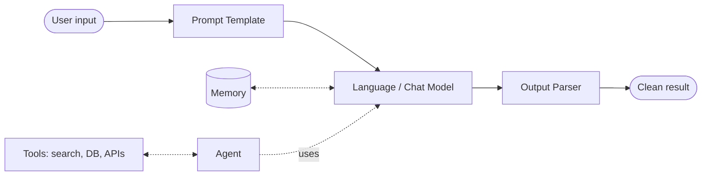

Reading the diagram:

- **Solid line (main pipeline):** input is formatted by a **prompt template**, answered by a **model**, then tidied by an **output parser**.
- **Dotted lines:** optional extras. **Memory** lets the model recall earlier turns. An **agent** lets the model decide when to use **tools**.

| Component | One-line job |
|---|---|
| Language Model | Text in, text out |
| Chat Model | Conversation in, reply out |
| Chat Message | One turn in a conversation (has a role and content) |
| Prompt Template | Fill-in-the-blank prompt |
| Output Parser | Turns the raw reply into a usable format (list, JSON, ...) |
| Chain | A fixed sequence of steps |
| Memory | Stores past messages |
| Agent | The LLM decides which steps and tools to use |
| Documents | Chunks of text your app can load and search |

---

## 3. Language Models vs Chat Models

|  | **Language Model (LLM)** | **Chat Model** |
|---|---|---|
| Input | A single string | A list of messages |
| Output | A string | A message |
| Best for | Completing or summarizing text | Back-and-forth conversation |
| Feels like | Autocomplete | Talking to a person |

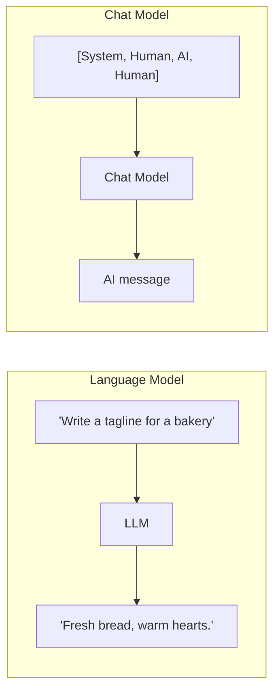

**Providers.** LangChain works with IBM, OpenAI, Google, Meta and others. The course uses **IBM watsonx.ai** with the **Mixtral 8x7B Instruct** model.

**Settings you can tune** (the course highlights two):

- `max_new_tokens`: the maximum length of the reply.
- `temperature`: creativity. Low (about 0) is focused and predictable. High (about 1) is more varied and creative.

```python
reply = llm.invoke("Suggest a new sales approach for a coffee shop.")
print(reply.content)      # the text
print(type(reply))        # AIMessage: a chat model returns a message, not a bare string
```

Try the same question with different `temperature` values to feel the difference:

```python
for t in (0.0, 1.0):
    creative = llm.bind(temperature=t)
    print(t, "->", creative.invoke("Give me a name for a pet goldfish.").content)
```

**Course version (IBM watsonx.ai)** for comparison. Only the model line changes, so everything below works with it too:

```python
# needs: langchain-ibm, WATSONX_PROJECT_ID and WATSONX_API_KEY
from langchain_ibm import ChatWatsonx

llm = ChatWatsonx(
    model_id="mistralai/mixtral-8x7b-instruct-v01",
    url="https://us-south.ml.cloud.ibm.com",
    project_id="YOUR_PROJECT_ID",
    params={"max_tokens": 256, "temperature": 0.5},
)
```

> **Remember:** the *model* is the brain. Everything else in LangChain helps feed it good input and handle its output.

---

## 4. Chat Messages

A chat model reads a **list of messages**. Every message has two fields:

- **`role`**: who is speaking
- **`content`**: what they said

### The 5 message types

| Type | Who/what | Purpose | Example |
|---|---|---|---|
| **SystemMessage** | You (developer) | Sets the model's behaviour and personality | "You are a fitness coach. Reply in one sentence." |
| **HumanMessage** | The user | The user's question | "What should I eat before a run?" |
| **AIMessage** | The model | The model's earlier replies | "A banana and some water." |
| **FunctionMessage** | A function | Result of a function call (has a `name`) | `{"name": "get_weather", ...}` |
| **ToolMessage** | A tool | Result of a tool call | Search results |

### Example: a fitness bot

```python
from langchain_core.messages import SystemMessage, HumanMessage, AIMessage

messages = [
    SystemMessage(content="You are a fitness activity bot. Be brief."),
    HumanMessage(content="I want to get stronger."),
    AIMessage(content="Try squats, push-ups and rows 3x a week."),
    HumanMessage(content="How many sets of each?"),   # the model answers THIS
]
reply = llm.invoke(messages)
print(reply.content)
```

Because the earlier turns are in the list, the model knows "each" means squats, push-ups and rows.

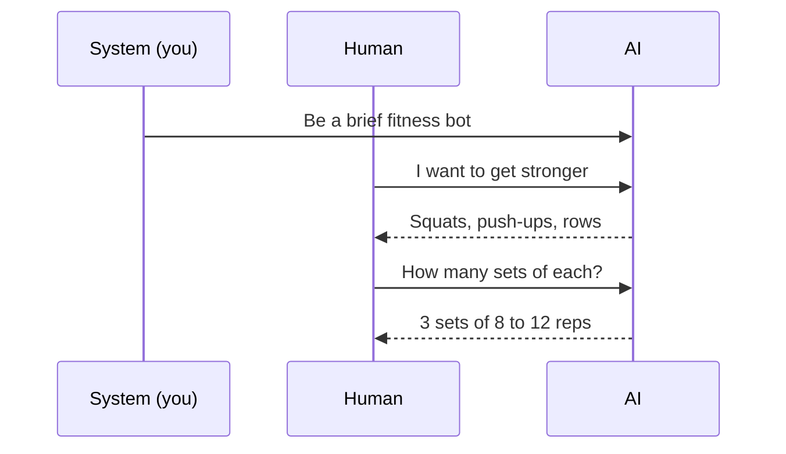

**Tip:** `SystemMessage` and `AIMessage` are optional. You can send just a `HumanMessage` and the model replies directly.

---

## 5. Prompt Templates

A **prompt template** is a prompt with **blanks** that you fill in later. This lets you reuse one prompt for many inputs.

> **Analogy:** a mail-merge letter. "Dear `{name}`, your order `{item}` has shipped."

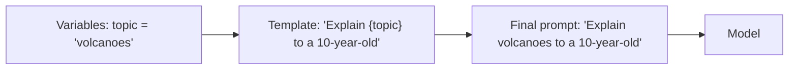

### Types of prompt templates

| Type | Use it when... |
|---|---|
| **String prompt template** | You need one formatted string |
| **Chat prompt template** | You need a list of messages with roles |
| **Message prompt templates** (System / Human / AI / Chat) | You want a template for one specific message. "Chat" lets you choose the role yourself |
| **MessagesPlaceholder** | You want full control over where a list of messages gets inserted (e.g. chat history) |
| **Few-shot prompt template** | You want to show the model examples ("shots") first |

### Example: string template

```python
from langchain_core.prompts import PromptTemplate

prompt = PromptTemplate.from_template("Tell me a fun fact about {animal}.")
prompt.format(animal="octopus")
# -> "Tell me a fun fact about octopus."
```

### Example: chat template

```python
from langchain_core.prompts import ChatPromptTemplate

prompt = ChatPromptTemplate.from_messages([
    ("system", "You are a {style} assistant."),
    ("human", "{question}"),
])
messages = prompt.invoke({"style": "pirate", "question": "What is the capital of France?"})
print(llm.invoke(messages).content)
```

### Few-shot prompts and example selectors

**Few-shot** means giving the model a few worked examples so it copies the pattern.

```text
Word: happy  -> Opposite: sad
Word: hot    -> Opposite: cold
Word: tall   -> Opposite: ???        <- the model completes this
```

As code:

```python
from langchain_core.prompts import FewShotPromptTemplate, PromptTemplate

examples = [
    {"word": "happy", "opposite": "sad"},
    {"word": "hot", "opposite": "cold"},
]
example_prompt = PromptTemplate.from_template("Word: {word} -> Opposite: {opposite}")

few_shot = FewShotPromptTemplate(
    examples=examples,
    example_prompt=example_prompt,
    suffix="Word: {word} -> Opposite:",
    input_variables=["word"],
)
print(few_shot.format(word="tall"))
print(llm.invoke(few_shot.format(word="tall")).content)
```

If you have **hundreds** of examples, you can't paste them all in. An **example selector** picks only the most useful ones for each question.

| Selector | Picks examples that are... | Good for |
|---|---|---|
| **Semantic similarity** | Closest in *meaning* to the input | The most relevant examples |
| **Max marginal relevance (MMR)** | Relevant *and* different from each other | Variety |
| **Length-based** | Short enough to fit the space available | Staying under length limits (the transcript calls this "efficient prompts") |
| **N-gram overlap** | Sharing the most words/phrases with the input | Simple text matching |

A selector that needs no extra packages is the length-based one:

```python
from langchain_core.example_selectors import LengthBasedExampleSelector

selector = LengthBasedExampleSelector(
    examples=examples * 5,          # pretend we have 10 examples
    example_prompt=example_prompt,
    max_length=25,                  # budget, counted in words
)
few_shot = FewShotPromptTemplate(
    example_selector=selector,
    example_prompt=example_prompt,
    suffix="Word: {word} -> Opposite:",
    input_variables=["word"],
)
print(few_shot.format(word="tall"))   # only as many examples as fit the budget
```

The semantic-similarity and MMR selectors need an embeddings model and a vector store, so they come later in the course.

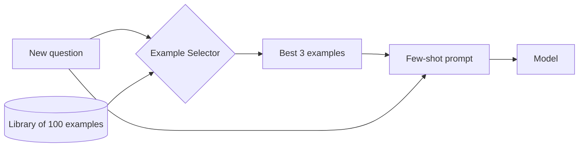

---

## 6. Output Parsers

LLMs return **plain text**. Your code often needs **structured data** (a list, JSON, a table). An **output parser** does that conversion.

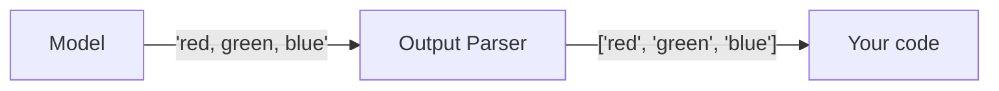

Formats available include **JSON, XML, CSV and Pandas DataFrames**.

### Example: comma-separated list

```python
from langchain_core.output_parsers import CommaSeparatedListOutputParser

parser = CommaSeparatedListOutputParser()
parser.parse("apple, banana, cherry")
# -> ['apple', 'banana', 'cherry']
```

Now you can loop over the list or drop it into a spreadsheet.

Use it in a real chain, where the parser also tells the model what format to produce:

```python
from langchain_core.prompts import PromptTemplate

prompt = PromptTemplate.from_template(
    "List 4 {thing}.\n{format_instructions}",
).partial(format_instructions=parser.get_format_instructions())

chain = prompt | llm | parser
chain.invoke({"thing": "primary colours of paint pigments"})
# -> ['red', 'yellow', 'blue', ...]  (a real Python list)
```

And a JSON parser for structured data:

```python
from langchain_core.output_parsers import JsonOutputParser

json_parser = JsonOutputParser()
prompt = PromptTemplate.from_template(
    "Give the name and capital of {country}.\n{format_instructions}",
).partial(format_instructions=json_parser.get_format_instructions())

(prompt | llm | json_parser).invoke({"country": "Japan"})
# -> {'name': 'Japan', 'capital': 'Tokyo'}
```

---

## 7. Chains and Memory

### 7.1 Chains

A **chain** is a **sequence of steps**. In a *sequential chain*, the **output of one step becomes the input of the next**.

> **Analogy:** an assembly line. Each station does one job and passes the result along.

### Worked example: "Dish → Recipe → Cooking time"

The course builds three small chains and links them:

| Chain | Input | Output (stored under key) | Example |
|---|---|---|---|
| 1. `location_chain` | `location` | `meal` | China → *Peking Duck* |
| 2. `dish_chain` | `meal` | `recipe` | Peking Duck → *step-by-step recipe* |
| 3. `recipe_chain` | `recipe` | `time` | recipe → *about 3 hours* |

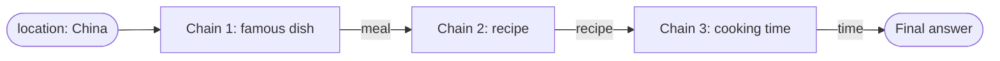

**How each chain is built (the same every time):**

1. Write a **template string** for the prompt.
2. Wrap it in a **PromptTemplate** and name its input variable.
3. Connect `prompt | llm | parser`.

Then link the three chains so each result is added to a growing dict (`meal` → `recipe` → `time`):

```python
from langchain_core.prompts import PromptTemplate
from langchain_core.output_parsers import StrOutputParser
from langchain_core.runnables import RunnablePassthrough

parser = StrOutputParser()

location_chain = (
    PromptTemplate.from_template("Name one famous dish from {location}. Reply with only the dish name.")
    | llm | parser
)
dish_chain = (
    PromptTemplate.from_template("Give a simple recipe for {meal}.")
    | llm | parser
)
time_chain = (
    PromptTemplate.from_template("Estimate the total cooking time for this recipe:\n{recipe}")
    | llm | parser
)

overall = (
    {"meal": location_chain}                     # step 1 -> {"meal": ...}
    | RunnablePassthrough.assign(recipe=dish_chain)   # step 2 adds "recipe"
    | RunnablePassthrough.assign(time=time_chain)     # step 3 adds "time"
)

result = overall.invoke({"location": "China"})
print(result["meal"])
print(result["time"])
```

`RunnablePassthrough.assign(...)` means: keep everything so far and add one new key. That reproduces the course's `output_key` behaviour.

> **About the course code.** The course uses the older `LLMChain` and `SequentialChain` classes with `output_key="meal"` and `verbose=True`. They were removed from the core package in LangChain 1.x, so the snippet above is the modern equivalent. To watch each step, call `from langchain_core.globals import set_debug; set_debug(True)` before invoking.

The core idea, as a one-liner: `chain = prompt | llm | StrOutputParser()`. Read it as prompt → model → parser. The `|` is the arrow, covered in [section 8](#8-lcel-the-modern-way-to-chain).

### 7.2 Memory

LLMs are **stateless**. They forget everything between calls. **Memory** fixes this by storing past messages and re-feeding them.

Each run of a chain does two things with memory:

1. **Read:** load past messages to enrich the new input.
2. **Write:** save the new input and output afterwards.

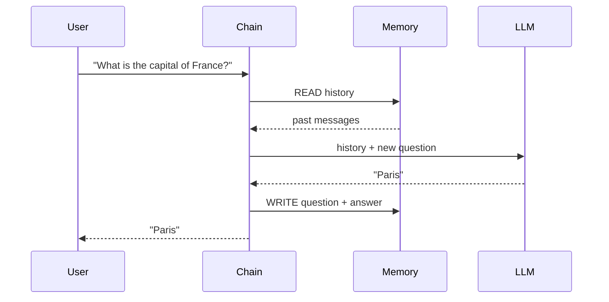

Memory is just a **list of messages** that you keep and pass back in each time. The course uses a `ChatMessageHistory` class for this. That class is being deprecated in LangChain 1.x, and a plain list does the same job:

**Step 1: the history is a list**

```python
from langchain_core.messages import AIMessage, HumanMessage

history = [
    AIMessage("Hi!"),
    HumanMessage("What is the capital of France?"),
]
```

**Step 2: a chat that actually remembers**

```python
from langchain_core.prompts import ChatPromptTemplate, MessagesPlaceholder

prompt = ChatPromptTemplate.from_messages([
    ("system", "You are a helpful assistant. Be brief."),
    MessagesPlaceholder("history"),          # past messages go here
    ("human", "{question}"),
])
chat = prompt | llm
history = []

def ask(question):
    reply = chat.invoke({"history": history, "question": question})   # READ
    history.append(HumanMessage(question))                            # WRITE
    history.append(AIMessage(reply.content))
    return reply.content

print(ask("What is the capital of France?"))   # Paris
print(ask("What is its population?"))          # works: the model sees the history
```

For storing history per user or session in a real app, look at `RunnableWithMessageHistory` or LangGraph checkpointers.

Without memory, a follow-up like "What's its population?" fails because the model doesn't know what "its" refers to.

---

## 8. LCEL: the modern way to chain

**LCEL (LangChain Expression Language)** is the recommended way to build chains today. You connect components with the **pipe operator `|`**, like pipes in a terminal. The data flows left to right.

```python
from langchain_core.prompts import PromptTemplate
from langchain_core.output_parsers import StrOutputParser

prompt = PromptTemplate.from_template("Explain {topic} to a 10-year-old in two sentences.")
chain = prompt | llm | StrOutputParser()
chain.invoke({"topic": "volcanoes"})
```

Why it's preferred over the older `LLMChain`:

- Easier to read: the data flow is visible in one line.
- Easier to combine: any part can be swapped or reused.
- Free extras: parallel execution, async support, simple streaming and automatic tracing.

### Four steps to build an LCEL chain

1. Write a **template** with variables in curly braces.
2. Create a **prompt template** from it.
3. Connect the pieces with `|`.
4. **Invoke** the chain with input values.

```python
from langchain_core.prompts import PromptTemplate
from langchain_core.output_parsers import StrOutputParser

prompt = PromptTemplate.from_template("Tell me a {adjective} joke about {content}.")
chain = prompt | llm | StrOutputParser()
print(chain.invoke({"adjective": "funny", "content": "cats"}))
```

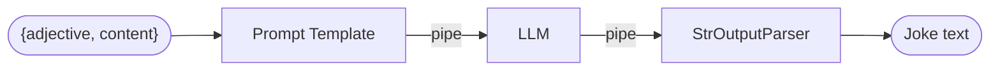

### Runnables: the building blocks

A **runnable** is any component with a common interface (`invoke`, `stream`, ...). Prompts, models, parsers, retrievers and tools are all runnables, which is why they snap together.

There are two composition primitives:

| Primitive | What it does | Shortcut |
|---|---|---|
| **RunnableSequence** | Runs steps one after another. Output of one is input of the next | `a \| b` |
| **RunnableParallel** | Runs steps at the same time. Each gets the **same input** | A plain `{...}` dict |

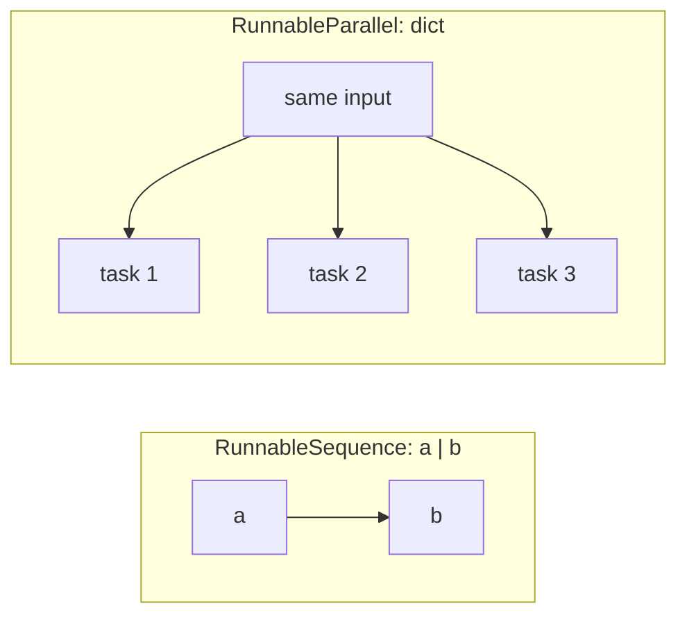

### Automatic type coercion

LCEL converts ordinary Python into runnables for you:

| You write | LCEL turns it into | Behaviour |
|---|---|---|
| a **dictionary** | `RunnableParallel` | Runs all entries concurrently |
| a **function** | `RunnableLambda` | Transforms the input |

### Example: three tasks at once

```python
from langchain_core.runnables import RunnableParallel

summary_prompt = PromptTemplate.from_template("Summarize in one sentence: {text}")
translation_prompt = PromptTemplate.from_template("Translate to French: {text}")
sentiment_prompt = PromptTemplate.from_template(
    "Is the sentiment of this text positive, negative or neutral? One word only: {text}"
)

chain = RunnableParallel(
    summary=summary_prompt | llm | StrOutputParser(),
    translation=translation_prompt | llm | StrOutputParser(),
    sentiment=sentiment_prompt | llm | StrOutputParser(),
)
# A plain dict gets coerced to RunnableParallel when piped, e.g. {...} | next_step
chain.invoke({"text": "I love this product!"})
# -> {"summary": "...", "translation": "...", "sentiment": "positive"}
```

All three prompts receive the same `text`. The result is one dict with three keys.

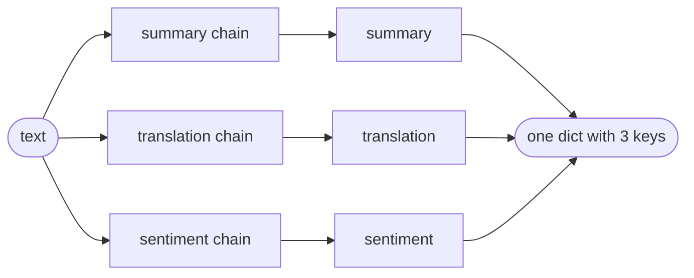

### Example: wrapping a function with RunnableLambda

```python
from langchain_core.runnables import RunnableLambda

template = "Tell me a {adjective} joke about {content}."

def format_prompt(inputs):
    return template.format(adjective=inputs["adjective"], content=inputs["content"])

joke_chain = RunnableLambda(format_prompt) | llm | StrOutputParser()
print(joke_chain.invoke({"adjective": "silly", "content": "robots"}))
```

Two more things LCEL gives you for free:

```python
# Streaming: tokens appear as they are generated
for chunk in joke_chain.stream({"adjective": "silly", "content": "robots"}):
    print(chunk, end="", flush=True)

# Batch: run many inputs, in parallel
joke_chain.batch([
    {"adjective": "silly", "content": "robots"},
    {"adjective": "dry", "content": "accountants"},
])
```

Flow: the input dict goes to `format_prompt`, which builds the text. The `|` hands that text to the LLM. Another `|` hands the reply to the parser.

### Limits

LCEL is best for **simple orchestration** (straight lines and fan-out). For complex workflows with branching, loops or many steps, use **LangGraph**, and keep using LCEL inside each node.

---

## 9. Agents

A chain follows a **fixed** path that you design. An **agent** lets the **LLM decide** what to do next.

|  | **Chain** | **Agent** |
|---|---|---|
| Steps | Fixed in advance | Chosen by the LLM at run time |
| Flexibility | Low | High |
| Predictability | High | Lower |
| Analogy | Following a recipe | A chef who decides what to cook from what's in the fridge |

**Important:** the LLM **only produces text** that says what to do. The agent framework **runs the tools**. The model never executes anything directly.

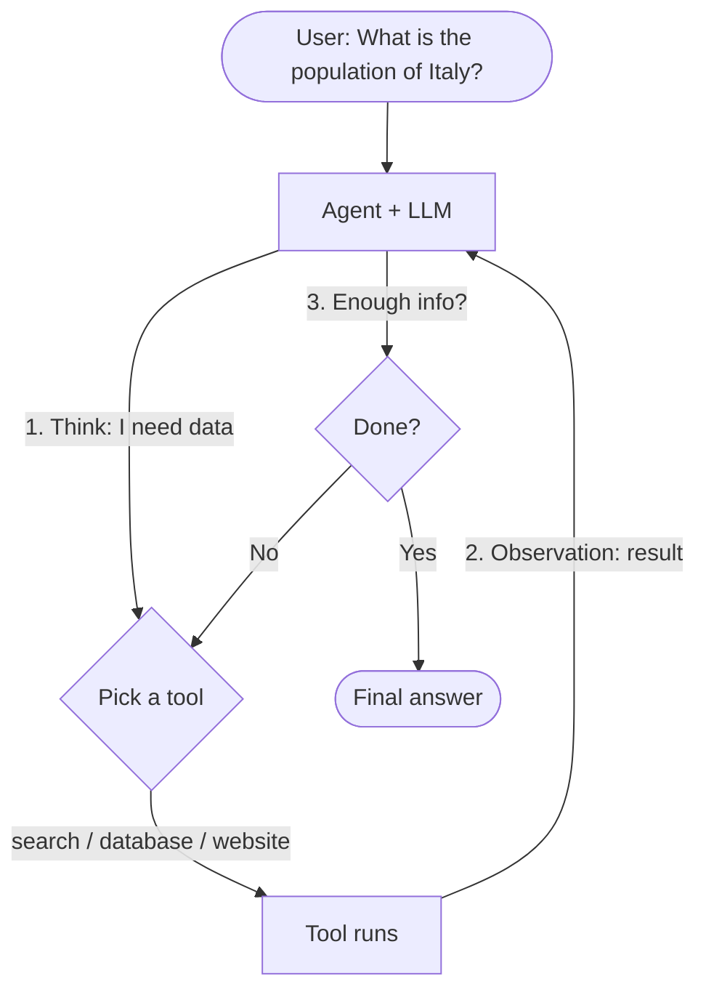

### Example: a tiny agent loop with one tool

This uses only packages you already have. The model *asks* for a tool, your code *runs* it, and the result goes back to the model.

```python
from langchain_core.tools import tool
from langchain_core.messages import HumanMessage, ToolMessage

@tool
def get_population(country: str) -> str:
    """Return the population of a country."""
    data = {"italy": "about 59 million", "france": "about 68 million"}
    return data.get(country.lower(), "unknown")

tools = {"get_population": get_population}
llm_with_tools = llm.bind_tools(list(tools.values()))

messages = [HumanMessage("What is the population of Italy?")]
while True:
    ai = llm_with_tools.invoke(messages)
    messages.append(ai)
    if not ai.tool_calls:                      # no tool needed: we have the final answer
        break
    for call in ai.tool_calls:                 # the model only ASKS; we RUN the tool
        result = tools[call["name"]].invoke(call["args"])
        messages.append(ToolMessage(content=result, tool_call_id=call["id"]))

print(ai.content)
```

Trace what happens: the model replies with a tool call for `get_population("Italy")` → your code runs it → the `ToolMessage` goes back → the model writes the final answer. That is the think → act → observe loop from the diagram.

### Example: Pandas DataFrame agent (from the course)

Ask questions about a table in plain English. This needs one extra package: `uv add langchain-experimental` (run at the repo root).

```python
# needs: langchain-experimental
import pandas as pd
from langchain_experimental.agents import create_pandas_dataframe_agent

df = pd.DataFrame({"city": ["Rome", "Milan", "Turin"], "pop_m": [2.8, 1.4, 0.9]})

agent = create_pandas_dataframe_agent(llm, df, verbose=True, allow_dangerous_code=True)
agent.invoke("How many rows are in the dataframe?")
```

What happens behind the scenes:

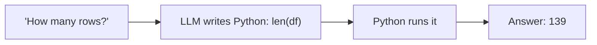

`verbose=True` lets you see the LLM's reasoning. The course's dataset returned **139 rows**. With the small table above you should get 3.

> **Safety note:** this agent *executes code the LLM writes*. Only use it on data and in environments you trust. Recent versions require `allow_dangerous_code=True` to make you acknowledge that.

---

## 10. Cheat Sheet

| Concept | Remember it as | Key point |
|---|---|---|
| LangChain | LEGO for LLM apps | Open-source, modular |
| Language model | Autocomplete | String in, string out |
| Chat model | A conversation partner | List of messages in |
| Message | `role` + `content` | System, Human, AI, Function, Tool |
| Prompt template | Mail-merge | Blanks like `{topic}` |
| Few-shot | "Learn from examples" | Selectors pick the best examples |
| Output parser | Text → structure | JSON, CSV, list, DataFrame |
| Chain | Assembly line | Output of step N → input of step N+1 |
| LCEL | Pipes connecting runnables | `a \| b` runs a then b; a dict runs in parallel |
| Memory | Notebook | Read before, write after each run |
| Agent | A chef who decides | LLM picks tools; framework runs them |

**The core pipeline in one line:**

```text
Prompt Template  →  Model  →  Output Parser      (this is a chain)
```

**When to use which:**

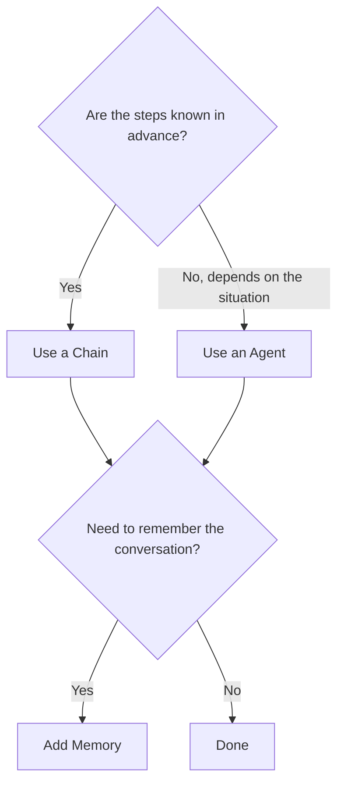

---

## 11. Self-Quiz

Try answering **before** you open the answers.

1. What is the difference between a language model and a chat model?
2. What two properties does every chat message have?
3. Which message type sets the model's behaviour?
4. Why use a prompt template instead of a plain string?
5. When do you need an example selector?
6. What does an output parser do?
7. In a sequential chain, how does data move between steps?
8. Why do LLM apps need memory?
9. What is the key difference between a chain and an agent?
10. Does the LLM itself run a tool in an agent?
11. What does the `|` operator do in LCEL?
12. What happens when you put a dictionary in an LCEL chain?
13. When should you reach for LangGraph instead of plain LCEL?

<details>
<summary>Show answers</summary>

1. A language model takes a string and returns a string. A chat model takes a list of messages and returns a message.
2. `role` (who is speaking) and `content` (what is said).
3. `SystemMessage`.
4. It makes the prompt reusable. You fill in variables instead of rewriting the text.
5. When you have many few-shot examples and want only the most relevant ones in the prompt.
6. It converts the model's raw text into a structured format such as a list, JSON, CSV or a DataFrame.
7. The output of one step becomes the input of the next, passed via named keys (`meal`, `recipe`, `time`).
8. LLMs are stateless, so memory stores and re-supplies past messages to keep context.
9. A chain's steps are fixed in advance. An agent's steps are chosen by the LLM at run time.
10. No. The LLM only outputs text that says what to do. The agent framework runs the tool.
11. It connects two runnables in sequence: the output of the left one becomes the input of the right one.
12. It becomes a `RunnableParallel`: every entry runs at the same time on the same input, and the result is a dict with one key per entry.
13. For complex workflows (branches, loops, many steps). LCEL suits simpler orchestration, and you can still use it inside each LangGraph node.

</details>

---

### Notes on this guide

- Code snippets are **simplified** to teach the idea. Import paths and class names change between LangChain versions, so check the [LangChain docs](https://python.langchain.com) for your installed version.
- The course demos use **IBM watsonx.ai + Mixtral 8x7B Instruct**. The concepts apply to any provider.
- `LLMChain` and `SequentialChain` are the older style shown in the course. The `|` (LCEL) style is the modern equivalent.
