# Tutorial 1: The Coursera LangChain Lab, Adapted

**What this is.** A type-along version of the lab *Build Smarter AI Apps: Empower LLMs with LangChain*. It follows the lab's order and covers the same concepts, so you can use it next to the original notebook.

**What is different from the lab.** The lab runs on IBM watsonx.ai with LangChain 0.2. This guide uses OpenAI and current LangChain (1.x), because several lab classes were removed. Wherever the lab and this guide differ, you will see a note like this:

> **Lab says / today we use:** ...

For simpler explanations and a project that builds up step by step, see [Tutorial 2](02-build-a-study-buddy.md).

## How to use this guide

1. Open a new notebook in `module2/` and pick the root `.venv` as the kernel.
2. Type each **Type this** block yourself. Do not paste. Typing is where the learning happens.
3. Compare your result with **Expected output**. LLM text varies, so expect similar, not identical.
4. Do **Try it** and **Check yourself** before moving on.

Real API calls cost a small amount of credit (the whole guide is a few cents with `gpt-4o-mini`).

## Contents

1. [Setup](#setup)
2. [Model and chat model](#part-1-model-and-chat-model)
3. [Chat messages](#part-2-chat-messages)
4. [Prompt templates](#part-3-prompt-templates)
5. [Output parsers](#part-4-output-parsers)
6. [Documents, loaders and text splitters](#part-5-documents-loaders-and-text-splitters)
7. [Embeddings and vector stores](#part-6-embeddings-and-vector-stores)
8. [Retrievers and question answering](#part-7-retrievers-and-question-answering)
9. [Memory](#part-8-memory)
10. [Chains](#part-9-chains)
11. [Tools and agents](#part-10-tools-and-agents)
12. [Practice exercises](#practice-exercises)

---

## Setup

You need `OPENAI_API_KEY` in the repo-root `.env`. Packages are already installed (see the [root README](../../README.md)).

**Type this** (once, in the first cell):

```python
from dotenv import load_dotenv
from langchain_openai import ChatOpenAI

load_dotenv()
llm = ChatOpenAI(model="gpt-4o-mini", temperature=0.2, max_tokens=256)
```

> **Lab says / today we use:** the lab builds a watsonx `ModelInference` object with `model_id`, `GenParams.MAX_NEW_TOKENS` and `GenParams.TEMPERATURE`, plus `project_id="skills-network"`. Those are the same two settings as `max_tokens` and `temperature` above. The lab also needs a long `pip install` cell with pinned old versions. You can skip it.

---

## Part 1: Model and chat model

### The idea

A **model** takes text in and gives text out. It is the engine of everything else. A **chat model** is the same engine, but it accepts a *list of messages* (who said what) and answers with a *message*.

In the lab you first call the raw watsonx model, then wrap it with `WatsonxLLM` to make it fit LangChain. With OpenAI, `ChatOpenAI` is already a LangChain chat model, so there is no wrapping step.

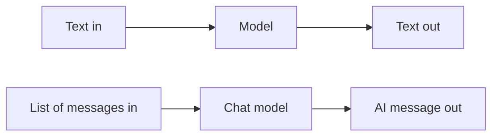

### Type this

```python
reply = llm.invoke("In today's sales meeting, we ")
print(reply.content)
```

```python
print(llm.invoke("Who is man's best friend?").content)
```

### Expected output

A continuation of the sentence, then an answer like "A dog is often called man's best friend." (the exact wording will differ).

### Try it

Print `type(reply)`. It is an `AIMessage`, not a plain string. The text lives in `.content`.

### Check yourself

What is the difference between `llm.invoke(...)` and `llm.invoke(...).content`?

<details><summary>Answer</summary>The first is the whole message object (text plus extra details). The second is only the text.</details>

---

## Part 2: Chat messages

### The idea

Every message has a **role** (who is speaking) and **content** (what they said). The roles the lab lists:

| Class | Role | Use it to |
|---|---|---|
| `SystemMessage` | system | Set the bot's behaviour. Usually first. |
| `HumanMessage` | user | Carry the user's input. |
| `AIMessage` | assistant | Carry the model's earlier replies. |
| `FunctionMessage` | function | Return a function's result (older style). |
| `ToolMessage` | tool | Return a tool's result. |

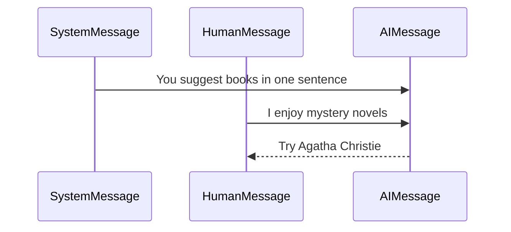

### Type this

```python
from langchain_core.messages import HumanMessage, SystemMessage, AIMessage

msg = llm.invoke([
    SystemMessage(content="You are a helpful AI bot that assists a user in choosing the perfect book to read in one short sentence"),
    HumanMessage(content="I enjoy mystery novels, what should I read?"),
])
print(msg.content)
```

Now pass a whole earlier conversation, so "How often?" has something to refer to:

```python
msg = llm.invoke([
    SystemMessage(content="You are a supportive AI bot that suggests fitness activities to a user in one short sentence"),
    HumanMessage(content="I like high-intensity workouts, what should I do?"),
    AIMessage(content="You should try a CrossFit class"),
    HumanMessage(content="How often should I attend?"),
])
print(msg.content)
```

And with no system message at all:

```python
print(llm.invoke([HumanMessage(content="What month follows June?")]).content)
```

### Expected output

A one-sentence book suggestion. A one-sentence frequency suggestion about CrossFit (for example "2 to 3 times a week"). Then "July".

### Try it

Delete the `AIMessage` from the fitness example and run again. The model no longer knows what "attend" refers to.

### Check yourself

Why does the model need the earlier `AIMessage` to answer "How often should I attend?"

<details><summary>Answer</summary>The model has no memory of its own. It only sees the messages you send in this call.</details>

---

## Part 3: Prompt templates

### The idea

A **prompt template** is a prompt with blanks. You fill the blanks per request. Three kinds appear in the lab:

| Kind | Produces |
|---|---|
| `PromptTemplate` | one string |
| `ChatPromptTemplate` | a list of messages |
| `MessagesPlaceholder` | a slot where you insert a whole list of messages |

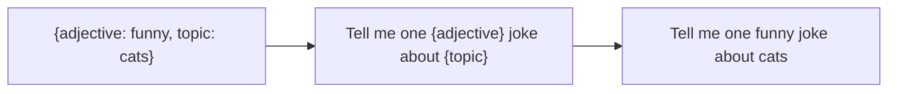

### Type this

String template:

```python
from langchain_core.prompts import PromptTemplate

prompt = PromptTemplate.from_template("Tell me one {adjective} joke about {topic}")
input_ = {"adjective": "funny", "topic": "cats"}
prompt.invoke(input_)
```

Chat template:

```python
from langchain_core.prompts import ChatPromptTemplate

prompt = ChatPromptTemplate.from_messages([
    ("system", "You are a helpful assistant"),
    ("user", "Tell me a joke about {topic}"),
])
prompt.invoke({"topic": "cats"})
```

Placeholder for a list of messages:

```python
from langchain_core.prompts import MessagesPlaceholder

prompt = ChatPromptTemplate.from_messages([
    ("system", "You are a helpful assistant"),
    MessagesPlaceholder("msgs"),   # a whole list goes here
])
input_ = {"msgs": [HumanMessage(content="What is the day after Tuesday?")]}
prompt.invoke(input_)
```

Now connect the template to the model with the pipe `|`:

```python
chain = prompt | llm
response = chain.invoke(input_)
print(response.content)
```

### Expected output

`prompt.invoke(...)` shows the filled prompt (a `StringPromptValue` or a list of messages). The chain prints "Wednesday".

### Try it

Change the placeholder input to two messages: a `HumanMessage` "My name is Sam", an `AIMessage` "Hi Sam!", then ask "What is my name?" in a third message.

### Check yourself

What does `prompt | llm` do, in your own words?

<details><summary>Answer</summary>It builds a chain: the prompt is filled first, and its result is sent to the model.</details>

---

## Part 4: Output parsers

### The idea

A model returns text. Your program often needs a **structure** (a dict, a list). An **output parser** converts the text. You also ask the parser for **format instructions** and put them in the prompt, so the model knows what shape to answer in.

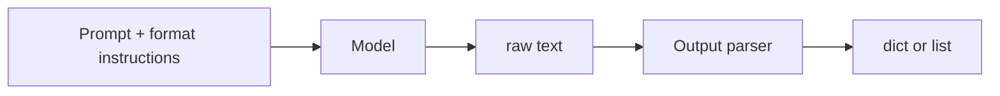

### Type this

JSON parser with a described shape:

```python
from pydantic import BaseModel, Field
from langchain_core.output_parsers import JsonOutputParser

class Joke(BaseModel):
    setup: str = Field(description="question to set up a joke")
    punchline: str = Field(description="answer to resolve the joke")

output_parser = JsonOutputParser(pydantic_object=Joke)
format_instructions = output_parser.get_format_instructions()
print(format_instructions[:200])
```

```python
prompt = PromptTemplate(
    template="Answer the user query.\n{format_instructions}\n{query}\n",
    input_variables=["query"],
    partial_variables={"format_instructions": format_instructions},  # fixed once, not per call
)
chain = prompt | llm | output_parser
chain.invoke({"query": "Tell me a joke."})
```

Comma-separated list parser:

```python
from langchain_core.output_parsers import CommaSeparatedListOutputParser

list_parser = CommaSeparatedListOutputParser()
prompt = PromptTemplate(
    template="Answer the user query. {format_instructions}\nList five {subject}.",
    input_variables=["subject"],
    partial_variables={"format_instructions": list_parser.get_format_instructions()},
)
chain = prompt | llm | list_parser
chain.invoke({"subject": "ice cream flavors"})
```

> **Lab says / today we use:** the lab imports `BaseModel` from `langchain_core.pydantic_v1` and the list parser from `langchain.output_parsers`. Both paths are gone. Use `pydantic` directly and `langchain_core.output_parsers`.

### Expected output

A Python dict such as `{'setup': '...', 'punchline': '...'}`, then a Python list such as `['vanilla', 'chocolate', 'strawberry', 'mint', 'coffee']`.

### Try it

Add a field `rating: int` to `Joke` and rerun. Does the parsed dict include it?

### Check yourself

Why is `format_instructions` a *partial* variable?

<details><summary>Answer</summary>It never changes between calls, so you fill it once when you build the template. Only <code>query</code> changes per call.</details>

---

## Part 5: Documents, loaders and text splitters

### The idea

To let a model read your own material, you need three things:

1. A **Document**: a container with `page_content` (text) and `metadata` (a dict about where it came from).
2. A **loader**: reads a PDF, a web page, etc. into Documents.
3. A **text splitter**: cuts long Documents into **chunks** small enough to fit in the model's context window.

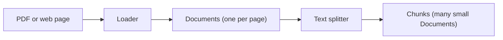

### Type this

A Document by hand:

```python
from langchain_core.documents import Document

Document(
    page_content="Python is an interpreted high-level general-purpose programming language.",
    metadata={"my_document_id": 234234, "my_document_source": "About Python"},
)
```

Load the lab's PDF (needs internet):

```python
from langchain_community.document_loaders import PyPDFLoader

loader = PyPDFLoader("https://cf-courses-data.s3.us.cloud-object-storage.appdomain.cloud/96-FDF8f7coh0ooim7NyEQ/langchain-paper.pdf")
document = loader.load()
print(len(document), "pages")
print(document[1].page_content[:300])
```

Load a web page:

```python
from langchain_community.document_loaders import WebBaseLoader

web_data = WebBaseLoader("https://python.langchain.com/docs/introduction/").load()
print(web_data[0].page_content[:300])
```

Split the PDF:

```python
from langchain_text_splitters import CharacterTextSplitter

text_splitter = CharacterTextSplitter(chunk_size=200, chunk_overlap=20, separator="\n")
chunks = text_splitter.split_documents(document)
print(len(chunks))
chunks[5].page_content
```

> **Lab says / today we use:** the lab imports the splitter from `langchain.text_splitter` and loads `https://python.langchain.com/v0.2/docs/introduction/`. Today the splitter lives in `langchain_text_splitters`, and the docs URL has no `v0.2`. The lab reports 148 chunks. You will see a similar number (about 147).

### Expected output

6 pages, then page text, then about 147 chunks, then the text of one chunk.

### Try it

Change `chunk_size` to 500 and then 100. How does the chunk count change? Then set `chunk_overlap=0` and read the end of one chunk and the start of the next.

### Check yourself

Why do chunks overlap?

<details><summary>Answer</summary>So a sentence cut at a boundary still appears whole in at least one chunk, and context is not lost.</details>

---

## Part 6: Embeddings and vector stores

### The idea

An **embedding** turns a piece of text into a list of numbers (a vector) so that texts with similar *meaning* get similar numbers. A **vector store** keeps those vectors and can find the ones closest to a query. This is how "search by meaning" works.

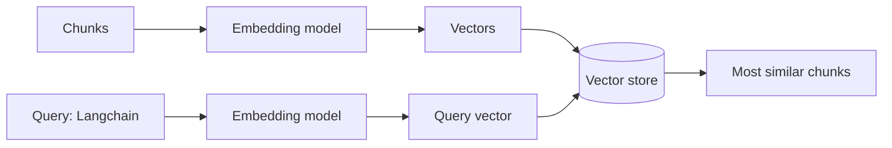

### Type this

```python
from langchain_openai import OpenAIEmbeddings

embedding = OpenAIEmbeddings(model="text-embedding-3-small")
texts = [c.page_content for c in chunks]
vectors = embedding.embed_documents(texts)
print(len(vectors), "vectors, each with", len(vectors[0]), "numbers")
vectors[0][:5]
```

Store them and search:

```python
from langchain_core.vectorstores import InMemoryVectorStore

docsearch = InMemoryVectorStore.from_documents(chunks, embedding)

query = "Langchain"
docs = docsearch.similarity_search(query)
print(docs[0].page_content)
```

> **Lab says / today we use:** the lab uses watsonx `granite-embedding-278m-multilingual` and the **Chroma** database. We use OpenAI embeddings and LangChain's built-in `InMemoryVectorStore`, which needs no install. The calls (`from_documents`, `similarity_search`, `as_retriever`) are the same for Chroma.
>
> **Lab quirk:** the lab sets `TRUNCATE_INPUT_TOKENS: 3`, which makes watsonx embed only the first 3 tokens of each text. That is fine for a demo but poor for real search, so we do not copy it.

### Expected output

About 147 vectors of 1536 numbers each, five small floats, then the chunk most related to "Langchain".

### Try it

Search for `"memory"` and for `"vector database"`. Do the top chunks make sense?

### Check yourself

Why can a vector search find "refund policy" when you type "money back"?

<details><summary>Answer</summary>The two phrases mean about the same thing, so their vectors are close, even though the words differ.</details>

---

## Part 7: Retrievers and question answering

### The idea

A **retriever** is a small interface: give it a question, get back relevant Documents. A vector store can be turned into one. Retrievers are more general than vector stores because they do not have to store anything.

**Retrieval QA** then joins a retriever with the model: find the relevant chunks, put them in the prompt, and let the model answer from them.

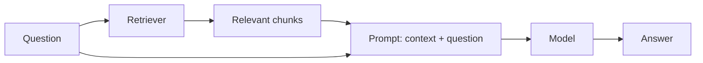

### Type this

A vector-store retriever:

```python
retriever = docsearch.as_retriever(search_kwargs={"k": 3})   # return the top 3
docs = retriever.invoke("Langchain")
docs[0]
```

A retrieval question-answering chain:

```python
from langchain_core.output_parsers import StrOutputParser
from langchain_core.runnables import RunnablePassthrough

def format_docs(docs):
    return "\n\n".join(d.page_content for d in docs)

qa_prompt = ChatPromptTemplate.from_template(
    "Answer the question using only the context.\n\nContext:\n{context}\n\nQuestion: {question}"
)

qa = (
    {"context": retriever | format_docs, "question": RunnablePassthrough()}
    | qa_prompt
    | llm
    | StrOutputParser()
)
qa.invoke("what is this paper discussing?")
```

> **Lab says / today we use:** the lab uses `RetrievalQA.from_chain_type(chain_type="stuff", ...)`. "Stuff" just means "put all retrieved chunks into one prompt", which is exactly what `format_docs` does above. `RetrievalQA` is legacy, so we build the same thing with `|`.

The dict at the start runs two things on your question at once: the retriever (then `format_docs`) fills `context`, and `RunnablePassthrough()` passes the question through unchanged.

### Parent document retriever (the idea, built by hand)

Small chunks match a query precisely, but a small chunk may lack context. Big chunks have context but match poorly. The **parent document retriever** gets both: it searches small *child* chunks, then returns the big *parent* chunk each one came from.

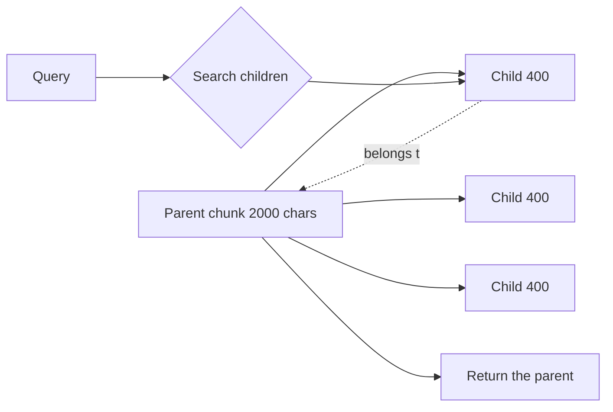

**Type this:**

```python
import uuid

parent_splitter = CharacterTextSplitter(chunk_size=2000, chunk_overlap=20, separator="\n")
child_splitter = CharacterTextSplitter(chunk_size=400, chunk_overlap=20, separator="\n")

parent_store = {}   # id -> big chunk
children = []       # small chunks that remember their parent's id
for parent in parent_splitter.split_documents(document):
    parent_id = str(uuid.uuid4())
    parent_store[parent_id] = parent
    for child in child_splitter.split_documents([parent]):
        child.metadata["parent_id"] = parent_id
        children.append(child)

child_index = InMemoryVectorStore.from_documents(children, embedding)

def retrieve_parent(query):
    best_child = child_index.similarity_search(query, k=1)[0]
    return parent_store[best_child.metadata["parent_id"]]

print(len(parent_store), "parents,", len(children), "children")
print(len(retrieve_parent("Langchain").page_content), "characters returned")
```

> **Lab says / today we use:** the lab imports `ParentDocumentRetriever` from `langchain.retrievers` with a Chroma store and an `InMemoryStore`. That class now lives in the separate `langchain-classic` package. Building it by hand shows what it does in about 15 lines.

### Expected output

Something like "16 parents, 78 children", then a returned size well above 400 characters (about 1500 in our run).

### Try it

Ask the plain retriever and `retrieve_parent` the same question. Which result gives you more to read?

### Check yourself

In the QA chain, what does `RunnablePassthrough()` do?

<details><summary>Answer</summary>It passes the original question through unchanged, so the prompt gets both the retrieved context and the question.</details>

---

## Part 8: Memory

### The idea

A model forgets everything between calls. **Memory** means *you* keep the past messages and send them again each time. The lab calls this `ChatMessageHistory` and `ConversationBufferMemory`. At heart it is a list.

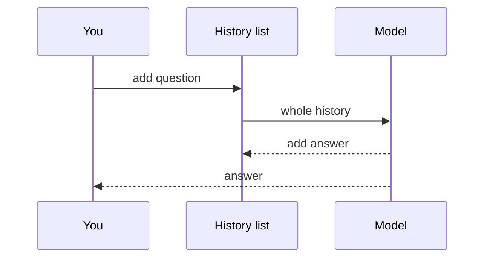

### Type this

```python
history = [
    AIMessage(content="hi!"),
    HumanMessage(content="what is the capital of France?"),
]
ai_response = llm.invoke(history)
print(ai_response.content)

history.append(ai_response)        # remember the answer too
history.append(HumanMessage(content="and what is its population?"))
print(llm.invoke(history).content)
```

The lab's "little cat" conversation, as a reusable function:

```python
chat_prompt = ChatPromptTemplate.from_messages([
    MessagesPlaceholder("history"),
    ("human", "{input}"),
])
chat = chat_prompt | llm
conversation = []

def talk(text):
    reply = chat.invoke({"history": conversation, "input": text})
    conversation.append(HumanMessage(content=text))
    conversation.append(AIMessage(content=reply.content))
    return reply.content

talk("Hello, I am a little cat. Who are you?")
talk("What can you do?")
print(talk("Who am I?"))
```

> **Lab says / today we use:** `ChatMessageHistory`, `ConversationBufferMemory` and `ConversationChain` (with `verbose=True`) are legacy. A plain list plus `MessagesPlaceholder` does the same job and shows you exactly what is sent.

### Expected output

"The capital of France is Paris.", then a population answer about Paris, then something like "You are a little cat."

### Try it

Print `conversation` after the three calls. That list is the entire "memory".

### Check yourself

Why does the second question work when it says "its"?

<details><summary>Answer</summary>The earlier question and answer are in the history you resend, so the model can see what "its" refers to.</details>

---

## Part 9: Chains

### The idea

A **chain** links steps so that one step's output feeds the next. The lab shows the old way (`LLMChain`, `SequentialChain`) and the modern way (LCEL with `|`). We use the modern way.

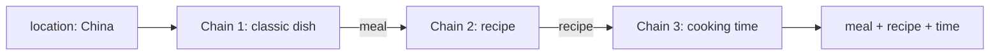

### Type this

A simple chain:

```python
location_template = """Your job is to come up with a classic dish from the area that the users suggests.
{location}

YOUR RESPONSE:
"""

location_chain = PromptTemplate.from_template(location_template) | llm | StrOutputParser()
print(location_chain.invoke({"location": "China"}))
```

The other two steps:

```python
dish_template = """Given a meal {meal}, give a short and simple recipe on how to make that dish at home.

YOUR RESPONSE:
"""
time_template = """Given the recipe {recipe}, estimate how much time I need to cook it.

YOUR RESPONSE:
"""

dish_chain = PromptTemplate.from_template(dish_template) | llm | StrOutputParser()
time_chain = PromptTemplate.from_template(time_template) | llm | StrOutputParser()
```

Join them. `RunnablePassthrough.assign` keeps what exists and adds one new key:

```python
from pprint import pprint

overall_chain = (
    RunnablePassthrough.assign(meal=location_chain)
    | RunnablePassthrough.assign(recipe=dish_chain)
    | RunnablePassthrough.assign(time=time_chain)
)
pprint(overall_chain.invoke({"location": "China"}))
```

> **Lab says / today we use:** the lab first builds `LLMChain(..., output_key='meal')` and `SequentialChain(chains=[...], input_variables=[...], output_variables=[...], verbose=True)`. Those classes are legacy. `output_key` becomes the name you give in `.assign(meal=...)`. The lab's LCEL version wraps each step in a `lambda`. It is shorter to pass the chain directly, as above.

### Expected output

A dict with `location`, `meal` (for example "Peking Duck"), `recipe` and `time`.

### Try it

Add a fourth step `shopping_chain` that takes `{recipe}` and lists ingredients. Add it with one more `.assign(shopping=...)`.

### Check yourself

What would break if `dish_template` used `{dish}` instead of `{meal}`?

<details><summary>Answer</summary>The previous step stores its result under <code>meal</code>, so the prompt would be missing a variable called <code>dish</code> and fail.</details>

---

## Part 10: Tools and agents

### The idea

A model can only produce text. A **tool** is a function it can ask your code to run (a calculator, a weather lookup, a search). An **agent** is a loop where the model decides which tool to use, sees the result, and repeats until it can answer.

The lab explains the **ReAct** pattern (Reason + Act). The model writes:

```text
Thought: I need to multiply two numbers
Action: multiply
Action Input: 345, 789
Observation: 272205        <- your code adds this
Thought: I know the answer
Final Answer: 272205
```

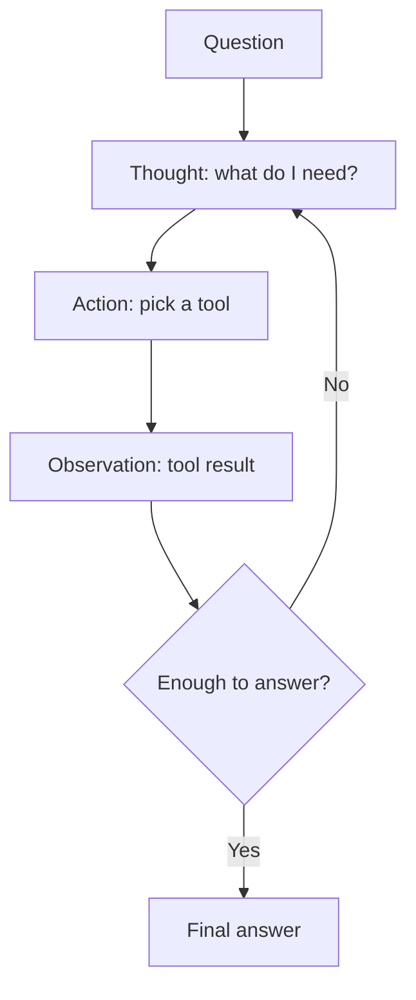

### Type this

Define tools. The docstring is the tool's description, and the model reads it to decide when to use it:

```python
from langchain_core.tools import tool

@tool
def search_weather(location: str) -> str:
    """Search for the current weather in the specified location."""
    # A real app would call a weather API here.
    return f"The weather in {location} is currently sunny and 72F."

@tool
def multiply(a: float, b: float) -> float:
    """Multiply two numbers."""
    return a * b

tools = [search_weather, multiply]
multiply.invoke({"a": 345, "b": 789})
```

Build the agent:

```python
from langchain.agents import create_agent

agent = create_agent(
    model=llm,
    tools=tools,
    system_prompt="You are a helpful assistant. Use a tool whenever it helps.",
)

result = agent.invoke({"messages": [{"role": "user", "content": "What's the weather in Miami?"}]})
print(result["messages"][-1].content)
```

See every step the agent took (this is the lab's `verbose=True`):

```python
for message in result["messages"]:
    message.pretty_print()
```

Try several questions, as the lab does:

```python
queries = [
    "What's 345 * 789?",
    "What's the weather in Miami?",
    "If it's sunny in Chicago, what would be a good outdoor activity?",
]
for query in queries:
    result = agent.invoke({"messages": [{"role": "user", "content": query}]})
    print(f"\nQUERY: {query}\nFINAL ANSWER: {result['messages'][-1].content}")
```

> **Lab says / today we use:** the lab writes the ReAct prompt by hand (with `{tools}`, `{tool_names}` and `{agent_scratchpad}`), then calls `create_react_agent` and `AgentExecutor(handle_parsing_errors=True)`. Modern chat models support **tool calling** directly, so the model returns a structured request instead of text you must parse. That is why `create_agent` needs no prompt template and no parsing-error handling. The idea (reason, act, observe, repeat) is the same.
>
> **Lab's Python tool:** the lab also uses `PythonREPL` from `langchain_experimental` as a calculator. It runs any Python the model writes, which is risky. If you want it: `uv add langchain-experimental` at the repo root.

### Expected output

`pretty_print` shows: a Human message, an AI message that *asks* for `search_weather`, a Tool message with the result, and a final AI message with the answer.

### Try it

Add a `text_length(text: str) -> int` tool and ask "How many characters are in 'langchain'?". Notice that you did not change the agent code.

### Check yourself

Does the model run the tool itself?

<details><summary>Answer</summary>No. The model only asks for the tool call. LangChain runs your function and hands the result back.</details>

---

## Practice exercises

These are the lab's exercises, reworded for this setup. Try them without looking at the lab solutions, then ask me about anything that fails.

1. **Compare settings.** Make two models with `temperature=0.1` and `temperature=0.8`. Send the same prompt to both. (Optional: use a second model name such as `gpt-4o` for comparison.) Describe the difference.
2. **Movie JSON.** Build a chain that takes a movie name and returns a dict with `title`, `director`, `year`, `genre`, using `JsonOutputParser`. Print each field.
3. **Loaders and splitters.** Load the PDF and the web page. Make two splitters with different settings. Write a function that prints chunk count, average chunk size and metadata keys for each result.
4. **Mini search system.** Load a web page, split it, embed, store, make a retriever, and write `search_documents(query, top_k=3)`. Test it with "What is LangChain?" and "Why is document splitting important?".
5. **Chatbot with memory.** Make a chatbot that remembers your name and favourite colour across five turns, then print the whole history. (Stretch: after 6 turns, summarise old messages with the model so the history stays short.)
6. **Review pipeline.** Chain three steps for product reviews: sentiment, then a 3 to 5 bullet summary, then a customer reply. Use `RunnablePassthrough.assign`. Test it on a happy and an unhappy review.
7. **Your first agent.** Write a `calculator(expression)` tool and a `format_text` tool (upper, lower, title). Give both to `create_agent`. Test with "What is 25 + 63?" and "titlecase: langchain is awesome".

## Cheat sheet

| Piece | Code you typed | One-line meaning |
|---|---|---|
| Model | `ChatOpenAI(model=...)` | The engine |
| Messages | `SystemMessage`, `HumanMessage`, `AIMessage` | Who said what |
| Template | `PromptTemplate`, `ChatPromptTemplate`, `MessagesPlaceholder` | Prompt with blanks |
| Parser | `JsonOutputParser`, `CommaSeparatedListOutputParser` | Text to structure |
| Document | `Document(page_content, metadata)` | Text plus its origin |
| Loader | `PyPDFLoader`, `WebBaseLoader` | Source to Documents |
| Splitter | `CharacterTextSplitter` | Long text to chunks |
| Embedding | `OpenAIEmbeddings` | Text to numbers |
| Vector store | `InMemoryVectorStore` | Search by meaning |
| Retriever | `store.as_retriever()` | Question to chunks |
| Memory | a list of messages | Resend the past |
| Chain | `a \| b \| c` | Output of one feeds the next |
| Tool | `@tool` | A function the model can request |
| Agent | `create_agent(...)` | Loop: think, act, observe |

Next: [Tutorial 2](02-build-a-study-buddy.md) builds one app from these pieces.
