# Tutorial 2: Build a Study Buddy

**The idea.** Most guides list LangChain's parts one by one. That is hard to remember, because you never feel *why* a part exists. Here you build **one small app** and add one piece at a time. Each piece appears because the app just hit a problem that the piece solves.

**What you will build.** A study buddy that:

- explains a concept and writes quiz questions for it,
- remembers your conversation,
- answers questions from *your own notes* (this repo's [module2 README](../README.md)) and says "I don't know" when the notes don't cover it,
- decides by itself when to search the notes or make a quiz.

For the same topics in the lab's order, see [Tutorial 1](01-langchain-lab-adapted.md).

## How to use this guide

1. New notebook in `module2/`, root `.venv` as the kernel.
2. Type every **Type this** block yourself.
3. Each step has: **The problem**, **The fix**, **Type this**, **What you should see**, **Why it works**, **Try it**.
4. Real API calls cost a small amount (the whole guide is a few cents with `gpt-4o-mini`).

## The journey

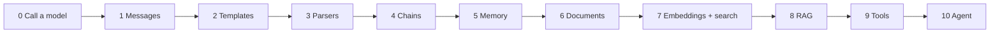

---

## Step 0: One call to a model

**The problem.** Before building anything, see what a model really is.

**The fix.** Call one.

**Type this.** (Needs `OPENAI_API_KEY` in the repo-root `.env`.)

```python
from dotenv import load_dotenv
from langchain_openai import ChatOpenAI

load_dotenv()
llm = ChatOpenAI(model="gpt-4o-mini", temperature=0.2, max_tokens=300)

reply = llm.invoke("Explain what an API is in two sentences.")
print(reply.content)
```

**What you should see.** A short, sensible explanation.

**Why it works.** A model is a function from text to text. `invoke` sends your text, and the answer comes back as a message object. `.content` is the text.

**Try it.** Run the same cell three times, then set `temperature=1.0` and run three more. Low temperature gives near-identical answers, high gives variety.

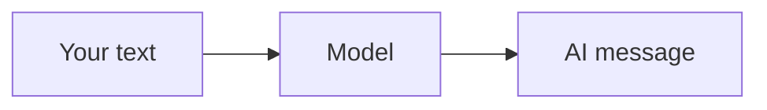

---

## Step 1: Give it a role, and meet its biggest weakness

**The problem.** The answer's tone is random, and the model has no idea who it is helping.

**The fix.** **Messages.** A message is a piece of text with a **role**. A `SystemMessage` sets behaviour. A `HumanMessage` is you.

**Type this.**

```python
from langchain_core.messages import SystemMessage, HumanMessage

tutor = SystemMessage(content="You are a patient tutor. Explain simply, in at most 3 sentences.")

print(llm.invoke([tutor, HumanMessage(content="My name is Sam. What is an embedding?")]).content)
```

Now the weakness. Ask a follow-up in a *new* call:

```python
print(llm.invoke([tutor, HumanMessage(content="What is my name?")]).content)
```

**What you should see.** A good explanation first. Then the model says it doesn't know your name.

**Why it works.** The model sees **only what you send in that call**. It has no memory. We fix that in Step 5, but first we need to stop retyping prompts.

**Try it.** Change the system message to "You are a pirate tutor" and ask the same question.

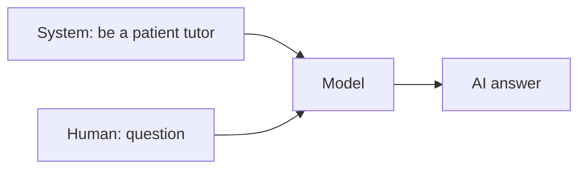

---

## Step 2: Prompt templates

**The problem.** You will ask for many concepts. Retyping the whole message each time is slow and error-prone.

**The fix.** A **prompt template** is a message with blanks.

**Type this.**

```python
from langchain_core.prompts import ChatPromptTemplate

explain_prompt = ChatPromptTemplate.from_messages([
    ("system", "You are a patient tutor. Explain simply, in at most 3 sentences."),
    ("human", "Explain {topic}."),
])

filled = explain_prompt.invoke({"topic": "vector databases"})
print(filled.to_messages())
print(llm.invoke(filled).content)
```

**What you should see.** First the filled-in messages (system plus human with "vector databases" inside), then the answer.

**Why it works.** `invoke` on a template does not call the model. It only fills the blanks. You then pass the result to the model.

**Try it.** Add a second blank, `{level}`, to the system message ("Explain for a {level}") and fill it with `"10-year-old"`.

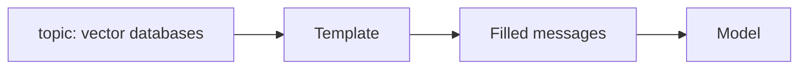

---

## Step 3: Output parsers

**The problem.** You want quiz questions you can loop over, but the model returns one blob of text.

**The fix.** An **output parser** turns the text into a Python structure. You describe the shape with a small class, and the parser tells the model how to format its answer.

**Type this.**

```python
from pydantic import BaseModel, Field
from langchain_core.output_parsers import JsonOutputParser
from langchain_core.prompts import PromptTemplate

class Quiz(BaseModel):
    questions: list[str] = Field(description="three short quiz questions")

parser = JsonOutputParser(pydantic_object=Quiz)

quiz_prompt = PromptTemplate.from_template(
    "Write three short quiz questions about {topic}.\n{format_instructions}"
).partial(format_instructions=parser.get_format_instructions())

raw = llm.invoke(quiz_prompt.invoke({"topic": "vector databases"}))
quiz = parser.invoke(raw)
print(quiz["questions"][0])
```

**What you should see.** A real Python dict like `{'questions': ['...', '...', '...']}` and the first question printed.

**Why it works.** `get_format_instructions()` is extra text added to your prompt ("answer as JSON with these keys"). The parser then reads the reply back into a dict.

**Try it.** Add `difficulty: str` to `Quiz` and rerun.

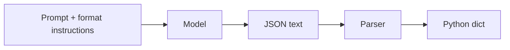

---

## Step 4: Chains with the pipe

**The problem.** Steps 2 and 3 each need three lines of glue (fill, call, parse).

**The fix.** A **chain** joins the steps with `|`. Data flows left to right. The pipe is the main idea of modern LangChain (it is called LCEL).

**Type this.**

```python
from langchain_core.output_parsers import StrOutputParser

explain_prompt = ChatPromptTemplate.from_messages([
    ("system", "You are a patient tutor. Explain simply, in at most 3 sentences."),
    ("human", "Explain {topic}."),
])

explain_chain = explain_prompt | llm | StrOutputParser()
quiz_chain = quiz_prompt | llm | parser

print(explain_chain.invoke({"topic": "embeddings"}))
print(quiz_chain.invoke({"topic": "embeddings"})["questions"])
```

Both chains take `{"topic": ...}`, so you can run them **at the same time**:

```python
from langchain_core.runnables import RunnableParallel

lesson = RunnableParallel(explanation=explain_chain, quiz=quiz_chain)
result = lesson.invoke({"topic": "embeddings"})
print(result["explanation"])
print(result["quiz"]["questions"])
```

**What you should see.** An explanation string, a list of questions, then one dict holding both.

**Why it works.** Every piece (template, model, parser, chain) speaks the same interface, `invoke`, so they snap together. A dict of chains runs them in parallel on the same input.

**Try it.** Use `lesson.stream({"topic": "embeddings"})` and print each piece as it arrives.

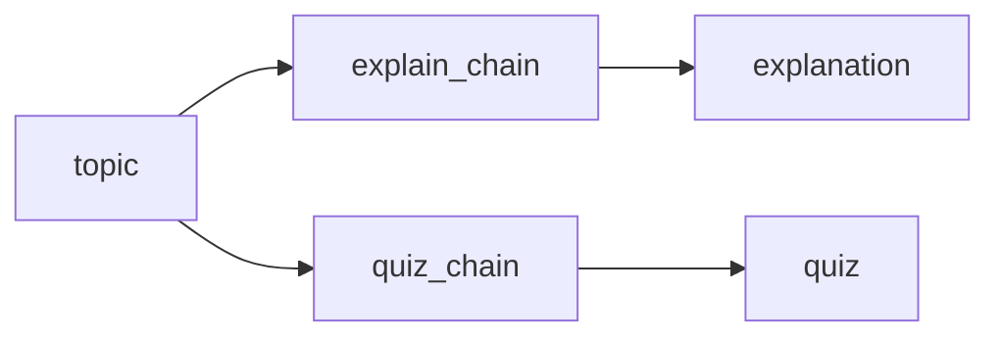

---

## Step 5: Memory

**The problem.** Remember Step 1? Follow-up questions ("what about its limits?") fail.

**The fix.** **Memory** is a list of messages that you send back every time. A `MessagesPlaceholder` is the slot where the list goes.

**Type this.**

```python
from langchain_core.messages import AIMessage
from langchain_core.prompts import MessagesPlaceholder

chat_prompt = ChatPromptTemplate.from_messages([
    ("system", "You are a patient tutor. Be brief."),
    MessagesPlaceholder("history"),
    ("human", "{question}"),
])
chat = chat_prompt | llm | StrOutputParser()
history = []

def ask(question):
    answer = chat.invoke({"history": history, "question": question})
    history.append(HumanMessage(content=question))
    history.append(AIMessage(content=answer))
    return answer

print(ask("What is an embedding?"))
print(ask("Why would I need one?"))      # "one" only makes sense with the history
```

**What you should see.** The second answer understands "one" means "an embedding".

**Why it works.** The model still has no memory. *You* store the conversation and resend it. `history` is the memory.

**Try it.** `print(history)` after three questions. Then run `history.clear()` and ask "Why would I need one?" again.

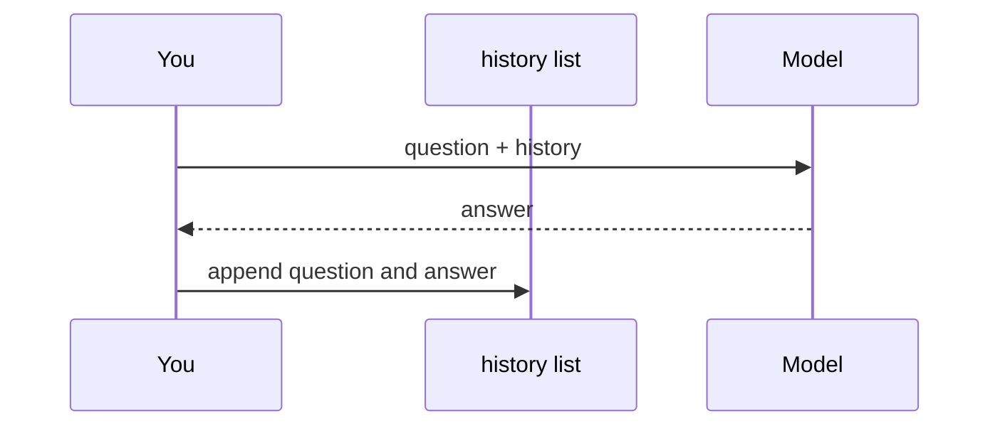

---

## Step 6: Documents (teach it your notes)

**The problem.** Ask: "What does Tutorial 1 call the pipe operator?" The model has never read your notes. It guesses.

**The fix.** Load your notes as **Documents**, then **split** them into chunks. A model can only read so much at once, and smaller chunks are easier to search later.

**Type this.**

```python
from pathlib import Path
from langchain_community.document_loaders import TextLoader

here = Path.cwd()
notes_path = next(
    p / "module2" / "README.md"
    for p in [here, *here.parents]
    if (p / "module2" / "README.md").exists()
)

docs = TextLoader(str(notes_path), encoding="utf-8").load()
print(len(docs), "document,", len(docs[0].page_content), "characters")
print(docs[0].metadata)
```

The first lines find your notes no matter which folder the notebook runs in.

```python
from langchain_text_splitters import RecursiveCharacterTextSplitter

for size in (300, 1000, 3000):
    splitter = RecursiveCharacterTextSplitter(chunk_size=size, chunk_overlap=size // 10)
    print(size, "->", len(splitter.split_documents(docs)), "chunks")
```

Pick one size to keep:

```python
splitter = RecursiveCharacterTextSplitter(chunk_size=1000, chunk_overlap=100)
chunks = splitter.split_documents(docs)
print(chunks[3].page_content[:300])
```

**What you should see.** One Document, then chunk counts that shrink as the size grows, then the text of one chunk.

**Why it works.** A **Document** is `page_content` (text) plus `metadata` (where it came from). A splitter cuts text near natural breaks (paragraphs, lines) and **overlaps** neighbours slightly so an idea cut at a boundary survives in one chunk.

**Trade-off to feel.** Tiny chunks lose context. Huge chunks hide the answer in noise. About 500 to 1500 characters is a common starting point.

**Try it.** Set `chunk_overlap=0` and compare the end of one chunk with the start of the next.

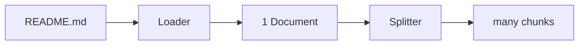

---

## Step 7: Embeddings and search by meaning

**The problem.** Which chunks should we show the model for a question? Keyword search misses "money back" vs "refund".

**The fix.** An **embedding** turns text into a list of numbers where *similar meaning means similar numbers*. A **vector store** finds the closest ones.

First, feel it with your own hands:

```python
import math
from langchain_openai import OpenAIEmbeddings

embedder = OpenAIEmbeddings(model="text-embedding-3-small")

def cosine(a, b):
    dot = sum(x * y for x, y in zip(a, b))
    return dot / (math.sqrt(sum(x * x for x in a)) * math.sqrt(sum(y * y for y in b)))

v = embedder.embed_documents([
    "How do I give a chatbot memory?",
    "Keeping the chat history so the bot remembers",
    "The recipe needs two eggs and flour",
])
print("memory vs history:", round(cosine(v[0], v[1]), 2))
print("memory vs recipe: ", round(cosine(v[0], v[2]), 2))
```

**What you should see.** The first score is clearly higher than the second. The first two sentences share almost no words but mean nearly the same thing.

Now index all your notes and search:

```python
from langchain_core.vectorstores import InMemoryVectorStore

store = InMemoryVectorStore.from_documents(chunks, embedder)

for hit in store.similarity_search("how do I make the bot remember earlier messages?", k=2):
    print("---")
    print(hit.page_content[:200])
```

Turn the store into a **retriever** (question in, chunks out):

```python
retriever = store.as_retriever(search_kwargs={"k": 4})
retriever.invoke("what is LCEL?")[0].page_content[:200]
```

**Why it works.** Cosine similarity is a score of how closely two number-lists point the same way. The store embeds your question the same way and returns the chunks with the highest scores. A **retriever** is simply that search wrapped as `question -> documents`.

**Try it.** Search for something your notes do *not* cover ("capital of Australia"). The store still returns chunks, because it always returns the nearest ones. Remember this for Step 8.

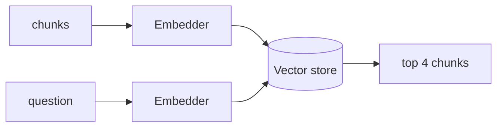

---

## Step 8: RAG (answer from your notes)

**The problem.** Search finds chunks, but nobody has written the answer. And the store *always* returns something, even for unrelated questions.

**The fix.** **RAG** (retrieval-augmented generation): retrieve chunks, put them in the prompt, and tell the model to answer **only from them**.

**Type this.**

```python
rag_prompt = ChatPromptTemplate.from_template(
    """Answer the question using ONLY the context below.
If the answer is not in the context, say "I don't know based on my notes."

Context:
{context}

Question: {question}"""
)

def format_docs(docs):
    return "\n\n".join(d.page_content for d in docs)

rag_chain = rag_prompt | llm | StrOutputParser()

def ask_notes(question):
    docs = retriever.invoke(question)
    answer = rag_chain.invoke({"context": format_docs(docs), "question": question})
    return answer, docs

answer, sources = ask_notes("What does the pipe operator do in LCEL?")
print(answer)
```

Show where the answer came from:

```python
for doc in sources:
    print("-", doc.page_content[:80].replace("\n", " "))
```

Now the honesty test:

```python
print(ask_notes("What is the capital of Australia?")[0])
```

**What you should see.** A grounded answer about the pipe, the source snippets, then "I don't know based on my notes."

**Why it works.** The model is a good *reader*, so you hand it the pages and an instruction to stay inside them. Sources let you check its work. The "I don't know" line stops it from inventing answers.

**Try it.** Delete the "If the answer is not in the context" line and ask the Australia question again. This is why prompt wording matters.

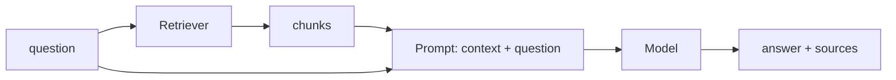

---

## Step 9: Tools

**The problem.** Your study buddy can explain, quiz and search, but you must call each function yourself. A model can't run code, it can only write text.

**The fix.** A **tool** is a normal function with a name, a docstring and typed arguments. The model can *ask* for it. The docstring is the model's only description of the tool, so write it well.

**Type this.**

```python
from langchain_core.tools import tool

@tool
def search_notes(question: str) -> str:
    """Search the study notes and return the most relevant passages."""
    return format_docs(retriever.invoke(question))

@tool
def make_quiz(topic: str) -> str:
    """Write three quiz questions about a topic."""
    return "\n".join(quiz_chain.invoke({"topic": topic})["questions"])

tools = [search_notes, make_quiz]
print(make_quiz.invoke({"topic": "memory"}))
print(search_notes.name, "-", search_notes.description)
```

**What you should see.** Three quiz questions, then the tool's name and description.

**Why it works.** `@tool` reads your function's name, docstring and argument types and gives the model a description of them. You can call tools yourself with `.invoke`, as above. The next step lets the model ask for them.

**Try it.** Change the docstring of `make_quiz` to something vague like "Do stuff" and see in Step 10 whether the agent still picks it correctly.

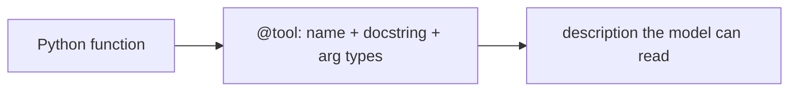

---

## Step 10: The agent

**The problem.** The model should decide whether to search, quiz, or just chat.

**The fix.** An **agent** is a loop: the model reads the question and the tool descriptions, **asks** for a tool, LangChain **runs** it, the result goes back to the model, and this repeats until the model can answer.

**Type this.**

```python
from langchain.agents import create_agent

buddy = create_agent(
    model=llm,
    tools=tools,
    system_prompt=(
        "You are a study buddy. Use search_notes for questions about the course notes. "
        "Use make_quiz when asked to quiz. Say so if the notes don't cover something."
    ),
)

def run(text):
    result = buddy.invoke({"messages": [{"role": "user", "content": text}]})
    return result["messages"]

messages = run("What does the pipe operator do in LCEL?")
print(messages[-1].content)
```

Watch the loop. Each message is one step:

```python
for m in messages:
    m.pretty_print()
```

Then try the other tool:

```python
print(run("Quiz me on memory")[-1].content)
```

**What you should see.** In the trace: your Human message, an AI message that *asks* for `search_notes`, a Tool message with passages, then a final AI answer. For the quiz request, the agent picks `make_quiz` instead.

**Why it works.** The model never runs anything. It outputs a structured request ("call `search_notes` with this question"). LangChain executes your function and appends the result as a Tool message. Then the model continues. This is the think, act, observe loop.

**Try it.** Ask "Say hello" and check the trace: no tool, because none is needed. That decision is what makes it an agent and not a chain.

### Beyond the lab: give the agent memory

The Step 5 trick works here too, with a built-in checkpointer that stores the conversation under a thread id:

```python
from langgraph.checkpoint.memory import InMemorySaver

buddy = create_agent(
    model=llm,
    tools=tools,
    system_prompt="You are a study buddy. Use the tools when helpful.",
    checkpointer=InMemorySaver(),
)

config = {"configurable": {"thread_id": "sam"}}
buddy.invoke({"messages": [{"role": "user", "content": "My name is Sam."}]}, config)
reply = buddy.invoke({"messages": [{"role": "user", "content": "What is my name?"}]}, config)
print(reply["messages"][-1].content)
```

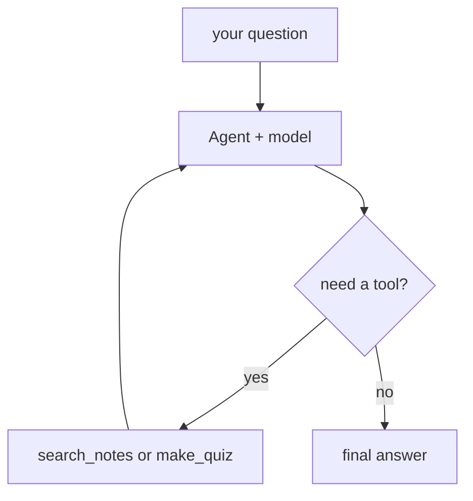

---

## The whole app in one picture

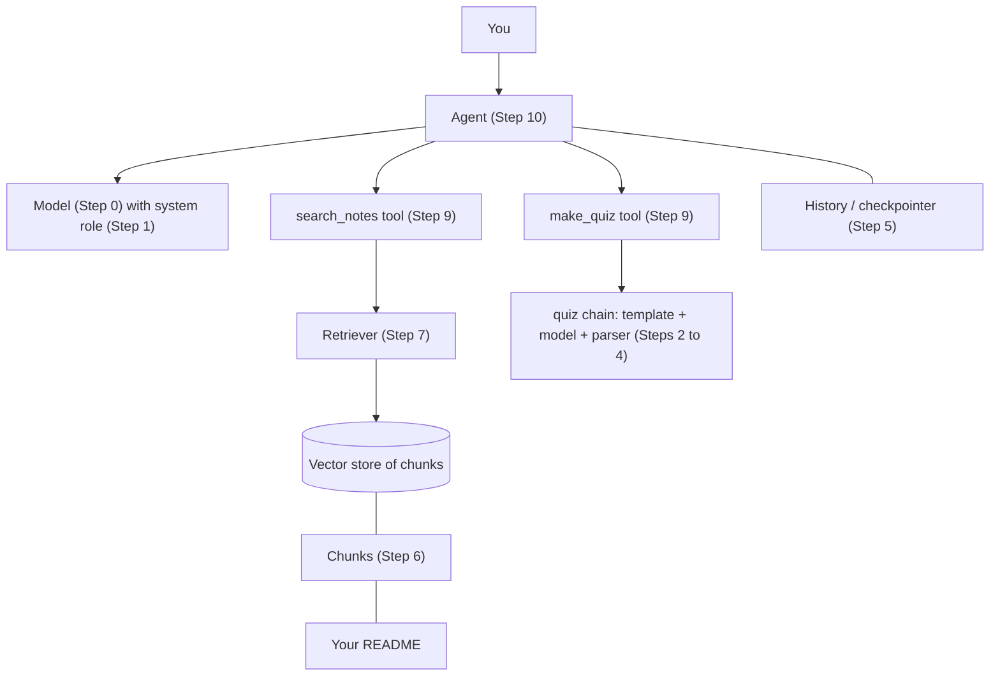

## Common mistakes

| Symptom | Likely cause | Fix |
|---|---|---|
| `OPENAI_API_KEY` error | `.env` not found or empty | Put the key in the repo-root `.env`, restart the kernel |
| `KeyError` or missing variable when invoking | Input dict key does not match `{blank}` name | Match the names exactly |
| Parser fails with "Invalid JSON" | Model added extra words | Lower the temperature, keep the format instructions in the prompt |
| Follow-up questions are ignored | Forgot to resend `history` | Pass it every call (Step 5) |
| RAG answers things not in the notes | Prompt lacks "only from the context" | Restore the instruction (Step 8) |
| Agent never calls a tool | Vague docstring or system prompt | Rewrite them (Step 9) |
| Results change between runs | Normal for LLMs | Lower `temperature` |

## Practice (no answers here, ask me)

1. Add a `define(term)` tool that answers only from the notes and refuses otherwise.
2. Make the quiz parser return questions *and* answers, then ask the buddy to grade a reply you type.
3. Load a second file (another README or a PDF) and add it to the same store. Check that sources come from both.
4. Show the retrieved chunk number and similarity score with `store.similarity_search_with_score(...)`. At what score do results stop being useful?
5. Change chunk size to 200, then 3000. How do the RAG answers change? Explain why.
6. Add a rule that the agent must cite which section of the notes it used.

## Cheat sheet

| Step | Piece | Remember |
|---|---|---|
| 0 | Model | text in, text out |
| 1 | Messages | roles; the model only sees what you send |
| 2 | Template | a prompt with blanks |
| 3 | Parser | text to Python structure |
| 4 | Chain `\|` | steps joined; a dict runs in parallel |
| 5 | Memory | resend the history list |
| 6 | Documents, splitter | text plus metadata, cut into chunks |
| 7 | Embeddings, store, retriever | search by meaning |
| 8 | RAG | answer only from retrieved chunks |
| 9 | Tool | a function the model can request |
| 10 | Agent | the model chooses tools in a loop |
