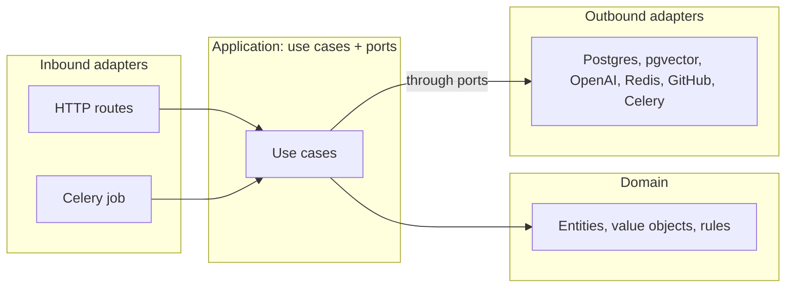

# Finished app: OWASP Top 10 chatbot, DDD and hexagonal

The result of [Tutorial 6](../tutorials/06-ddd-and-hexagonal.md). It behaves exactly like the layered app in [../app/](../app/) and has the same HTTP API, so the frontend is identical and the same live test passes. Only the structure of the backend changed.

```text
backend/
  chatapp/
    shared/                  the shared kernel (ids): tiny
    infrastructure/          settings, database plumbing, schema.sql, the Celery app
    knowledge/               bounded context: what the knowledge base is made of and how to search it
      domain/                catalog.py, document.py            pure Python
      application/           ports.py, use_cases.py             what it can do, what it needs
      adapters/
        inbound/             http.py, celery_tasks.py           call the use cases
        outbound/            postgres_documents, pgvector_chunks, openai_embedder,
                             github_source, markdown_splitter, celery_queue
    conversation/            bounded context: chats, messages, answers
      domain/                conversation.py, message.py
      application/           errors.py, events.py, ports.py, use_cases.py
      adapters/
        inbound/             http.py                            routes, SSE, status codes
        outbound/            postgres_conversations, openai_answers, redis_rate_limiter,
                             knowledge_gateway                  the ONE place the contexts meet
    container.py             composition root: which adapter fills which port
    main.py  worker.py       web app and Celery worker entry points
  tests/
    test_domain.py           pure domain tests, no services
    test_architecture.py     the dependency rules, checked by reading imports
  test_live.py               the whole real stack, through HTTP
```



## Run it

```bash
cd course2/fullstack-chat/app-hexagonal
cp .env.example .env        # then put your key in .env as OPENAI_API_KEY=sk-...
docker compose up --build
```

Open http://localhost:3000, press **Load OWASP Top 10**, and chat. Key already in the repo-root `.env`? Use `docker compose --env-file ../../../.env up --build`.

> **Ports.** This version, the layered one in `../app/`, and the other course apps all use ports 3000, 8000, 5432 and 6379. Run one at a time. (`name: owasp-chat-hex` keeps this version's database volume separate.)

For development, run only the databases in Docker:

```bash
docker compose up -d postgres redis
cd backend
uv run uvicorn chatapp.main:app --reload --port 8000                # terminal 1
uv run celery -A chatapp.worker worker --loglevel=info --pool=solo  # terminal 2
cd ../frontend && npm install && npm run dev                        # terminal 3
```

## Tests

| Test | Needs | What it proves |
|---|---|---|
| `uv run python -m tests.test_domain` | nothing | The business rules: the first message names a chat, blank questions are rejected, the document life cycle, the catalog |
| `uv run python -m tests.test_architecture` | nothing | Domain and application import no technology, the contexts meet only in the gateway |
| `uv run python test_live.py` | the running stack, OpenAI | The real behaviour end to end, through HTTP (a fraction of a cent) |

Run them from `backend/`. There are no fakes or in-memory substitutes: pure rules are tested directly, and everything else is tested against the real services.

Content from the OWASP Top 10:2025 is © OWASP Foundation, [CC BY-SA 4.0](https://creativecommons.org/licenses/by-sa/4.0/).
