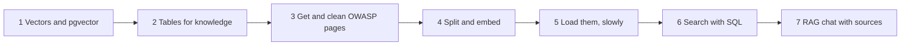
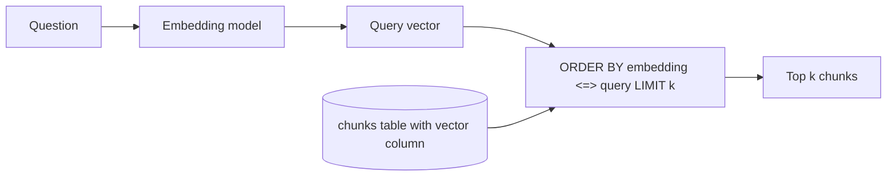
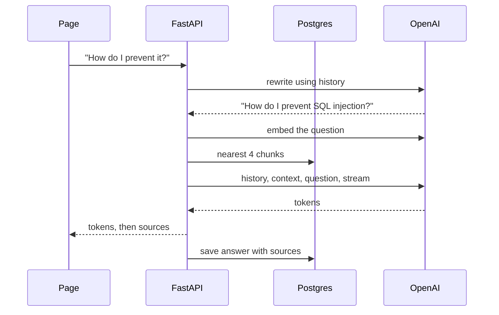

# Tutorial 3: An OWASP Top 10 Knowledge Base With pgvector

**What you build.** Your chat becomes an **OWASP Top 10:2025 assistant**. It answers security questions using the real OWASP pages, cites the category (like `[A05:2025]`), links to the source, and says "I don't know" when the pages do not cover the question. This is **RAG** (retrieval-augmented generation), and the vector search happens inside the Postgres you set up in part 2, using **pgvector**.

Everything is real: real OWASP pages, real OpenAI embeddings, real Postgres.

> **Content and license.** The OWASP Top 10 text is published by the OWASP Foundation under [CC BY-SA 4.0](https://creativecommons.org/licenses/by-sa/4.0/) at [github.com/OWASP/Top10](https://github.com/OWASP/Top10). The app downloads it when you press load and links back to owasp.org.

You need [part 2](02-postgres-conversations.md) working. If you have done the module 1 labs, this is the same RAG pipeline: load, split, embed, store, retrieve, generate.

## The path



---

## Step 1: Vectors and pgvector

### The idea

An **embedding** turns text into a list of numbers (a **vector**) so that texts with similar meaning get vectors that point the same way. `text-embedding-3-small` makes vectors of **1536** numbers.

**pgvector** adds a `vector(1536)` column type to Postgres, and operators to measure closeness:

| Operator | Meaning |
|---|---|
| `<=>` | cosine **distance** (0 means same direction, bigger is further) |
| `<->` | straight-line (Euclidean) distance |
| `<#>` | negative inner product |

We use `<=>`. **Similarity = 1 - distance.** A search is just SQL:

```sql
SELECT content FROM chunks ORDER BY embedding <=> $query LIMIT 4;
```

An **HNSW index** makes that fast for many rows by searching a graph of neighbours instead of every row (it is approximate, and very good).



### Check yourself

A query returns `distance = 0.30`. What is the similarity?

<details>
<summary>Answer</summary>

`1 - 0.30 = 0.70`.
</details>

---

## Step 2: Tables for knowledge

### Type this

Add to the end of `backend/schema.sql`. First the extension (it is already installed in the image, this just turns it on in your database), then two tables:

```sql
CREATE EXTENSION IF NOT EXISTS vector;

-- One row per OWASP category page.
CREATE TABLE IF NOT EXISTS documents (
    id          serial PRIMARY KEY,
    key         text UNIQUE NOT NULL,
    title       text NOT NULL,
    url         text NOT NULL,
    status      text NOT NULL DEFAULT 'queued',
    chunks      int NOT NULL DEFAULT 0,
    error       text NOT NULL DEFAULT '',
    updated_at  timestamptz NOT NULL DEFAULT now()
);

-- Many rows per document. 1536 is the size of text-embedding-3-small vectors.
CREATE TABLE IF NOT EXISTS chunks (
    id           bigserial PRIMARY KEY,
    document_id  int NOT NULL REFERENCES documents(id) ON DELETE CASCADE,
    position     int NOT NULL,
    content      text NOT NULL,
    embedding    vector(1536) NOT NULL
);
CREATE INDEX IF NOT EXISTS chunks_embedding_idx ON chunks USING hnsw (embedding vector_cosine_ops);
```

> If you switch embedding models, the vector size must match. A model with 3072 dimensions needs `vector(3072)`.

Python needs to learn the `vector` type. Replace `backend/db.py` (it adds the pgvector registration and a normal, non-async connection for scripts and the worker):

```python
# needs: your backend folder (file: db.py)
"""Postgres connections. The API uses an async pool. Scripts and the Celery worker use a normal connection."""
from pathlib import Path

import psycopg
from pgvector.psycopg import register_vector, register_vector_async
from psycopg.rows import dict_row
from psycopg_pool import AsyncConnectionPool

import settings

SCHEMA = Path(__file__).with_name("schema.sql")


def init_schema() -> None:
    # Safe to run on every start: every statement says IF NOT EXISTS.
    with psycopg.connect(settings.DATABASE_URL, autocommit=True) as conn:
        conn.execute(SCHEMA.read_text())


async def _configure(conn) -> None:
    await register_vector_async(conn)  # lets us pass numpy arrays as vectors


def make_pool() -> AsyncConnectionPool:
    return AsyncConnectionPool(
        settings.DATABASE_URL,
        min_size=1,
        max_size=5,
        open=False,
        configure=_configure,
        kwargs={"row_factory": dict_row, "autocommit": True},
    )


def sync_connect() -> psycopg.Connection:
    conn = psycopg.connect(settings.DATABASE_URL, row_factory=dict_row, autocommit=True)
    register_vector(conn)
    return conn
```

`init_schema` runs before the pool opens, so the extension exists by the time `register_vector_async` looks for it. Restart uvicorn once so the new tables are created.

---

## Step 3: Get and clean the OWASP pages

### The idea

The Top 10:2025 has ten category pages, each a Markdown file on GitHub. Raw text from the web is messy: these files have score tables made of HTML and icon images. Cleaning before embedding matters, because tables of numbers are noise to a search.

### Type this

Create `backend/owasp.py`:

```python
# needs: your backend folder (file: owasp.py)
"""Where the OWASP Top 10:2025 text comes from, and how we clean it.
The pages are published by OWASP under CC BY-SA 4.0: https://github.com/OWASP/Top10"""
import re

import httpx

RAW = "https://raw.githubusercontent.com/OWASP/Top10/master/2025/docs/en/{file}.md"
PAGE = "https://owasp.org/Top10/2025/{file}/"

CATEGORIES = [
    ("A01:2025", "Broken Access Control", "A01_2025-Broken_Access_Control"),
    ("A02:2025", "Security Misconfiguration", "A02_2025-Security_Misconfiguration"),
    ("A03:2025", "Software Supply Chain Failures", "A03_2025-Software_Supply_Chain_Failures"),
    ("A04:2025", "Cryptographic Failures", "A04_2025-Cryptographic_Failures"),
    ("A05:2025", "Injection", "A05_2025-Injection"),
    ("A06:2025", "Insecure Design", "A06_2025-Insecure_Design"),
    ("A07:2025", "Authentication Failures", "A07_2025-Authentication_Failures"),
    ("A08:2025", "Software or Data Integrity Failures", "A08_2025-Software_or_Data_Integrity_Failures"),
    ("A09:2025", "Security Logging and Alerting Failures", "A09_2025-Security_Logging_and_Alerting_Failures"),
    ("A10:2025", "Mishandling of Exceptional Conditions", "A10_2025-Mishandling_of_Exceptional_Conditions"),
]
FILES = {key: file for key, _, file in CATEGORIES}


def title(key: str, name: str) -> str:
    return f"{key} {name}"


def page_url(key: str) -> str:
    return PAGE.format(file=FILES[key])


def fetch_markdown(key: str) -> str:
    res = httpx.get(RAW.format(file=FILES[key]), timeout=30, follow_redirects=True)
    res.raise_for_status()
    return clean(res.text)


def clean(md: str) -> str:
    md = re.sub(r"<table>.*?</table>", "", md, flags=re.S)  # score tables are numbers, not prose
    md = re.sub(r"!\[[^\]]*\]\([^)]*\)(\{[^}]*\})?", "", md)  # icons and images
    md = re.sub(r"[ \t]+\n", "\n", md)
    return re.sub(r"\n{3,}", "\n\n", md).strip()
```

Try it:

```python
# needs: your backend folder (run it from there)
import owasp

text = owasp.fetch_markdown("A05:2025")
print(len(text))
print(text[:300])
```

**What you should see:** about 11,000 characters, starting with `# A05:2025 Injection`. This calls the real GitHub URL. No table of numbers, no image tags.

---

## Step 4: Split and embed

### The idea

A whole page is too big to match one question. We cut it into **chunks** of about 1000 characters, cutting at headings and paragraphs when possible (`Language.MARKDOWN` tells the splitter how Markdown is shaped). `chunk_overlap=150` repeats a little text at each edge so an idea cut in half still appears whole somewhere.

**A small trick that matters.** A chunk like "Use parameterized queries" does not say which category it belongs to. Before embedding, we put the category title in front. The vector then lands closer to the right topic. We store the plain chunk, though, so the page can show it as it was written.

### Type this

`backend/rag.py`:

```python
# needs: your backend folder (file: rag.py)
"""Splitting and embedding. No web code and no database code in here."""
from langchain_core.documents import Document
from langchain_openai import OpenAIEmbeddings
from langchain_text_splitters import Language, RecursiveCharacterTextSplitter

import settings

# Markdown-aware: prefers to cut at headings and paragraphs, not mid-sentence.
splitter = RecursiveCharacterTextSplitter.from_language(Language.MARKDOWN, chunk_size=1000, chunk_overlap=150)


def embedder() -> OpenAIEmbeddings:
    return OpenAIEmbeddings(model=settings.EMBED_MODEL)


def split(text: str) -> list[Document]:
    return splitter.create_documents([text])


def for_embedding(title: str, chunk: str) -> str:
    # A chunk like "Use parameterized queries" does not say which category it belongs to.
    # Putting the title in front helps the vector land near the right topic.
    return f"{title}\n\n{chunk}"


async def embed_query(question: str) -> list[float]:
    return await embedder().aembed_query(question)
```

Try it. This calls the real embedding API once:

```python
# needs: your backend folder (run it from there)
import owasp
import rag

chunks = rag.split(owasp.fetch_markdown("A05:2025"))
print(len(chunks), "chunks; first one:")
print(chunks[0].page_content[:200])

vector = rag.embedder().embed_query("SQL injection")
print(len(vector))
```

**What you should see:** around 16 chunks, the start of the first one, and `1536`.

### Check yourself

Why is `chunk_overlap` useful?

<details>
<summary>Answer</summary>

A sentence or idea can sit on the border between two chunks. Overlap repeats the border text, so at least one chunk contains it whole.
</details>

---

## Step 5: Load them, slowly (on purpose)

### The problem

We need all ten categories in the database. Write the simplest thing that works: a script that does it one by one. Notice how long it takes. That will matter in part 4.

### Type this

Create `backend/ingest_sync.py`. It is a throwaway script, and it is deliberately simple:

```python
# needs: your backend folder (file: ingest_sync.py)
"""Load the OWASP Top 10 into Postgres, one category at a time, and wait for each. Run it with:
    uv run python ingest_sync.py
"""
import time

import db
import owasp
import rag

started = time.time()
db.init_schema()
embedder = rag.embedder()

with db.sync_connect() as conn:
    for key, name, _ in owasp.CATEGORIES:
        title = owasp.title(key, name)
        doc = conn.execute(
            "INSERT INTO documents (key, title, url, status) VALUES (%s, %s, %s, 'processing') "
            "ON CONFLICT (key) DO UPDATE SET status = 'processing' RETURNING id",
            (key, title, owasp.page_url(key)),
        ).fetchone()
        texts = [c.page_content for c in rag.split(owasp.fetch_markdown(key))]
        vectors = embedder.embed_documents([rag.for_embedding(title, t) for t in texts])
        conn.execute("DELETE FROM chunks WHERE document_id = %s", (doc["id"],))  # reloading replaces, never duplicates
        for position, (text, vec) in enumerate(zip(texts, vectors)):
            conn.execute(
                "INSERT INTO chunks (document_id, position, content, embedding) VALUES (%s, %s, %s, %s)",
                (doc["id"], position, text, vec),
            )
        conn.execute("UPDATE documents SET status = 'ready', chunks = %s WHERE id = %s", (len(texts), doc["id"]))
        print(f"{key} {name}: {len(texts)} chunks, {time.time() - started:.0f}s so far")

print(f"Done in {time.time() - started:.0f} seconds")
```

Run it:

```bash
cd course2/fullstack-chat/my-chat/backend
uv run python ingest_sync.py
```

**What you should see:** ten lines, one per category, ending with `Done in N seconds`. On a good connection it takes about 10 seconds (more on a slow one). About 150 chunks in total.

Look at what it stored:

```bash
docker compose exec postgres psql -U chat chat -c "select key, status, chunks from documents order by key;"
docker compose exec postgres psql -U chat chat -c "select count(*) as chunks, vector_dims(embedding) as dims from chunks group by 2;"
```

The second query shows `1536` dimensions. The first shows ten `ready` rows.

> **Remember the time it took.** If a web endpoint did this, the browser would wait that long with a spinner, and a timeout could kill it half way. Ten seconds for ten pages is already long for a web request, and it grows with every document you add. Part 4 fixes that with a background worker.

### Try it

Run the script a second time. Does the chunk count double? (It should not: the script deletes a document's old chunks before inserting.)

---

## Step 6: Search with SQL

### Type this

Append to `backend/store.py`. This is the heart of the vector search:

```python
# needs: your backend folder (file: store.py, append)
import numpy as np  # noqa: E402  (move imports to the top of the file if you like)


async def ready_chunk_count(pool: AsyncConnectionPool) -> int:
    return (await one(pool, "SELECT count(*) AS n FROM chunks"))["n"]


async def search_chunks(pool: AsyncConnectionPool, embedding: list[float], k: int) -> list[dict]:
    # <=> is pgvector's cosine DISTANCE (0 = same direction). 1 - distance = similarity.
    rows = await many(
        pool,
        "SELECT d.title, d.url, c.content AS text, 1 - (c.embedding <=> %s) AS score "
        "FROM chunks c JOIN documents d ON d.id = c.document_id "
        "ORDER BY c.embedding <=> %s LIMIT %s",
        (np.array(embedding), np.array(embedding), k),
    )
    return [{**r, "score": round(float(r["score"]), 4)} for r in rows]
```

Try it. Embed a question and ask Postgres for the closest chunks:

```python
# needs: your backend folder (run it from there)
import asyncio

import db
import rag
import store


async def main():
    pool = db.make_pool()
    await pool.open()
    vec = await rag.embed_query("How do I stop SQL injection?")
    for hit in await store.search_chunks(pool, vec, 4):
        print(hit["score"], hit["title"], "|", hit["text"][:60].replace("\n", " "))
    await pool.close()


asyncio.run(main())
```

**What you should see:** four lines with scores around `0.6`, all or mostly `A05:2025 Injection`. Now change the question to "What is the best pizza topping?". The scores drop to about `0.1`. **A low score means "nothing relevant here".** You will use that in the chat.

### Why it works

`JOIN` pulls the category title and URL from `documents`. `ORDER BY c.embedding <=> ... LIMIT k` is the whole nearest-neighbour search, and the HNSW index speeds it up.

### Try it

1. Search "How do I log security events?" and "Why did my app crash and leak a stack trace?". Which categories win?
2. Set `k` to 1, then 10. What changes in the scores at the bottom?

### Check yourself

Why do we put `ORDER BY ... <=> ...` and not `ORDER BY score DESC`?

<details>
<summary>Answer</summary>

The index can only speed up an ordering by the **distance operator itself**. Sorting by a computed alias would scan every row.
</details>

---

## Step 7: A RAG chat with sources

### The problem

The chat in part 2 answers from the model's memory. We want it to answer from OWASP and show where the answer came from.

### The fix: retrieve, then ask



The **rewrite** step matters. A follow-up like "How do I prevent it?" has no topic words, so its vector matches nothing. A small model call turns it into a standalone question first, and we search with that.

### Type this

Replace `backend/llm.py`:

```python
# needs: your backend folder (file: llm.py)
"""Prompts and the model calls."""
from collections.abc import AsyncIterator

from langchain_core.messages import AIMessage, HumanMessage, SystemMessage
from langchain_openai import ChatOpenAI

import settings

SYSTEM = (
    "You are a security assistant that answers questions about the OWASP Top 10:2025. "
    "Use only the context below. Name the category you rely on, like [A05:2025], in your answer. "
    "If the context does not contain the answer, say you don't know and suggest which OWASP "
    "category might be related. Be concise and practical.\n\nContext:\n{context}"
)
REWRITE = (
    "Rewrite the user's last question so it makes sense on its own, using the chat history. "
    "Return only the question."
)


def get_llm(**kwargs) -> ChatOpenAI:
    return ChatOpenAI(model=settings.CHAT_MODEL, **kwargs)


def to_messages(history: list[dict]):
    return [HumanMessage(m["content"]) if m["role"] == "user" else AIMessage(m["content"]) for m in history]


async def standalone_question(history: list[dict], question: str) -> str:
    # "How do I prevent it?" cannot be searched. "How do I prevent SQL injection?" can.
    if not history:
        return question
    messages = [SystemMessage(REWRITE), *to_messages(history), HumanMessage(question)]
    return (await get_llm(temperature=0, max_tokens=100).ainvoke(messages)).content.strip()


def format_context(sources: list[dict]) -> str:
    return "\n\n".join(f"[{s['title']}]\n{s['text']}" for s in sources)


async def stream_answer(history: list[dict], question: str, sources: list[dict]) -> AsyncIterator[str]:
    messages = [SystemMessage(SYSTEM.format(context=format_context(sources))), *to_messages(history), HumanMessage(question)]
    async for chunk in get_llm(temperature=0.2, max_tokens=600).astream(messages):
        if chunk.content:
            yield chunk.content
```

Replace `backend/chat.py`. It gains retrieval, the rewrite, a `409` if the knowledge base is empty, and a `sources` event:

```python
# needs: your backend folder (file: chat.py)
import json

from fastapi import APIRouter, Depends, HTTPException
from fastapi.responses import StreamingResponse
from psycopg_pool import AsyncConnectionPool
from pydantic import BaseModel, Field

import llm
import rag
import settings
import store
from deps import get_pool

router = APIRouter(prefix="/api/conversations")


class ChatIn(BaseModel):
    message: str = Field(min_length=1, max_length=4000)
    k: int = Field(default=4, ge=1, le=10)


def sse(event: dict) -> str:
    # One server-sent event: a line starting with "data:" and a blank line after it.
    return f"data: {json.dumps(event)}\n\n"


@router.post("/{cid}/chat")
async def chat(cid: str, body: ChatIn, pool: AsyncConnectionPool = Depends(get_pool)):
    if not await store.conversation_exists(pool, cid):
        raise HTTPException(status_code=404, detail="Conversation not found")
    if await store.ready_chunk_count(pool) == 0:
        raise HTTPException(status_code=409, detail="The knowledge base is empty. Press Load OWASP Top 10 first.")

    history = await store.get_messages(pool, cid, limit=settings.HISTORY_LIMIT)
    search_text = await llm.standalone_question(history, body.message)
    sources = await store.search_chunks(pool, await rag.embed_query(search_text), body.k)
    await store.add_message(pool, cid, "user", body.message)

    async def events():
        parts: list[str] = []
        try:
            async for token in llm.stream_answer(history, body.message, sources):
                parts.append(token)
                yield sse({"type": "token", "text": token})
        except Exception as e:  # tell the page, instead of cutting the stream
            yield sse({"type": "error", "message": str(e)[:200]})
            return
        await store.add_message(pool, cid, "assistant", "".join(parts), sources)
        yield sse({"type": "sources", "sources": sources})
        yield sse({"type": "done"})

    return StreamingResponse(events(), media_type="text/event-stream")
```

`main.py` stays the same. Restart uvicorn and try it with curl:

```bash
curl -s -X POST localhost:8000/api/conversations
# use the id in place of c1
curl -N -X POST localhost:8000/api/conversations/c1/chat -H "Content-Type: application/json" -d '{"message":"What is SQL injection and how do I prevent it?"}'
curl -N -X POST localhost:8000/api/conversations/c1/chat -H "Content-Type: application/json" -d '{"message":"Which category is it in?"}'
curl -N -X POST localhost:8000/api/conversations/c1/chat -H "Content-Type: application/json" -d '{"message":"What is the best pizza topping?"}'
```

**What you should see (example):**

1. An answer about injection ending with a reference like `[A05:2025 Injection]`, then a `sources` event listing four `A05:2025` chunks.
2. "SQL injection falls under the A05:2025 Injection category..." The follow-up said only "it", and the rewrite step made it searchable.
3. "I don't know..." with sources that all have scores near `0.1`.

**The page.** The chat view gains starter questions and clickable sources. Replace `src/components/chat-view.tsx`:

```tsx
"use client";

import { useEffect, useRef, useState } from "react";
import { Button } from "@/components/ui/button";
import { Textarea } from "@/components/ui/textarea";
import { getMessages, streamChat, type Message } from "@/lib/api";

type Props = { cid: string; onActivity: () => void };

const STARTERS = [
  "What is the number one risk in the OWASP Top 10:2025?",
  "How do I prevent SQL injection?",
  "What changed in 2025 compared to before?",
];

export function ChatView({ cid, onActivity }: Props) {
  const [messages, setMessages] = useState<Message[]>([]);
  const [input, setInput] = useState("");
  const [busy, setBusy] = useState(false);
  const [error, setError] = useState("");
  const bottom = useRef<HTMLDivElement>(null);

  useEffect(() => {
    let alive = true;
    getMessages(cid)
      .then((m) => alive && setMessages(m))
      .catch((e) => alive && setError((e as Error).message));
    return () => {
      alive = false;
    };
  }, [cid]);

  useEffect(() => {
    bottom.current?.scrollIntoView({ behavior: "smooth" });
  }, [messages]);

  async function send(override?: string) {
    const text = (override ?? input).trim();
    if (!text || busy) return;
    setBusy(true);
    setError("");
    setInput("");
    // Add the user's message and an empty bot message that we fill as tokens arrive.
    setMessages((m) => [...m, { role: "user", content: text }, { role: "assistant", content: "" }]);
    const patchLast = (fn: (m: Message) => Message) =>
      setMessages((all) => all.map((m, i) => (i === all.length - 1 ? fn(m) : m)));
    try {
      for await (const event of streamChat(cid, text)) {
        if (event.type === "token") patchLast((m) => ({ ...m, content: m.content + event.text }));
        if (event.type === "sources") patchLast((m) => ({ ...m, sources: event.sources }));
        if (event.type === "error") setError(event.message);
      }
    } catch (e) {
      setError((e as Error).message);
    } finally {
      setBusy(false);
      onActivity(); // the first message gives the chat its title
    }
  }

  return (
    <div className="flex min-w-0 flex-1 flex-col">
      <div className="flex-1 space-y-4 overflow-y-auto p-4">
        {messages.map((m, i) => (
          <div key={i} className={m.role === "user" ? "ml-auto max-w-[80%] rounded-lg bg-muted p-3" : "max-w-[80%] p-3"}>
            <p className="whitespace-pre-wrap text-sm">{m.content || (busy ? "..." : "")}</p>
            {m.sources && m.sources.length > 0 && (
              <details className="mt-2 text-xs">
                <summary className="cursor-pointer text-muted-foreground">Sources ({m.sources.length})</summary>
                <ul className="mt-1 space-y-1">
                  {m.sources.map((s, j) => (
                    <li key={j} className="rounded border p-2">
                      <a href={s.url} target="_blank" rel="noreferrer" className="font-medium underline">
                        {s.title}
                      </a>{" "}
                      (similarity {s.score})
                      <p className="line-clamp-3">{s.text}</p>
                    </li>
                  ))}
                </ul>
              </details>
            )}
          </div>
        ))}
        {messages.length === 0 && (
          <div className="flex flex-wrap gap-2">
            {STARTERS.map((q) => (
              <Button key={q} variant="outline" size="sm" onClick={() => send(q)} disabled={busy}>
                {q}
              </Button>
            ))}
          </div>
        )}
        <div ref={bottom} />
      </div>
      {error && <p className="px-4 text-sm text-destructive">{error}</p>}
      <div className="flex gap-2 border-t p-3">
        <Textarea
          value={input}
          placeholder="Ask about the OWASP Top 10..."
          onChange={(e) => setInput(e.target.value)}
          onKeyDown={(e) => {
            if (e.key === "Enter" && !e.shiftKey) {
              e.preventDefault();
              send();
            }
          }}
        />
        <Button onClick={() => send()} disabled={busy}>
          Send
        </Button>
      </div>
    </div>
  );
}
```

**What you should see:** in the browser, ask a question. Under the answer, open **Sources**: each one links to the real page on owasp.org with its similarity score.

### Why it works

- The system prompt tells the model to use **only** the context and to say "I don't know" otherwise. That is the module 1 lesson about hallucinations.
- Sources travel with the answer and are saved in the `sources` jsonb column, so they are still there after a refresh.
- The similarity scores let you see *why* an answer was good or bad before blaming the model.

### Try it

1. Ask in a different way: "My login page lets people try passwords forever." Which category does it find? (Look at the sources.)
2. Set `"k": 1` in a curl request. Does the answer get thinner?
3. Ask something about **2021** ("What was A01 in 2021?"). What does the bot say, and why?

---

## Common mistakes

| Mistake | What you see | Fix |
|---|---|---|
| Vector size does not match | `expected 1536 dimensions, not 3072` | The `vector(N)` column and the embedding model must agree. |
| `type "vector" does not exist` | Error on startup | Use the `pgvector/pgvector` image, and keep `CREATE EXTENSION` in `schema.sql`. |
| Registered pgvector before the extension existed | `vector type not found in the database` | Run `init_schema()` before opening the pool. |
| Passed a Python list as the vector | A type error or a cast error | Pass a numpy array (`np.array(vec)`) after `register_vector`. |
| Searched with a follow-up as-is | Wrong or empty sources | Rewrite it to a standalone question first. |
| Embedded different text than you searched | Poor matches | Same embedding model for chunks and questions. |
| `409` from chat | "The knowledge base is empty" | Run `ingest_sync.py`. |
| Duplicate chunks after a reload | Counts double | Delete a document's chunks before inserting (the script does). |
| Table scores in the text | Odd, numeric chunks | Clean the Markdown first (`owasp.clean`). |

## Practice

No answers shown. Ask me for a hint.

1. **Chunk size.** Try `chunk_size` 400 and 2000. Re-run the ingest. Which gives better sources for "How do I prevent SQL injection?"
2. **A score threshold.** If the best similarity is under `0.25`, answer "I don't know" without calling the chat model. Where does that check go?
3. **Filter by category.** Add an optional `category` to the chat request (for example `A05:2025`) and filter in SQL. Which `WHERE`?
4. **Compare distances.** Switch `<=>` to `<->` in the query. Do the results change? Why or why not?
5. **An index test.** Run `EXPLAIN SELECT ... ORDER BY embedding <=> ... LIMIT 4` in psql. Do you see the HNSW index used?
6. **Another source.** Add the OWASP API Security Top 10 as a second set of documents. What should change in `owasp.py` and `documents`?
7. **Explain it.** In six sentences, explain what happens between typing a question and seeing a sourced answer.

## Cheat sheet

| Step | Added | Key idea |
|---|---|---|
| 1 | pgvector | Vectors in Postgres, `<=>` for cosine distance |
| 2 | `documents`, `chunks` tables | A vector column plus an HNSW index |
| 3 | `owasp.py` | Clean text before embedding |
| 4 | `rag.py` | Markdown-aware splitting, title in front for embedding |
| 5 | `ingest_sync.py` | Works, but slow |
| 6 | `search_chunks` | Nearest neighbours in one SQL query |
| 7 | RAG `chat.py` | Rewrite, retrieve, answer, cite, save |

Next: [Part 4: Redis and Celery](04-redis-and-celery.md).
