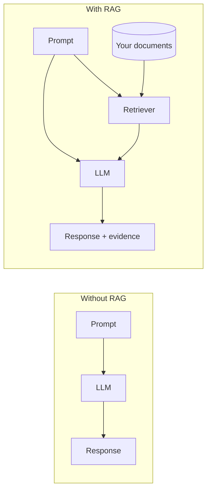
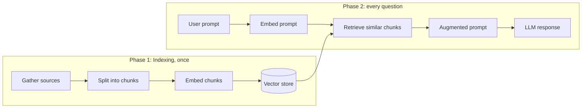
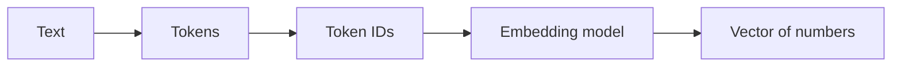
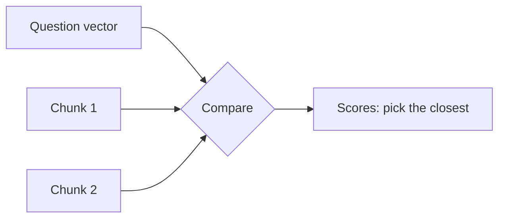
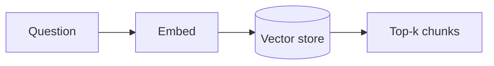
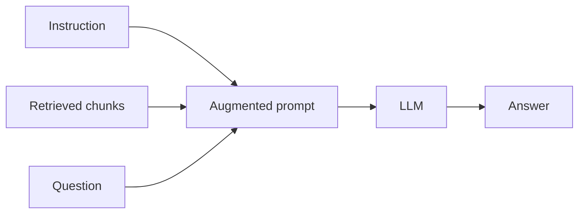

# Module 1: RAG Study Guide

A plain-language guide to Retrieval-Augmented Generation (RAG): why it exists, how each step works, and where it falls short.

**How to use this guide:** read top to bottom once, then use the [Cheat Sheet](#12-cheat-sheet) and [Self-Quiz](#13-self-quiz) for revision.

## Contents

1. [Why RAG?](#1-why-rag)
2. [What is RAG?](#2-what-is-rag)
3. [The big picture](#3-the-big-picture)
4. [Gather sources and split into chunks](#4-gather-sources-and-split-into-chunks)
5. [Embeddings](#5-embeddings)
6. [Measuring similarity](#6-measuring-similarity)
7. [Vector stores](#7-vector-stores)
8. [Retrieval and top-k](#8-retrieval-and-top-k)
9. [The augmented prompt and generation](#9-the-augmented-prompt-and-generation)
10. [RAG vs long context windows](#10-rag-vs-long-context-windows)
11. [Where RAG struggles](#11-where-rag-struggles)
12. [Cheat Sheet](#12-cheat-sheet)
13. [Self-Quiz](#13-self-quiz)

---

## Hands-on tutorials

Type-along versions with code, diagrams and exercises:

- [Tutorial 1: study guide and the lab, adapted](tutorials/01-rag-study-guide-and-lab-adapted.md) follows the videos and the lab in order, modernised for OpenAI and LangChain 1.x.
- [Tutorial 2: build a notes bot](tutorials/02-rag-build-a-notes-bot.md) grows one bot that answers from `transcript.md`, step by step, so each concept appears when you need it.

- [Tutorial 3: build the RAG lab as a web app](tutorials/03-build-the-rag-lab-web-app.md) rebuilds the lab with a Next.js, TypeScript, Tailwind and shadcn/ui frontend and a FastAPI backend. Three tabs let you *see* chunks, retrieval scores and answers (with the "I don't know" rule and memory as switches). The finished app is in [app/](app/).

Source material in this folder: [transcript.md](transcript.md) (video transcripts and readings) and the lab notebook *Summarize private documents using RAG LangChain and LLMs*.

---

## Run the examples yourself

The snippets use **OpenAI** through `langchain-openai`, already installed in the repo's shared environment (see the [root README](../../README.md)). Put `OPENAI_API_KEY=...` in the root `.env`, pick the root `.venv` as your notebook kernel, then run this **once** at the top of a notebook.

```python
from dotenv import load_dotenv
from langchain_openai import ChatOpenAI, OpenAIEmbeddings

load_dotenv()
llm = ChatOpenAI(model="gpt-4o-mini", temperature=0, max_tokens=300)
embeddings = OpenAIEmbeddings(model="text-embedding-3-small")
```

Each call costs a small amount of API credit. The course uses IBM watsonx.ai and Hugging Face embeddings instead. The ideas are identical and only these two lines change.

---

## 1. Why RAG?

An LLM learned from text up to a **cut-off date**. It does not know your private files, and it does not know anything newer. When it does not know, it often answers anyway, sounding sure.

The video tells a story: asked which planet has the most moons, a parent answers "Jupiter, 88 moons" from memory. That answer has **no source** and is **out of date**. Checking NASA gives "Saturn, 146 moons". The second answer is **grounded** in a source.

| Problem | In plain words |
|---|---|
| **No source** | The model cannot show where an answer came from. |
| **Out of date** | The world changed after training. |
| **Hallucination** | It invents a believable but wrong answer. |
| **Data leaks** | It may repeat private details it saw in training. |

> **Analogy:** a normal LLM takes a **closed-book exam**: answers from memory only. RAG gives it an **open-book exam**: it looks up the right page first.

---

## 2. What is RAG?

**RAG = Retrieval-Augmented Generation.** It combines information retrieval with a generative model so answers use your data, without retraining the model.

| Word | Meaning |
|---|---|
| **Retrieval** | Look up the relevant text in a store of documents. |
| **Augmented** | Add that text to the prompt. |
| **Generation** | The LLM writes the answer from the augmented prompt. |

RAG has two components:

| Component | Job |
|---|---|
| **Retriever** | The core of RAG. Finds the text most relevant to the question. |
| **Generator** | The LLM, which writes the answer using the retrieved text. |



**What RAG fixes**

| Problem | How RAG helps |
|---|---|
| Out of date | Update the data store. No retraining needed. |
| No source | The answer is built from retrieved text, so you can show it. |
| Hallucination | The model leans on source text and can say "I don't know". |

---

## 3. The big picture

RAG has two phases. **Indexing** happens once. **Retrieval and generation** happens for every question.



The video groups these into four steps: **text embedding, retrieval, augmented query creation, model generation**. The lab calls the first phase **Load, Split, Embed, Store**.

| Step | One-line job |
|---|---|
| Gather sources | Collect documents (policies, PDFs, web pages). |
| Chunk | Cut documents into small pieces. |
| Embed | Turn each piece into a vector of numbers. |
| Store | Save vectors in a vector store. |
| Embed the prompt | Use the **same** embedding model on the question. |
| Retrieve | Find the closest chunks. |
| Augment | Put chunks and question into one prompt. |
| Generate | The LLM answers. |

---

## 4. Gather sources and split into chunks

**Gathering** often includes cleaning: for example turning PDFs into plain text.

**Chunking** cuts long documents into small pieces. Why?

- Small pieces are easier to match to a question.
- Many small pieces fit in a prompt. A whole book does not.
- The video's example: a company's mobile policy is long, so we split it into chunks (7 in the diagram).

> **Analogy:** you hand someone the right page of the textbook, not the whole textbook.

| Setting | Meaning |
|---|---|
| `chunk_size` | Target length of each chunk (in characters). |
| `chunk_overlap` | Text repeated at the edges so ideas are not cut in half. |

```python
from langchain_text_splitters import RecursiveCharacterTextSplitter

splitter = RecursiveCharacterTextSplitter(chunk_size=500, chunk_overlap=50)
chunks = splitter.split_text("A long policy text. " * 200)
print(len(chunks))
```

> **Lab quirk:** the lab uses `CharacterTextSplitter`, which cuts only at blank lines. On the policy file it produces 16 chunks, and half are lone headings (about 20 characters) cut away from their text. `RecursiveCharacterTextSplitter` avoids this by trying paragraphs, then lines, then spaces.

---

## 5. Embeddings

A computer cannot compare meaning in words, so an **embedding model** turns text into a **vector**: a fixed-length list of numbers (for example 1536 numbers). Text with similar meaning gets similar vectors.

Inside the embedding model:

1. **Tokenize:** split text into tokens (words or word pieces). Each token gets an ID, which has no meaning by itself.
2. **Neural network:** the IDs go in, and out comes one vector for the whole text.

> The video explains the vector as the **average of the token vectors**. Think of that as a simple mental model. Modern models are smarter, but the result is the same: one vector per piece of text.



**Golden rule:** embed the question with the **same model** you used for the chunks. Vectors from different models cannot be compared.

The reading mentions encoders such as **BERT** and **GPT** for this. The video's "question encoder" and "context encoder" can be the same model, which is simpler.

```python
vec = embeddings.embed_query("Phones must be silent in meetings")
print(len(vec))   # 1536 for text-embedding-3-small
```

---

## 6. Measuring similarity

To find relevant chunks, compare the question vector with each chunk vector.

| Measure | Looks at | Use when |
|---|---|---|
| **Cosine similarity** | direction only (angle between the arrows) | Default for text. Length does not matter. |
| **Dot product** | direction **and** length (magnitude) | Length carries meaning too. |



A tiny example you can run by hand:

```python
import numpy as np

q, c1, c2 = np.array([1.0, 1.0]), np.array([2.0, 2.0]), np.array([1.0, 0.2])
cosine = lambda a, b: a @ b / (np.linalg.norm(a) * np.linalg.norm(b))

print("dot   :", q @ c1, q @ c2)                              # 4.0  1.2
print("cosine:", round(cosine(q, c1), 3), round(cosine(q, c2), 3))  # 1.0  0.745
```

`c1` points exactly the same way as `q`, so its cosine is `1.0`. Make `c1` longer and the dot product grows, but cosine stays `1.0`.

---

## 7. Vector stores

A **vector store** (vector database) keeps each chunk's vector and text, and quickly finds the nearest vectors to a question vector. In the video, the chunk **ID** is the key used to get the text back.

| Store | Notes |
|---|---|
| **ChromaDB** | Easy to start with. Used in the lab. |
| **FAISS** | Fast similarity search. Used later in the certificate. |
| **Milvus** | Built for large scale. |
| In-memory store | Fine for learning. Gone when the program ends. |

```python
from langchain_core.documents import Document
from langchain_core.vectorstores import InMemoryVectorStore

docs = [Document(page_content=t) for t in chunks[:5]]
store = InMemoryVectorStore.from_documents(docs, embeddings)
```

> **Lab says / today we use:** the lab uses `Chroma.from_documents(texts, embeddings)`. Chroma is not installed in this repo, so the tutorials use `InMemoryVectorStore`. The call has the same shape.

---

## 8. Retrieval and top-k

A **retriever** takes a question and returns the best chunks. The key setting is **k**: how many chunks to return. The video says 3 to 5 is typical, and calls k a **hyperparameter** (a setting you choose, not something learned).



| k too small | k too large |
|---|---|
| May miss the chunk with the answer | Adds noise, costs more, slows the answer |

```python
retriever = store.as_retriever(search_kwargs={"k": 3})
for d in retriever.invoke("silent phones"):
    print(d.page_content[:60])
```

Retrieval can return a **chunk**, the **whole document** containing it, or **several documents**. The simplest and most common choice is chunks.

---

## 9. The augmented prompt and generation

The retrieved text is combined with the user's question into an **augmented prompt**. The video says it has three parts: **instruction + retrieved content + question**. The LLM then answers from it.



Two ways to build it, from the reading: **simple concatenation**, or a **structured template** with extra instructions. Templates are better because they can add rules such as "say I don't know".

```python
from langchain_core.output_parsers import StrOutputParser
from langchain_core.prompts import ChatPromptTemplate

prompt = ChatPromptTemplate.from_template(
    "Use only the context. If the answer is not there, say \"I don't know\".\n\n"
    "Context:\n{context}\n\nQuestion: {question}"
)
chain = prompt | llm | StrOutputParser()
print(chain.invoke({"context": "Smoking is not permitted in company vehicles.",
                    "question": "Can I smoke in a company car?"}))
```

The video's point about **"I don't know"**: if the data store cannot answer, the model should say so instead of inventing something. But there is a catch: if the **retriever** is weak and misses the right chunk, the model will also say "I don't know" about answerable questions. So teams improve both sides: a better retriever and a better generator.

**Memory.** For follow-up questions ("What can't I do in it?"), keep the chat history and first **rewrite** the follow-up into a standalone question, then retrieve with that. The lab does this with legacy classes (`ConversationalRetrievalChain`). Tutorial 1, Concept 8 shows the modern way.

---

## 10. RAG vs long context windows

Modern models accept very long prompts (128,000 tokens is about 96,000 English words; 100 tokens is about 75 words). Why not paste everything in?

| Limit of long context alone | How RAG helps |
|---|---|
| **Input dependency:** you must already have the right text | The store is searched for you. |
| **Limited capacity:** *War and Peace* is over 560,000 words | Only relevant pieces are sent. |
| **Redundancy:** facts get buried ("needle in a haystack") | Only pertinent text is passed. |
| **Processing time:** more tokens, slower | Shorter prompts, faster answers. |
| **Cost:** more tokens, more money | Shorter prompts, lower cost. |

---

## 11. Where RAG struggles

- **Weak retrieval means weak answers.** If the right chunk is not retrieved, the LLM cannot use it. Inspect what was retrieved before blaming the LLM.
- **Whole-document questions.** "Summarize the document" matches no single chunk. The lab shows this: you get a summary of only the top-k chunks.
- **Bad chunking.** Tiny heading-only chunks or ideas cut in half hurt matching.
- **Stale index.** If documents change, rebuild the index (re-chunk, re-embed, re-store).
- **Mixed models.** Questions and chunks must use the same embedding model.

Typical tuning knobs: `chunk_size`, `chunk_overlap`, `k`, the embedding model, and the prompt wording.

---

## 12. Cheat Sheet

| Term | One-line meaning |
|---|---|
| RAG | Look up relevant text, add it to the prompt, then generate. |
| Retriever | Finds relevant chunks for a question. |
| Generator | The LLM that writes the answer. |
| Chunk | A small piece of a document. |
| Embedding | A vector of numbers that captures meaning. |
| Token | A word or word piece the model reads. |
| Vector store | Database of chunk vectors plus text. |
| Cosine similarity | Closeness by direction only. |
| Dot product | Closeness by direction and length. |
| Top-k | Take the k closest chunks. |
| Augmented prompt | Instruction + retrieved text + question. |
| Grounded | Based on a real source. |
| Hallucination | A made-up but believable answer. |
| Indexing | The one-time prep: load, split, embed, store. |

| Lab (watsonx era) | Today in this repo |
|---|---|
| `WatsonxLLM` | `ChatOpenAI(model="gpt-4o-mini")` |
| `HuggingFaceEmbeddings()` | `OpenAIEmbeddings(model="text-embedding-3-small")` |
| `Chroma.from_documents` | `InMemoryVectorStore.from_documents` |
| `RetrievalQA` | `retriever | format_docs | prompt | llm | StrOutputParser()` |
| `ConversationalRetrievalChain` | history list plus a rewrite step |

---

## 13. Self-Quiz

1. Name the three LLM problems that RAG helps with.
2. What do the "R", "A" and "G" in RAG stand for?
3. What are the two components of a RAG system?
4. What is the difference between the indexing phase and the query phase?
5. Why do we split documents into chunks?
6. What does an embedding model produce?
7. Why must the question and the chunks use the same embedding model?
8. What is the difference between cosine similarity and dot product?
9. What is **k** in top-k, and what happens if it is too small?
10. What are the three parts of an augmented prompt?
11. Why should a RAG bot sometimes say "I don't know"?
12. Name two reasons a RAG bot might say "I don't know" for an answerable question.
13. Why not just paste all documents into a long-context model?
14. Why is "summarize the whole document" hard for simple RAG?

<details>
<summary>Show answers</summary>

1. No source, out of date, and hallucination (also possible data leaks).
2. Retrieval, Augmented, Generation.
3. The **retriever** (finds relevant text) and the **generator** (the LLM that writes the answer).
4. Indexing runs once to prepare documents (load, split, embed, store). The query phase runs for every question (embed question, retrieve, augment, generate).
5. Small pieces match questions better, fit in a prompt, and avoid sending irrelevant text.
6. A fixed-length vector of numbers that captures the text's meaning.
7. Vectors from different models live in different "number spaces", so distances between them mean nothing.
8. Cosine compares direction only. Dot product compares direction and length.
9. The number of chunks retrieved (3 to 5 is common). Too small and the chunk with the answer may be missed.
10. The instruction, the retrieved content, and the user's question.
11. So it does not invent a believable but wrong answer when the documents do not contain the information.
12. The retriever missed the right chunk (poor chunking, `k` too small, weak embeddings), or the prompt was too strict.
13. You must already have the right text, capacity is limited, relevant facts get buried, and long prompts are slower and cost more.
14. The question matches no single topic, so the retriever returns only the top-k chunks and the answer covers a small part of the document.

</details>

---

### Notes on this guide

- Code snippets are **simplified** to teach the idea. Import paths change between LangChain versions, so check the [LangChain docs](https://python.langchain.com) for your installed version.
- The course lab uses **IBM watsonx.ai, Hugging Face embeddings and Chroma**. The concepts apply to any provider.
- `RetrievalQA`, `ConversationalRetrievalChain` and `ConversationBufferMemory` are the older style shown in the lab. The `|` (LCEL) style is the modern equivalent.
