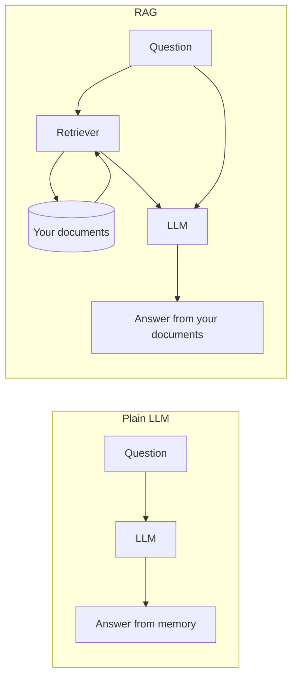
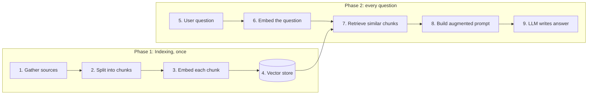
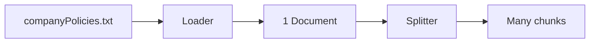
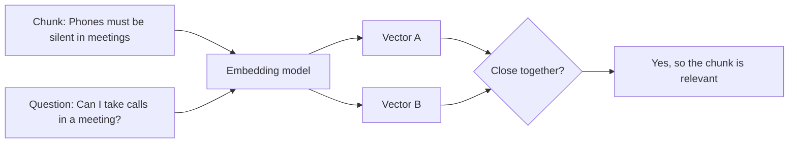
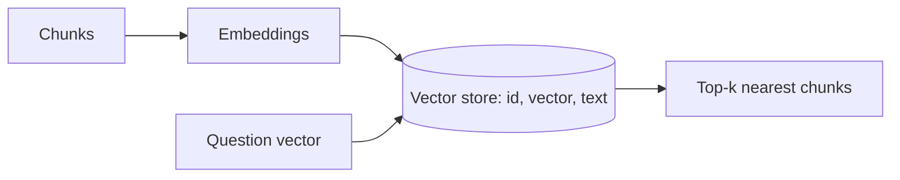
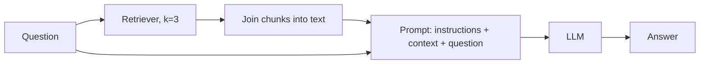
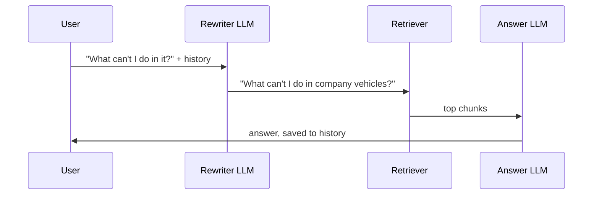
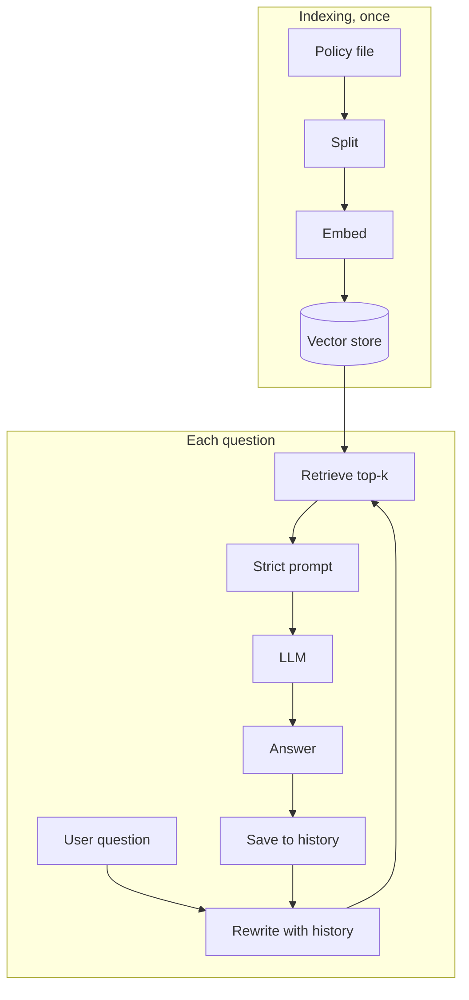

# Tutorial 1: RAG Study Guide and the Lab, Adapted

**What this is.** A study guide plus a type-along version of the videos *Why RAG*, *More RAG Details*, *What is RAG* and the lab *Summarize Private Documents Using RAG, LangChain, and LLMs*. It follows the course order. Each idea has a plain explanation, a diagram, code you type yourself, and a small exercise.

**What is different from the lab.** The lab uses IBM watsonx.ai, Hugging Face embeddings, Chroma and old LangChain classes (`RetrievalQA`, `ConversationalRetrievalChain`). This guide uses OpenAI and current LangChain (1.x). The ideas are the same. Where they differ you will see:

> **Lab says / today we use:** ...

Prefer learning by building one app, one problem at a time? Read [Tutorial 2: build a "study notes" bot](02-rag-build-a-notes-bot.md). The two tutorials teach the same ideas in different ways. To see the pipeline in a web app (Next.js + FastAPI), try [Tutorial 3](03-build-the-rag-lab-web-app.md).

## After this tutorial you can

- Say why plain LLMs fail (no source, out of date, made-up answers) and how RAG helps.
- Name the steps of a RAG pipeline and draw them.
- Split a document into chunks and explain why.
- Explain embeddings, cosine similarity, dot product and top-k in simple words.
- Build a working question-answering bot over your own text, with an "I don't know" rule, memory and sources.

## How to use this guide

1. Open a new notebook in `course2/module1/` and choose the root `.venv` as the kernel.
2. Type each **Type this** block. Do not paste. Typing is where learning happens.
3. Compare with **Expected output**. LLM text changes each run, so expect *similar*, not *identical*.
4. Do **Try it** and **Check yourself** before moving on.

Real API calls cost a tiny amount (a few cents for the whole guide with `gpt-4o-mini` and `text-embedding-3-small`).

## Contents

1. [Before you start](#before-you-start)
2. [Concept 1: Why RAG?](#concept-1-why-rag)
3. [Concept 2: The RAG recipe](#concept-2-the-rag-recipe)
4. [Concept 3: Load and split into chunks](#concept-3-load-and-split-into-chunks)
5. [Concept 4: Embeddings and similarity](#concept-4-embeddings-and-similarity)
6. [Concept 5: The vector store](#concept-5-the-vector-store)
7. [Concept 6: Retrieve, augment, generate](#concept-6-retrieve-augment-generate)
8. [Concept 7: Teach it to say "I don't know"](#concept-7-teach-it-to-say-i-dont-know)
9. [Concept 8: Memory for follow-up questions](#concept-8-memory-for-follow-up-questions)
10. [Putting it together](#putting-it-together)
11. [Transcript fixes](#transcript-fixes)
12. [Common mistakes](#common-mistakes)
13. [Cheat sheet](#cheat-sheet)
14. [Practice](#practice)

---

## Before you start

You need `OPENAI_API_KEY` in the repo-root `.env`. Packages are already installed (see the [root README](../../../README.md)). Run this once in the first cell:

```python
from dotenv import load_dotenv
from langchain_openai import ChatOpenAI, OpenAIEmbeddings

load_dotenv()
llm = ChatOpenAI(model="gpt-4o-mini", temperature=0, max_tokens=300)
embeddings = OpenAIEmbeddings(model="text-embedding-3-small")
```

> **Lab says / today we use:** the lab builds `WatsonxLLM(model_id="meta-llama/llama-4-maverick-17b-128e-instruct-fp8", params=...)` with `project_id="skills-network"` and uses `HuggingFaceEmbeddings()`. Our `llm` and `embeddings` fill the same two jobs: one writes answers, the other turns text into numbers. `temperature=0` replaces the lab's greedy decoding (same answer every time, roughly). The lab's long `pip install` cell is not needed.

If you want the watsonx version, the model line is `WatsonxLLM(model_id=..., url="https://us-south.ml.cloud.ibm.com", project_id=..., params=...)` from `langchain_ibm`. It only works inside the course lab or with your own IBM keys.

---

## Concept 1: Why RAG?

### The idea

An LLM learned from text up to a **cut-off date**. It does not know your private files or anything newer. When it does not know, it often still answers, sounding sure. That gives three problems:

| Problem | What it means |
|---|---|
| **No source** | It cannot show where an answer came from. |
| **Out of date** | The world changed after training. |
| **Hallucination** | It invents a believable but wrong answer. |

The video's story: a parent says "Jupiter, 88 moons" from memory. That answer has no source and is old. Checking NASA gives "Saturn, 146 moons". That second answer is **grounded** in a source. RAG makes the LLM do the "check NASA first" step.

**RAG** = **R**etrieval-**A**ugmented **G**eneration:
- *Retrieval*: look up relevant text.
- *Augmented*: add that text to the prompt.
- *Generation*: the LLM writes the answer using it.

Think of an **open-book exam**. A normal LLM answers from memory. A RAG system is allowed to open the book first.



### Why not just paste everything into the prompt?

Modern models accept very long prompts (128,000 tokens is about 96,000 English words; 100 tokens is about 75 words). The reading lists five reasons that is still not enough:

1. **You must already have the right text** to paste.
2. **It can still be too small.** *War and Peace* is over 560,000 words.
3. **Noise.** Facts buried in a lot of text are easy to miss ("needle in a haystack").
4. **Slow.** More tokens, more time.
5. **Costly.** More tokens, more money.

RAG sends only the few most relevant pieces, so prompts stay short, fast and cheap.

### Try it

Ask the plain model something it cannot know. Type:

```python
q = "What does the Mobile Phone Policy of Innovatech say about personal calls?"
print(llm.invoke(q).content)
```

**Expected output** (example): a vague, general answer, or a guess. It has never seen Innovatech's policy. Keep this question. You will ask it again after we build the RAG pipeline.

### Check yourself

Which two of the three problems does RAG fix by "just updating the data store" instead of retraining?

<details>
<summary>Answer</summary>

**Out of date** (add the new facts to the store, no retraining) and **no source** (the answer comes from retrieved text, so you can show it). It also lowers hallucination because the model leans on the retrieved text.
</details>

---

## Concept 2: The RAG recipe

### The idea

RAG has two phases.

- **Indexing** (done once, before any question): prepare your documents so they are searchable.
- **Retrieval + generation** (done for every question): find the right pieces and answer.



The video groups this into four steps: **text embedding, retrieval, augmented query creation, model generation**. The two components are the **retriever** (finds text) and the **generator** (the LLM that writes the answer).

> The lab labels these as **Load, Split, Embed, Store** (indexing) and **Retrieve, Generate** (retrieval).

### Check yourself

Which phase do you run again when a user asks a *new* question?

<details>
<summary>Answer</summary>

Only phase 2. The index is built once and reused. You rerun phase 1 only when your documents change.
</details>

---

## Concept 3: Load and split into chunks

### The idea

A long document is hard to search and may not fit in a prompt. So we cut it into small pieces called **chunks**. Each chunk is later matched to a question by itself.

Think of a textbook. You do not hand someone the whole book. You give them the right page.



### Type this

Download the lab's sample file (company policies for the fictional *Innovatech*). This replaces the lab's `wget`:

```python
from urllib.request import urlretrieve

URL = "https://cf-courses-data.s3.us.cloud-object-storage.appdomain.cloud/6JDbUb_L3egv_eOkouY71A.txt"
urlretrieve(URL, "companyPolicies.txt")
print(open("companyPolicies.txt").read()[:300])
```

**Expected output:** the start of "1. Code of Conduct ...". The file holds nine policies (Code of Conduct, Recruitment, Internet and Email, Mobile Phone, Smoking, Drug and Alcohol, Health and Safety, Anti-discrimination, Discipline).

Now load and split exactly like the lab:

```python
from langchain_community.document_loaders import TextLoader
from langchain_text_splitters import CharacterTextSplitter

documents = TextLoader("companyPolicies.txt").load()
splitter = CharacterTextSplitter(chunk_size=1000, chunk_overlap=0)
texts = splitter.split_documents(documents)
print(len(texts))
```

**Expected output:** `16` (you may also see warnings like "Created a chunk of size 1624, which is longer than the specified 1000").

Two things to understand:

- `chunk_size=1000` is a *target* in characters, not a hard limit.
- `CharacterTextSplitter` only cuts at one separator, by default a blank line (`\n\n`). If a piece has no blank line inside, it stays long. That is why you got warnings.

### Look closely (a lab quirk)

Check the chunk sizes:

```python
print([len(t.page_content) for t in texts])
```

**Expected output** (example): `[18, 1624, 21, 1885, 28, 1903, ...]`. See the tiny numbers (18, 21, 28)? Those are **headings alone**, such as "1. Code of Conduct", cut away from their text. A heading chunk with no body is nearly useless for retrieval.

### Beyond the video: a better splitter

`RecursiveCharacterTextSplitter` tries the blank line first, then a single newline, then a space, so chunks stay near the size you asked for. `chunk_overlap` repeats a little text at the edges so a sentence cut in half still appears whole in one chunk.

```python
from langchain_text_splitters import RecursiveCharacterTextSplitter

better = RecursiveCharacterTextSplitter(chunk_size=500, chunk_overlap=50)
chunks = better.split_documents(documents)
print(len(chunks), max(len(c.page_content) for c in chunks))
```

**Expected output** (example): about `50` chunks, longest at most 500. We will use `chunks` from here on, because small focused chunks give sharper retrieval.

### Try it

Change `chunk_size` to `200` and then `2000`. How does the number of chunks change? Which size would you pick for a question like "Can I smoke in company vehicles?"

### Check yourself

Why does a chunk have to be small, but not *too* small?

<details>
<summary>Answer</summary>

Small enough to match one topic and to fit many chunks in a prompt. Big enough to hold a complete thought. A heading alone (18 characters) has no answer inside it.
</details>

---

## Concept 4: Embeddings and similarity

### The idea

A computer cannot compare meaning in words. So an **embedding model** turns text into a **vector**: a long list of numbers (for example 1536 numbers). Texts with similar meaning get vectors that point in similar directions.

The video describes the steps inside the model:

1. **Tokenize**: split text into tokens (words or word pieces). Each token gets an ID number, which has no meaning by itself.
2. **Neural network**: the IDs go through the embedding model, which produces one fixed-length vector for the whole chunk.

> The video also says the prompt vector is made by **averaging token vectors**. That is a simple way to think about it. Modern embedding models are smarter, but the result is the same: *one vector per piece of text*.

Important rule: **embed the question with the same model you used for the chunks**. Vectors from different models cannot be compared.



### Measuring "close": dot product and cosine

Two common measures, from the video:

| Measure | Looks at | In short |
|---|---|---|
| **Dot product** | direction **and** length (magnitude) | bigger and aligned scores higher |
| **Cosine similarity** | direction **only** | angle between arrows; ignores length |

Cosine is the usual default for text because a long chunk and a short chunk about the same topic should still match.

### Type this

First by hand with tiny 2-number vectors, no API:

```python
import numpy as np

q = np.array([1.0, 1.0])    # the question
c1 = np.array([2.0, 2.0])   # same direction as q, but longer
c2 = np.array([1.0, 0.2])   # different direction, shorter

def cosine(a, b):
    return a @ b / (np.linalg.norm(a) * np.linalg.norm(b))

print("dot   :", q @ c1, q @ c2)
print("cosine:", round(cosine(q, c1), 3), round(cosine(q, c2), 3))
```

**Expected output:**

```
dot   : 4.0 1.2
cosine: 1.0 0.745
```

`c1` points exactly the same way as `q`, so its cosine is `1.0` (a perfect match). The dot product also likes `c1` here, but only because `c1` is longer. Make `c1 = np.array([200.0, 200.0])` and the dot product explodes while cosine stays `1.0`. That is the "direction versus magnitude" point from the video.

Now with real embeddings (this calls the API once):

```python
a = embeddings.embed_query("Phones must be silent in meetings")
b = embeddings.embed_query("Can I take calls during a meeting?")
c = embeddings.embed_query("The cafeteria serves lunch at noon")

print(len(a))
print(round(cosine(np.array(a), np.array(b)), 2), round(cosine(np.array(a), np.array(c)), 2))
```

**Expected output** (example): `1536`, then something like `0.55 0.12`. The first pair talks about the same thing, so its number is clearly higher. The exact values will differ.

> **Lab says / today we use:** the lab's `HuggingFaceEmbeddings()` downloads a sentence-transformers model and runs on your machine. `OpenAIEmbeddings` calls an API. Same job, different provider. The lab's demo in the video also shows **top-K** with 7 chunks, picking IDs 6, 2 and 0: **K** is just "how many closest chunks to take" (the video says 3 to 5 is common). K is a setting you choose, called a *hyperparameter*.

### Try it

Make a fourth sentence about smoking at work and compare it with `a`, `b` and `c`. Is it closer to the phone ones or the cafeteria one?

### Check yourself

You change the embedding model for questions but keep the old chunk vectors. What goes wrong?

<details>
<summary>Answer</summary>

The two kinds of vectors live in different "number spaces" (even their lengths may differ), so distances mean nothing and retrieval returns bad matches. Re-embed everything with the same model.
</details>

---

## Concept 5: The vector store

### The idea

A **vector store** (vector database) keeps each chunk's text next to its vector and can quickly find the vectors nearest to a question vector. The reading lists ChromaDB, FAISS and Milvus. The video says each chunk has an **ID** as its key, and the search uses that ID to fetch the text.



### Type this

```python
from langchain_core.vectorstores import InMemoryVectorStore

docsearch = InMemoryVectorStore.from_documents(chunks, embeddings)
print("document ingested")
```

**Expected output:** `document ingested`. This is the **embed + store** step. It calls the embedding API once per chunk.

> **Lab says / today we use:** the lab uses `Chroma.from_documents(texts, embeddings)` from `langchain_chroma`. Chroma is not installed in this repo, and an in-memory store is enough for learning. The call has the same shape, so swapping later is a one-line change. In-memory means it disappears when the notebook stops. A real app uses Chroma, FAISS or similar to save to disk.

Now search it yourself:

```python
hits = docsearch.similarity_search_with_score("Can I smoke in company vehicles?", k=3)
for doc, score in hits:
    print(round(score, 2), doc.page_content[:80].replace("\n", " "))
```

**Expected output** (example): three lines, each a smoking-related chunk with a score near `0.5` to `0.7`. Higher is closer.

### Try it

Change `k=3` to `k=1` and then `k=6`. What do you notice about the last results?

### Check yourself

What two things does a vector store hold for each chunk?

<details>
<summary>Answer</summary>

The chunk's **vector** (used to find it) and its **text** (what we hand to the LLM). Often also metadata, such as the source file.
</details>

---

## Concept 6: Retrieve, augment, generate

### The idea

A **retriever** is a small object that takes a question and returns the best chunks. Then we make an **augmented prompt**: instructions, plus the retrieved text, plus the question. The video says the prompt now has three parts. Finally the LLM answers.



### Type this

Build the pieces one at a time.

```python
retriever = docsearch.as_retriever(search_kwargs={"k": 3})

def format_docs(docs):
    return "\n\n".join(d.page_content for d in docs)

print(format_docs(retriever.invoke("What is the mobile phone policy?"))[:300])
```

**Expected output:** the start of the phone-policy text. Now the prompt and the chain, using LCEL (LangChain's `|` pipe):

```python
from langchain_core.output_parsers import StrOutputParser
from langchain_core.prompts import ChatPromptTemplate
from langchain_core.runnables import RunnablePassthrough

prompt = ChatPromptTemplate.from_template(
    "Use the context to answer the question.\n\nContext:\n{context}\n\nQuestion: {question}"
)

qa = (
    {"context": retriever | format_docs, "question": RunnablePassthrough()}
    | prompt
    | llm
    | StrOutputParser()
)
print(qa.invoke("What is the mobile phone policy?"))
```

**Expected output** (example): a short summary of the phone policy taken from your file.

Read the dictionary as: "fill `context` by running the retriever then `format_docs`; fill `question` with the input unchanged".

> **Lab says / today we use:** the lab uses `RetrievalQA.from_chain_type(llm=llm, chain_type="stuff", retriever=...)` and `qa.invoke(query)`. That class was removed from LangChain 1.x (it lives in the `langchain-classic` package). `"stuff"` means "stuff all retrieved chunks into one prompt", which is exactly what our `format_docs` plus `prompt` do. Writing it by hand shows you what the old class did inside. The lab's result is a dictionary (`result["result"]`); ours is plain text because of `StrOutputParser`.

### Beyond the video: the high-level question problem

The lab then asks `"Can you summarize the document for me?"`. Try it:

```python
print(qa.invoke("Can you summarize the document for me?"))
```

You get a summary of only *3 chunks*, not the whole file. A retriever finds chunks that match the words in the question. "Summarize the document" matches no particular topic. This is a real limit of simple RAG: it is good at **specific** questions and weak at **whole-document** questions.

### Try it

Set `k` to `10` and ask for the summary again. Is it better? What does the larger `k` cost you?

### Check yourself

In the line `{"context": retriever | format_docs, ...}`, what would happen if you forgot `format_docs`?

<details>
<summary>Answer</summary>

`context` would be a Python list of `Document` objects, and the prompt would print `[Document(page_content=..., metadata=...), ...]`, noisy text with extra labels. `format_docs` turns them into clean text.
</details>

---

## Concept 7: Teach it to say "I don't know"

### The idea

The video says a good RAG system should say "I don't know" when the documents do not contain the answer, instead of inventing one. You do this with the **prompt**: add a rule.

First see the problem with the weak prompt:

```python
print(qa.invoke("Can I eat in company vehicles?"))
```

**Expected output** (example): the model may answer confidently from nearby smoking text, or from general knowledge. The lab shows exactly this "answer that is not true".

Now add the rule:

```python
strict_prompt = ChatPromptTemplate.from_template(
    "Use only the context below to answer the question at the end. "
    "If the answer is not in the context, say \"I don't know\". "
    "Do not make up an answer.\n\nContext:\n{context}\n\nQuestion: {question}"
)

qa = (
    {"context": retriever | format_docs, "question": RunnablePassthrough()}
    | strict_prompt
    | llm
    | StrOutputParser()
)
print(qa.invoke("Can I eat in company vehicles?"))
```

**Expected output** (example): `I don't know.` or similar.

> **Lab says / today we use:** the lab uses `PromptTemplate(template=..., input_variables=["context", "question"])` and passes it as `chain_type_kwargs={"prompt": PROMPT}`. Here the prompt sits directly in the pipe. `{context}` and `{question}` are just placeholders we fill ourselves.

The video adds a warning: if the **retriever** is weak and misses the right chunk, the model will also say "I don't know" for a question that *was* answerable. A good RAG system needs both a good retriever and a good generator.

### Try it

Ask a question that *is* in the file ("Can I smoke in company vehicles?") with the strict prompt. Does it still answer?

### Check yourself

Name the two reasons a RAG bot might say "I don't know".

<details>
<summary>Answer</summary>

1. The answer truly is not in the documents (the good case).
2. The answer is in the documents, but the retriever did not fetch that chunk (the bad case; fix with better chunks, `k`, or embeddings).
</details>

---

## Concept 8: Memory for follow-up questions

### The idea

Our bot treats every question alone. Ask "What can't I do in it?" and it does not know what "it" is. The lab shows this, then adds memory.

Memory in a RAG bot has a catch: the **retriever** also needs the context. Searching for the words "What can't I do in it?" finds nothing useful. The fix used by the lab's chain is: **rewrite the follow-up into a standalone question** using the chat history, then search with that.



### Type this

The rewriter:

```python
from langchain_core.messages import AIMessage, HumanMessage
from langchain_core.prompts import MessagesPlaceholder

rewrite_prompt = ChatPromptTemplate.from_messages([
    ("system", "Rewrite the user's last question so it makes sense on its own, using the chat history. "
               "Return only the question."),
    MessagesPlaceholder("history"),
    ("human", "{question}"),
])
rewrite = rewrite_prompt | llm | StrOutputParser()
```

Try it with a made-up history:

```python
history = [
    HumanMessage("Can I smoke in company vehicles?"),
    AIMessage("No, smoking is not permitted in company vehicles."),
]
print(rewrite.invoke({"history": history, "question": "What can't I do in it?"}))
```

**Expected output** (example): `What am I not allowed to do in company vehicles?`

Now the answering step, which uses the rewritten question:

```python
answer_chain = strict_prompt | llm | StrOutputParser()

def ask(question):
    standalone = rewrite.invoke({"history": history, "question": question}) if history else question
    context = format_docs(retriever.invoke(standalone))
    answer = answer_chain.invoke({"context": context, "question": standalone})
    history.extend([HumanMessage(question), AIMessage(answer)])
    return answer
```

Test it. Start with a fresh history:

```python
history.clear()
print(ask("What is the mobile phone policy?"))
print(ask("List the points in it."))
print(ask("What is the aim of it?"))
```

**Expected output** (example): the second and third answers are about the phone policy even though you wrote only "it".

> **Lab says / today we use:** the lab uses `ConversationBufferMemory(memory_key="chat_history", return_message=True)` and `ConversationalRetrievalChain.from_llm(...)`, then keeps its own `history` list. Both classes are legacy (in `langchain-classic`). Two lab quirks worth knowing: `return_message` is a typo (the real argument is `return_messages`, so it is silently ignored), and the lab passes `{"chat_history": history}` as the *second* argument of `invoke`, which is the config argument, so that list is not what gives the bot its memory. Our version makes the idea visible: a list of messages, plus a rewrite step.

### Try it

Comment out the rewrite (use `question` instead of `standalone` for retrieval) and repeat the three questions. What happens to the second answer?

### Check yourself

Why do we rewrite the question before searching, rather than only giving the history to the answering LLM?

<details>
<summary>Answer</summary>

The retriever only sees the text we search with. "What can't I do in it?" has no topic words, so it fetches the wrong chunks, and the answering LLM then has the wrong context no matter how good the history is.
</details>

---

## Putting it together

The lab ends with an interactive loop that keeps asking questions until you type `quit`. Here it is with our `ask` function:

```python
def chat():
    history.clear()
    while True:
        question = input("Question: ")
        if question.lower() in ["quit", "exit", "bye"]:
            print("Answer: Goodbye!")
            break
        print("Answer:", ask(question))
```

Run it with `chat()` in a notebook cell, and try: *What is the smoking policy? Can you list all points of it? Can you summarize it?* Type `quit` to stop. (Stop the loop before running other cells.)

> The lab calls this function `qa()` and calls it an "agent". It is really a **chatbot over documents**. A true agent decides which tools to call, which comes later in the certificate.

The whole pipeline in one picture:



---

## Transcript fixes

The course transcript was typed by speech-to-text. These spots would mislead you:

| Transcript says | Means |
|---|---|
| "in the RAM framework" | in the **RAG** framework |
| "how does RAD help" | how does **RAG** help |
| "retriever augmented answer" | **retrieval**-augmented answer |
| "the dot product ... considering vector's directions and magnitude" | correct as meant: dot product uses direction **and** magnitude; cosine uses direction only |
| "BAI framework" (certificate overview) | most likely **BeeAI** (flagged, not certain) |
| "DALI" | **DALL-E** |

Lab quirks (not transcript errors): the lab's `CharacterTextSplitter` cuts headings away from their text (Concept 3); the hint under Exercise 3 mentions the "Granite model" although the lab uses Mistral; `return_message` should be `return_messages` (Concept 8).

---

## Common mistakes

| Mistake | What you see | Fix |
|---|---|---|
| Forgot `load_dotenv()` or the API key | `OpenAIError: The api_key client option must be set` | Put `OPENAI_API_KEY=...` in the root `.env` and run the first cell. |
| Embedded the question with a different model | Odd or empty search results | Use the same `embeddings` object for chunks and questions. |
| Rebuilt the index after changing documents but kept the old store | Old facts in answers | Run `InMemoryVectorStore.from_documents(...)` again. |
| `k` too small | "I don't know" for answerable questions | Raise `k` (3 to 5 is common) or use smaller, better chunks. |
| Chunks too big or cut headings off | Mixed or useless chunks | Use `RecursiveCharacterTextSplitter`, add `chunk_overlap`. |
| Left `chat()` running | Later cells never run | Type `quit` to stop it. |
| `ImportError: RetrievalQA` | Class not found in LangChain 1.x | Build the chain with `retriever | format_docs | prompt | llm` as in Concept 6. |
| Expecting a summary from `k=3` | Summary covers only part of the file | See Concept 6; whole-document tasks need more chunks or another approach. |

---

## Cheat sheet

| Term | One-line meaning |
|---|---|
| RAG | Look up relevant text, add it to the prompt, then generate. |
| Retriever | Finds relevant chunks for a question. |
| Generator | The LLM that writes the answer. |
| Chunk | A small piece of a document. |
| `chunk_size` / `chunk_overlap` | Piece length / text repeated at piece edges. |
| Embedding | A vector of numbers that captures meaning. |
| Vector store | Database of chunk vectors plus text. |
| Cosine similarity | Closeness by direction only. |
| Dot product | Closeness by direction and length. |
| Top-k | Take the k closest chunks. |
| Augmented prompt | Instructions + retrieved text + question. |
| Grounded answer | An answer based on a source. |
| Hallucination | A made-up but believable answer. |

| Lab (old) | Today |
|---|---|
| `WatsonxLLM` | `ChatOpenAI` |
| `HuggingFaceEmbeddings()` | `OpenAIEmbeddings(model="text-embedding-3-small")` |
| `Chroma.from_documents` | `InMemoryVectorStore.from_documents` |
| `RetrievalQA` | `retriever | format_docs | prompt | llm | StrOutputParser()` |
| `ConversationalRetrievalChain` + `ConversationBufferMemory` | history list + rewrite step |
| `PromptTemplate` | `ChatPromptTemplate.from_template` |

---

## Practice

No answers here. Ask me for a hint when you are stuck.

1. **Your own document.** The lab's Exercise 1 gives a second file: `https://cf-courses-data.s3.us.cloud-object-storage.appdomain.cloud/XVnuuEg94sAE4S_xAsGxBA.txt`. Download it, split it, build a store and ask it three questions.
2. **Show the source.** The lab's Exercise 2: change `ask` so it also returns the text of the chunk(s) the answer came from. (Hint: you already call `retriever.invoke`.)
3. **Another model.** The lab's Exercise 3 swaps the LLM. Change `llm` to `gpt-4o` or another model and compare answers for the same questions.
4. **Break it on purpose.** Set `k=1` and `chunk_size=100`. Which questions stop working? Explain why.
5. **Explain it to Priya.** The module reading asks you to explain RAG to a non-technical product manager. Write five sentences, using the open-book exam analogy, that cover hallucinations and fresh documents.

Next: [Tutorial 2: build a notes bot](02-rag-build-a-notes-bot.md).
