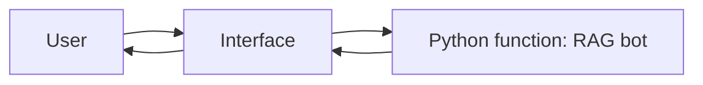
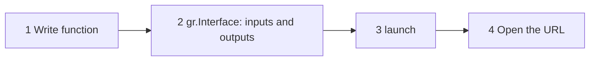
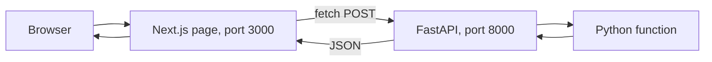
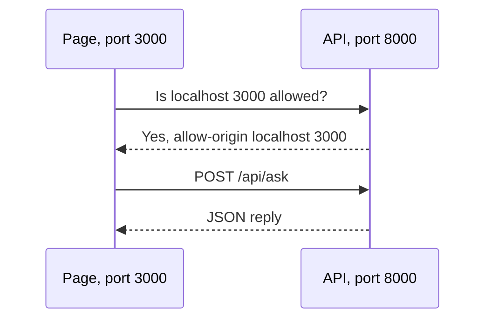
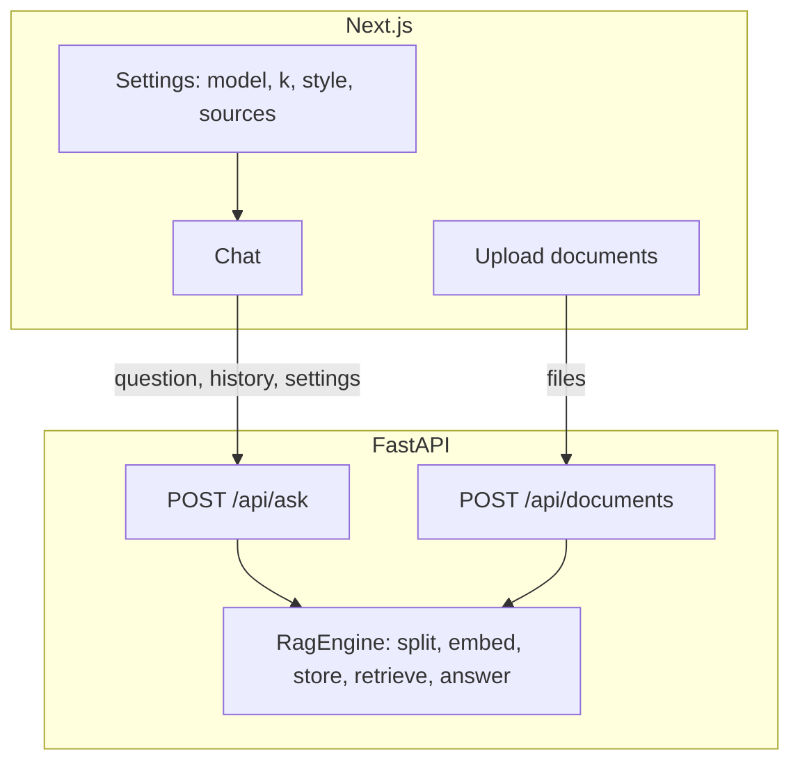

# Module 2: Building Apps With RAG Study Guide

A plain-language guide to putting a user interface in front of a RAG bot. The course teaches **Gradio**. This repo also rebuilds the same ideas with **Next.js, TypeScript, Tailwind, shadcn/ui and FastAPI**, which is the stack most real products use.

**How to use this guide:** read top to bottom once, then use the [Cheat Sheet](#9-cheat-sheet) and [Self-Quiz](#10-self-quiz) for revision.

## Contents

1. [Why an interface?](#1-why-an-interface)
2. [What is Gradio?](#2-what-is-gradio)
3. [Gradio components](#3-gradio-components)
4. [The same ideas with Next.js and FastAPI](#4-the-same-ideas-with-nextjs-and-fastapi)
5. [Endpoints, JSON and validation](#5-endpoints-json-and-validation)
6. [CORS: why the page cannot reach the API](#6-cors-why-the-page-cannot-reach-the-api)
7. [A RAG bot behind an interface](#7-a-rag-bot-behind-an-interface)
8. [Run the app](#8-run-the-app)
9. [Cheat Sheet](#9-cheat-sheet)
10. [Self-Quiz](#10-self-quiz)

---

## Hands-on tutorials

Type-along versions with code, diagrams and exercises:

- [Tutorial 1: Gradio concepts, rebuilt with Next.js and FastAPI](tutorials/01-gradio-concepts-adapted-to-nextjs.md) follows the video: text in and out, several inputs, file upload, slider, dropdown, radio, checkbox, launching.
- [Tutorial 2: build the RAG web app](tutorials/02-build-the-rag-web-app.md) grows a chat-with-your-documents app one problem at a time.

- [Tutorial 3: the lab, a PDF question-answering bot](tutorials/03-lab-pdf-qa-bot-adapted.md) follows the lab *Construct a QA Bot that Leverages LangChain and LLMs to Answer Questions from Loaded Documents*: PDF loader, splitter, embeddings, vector store, retriever, QA chain, then the interface (Gradio, and the same thing as a FastAPI upload endpoint). It flags four problems in the lab's code.

The finished, working project is in [app/](app/) (`backend/` for FastAPI, `frontend/` for Next.js). Source material: [transcript.md](transcript.md) and [lab-instructions.md](lab-instructions.md) (the PDF QA bot lab).

---

## 1. Why an interface?

In module 1 the RAG bot lived in a notebook. Only you could use it. To let other people use it, you need a **user interface**: a page with a text box, a button and a place for the answer.

> **Analogy:** a bot without an interface is a kitchen with no dining room. The food is good, but nobody can order.



Whatever tool you use, the pattern is the same: an interface collects input, calls a **Python function**, and shows the result.

---

## 2. What is Gradio?

**Gradio is an open-source Python library for creating web-based user interfaces**, mainly for machine learning models. You stay in Python and Gradio builds the page.

The video's four steps:

| Step | What you do |
|---|---|
| 1 | Write the Python function (the logic). |
| 2 | Create the interface with `gr.Interface`: say which components are inputs and outputs. |
| 3 | Call `launch()` to start a local server. |
| 4 | Open the local or public URL and use it in real time. |



The key idea from the quiz: **`gr.Interface` wraps a function.** It does not hold your logic. It describes inputs and outputs for it.

The video's first demo in real Gradio (needs `uv add gradio`):

```python
# needs: gradio
import gradio as gr


def echo(text):
    return text


gr.Interface(fn=echo, inputs=gr.Textbox(label="Input"), outputs=gr.Textbox(label="Output")).launch()
```

---

## 3. Gradio components

| Component | For | Notes from the course and quizzes |
|---|---|---|
| `gr.Textbox` | Text in or out | The transcript misspells it "Textbook". |
| `gr.Number` | A number | Pass it in a **list** with `gr.Textbox` for several inputs. |
| `gr.File` | Upload or drop files | Supports multiple files. Gives file paths to your function. |
| `gr.Slider` | A number in a range | Set `minimum`, `maximum`, `value` **and** `step` to integers for an integer result. |
| `gr.Dropdown` | One choice from a list | Good for "one of several venues". |
| `gr.Radio` | One choice, all visible | |
| `gr.Checkbox` | Yes or no | |
| `gr.CheckboxGroup` | Several choices from a list | |

Several inputs are a **list**: `inputs=[gr.Textbox(), gr.Number()]`. The function receives them in the same order.

---

## 4. The same ideas with Next.js and FastAPI

Gradio is quick for demos. A real product usually has two programs:

- A **backend** (FastAPI): your Python function, available as a web **endpoint**.
- A **frontend** (Next.js): the page. It sends the user's input to the endpoint and shows the reply.



| Gradio | Here |
|---|---|
| Your function | The same function, behind `@app.post(...)` |
| `gr.Interface` | A React component with inputs, a button and an output |
| `gr.Textbox` | shadcn `Input` / `Textarea` |
| `gr.Number` | `Input type="number"` |
| `gr.File` | `Input type="file"` plus `UploadFile` on the server |
| `gr.Slider` | shadcn `Slider` |
| `gr.Dropdown` | shadcn `Select` |
| `gr.Radio` | shadcn `RadioGroup` |
| `gr.Checkbox` / `CheckboxGroup` | shadcn `Checkbox` |
| `launch()` | `uvicorn main:app --reload` and `npm run dev` |

The tools:

| Tool | Job |
|---|---|
| **Next.js** | React framework: pages, dev server. |
| **TypeScript** | JavaScript with types, so mistakes show early. |
| **Tailwind CSS** | Styling with short class names. |
| **shadcn/ui** | Ready-made components copied into your project. |
| **FastAPI** | Turns Python functions into HTTP endpoints, with automatic validation and a test page at `/docs`. |

---

## 5. Endpoints, JSON and validation

An **endpoint** is a web address that runs a function. The page sends **JSON** (text that describes data) and gets JSON back. FastAPI uses a small class to describe what the JSON must look like, and rejects anything else for you.

```python
from fastapi import FastAPI
from fastapi.testclient import TestClient
from pydantic import BaseModel, Field

app = FastAPI()


class GreetIn(BaseModel):
    name: str
    times: int = Field(ge=1, le=10)  # whole number from 1 to 10


@app.post("/api/greet")
def greet(body: GreetIn):
    return {"message": " ".join([f"Hello, {body.name}!"] * body.times)}


client = TestClient(app)
print(client.post("/api/greet", json={"name": "Ann", "times": 2}).json())
print(client.post("/api/greet", json={"name": "Ann", "times": 99}).status_code)  # 422
```

| Status | Meaning |
|---|---|
| `200` | OK |
| `422` | Your input broke a rule (wrong type, out of range, missing) |
| `500` | The server crashed (for example a missing API key) |

**Always validate on the server.** A slider in the page limits the user, but anyone can send a request by hand. Rules like `Field(ge=1, le=10)` and an allow-list of model names protect your cost and your data.

File uploads use **multipart form data** instead of JSON, because files are binary. FastAPI reads them as `UploadFile`.

---

## 6. CORS: why the page cannot reach the API

The page lives at `localhost:3000` and the API at `localhost:8000`. Browsers call these different **origins** and block the request unless the API says the page is allowed. That is **CORS**.



The fix is one block in FastAPI: `CORSMiddleware` with the page's origin in `allow_origins`. If you see "blocked by CORS policy" in the browser console, this is it.

Secrets stay on the server. Next.js only exposes variables that start with `NEXT_PUBLIC_` to the browser, so `OPENAI_API_KEY` is read by FastAPI and never sent to the page.

---

## 7. A RAG bot behind an interface

The app in [app/](app/) is the module 1 notes bot with a web interface.



What is worth noticing:

- **The RAG logic has no web code.** `rag.py` is the engine. `main.py` only exposes it. You can test each part alone.
- **The server forgets between requests.** So the page sends the **chat history** with each question, and the server rewrites follow-ups into standalone questions before searching (module 1, Concept 8).
- **Settings map to controls.** `k` is a slider, the model is a dropdown, the style is a radio group, "show sources" is a checkbox.
- **Sources make answers verifiable.** The reply carries the file name and character position of each chunk.
- **The index is in memory.** Restarting the server clears uploads. A real app saves the vector store to disk.

---

## 8. Run the app

You need `OPENAI_API_KEY` in the repo-root `.env`. Use two terminals.

```bash
# Terminal 1: backend
cd course2/module2/app/backend
uv run uvicorn main:app --reload --port 8000

# Terminal 2: frontend
cd course2/module2/app/frontend
npm install
npm run dev
```

Open http://localhost:3000. API docs and a built-in test page: http://localhost:8000/docs.

Or run everything with Docker: `cd course2/module2/app && cp .env.example .env` (add your key), then `docker compose up --build`.

Test the real stack (needs the backend running, costs a fraction of a cent):

```bash
cd course2/module2/app/backend && uv run python test_live.py
cd ../frontend && npx tsc --noEmit && npm run lint && npm run build
```

Packages added to the root `pyproject.toml` for this module: `fastapi`, `uvicorn[standard]`, `python-multipart`.

---

## 9. Cheat Sheet

| Term | One-line meaning |
|---|---|
| Interface | The page a user touches to call your function. |
| Gradio | Python library that builds the interface for you. |
| `gr.Interface` | Wraps a function with inputs and outputs. |
| `launch()` | Starts the Gradio server. |
| Endpoint | A web address that runs a function. |
| FastAPI | Python framework for endpoints. |
| JSON | Text format for sending data. |
| Pydantic model | A class that describes and checks the JSON. |
| `422` | Input failed validation. |
| Multipart | How files are sent in a request. |
| CORS | Browser rule: the API must allow the page's origin. |
| Next.js | React framework for the page. |
| `"use client"` | Marks a component that uses state or click handlers. |
| shadcn/ui | Components copied into your project. |
| `NEXT_PUBLIC_` | Env prefix that exposes a value to the browser. |

| Course | Today |
|---|---|
| `gr.Textbox` | `Input` |
| `gr.Number` | `Input type="number"` |
| `gr.File` | `Input type="file"` and `UploadFile` |
| `gr.Slider` | `Slider` |
| `gr.Dropdown` | `Select` |
| `gr.Radio` | `RadioGroup` |
| `gr.CheckboxGroup` | several `Checkbox` |
| `launch()` | `uvicorn` and `npm run dev` |

---

## 10. Self-Quiz

1. What is Gradio, and what are the four steps to use it?
2. What does `gr.Interface` wrap?
3. Which component uploads files?
4. How do you take both text and a number as inputs?
5. How do you make a Slider output integers?
6. Which input forces a choice of exactly one of three venues?
7. Which Gradio input selects several values from a checkbox list?
8. In Next.js + FastAPI, what replaces `gr.Interface`?
9. Why validate input on the server when the page already has a slider?
10. What causes "blocked by CORS policy", and how do you fix it?
11. Why does the page send the chat history with every question?
12. Why is `OPENAI_API_KEY` safe from the browser?

<details>
<summary>Show answers</summary>

1. An open-source Python library for web interfaces. Write the function, create the interface with `gr.Interface`, call `launch()`, open the URL.
2. A **function**.
3. `gr.File`.
4. Pass a **list** of components: `inputs=[gr.Textbox(), gr.Number()]`.
5. Set `minimum`, `maximum`, `value` **and** `step` to integers.
6. A **Dropdown** (a Radio also works). A checkbox allows none or many, and a textbox allows anything.
7. `gr.CheckboxGroup`.
8. A FastAPI endpoint (the function over HTTP) plus a React component (the inputs and output).
9. Anyone can call the API directly and skip the page. Server rules (`Field(ge=1, le=10)`, an allow-list of models) are the real protection.
10. The page and API are on different origins (ports). The API must allow the page's origin with `CORSMiddleware`.
11. HTTP servers keep no memory between requests. Sending the history lets the server rewrite follow-ups like "How is it different?" into standalone questions.
12. The key is read by the FastAPI backend only. Next.js exposes only variables that start with `NEXT_PUBLIC_` to the browser.

</details>

---

### Notes on this guide

- Code snippets are **simplified** to teach the idea. Check each library's docs for your installed version. Next.js and shadcn/ui change quickly, so if a generated file differs from the tutorials, trust the generated one.
- The course covers Gradio only. The Next.js + FastAPI material is an extension, so you learn the same concepts in a stack used in production.
- The lab for this module (a QA bot in Gradio) was not in the folder, so the app reuses the module 1 notes bot instead.
