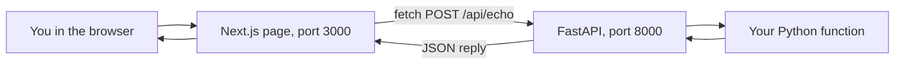
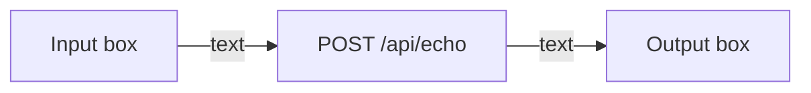
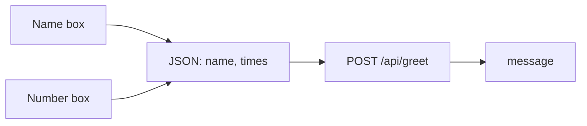
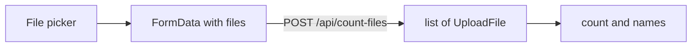
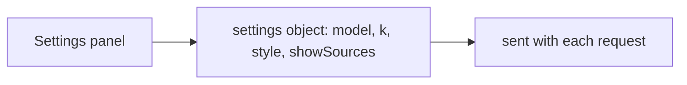
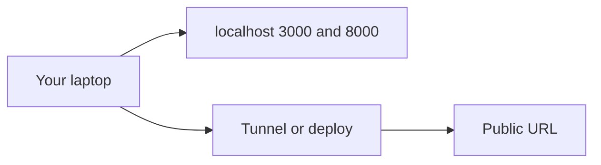

# Tutorial 1: Gradio Concepts, Rebuilt With Next.js and FastAPI

**What this is.** The course video *Getting Started with Gradio* teaches how to put a web page in front of a Python function. This guide teaches the **same ideas** with a different stack:

| Course (Gradio) | This tutorial |
|---|---|
| Python function | Python function (same) |
| `gr.Interface(...)` makes the page | **FastAPI** endpoint (the function over HTTP) + **Next.js** page (React, TypeScript, Tailwind, shadcn/ui) |
| `launch()` | `uvicorn` (backend) + `npm run dev` (frontend) |

Why change the stack? Gradio is great for demos. Most real products use a separate frontend and backend, so this is the shape you will meet at work. Every Gradio idea still maps cleanly, and you will see how.

For a project that grows the full RAG web app one problem at a time, go to [Tutorial 2](02-build-the-rag-web-app.md).

## After this tutorial you can

- Explain what Gradio does and what replaces each part in a Next.js + FastAPI app.
- Expose a Python function as an API endpoint and call it from a React page.
- Build text, number, file, slider, dropdown, radio and checkbox inputs with shadcn/ui.
- Run a frontend and a backend together and fix the common "it does not connect" errors.

## How to use this guide

1. Type each **Type this** block yourself.
2. Compare with **What you should see**. LLM text varies, but this tutorial's demos are deterministic.
3. Do **Try it** and **Check yourself**.

A finished, working copy of everything is in [../app/](../app/). Build your own copy in a folder called `course2/module2/my-app/` and compare with `app/` when stuck.

## Contents

1. [Before you start](#before-you-start)
2. [Concept 1: The big picture](#concept-1-the-big-picture)
3. [Concept 2: One input, one output (Textbox)](#concept-2-one-input-one-output-textbox)
4. [Concept 3: Several inputs (a list of components)](#concept-3-several-inputs-a-list-of-components)
5. [Concept 4: File upload (gr.File)](#concept-4-file-upload-grfile)
6. [Concept 5: Slider, Dropdown, Radio, Checkbox](#concept-5-slider-dropdown-radio-checkbox)
7. [Concept 6: Launching and sharing](#concept-6-launching-and-sharing)
8. [Transcript fixes and quiz answers](#transcript-fixes-and-quiz-answers)
9. [Common mistakes](#common-mistakes)
10. [Cheat sheet](#cheat-sheet)
11. [Practice](#practice)

---

## Before you start

You need Node.js (version 20 or newer) and the repo's Python environment.

**Backend packages.** These were added to the root `pyproject.toml` for this module (`uv add fastapi "uvicorn[standard]" python-multipart`). If you cloned the repo, `uv sync` installs them.

**Frontend project.** From `course2/module2/`:

```bash
mkdir my-app && cd my-app
npx create-next-app@latest frontend --typescript --tailwind --eslint --app --src-dir --import-alias "@/*" --use-npm --yes
cd frontend
npx shadcn@latest init -d -y
npx shadcn@latest add button card input label slider select radio-group checkbox textarea badge tabs -y
```

What each piece is:

| Tool | Job |
|---|---|
| **Next.js** | A React framework: pages, routing, dev server. |
| **TypeScript** | JavaScript with types, so mistakes show up as you type. |
| **Tailwind CSS** | Styling with small class names such as `p-4` or `text-sm`. |
| **shadcn/ui** | Ready-made components copied into your project (`src/components/ui`). |
| **FastAPI** | A Python web framework that turns functions into HTTP endpoints. |

> **Note:** Next.js moves fast. If a generated file looks different from this guide, trust the generated one. The ideas do not change.

Make the backend folder next to it: `mkdir ../backend`.

---

## Concept 1: The big picture

### The idea

The video lists four steps: write the function, create the interface, launch the server, open the URL. With a separate frontend and backend, the "interface" splits in two.

- The **backend** is the function, available at a web address (an **endpoint**).
- The **frontend** is the page. It collects input, **calls** the endpoint with `fetch`, and shows the result.

Think of a restaurant. The kitchen (backend) cooks. The dining room (frontend) takes the order and serves. They talk through a menu (the API).



### Mapping table

| Gradio | Next.js + FastAPI |
|---|---|
| The function you write | The same function, behind `@app.post("/api/...")` |
| `gr.Interface(fn, inputs, outputs)` | A React component with inputs, a button and an output |
| `gr.Textbox` | shadcn `Input` or `Textarea` |
| `gr.Number` | `Input type="number"` |
| `gr.File` | `Input type="file"` |
| `gr.Slider` | shadcn `Slider` |
| `gr.Dropdown` | shadcn `Select` |
| `gr.Radio` | shadcn `RadioGroup` |
| `gr.Checkbox` / `gr.CheckboxGroup` | shadcn `Checkbox` |
| `launch()` | `uvicorn main:app --reload` and `npm run dev` |

### Type this

Create `backend/main.py` and start with the smallest working app:

```python
from fastapi import FastAPI
from fastapi.middleware.cors import CORSMiddleware

app = FastAPI(title="Gradio concepts")

# The page (port 3000) and the API (port 8000) are different "origins".
# Browsers block the call unless the API says the page is allowed. See Concept 2.
app.add_middleware(
    CORSMiddleware,
    allow_origins=["http://localhost:3000", "http://127.0.0.1:3000"],
    allow_methods=["*"],
    allow_headers=["*"],
)


@app.get("/api/health")
def health():
    return {"status": "ok"}
```

Run it. From the **repo root**, so the shared `.venv` is used:

```bash
cd course2/module2/my-app/backend
uv run uvicorn main:app --reload --port 8000
```

Open http://localhost:8000/api/health.

**What you should see:** `{"status":"ok"}`. Also open http://localhost:8000/docs. FastAPI builds a **free test page** for every endpoint. It is the closest thing to Gradio's instant UI.

You can also test without a browser. This uses FastAPI's `TestClient`:

```python
from fastapi.testclient import TestClient

client = TestClient(app)
print(client.get("/api/health").json())
```

**What you should see:** `{'status': 'ok'}`.

### Check yourself

In Gradio one call, `launch()`, starts the server and the page. How many things must you start here, and why?

<details>
<summary>Answer</summary>

Two: the FastAPI backend (port 8000) and the Next.js frontend (port 3000). They are separate programs. That is the trade-off: more setup, but each part can change or scale on its own.
</details>

---

## Concept 2: One input, one output (Textbox)

### The idea

The video's first demo: a text box in, a text box out, and a function that returns the text. Here that is one endpoint plus one component.



### Type this

**Backend.** Add below the health endpoint. A `BaseModel` describes the JSON the endpoint expects, and FastAPI checks it for you:

```python
from pydantic import BaseModel


class EchoIn(BaseModel):
    text: str


@app.post("/api/echo")
def echo(body: EchoIn):
    return {"text": body.text}
```

Test it:

```python
print(client.post("/api/echo", json={"text": "hello"}).json())
```

**What you should see:** `{'text': 'hello'}`.

**Frontend, helper.** Create `src/lib/api.ts`. Every page uses this one function to call the backend:

```ts
export const API = process.env.NEXT_PUBLIC_API_URL ?? "http://localhost:8000";

export async function postJson<T>(path: string, body: unknown): Promise<T> {
  const res = await fetch(`${API}${path}`, {
    method: "POST",
    headers: { "Content-Type": "application/json" },
    body: JSON.stringify(body),
  });
  if (!res.ok) {
    // FastAPI sends errors as { detail: ... }.
    const err = await res.json().catch(() => ({}));
    throw new Error(typeof err.detail === "string" ? err.detail : `Request failed (${res.status})`);
  }
  return res.json() as Promise<T>;
}
```

**Frontend, component.** Create `src/components/echo-card.tsx`:

```tsx
"use client";

import { useState } from "react";
import { Button } from "@/components/ui/button";
import { Card, CardContent, CardHeader, CardTitle } from "@/components/ui/card";
import { Input } from "@/components/ui/input";
import { Label } from "@/components/ui/label";
import { postJson } from "@/lib/api";

export function EchoCard() {
  const [text, setText] = useState("");
  const [result, setResult] = useState("");

  async function run() {
    const data = await postJson<{ text: string }>("/api/echo", { text });
    setResult(data.text);
  }

  return (
    <Card>
      <CardHeader>
        <CardTitle>Echo (one text in, one text out)</CardTitle>
      </CardHeader>
      <CardContent className="space-y-3">
        <Label htmlFor="echo-in">Input</Label>
        <Input id="echo-in" value={text} onChange={(e) => setText(e.target.value)} />
        <Button onClick={run}>Submit</Button>
        <Label htmlFor="echo-out">Output</Label>
        <Input id="echo-out" value={result} readOnly />
      </CardContent>
    </Card>
  );
}
```

Show it on the page. Replace `src/app/page.tsx`:

```tsx
import { EchoCard } from "@/components/echo-card";

export default function Home() {
  return (
    <main className="mx-auto max-w-xl space-y-6 p-6">
      <EchoCard />
    </main>
  );
}
```

Start the frontend in a **second terminal**: `cd course2/module2/my-app/frontend && npm run dev`, then open http://localhost:3000.

**What you should see:** a card with two boxes. Type something and press **Submit**. The same text appears below.

### Why the CORS block matters

You added `CORSMiddleware` in Concept 1. To see why it exists, comment out the `app.add_middleware(...)` lines, let uvicorn reload, and press **Submit** again. Nothing appears. Open the browser console (F12): you will see "blocked by CORS policy". Browsers treat port 3000 and port 8000 as different origins and refuse the call unless the API allows it. Put the lines back and it works again.

### What is `"use client"`?

In Next.js, components run on the server by default. Anything that uses `useState`, click handlers or `fetch` from the browser must be a **client component**. The first line `"use client"` does that.

### Try it

Make the backend return the text in upper case (`body.text.upper()`). Do you need to change the frontend?

### Check yourself

In Gradio, `gr.Interface(fn=echo, inputs=gr.Textbox(), outputs=gr.Textbox())` is one line. Name the three pieces that replace it here.

<details>
<summary>Answer</summary>

(1) The **endpoint** in FastAPI (`/api/echo`), (2) the **`postJson` helper** that calls it, and (3) the **React component** with the input, button and output.
</details>

---

## Concept 3: Several inputs (a list of components)

### The idea

The video passes a **list**: `inputs=[gr.Textbox(), gr.Number()]`. Here, several fields go into one JSON object, and the backend model lists each field with its type.



### Type this

**Backend.** `Field(ge=1, le=10)` means "at least 1, at most 10". Bad values are rejected automatically.

```python
from pydantic import Field


class GreetIn(BaseModel):
    name: str
    times: int = Field(ge=1, le=10)


@app.post("/api/greet")
def greet(body: GreetIn):
    return {"message": " ".join([f"Hello, {body.name}!"] * body.times)}
```

```python
print(client.post("/api/greet", json={"name": "Ann", "times": 2}).json())
print(client.post("/api/greet", json={"name": "Ann", "times": 99}).status_code)
```

**What you should see:**

```
{'message': 'Hello, Ann! Hello, Ann!'}
422
```

`422` means "your input is invalid". That is validation you did not have to write.

**Frontend.** Create `src/components/greet-card.tsx`:

```tsx
"use client";

import { useState } from "react";
import { Button } from "@/components/ui/button";
import { Card, CardContent, CardHeader, CardTitle } from "@/components/ui/card";
import { Input } from "@/components/ui/input";
import { Label } from "@/components/ui/label";
import { postJson } from "@/lib/api";

export function GreetCard() {
  const [name, setName] = useState("");
  const [times, setTimes] = useState(1);
  const [message, setMessage] = useState("");
  const [error, setError] = useState("");

  async function run() {
    setError("");
    try {
      const data = await postJson<{ message: string }>("/api/greet", { name, times });
      setMessage(data.message);
    } catch (e) {
      setError((e as Error).message);
    }
  }

  return (
    <Card>
      <CardHeader>
        <CardTitle>Greet (a text input and a number input)</CardTitle>
      </CardHeader>
      <CardContent className="space-y-3">
        <Label htmlFor="name">Name</Label>
        <Input id="name" value={name} onChange={(e) => setName(e.target.value)} />
        <Label htmlFor="times">Times (1 to 10)</Label>
        <Input id="times" type="number" value={times} onChange={(e) => setTimes(Number(e.target.value))} />
        <Button onClick={run}>Greet</Button>
        {error && <p className="text-sm text-destructive">{error}</p>}
        {message && <p className="text-sm">{message}</p>}
      </CardContent>
    </Card>
  );
}
```

Add `<GreetCard />` under `<EchoCard />` in `page.tsx` (import it at the top).

**What you should see:** a second card. Try `times = 3`. Then try `50`: the card shows an error instead of crashing.

> A number box gives you a **string** in the DOM. That is why we wrap the value in `Number(...)`. Gradio's `gr.Number` did this for you.

### Try it

Add a third field, `shout` (true or false), and make the backend upper-case the message when it is true. Use a `Checkbox` on the frontend.

### Check yourself

Why does the backend declare `times: int`, when the browser sends everything as text?

<details>
<summary>Answer</summary>

Pydantic checks and **converts** the JSON for you. The frontend sends a JSON number (we used `Number(...)`), and the backend refuses anything that is not a whole number in range. Never trust the browser alone: validate on the server.
</details>

---

## Concept 4: File upload (gr.File)

### The idea

The video's file demo counts the files a user drops in. Files travel differently from JSON: as **multipart form data**. FastAPI reads them as `UploadFile` objects.



### Type this

**Backend:**

```python
from typing import Annotated

from fastapi import File, UploadFile


@app.post("/api/count-files")
async def count_files(files: Annotated[list[UploadFile], File()]):
    return {"count": len(files), "names": [f.filename for f in files]}
```

```python
r = client.post("/api/count-files", files=[("files", ("a.txt", b"x")), ("files", ("b.txt", b"y"))])
print(r.json())
```

**What you should see:** `{'count': 2, 'names': ['a.txt', 'b.txt']}`.

> FastAPI needs the `python-multipart` package for this. It is already installed in this repo. Without it you get a clear error on startup.

**Frontend.** Add a second helper to `src/lib/api.ts`. Note the comment, it is the number one file-upload bug:

```ts
// Do not set Content-Type here: the browser adds the multipart boundary itself.
export async function postFiles<T>(path: string, files: FileList): Promise<T> {
  const form = new FormData();
  Array.from(files).forEach((f) => form.append("files", f));
  const res = await fetch(`${API}${path}`, { method: "POST", body: form });
  if (!res.ok) throw new Error(`Request failed (${res.status})`);
  return res.json() as Promise<T>;
}
```

Create `src/components/files-card.tsx`:

```tsx
"use client";

import { useState } from "react";
import { Card, CardContent, CardHeader, CardTitle } from "@/components/ui/card";
import { Input } from "@/components/ui/input";
import { Label } from "@/components/ui/label";
import { postFiles } from "@/lib/api";

export function FilesCard() {
  const [result, setResult] = useState<{ count: number; names: string[] } | null>(null);

  async function onPick(files: FileList | null) {
    if (!files || files.length === 0) return;
    setResult(await postFiles("/api/count-files", files));
  }

  return (
    <Card>
      <CardHeader>
        <CardTitle>Count files (file upload)</CardTitle>
      </CardHeader>
      <CardContent className="space-y-3">
        <Label htmlFor="files">Choose one or more files</Label>
        <Input id="files" type="file" multiple onChange={(e) => onPick(e.target.files)} />
        {result && (
          <p className="text-sm">
            {result.count} file(s): {result.names.join(", ")}
          </p>
        )}
      </CardContent>
    </Card>
  );
}
```

Add `<FilesCard />` to the page. **What you should see:** pick three files and the card says `3 file(s): ...`.

### Try it

Return the **size in bytes** of each file as well. (Hint: `await f.read()` gives the bytes. Then `len(...)`.)

### Check yourself

Why can't you send a file inside the same JSON body as the text fields?

<details>
<summary>Answer</summary>

JSON is text. Files are binary. **Multipart form data** carries both text fields and raw file bytes, which is why upload endpoints use `File()` and the browser uses `FormData`.
</details>

---

## Concept 5: Slider, Dropdown, Radio, Checkbox

### The idea

The quizzes in the module ask about other Gradio inputs. Each has a direct shadcn equivalent. We will group them in one **settings panel**, which the RAG app uses in Tutorial 2.

| You want | Gradio | shadcn | Value you get |
|---|---|---|---|
| A whole number in a range | `gr.Slider` | `Slider` | `number[]` (one entry per handle) |
| One choice from a list | `gr.Dropdown` | `Select` | `string` |
| Exactly one of a few | `gr.Radio` | `RadioGroup` | `string` |
| Yes or no | `gr.Checkbox` | `Checkbox` | `boolean` |
| Many of a list | `gr.CheckboxGroup` | several `Checkbox` | `string[]` |



### Type this

First the shared type. Add to `src/lib/api.ts`:

```ts
export type Settings = { model: string; k: number; style: "concise" | "detailed"; showSources: boolean };
```

Now `src/components/settings-panel.tsx`:

```tsx
"use client";

import { Checkbox } from "@/components/ui/checkbox";
import { Label } from "@/components/ui/label";
import { RadioGroup, RadioGroupItem } from "@/components/ui/radio-group";
import { Select, SelectContent, SelectItem, SelectTrigger, SelectValue } from "@/components/ui/select";
import { Slider } from "@/components/ui/slider";
import type { Settings } from "@/lib/api";

type Props = { value: Settings; onChange: (next: Settings) => void };

export function SettingsPanel({ value, onChange }: Props) {
  return (
    <div className="space-y-5">
      <div className="space-y-2">
        <Label>Model (dropdown)</Label>
        <Select value={value.model} onValueChange={(m) => m && onChange({ ...value, model: m })}>
          <SelectTrigger>
            <SelectValue />
          </SelectTrigger>
          <SelectContent>
            <SelectItem value="gpt-4o-mini">gpt-4o-mini</SelectItem>
            <SelectItem value="gpt-4o">gpt-4o</SelectItem>
          </SelectContent>
        </Select>
      </div>

      <div className="space-y-2">
        <Label>Chunks to retrieve, k = {value.k} (slider)</Label>
        {/* Whole-number min, max and step keep the value an integer. */}
        <Slider
          min={1}
          max={10}
          step={1}
          value={[value.k]}
          onValueChange={(v) => onChange({ ...value, k: Array.isArray(v) ? v[0] : v })}
        />
      </div>

      <div className="space-y-2">
        <Label>Answer style (radio: pick exactly one)</Label>
        <RadioGroup value={value.style} onValueChange={(s) => onChange({ ...value, style: s as Settings["style"] })}>
          <div className="flex items-center gap-2">
            <RadioGroupItem value="concise" id="concise" />
            <Label htmlFor="concise">Concise</Label>
          </div>
          <div className="flex items-center gap-2">
            <RadioGroupItem value="detailed" id="detailed" />
            <Label htmlFor="detailed">Detailed</Label>
          </div>
        </RadioGroup>
      </div>

      <div className="flex items-center gap-2">
        <Checkbox
          id="sources"
          checked={value.showSources}
          onCheckedChange={(c) => onChange({ ...value, showSources: c === true })}
        />
        <Label htmlFor="sources">Show sources (checkbox)</Label>
      </div>
    </div>
  );
}
```

To see it, put it on the page with a settings state. In `page.tsx` make the page a client component, keep the settings in state, and print them:

```tsx
"use client";

import { useState } from "react";
import { SettingsPanel } from "@/components/settings-panel";
import type { Settings } from "@/lib/api";

export default function Home() {
  const [settings, setSettings] = useState<Settings>({ model: "gpt-4o-mini", k: 4, style: "concise", showSources: true });
  return (
    <main className="mx-auto max-w-xl space-y-6 p-6">
      <SettingsPanel value={settings} onChange={setSettings} />
      <pre className="text-xs">{JSON.stringify(settings)}</pre>
    </main>
  );
}
```

(Keep your other cards in the page too, or save them for the Tabs layout in Tutorial 2.)

**What you should see:** a panel, and below it a line like `{"model":"gpt-4o-mini","k":4,"style":"concise","showSources":true}` that changes as you click.

### Why these quiz answers

The quiz asks how to make a slider output an integer. In Gradio you set `minimum`, `maximum`, `value` **and** `step` to integers. The shadcn slider is the same: `min`, `max`, `step` (and the value) are whole numbers. If `step` were `0.5`, you would get `4.5`.

> **Lab says / today we use:** Gradio's `CheckboxGroup` is one component. In shadcn you render several `Checkbox` items and keep an array of the checked names in state.

### Try it

Change the slider to `max={20}`. What should the backend do if someone sends `k=50`? (Look at `Field(ge=1, le=10)` in Tutorial 2.)

### Check yourself

Arthur must make people pick **exactly one** of three party venues. Which input?

<details>
<summary>Answer</summary>

A **Dropdown** (`Select`) or **Radio** (`RadioGroup`). Both force one choice. The quiz expects Dropdown. A checkbox would allow none or many, and a textbox allows anything.
</details>

---

## Concept 6: Launching and sharing

### The idea

The video's last steps: `launch()` starts a local server, and Gradio can print a **public URL** that works "from anywhere until the session is running".

| Task | Gradio | Here |
|---|---|---|
| Start locally | `demo.launch()` | `uvicorn main:app --reload --port 8000` and `npm run dev` |
| Reload on changes | restart the cell | automatic in both |
| Auto test page | the page itself | `http://localhost:8000/docs` |
| Public link | `launch(share=True)` | a tunnel tool, or deploy (below) |



**Beyond the video.** To share a demo quickly, run a tunnel such as `cloudflared` or `ngrok` for the frontend port. Because the frontend calls `http://localhost:8000`, a friend's browser cannot reach your backend. So set `NEXT_PUBLIC_API_URL` to a public backend address and add the frontend's address to `allow_origins`. For something permanent, deploy the backend (any host that runs Python) and the frontend (for example Vercel), and set those two settings.

### Check yourself

Why does `NEXT_PUBLIC_API_URL` start with `NEXT_PUBLIC_`?

<details>
<summary>Answer</summary>

Next.js only exposes variables with that prefix to code that runs in the **browser**. Anything else stays on the server, which keeps secrets such as `OPENAI_API_KEY` out of the page. Never prefix a secret with `NEXT_PUBLIC_`.
</details>

---

## Transcript fixes and quiz answers

| Transcript says | Means |
|---|---|
| "gr.Textbook" | **gr.Textbox** |
| "Gradio's interface class" | `gr.Interface` |
| "PIP" | `pip` (the package installer) |

Answers to the module quiz (for your revision), with the matching idea here:

| Question | Answer | Here |
|---|---|---|
| Which component uploads files? | `gr.File` | `Input type="file"` + `UploadFile` |
| Text and numbers together? | pass a **list** of `gr.Textbox` and `gr.Number` | one JSON object with typed fields |
| Role of `gr.Interface`? | specifies inputs and outputs of the function | endpoint + page |
| Integer slider? | set min, max, value **and step** to integers | `min`, `max`, `step` |
| One of three venues? | Dropdown | `Select` or `RadioGroup` |
| What does `Interface` wrap? | a **function** | the endpoint wraps a function |
| Pick several from a checkbox list? | `CheckboxGroup` | several `Checkbox` |

For comparison, here is the video's text demo in real Gradio. It needs the package (`uv add gradio` if you want to try it):

```python
# needs: gradio
import gradio as gr


def echo(text):
    return text


gr.Interface(fn=echo, inputs=gr.Textbox(label="Input"), outputs=gr.Textbox(label="Output")).launch()
```

---

## Common mistakes

| Mistake | What you see | Fix |
|---|---|---|
| CORS not set | Browser console: "blocked by CORS policy" | Add `CORSMiddleware` with the frontend origin (Concept 2). |
| Backend not running | `Failed to fetch` | Start `uvicorn` on port 8000. |
| Wrong port in `NEXT_PUBLIC_API_URL` | `Failed to fetch` | Match the address uvicorn prints. Restart `npm run dev` after changing env files. |
| Forgot `"use client"` | Error about `useState` in a Server Component | Put `"use client";` as the first line. |
| Set `Content-Type` for file upload | Backend says "no files" or a parse error | Remove it. Let the browser set it. |
| `422 Unprocessable` | Error on submit | The data broke a rule (type, `ge`/`le`). Read `detail` in `/docs`. |
| Number field sends text | `422` for `times` | Convert with `Number(...)`. |
| Run `uvicorn` outside the repo environment | `ModuleNotFoundError: fastapi` | Use `uv run uvicorn ...` from inside the repo. |

---

## Cheat sheet

| Idea | Code |
|---|---|
| Endpoint | `@app.post("/api/x")` on a function |
| Request shape | `class In(BaseModel): ...` |
| Range rule | `Field(ge=1, le=10)` |
| File upload | `Annotated[list[UploadFile], File()]` |
| Allow the page | `CORSMiddleware(allow_origins=[...])` |
| Call from the page | `fetch(API + path, { method: "POST", ... })` |
| Interactive component | file starts with `"use client"` |
| State | `const [x, setX] = useState(initial)` |
| Test without a browser | `TestClient(app).post(...)` |
| API test page | `/docs` |

## Practice

No answers shown. Ask me for a hint.

1. **Dropdown endpoint.** Add `/api/tip` that takes a `Select` choice (`"short"`, `"long"`) and returns a message of that length. Reject other values with a `Literal` type.
2. **Two files in one call.** Make the file card also show total bytes. Which side computes it?
3. **Break CORS on purpose.** Remove `localhost:3000` from `allow_origins`. Read the browser error, then fix it.
4. **CheckboxGroup.** Build three checkboxes (`red`, `green`, `blue`) that send an array `string[]` to a backend endpoint that returns how many were ticked.
5. **Explain it.** In four sentences, explain to a friend what replaced `gr.Interface` and why there are two servers.

Next: [Tutorial 2: build the RAG web app](02-build-the-rag-web-app.md).
