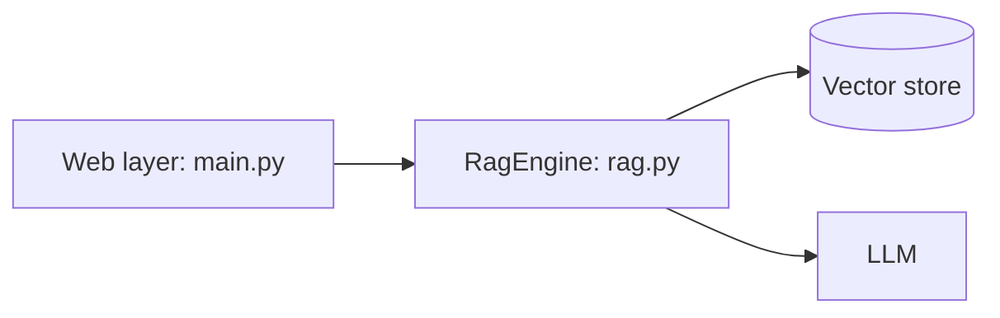
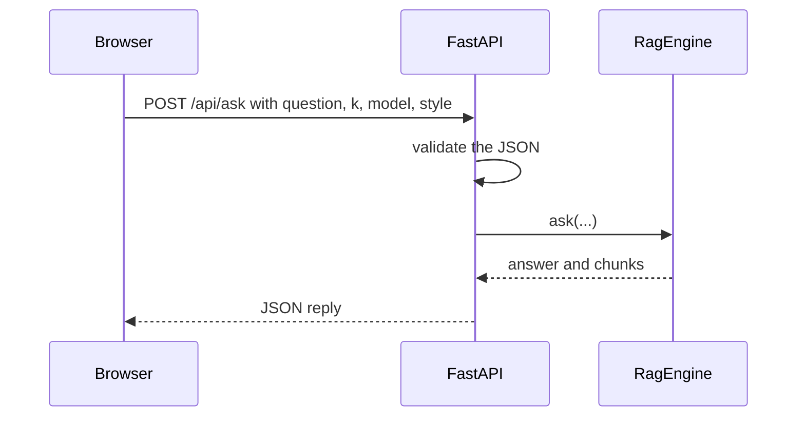
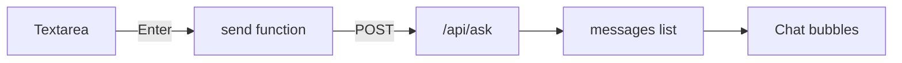
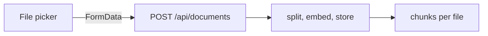
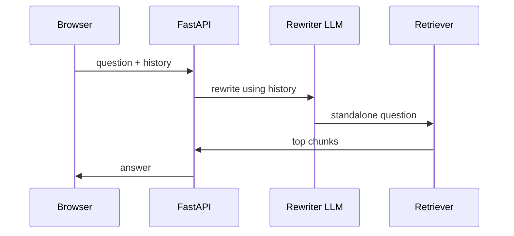
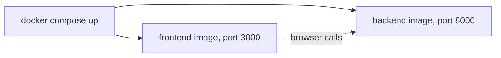
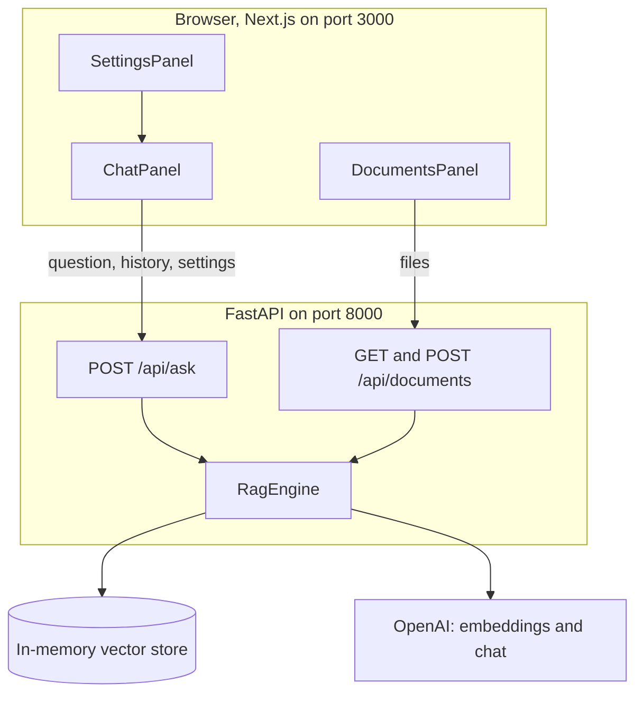

# Tutorial 2: Build a RAG Web App (Next.js + FastAPI)

**What you build.** A web app where you chat with your own documents. It has a chat window, a settings panel (model, number of chunks, answer style, show sources), and a box to upload more `.txt` or `.md` files. The brain is the RAG notes bot from [module 1](../../module1/tutorials/02-rag-build-a-notes-bot.md). Here we give it a proper web interface instead of a Gradio page.

**How this tutorial works.** One app, grown in small steps. Each step starts with a **problem** you just hit, then the **fix**.

New to the Gradio-to-web mapping? Read [Tutorial 1](01-gradio-concepts-adapted-to-nextjs.md) first. It covers endpoints, `fetch`, CORS and the shadcn inputs that this tutorial reuses.

## The path

```mermaid
flowchart LR
    S0["0 Hello world"] --> S1["1 RAG logic stuck in a notebook"]
    S1["1 RAG logic stuck in a notebook"] --> S2["2 Cannot ask over HTTP"]
    S2 --> S3["3 No chat page"]
    S3 --> S4["4 Cannot add my own files"]
    S4 --> S5["5 Server forgets the chat"]
    S5 --> S6["6 Cannot see sources"]
    S6 --> S7["7 No way to tune it"]
    S7 --> S8["8 Errors look like nothing"]
    S8 --> S9["9 One command: Docker"]
```



## Before you start

- Tutorial 1 setup done, or use the finished project in [../app/](../app/).
- `OPENAI_API_KEY` in the repo-root `.env`.
- Work in `course2/module2/my-app/` (build your own) and compare with `app/` when stuck.
- Packages `fastapi`, `uvicorn` and `python-multipart` are in the root `pyproject.toml`. Frontend packages come from `npm install`.

Real API calls cost a few cents in total. Everything is real: the real OpenAI API, no fakes. Docker is only needed for the last step.

---

## Step 0: Hello world

Every project here starts by proving that the page and the backend can talk. You did exactly this in [Tutorial 1, Concept 1](01-gradio-concepts-adapted-to-nextjs.md#concept-1-the-big-picture) and Concept 2 (an echo box). Check that you still have it:

```bash
cd course2/module2/my-app/backend
uv run uvicorn main:app --reload --port 8000     # terminal 1
cd ../frontend && npm run dev                    # terminal 2
```

**What you should see:** http://localhost:8000/api/health returns `{"status":"ok"}`, and the page at http://localhost:3000 can call the backend (the echo card works). If not, go back to Tutorial 1 first. Everything below adds one feature at a time to that working base.

---

## Step 1: The RAG logic is stuck in a notebook

### The problem

In module 1 the splitter, embeddings, vector store and prompts were loose notebook cells. A web server cannot run cells. It needs one clean object with simple methods: **add text** and **ask a question**.

### The fix: a `RagEngine` class with no web code in it

Keeping RAG separate from the web layer means you can test and change each on its own.



### Type this

Create `backend/rag.py`. First the imports and the prompt:

```python
from dotenv import load_dotenv
from langchain_core.documents import Document
from langchain_core.output_parsers import StrOutputParser
from langchain_core.prompts import ChatPromptTemplate
from langchain_core.vectorstores import InMemoryVectorStore
from langchain_openai import ChatOpenAI, OpenAIEmbeddings
from langchain_text_splitters import RecursiveCharacterTextSplitter

load_dotenv()

ANSWER_PROMPT = ChatPromptTemplate.from_template(
    "Answer using only the context. If the answer is not in the context, "
    "say \"I don't know\". {style}\n\nContext:\n{context}\n\nQuestion: {question}"
)
STYLES = {
    "concise": "Answer in one or two sentences.",
    "detailed": "Answer in a short paragraph with the key details.",
}
```

Then the class with its two jobs, **add text** (indexing) and **ask** (query):

```python
class RagEngine:
    def __init__(self) -> None:
        self.embeddings = OpenAIEmbeddings(model="text-embedding-3-small")
        self.store = InMemoryVectorStore(self.embeddings)
        self.splitter = RecursiveCharacterTextSplitter(
            chunk_size=800, chunk_overlap=100, add_start_index=True
        )
        self.sources: dict[str, int] = {}  # file name -> number of chunks

    def add_text(self, name: str, text: str) -> int:
        doc = Document(page_content=text, metadata={"source": name})
        chunks = self.splitter.split_documents([doc])
        self.store.add_documents(chunks)
        self.sources[name] = self.sources.get(name, 0) + len(chunks)
        return len(chunks)

    def ask(self, question: str, k: int, model: str, style: str):
        llm = ChatOpenAI(model=model, temperature=0, max_tokens=400)
        docs = self.store.as_retriever(search_kwargs={"k": k}).invoke(question)
        context = "\n\n".join(d.page_content for d in docs)
        chain = ANSWER_PROMPT | llm | StrOutputParser()
        answer = chain.invoke({"context": context, "question": question, "style": STYLES[style]})
        return answer, docs
```

Try the engine by itself:

```python
engine = RagEngine()
print(engine.add_text("policy.txt", "Smoking is not permitted in company vehicles. " * 30))
answer, docs = engine.ask("Can I smoke in the car?", k=2, model="gpt-4o-mini", style="concise")
print(answer, len(docs))
```

**What you should see** (example): a number such as `3` (chunks added), then an answer like `No, smoking is not permitted in company vehicles.` and `2`.

### Why it works

`add_text` is the **indexing** phase (split, embed, store). `ask` is the **query** phase (retrieve, build the prompt, answer). Both are the same ideas as module 1, now wrapped in a class.

### Try it

Change `chunk_size` to `200` and see how many chunks `add_text` returns for the same text.

---

## Step 2: Nothing can ask over HTTP

### The problem

The engine works in Python, but a browser cannot call a Python method. We need a **web address** for it.

### The fix: a FastAPI endpoint, with validation



### Type this

Create `backend/main.py`:

```python
from typing import Literal

from fastapi import FastAPI, HTTPException
from fastapi.middleware.cors import CORSMiddleware
from pydantic import BaseModel, Field

ALLOWED_MODELS = {"gpt-4o-mini", "gpt-4o"}

app = FastAPI(title="RAG Notes Bot")
app.add_middleware(
    CORSMiddleware,
    allow_origins=["http://localhost:3000", "http://127.0.0.1:3000"],
    allow_methods=["*"],
    allow_headers=["*"],
)

# One engine for the whole server, so uploaded documents stay in memory.
rag_engine = RagEngine()
```

At the top of `main.py` also add `from rag import RagEngine`.

Describe what a question looks like. `Field(ge=1, le=10)` limits `k` to 1 through 10:

```python
class AskIn(BaseModel):
    question: str = Field(min_length=1)
    k: int = Field(default=4, ge=1, le=10)
    model: str = "gpt-4o-mini"
    style: Literal["concise", "detailed"] = "concise"
```

And the endpoint:

```python
@app.post("/api/ask")
def ask_endpoint(body: AskIn):
    if body.model not in ALLOWED_MODELS:
        raise HTTPException(status_code=422, detail=f"model must be one of {sorted(ALLOWED_MODELS)}")
    answer, docs = rag_engine.ask(body.question, body.k, body.model, body.style)
    return {"answer": answer, "sources": [d.page_content for d in docs]}
```

Run the server (from the repo environment) and open http://localhost:8000/docs:

```bash
cd course2/module2/my-app/backend
uv run uvicorn main:app --reload --port 8000
```

Or test in Python without a server:

```python
from fastapi.testclient import TestClient

client = TestClient(app)
r = client.post("/api/ask", json={"question": "Can I smoke in the car?", "k": 2})
print(r.status_code, r.json()["answer"])
print(client.post("/api/ask", json={"question": "x", "k": 50}).status_code)
print(client.post("/api/ask", json={"question": "x", "model": "gpt-9"}).status_code)
```

**What you should see:** `200` and an answer, then `422`, then `422`.

### Why it works

FastAPI turns your function into an endpoint and `AskIn` into the contract. A bad `k`, an empty question or a wrong `style` is rejected **before** your code runs. The `ALLOWED_MODELS` check matters too: without it, a user could ask the server to run any model name, at your cost.

### Try it

Open `/docs`, click **POST /api/ask**, **Try it out**, and send a request by hand.

---

## Step 3: There is no chat page

### The problem

We have an API but no page. Time for the frontend.

### The fix: a chat component that calls the endpoint



### Type this

You need `src/lib/api.ts` from Tutorial 1 (`postJson`). Add the types to it:

```ts
export type Turn = { role: "user" | "assistant"; content: string };
export type Source = { source: string; start_index: number; text: string };
```

We will start with the simplest chat: question in, answer out. Create `src/components/chat-panel.tsx`:

```tsx
"use client";

import { useState } from "react";
import { Button } from "@/components/ui/button";
import { Card, CardContent } from "@/components/ui/card";
import { Textarea } from "@/components/ui/textarea";
import { postJson, type Settings } from "@/lib/api";

type Message = { role: "user" | "assistant"; content: string };

export function ChatPanel({ settings }: { settings: Settings }) {
  const [messages, setMessages] = useState<Message[]>([]);
  const [question, setQuestion] = useState("");
  const [busy, setBusy] = useState(false);

  async function send() {
    const q = question.trim();
    if (!q || busy) return;
    setBusy(true);
    setQuestion("");
    setMessages((m) => [...m, { role: "user", content: q }]);
    try {
      const data = await postJson<{ answer: string }>("/api/ask", {
        question: q,
        k: settings.k,
        model: settings.model,
        style: settings.style,
      });
      setMessages((m) => [...m, { role: "assistant", content: data.answer }]);
    } finally {
      setBusy(false);
    }
  }

  return (
    <div className="space-y-4">
      {messages.map((m, i) => (
        <Card key={i} className={m.role === "user" ? "bg-muted" : ""}>
          <CardContent className="text-sm">
            <p className="font-medium">{m.role === "user" ? "You" : "Bot"}</p>
            <p className="whitespace-pre-wrap">{m.content}</p>
          </CardContent>
        </Card>
      ))}
      <Textarea value={question} placeholder="Ask about your notes..." onChange={(e) => setQuestion(e.target.value)} />
      <Button onClick={send} disabled={busy}>
        {busy ? "Thinking..." : "Ask"}
      </Button>
    </div>
  );
}
```

It needs a `Settings` type and the settings panel from Tutorial 1, Concept 5. Add the page. Replace `src/app/page.tsx`:

```tsx
"use client";

import { useState } from "react";
import { ChatPanel } from "@/components/chat-panel";
import { SettingsPanel } from "@/components/settings-panel";
import { Card, CardContent, CardHeader, CardTitle } from "@/components/ui/card";
import type { Settings } from "@/lib/api";

export default function Home() {
  const [settings, setSettings] = useState<Settings>({
    model: "gpt-4o-mini",
    k: 4,
    style: "concise",
    showSources: true,
  });

  return (
    <main className="mx-auto w-full max-w-5xl space-y-6 p-6">
      <h1 className="text-2xl font-semibold">RAG Notes Bot</h1>
      <div className="grid gap-6 md:grid-cols-[1fr_18rem]">
        <ChatPanel settings={settings} />
        <Card>
          <CardHeader>
            <CardTitle>Settings</CardTitle>
          </CardHeader>
          <CardContent>
            <SettingsPanel value={settings} onChange={setSettings} />
          </CardContent>
        </Card>
      </div>
    </main>
  );
}
```

Start `npm run dev` and open http://localhost:3000. The knowledge base is empty at this point, so first add some text with the upload box in step 4, or index it from Python as you did in Step 1.

**What you should see:** a chat box. Ask something and an answer appears under "Bot".

### Why it works

`useState` holds the list of messages. When state changes, React redraws. `send` adds your message, calls the API, then adds the reply. `"use client"` is needed because this component reacts to clicks.

### Try it

Press **Ask** with an empty box. Why does nothing happen? (Look for `if (!q || busy) return;`.)

---

## Step 4: I cannot add my own files

### The problem

The bot only knows what you indexed from Python. A user needs an upload box.

### The fix: an upload endpoint and a documents panel



### Type this

**Backend.** Add to `main.py` (the `UploadFile` pieces are from Tutorial 1, Concept 4):

```python
from typing import Annotated

from fastapi import File, UploadFile


@app.get("/api/documents")
def list_documents():
    return {"sources": rag_engine.sources}


@app.post("/api/documents")
async def add_documents(files: Annotated[list[UploadFile], File()]):
    added = {}
    for f in files:
        text = (await f.read()).decode("utf-8", errors="ignore")
        added[f.filename] = rag_engine.add_text(f.filename, text)
    return {"added": added, "sources": rag_engine.sources}
```

```python
files = [("files", ("rules.txt", b"Visitors must sign in at reception. " * 40))]
print(client.post("/api/documents", files=files).json()["added"])
print(client.get("/api/documents").json()["sources"])
```

**What you should see:** `{'rules.txt': 2}` (the number may differ) and a dictionary of file names with chunk counts.

**Frontend.** Add `postFiles` and `getJson` to `src/lib/api.ts`:

```ts
export async function getJson<T>(path: string): Promise<T> {
  const res = await fetch(`${API}${path}`);
  if (!res.ok) throw new Error(`Request failed (${res.status})`);
  return res.json() as Promise<T>;
}
```

(`postFiles` is from Tutorial 1, Concept 4.) Create `src/components/documents-panel.tsx`:

```tsx
"use client";

import { useEffect, useState } from "react";
import { Badge } from "@/components/ui/badge";
import { Input } from "@/components/ui/input";
import { Label } from "@/components/ui/label";
import { getJson, postFiles } from "@/lib/api";

export function DocumentsPanel() {
  const [sources, setSources] = useState<Record<string, number>>({});
  const [status, setStatus] = useState("");

  useEffect(() => {
    getJson<{ sources: Record<string, number> }>("/api/documents")
      .then((data) => setSources(data.sources))
      .catch(() => setStatus("Cannot reach the backend. Is uvicorn running on port 8000?"));
  }, []);

  async function onPick(files: FileList | null) {
    if (!files || files.length === 0) return;
    setStatus("Indexing...");
    try {
      const data = await postFiles<{ sources: Record<string, number> }>("/api/documents", files);
      setSources(data.sources);
      setStatus("Added.");
    } catch (e) {
      setStatus((e as Error).message);
    }
  }

  return (
    <div className="space-y-3">
      <Label htmlFor="docs">Add .txt or .md files to the knowledge base</Label>
      <Input id="docs" type="file" multiple accept=".txt,.md" onChange={(e) => onPick(e.target.files)} />
      {status && <p className="text-sm text-muted-foreground">{status}</p>}
      <div className="flex flex-wrap gap-2">
        {Object.entries(sources).map(([name, n]) => (
          <Badge key={name} variant="secondary">
            {name}: {n} chunks
          </Badge>
        ))}
      </div>
    </div>
  );
}
```

Add a second card under Settings in `page.tsx`:

```tsx
<Card>
  <CardHeader>
    <CardTitle>Knowledge base</CardTitle>
  </CardHeader>
  <CardContent>
    <DocumentsPanel />
  </CardContent>
</Card>
```

(Import `DocumentsPanel`, and wrap the two cards in a `<div className="space-y-6">`.)

**What you should see:** pick a `.md` file. The badge shows `yourfile.md: 12 chunks`. Ask a question about it.

### Why it works

The file goes through the same `add_text` as Step 1. The module-1 file `transcript.md` is a good first upload, because it is your own study material.

### Beyond the video: pre-load your notes

Instead of uploading by hand each time, you can pre-load `course2/module1/transcript.md` the first time the server needs the engine. The finished app in `app/backend/main.py` does exactly that with a small `seed()` method. Try writing it yourself in the Practice section.

> The index lives **in memory**. When uvicorn restarts (including `--reload`), uploads are gone. A real app would use a database such as Chroma or FAISS saved to disk.

### Try it

Upload the same file twice. What happens to the chunk count and to the answers? (Think about duplicates.)

---

## Step 5: The server forgets the conversation

### The problem

Ask "What is cosine similarity?" and then "How is it different from the dot product?". The second question has no topic words. The retriever searches with "it" and finds nothing useful.

### The fix: the page sends the history, the server rewrites the follow-up

HTTP servers forget everything between requests. The simplest memory is to keep the chat in the **browser** and send it with every question. The server rewrites the follow-up into a standalone question, then searches.



### Type this

**Backend, `rag.py`.** Add these imports at the top and the rewrite prompt:

```python
from langchain_core.messages import AIMessage, HumanMessage
from langchain_core.prompts import MessagesPlaceholder

REWRITE_PROMPT = ChatPromptTemplate.from_messages([
    ("system", "Rewrite the user's last question so it makes sense on its own, "
               "using the chat history. Return only the question."),
    MessagesPlaceholder("history"),
    ("human", "{question}"),
])
```

Replace the whole `RagEngine` class with this version. Only `ask` changed: it takes `history` and rewrites follow-ups first.

```python
# needs: replaces the RagEngine class from Step 1 in your rag.py
class RagEngine:
    def __init__(self) -> None:
        self.embeddings = OpenAIEmbeddings(model="text-embedding-3-small")
        self.store = InMemoryVectorStore(self.embeddings)
        self.splitter = RecursiveCharacterTextSplitter(
            chunk_size=800, chunk_overlap=100, add_start_index=True
        )
        self.sources: dict[str, int] = {}

    def add_text(self, name: str, text: str) -> int:
        doc = Document(page_content=text, metadata={"source": name})
        chunks = self.splitter.split_documents([doc])
        self.store.add_documents(chunks)
        self.sources[name] = self.sources.get(name, 0) + len(chunks)
        return len(chunks)

    def ask(self, question: str, history: list[dict], k: int, model: str, style: str):
        llm = ChatOpenAI(model=model, temperature=0, max_tokens=400)
        messages = [HumanMessage(m["content"]) if m["role"] == "user" else AIMessage(m["content"]) for m in history]
        # Rewrite follow-ups so the retriever searches with a complete question.
        standalone = question
        if messages:
            standalone = (REWRITE_PROMPT | llm | StrOutputParser()).invoke({"history": messages, "question": question})
        docs = self.store.as_retriever(search_kwargs={"k": k}).invoke(standalone)
        context = "\n\n".join(d.page_content for d in docs)
        chain = ANSWER_PROMPT | llm | StrOutputParser()
        answer = chain.invoke({"context": context, "question": standalone, "style": STYLES[style]})
        return answer, docs
```

**Backend, `main.py`.** Add a `Turn` model, a `history` field on `AskIn`, and pass it on. Replace `AskIn` and the endpoint:

```python
# needs: replaces AskIn and ask_endpoint from Step 2 in your main.py
class Turn(BaseModel):
    role: Literal["user", "assistant"]
    content: str


class AskIn(BaseModel):
    question: str = Field(min_length=1)
    history: list[Turn] = []
    k: int = Field(default=4, ge=1, le=10)
    model: str = "gpt-4o-mini"
    style: Literal["concise", "detailed"] = "concise"


@app.post("/api/ask")
def ask_endpoint(body: AskIn):
    if body.model not in ALLOWED_MODELS:
        raise HTTPException(status_code=422, detail=f"model must be one of {sorted(ALLOWED_MODELS)}")
    history = [t.model_dump() for t in body.history]
    answer, docs = rag_engine.ask(body.question, history, body.k, body.model, body.style)
    return {"answer": answer, "sources": [d.page_content for d in docs]}
```

```python
# needs: your updated engine and endpoint from above, running in your own project
history = [{"role": "user", "content": "What is cosine similarity?"}, {"role": "assistant", "content": "It compares direction."}]
r = client.post("/api/ask", json={"question": "How is it different from the dot product?", "history": history})
print(r.status_code)
```

**What you should see:** `200`.

**Frontend, `chat-panel.tsx`.** Two small changes. Add `history` before you add the new message, and send it:

```tsx
    // The server keeps no chat state, so we send the history with every question.
    const history = messages.map(({ role, content }) => ({ role, content }));
```

Put it right after `setQuestion("")`. Then add `history,` to the object you pass to `postJson` (next to `question: q,`).

**What you should see:** ask about a topic, then follow up using "it". The second answer stays on topic.

### Why it works

The **rewrite** step turns "How is it different?" into "How is cosine similarity different from the dot product?". Only then does the retriever search. That is exactly module 1, Concept 8, now across a network.

### Try it

Press F12, open the **Network** tab and look at the `ask` request. Find `history` in the payload. How does it grow after each turn?

---

## Step 6: I cannot see where the answer came from

### The problem

RAG should be **verifiable**. Right now the API returns only text for the sources, with no file name or position.

### The fix: return source details, show them in a collapsible block

### Type this

**Backend.** Return more fields from the endpoint. Replace the `return` line of `ask_endpoint`:

```python
# needs: replaces the return line inside ask_endpoint in your main.py
    return {
        "answer": answer,
        "sources": [
            {"source": d.metadata["source"], "start_index": d.metadata["start_index"], "text": d.page_content}
            for d in docs
        ],
    }
```

`start_index` exists because we set `add_start_index=True` in the splitter (Step 1).

**Frontend.** In `chat-panel.tsx`:

1. Import the type: `import { postJson, type Settings, type Source } from "@/lib/api";`
2. Let a message carry sources: `type Message = { role: "user" | "assistant"; content: string; sources?: Source[] };`
3. Read them from the response: `postJson<{ answer: string; sources: Source[] }>(...)` and `{ role: "assistant", content: data.answer, sources: data.sources }`.
4. Show them below the answer text, inside the same `CardContent`:

```tsx
{settings.showSources && m.sources && (
  <details>
    <summary className="cursor-pointer text-muted-foreground">Sources ({m.sources.length})</summary>
    <ul className="mt-2 space-y-2">
      {m.sources.map((s, j) => (
        <li key={j} className="rounded border p-2">
          <span className="text-xs text-muted-foreground">
            {s.source} at character {s.start_index}
          </span>
          <p className="mt-1 line-clamp-4">{s.text}</p>
        </li>
      ))}
    </ul>
  </details>
)}
```

**What you should see:** under each bot answer, a "Sources (4)" row. Click it to see the chunks with file name and position.

### Why it works

The retriever already returned the chunks. We simply stopped throwing their metadata away. The checkbox in Settings (`showSources`) hides or shows the block without another request.

### Try it

Ask something the notes do not cover. Do the sources look related? What does that tell you about the bot's "I don't know"?

---

## Step 7: There is no way to tune it

### The problem

The answers are sometimes thin. In module 1 you learned the knobs: `k`, the model and the prompt. Users should be able to turn them.

### The fix: use the settings that are already in the request

Nothing new to write. Look at what you already built:

| Control (Tutorial 1, Concept 5) | Sent as | Backend rule |
|---|---|---|
| Slider | `k` | `Field(ge=1, le=10)` |
| Dropdown | `model` | must be in `ALLOWED_MODELS` |
| Radio | `style` | `Literal["concise", "detailed"]` |
| Checkbox | not sent | only hides sources in the page |

### Try it

1. Ask the same question with `k = 1` and then `k = 8`. Which answer is better? Which costs more?
2. Switch the style from concise to detailed.
3. In the browser tools, change the request by hand to `k: 50`. Read the `422` message.

**What you should see:** low `k` can give "I don't know" for answerable questions. High `k` gives fuller but slower answers. This is the retrieval trade-off from module 1, Concept 7.

---

## Step 8: Errors look like nothing happened

### The problem

If the API returns an error (bad key, model name, network), the chat shows nothing. Users think the app froze.

### The fix: catch the error and show it in the chat

In `chat-panel.tsx`, add a `catch` between `try` and `finally` in `send`:

```tsx
    } catch (e) {
      setMessages((m) => [...m, { role: "assistant", content: `Error: ${(e as Error).message}` }]);
    } finally {
```

The `postJson` helper already turns FastAPI's `detail` into the error message (Tutorial 1, Concept 2).

**What you should see:** stop the backend, ask a question, and you get `Error: Failed to fetch` in the chat instead of silence.

### Test the real thing

No fakes. With the backend running, this test calls your real API and the real OpenAI API (a fraction of a cent). Create `backend/test_live.py`:

```python
# needs: your backend folder (file: test_live.py)
"""Live test of the real stack. No fakes.

Needs the API on port 8000 (uv run uvicorn main:app --port 8000, or docker compose up).
It calls the real OpenAI API, so it costs a fraction of a cent.

    uv run python test_live.py
"""
import os
import uuid

import httpx

API = os.getenv("API_URL", "http://localhost:8000")
client = httpx.Client(base_url=API, timeout=90)


def test_rag() -> None:
    # A made-up fact that no model could know. It can only come from the uploaded file.
    code = f"PINEAPPLE-{uuid.uuid4().hex[:4].upper()}"
    name = f"vault-{uuid.uuid4().hex[:4]}.txt"
    text = f"Office handbook. The vault door code is {code}. Visitors must sign in at reception. " * 3
    added = client.post("/api/documents", files=[("files", (name, text.encode()))]).json()
    assert added["added"][name] >= 1 and name in added["sources"]

    reply = client.post("/api/ask", json={"question": "What is the vault door code?", "k": 4}).json()
    assert code in reply["answer"], reply["answer"]
    assert any(s["source"] == name for s in reply["sources"])
    assert {"source", "start_index", "text"} <= set(reply["sources"][0])

    # Something the notes do not cover: the rule in the prompt should make the bot decline.
    unknown = client.post("/api/ask", json={"question": "Who won the 2010 World Cup?", "k": 4}).json()
    assert "know" in unknown["answer"].lower(), unknown["answer"]


def test_memory_and_validation() -> None:
    history = [
        {"role": "user", "content": "What is cosine similarity?"},
        {"role": "assistant", "content": "It measures how much two vectors point the same way."},
    ]
    r = client.post("/api/ask", json={"question": "And how is it different from the dot product?", "history": history, "k": 4})
    assert r.status_code == 200 and r.json()["answer"]

    assert client.post("/api/ask", json={"question": "x", "k": 50}).status_code == 422
    assert client.post("/api/ask", json={"question": "x", "model": "gpt-9"}).status_code == 422
    assert client.post("/api/ask", json={"question": ""}).status_code == 422


if __name__ == "__main__":
    for test in (test_rag, test_memory_and_validation):
        test()
        print("ok  ", test.__name__)
    print("ALL LIVE TESTS PASSED")
```

```bash
cd course2/module2/my-app/backend
uv run python test_live.py
```

**What you should see:** `ALL LIVE TESTS PASSED`. It uploads a file containing a made-up fact (a vault door code no model could know) and checks the bot answers with it, that an unrelated question gets "I don't know", that a follow-up works with history, and that bad `k`, model and empty questions get `422`. (The finished app's `test_live.py` also tests the echo, greet and file-count endpoints from Tutorial 1.) It does **not** prove the page looks right, and it checks facts, not exact wording, because LLM text varies.

## Step 9: Run it with Docker

### The problem

To run the app you now need Python and its packages, Node and its packages, the right environment variables, and several terminals. A friend (or you in six months) will get at least one of those wrong.

### The fix: one command

**Docker** packages each part with everything it needs into an **image**, and **Docker Compose** starts all the parts together from one file. You will write three kinds of files:

| File | Job |
|---|---|
| `backend/Dockerfile` | Recipe for the backend image |
| `frontend/Dockerfile` | Recipe for the frontend image |
| `docker-compose.yml` | Starts and connects the services |



### Type this

**1. Pin the backend's packages.** In the Docker image there is no repo-wide environment, so list exactly what the backend needs. Create `backend/requirements.txt`. Pinned versions mean the image builds the same way next year:

```text
# Only what this app needs, pinned to the versions it was tested with.
fastapi==0.143.3
uvicorn[standard]==0.54.0
python-multipart==0.0.32
langchain-core==1.6.10
langchain-openai==1.7.2
langchain-text-splitters==1.1.3
python-dotenv==1.2.4
pydantic==2.14.1
httpx==0.28.1
numpy==2.5.4
```

**2. The backend Dockerfile.** Create `backend/Dockerfile`. Read it in four pieces. Type them one after another into the same file.

Start from a small Python image and set sane defaults:

```dockerfile
# syntax=docker/dockerfile:1
FROM python:3.14-slim AS base

ENV PYTHONDONTWRITEBYTECODE=1 \
    PYTHONUNBUFFERED=1 \
    PIP_NO_CACHE_DIR=1 \
    PIP_DISABLE_PIP_VERSION_CHECK=1

WORKDIR /app
```

Install the dependencies **before** copying your code. Docker caches each step as a layer, so when you edit code, the slow `pip install` layer is reused:

```dockerfile
# Install dependencies first, so code changes do not reinstall everything.
COPY requirements.txt .
RUN pip install -r requirements.txt
```

Do not run as root. If someone breaks into the app, a normal user can do far less damage. Then copy the code:

```dockerfile
# Run as a normal user, not root.
RUN useradd --create-home --uid 10001 app
COPY --chown=app . .
USER app
```

Say which port it uses, how Docker can tell it is healthy, and how to start it. `--host 0.0.0.0` is needed so the app accepts connections from outside the container:

```dockerfile
EXPOSE 8000

HEALTHCHECK --interval=10s --timeout=3s --start-period=15s --retries=5 \
    CMD python -c "import urllib.request as u; u.urlopen('http://localhost:8000/api/health', timeout=2)" || exit 1

CMD ["uvicorn", "main:app", "--host", "0.0.0.0", "--port", "8000"]
```

Add `backend/.dockerignore` so junk does not get copied into the image:

```text
__pycache__/
*.pyc
.env
test_live.py
```

**3. The frontend Dockerfile.** Create `frontend/Dockerfile`. It has **three stages**. Only the last one becomes the final image, so build tools never ship.

Stage 1 installs packages. `npm ci` installs exactly what `package-lock.json` says:

```dockerfile
# syntax=docker/dockerfile:1
FROM node:22-alpine AS deps
WORKDIR /app
COPY package.json package-lock.json ./
RUN npm ci
```

Stage 2 builds the app. Read the comment: a `NEXT_PUBLIC_*` value is **written into the JavaScript when you build**, so it must be the address your *browser* uses:

```dockerfile
FROM node:22-alpine AS build
WORKDIR /app
COPY --from=deps /app/node_modules ./node_modules
COPY . .
# NEXT_PUBLIC_* values are written into the JavaScript at build time. This is the address
# the BROWSER uses to reach the API, so it is localhost, not the Docker service name.
ARG NEXT_PUBLIC_API_URL=http://localhost:8000
ENV NEXT_PUBLIC_API_URL=$NEXT_PUBLIC_API_URL \
    NEXT_TELEMETRY_DISABLED=1
RUN npm run build
```

Stage 3 is the small runtime image. It copies only the built server, runs as a normal user and has a health check:

```dockerfile
FROM node:22-alpine AS runner
WORKDIR /app
ENV NODE_ENV=production \
    NEXT_TELEMETRY_DISABLED=1 \
    PORT=3000 \
    HOSTNAME=0.0.0.0
RUN addgroup -S -g 10001 app && adduser -S -u 10001 -G app app
# The standalone output holds the server and only the packages it needs.
COPY --from=build --chown=app:app /app/.next/standalone ./
COPY --from=build --chown=app:app /app/.next/static ./.next/static
COPY --from=build --chown=app:app /app/public ./public
USER app
EXPOSE 3000

HEALTHCHECK --interval=10s --timeout=3s --start-period=10s --retries=5 \
    CMD wget -q -O /dev/null http://127.0.0.1:3000/ || exit 1

CMD ["node", "server.js"]
```

This needs one setting in `frontend/next.config.ts`, which makes Next.js produce a small self-contained server in `.next/standalone`:

```ts
  output: "standalone",
```

(Add that line inside the `nextConfig` object.) Create `frontend/.dockerignore`:

```text
node_modules
.next
.env*
npm-debug.log
Dockerfile
```

**4. Keep the secret out of the files.** Create `.env.example` and copy it to `.env` (git ignores `.env`):

```bash
cp .env.example .env   # then put your OpenAI key in .env
```

```text
# Copy this file to .env and fill in your key:  cp .env.example .env
OPENAI_API_KEY=sk-...
```

**5. The compose file.** Create `docker-compose.yml`. It has two services. Note the **bind mount** that gives the backend your notes file.

```yaml
name: notes-bot   # a fixed project name, so volumes do not clash with the other apps in this repo

services:
  backend:
    build: ./backend
    environment:
      OPENAI_API_KEY: ${OPENAI_API_KEY:?Set OPENAI_API_KEY in app/.env (copy .env.example)}
      FRONTEND_ORIGINS: http://localhost:3000,http://127.0.0.1:3000
      SEED_FILE: /seed/transcript.md   # the notes the bot reads on first use
    volumes:
      - ../../module1/transcript.md:/seed/transcript.md:ro   # your module 1 notes, mounted read-only
    ports:
      - "8000:8000"
    restart: unless-stopped

  frontend:
    build:
      context: ./frontend
      args:
        NEXT_PUBLIC_API_URL: http://localhost:8000   # the address the browser uses
    ports:
      - "3000:3000"
    depends_on:
      backend:
        condition: service_healthy
    restart: unless-stopped
```

What the important lines do:

| Line | Why |
|---|---|
| `name:` | A fixed project name, so this app's volumes never mix with another app's. |
| `${OPENAI_API_KEY:?...}` | Reads the key from `.env`. If it is missing, compose stops with your message instead of failing later. |
| `depends_on ... service_healthy` | Start order that waits for a *healthy* service, not just a started one. |
| `volumes` | Data that must outlive the container. |
| `restart: unless-stopped` | Restart after a crash or a reboot. |
| `NEXT_PUBLIC_API_URL` under `args` | Passed to the frontend **build**, as explained above. |
| `SEED_FILE` and the `:ro` bind mount | Your module 1 notes are mounted into the container read-only, so the bot has something to read on first use. |
| No database volume | This app keeps its index in memory, so uploads vanish when the backend restarts. See the [OWASP chat](../../fullstack-chat/README.md) for the Postgres version. |

### Run it

```bash
cd course2/module2/my-app
docker compose up --build
```

In another terminal:

```bash
docker compose ps                 # every service should say healthy
docker compose logs -f backend    # follow one service's log
docker compose exec backend id -u # 10001: not root
```

Open http://localhost:3000. Run the live test against the container:

```bash
cd course2/module2/my-app/backend
uv run python test_live.py
```

**What you should see:** every service `healthy`, the page loads, and `ALL LIVE TESTS PASSED`. Stop with `docker compose down` (add `-v` to also delete the volumes).

### Why it works

The image holds the code and its exact dependencies, so it behaves the same on any machine. Compose gives the services a private network where they find each other by service name. The **browser**, though, is outside that network, which is why `NEXT_PUBLIC_API_URL` says `localhost:8000` and not a service name.

### Common Docker mistakes

| Mistake | What you see | Fix |
|---|---|---|
| Missing `.env` | `Set OPENAI_API_KEY in app/.env` | Copy `.env.example` to `.env` and add your key. |
| Used a service name in `NEXT_PUBLIC_API_URL` | The page loads but every call fails in the browser console | Use the address the browser uses, `http://localhost:8000`, then rebuild. |
| Changed `NEXT_PUBLIC_API_URL` without rebuilding | The old address is still used | `docker compose up --build`. |
| Code change not showing | Old behaviour | Rebuild with `--build`. |
| `address already in use` | A port is taken | Stop the other app (these apps share ports 3000, 8000 and 5432), or change the left side of the port mapping. |
| `ModuleNotFoundError` in the container | Backend unhealthy | The package is missing from `requirements.txt`. Add it with a pinned version and rebuild. |
| `npm ci` fails | Build stops in stage 1 | `package.json` and `package-lock.json` disagree. Run `npm install` locally and commit both. |
| Backend `unhealthy` on first start | `docker compose ps` | Read `docker compose logs backend`. The health check only says something is wrong. |

---

## The whole app



Where each idea from the course lives:

| Course idea | Where |
|---|---|
| Chunking | `RagEngine.__init__` (splitter) and `add_text` |
| Embedding and vector store | `InMemoryVectorStore(self.embeddings)` |
| Retrieval, top-k | `as_retriever(search_kwargs={"k": k})` |
| Augmented prompt | `ANSWER_PROMPT` |
| "I don't know" rule | the instruction inside `ANSWER_PROMPT` |
| Memory | history from the page plus `REWRITE_PROMPT` |
| Sources | `start_index` metadata |
| Gradio interface | `ChatPanel`, `SettingsPanel`, `DocumentsPanel` |

---

## Common mistakes

| Mistake | What you see | Fix |
|---|---|---|
| Backend not running | `Failed to fetch` in the page | Start `uv run uvicorn main:app --reload --port 8000`. |
| CORS missing | "blocked by CORS policy" in the console | `CORSMiddleware` with `http://localhost:3000`. |
| Missing API key | `500` and `api_key` in the backend log | Put `OPENAI_API_KEY` in the root `.env`, restart uvicorn. |
| Uploaded files vanish | Badges empty after a code change | The store is in memory. `--reload` restarts it. Upload again. |
| Set `Content-Type` on upload | Parse error or "no files" | Do not set it for `FormData`. |
| `422` on `/api/ask` | Error text in chat | `k` outside 1 to 10, empty question, or unknown model. |
| Forgot to send `history` | Follow-ups fail | Check the request payload in the Network tab. |
| Server Component error | Message about `useState` | The file needs `"use client"` on the first line. |
| Ran uvicorn with another Python | `No module named fastapi` | Use `uv run` inside the repo. |

## Practice

No answers shown. Ask me for a hint.

1. **Seed method.** Add `seed()` to `RagEngine` that loads `course2/module1/transcript.md` once, and call it the first time `/api/documents` or `/api/ask` is used. Why load lazily instead of at import time?
2. **Score cutoff.** Use `similarity_search_with_score`. If the best score is below a number you choose, return `"I don't know"` without calling the LLM. Where would the number live: the page or the server?
3. **Streaming (stretch).** Make answers appear word by word. Which FastAPI response class would you look at?
4. **Persistence.** Replace `InMemoryVectorStore` with a store that survives restarts. What must change in `add_text`?
5. **Delete a file.** Add `DELETE /api/documents/{name}`. What does the vector store need to support it?
6. **Explain it.** In six sentences, walk through what happens from pressing **Ask** to seeing an answer. Name each box in the whole-app diagram once.

## Cheat sheet

| Step | Problem | What was added |
|---|---|---|
| 0 | Nothing connected yet | Hello world check from Tutorial 1 |
| 1 | Logic stuck in a notebook | `RagEngine` class |
| 2 | No web address | `POST /api/ask` with validation |
| 3 | No page | `ChatPanel` |
| 4 | Cannot add files | `/api/documents` and `DocumentsPanel` |
| 5 | Forgets the chat | history from the page plus a rewrite step |
| 6 | Cannot verify | sources with file name and position |
| 7 | Cannot tune | settings controls tied to validated fields |
| 8 | Silent errors | `catch` and a friendly message |
| 9 | Hard to run | Dockerfiles and compose, one command |

Back to [Tutorial 1](01-gradio-concepts-adapted-to-nextjs.md).
