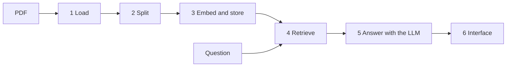
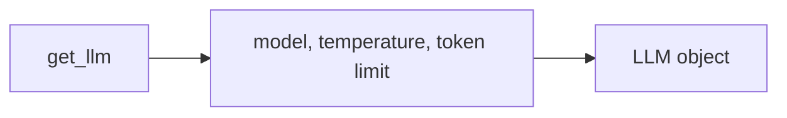
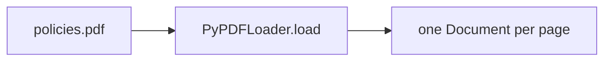
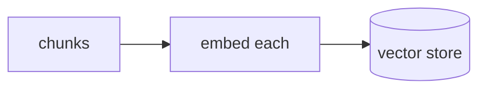
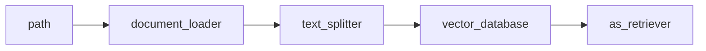
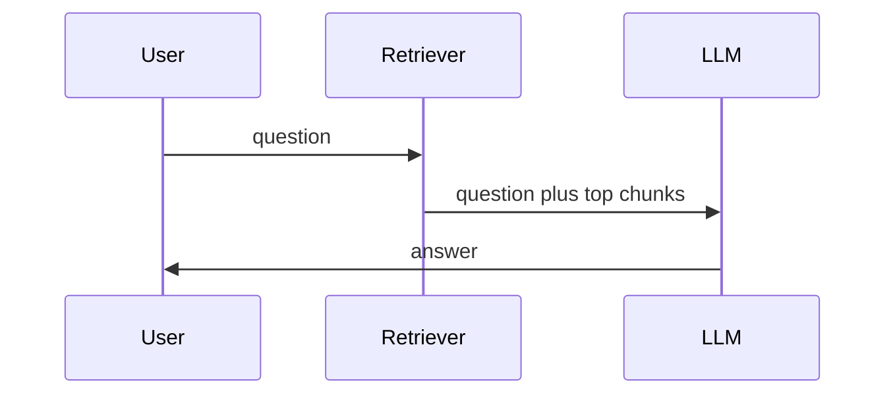
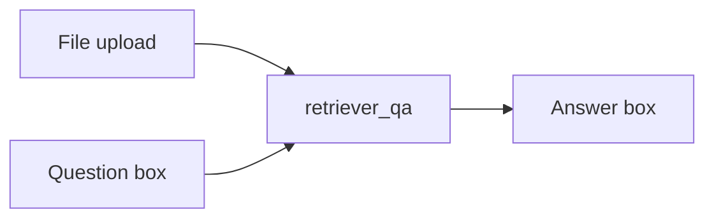

# Tutorial 3: The Lab, a PDF Question-Answering Bot (Adapted)

> **After this tutorial you can:**
> - load a PDF, split it into chunks, embed and store them, and retrieve the chunks that answer a question
> - wire those pieces into one `retriever_qa(pdf, question)` function with LangChain 1.x
> - put a web interface in front of it (Gradio as in the lab, or a FastAPI endpoint as in this module's app)
> - spot four problems in the lab's code that you would not ship

This follows the lab *Construct a QA Bot that Leverages LangChain and LLMs to Answer Questions from Loaded Documents*, in the lab's order. The lab is the same pipeline as module 1, with two changes: the source is a **PDF**, and the interface is **Gradio**. Not yet familiar with the pipeline? Start with [module 1, Tutorial 1](../../module1/tutorials/01-rag-study-guide-and-lab-adapted.md). For the Next.js and FastAPI version of the interface, see [Tutorial 1](01-gradio-concepts-adapted-to-nextjs.md) and [Tutorial 2](02-build-the-rag-web-app.md) of this module.

## The path



| Lab section | Function in the lab | Section here |
|---|---|---|
| Initialize the LLM | `get_llm()` | Step 1 |
| PDF document loader | `document_loader(file)` | Step 2 |
| Text splitter | `text_splitter(data)` | Step 3 |
| Embedding model | `watsonx_embedding()` | Step 4 |
| Vector store | `vector_database(chunks)` | Step 5 |
| Retriever | `retriever(file)` | Step 6 |
| QA chain | `retriever_qa(file, query)` | Step 7 |
| Gradio interface and launch | `gr.Interface(...)` | Step 8 |

## Before you start

You need `OPENAI_API_KEY` in the repo-root `.env`. All packages used (`langchain-community`, `pypdf`, `langchain-openai`, `fastapi`) are in the shared `.venv` already. Open a notebook in `course2-build-rag-agents-get-started/module2/` with that kernel.

> **Lab says / today we use:** the lab creates a virtual environment and pins old packages (`langchain==0.2.11`, `chromadb==0.4.24`, `gradio==4.44.0`, `ibm-watsonx-ai==1.1.2`), writes one file `qabot.py`, and runs `python3.11 qabot.py`. We use the repo's shared `.venv`, a notebook, and OpenAI. The lab's `RetrievalQA` chain is legacy in LangChain 1.x, so Step 7 uses the modern `prompt | llm | parser` form. The ideas are identical.

Each question costs a tiny amount of API credit. Model text varies, so answers below are **examples**.

---

## Step 0: A PDF to practise on

**The idea.** The lab asks you to upload your own PDF. So you can follow along without hunting for one, this small helper writes a text-only PDF with a few company rules. (**Beyond the video.** If you have a real PDF, skip this block and use its path.)

```python
from pathlib import Path


def make_pdf(path, pages):
    """Write a small text-only PDF, one string per page."""
    objs = ["<< /Type /Catalog /Pages 2 0 R >>", None, "<< /Type /Font /Subtype /Type1 /BaseFont /Helvetica >>"]
    kids = []
    for text in pages:
        lines = [text[i:i + 80] for i in range(0, len(text), 80)]
        drawn = " T* ".join("(" + l.replace("(", "[").replace(")", "]") + ") Tj" for l in lines)
        body = f"BT /F1 11 Tf 40 760 Td 14 TL {drawn} ET"
        objs.append(f"<< /Length {len(body)} >>\nstream\n{body}\nendstream")
        objs.append(f"<< /Type /Page /Parent 2 0 R /MediaBox [0 0 612 792] /Contents {len(objs)} 0 R "
                    "/Resources << /Font << /F1 3 0 R >> >> >>")
        kids.append(f"{len(objs)} 0 R")
    objs[1] = f"<< /Type /Pages /Kids [{' '.join(kids)}] /Count {len(kids)} >>"
    out, offsets = "%PDF-1.4\n", []
    for n, o in enumerate(objs, 1):
        offsets.append(len(out.encode()))
        out += f"{n} 0 obj\n{o}\nendobj\n"
    xref = len(out.encode())
    out += f"xref\n0 {len(objs) + 1}\n0000000000 65535 f \n" + "".join(f"{o:010d} 00000 n \n" for o in offsets)
    out += f"trailer\n<< /Size {len(objs) + 1} /Root 1 0 R >>\nstartxref\n{xref}\n%%EOF\n"
    Path(path).write_bytes(out.encode())
```

You do not need to understand it. It builds the few objects a PDF needs and writes them to disk. Now make the file:

```python
make_pdf("policies.pdf", [
    "Vehicle policy. Smoking is not permitted in company vehicles. Eating is allowed only in "
    "designated areas. Report any accident within 24 hours.",
    "Mobile policy. Company mobile phones must be locked with a PIN. Lost devices must be "
    "reported to IT within 24 hours. Personal use is limited to emergencies.",
])
print(Path("policies.pdf").stat().st_size > 0)
```

**Expected output.**

```
True
```

---

## Step 1: Initialize the LLM

**The idea.** The LLM writes the final answer from the chunks you hand it. The lab wraps it in `get_llm()` with `WatsonxLLM`, a model id, a token limit of 256 and temperature 0.5.



**Type this.**

```python
from dotenv import load_dotenv
from langchain_openai import ChatOpenAI, OpenAIEmbeddings

load_dotenv()


def get_llm():
    return ChatOpenAI(model="gpt-4o-mini", temperature=0.5, max_tokens=256)
```

> **Lab says / today we use:** the lab uses `WatsonxLLM(model_id='mistralai/mistral-medium-2505', url=..., project_id="skills-network", params={MAX_NEW_TOKENS: 256, TEMPERATURE: 0.5})`. In watsonx the `project_id` and URL select the IBM project that bills the call; with OpenAI the key does that. `max_tokens=256` and `temperature=0.5` are the same two settings.

**Try it.** Set `temperature=0` for more repeatable answers. For question answering over documents, many people prefer that.

---

## Step 2: The PDF loader

**The idea.** A **document loader** turns a file into LangChain `Document` objects (text plus metadata). `PyPDFLoader` reads a PDF and returns **one `Document` per page**, with the page number in the metadata. It does not split the text. That is the next step.



**Type this.**

```python
from langchain_community.document_loaders import PyPDFLoader


def document_loader(path):
    return PyPDFLoader(path).load()


pages = document_loader("policies.pdf")
print(len(pages), pages[0].metadata["page"])
print(pages[0].page_content[:60])
```

**Expected output.**

```
2 0
Vehicle policy. Smoking is not permitted in company vehicles
```

Two pages, and the first has page number `0` (counting starts at zero).

> **Lab says / today we use:** the lab's function takes a Gradio file object and reads `file.name`. We take a plain path (a string), which is what the interface gives you with `type="filepath"`. The loader needs the package `pypdf`, already installed. `langchain-community` prints a deprecation notice because the project is moving to separate packages; the loader still works.

**Check yourself.** Why not search the pages directly?

<details><summary>Answer</summary>
A page can hold many topics, and a big chunk is harder to match to a question and may not fit the model's context. Splitting makes the pieces small and focused.
</details>

---

## Step 3: The text splitter

**The idea.** Cut the pages into **chunks** of about 1000 characters. The lab uses `RecursiveCharacterTextSplitter` with `chunk_size=1000` and `chunk_overlap=50`. "Recursive" means it tries the largest natural break first (blank lines), then single newlines, then spaces, so chunks tend to end at sensible places. The **overlap** repeats the last 50 characters in the next chunk so a sentence cut at the edge is still whole in one of them.


**Type this.**

```python
from langchain_text_splitters import RecursiveCharacterTextSplitter


def text_splitter(data, chunk_size=1000, chunk_overlap=50):
    splitter = RecursiveCharacterTextSplitter(
        chunk_size=chunk_size, chunk_overlap=chunk_overlap, length_function=len
    )
    return splitter.split_documents(data)


chunks = text_splitter(pages)
print(len(chunks))
print(len(text_splitter(pages, chunk_size=100, chunk_overlap=20)))
```

**Expected output.**

```
2
4
```

The pages are short, so 1000-character chunks keep each page whole (2 chunks). With a chunk size of 100 the same text becomes 4 smaller chunks. Metadata, such as the page number, is copied to every chunk.

**Try it.** Print `chunks[0].metadata` and see the `page` field travel with the chunk. That is how a bot can say "see page 2".

---

## Step 4: The embedding model

**The idea.** An **embedding model** turns each chunk into a vector, so the store can find chunks by meaning (module 1, and course 3). The lab uses IBM's Granite embedding model through `WatsonxEmbeddings`.

```python
def get_embeddings():
    return OpenAIEmbeddings(model="text-embedding-3-small")
```

> **Lab says / today we use:** the lab's `watsonx_embedding()` uses `ibm/granite-embedding-278m-multilingual` with this setting: `embed_params = {EmbedTextParamsMetaNames.TRUNCATE_INPUT_TOKENS: 3, ...}`.
>
> **That is a trap.** `TRUNCATE_INPUT_TOKENS: 3` cuts every chunk down to its **first 3 tokens** before embedding, so each 1000-character chunk is represented by about two words. Retrieval then depends almost only on how a chunk begins. It reads like a demo setting to save time. We did not copy it: a good setting is to leave the input intact (or truncate to the model's real limit). The lab's other option, `RETURN_OPTIONS: {"input_text": True}`, just returns the text alongside the vector.
>
> It also means the lab can give a wrong answer for a reason that has nothing to do with the LLM. If your bot "cannot find" something that is plainly in the PDF, check what was embedded.

The lab notes that `watsonx_embedding()` is defined *after* the function that uses it, and that Python does not mind. That is true: names are looked up when a function **runs**, not when it is defined.

**Check yourself.** What does embedding give you that a keyword search does not?

<details><summary>Answer</summary>
Matches by meaning: "can I light up in the car?" can find the smoking rule, with no shared words.
</details>

---

## Step 5: The vector store

**The idea.** Embed all the chunks and store them where they can be searched. The lab uses `Chroma.from_documents(chunks, embedding_model)`. This is the vector database from [course 3](../../../course3/module1/README.md#13-chroma-db-key-concepts-and-architecture).



**Type this.**

```python
from langchain_core.vectorstores import InMemoryVectorStore


def vector_database(chunks):
    return InMemoryVectorStore.from_documents(chunks, get_embeddings())
```

> **Lab says / today we use:** `InMemoryVectorStore` ships with LangChain and needs nothing extra, so it keeps this tutorial runnable. It does the same job at this size. To use the lab's Chroma, run `uv add langchain-chroma` and swap in `Chroma.from_documents(chunks, get_embeddings())`. Or use Chroma directly, as in [course 3 Tutorial 4](../../../course3/module1/tutorials/04-chroma-db-adapted.md). Both vanish when the program stops unless you tell Chroma to persist.

---

## Step 6: The retriever

**The idea.** A **retriever** takes a question and returns the best-matching chunks (by default, by similarity search for the top 4). The lab's `retriever(file)` chains the steps so far: load, split, store, then `as_retriever()`.



**Type this.**

```python
def retriever(path):
    chunks = text_splitter(document_loader(path))
    return vector_database(chunks).as_retriever()


found = retriever("policies.pdf").invoke("Can I smoke in the car?")
print(len(found), found[0].metadata["page"])
print(found[0].page_content[:60])
```

**Expected output** (example; with only 2 chunks, both come back and the order shows the best first):

```
2 0
Vehicle policy. Smoking is not permitted in company vehicles
```

The default is the top 4, but this PDF only has two chunks. Use `.as_retriever(search_kwargs={"k": 2})` to choose how many.

---

## Step 7: The question-answering chain

**The idea.** `retriever_qa(file, query)` is the heart of the bot: find the chunks, paste them into a prompt, ask the LLM. The lab uses `RetrievalQA.from_chain_type(..., chain_type="stuff")`. "Stuff" means "stuff all retrieved chunks into one prompt".



**Type this.**

```python
from langchain_core.output_parsers import StrOutputParser
from langchain_core.prompts import ChatPromptTemplate

ANSWER = ChatPromptTemplate.from_template(
    "Use the document to answer the question. If the answer is not in the document, "
    "say you don't know. Do not make one up.\n\nDocument:\n{context}\n\nQuestion: {question}"
)


def retriever_qa(path, query):
    docs = retriever(path).invoke(query)
    context = "\n\n".join(d.page_content for d in docs)
    return (ANSWER | get_llm() | StrOutputParser()).invoke({"context": context, "question": query})


print(retriever_qa("policies.pdf", "Can I smoke in company vehicles?"))
```

**Expected output** (example; model text varies):

```
No. Smoking is not permitted in company vehicles.
```

> **Lab says / today we use:** `RetrievalQA` and `qa.invoke(query)['result']` are legacy classes from the old `langchain` package. The modern form is a **chain** built with `|`: a prompt, then the LLM, then a parser that returns plain text. The lab's version has no "I don't know" rule; we added the one from module 1, since a bot should admit gaps. See [module 1, Tutorial 1](../../module1/tutorials/01-rag-study-guide-and-lab-adapted.md).

Test the rule with something the PDF does not say:

```python
print(retriever_qa("policies.pdf", "What is the dress code?"))
```

**Expected output** (example): a sentence saying it does not know.

**Check yourself.** The lab's bot never lets the LLM see the whole PDF. Who decides what it sees?

<details><summary>Answer</summary>
The retriever. Only the top-matching chunks go into the prompt, which is why chunking and embedding quality matter so much.
</details>

### A problem in the lab: it rebuilds the index for every question

Look again at the lab's `retriever_qa`: it calls `retriever(file)` each time, so **every question re-loads, re-splits and re-embeds the whole PDF**. That is slow and costs money, and it is probably why the lab warns "large documents will fail". Fix it by building once per file and reusing:

```python
_cache = {}


def cached_retriever(path):
    if path not in _cache:
        _cache[path] = retriever(path)
    return _cache[path]


def retriever_qa(path, query):
    docs = cached_retriever(path).invoke(query)
    context = "\n\n".join(d.page_content for d in docs)
    return (ANSWER | get_llm() | StrOutputParser()).invoke({"context": context, "question": query})


print(retriever_qa("policies.pdf", "When must lost devices be reported?"))
print(len(_cache))
```

**Expected output** (example answer):

```
Within 24 hours, to IT.
1
```

The second line shows one index for the file. Ask five more questions and it stays 1: only the first call embeds the document. (Beyond the video: this module's [app](../app/) does the same thing with its `RagEngine`, which embeds a file once and keeps it in the store.)

---

## Step 8: The interface

**The idea.** You have the bot. Now other people need a page. The lab uses **Gradio**: a file upload, a question box, an answer box.



The lab's interface, adapted to our function. This block needs Gradio (`uv add gradio`), which is not installed, so it is marked and skipped by the checker:

```python
# needs: gradio (run `uv add gradio`)
import gradio as gr

rag_application = gr.Interface(
    fn=retriever_qa,
    inputs=[
        gr.File(label="Upload PDF File", file_count="single", file_types=[".pdf"], type="filepath"),
        gr.Textbox(label="Input Query", lines=2, placeholder="Type your question here..."),
    ],
    outputs=gr.Textbox(label="Output"),
    title="RAG Chatbot",
    description="Upload a PDF document and ask any question.",
)
rag_application.launch(server_name="127.0.0.1", server_port=7860)
```

> **Lab says / today we use:** the lab launches with `server_name="0.0.0.0"` and `share=True`. We use `127.0.0.1` and no `share`. **`share=True` creates a public internet link to your running app.** Anyone with the link can use it, and when it runs on your own OpenAI key they spend your credit. It is fine in the lab's sandbox with free access, and a poor default anywhere else. The lab also removed `allow_flagging="never"`, which newer Gradio renamed; leave the flag out unless your Gradio version needs it.

### The same interface as an API (this module's stack)

This module replaces Gradio with a **FastAPI** endpoint plus a Next.js page ([Tutorial 1](01-gradio-concepts-adapted-to-nextjs.md)). Here is the PDF bot as an endpoint: the upload and the question arrive as a form, we save the PDF to a temporary file, answer, and clean up.

```python
import os
import tempfile

from fastapi import FastAPI, File, Form, HTTPException, UploadFile

api = FastAPI()


@api.post("/ask")
async def ask(file: UploadFile = File(...), question: str = Form(...)):
    if not (file.filename or "").lower().endswith(".pdf"):
        raise HTTPException(status_code=400, detail="Please upload a PDF file")
    with tempfile.NamedTemporaryFile(suffix=".pdf", delete=False) as tmp:
        tmp.write(await file.read())
    try:
        return {"answer": retriever_qa(tmp.name, question)}
    finally:
        os.remove(tmp.name)
```

Call it without a browser using FastAPI's test client:

```python
from fastapi.testclient import TestClient

client = TestClient(api)
with open("policies.pdf", "rb") as pdf:
    reply = client.post("/ask", files={"file": ("policies.pdf", pdf, "application/pdf")},
                        data={"question": "Can I smoke in company vehicles?"})
print(reply.status_code, "answer" in reply.json())

wrong = client.post("/ask", files={"file": ("notes.txt", b"hello", "text/plain")}, data={"question": "hi"})
print(wrong.status_code)
```

**Expected output.**

```
200 True
400
```

Notice the temp file has a new name for every request, so the cache from Step 7 does not help here (it is keyed by path). A real app would key the cache by a hash of the file, or store the PDF's chunks once under its name, as this module's `RagEngine` does.

To run it for real: save the code in a file, then `uv run uvicorn <file>:api --port 8001` and open `http://127.0.0.1:8001/docs` to try the upload from the auto-generated page. (Use a port other than 8000 if something else is using it.)

> **Beyond the video:** the finished app in [../app/](../app/) accepts plain-text files, not PDFs. Adding PDF support is a small change: call `PyPDFLoader` on the upload before `add_text`. That makes a good exercise (Practice 5).

---

## Putting it together

The whole lab as one short script, with the fixes:

| Lab | Here |
|---|---|
| `WatsonxLLM(...)` | `ChatOpenAI(...)` |
| `PyPDFLoader(file.name)` | `PyPDFLoader(path)` |
| `RecursiveCharacterTextSplitter(1000, 50)` | the same |
| `WatsonxEmbeddings(... truncate 3 tokens)` | `OpenAIEmbeddings` with the input intact |
| `Chroma.from_documents` | `InMemoryVectorStore.from_documents` (or Chroma) |
| `RetrievalQA` (`stuff`) | `prompt \| llm \| StrOutputParser()` |
| rebuild the index for each question | build once per file |
| `launch(share=True)` | local only |

## Common mistakes

| Mistake | Fix |
|---|---|
| `ModuleNotFoundError: pypdf` | `uv add pypdf` (already installed in this repo) |
| Loader returns empty text for a scanned PDF | the PDF is an image; it needs OCR first. `PyPDFLoader` reads text only |
| `FileNotFoundError` | run the notebook from the folder containing `policies.pdf`, or use a full path |
| Answers ignore the PDF | check retrieval first: print `retriever(path).invoke(question)` |
| Questions get slower with a big file | the index is rebuilt each time. Cache it (Step 7) |
| Gradio `file.name` fails on a plain string path | use the path itself, as here |
| `RetrievalQA` import error | legacy class; use the `prompt \| llm \| parser` chain |
| Sharing the app publicly by accident | remove `share=True` |

## Cheat sheet

| Task | Code |
|---|---|
| Load a PDF | `PyPDFLoader(path).load()` (one `Document` per page) |
| Split | `RecursiveCharacterTextSplitter(chunk_size=1000, chunk_overlap=50).split_documents(docs)` |
| Embed and store | `InMemoryVectorStore.from_documents(chunks, OpenAIEmbeddings(...))` |
| Retrieve | `store.as_retriever(search_kwargs={"k": 4}).invoke(question)` |
| Answer | `(prompt \| llm \| StrOutputParser()).invoke({"context": ..., "question": ...})` |
| Upload endpoint | `async def ask(file: UploadFile = File(...), question: str = Form(...))` |

## Practice

No answers shown. Ask me for a hint.

1. Make `retriever_qa` also return the page numbers of the chunks it used, and show them under the answer (Beyond the video).
2. Change the chunk size to 300 with overlap 50. Ask the same question. Does the answer change? Print the retrieved chunks.
3. Use `search_kwargs={"k": 1}` and ask a question that needs both pages. What goes wrong, and which setting fixes it?
4. Reproduce the lab's trap: wrap `OpenAIEmbeddings` so each chunk is cut to its first 20 characters before embedding. Ask something that lives in the middle of a chunk. What happens?
5. Add PDF support to this module's app: in `main.py`'s upload route, if the file ends in `.pdf`, extract the text with `PyPDFLoader` and pass it to `add_text`. Test with `test_live.py`.
6. Key the cache by a hash of the PDF bytes, so uploading the same file twice builds the index once.

---

Back to the [module 2 README](../README.md). Previous: [Tutorial 2](02-build-the-rag-web-app.md).
