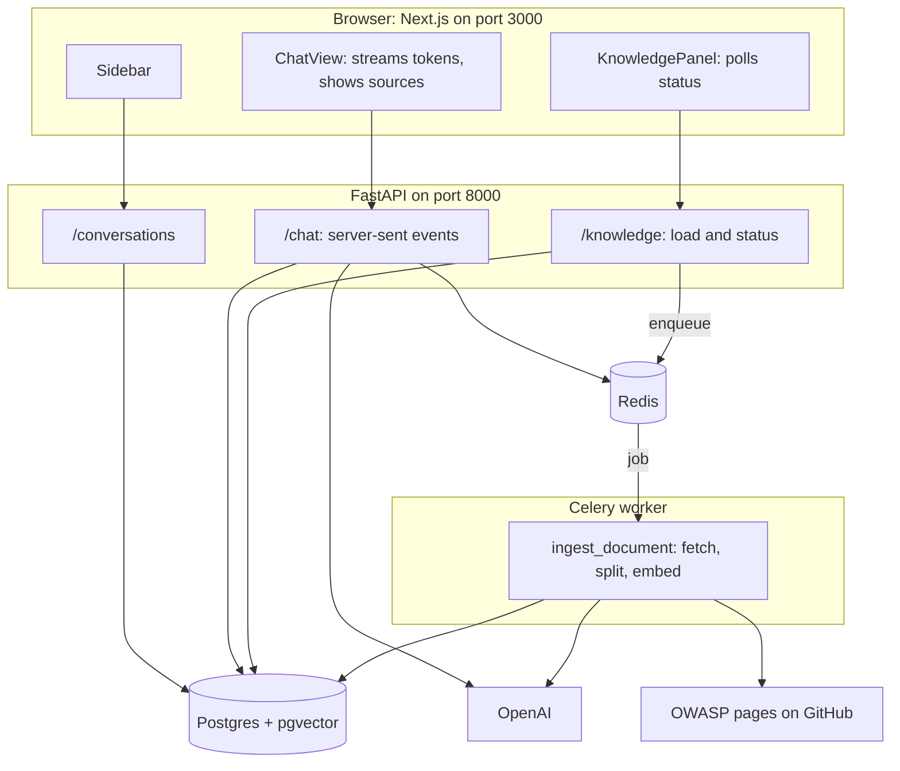
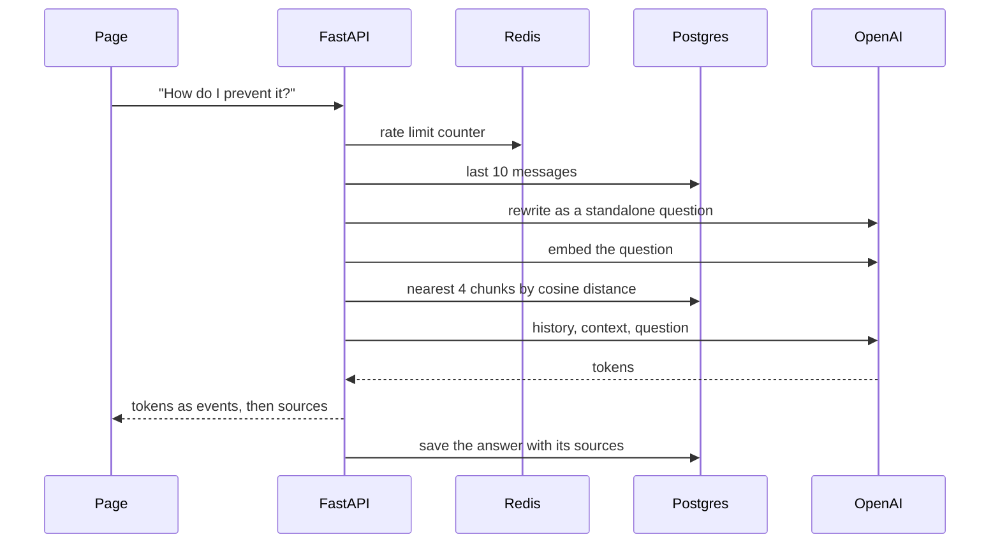

# Full-Stack OWASP Top 10 Chatbot: Next.js + FastAPI + Postgres (pgvector) + Redis + Celery

A follow-along guide that starts from a **hello world** and ends with a ChatGPT-style assistant that answers questions about the **OWASP Top 10:2025**. It cites the category, links to owasp.org, and says "I don't know" when the pages do not cover your question.

**Everything is real.** Real Postgres with pgvector, real Redis, a real Celery worker and the real OpenAI API, all running on your machine. There are no fakes or mocks. The final test runs against the live stack.

| Layer | Tech | Job |
|---|---|---|
| Frontend | Next.js, TypeScript, Tailwind CSS, shadcn/ui | The page |
| Backend | FastAPI (Python, async) | API, streaming, validation |
| Database and vector store | PostgreSQL 17 + pgvector | Chats, messages, documents, embeddings, similarity search |
| Queue and counters | Redis | Celery job queue, rate limiting |
| Background jobs | Celery | Download, split and embed the OWASP pages |
| AI | LangChain + OpenAI | Chat model and embeddings |

> **Content and license.** The OWASP Top 10 text is published by the OWASP Foundation under [CC BY-SA 4.0](https://creativecommons.org/licenses/by-sa/4.0/) ([source](https://github.com/OWASP/Top10)). The app downloads it at load time and links back to owasp.org.

**How to use this guide:** do the five tutorials in order. Each ends with a working app. A finished copy is in [app/](app/).

## Contents

1. [The tutorials](#1-the-tutorials)
2. [Architecture](#2-architecture)
3. [Why these pieces?](#3-why-these-pieces)
4. [Ideas to learn](#4-ideas-to-learn)
5. [Run the finished app](#5-run-the-finished-app)
6. [Cheat sheet](#6-cheat-sheet)
7. [Self-quiz](#7-self-quiz)

---

## 1. The tutorials

| Part | You start with | You end with |
|---|---|---|
| [1: Hello world to streaming chat](tutorials/01-hello-world-to-streaming-chat.md) | An empty folder | AI answers that stream word by word |
| [2: Saved conversations with Postgres](tutorials/02-postgres-conversations.md) | Part 1 | A sidebar of saved chats, history sent to the model |
| [3: pgvector and an OWASP knowledge base](tutorials/03-pgvector-owasp-knowledge-base.md) | Part 2 | RAG: sourced answers from the OWASP pages |
| [4: Redis and Celery](tutorials/04-redis-and-celery.md) | Part 3 | Background loading with a status panel, a rate limit, a live test |
| [5: Run everything with Docker](tutorials/05-docker-compose.md) | Part 4 | Dockerfiles and a compose file: one command starts all five services |

Related: the course apps [module 1](../module1/app/) and [module 2](../module2/app/) use the same Next.js and FastAPI pairing for the RAG labs.

---

## 2. Architecture



**Six things run when you use the whole app:** Postgres, Redis, the API, the Celery worker, the Next.js dev server and your browser.

A chat message, step by step:



---

## 3. Why these pieces?

Each piece is added only when a problem demands it.

| Piece | Added when | Problem it solves |
|---|---|---|
| FastAPI streaming | Part 1 | Waiting for a full answer feels slow |
| Postgres | Part 2 | A chat must be remembered, durably |
| pgvector | Part 3 | We need similarity search, and we already have Postgres |
| Redis + Celery | Part 4 | Loading documents is slow, and spam costs money |

| Question | Answer |
|---|---|
| Why Postgres for the vectors, not a separate vector database? | One database for chats, documents and vectors: fewer things to run, and you can join vectors to normal tables (the search query joins `chunks` to `documents`). A dedicated vector database makes sense at very large scale. |
| Does the chat stream need Celery? | **No.** A stream needs a live connection to the browser. A queue adds delay. FastAPI's `async` handles it. |
| Does loading documents need Celery? | **Yes, ideally.** It is slow, it can fail and be retried, and the user should not wait on a spinner. |
| What does Redis do here? | Holds the Celery queue and the rate-limit counters. Chats and documents live in Postgres, because they must not be lost. |
| Could we skip Celery? | For ten pages, `BackgroundTasks` in FastAPI would work. A queue and worker become worthwhile with many documents, retries, several users, or scheduled reloads. The tutorial uses Celery so you learn the pattern. |

**Honest trade-off.** Each extra piece is one more thing to install, run and debug. This app goes from 2 processes in part 1 to 6 at the end.

---

## 4. Ideas to learn

| Idea | Where |
|---|---|
| Client and server over HTTP; CORS | Part 1 |
| JSON contracts and validation (`422`) | Part 1 |
| `async` and `await`; streaming with server-sent events | Part 1 |
| Tables, foreign keys, `ON DELETE CASCADE`, parameterized SQL | Part 2 |
| Connection pools; app lifespan | Part 2 |
| The model has no memory: we resend history | Part 2 |
| Embeddings, cosine distance, `<=>`, HNSW index | Part 3 |
| Cleaning and chunking Markdown; putting the title in front for embedding | Part 3 |
| RAG: rewrite, retrieve, answer, cite; similarity as a "do I know this" signal | Part 3 |
| Task queue, broker, worker, `.delay()`, upserts, polling | Part 4 |
| Images, layer caching, non-root users, health checks, `depends_on`, volumes, build-time vs run-time settings | Part 5 |
| Rate limiting with `INCR` and `EXPIRE` | Part 4 |
| Testing the real stack | Part 4 |

---

## 5. Run the finished app

You need Docker, and `OPENAI_API_KEY` in `app/.env`.

**One command (recommended):**

```bash
cd course2/fullstack-chat/app
cp .env.example .env        # then put your key in .env as OPENAI_API_KEY=sk-...
docker compose up --build
```

(Key already in the repo-root `.env`? Use `docker compose --env-file ../../../.env up --build`.) Open http://localhost:3000, press **Load OWASP Top 10**, wait for ten `ready` badges, and ask a question. API docs: http://localhost:8000/docs. `docker compose down` stops everything (add `-v` to also delete the data).

**For development** (edit code with auto-reload): run only the databases in Docker, and the rest on your machine, in four terminals:

```bash
# 1. Postgres (with pgvector) and Redis
cd course2/fullstack-chat/app
docker compose up -d postgres redis

# 2. API (creates the tables on start)
cd course2/fullstack-chat/app/backend
uv run uvicorn main:app --reload --port 8000

# 3. Celery worker (same folder)
uv run celery -A tasks worker --loglevel=info --pool=solo

# 4. Frontend
cd course2/fullstack-chat/app/frontend
npm install
npm run dev
```

**Test the real stack** (needs the stack running either way; costs a fraction of a cent):

```bash
cd course2/fullstack-chat/app/backend && uv run python test_live.py
```

Frontend checks: `cd app/frontend && npx tsc --noEmit && npm run lint && npm run build`.

Ports 3000, 8000, 5432 and 6379 are used. The other course apps use some of the same ports, so run one at a time.

Packages added to the root `pyproject.toml` for this guide: `celery`, `redis`, `psycopg[binary]`, `psycopg-pool`, `pgvector`, `httpx`.

---

## 6. Cheat sheet

| Term | One-line meaning |
|---|---|
| Endpoint | A web address that runs a function. |
| CORS | Browser rule: the API must allow the page's origin. |
| SSE | Server-sent events: a response made of small `data:` messages. |
| Async generator | A function that `yield`s values over time. |
| Foreign key | A column pointing at a row in another table. |
| Cascade | Delete children when the parent is deleted. |
| Connection pool | A few open database connections that requests borrow. |
| Parameterized query | `%s` plus values, never string gluing. Stops SQL injection. |
| Embedding | A vector of numbers capturing meaning (1536 here). |
| pgvector | Postgres extension for vectors. |
| `<=>` | Cosine distance. Similarity is `1 - distance`. |
| HNSW | A fast approximate nearest-neighbour index. |
| Chunk | A small piece of a document. |
| RAG | Retrieve relevant text, add to the prompt, then generate. |
| Celery | A task queue: the API enqueues, a worker runs. |
| `.delay()` | Enqueue a task and return at once. |
| Upsert | `INSERT ... ON CONFLICT DO UPDATE`. |
| Polling | Asking repeatedly "is it done yet?". |

| Command | Does |
|---|---|
| `docker compose up --build` | Start everything (Postgres, Redis, API, worker, page) |
| `docker compose up -d postgres redis` | Start only the databases, for development |
| `uv run uvicorn main:app --reload --port 8000` | Start the API |
| `uv run celery -A tasks worker --loglevel=info --pool=solo` | Start the worker |
| `npm run dev` | Start the page |
| `docker compose exec postgres psql -U chat chat` | SQL prompt |
| `docker compose exec redis redis-cli` | Redis prompt |
| `uv run python test_live.py` | Test the real stack |

---

## 7. Self-quiz

1. Why does the page need CORS permission to call the API?
2. How does the model "remember" earlier messages?
3. What does `ON DELETE CASCADE` do for messages?
4. Why pass SQL values as `%s` parameters?
5. What does `1 - (embedding <=> query)` give you?
6. Why do we embed the question with the same model as the chunks?
7. Why is a follow-up like "How do I prevent it?" rewritten before searching?
8. What does a low top similarity (about 0.1) tell you?
9. What does `ingest_document.delay(id)` do, and what does it not do?
10. Why does the page poll for status?
11. Why is chat streaming not a Celery job?
12. Why does `INCR` plus `EXPIRE` make a rate limiter?

<details>
<summary>Show answers</summary>

1. The page (port 3000) and API (port 8000) are different origins. Browsers block the call unless the API allows the page's origin.
2. We resend the recent history with every request. The model just reads it again.
3. Deleting a conversation also deletes its messages, so nothing is left orphaned.
4. The database treats parameters as data, never as SQL, so a user cannot inject commands.
5. The cosine similarity: 1 means the same direction, near 0 means unrelated.
6. Vectors from different models live in different "number spaces", so comparing them means nothing.
7. The vector of a question with no topic words matches nothing. The rewrite makes it standalone ("How do I prevent SQL injection?").
8. Nothing relevant is stored, so the bot should say it does not know instead of making something up.
9. It puts a job message on the Redis queue and returns immediately. It does not run the function. A worker runs it later.
10. The worker cannot push a result to the browser. The page asks every second or two until nothing is queued or processing.
11. A stream needs a live connection to the browser, and a queue adds delay and complexity. Celery is for slow work that can finish later.
12. `INCR` counts requests for the current minute. `EXPIRE` removes the counter after 60 seconds, so each minute starts fresh with no cleanup code.

</details>

---

### Notes on this guide

- Next.js, shadcn/ui, FastAPI and Celery change quickly. If a generated file differs from the tutorials, trust the generated one.
- The `test_live.py` assertions check facts that must hold (right category in the sources, "I don't know" with low similarity), not exact wording, because model text varies.
- The OWASP pages are fetched from GitHub at load time. If OWASP reorganizes the repository, update `RAW` in `owasp.py`.
- Embedding vectors are 1536 numbers for `text-embedding-3-small`. If you change the model, change `vector(1536)` in `schema.sql` too.
