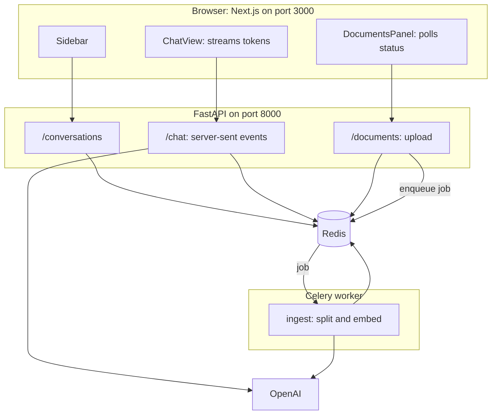
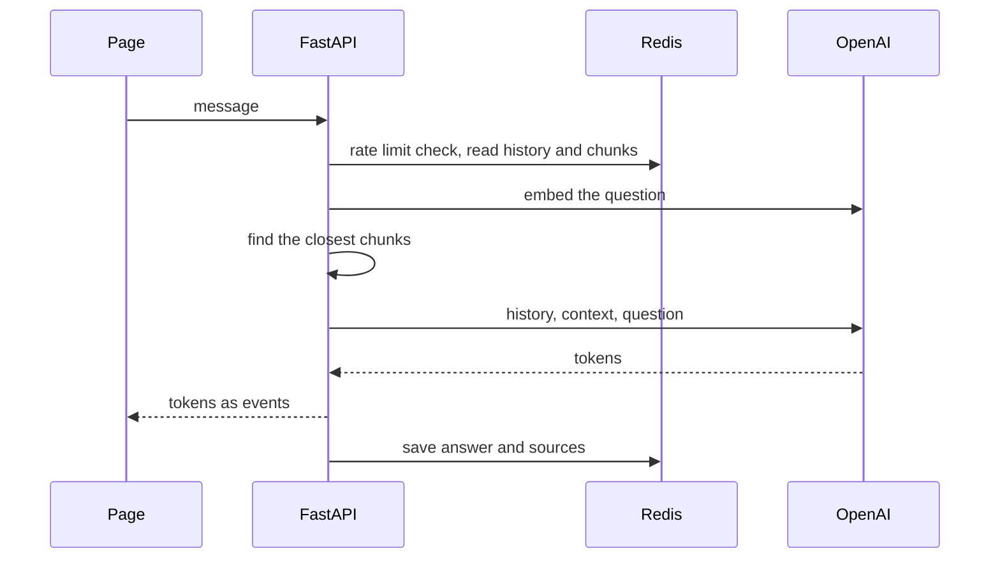

# Full-Stack Chat App: Next.js + FastAPI + Redis + Celery

A follow-along guide to building a ChatGPT-style app from a **hello world** up to a chat that streams answers, remembers conversations, and answers from your own documents.

| Layer | Tech | Job |
|---|---|---|
| Frontend | Next.js, TypeScript, Tailwind CSS, shadcn/ui | The page |
| Backend | FastAPI (Python, async) | API, streaming, validation |
| AI | LangChain + OpenAI | Chat model and embeddings |
| Storage and queue | Redis | Conversations, messages, counters, job queue |
| Background jobs | Celery | Slow work: indexing documents |

**How to use this guide:** do the three tutorials in order. Each ends with a working app. A finished copy is in [app/](app/) for comparison.

## Contents

1. [The tutorials](#1-the-tutorials)
2. [Architecture](#2-architecture)
3. [Do we need Redis and Celery?](#do-we-need-redis-and-celery)
4. [Ideas to learn](#4-ideas-to-learn)
5. [Run the finished app](#5-run-the-finished-app)
6. [Cheat sheet](#6-cheat-sheet)
7. [Self-quiz](#7-self-quiz)

---

## 1. The tutorials

| Part | You start with | You end with |
|---|---|---|
| [1: Hello world to streaming chat](tutorials/01-hello-world-to-streaming-chat.md) | An empty folder | A page where AI answers stream word by word |
| [2: Memory and many conversations with Redis](tutorials/02-redis-memory-and-conversations.md) | Part 1 | A sidebar of saved conversations, history sent to the model, a rate limit |
| [3: Documents with Celery, and RAG](tutorials/03-celery-documents-and-rag.md) | Part 2 | File upload processed by a worker, answers with sources |

Related: the course apps [module 1](../module1/app/) and [module 2](../module2/app/) use the same Next.js and FastAPI pairing for the RAG labs.

---

## 2. Architecture



**Five processes run when you use the whole app:** Redis, the API, the Celery worker, the Next.js dev server and your browser.

A chat message, step by step:



---

<a id="do-we-need-redis-and-celery"></a>

## 3. Do we need Redis and Celery?

**Short answer.** For a one-person demo, no. For an app with several users, saved chats and file uploads, **Redis is worth it, and Celery is worth it for one job: document indexing.** Not for the chat itself.

| Question | Answer |
|---|---|
| Does streaming a chat answer need Celery? | **No.** A stream needs a live connection to the browser. A queue adds delay and moving parts. FastAPI's `async` handles it. |
| Does indexing a document need Celery? | **Yes, ideally.** It is slow (embedding calls), it can fail and be retried, and the user should not wait on a spinner. |
| What does Redis do here? | Stores chats and messages, counts requests for rate limiting, holds the Celery job queue, and (in this app) holds the embedded chunks so the worker and API can share them. |
| Could we skip Redis? | For history, a Python list works for one user and one process (that is stages 0 to 3). With a separate worker process, **shared state must live outside Python memory**, and Redis is the simplest place. |

When something simpler is enough:

| Situation | Simpler choice |
|---|---|
| Small jobs, same server, losing a job is fine | FastAPI `BackgroundTasks` (no Redis, no worker) |
| You want a lighter queue than Celery | RQ or ARQ (also Redis based) |
| Messages must never be lost, need search and reports | PostgreSQL for messages, Redis as cache, limiter and queue |
| Thousands of chunks per user | A real vector index (Redis Stack search, Chroma, FAISS, pgvector) instead of comparing vectors by hand |

**Honest trade-off.** Each extra piece is one more thing to install, run, monitor and debug (this app goes from 2 processes to 5). That is why the tutorials add them **one at a time, only when a problem demands it**: Redis when the chat must remember, Celery when indexing is too slow to wait for.

---

## 4. Ideas to learn

| Idea | Where it appears |
|---|---|
| Client and server talk over HTTP; CORS | Part 1, stage 0 |
| JSON contracts and validation (`422`) | Part 1, stage 1 |
| `async` and `await` | Part 1, stage 2 |
| Streaming with server-sent events and async generators | Part 1, stage 3 |
| Redis keys, hashes, lists, sets, sorted sets, `EXPIRE` | Part 2 |
| Models have no memory, we resend history | Part 2 |
| Rate limiting with an expiring counter | Part 2 |
| Task queue, broker, worker, `.delay()` | Part 3 |
| Polling for job status | Part 3 |
| RAG: embed, retrieve with cosine similarity, answer with sources | Part 3 |
| Testing with fakes: fakeredis, fake models, eager Celery | Part 3 |

---

## 5. Run the finished app

You need `OPENAI_API_KEY` in the repo-root `.env`. Packages are in the root `pyproject.toml`. Use four terminals:

```bash
# 1. Redis (needs Docker)
cd course2/fullstack-chat/app
docker compose up -d

# 2. API
cd course2/fullstack-chat/app/backend
uv run uvicorn main:app --reload --port 8000

# 3. Celery worker (same folder)
uv run celery -A tasks worker --loglevel=info --pool=solo

# 4. Frontend
cd course2/fullstack-chat/app/frontend
npm install
npm run dev
```

Open http://localhost:3000. API docs: http://localhost:8000/docs.

Free checks (no Redis, no OpenAI, no worker):

```bash
cd course2/fullstack-chat/app/backend && uv run python -c "import test_api; test_api.test_all(); print('ok')"
cd ../frontend && npx tsc --noEmit && npm run lint && npm run build
```

Packages added to the root `pyproject.toml` for this guide: `celery`, `redis`, and `fakeredis` (dev only).

---

## 6. Cheat sheet

| Term | One-line meaning |
|---|---|
| Endpoint | A web address that runs a function. |
| CORS | Browser rule: the API must allow the page's origin. |
| SSE | Server-sent events: a response made of small `data:` messages. |
| Async generator | A function that `yield`s values over time (`async def` with `yield`). |
| Token | A piece of text the model produces. |
| Redis | Fast in-memory database with simple structures. |
| Hash / list / set / sorted set | Dictionary / ordered items / unique items / items ordered by score. |
| `EXPIRE` | Makes a key delete itself after N seconds. |
| Celery | A task queue: web server enqueues, a worker runs. |
| Broker | The queue Celery uses (Redis here). |
| Worker | A separate process that runs queued jobs. |
| `.delay()` | Enqueue a Celery task and return at once. |
| Polling | Asking repeatedly "is it done yet?". |
| Eager mode | Celery runs tasks inline, for tests. |
| RAG | Retrieve relevant text, add to the prompt, then generate. |
| Cosine similarity | Closeness of two vectors by direction. |

| Command | Does |
|---|---|
| `docker compose up -d` | Start Redis |
| `uv run uvicorn main:app --reload --port 8000` | Start the API |
| `uv run celery -A tasks worker --loglevel=info --pool=solo` | Start the worker |
| `npm run dev` | Start the page |
| `redis-cli keys '*'` | See what is stored |

---

## 7. Self-quiz

1. Why does the page need CORS permission to call the API?
2. Why does streaming use `fetch` and a reader instead of `EventSource`?
3. The model "remembers" earlier messages. How, if it has no memory?
4. Which Redis type keeps messages in order? Which keeps chats newest-first?
5. How does `EXPIRE` help a rate limiter?
6. What does `ingest.delay(...)` do, and what does it not do?
7. Why can't the worker keep chunks in a Python list?
8. Why does the page poll for document status?
9. Why is chat streaming not a Celery job?
10. What happens to a document if the worker is not running?
11. What would you change for thousands of chunks per user?

<details>
<summary>Show answers</summary>

1. The page (port 3000) and API (port 8000) are different origins. Browsers block the call unless the API allows the page's origin.
2. `EventSource` only makes GET requests. We need POST with a message body, so we read the response stream with `fetch`.
3. We resend the recent history with every request. The model just reads it again.
4. A list (`RPUSH`, `LRANGE`) keeps messages in order. A sorted set (`ZADD` with the time as score, `ZREVRANGE`) lists chats newest first.
5. The counter key is per client per minute and expires after 60 seconds, so the count resets without any cleanup code.
6. It puts a job message on the Redis queue and returns immediately. It does not run the function. A worker runs it later.
7. The worker and the API are separate processes with separate memory. Shared data must live in something both can reach, such as Redis.
8. The worker cannot push a result to the browser. The page asks for the status every second or two until nothing is queued or processing.
9. A streaming answer needs a live connection to the browser, and a queue would add delay and complexity. Celery is for slow work that can finish later.
10. Its status stays `queued` forever.
11. Use a real vector index (Redis Stack search, Chroma, FAISS or pgvector) instead of comparing every vector with numpy.

</details>

---

### Notes on this guide

- Next.js, shadcn/ui, FastAPI and Celery change quickly. If a generated file differs from the tutorials, trust the generated one. The ideas do not change.
- The finished app keeps chunks and vectors in Redis lists for clarity. It is a teaching design, not a scaling design.
- Redis in a plain container keeps data in memory. The tutorial's practice section shows how to persist it.
