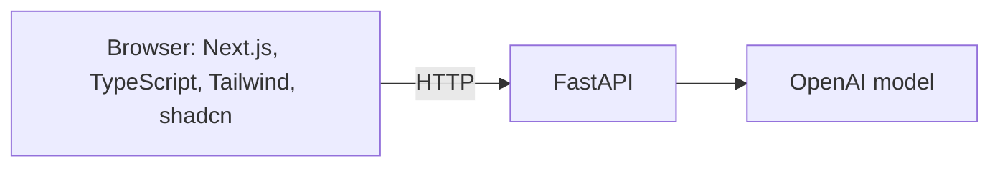
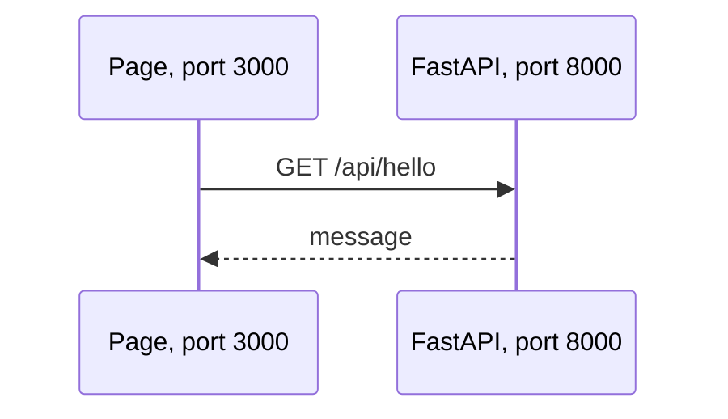
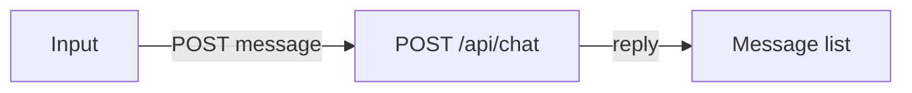
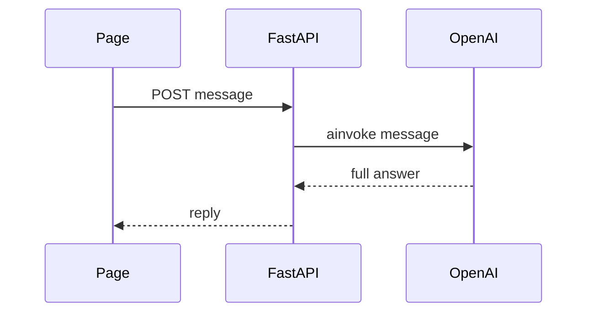
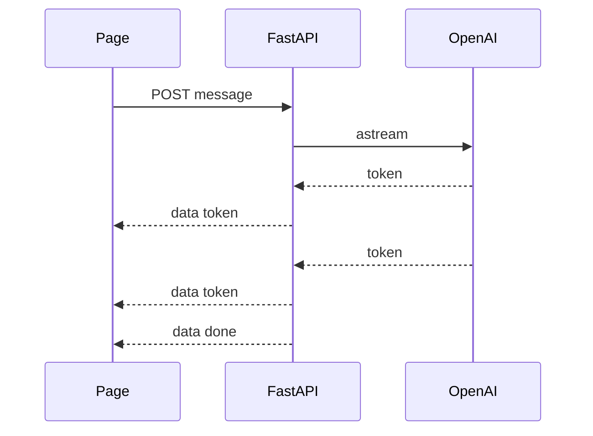

# Tutorial 1: From Hello World to a Streaming Chat

**What you build.** A chat page where you type a message and the AI's answer appears **word by word**, like ChatGPT. You start from a "hello world" and add one thing at a time. Each stage runs on its own, so you always have a working app.

| Stage | You have |
|---|---|
| 0 | A page that shows a message from the backend |
| 1 | A chat box that echoes you |
| 2 | Real AI answers (all at once) |
| 3 | Answers that **stream** |

This is part 1 of 4:

| Part | Adds |
|---|---|
| **1** | **A streaming chat** |
| [2](02-postgres-conversations.md) | **Postgres**: saved conversations |
| [3](03-pgvector-owasp-knowledge-base.md) | **pgvector**: an OWASP Top 10 knowledge base and RAG |
| [4](04-redis-and-celery.md) | **Redis and Celery**: background loading and rate limiting |

By the end you have an OWASP Top 10 chatbot. Everything is real: real Postgres, Redis, Celery worker and OpenAI API, with no fakes.

New to FastAPI, `fetch` or CORS? [Module 2, Tutorial 1](../../module2/tutorials/01-gradio-concepts-adapted-to-nextjs.md) explains them slowly. This tutorial goes faster.

## The stack, in one picture



Postgres joins in part 2, Redis and Celery in part 4. Do we need them? See [the guide](../README.md#do-we-need-redis-and-celery). Short answer: **not yet**. Stages 0 to 3 need neither.

## Before you start

- Node.js 20 or newer, and the repo's Python environment (`uv sync`).
- `OPENAI_API_KEY` in the repo-root `.env` (stages 2 and 3 only).
- Work in `course2/fullstack-chat/my-chat/`. A finished copy is in [../app/](../app/). Compare with it when stuck.

Create the two folders:

```bash
cd course2/fullstack-chat
mkdir -p my-chat/backend && cd my-chat
npx create-next-app@latest frontend --typescript --tailwind --eslint --app --src-dir --import-alias "@/*" --use-npm --yes
cd frontend
npx shadcn@latest init -d -y
npx shadcn@latest add button input textarea badge -y
```

Backend packages (`fastapi`, `uvicorn`, `celery`, `redis`, `psycopg`, `pgvector` and friends) are already in the root `pyproject.toml`. From part 2 on you also need Docker.

---

## Stage 0: Hello world

### The idea

Two programs talk over HTTP. The backend answers on port 8000. The page, on port 3000, asks it a question with `fetch` and shows the reply.



### Type this

Create `backend/main.py`:

```python
from fastapi import FastAPI
from fastapi.middleware.cors import CORSMiddleware

app = FastAPI()

# The page and the API run on different ports, so the browser needs permission (CORS).
app.add_middleware(
    CORSMiddleware,
    allow_origins=["http://localhost:3000", "http://127.0.0.1:3000"],
    allow_methods=["*"],
    allow_headers=["*"],
)


@app.get("/api/hello")
def hello():
    return {"message": "Hello from FastAPI"}
```

Run it. From inside the repo so `uv` uses the shared environment:

```bash
cd course2/fullstack-chat/my-chat/backend
uv run uvicorn main:app --reload --port 8000
```

Open http://localhost:8000/api/hello. You should see `{"message":"Hello from FastAPI"}`. Also open http://localhost:8000/docs for a free test page.

Now the page. Replace `frontend/src/app/page.tsx`:

```tsx
"use client";

import { useEffect, useState } from "react";

export default function Home() {
  const [message, setMessage] = useState("Loading...");

  useEffect(() => {
    fetch("http://localhost:8000/api/hello")
      .then((res) => res.json())
      .then((data) => setMessage(data.message))
      .catch(() => setMessage("Cannot reach the backend. Is uvicorn running?"));
  }, []);

  return <main className="p-6 text-xl">{message}</main>;
}
```

In a second terminal: `cd course2/fullstack-chat/my-chat/frontend && npm run dev`, then open http://localhost:3000.

**What you should see:** "Hello from FastAPI". Stop uvicorn and refresh: you see the "Cannot reach" text instead.

### Why it works

`"use client"` marks a component that uses state and effects, so it runs in the browser. `useEffect` with `[]` runs once when the page opens. If the backend is down, `.catch` shows a friendly message instead of a blank page.

Test the endpoint without a browser:

```python
from fastapi.testclient import TestClient

client = TestClient(app)
print(client.get("/api/hello").json())
```

**What you should see:** `{'message': 'Hello from FastAPI'}`.

### Try it

Change the message in `main.py`. Does the page update on refresh? (uvicorn reloads on its own.)

### Check yourself

Why do we need `CORSMiddleware`?

<details>
<summary>Answer</summary>

The page is at port 3000 and the API at port 8000. Browsers treat those as different origins and block the call unless the API says the page is allowed.
</details>

---

## Stage 1: A chat box that echoes

### The idea

A chat is: send a message, get a reply, show both. We start with a fake reply so we only test the plumbing.



### Type this

Replace `backend/main.py` (the whole file). `BaseModel` describes the JSON we expect:

```python
from fastapi import FastAPI
from fastapi.middleware.cors import CORSMiddleware
from pydantic import BaseModel, Field

app = FastAPI()
app.add_middleware(
    CORSMiddleware,
    allow_origins=["http://localhost:3000", "http://127.0.0.1:3000"],
    allow_methods=["*"],
    allow_headers=["*"],
)


class ChatIn(BaseModel):
    message: str = Field(min_length=1, max_length=4000)


@app.post("/api/chat")
def chat(body: ChatIn):
    return {"reply": f"You said: {body.message}"}
```

```python
client = TestClient(app)
print(client.post("/api/chat", json={"message": "hi"}).json())
print(client.post("/api/chat", json={"message": ""}).status_code)
```

**What you should see:** `{'reply': 'You said: hi'}` then `422` (empty messages are rejected).

Replace `frontend/src/app/page.tsx`:

```tsx
"use client";

import { useState } from "react";
import { Button } from "@/components/ui/button";
import { Input } from "@/components/ui/input";

type Message = { role: "user" | "assistant"; content: string };

export default function Home() {
  const [messages, setMessages] = useState<Message[]>([]);
  const [input, setInput] = useState("");

  async function send() {
    const text = input.trim();
    if (!text) return;
    setInput("");
    setMessages((m) => [...m, { role: "user", content: text }]);
    const res = await fetch("http://localhost:8000/api/chat", {
      method: "POST",
      headers: { "Content-Type": "application/json" },
      body: JSON.stringify({ message: text }),
    });
    const data = await res.json();
    setMessages((m) => [...m, { role: "assistant", content: data.reply }]);
  }

  return (
    <main className="mx-auto max-w-2xl space-y-4 p-6">
      {messages.map((m, i) => (
        <p key={i} className={m.role === "user" ? "text-right" : ""}>
          {m.content}
        </p>
      ))}
      <div className="flex gap-2">
        <Input value={input} onChange={(e) => setInput(e.target.value)} onKeyDown={(e) => e.key === "Enter" && send()} />
        <Button onClick={send}>Send</Button>
      </div>
    </main>
  );
}
```

**What you should see:** type "hi", press Enter. Your message and "You said: hi" appear.

### Why it works

`useState` keeps the list of messages. Changing state redraws the page. The spread `[...m, newItem]` makes a *new* array, which is how React knows something changed.

### Try it

Send a message of 5000 characters (paste one). What happens? Why does the page show nothing? (Hint: we do not handle errors yet. We will in stage 3.)

---

## Stage 2: Real AI answers

### The idea

Swap the echo for a model call. The frontend does **not** change at all, because the contract (`message` in, `reply` out) is the same. That is the benefit of separating frontend and backend.



### Type this

Replace `backend/main.py`:

```python
from dotenv import load_dotenv
from fastapi import FastAPI
from fastapi.middleware.cors import CORSMiddleware
from langchain_openai import ChatOpenAI
from pydantic import BaseModel, Field

load_dotenv()  # reads OPENAI_API_KEY from the repo-root .env

app = FastAPI()
app.add_middleware(
    CORSMiddleware,
    allow_origins=["http://localhost:3000", "http://127.0.0.1:3000"],
    allow_methods=["*"],
    allow_headers=["*"],
)
llm = ChatOpenAI(model="gpt-4o-mini", max_tokens=300)


class ChatIn(BaseModel):
    message: str = Field(min_length=1, max_length=4000)


@app.post("/api/chat")
async def chat(body: ChatIn):
    reply = await llm.ainvoke(body.message)  # await: do not block other requests while the model thinks
    return {"reply": reply.content}
```

```python
client = TestClient(app)
print(client.post("/api/chat", json={"message": "Say hi in three words."}).status_code)
```

**What you should see:** `200`. With the real key, the page now answers like an AI. The reply appears only after the *whole* answer is ready, which can take several seconds.

### Why it works

`async def` plus `await` lets the server handle other requests while it waits for the model. Without it, one slow answer would freeze every other user.

### Try it

Ask for a long poem. How long before anything appears? That wait is the problem stage 3 fixes.

### Check yourself

Why did the frontend not need to change?

<details>
<summary>Answer</summary>

The request and response shapes stayed the same. The backend can change how it makes the reply without the frontend knowing. That is what an API contract buys you.
</details>

---

## Stage 3: Streaming

### The idea

Models produce text a few characters at a time. **Streaming** sends each piece as soon as it exists, so the user starts reading at once. The standard way is **Server-Sent Events (SSE)**: one long HTTP response made of small messages, each a line `data: {...}` followed by a blank line.



### Type this

Replace `backend/main.py`. We keep the old endpoint and add a streaming one:

```python
import json

from dotenv import load_dotenv
from fastapi import FastAPI
from fastapi.middleware.cors import CORSMiddleware
from fastapi.responses import StreamingResponse
from langchain_openai import ChatOpenAI
from pydantic import BaseModel, Field

load_dotenv()

app = FastAPI()
app.add_middleware(
    CORSMiddleware,
    allow_origins=["http://localhost:3000", "http://127.0.0.1:3000"],
    allow_methods=["*"],
    allow_headers=["*"],
)
llm = ChatOpenAI(model="gpt-4o-mini", max_tokens=300)


class ChatIn(BaseModel):
    message: str = Field(min_length=1, max_length=4000)


def sse(event: dict) -> str:
    # One server-sent event: a line starting with "data:" and a blank line after it.
    return f"data: {json.dumps(event)}\n\n"


@app.post("/api/chat/stream")
async def chat_stream(body: ChatIn):
    async def events():
        try:
            async for chunk in llm.astream(body.message):
                if chunk.content:
                    yield sse({"type": "token", "text": chunk.content})
        except Exception as e:  # tell the page, instead of cutting the stream
            yield sse({"type": "error", "message": str(e)[:200]})
            return
        yield sse({"type": "done"})

    return StreamingResponse(events(), media_type="text/event-stream")
```

Test it. A streaming response arrives as one text with many events:

```python
client = TestClient(app)
text = client.post("/api/chat/stream", json={"message": "Say hi."}).text
print(text.count("data: "), "events")
```

**What you should see:** a number of events (at least 2: tokens and `done`). Try the real thing with curl while uvicorn runs. `-N` tells curl not to buffer:

```bash
curl -N -X POST localhost:8000/api/chat/stream -H "Content-Type: application/json" -d '{"message":"Count to five"}'
```

You see `data: {"type": "token", ...}` lines arrive one by one.

**Frontend, helper.** The browser's `EventSource` only supports GET, but we need POST. So we read the response stream ourselves. Create `frontend/src/lib/api.ts`:

```ts
export const API = process.env.NEXT_PUBLIC_API_URL ?? "http://localhost:8000";

export type ChatEvent = { type: "token"; text: string } | { type: "error"; message: string } | { type: "done" };

export async function* streamChat(message: string): AsyncGenerator<ChatEvent> {
  const res = await fetch(`${API}/api/chat/stream`, {
    method: "POST",
    headers: { "Content-Type": "application/json" },
    body: JSON.stringify({ message }),
  });
  if (!res.ok || !res.body) throw new Error(`Request failed (${res.status})`);
  const reader = res.body.getReader();
  const decoder = new TextDecoder();
  let buffer = "";
  while (true) {
    const { done, value } = await reader.read();
    if (done) break;
    buffer += decoder.decode(value, { stream: true });
    const events = buffer.split("\n\n");
    buffer = events.pop() ?? ""; // the last piece may be half an event, keep it for the next read
    for (const e of events) {
      if (e.startsWith("data: ")) yield JSON.parse(e.slice(6)) as ChatEvent;
    }
  }
}
```

`async function*` is an **async generator**: it can `yield` many values over time, and the caller uses `for await`.

**Frontend, page.** Replace `frontend/src/app/page.tsx`:

```tsx
"use client";

import { useState } from "react";
import { Button } from "@/components/ui/button";
import { Input } from "@/components/ui/input";
import { streamChat } from "@/lib/api";

type Message = { role: "user" | "assistant"; content: string };

export default function Home() {
  const [messages, setMessages] = useState<Message[]>([]);
  const [input, setInput] = useState("");
  const [busy, setBusy] = useState(false);
  const [error, setError] = useState("");

  async function send() {
    const text = input.trim();
    if (!text || busy) return;
    setBusy(true);
    setError("");
    setInput("");
    // An empty bot message that we fill in as tokens arrive.
    setMessages((m) => [...m, { role: "user", content: text }, { role: "assistant", content: "" }]);
    try {
      for await (const event of streamChat(text)) {
        if (event.type === "token") {
          setMessages((all) => all.map((m, i) => (i === all.length - 1 ? { ...m, content: m.content + event.text } : m)));
        }
        if (event.type === "error") setError(event.message);
      }
    } catch (e) {
      setError((e as Error).message);
    } finally {
      setBusy(false);
    }
  }

  return (
    <main className="mx-auto max-w-2xl space-y-4 p-6">
      {messages.map((m, i) => (
        <p key={i} className={m.role === "user" ? "text-right" : "whitespace-pre-wrap"}>
          {m.content}
        </p>
      ))}
      {error && <p className="text-sm text-destructive">{error}</p>}
      <div className="flex gap-2">
        <Input value={input} onChange={(e) => setInput(e.target.value)} onKeyDown={(e) => e.key === "Enter" && send()} />
        <Button onClick={send} disabled={busy}>
          Send
        </Button>
      </div>
    </main>
  );
}
```

**What you should see:** the answer grows word by word. Press Send while it is answering: nothing happens (the button is disabled), because `busy` is true.

### Why it works

The server `yield`s one event per token. The page reads chunks from the network, splits them on blank lines, parses each `data:` line and adds the text to the last message. Each `setMessages` redraws, so the text grows.

The `error` event matters. After a stream starts, the HTTP status is already `200`, so an error cannot change it. We send an error event instead, and the page shows it.

### Try it

1. Stop uvicorn mid-answer. What does the page show?
2. Set a wrong `OPENAI_API_KEY` in `.env` and restart. Do you see an error in the page?

### Check yourself

Why can't we use `EventSource` here?

<details>
<summary>Answer</summary>

`EventSource` can only make GET requests, and we need to POST a message body. So we use `fetch` and read `res.body` as a stream.
</details>

---

## Common mistakes

| Mistake | What you see | Fix |
|---|---|---|
| Backend not running | "Cannot reach the backend" or `Failed to fetch` | Start `uv run uvicorn main:app --reload --port 8000`. |
| CORS missing | "blocked by CORS policy" in the console | Add `CORSMiddleware` with the page's origin. |
| Missing API key | Error event, or `500` | Put `OPENAI_API_KEY` in the root `.env`, restart uvicorn. |
| Streaming looks like one big chunk | Everything appears at the end | Something is buffering. Use `curl -N` to test the backend alone. |
| `useState` error in a Server Component | Next.js error message | Put `"use client";` on the first line. |
| Ran uvicorn with another Python | `No module named fastapi` | Use `uv run` inside the repo. |

## Practice

No answers shown. Ask me for a hint.

1. **Stop button.** Add a Stop button that cancels the stream. Look up `AbortController` for `fetch`.
2. **Typing dots.** Show `...` while the bot message is still empty.
3. **System prompt.** Make the assistant answer like a pirate. Where does that instruction go?
4. **Token count.** Count the `token` events and show the number under the answer. What does it tell you?
5. **Explain it.** In five sentences, explain why streaming makes the app feel faster even when the total time is the same.

## Cheat sheet

| Stage | Added | Key idea |
|---|---|---|
| 0 | Hello endpoint and page | Two programs, one HTTP call, CORS |
| 1 | `POST /api/chat` and a chat UI | JSON contract, `useState` |
| 2 | `llm.ainvoke` | `async` and `await` |
| 3 | `llm.astream`, SSE, `streamChat` | Streaming, async generators |

Next: [Part 2: Saved conversations with Postgres](02-postgres-conversations.md).
