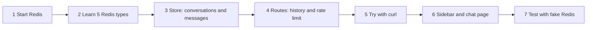
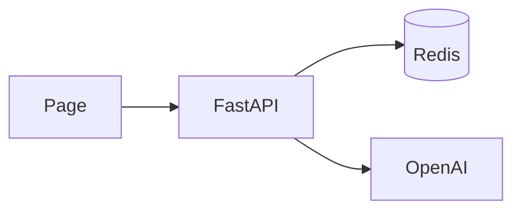
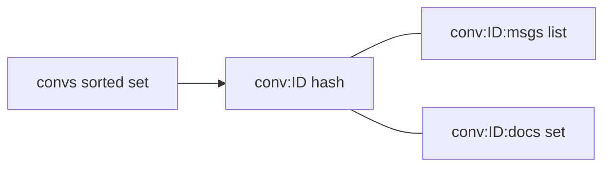
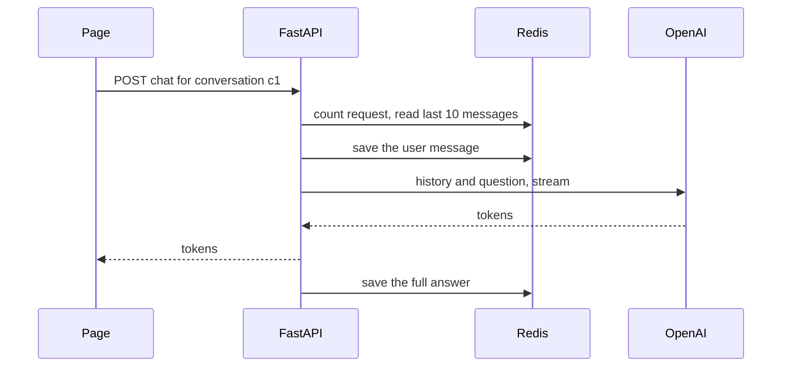
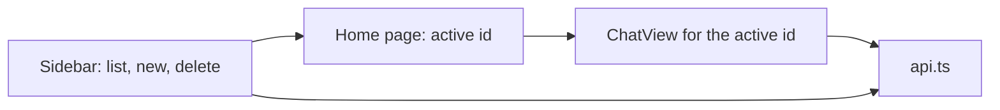
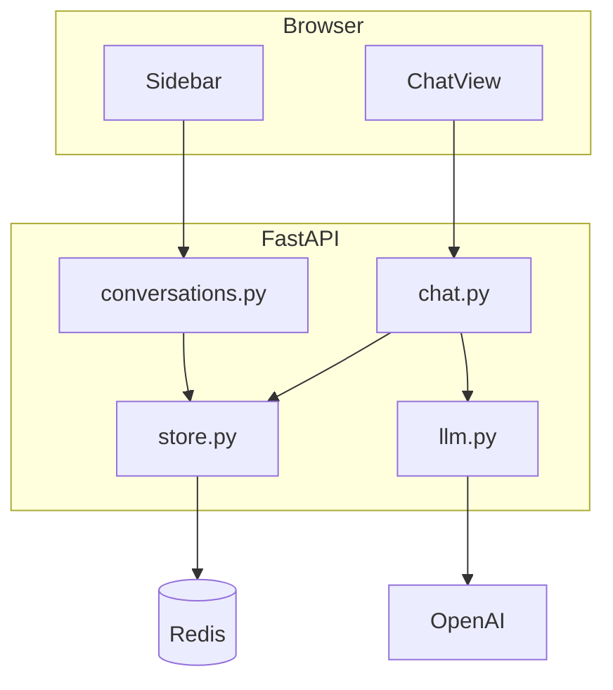

# Tutorial 2: Memory and Many Conversations With Redis

**What you build.** Your streaming chat from [part 1](01-hello-world-to-streaming-chat.md) remembers things. It keeps **many conversations** in a sidebar, saves every message, and protects itself from spam with a **rate limit**. All of that is stored in **Redis**.

You start from the stage 3 app of part 1. After this part, part 3 adds documents and Celery.

## Before you start

- Part 1 finished, with `my-chat/backend/main.py` and `my-chat/frontend` working.
- Docker (easiest), or Redis installed another way (see Step 1).

## The path



---

## Step 1: Why Redis, and starting it

### The problem

Stage 3 forgets everything when you refresh the page, and the model sees only your latest message. A chat needs **memory** that lives on the server, outside any one request.

### The fix: Redis

**Redis** is a very fast database that keeps data in memory. It stores simple structures (text, lists, sets) by name. For a chat it gives us three things at once:

| Job | How Redis helps |
|---|---|
| Store conversations and messages | Lists and hashes, read in microseconds |
| Count requests for a rate limit | A counter that **expires by itself** |
| Part 3: a job queue for Celery | The same server doubles as the queue |



> **An honest note.** Redis is great for learning and for chat history that is allowed to be lost. For a real product you would usually keep messages in a durable database such as PostgreSQL, and use Redis as a fast cache, rate limiter and queue. The code below keeps all Redis calls in one file (`store.py`), so swapping the storage later changes one file.

### Type this

Create `my-chat/docker-compose.yml`:

```yaml
services:
  redis:
    image: redis:7-alpine
    ports:
      - "6379:6379"
```

Start it:

```bash
cd course2/fullstack-chat/my-chat
docker compose up -d
docker compose exec redis redis-cli ping
```

**What you should see:** `PONG`.

No Docker? Install Redis another way (for example `brew install redis` then `redis-server`) and use `redis-cli ping`.

### Check yourself

Why is `ports: "6379:6379"` needed?

<details>
<summary>Answer</summary>

Redis runs inside a container. That line opens port 6379 on your computer and connects it to the container, so your Python code at `localhost:6379` can reach it.
</details>

---

## Step 2: The five Redis types we use

### The idea

Redis does not have tables. It has **keys** that point to a few kinds of values. Our chat uses five. Try each in `redis-cli`:

```bash
docker compose exec redis redis-cli
```

| Type | We use it for | Try |
|---|---|---|
| **String** | counters | `INCR visits`, `GET visits` |
| **Hash** (a small dictionary) | one conversation's fields | `HSET conv:a1 title "Trip plan"`, `HGETALL conv:a1` |
| **List** (ordered) | messages in order | `RPUSH msgs:a1 "hi"`, `RPUSH msgs:a1 "hello"`, `LRANGE msgs:a1 0 -1` |
| **Set** (unique items) | which documents belong to a chat | `SADD docs:a1 d1 d2`, `SMEMBERS docs:a1` |
| **Sorted set** | conversations ordered by time | `ZADD convs 1 a1 2 b2`, `ZREVRANGE convs 0 -1` |

Also try the expiring counter we will use for the rate limit:

```bash
INCR rate:me
EXPIRE rate:me 60
TTL rate:me
```

`TTL` counts down from 60, then the key disappears. Clean up with `FLUSHDB`.



### Check yourself

Which type keeps messages in the order they were added?

<details>
<summary>Answer</summary>

A **list**. `RPUSH` adds to the end, and `LRANGE` reads them back in order.
</details>

---

## Step 3: The store

### The idea

All Redis code goes in one file, `store.py`. The rest of the app asks it questions in plain words: "create a conversation", "get messages". Nobody else knows what a key looks like.

We use the **async** Redis client (`redis.asyncio`), because FastAPI handlers are `async`.

### Type this

Create `backend/settings.py`. One place for every setting:

```python
# needs: your backend folder (file: settings.py)
import os

from dotenv import load_dotenv

load_dotenv()

REDIS_URL = os.getenv("REDIS_URL", "redis://localhost:6379/0")
CHAT_MODEL = os.getenv("CHAT_MODEL", "gpt-4o-mini")
EMBED_MODEL = os.getenv("EMBED_MODEL", "text-embedding-3-small")
FRONTEND_ORIGINS = ["http://localhost:3000", "http://127.0.0.1:3000"]
HISTORY_LIMIT = 10  # last N messages sent to the model
RATE_LIMIT_PER_MINUTE = 20
```

Create `backend/deps.py`. One shared Redis client, handed to routes with FastAPI's `Depends`:

```python
# needs: your backend folder (file: deps.py)
from redis.asyncio import Redis

import settings

_client: Redis | None = None


def get_redis() -> Redis:
    # One shared client. Tests replace this function with a fake.
    global _client
    if _client is None:
        _client = Redis.from_url(settings.REDIS_URL, decode_responses=True)
    return _client
```

`decode_responses=True` makes Redis return normal strings instead of bytes.

Create `backend/store.py`. First the key names and conversations:

```python
# needs: your backend folder (file: store.py)
"""Everything we keep in Redis. Key names live here so the API and the worker agree."""
import json
import time
import uuid

from redis.asyncio import Redis

DEFAULT_TITLE = "New chat"


# Key builders. The Celery worker imports these too (part 3).
def conv_key(cid: str) -> str:
    return f"conv:{cid}"


def msgs_key(cid: str) -> str:
    return f"conv:{cid}:msgs"


def docs_key(cid: str) -> str:
    return f"conv:{cid}:docs"


def chunks_key(cid: str) -> str:
    return f"conv:{cid}:chunks"


def doc_key(doc_id: str) -> str:
    return f"doc:{doc_id}"


async def create_conversation(r: Redis) -> dict:
    cid = uuid.uuid4().hex[:8]
    now = time.time()
    await r.hset(conv_key(cid), mapping={"id": cid, "title": DEFAULT_TITLE, "created": now})
    await r.zadd("convs", {cid: now})  # sorted by creation time
    return {"id": cid, "title": DEFAULT_TITLE}


async def conversation_exists(r: Redis, cid: str) -> bool:
    return bool(await r.exists(conv_key(cid)))


async def list_conversations(r: Redis) -> list[dict]:
    ids = await r.zrevrange("convs", 0, -1)  # newest first
    out = []
    for cid in ids:
        title = await r.hget(conv_key(cid), "title")
        out.append({"id": cid, "title": title})
    return out
```

Then messages. Add below, in the same file:

```python
# needs: your backend folder (file: store.py, append)
async def add_message(r: Redis, cid: str, role: str, content: str, sources: list | None = None) -> None:
    await r.rpush(msgs_key(cid), json.dumps({"role": role, "content": content, "sources": sources or []}))
    if role == "user" and await r.hget(conv_key(cid), "title") == DEFAULT_TITLE:
        await r.hset(conv_key(cid), "title", content[:40])  # the first message names the chat


async def get_messages(r: Redis, cid: str, limit: int | None = None) -> list[dict]:
    start = -limit if limit else 0  # a negative start means "the last N"
    return [json.loads(m) for m in await r.lrange(msgs_key(cid), start, -1)]


async def delete_conversation(r: Redis, cid: str) -> None:
    doc_ids = await r.smembers(docs_key(cid))
    keys = [conv_key(cid), msgs_key(cid), docs_key(cid), chunks_key(cid), *[doc_key(d) for d in doc_ids]]
    await r.delete(*keys)
    await r.zrem("convs", cid)
```

And the rate limiter, the expiring counter from step 2:

```python
# needs: your backend folder (file: store.py, append)
async def rate_limited(r: Redis, who: str, limit: int) -> bool:
    # One counter per client per minute. The key expires by itself.
    key = f"rate:{who}:{int(time.time() // 60)}"
    count = await r.incr(key)
    if count == 1:
        await r.expire(key, 60)
    return count > limit
```

> `store.py` also mentions document keys. They are used in part 3. Nothing else changes in this file there except adding the document functions.

### Why it works

Messages are JSON strings in a list, so order is free. Each conversation is a hash. The sorted set `convs` uses the creation time as the score, so `zrevrange` returns newest first. The rate limiter keys by minute, so each minute starts a fresh counter that disappears after 60 seconds.

### Try it

After step 5, run `docker compose exec redis redis-cli keys '*'` and find your keys.

---

## Step 4: Routes with history and a rate limit

### The problem

Our chat endpoint has no idea who the conversation belongs to. We need a conversation id in the URL, saved messages, and the **history** sent to the model on every turn.



### Type this

Create `backend/llm.py`:

```python
# needs: your backend folder (file: llm.py)
"""Building the prompt and streaming the model's reply."""
from collections.abc import AsyncIterator

from langchain_core.messages import AIMessage, HumanMessage, SystemMessage
from langchain_openai import ChatOpenAI

import settings

PLAIN = "You are a helpful assistant. Keep answers short."


def get_llm() -> ChatOpenAI:
    return ChatOpenAI(model=settings.CHAT_MODEL, temperature=0.3, max_tokens=500)


async def stream_answer(history: list[dict], question: str) -> AsyncIterator[str]:
    past = [HumanMessage(m["content"]) if m["role"] == "user" else AIMessage(m["content"]) for m in history]
    messages = [SystemMessage(PLAIN), *past, HumanMessage(question)]
    async for chunk in get_llm().astream(messages):
        if chunk.content:
            yield chunk.content
```

The model has no memory of its own. **Memory is us sending the earlier messages again each time.**

Create `backend/conversations.py`:

```python
# needs: your backend folder (file: conversations.py)
from fastapi import APIRouter, Depends, HTTPException
from redis.asyncio import Redis

import store
from deps import get_redis

router = APIRouter(prefix="/api/conversations")


@router.get("")
async def list_all(r: Redis = Depends(get_redis)):
    return await store.list_conversations(r)


@router.post("")
async def create(r: Redis = Depends(get_redis)):
    return await store.create_conversation(r)


@router.get("/{cid}/messages")
async def messages(cid: str, r: Redis = Depends(get_redis)):
    if not await store.conversation_exists(r, cid):
        raise HTTPException(status_code=404, detail="Conversation not found")
    return await store.get_messages(r, cid)


@router.delete("/{cid}")
async def delete(cid: str, r: Redis = Depends(get_redis)):
    await store.delete_conversation(r, cid)
    return {"deleted": cid}
```

Create `backend/chat.py`. Read the order of events: rate limit, check, read history, save, then stream:

```python
# needs: your backend folder (file: chat.py)
import json

from fastapi import APIRouter, Depends, HTTPException, Request
from fastapi.responses import StreamingResponse
from pydantic import BaseModel, Field
from redis.asyncio import Redis

import llm
import settings
import store
from deps import get_redis

router = APIRouter(prefix="/api/conversations")


class ChatIn(BaseModel):
    message: str = Field(min_length=1, max_length=4000)
    k: int = Field(default=4, ge=1, le=10)


def sse(event: dict) -> str:
    # One server-sent event: a line starting with "data:" and a blank line after it.
    return f"data: {json.dumps(event)}\n\n"


@router.post("/{cid}/chat")
async def chat(cid: str, body: ChatIn, request: Request, r: Redis = Depends(get_redis)):
    who = request.client.host if request.client else "unknown"
    if await store.rate_limited(r, who, settings.RATE_LIMIT_PER_MINUTE):
        raise HTTPException(status_code=429, detail="Too many messages. Wait a minute.")
    if not await store.conversation_exists(r, cid):
        raise HTTPException(status_code=404, detail="Conversation not found")

    history = await store.get_messages(r, cid, limit=settings.HISTORY_LIMIT)
    await store.add_message(r, cid, "user", body.message)

    async def events():
        parts: list[str] = []
        try:
            async for token in llm.stream_answer(history, body.message):
                parts.append(token)
                yield sse({"type": "token", "text": token})
        except Exception as e:  # tell the page, instead of cutting the stream
            yield sse({"type": "error", "message": str(e)[:200]})
            return
        await store.add_message(r, cid, "assistant", "".join(parts))
        yield sse({"type": "done"})

    return StreamingResponse(events(), media_type="text/event-stream")
```

Note: we read the history **before** saving the new message, so the question is not sent twice. (`k` is for part 3.)

Replace `backend/main.py`:

```python
# needs: your backend folder (file: main.py)
from fastapi import FastAPI
from fastapi.middleware.cors import CORSMiddleware

import chat
import conversations
import settings

app = FastAPI(title="Full-stack chat")
app.add_middleware(
    CORSMiddleware,
    allow_origins=settings.FRONTEND_ORIGINS,
    allow_methods=["*"],
    allow_headers=["*"],
)
app.include_router(conversations.router)
app.include_router(chat.router)


@app.get("/api/hello")
def hello():
    return {"message": "Hello from FastAPI"}
```

### Why it works

Each route is small. `Depends(get_redis)` hands every route the same client, and tests can swap it. Errors use real HTTP codes: `404` for a missing chat, `422` for bad input, `429` for "too many requests".

### Check yourself

Why is the rate limit checked **before** anything else?

<details>
<summary>Answer</summary>

It is the cheapest check and it protects everything after it (Redis reads, the model call, which costs money). Reject spam first.
</details>

---

## Step 5: Try it with curl

Start the backend (Redis must be running):

```bash
cd course2/fullstack-chat/my-chat/backend
uv run uvicorn main:app --reload --port 8000
```

```bash
# make a conversation and keep its id
curl -s -X POST localhost:8000/api/conversations
# replace c1 below with the id you got
curl -N -X POST localhost:8000/api/conversations/c1/chat -H "Content-Type: application/json" -d '{"message":"My name is Sam."}'
curl -N -X POST localhost:8000/api/conversations/c1/chat -H "Content-Type: application/json" -d '{"message":"What is my name?"}'
curl -s localhost:8000/api/conversations/c1/messages
```

**What you should see:** the second answer says "Sam". The last call lists all four messages. The model remembers **because we resent the history**.

Open `localhost:8000/docs` for a test page. Look at Redis:

```bash
docker compose exec redis redis-cli lrange conv:c1:msgs 0 -1
```

Send more than 20 messages in a minute and you get `429`.

---

## Step 6: The sidebar and the chat page

### The idea

The page needs: a list of conversations, a way to start a new one, and a chat area for the selected one.



### Type this

Create the API helper (replace the one from part 1). It has helpers for part 3 too, so you will not edit it again:

```ts
export const API = process.env.NEXT_PUBLIC_API_URL ?? "http://localhost:8000";

export type Conversation = { id: string; title: string };
export type Source = { source: string; start_index: number; text: string; score: number };
export type Message = { role: "user" | "assistant"; content: string; sources?: Source[] };
export type DocInfo = { id: string; name: string; status: "queued" | "processing" | "ready" | "failed"; chunks: string; error: string };
export type ChatEvent =
  | { type: "token"; text: string }
  | { type: "sources"; sources: Source[] }
  | { type: "error"; message: string }
  | { type: "done" };

async function send<T>(path: string, init?: RequestInit): Promise<T> {
  const res = await fetch(`${API}${path}`, init);
  if (!res.ok) {
    // FastAPI sends errors as { detail: ... }.
    const body = await res.json().catch(() => ({}));
    throw new Error(typeof body.detail === "string" ? body.detail : `Request failed (${res.status})`);
  }
  return res.json() as Promise<T>;
}

export const listConversations = () => send<Conversation[]>("/api/conversations");
export const createConversation = () => send<Conversation>("/api/conversations", { method: "POST" });
export const deleteConversation = (id: string) => send(`/api/conversations/${id}`, { method: "DELETE" });
export const getMessages = (id: string) => send<Message[]>(`/api/conversations/${id}/messages`);
export const listDocuments = (id: string) => send<DocInfo[]>(`/api/conversations/${id}/documents`);

export function uploadDocuments(id: string, files: FileList) {
  const form = new FormData();
  Array.from(files).forEach((f) => form.append("files", f));
  // No Content-Type header here: the browser adds the multipart boundary itself.
  return send<{ queued: string[] }>(`/api/conversations/${id}/documents`, { method: "POST", body: form });
}

// EventSource only supports GET, so we read the POST response stream ourselves.
export async function* streamChat(id: string, message: string): AsyncGenerator<ChatEvent> {
  const res = await fetch(`${API}/api/conversations/${id}/chat`, {
    method: "POST",
    headers: { "Content-Type": "application/json" },
    body: JSON.stringify({ message }),
  });
  if (!res.ok || !res.body) {
    const body = await res.json().catch(() => ({}));
    throw new Error(typeof body.detail === "string" ? body.detail : `Request failed (${res.status})`);
  }
  const reader = res.body.getReader();
  const decoder = new TextDecoder();
  let buffer = "";
  while (true) {
    const { done, value } = await reader.read();
    if (done) break;
    buffer += decoder.decode(value, { stream: true });
    const events = buffer.split("\n\n");
    buffer = events.pop() ?? ""; // the last piece may be half an event, keep it for the next read
    for (const e of events) {
      if (e.startsWith("data: ")) yield JSON.parse(e.slice(6)) as ChatEvent;
    }
  }
}
```

The sidebar, `src/components/sidebar.tsx`:

```tsx
"use client";

import { Button } from "@/components/ui/button";
import type { Conversation } from "@/lib/api";

type Props = {
  conversations: Conversation[];
  activeId: string | null;
  onSelect: (id: string) => void;
  onNew: () => void;
  onDelete: (id: string) => void;
};

export function Sidebar({ conversations, activeId, onSelect, onNew, onDelete }: Props) {
  return (
    <aside className="flex w-64 shrink-0 flex-col gap-2 border-r p-3">
      <Button onClick={onNew}>New chat</Button>
      <ul className="space-y-1 overflow-y-auto">
        {conversations.map((c) => (
          <li key={c.id} className="flex items-center gap-1">
            <Button
              variant={c.id === activeId ? "secondary" : "ghost"}
              className="min-w-0 flex-1 justify-start"
              onClick={() => onSelect(c.id)}
            >
              <span className="truncate">{c.title}</span>
            </Button>
            <Button variant="ghost" size="sm" aria-label={`Delete ${c.title}`} onClick={() => onDelete(c.id)}>
              x
            </Button>
          </li>
        ))}
      </ul>
    </aside>
  );
}
```

The chat view, `src/components/chat-view.tsx`. This version has no documents panel and no sources yet (part 3 adds them):

```tsx
"use client";

import { useEffect, useRef, useState } from "react";
import { Button } from "@/components/ui/button";
import { Textarea } from "@/components/ui/textarea";
import { getMessages, streamChat, type Message } from "@/lib/api";

type Props = { cid: string; onActivity: () => void };

export function ChatView({ cid, onActivity }: Props) {
  const [messages, setMessages] = useState<Message[]>([]);
  const [input, setInput] = useState("");
  const [busy, setBusy] = useState(false);
  const [error, setError] = useState("");
  const bottom = useRef<HTMLDivElement>(null);

  useEffect(() => {
    let alive = true;
    getMessages(cid)
      .then((m) => alive && setMessages(m))
      .catch((e) => alive && setError((e as Error).message));
    return () => {
      alive = false;
    };
  }, [cid]);

  useEffect(() => {
    bottom.current?.scrollIntoView({ behavior: "smooth" });
  }, [messages]);

  async function send() {
    const text = input.trim();
    if (!text || busy) return;
    setBusy(true);
    setError("");
    setInput("");
    // Add the user's message and an empty bot message that we fill as tokens arrive.
    setMessages((m) => [...m, { role: "user", content: text }, { role: "assistant", content: "" }]);
    const patchLast = (fn: (m: Message) => Message) =>
      setMessages((all) => all.map((m, i) => (i === all.length - 1 ? fn(m) : m)));
    try {
      for await (const event of streamChat(cid, text)) {
        if (event.type === "token") patchLast((m) => ({ ...m, content: m.content + event.text }));
        if (event.type === "error") setError(event.message);
      }
    } catch (e) {
      setError((e as Error).message);
    } finally {
      setBusy(false);
      onActivity(); // the first message gives the chat its title
    }
  }

  return (
    <div className="flex min-w-0 flex-1 flex-col">
      <div className="flex-1 space-y-4 overflow-y-auto p-4">
        {messages.map((m, i) => (
          <div key={i} className={m.role === "user" ? "ml-auto max-w-[80%] rounded-lg bg-muted p-3" : "max-w-[80%] p-3"}>
            <p className="whitespace-pre-wrap text-sm">{m.content || (busy ? "..." : "")}</p>
          </div>
        ))}
        <div ref={bottom} />
      </div>
      {error && <p className="px-4 text-sm text-destructive">{error}</p>}
      <div className="flex gap-2 border-t p-3">
        <Textarea
          value={input}
          placeholder="Message..."
          onChange={(e) => setInput(e.target.value)}
          onKeyDown={(e) => {
            if (e.key === "Enter" && !e.shiftKey) {
              e.preventDefault();
              send();
            }
          }}
        />
        <Button onClick={send} disabled={busy}>
          Send
        </Button>
      </div>
    </div>
  );
}
```

The page, `src/app/page.tsx`:

```tsx
"use client";

import { useEffect, useState } from "react";
import { ChatView } from "@/components/chat-view";
import { Sidebar } from "@/components/sidebar";
import {
  createConversation,
  deleteConversation,
  listConversations,
  type Conversation,
} from "@/lib/api";

export default function Home() {
  const [conversations, setConversations] = useState<Conversation[]>([]);
  const [activeId, setActiveId] = useState<string | null>(null);
  const [error, setError] = useState("");

  async function refresh() {
    setConversations(await listConversations());
  }

  useEffect(() => {
    listConversations()
      .then((list) => {
        setConversations(list);
        setActiveId((current) => current ?? list[0]?.id ?? null);
      })
      .catch(() => setError("Cannot reach the backend. Is uvicorn running on port 8000?"));
  }, []);

  async function onNew() {
    const c = await createConversation();
    await refresh();
    setActiveId(c.id);
  }

  async function onDelete(id: string) {
    await deleteConversation(id);
    const list = await listConversations();
    setConversations(list);
    if (id === activeId) setActiveId(list[0]?.id ?? null);
  }

  return (
    <div className="flex h-screen">
      <Sidebar conversations={conversations} activeId={activeId} onSelect={setActiveId} onNew={onNew} onDelete={onDelete} />
      {activeId ? (
        <ChatView key={activeId} cid={activeId} onActivity={refresh} />
      ) : (
        <div className="m-auto text-sm text-muted-foreground">{error || "Press New chat to start."}</div>
      )}
    </div>
  );
}
```

Run `npm run dev` (with uvicorn and Redis running).

**What you should see:** "New chat" creates an entry. Type a message, watch it stream, and see the sidebar title change to your first words. Refresh the page: your conversations and messages are still there. Create a second chat and switch between them.

### Why it works

- `ChatView key={activeId}` makes React build a **new** ChatView for each conversation, so old messages never leak into another chat.
- Messages load from the backend whenever `cid` changes.
- `onActivity` tells the page to refresh the sidebar after each answer, which picks up the new title.
- The `alive` flag stops a slow response for an old conversation from overwriting the new one.

### Try it

1. Delete a conversation with the `x` button. Check Redis: `redis-cli keys 'conv:*'`. Are its keys gone?
2. Send 25 messages quickly. What does the page show at the end? (The `429` message.)

---

## Step 7: Test with a fake Redis

You do not want tests that need a real Redis or real OpenAI. **fakeredis** speaks the Redis protocol in memory, and we can replace the model with a fake. The finished project has this in `app/backend/test_api.py`. A short version for this part:

```python
# needs: your backend folder (run it from there, after the steps above)
import fakeredis
from fastapi.testclient import TestClient

import deps
import main

fake = fakeredis.FakeAsyncRedis(decode_responses=True)
main.app.dependency_overrides[deps.get_redis] = lambda: fake  # use the fake instead of real Redis

client = TestClient(main.app)
cid = client.post("/api/conversations").json()["id"]
print(client.get("/api/conversations").json())
print(client.get(f"/api/conversations/{cid}/messages").json())
print(client.get("/api/conversations/nope/messages").status_code)
```

**What you should see:** a list with one `New chat`, an empty message list, then `404`.

---

## The whole of part 2



## Common mistakes

| Mistake | What you see | Fix |
|---|---|---|
| Redis not running | `ConnectionError ... 6379` | `docker compose up -d` and check `redis-cli ping`. |
| Forgot `decode_responses=True` | `b'...'` bytes in results | Create the client with it. |
| Sent the new message in the history too | Model sees the question twice | Read history before `add_message`. |
| Messages from another chat appear | Old text after switching | Use `key={activeId}` on `ChatView`. |
| Sidebar title stays "New chat" | No title update | Call `onActivity` after the stream ends. |
| `429` during testing | "Too many messages" | Wait a minute or raise `RATE_LIMIT_PER_MINUTE`. |
| Data gone after restart | Empty sidebar | Redis in a plain container keeps data in memory. Add a volume or enable `appendonly` for persistence. |

## Practice

No answers shown. Ask me for a hint.

1. **Rename a chat.** Add `PATCH /api/conversations/{id}` that changes the title. Which Redis command?
2. **Limit history by size.** Send only the last 10 messages, but also stop if the total passes 4000 characters.
3. **Expire old chats.** Make a conversation vanish after 7 days with `EXPIRE`. Which keys need it?
4. **Per-user limit.** The limiter uses the IP address. Why is that weak behind a proxy? What would you use after adding logins?
5. **Persistence.** Add a Redis volume to `docker-compose.yml`. Restart the container and confirm your chats survive.
6. **Explain it.** In five sentences, explain how the model "remembers" when it has no memory.

## Cheat sheet

| Need | Redis | Where |
|---|---|---|
| A conversation's fields | hash `conv:ID` | `create_conversation` |
| Messages in order | list `conv:ID:msgs` | `add_message`, `get_messages` |
| Newest chats first | sorted set `convs` | `list_conversations` |
| Per-minute counter | string with `EXPIRE` | `rate_limited` |
| Remove a chat | `DEL` on its keys | `delete_conversation` |

Next: [Part 3: documents with Celery, and RAG](03-celery-documents-and-rag.md).
