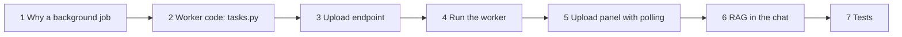
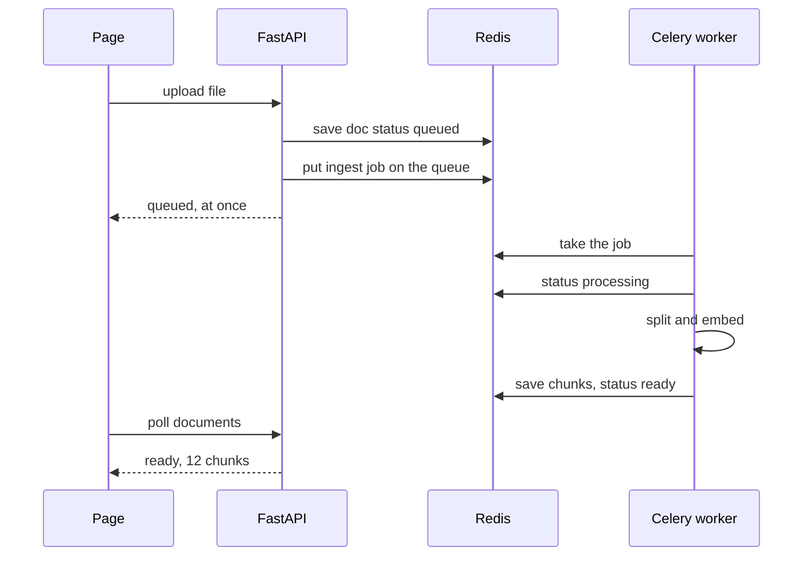
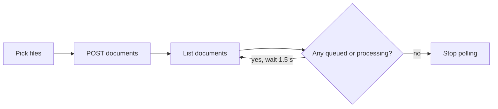
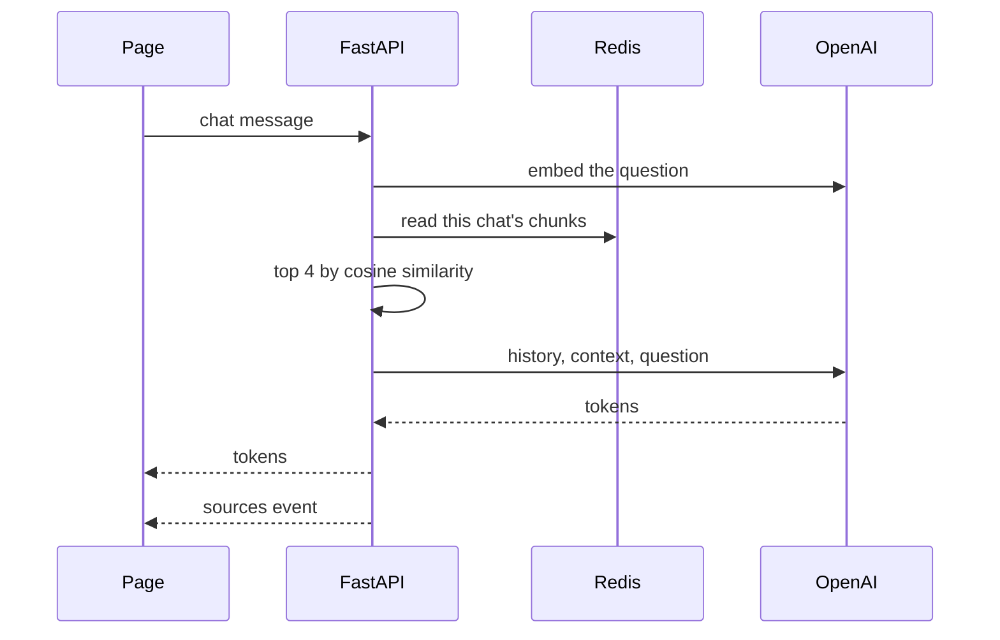
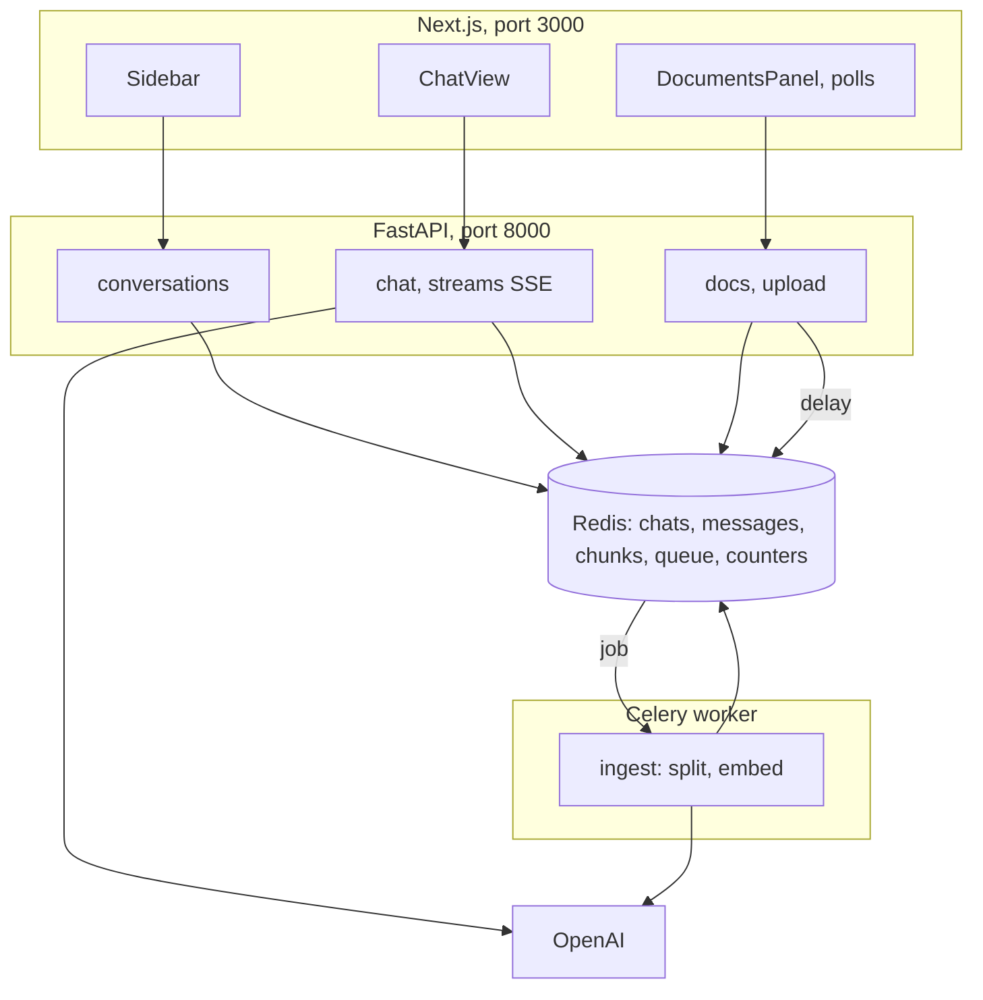

# Tutorial 3: Documents With Celery, and Answers From Them (RAG)

**What you build.** You can upload `.txt` and `.md` files into a conversation. A **Celery worker** processes them in the background (split, embed, store), and the page shows each file's status: queued, processing, ready. Then the chat answers **from your documents** and shows its **sources**.

This is part 3. You need [part 2](02-redis-memory-and-conversations.md) working: Redis, conversations and streaming chat.

## The path



---

## Step 1: Why a background job (and what Celery is)

### The problem

Indexing a document means splitting it, then calling an embedding API once per batch of chunks. A big file takes seconds or minutes. If the upload endpoint does that work itself, the browser waits with a spinner, a slow request can time out, and other users compete for the same server.

### The fix: a queue and a worker

**Celery** is a task queue. The web server puts a **job** on a queue and replies right away. A separate **worker** process takes jobs from the queue and runs them. **Redis** is the queue (the *broker*) and can also keep results.



Three facts to remember:

1. The worker is **another process**. It cannot see the API's Python variables. Anything it produces must go through Redis. That is why the chunks and vectors live in Redis in this app, not in an in-memory object.
2. The page cannot be told "done" by the worker directly, so it **polls**: it asks for the status every second or two until the work finishes.
3. The chat itself does **not** use Celery. A streaming answer needs a live connection to the browser. A queue adds delay and complexity. Use Celery for slow work that can happen later.

### Check yourself

Why can't the worker keep the chunks in a Python list that the API reads?

<details>
<summary>Answer</summary>

They are separate processes with separate memory. Shared data must live somewhere both can reach, here Redis.
</details>

---

## Step 2: The worker code

### Type this

First the documents' Redis functions. Add to the end of `backend/store.py`:

```python
# needs: your backend folder (file: store.py, append)
async def create_document(r: Redis, cid: str, name: str) -> str:
    doc_id = uuid.uuid4().hex[:8]
    await r.hset(doc_key(doc_id), mapping={"id": doc_id, "name": name, "status": "queued", "chunks": 0, "error": ""})
    await r.sadd(docs_key(cid), doc_id)
    return doc_id


async def list_documents(r: Redis, cid: str) -> list[dict]:
    docs = [await r.hgetall(doc_key(d)) for d in await r.smembers(docs_key(cid))]
    return sorted(docs, key=lambda d: d["name"])


async def get_chunks(r: Redis, cid: str) -> list[dict]:
    return [json.loads(c) for c in await r.lrange(chunks_key(cid), 0, -1)]
```

Now `backend/rag.py`: splitting, embedding and finding the closest chunks. It knows nothing about Redis or the web:

```python
# needs: your backend folder (file: rag.py)
"""Split, embed, and find the closest chunks. No web and no Redis in here."""
import numpy as np
from langchain_core.documents import Document
from langchain_openai import OpenAIEmbeddings
from langchain_text_splitters import RecursiveCharacterTextSplitter

import settings

splitter = RecursiveCharacterTextSplitter(chunk_size=800, chunk_overlap=100, add_start_index=True)


def embedder() -> OpenAIEmbeddings:
    return OpenAIEmbeddings(model=settings.EMBED_MODEL)


def split(name: str, text: str) -> list[Document]:
    return splitter.split_documents([Document(page_content=text, metadata={"source": name})])


async def embed_query(question: str) -> list[float]:
    return await embedder().aembed_query(question)


def top_k(query_vec: list[float], chunks: list[dict], k: int) -> list[dict]:
    if not chunks:
        return []
    matrix = np.array([c["vec"] for c in chunks])
    q = np.array(query_vec)
    scores = matrix @ q / (np.linalg.norm(matrix, axis=1) * np.linalg.norm(q))  # cosine similarity
    best = np.argsort(scores)[::-1][:k]
    return [
        {"source": chunks[i]["source"], "start_index": chunks[i]["start_index"], "text": chunks[i]["text"], "score": round(float(scores[i]), 4)}
        for i in best
    ]
```

`top_k` is the same idea as a vector store: compare the question's vector with every chunk's vector by **cosine similarity** and keep the best `k`. Doing it by hand with numpy is fine for a few hundred chunks per chat, and you see exactly how it works.

> For thousands of chunks you would use a real vector index (Redis Stack search, Chroma, FAISS). The shape of the app stays the same.

Now the task. `backend/tasks.py`:

```python
# needs: your backend folder (file: tasks.py)
"""Celery worker code. It runs in its own process, so it cannot share Python objects with the API.
Everything it produces goes into Redis."""
import json

import redis
from celery import Celery

import rag
import settings
import store

celery_app = Celery("chat", broker=settings.REDIS_URL, backend=settings.REDIS_URL)


def sync_redis() -> redis.Redis:
    # The worker is synchronous, so it uses the normal client, not redis.asyncio.
    return redis.Redis.from_url(settings.REDIS_URL, decode_responses=True)


@celery_app.task
def ingest(cid: str, doc_id: str, name: str, text: str) -> int:
    r = sync_redis()
    r.hset(store.doc_key(doc_id), "status", "processing")
    try:
        chunks = rag.split(name, text)
        vectors = rag.embedder().embed_documents([c.page_content for c in chunks])
        for chunk, vec in zip(chunks, vectors):
            item = {"source": name, "start_index": chunk.metadata["start_index"], "text": chunk.page_content, "vec": vec}
            r.rpush(store.chunks_key(cid), json.dumps(item))
        r.hset(store.doc_key(doc_id), mapping={"status": "ready", "chunks": len(chunks)})
        return len(chunks)
    except Exception as e:  # show the reason in the page instead of failing silently
        r.hset(store.doc_key(doc_id), mapping={"status": "failed", "error": str(e)[:200]})
        raise
```

`@celery_app.task` turns a normal function into a job. Notice the status updates: `processing`, then `ready` or `failed` with a reason. That is what the page will show.

### Why it works

The worker imports the same `store` key builders, so the API and the worker always agree where things live. The text is passed as an argument (fine for small text files). For big files you would save the file somewhere and pass its name.

---

## Step 3: The upload endpoint

### Type this

`backend/docs.py`:

```python
# needs: your backend folder (file: docs.py)
from typing import Annotated

from fastapi import APIRouter, Depends, File, HTTPException, UploadFile
from redis.asyncio import Redis

import store
from deps import get_redis
from tasks import ingest

router = APIRouter(prefix="/api/conversations")


@router.get("/{cid}/documents")
async def documents(cid: str, r: Redis = Depends(get_redis)):
    return await store.list_documents(r, cid)


@router.post("/{cid}/documents")
async def upload(cid: str, files: Annotated[list[UploadFile], File()], r: Redis = Depends(get_redis)):
    if not await store.conversation_exists(r, cid):
        raise HTTPException(status_code=404, detail="Conversation not found")
    queued = []
    for f in files:
        text = (await f.read()).decode("utf-8", errors="ignore")
        doc_id = await store.create_document(r, cid, f.filename or "file")
        # .delay() puts a job on the Redis queue and returns at once. A worker picks it up.
        ingest.delay(cid, doc_id, f.filename or "file", text)
        queued.append(doc_id)
    return {"queued": queued}
```

Replace `backend/main.py` to include the new router (one added import and one added line):

```python
# needs: your backend folder (file: main.py)
from fastapi import FastAPI
from fastapi.middleware.cors import CORSMiddleware

import chat
import conversations
import docs
import settings

app = FastAPI(title="Full-stack chat")
app.add_middleware(
    CORSMiddleware,
    allow_origins=settings.FRONTEND_ORIGINS,
    allow_methods=["*"],
    allow_headers=["*"],
)
app.include_router(conversations.router)
app.include_router(chat.router)
app.include_router(docs.router)


@app.get("/api/hello")
def hello():
    return {"message": "Hello from FastAPI"}
```

### Why it works

`ingest.delay(...)` is the whole trick. It does **not** run the function. It sends a message "please run `ingest` with these arguments" to Redis and returns. The endpoint answers `queued` in milliseconds.

---

## Step 4: Run the worker

You now run **four** things. Use separate terminals:

| # | What | Command |
|---|---|---|
| 1 | Redis | `docker compose up -d` (in `my-chat/`) |
| 2 | API | `uv run uvicorn main:app --reload --port 8000` (in `backend/`) |
| 3 | **Worker** | `uv run celery -A tasks worker --loglevel=info --pool=solo` (in `backend/`) |
| 4 | Frontend | `npm run dev` (in `frontend/`) |

`--pool=solo` runs jobs one at a time in the worker's own process. It is simple and avoids macOS fork problems during development. Real deployments use the default pool and more workers.

The worker prints a banner with `[tasks]` and `. tasks.ingest`. If it does not list `tasks.ingest`, you started it from the wrong folder.

Try it by hand (replace `c1` with a real conversation id):

```bash
echo "Smoking is not allowed in company vehicles. Phones must be silent in meetings." > policy.txt
curl -s -X POST localhost:8000/api/conversations/c1/documents -F "files=@policy.txt"
curl -s localhost:8000/api/conversations/c1/documents
```

**What you should see:** the first call returns `{"queued":["..."]}` immediately. In the worker terminal you see `Task tasks.ingest[...] received` then `succeeded`. The second call shows `"status":"ready"`.

Without a worker the status stays `queued` forever. That is the number one thing to check.

---

## Step 5: The upload panel with polling

### The problem

The page must show progress, and update itself when the worker finishes.

### The fix: poll while anything is pending



### Type this

`api.ts` from part 2 already has `uploadDocuments` and `listDocuments`. Create `src/components/documents-panel.tsx`:

```tsx
"use client";

import { useEffect, useState } from "react";
import { Badge } from "@/components/ui/badge";
import { Input } from "@/components/ui/input";
import { listDocuments, uploadDocuments, type DocInfo } from "@/lib/api";

export function DocumentsPanel({ cid }: { cid: string }) {
  const [docs, setDocs] = useState<DocInfo[]>([]);
  const [error, setError] = useState("");
  const [tick, setTick] = useState(0);

  // Poll while any document is still being processed by the worker.
  const pending = docs.some((d) => d.status === "queued" || d.status === "processing");

  useEffect(() => {
    let alive = true;
    listDocuments(cid)
      .then((d) => alive && setDocs(d))
      .catch((e) => alive && setError((e as Error).message));
    return () => {
      alive = false;
    };
  }, [cid, tick]);

  useEffect(() => {
    if (!pending) return;
    const timer = setTimeout(() => setTick((t) => t + 1), 1500);
    return () => clearTimeout(timer);
  }, [pending, tick]);

  async function onPick(files: FileList | null) {
    if (!files || files.length === 0) return;
    setError("");
    try {
      await uploadDocuments(cid, files);
      setTick((t) => t + 1);
    } catch (e) {
      setError((e as Error).message);
    }
  }

  return (
    <div className="space-y-2 border-b p-3">
      <div className="flex items-center gap-3">
        <label htmlFor="docs" className="text-sm font-medium">
          Documents for this chat
        </label>
        <Input id="docs" type="file" multiple accept=".txt,.md" className="max-w-xs" onChange={(e) => onPick(e.target.files)} />
      </div>
      {error && <p className="text-sm text-destructive">{error}</p>}
      <div className="flex flex-wrap gap-2">
        {docs.map((d) => (
          <Badge key={d.id} variant={d.status === "failed" ? "destructive" : "secondary"} title={d.error}>
            {d.name}: {d.status}
            {d.status === "ready" ? ` (${d.chunks} chunks)` : ""}
          </Badge>
        ))}
      </div>
    </div>
  );
}
```

### Why it works

The first effect loads the list. The second effect only runs while something is pending, waits 1.5 seconds, then bumps `tick`, which reruns the first effect. When every document is `ready` or `failed`, nothing is pending and the loop stops by itself. The cleanup functions cancel timers and ignore late answers.

---

## Step 6: RAG in the chat

### The problem

The worker stores chunks, but the chat still answers from the model's memory alone.

### The fix: retrieve, then ask

On every message: embed the question, find the closest chunks, put them in the prompt, and send the chunks to the page as **sources**.



### Type this

Replace `backend/llm.py` so the prompt can include context:

```python
# needs: your backend folder (file: llm.py)
"""Building the prompt and streaming the model's reply."""
from collections.abc import AsyncIterator

from langchain_core.messages import AIMessage, HumanMessage, SystemMessage
from langchain_openai import ChatOpenAI

import settings

PLAIN = "You are a helpful assistant. Keep answers short."
RAG = (
    "You are a helpful assistant. Answer using the context below. "
    "If the context does not contain the answer, say you don't know.\n\nContext:\n{context}"
)


def get_llm() -> ChatOpenAI:
    return ChatOpenAI(model=settings.CHAT_MODEL, temperature=0.3, max_tokens=500)


def build_messages(history: list[dict], question: str, sources: list[dict]):
    system = RAG.format(context="\n\n".join(s["text"] for s in sources)) if sources else PLAIN
    past = [HumanMessage(m["content"]) if m["role"] == "user" else AIMessage(m["content"]) for m in history]
    return [SystemMessage(system), *past, HumanMessage(question)]


async def stream_answer(history: list[dict], question: str, sources: list[dict]) -> AsyncIterator[str]:
    async for chunk in get_llm().astream(build_messages(history, question, sources)):
        if chunk.content:
            yield chunk.content
```

Replace `backend/chat.py`. Changes from part 2: it imports `rag`, loads this chat's chunks, finds the sources, passes them to the model, saves them with the answer and sends a `sources` event:

```python
# needs: your backend folder (file: chat.py)
import json

from fastapi import APIRouter, Depends, HTTPException, Request
from fastapi.responses import StreamingResponse
from pydantic import BaseModel, Field
from redis.asyncio import Redis

import llm
import rag
import settings
import store
from deps import get_redis

router = APIRouter(prefix="/api/conversations")


class ChatIn(BaseModel):
    message: str = Field(min_length=1, max_length=4000)
    k: int = Field(default=4, ge=1, le=10)


def sse(event: dict) -> str:
    # One server-sent event: a line starting with "data:" and a blank line after it.
    return f"data: {json.dumps(event)}\n\n"


@router.post("/{cid}/chat")
async def chat(cid: str, body: ChatIn, request: Request, r: Redis = Depends(get_redis)):
    who = request.client.host if request.client else "unknown"
    if await store.rate_limited(r, who, settings.RATE_LIMIT_PER_MINUTE):
        raise HTTPException(status_code=429, detail="Too many messages. Wait a minute.")
    if not await store.conversation_exists(r, cid):
        raise HTTPException(status_code=404, detail="Conversation not found")

    history = await store.get_messages(r, cid, limit=settings.HISTORY_LIMIT)
    chunks = await store.get_chunks(r, cid)
    sources = rag.top_k(await rag.embed_query(body.message), chunks, body.k) if chunks else []
    await store.add_message(r, cid, "user", body.message)

    async def events():
        parts: list[str] = []
        try:
            async for token in llm.stream_answer(history, body.message, sources):
                parts.append(token)
                yield sse({"type": "token", "text": token})
        except Exception as e:  # tell the page, instead of cutting the stream
            yield sse({"type": "error", "message": str(e)[:200]})
            return
        await store.add_message(r, cid, "assistant", "".join(parts), sources)
        if sources:
            yield sse({"type": "sources", "sources": sources})
        yield sse({"type": "done"})

    return StreamingResponse(events(), media_type="text/event-stream")
```

Now the final chat view, with the documents panel on top and a "Sources" block under answers. Replace `src/components/chat-view.tsx`:

```tsx
"use client";

import { useEffect, useRef, useState } from "react";
import { DocumentsPanel } from "@/components/documents-panel";
import { Button } from "@/components/ui/button";
import { Textarea } from "@/components/ui/textarea";
import { getMessages, streamChat, type Message } from "@/lib/api";

type Props = { cid: string; onActivity: () => void };

export function ChatView({ cid, onActivity }: Props) {
  const [messages, setMessages] = useState<Message[]>([]);
  const [input, setInput] = useState("");
  const [busy, setBusy] = useState(false);
  const [error, setError] = useState("");
  const bottom = useRef<HTMLDivElement>(null);

  useEffect(() => {
    let alive = true;
    getMessages(cid)
      .then((m) => alive && setMessages(m))
      .catch((e) => alive && setError((e as Error).message));
    return () => {
      alive = false;
    };
  }, [cid]);

  useEffect(() => {
    bottom.current?.scrollIntoView({ behavior: "smooth" });
  }, [messages]);

  async function send() {
    const text = input.trim();
    if (!text || busy) return;
    setBusy(true);
    setError("");
    setInput("");
    // Add the user's message and an empty bot message that we fill as tokens arrive.
    setMessages((m) => [...m, { role: "user", content: text }, { role: "assistant", content: "" }]);
    const patchLast = (fn: (m: Message) => Message) =>
      setMessages((all) => all.map((m, i) => (i === all.length - 1 ? fn(m) : m)));
    try {
      for await (const event of streamChat(cid, text)) {
        if (event.type === "token") patchLast((m) => ({ ...m, content: m.content + event.text }));
        if (event.type === "sources") patchLast((m) => ({ ...m, sources: event.sources }));
        if (event.type === "error") setError(event.message);
      }
    } catch (e) {
      setError((e as Error).message);
    } finally {
      setBusy(false);
      onActivity(); // the first message gives the chat its title
    }
  }

  return (
    <div className="flex min-w-0 flex-1 flex-col">
      <DocumentsPanel cid={cid} />
      <div className="flex-1 space-y-4 overflow-y-auto p-4">
        {messages.map((m, i) => (
          <div key={i} className={m.role === "user" ? "ml-auto max-w-[80%] rounded-lg bg-muted p-3" : "max-w-[80%] p-3"}>
            <p className="whitespace-pre-wrap text-sm">{m.content || (busy ? "..." : "")}</p>
            {m.sources && m.sources.length > 0 && (
              <details className="mt-2 text-xs">
                <summary className="cursor-pointer text-muted-foreground">Sources ({m.sources.length})</summary>
                <ul className="mt-1 space-y-1">
                  {m.sources.map((s, j) => (
                    <li key={j} className="rounded border p-2">
                      {s.source} at character {s.start_index}, score {s.score}
                      <p className="line-clamp-3">{s.text}</p>
                    </li>
                  ))}
                </ul>
              </details>
            )}
          </div>
        ))}
        <div ref={bottom} />
      </div>
      {error && <p className="px-4 text-sm text-destructive">{error}</p>}
      <div className="flex gap-2 border-t p-3">
        <Textarea
          value={input}
          placeholder="Message..."
          onChange={(e) => setInput(e.target.value)}
          onKeyDown={(e) => {
            if (e.key === "Enter" && !e.shiftKey) {
              e.preventDefault();
              send();
            }
          }}
        />
        <Button onClick={send} disabled={busy}>
          Send
        </Button>
      </div>
    </div>
  );
}
```

**What you should see:**

1. Start everything (four terminals). Create a new chat.
2. Upload a `.md` file, for example `course2/module1/transcript.md`. The badge goes `queued`, then `processing`, then `ready (77 chunks)`.
3. Ask something from the file. The answer streams, and a **Sources** line appears under it. Open it to see the chunk, file and position.
4. Ask something unrelated. The model should say it does not know.

### Why it works

The model sees the retrieved chunks as part of the system message, so it answers from them. The sources are saved with the assistant message, so they are still there after a refresh. Chunks are stored **per conversation**, so one chat's documents never leak into another.

### Try it

1. Upload the same file twice. What happens to the chunk count and the answers? (Duplicates.)
2. Upload a file in chat A, then switch to chat B and ask about it. What happens, and why?
3. Stop the worker, upload a file, and watch it stay `queued`. Start the worker. Does it finish?

---

## Step 7: Tests that need no Redis, no OpenAI, no worker

Celery has an **eager mode** that runs `.delay()` jobs immediately in the same process. With fakeredis and fake models, the whole flow can be tested for free. Create `backend/test_api.py`:

```python
# needs: your backend folder (file: test_api.py)
"""Wiring tests: fake Redis, fake models, Celery runs jobs inline. Free and offline."""
import json
from itertools import cycle

import fakeredis
from fastapi.testclient import TestClient
from langchain_core.embeddings import DeterministicFakeEmbedding
from langchain_core.language_models.fake_chat_models import GenericFakeChatModel
from langchain_core.messages import AIMessage

import deps
import llm
import main
import rag
import settings
import tasks


def make_client():
    server = fakeredis.FakeServer()
    async_client = fakeredis.FakeAsyncRedis(server=server, decode_responses=True)
    deps_override = lambda: async_client  # noqa: E731
    main.app.dependency_overrides[deps.get_redis] = deps_override
    tasks.sync_redis = lambda: fakeredis.FakeRedis(server=server, decode_responses=True)
    tasks.celery_app.conf.task_always_eager = True  # run .delay() jobs inline, no worker needed
    llm.get_llm = lambda: GenericFakeChatModel(messages=cycle([AIMessage(content="Hello there friend")]))
    rag.embedder = lambda: DeterministicFakeEmbedding(size=16)
    return TestClient(main.app)


def events(response):
    return [json.loads(line[6:]) for line in response.text.split("\n\n") if line.startswith("data: ")]


def test_all():
    c = make_client()
    assert c.get("/api/hello").json()["message"].startswith("Hello")

    cid = c.post("/api/conversations").json()["id"]
    assert c.get("/api/conversations").json()[0]["title"] == "New chat"

    # Plain chat: tokens stream, then done, and the history is saved.
    ev = events(c.post(f"/api/conversations/{cid}/chat", json={"message": "hi"}))
    assert [e["type"] for e in ev][-1] == "done" and "".join(e.get("text", "") for e in ev) == "Hello there friend"
    msgs = c.get(f"/api/conversations/{cid}/messages").json()
    assert [m["role"] for m in msgs] == ["user", "assistant"]
    assert c.get("/api/conversations").json()[0]["title"] == "hi"

    # Upload: the Celery task runs inline, the document becomes ready.
    r = c.post(f"/api/conversations/{cid}/documents", files=[("files", ("n.txt", b"Smoking is not allowed. " * 80))])
    assert len(r.json()["queued"]) == 1
    doc = c.get(f"/api/conversations/{cid}/documents").json()[0]
    assert doc["status"] == "ready" and int(doc["chunks"]) >= 1

    # RAG chat: a sources event comes before done.
    ev = events(c.post(f"/api/conversations/{cid}/chat", json={"message": "smoking?", "k": 2}))
    sources = next(e for e in ev if e["type"] == "sources")["sources"]
    assert len(sources) == 2 and {"source", "start_index", "text", "score"} <= set(sources[0])

    # Errors and limits.
    assert c.post("/api/conversations/nope/chat", json={"message": "x"}).status_code == 404
    assert c.post(f"/api/conversations/{cid}/chat", json={"message": ""}).status_code == 422
    settings.RATE_LIMIT_PER_MINUTE = 1
    assert c.post(f"/api/conversations/{cid}/chat", json={"message": "again"}).status_code == 429

    assert c.delete(f"/api/conversations/{cid}").json() == {"deleted": cid}
    assert c.get(f"/api/conversations/{cid}/messages").status_code == 404
```

Run it:

```bash
cd course2/fullstack-chat/my-chat/backend
uv run python -c "import test_api; test_api.test_all(); print('ok')"
```

**What you should see:** `ok`.

What it proves: every endpoint, validation, `404`, `429`, upload, the status reaching `ready`, sources before `done`, and deleting a chat. What it does **not** prove: that the real model answers well, or that a separate worker process works against real Redis. Test those by hand as in step 4.

---

## The whole app



Where Redis is used in this app:

| Role | Where |
|---|---|
| Chat storage | `conv:*` hashes and lists |
| Document status | `doc:*` hashes |
| Embedded chunks | `conv:*:chunks` lists |
| Rate limiting | `rate:*` counters with `EXPIRE` |
| Celery broker and results | the `REDIS_URL` Celery points at |

## Common mistakes

| Mistake | What you see | Fix |
|---|---|---|
| Worker not running | Status stays `queued` | Start `celery -A tasks worker ...` in `backend/`. |
| Worker started from the wrong folder | No `tasks.ingest` in the banner, or `ModuleNotFoundError` | Run it inside `backend/`. |
| Edited `tasks.py` but not restarted the worker | Old behaviour | Celery does not auto-reload. Restart it. |
| Redis not running | `Connection refused` in API or worker | `docker compose up -d`. |
| `failed` status | Badge in red, hover for reason | Often a bad `OPENAI_API_KEY` or an empty file. |
| Used `redis.asyncio` in the worker | `coroutine was never awaited` | Workers are synchronous. Use `redis.Redis`. |
| Chunk text in a Python global | Works in one process, empty in the other | Shared state belongs in Redis. |
| Sources empty | No sources block | The chat has no `ready` documents yet. |
| `--pool=solo` forgotten on macOS | Worker crashes on first job | Add it for development. |

## Practice

No answers shown. Ask me for a hint.

1. **Retries.** Make `ingest` retry up to 3 times on failure. Search for `bind=True` and `self.retry`.
2. **Progress.** Report "embedded 40 of 77 chunks" in the document badge. Where do you store it, and how does the page see it?
3. **Delete a document.** Add `DELETE /api/conversations/{cid}/documents/{doc_id}`. The chunks list has no per-document marker. What do you change?
4. **Many users.** Run two workers. What stops them from clobbering each other?
5. **Big files.** Save the upload to disk and pass only the path to the task. Why is this better than passing the text?
6. **A real vector index.** Replace `top_k` with Chroma or FAISS. What must the worker and the API now share?
7. **Explain it.** In six sentences, explain why chat streaming does not use Celery but document indexing does.

## Cheat sheet

| Step | Added | Key idea |
|---|---|---|
| 1 | Why a queue | The web server answers fast, a worker does slow work |
| 2 | `rag.py`, `tasks.py` | A task is a function plus `@celery_app.task` |
| 3 | `docs.py` | `.delay()` enqueues and returns |
| 4 | Worker command | Four processes now run |
| 5 | Polling panel | Poll until nothing is pending |
| 6 | RAG in `chat.py` | Retrieve, put in the prompt, send sources |
| 7 | Tests | Eager Celery plus fakeredis |

Back to [part 1](01-hello-world-to-streaming-chat.md) or the [guide](../README.md).
