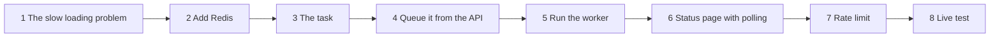
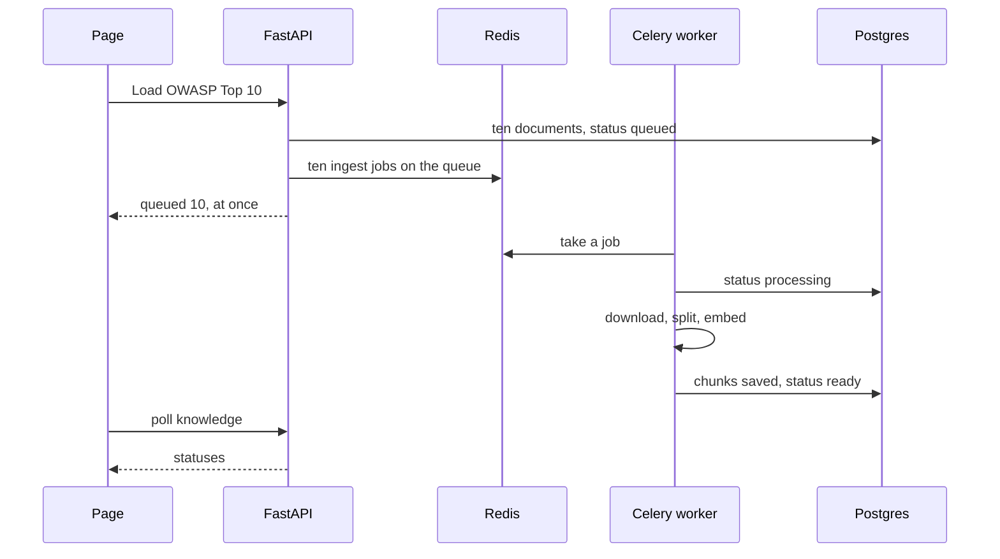
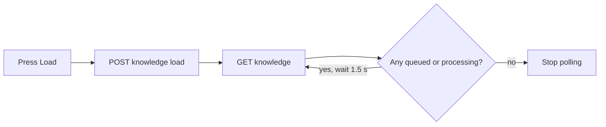
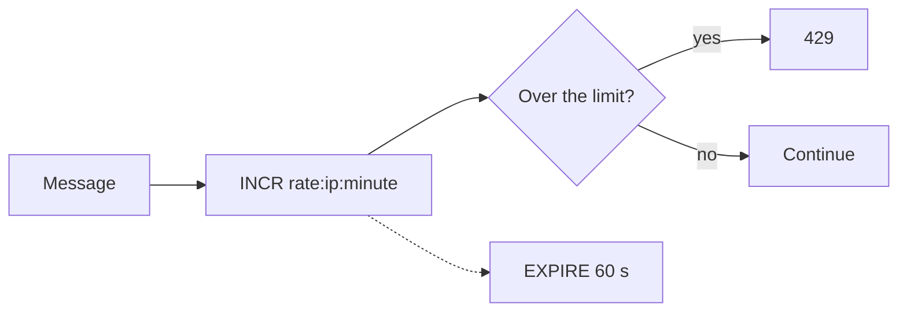
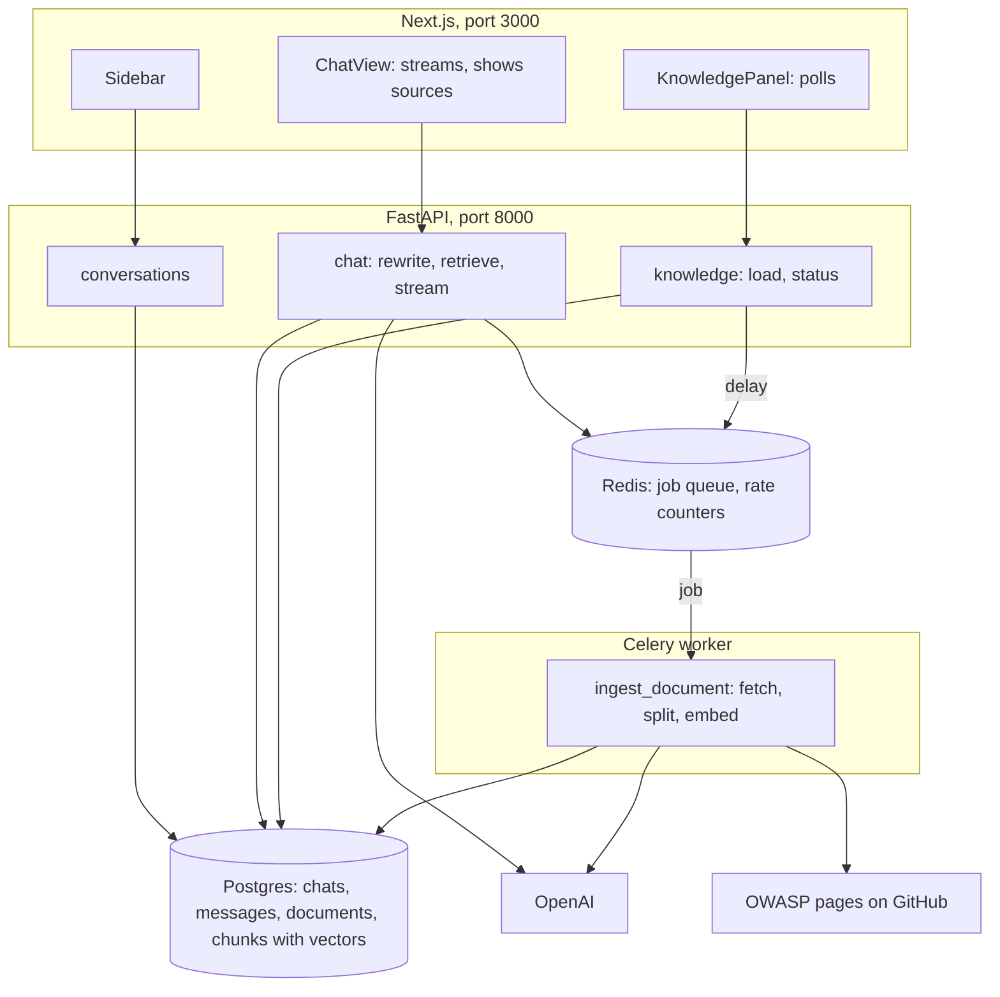

# Tutorial 4: Background Loading and Rate Limiting With Redis and Celery

**What you build.** Two things, with one tool each:

1. **Celery** loads the OWASP Top 10 in the **background**. A "Load OWASP Top 10" button queues ten jobs, a worker processes them, and the page shows each category turning `queued`, `processing`, `ready`.
2. **Redis** also powers a **rate limit**, so nobody can spam your paid OpenAI key.

Everything is real: real Redis, a real Celery worker, real Postgres, real OpenAI. At the end you will run a **live test** against the real stack.

You need [part 3](03-pgvector-owasp-knowledge-base.md) working, including `ingest_sync.py`.

## The path



---

## Step 1: The slow loading problem

### The problem

In part 3 you timed `ingest_sync.py`. If a web endpoint did that work, the browser would wait the whole time with a spinner. Proxies and browsers give up after a while. A restart in the middle would lose everything. And one slow request would block others.

### The fix: a queue and a worker

**Celery** is a task queue. The web server puts a **job** on a queue and answers at once. A separate **worker** process takes jobs and runs them. **Redis** is the queue (the *broker*).



Three facts:

1. The worker is **another process**. It shares nothing with the API except what is in **Postgres** and **Redis**.
2. The page cannot be told "done", so it **polls**: it asks for the status every second or two until nothing is pending.
3. The **chat itself does not use Celery**. A streaming answer needs a live connection. Use Celery for slow work that can finish later.

---

## Step 2: Add Redis

### Type this

Add a `redis` service to `my-chat/docker-compose.yml`, next to `postgres` (above the `volumes:` section):

```yaml
  redis:
    image: redis:7-alpine
    ports:
      - "6379:6379"
    healthcheck:
      test: ["CMD", "redis-cli", "ping"]
      interval: 3s
      retries: 20
```

```bash
cd course2/fullstack-chat/my-chat
docker compose up -d
docker compose exec redis redis-cli ping
```

**What you should see:** `PONG`.

Add Redis settings to `backend/settings.py` (append):

```python
# needs: your backend folder (file: settings.py, append)
REDIS_URL = os.getenv("REDIS_URL", "redis://localhost:6379/0")
RATE_LIMIT_PER_MINUTE = int(os.getenv("RATE_LIMIT_PER_MINUTE", "20"))
```

### Redis in two minutes

Try these in `docker compose exec redis redis-cli`:

| Command | Meaning |
|---|---|
| `SET greeting hello`, `GET greeting` | A key and a value. |
| `INCR visits` | A counter that adds 1. |
| `EXPIRE visits 60`, `TTL visits` | The key deletes itself after 60 seconds. |
| `RPUSH jobs a b c`, `LLEN jobs`, `LPOP jobs` | A list, used as a queue. |

A queue is just a **list**: producers push on one end, consumers pop from the other. Celery builds on exactly that. Clean up with `FLUSHDB`.

---

## Step 3: The task

### Type this

Create `backend/tasks.py`:

```python
# needs: your backend folder (file: tasks.py)
"""Celery worker code. It runs in its own process, so it only shares Postgres and Redis with the API."""
from celery import Celery

import db
import owasp
import rag
import settings

celery_app = Celery("chat", broker=settings.REDIS_URL)  # status lives in Postgres, so no result backend


@celery_app.task
def ingest_document(doc_id: int) -> int:
    with db.sync_connect() as conn:
        doc = conn.execute("SELECT key, title FROM documents WHERE id = %s", (doc_id,)).fetchone()
        conn.execute("UPDATE documents SET status = 'processing', updated_at = now() WHERE id = %s", (doc_id,))
        try:
            chunks = rag.split(owasp.fetch_markdown(doc["key"]))
            texts = [c.page_content for c in chunks]
            vectors = rag.embedder().embed_documents([rag.for_embedding(doc["title"], t) for t in texts])
            conn.execute("DELETE FROM chunks WHERE document_id = %s", (doc_id,))  # reloading replaces, never duplicates
            for position, (text, vec) in enumerate(zip(texts, vectors)):
                conn.execute(
                    "INSERT INTO chunks (document_id, position, content, embedding) VALUES (%s, %s, %s, %s)",
                    (doc_id, position, text, vec),
                )
            conn.execute(
                "UPDATE documents SET status = 'ready', chunks = %s, error = '', updated_at = now() WHERE id = %s",
                (len(texts), doc_id),
            )
            return len(texts)
        except Exception as e:  # show the reason in the page instead of failing silently
            conn.execute(
                "UPDATE documents SET status = 'failed', error = %s, updated_at = now() WHERE id = %s",
                (str(e)[:200], doc_id),
            )
            raise
```

It is the same work as `ingest_sync.py`, for **one** document, with status updates. `@celery_app.task` turns the function into a job. The job takes a small argument (an id), not the whole text: messages on the queue should be tiny.

> The worker uses a **normal** Postgres connection (`db.sync_connect`), not the async pool, because a worker runs jobs one after another in plain Python.

### Check yourself

Why does the task take `doc_id` and not the document text?

<details>
<summary>Answer</summary>

Queue messages should be small. The id is enough: the worker looks up the document in Postgres and downloads the text itself.
</details>

---

## Step 4: Queue it from the API

### Type this

Append two functions to `backend/store.py`:

```python
# needs: your backend folder (file: store.py, append)
import owasp  # noqa: E402  (move imports to the top of the file if you like)


async def list_documents(pool: AsyncConnectionPool) -> list[dict]:
    return await many(pool, "SELECT id, key, title, status, chunks, error FROM documents ORDER BY key")


async def queue_documents(pool: AsyncConnectionPool) -> list[int]:
    """One row per OWASP category. Running it twice resets the rows instead of adding more."""
    ids = []
    for key, name, _ in owasp.CATEGORIES:
        row = await one(
            pool,
            "INSERT INTO documents (key, title, url, status) VALUES (%s, %s, %s, 'queued') "
            "ON CONFLICT (key) DO UPDATE SET status = 'queued', error = '', updated_at = now() RETURNING id",
            (key, owasp.title(key, name), owasp.page_url(key)),
        )
        ids.append(row["id"])
    return ids
```

`INSERT ... ON CONFLICT DO UPDATE` is an **upsert**: insert the row, or if the key already exists, update it. That is why pressing the button twice does not create duplicates.

`backend/knowledge.py`:

```python
# needs: your backend folder (file: knowledge.py)
from fastapi import APIRouter, Depends
from psycopg_pool import AsyncConnectionPool

import store
from deps import get_pool
from tasks import ingest_document

router = APIRouter(prefix="/api/knowledge")


@router.get("")
async def documents(pool: AsyncConnectionPool = Depends(get_pool)):
    return await store.list_documents(pool)


@router.post("/load")
async def load(pool: AsyncConnectionPool = Depends(get_pool)):
    ids = await store.queue_documents(pool)
    for doc_id in ids:
        # .delay() puts a job on the Redis queue and returns at once. A worker picks it up.
        ingest_document.delay(doc_id)
    return {"queued": len(ids)}
```

`ingest_document.delay(doc_id)` does **not** run the function. It sends a message "please run `ingest_document` with this id" to Redis and returns.

`backend/deps.py` gets a Redis helper (append):

```python
# needs: your backend folder (file: deps.py, append)
from redis.asyncio import Redis  # noqa: E402


def get_redis(request: Request) -> Redis:
    return request.app.state.redis
```

---

## Step 5: Run the worker

You now run **four** things. Use separate terminals:

| # | What | Command |
|---|---|---|
| 1 | Postgres and Redis | `docker compose up -d` (in `my-chat/`) |
| 2 | API | `uv run uvicorn main:app --reload --port 8000` (in `backend/`) |
| 3 | **Worker** | `uv run celery -A tasks worker --loglevel=info --pool=solo` (in `backend/`) |
| 4 | Frontend | `npm run dev` (in `frontend/`) |

`--pool=solo` runs jobs one at a time in the worker's own process. It is simple and avoids macOS fork problems in development. Real deployments use the default pool and several workers.

The worker prints a banner. Check that `[tasks]` lists `tasks.ingest_document`. If not, you started it from the wrong folder.

You need the API to include the new router, and the rate limiter from step 7 will need the Redis client. Replace `backend/main.py` now. It adds the Redis client to the lifespan and includes the `knowledge` router:

```python
# needs: your backend folder (file: main.py)
from contextlib import asynccontextmanager

from fastapi import FastAPI
from fastapi.middleware.cors import CORSMiddleware
from redis.asyncio import Redis

import chat
import conversations
import db
import knowledge
import settings


@asynccontextmanager
async def lifespan(app: FastAPI):
    db.init_schema()
    app.state.pool = db.make_pool()
    await app.state.pool.open()
    app.state.redis = Redis.from_url(settings.REDIS_URL, decode_responses=True)
    yield
    await app.state.pool.close()
    await app.state.redis.aclose()


app = FastAPI(title="OWASP Top 10 chat", lifespan=lifespan)
app.add_middleware(
    CORSMiddleware,
    allow_origins=settings.FRONTEND_ORIGINS,
    allow_methods=["*"],
    allow_headers=["*"],
)
app.include_router(conversations.router)
app.include_router(chat.router)
app.include_router(knowledge.router)


@app.get("/api/hello")
def hello():
    return {"message": "Hello from FastAPI"}
```

`decode_responses=True` makes Redis return normal strings instead of bytes.

### Watch the queue (a good experiment)

1. **Stop the worker** (Ctrl+C in its terminal).
2. Press load by hand:

```bash
curl -s -X POST localhost:8000/api/knowledge/load
docker compose exec redis redis-cli llen celery
docker compose exec postgres psql -U chat chat -c "select key, status from documents order by key;"
```

**What you should see:** `{"queued":10}`, then `10` (ten jobs waiting in the Redis list called `celery`), and ten `queued` rows. Nothing is happening because nobody is working.

3. **Start the worker.** Watch it print `Task tasks.ingest_document[...] received` and `succeeded` ten times. Run the `llen` and `select` again: `0` jobs left, ten `ready` rows.

That is the whole mechanism: the API only leaves jobs in a Redis list, and the worker drains it.

### Try it

Press load twice quickly. What does `select count(*) from chunks;` say afterwards? (No duplicates, thanks to the upsert and the `DELETE` in the task.)

---

## Step 6: The status panel with polling

### The problem

The page must show progress and update itself as the worker finishes.

### The fix: poll while anything is pending



### Type this

`api.ts` already has `listKnowledge` and `loadKnowledge`. Create `src/components/knowledge-panel.tsx`:

```tsx
"use client";

import { useEffect, useState } from "react";
import { Badge } from "@/components/ui/badge";
import { Button } from "@/components/ui/button";
import { listKnowledge, loadKnowledge, type KbDoc } from "@/lib/api";

export function KnowledgePanel() {
  const [docs, setDocs] = useState<KbDoc[]>([]);
  const [error, setError] = useState("");
  const [tick, setTick] = useState(0);

  // Poll while the worker is still processing any category.
  const pending = docs.some((d) => d.status === "queued" || d.status === "processing");

  useEffect(() => {
    let alive = true;
    listKnowledge()
      .then((d) => alive && setDocs(d))
      .catch(() => alive && setError("Cannot reach the backend. Is uvicorn running on port 8000?"));
    return () => {
      alive = false;
    };
  }, [tick]);

  useEffect(() => {
    if (!pending) return;
    const timer = setTimeout(() => setTick((t) => t + 1), 1500);
    return () => clearTimeout(timer);
  }, [pending, tick]);

  async function load() {
    setError("");
    try {
      await loadKnowledge();
      setTick((t) => t + 1);
    } catch (e) {
      setError((e as Error).message);
    }
  }

  const ready = docs.filter((d) => d.status === "ready").length;

  return (
    <div className="space-y-2 border-b p-3">
      <div className="flex flex-wrap items-center gap-3">
        <span className="text-sm font-medium">
          OWASP Top 10:2025 knowledge base ({ready}/{docs.length || 10} ready)
        </span>
        <Button size="sm" variant="outline" onClick={load} disabled={pending}>
          {docs.length === 0 ? "Load OWASP Top 10" : "Reload"}
        </Button>
      </div>
      {error && <p className="text-sm text-destructive">{error}</p>}
      <div className="flex flex-wrap gap-2">
        {docs.map((d) => (
          <Badge key={d.id} variant={d.status === "failed" ? "destructive" : "secondary"} title={d.error}>
            {d.key}: {d.status}
          </Badge>
        ))}
      </div>
    </div>
  );
}
```

Replace `src/components/chat-view.tsx` with the final version (it adds the panel above the chat):

```tsx
"use client";

import { useEffect, useRef, useState } from "react";
import { KnowledgePanel } from "@/components/knowledge-panel";
import { Button } from "@/components/ui/button";
import { Textarea } from "@/components/ui/textarea";
import { getMessages, streamChat, type Message } from "@/lib/api";

type Props = { cid: string; onActivity: () => void };

const STARTERS = [
  "What is the number one risk in the OWASP Top 10:2025?",
  "How do I prevent SQL injection?",
  "What changed in 2025 compared to before?",
];

export function ChatView({ cid, onActivity }: Props) {
  const [messages, setMessages] = useState<Message[]>([]);
  const [input, setInput] = useState("");
  const [busy, setBusy] = useState(false);
  const [error, setError] = useState("");
  const bottom = useRef<HTMLDivElement>(null);

  useEffect(() => {
    let alive = true;
    getMessages(cid)
      .then((m) => alive && setMessages(m))
      .catch((e) => alive && setError((e as Error).message));
    return () => {
      alive = false;
    };
  }, [cid]);

  useEffect(() => {
    bottom.current?.scrollIntoView({ behavior: "smooth" });
  }, [messages]);

  async function send(override?: string) {
    const text = (override ?? input).trim();
    if (!text || busy) return;
    setBusy(true);
    setError("");
    setInput("");
    // Add the user's message and an empty bot message that we fill as tokens arrive.
    setMessages((m) => [...m, { role: "user", content: text }, { role: "assistant", content: "" }]);
    const patchLast = (fn: (m: Message) => Message) =>
      setMessages((all) => all.map((m, i) => (i === all.length - 1 ? fn(m) : m)));
    try {
      for await (const event of streamChat(cid, text)) {
        if (event.type === "token") patchLast((m) => ({ ...m, content: m.content + event.text }));
        if (event.type === "sources") patchLast((m) => ({ ...m, sources: event.sources }));
        if (event.type === "error") setError(event.message);
      }
    } catch (e) {
      setError((e as Error).message);
    } finally {
      setBusy(false);
      onActivity(); // the first message gives the chat its title
    }
  }

  return (
    <div className="flex min-w-0 flex-1 flex-col">
      <KnowledgePanel />
      <div className="flex-1 space-y-4 overflow-y-auto p-4">
        {messages.map((m, i) => (
          <div key={i} className={m.role === "user" ? "ml-auto max-w-[80%] rounded-lg bg-muted p-3" : "max-w-[80%] p-3"}>
            <p className="whitespace-pre-wrap text-sm">{m.content || (busy ? "..." : "")}</p>
            {m.sources && m.sources.length > 0 && (
              <details className="mt-2 text-xs">
                <summary className="cursor-pointer text-muted-foreground">Sources ({m.sources.length})</summary>
                <ul className="mt-1 space-y-1">
                  {m.sources.map((s, j) => (
                    <li key={j} className="rounded border p-2">
                      <a href={s.url} target="_blank" rel="noreferrer" className="font-medium underline">
                        {s.title}
                      </a>{" "}
                      (similarity {s.score})
                      <p className="line-clamp-3">{s.text}</p>
                    </li>
                  ))}
                </ul>
              </details>
            )}
          </div>
        ))}
        {messages.length === 0 && (
          <div className="flex flex-wrap gap-2">
            {STARTERS.map((q) => (
              <Button key={q} variant="outline" size="sm" onClick={() => send(q)} disabled={busy}>
                {q}
              </Button>
            ))}
          </div>
        )}
        <div ref={bottom} />
      </div>
      {error && <p className="px-4 text-sm text-destructive">{error}</p>}
      <div className="flex gap-2 border-t p-3">
        <Textarea
          value={input}
          placeholder="Ask about the OWASP Top 10..."
          onChange={(e) => setInput(e.target.value)}
          onKeyDown={(e) => {
            if (e.key === "Enter" && !e.shiftKey) {
              e.preventDefault();
              send();
            }
          }}
        />
        <Button onClick={() => send()} disabled={busy}>
          Send
        </Button>
      </div>
    </div>
  );
}
```

**What you should see:** press **Load OWASP Top 10** (or **Reload**). Ten badges appear and turn from `queued` to `processing` to `ready` one by one, with the worker terminal scrolling alongside.

### Why it works

The first effect fetches the list. The second only runs while something is pending: it waits 1.5 seconds and bumps `tick`, which reruns the first effect. When every document is `ready` or `failed`, nothing is pending and the loop stops by itself. Cleanup functions cancel timers and ignore late answers.

### Try it

1. Stop the worker, press load, and watch the badges stay `queued`. Start the worker and see them finish.
2. Temporarily break the URL in `owasp.RAW` (a typo), restart the worker and load. Hover a red `failed` badge to read the reason.

---

## Step 7: A rate limit

### The problem

Every chat message costs money (model and embedding calls). Someone could script thousands of messages.

### The fix: a counter in Redis that expires

Count messages per client per minute. Past the limit, answer `429 Too Many Requests`.



### Type this

`backend/ratelimit.py`:

```python
# needs: your backend folder (file: ratelimit.py)
"""Rate limiting with Redis: one counter per client per minute."""
import time

from redis.asyncio import Redis


async def rate_limited(r: Redis, who: str, limit: int) -> bool:
    key = f"rate:{who}:{int(time.time() // 60)}"
    count = await r.incr(key)
    if count == 1:
        await r.expire(key, 60)  # the counter deletes itself, no cleanup code needed
    return count > limit
```

The key includes the current minute, so each minute starts a fresh counter, and `EXPIRE` removes old ones.

Replace `backend/chat.py` with the final version. It adds the limit as the very first check, because it is the cheapest check and protects everything after it:

```python
# needs: your backend folder (file: chat.py)
import json

from fastapi import APIRouter, Depends, HTTPException, Request
from fastapi.responses import StreamingResponse
from psycopg_pool import AsyncConnectionPool
from pydantic import BaseModel, Field
from redis.asyncio import Redis

import llm
import rag
import settings
import store
from deps import get_pool, get_redis
from ratelimit import rate_limited

router = APIRouter(prefix="/api/conversations")


class ChatIn(BaseModel):
    message: str = Field(min_length=1, max_length=4000)
    k: int = Field(default=4, ge=1, le=10)


def sse(event: dict) -> str:
    # One server-sent event: a line starting with "data:" and a blank line after it.
    return f"data: {json.dumps(event)}\n\n"


@router.post("/{cid}/chat")
async def chat(
    cid: str,
    body: ChatIn,
    request: Request,
    pool: AsyncConnectionPool = Depends(get_pool),
    r: Redis = Depends(get_redis),
):
    who = request.client.host if request.client else "unknown"
    if await rate_limited(r, who, settings.RATE_LIMIT_PER_MINUTE):
        raise HTTPException(status_code=429, detail="Too many messages. Wait a minute.")
    if not await store.conversation_exists(pool, cid):
        raise HTTPException(status_code=404, detail="Conversation not found")
    if await store.ready_chunk_count(pool) == 0:
        raise HTTPException(status_code=409, detail="The knowledge base is empty. Press Load OWASP Top 10 first.")

    history = await store.get_messages(pool, cid, limit=settings.HISTORY_LIMIT)
    search_text = await llm.standalone_question(history, body.message)
    sources = await store.search_chunks(pool, await rag.embed_query(search_text), body.k)
    await store.add_message(pool, cid, "user", body.message)

    async def events():
        parts: list[str] = []
        try:
            async for token in llm.stream_answer(history, body.message, sources):
                parts.append(token)
                yield sse({"type": "token", "text": token})
        except Exception as e:  # tell the page, instead of cutting the stream
            yield sse({"type": "error", "message": str(e)[:200]})
            return
        await store.add_message(pool, cid, "assistant", "".join(parts), sources)
        yield sse({"type": "sources", "sources": sources})
        yield sse({"type": "done"})

    return StreamingResponse(events(), media_type="text/event-stream")
```

Watch the counter in Redis after sending a few messages:

```bash
docker compose exec redis redis-cli --scan --pattern 'rate:*'
docker compose exec redis redis-cli ttl "rate:127.0.0.1:NNNN"   # use a key you saw above
```

To feel the limit without spending money, start uvicorn with a tiny limit: `RATE_LIMIT_PER_MINUTE=2 uv run uvicorn main:app --port 8000`, send three chats, and the third is `429`.

### Check yourself

Why is the rate limit the first check in `chat`?

<details>
<summary>Answer</summary>

It is the cheapest check, and it protects everything after it: Postgres reads and the paid model calls.
</details>

---

## Step 8: A live test of the real stack

You do not need fakes. This test talks to your running system: the real API, real Postgres with pgvector, real Redis, the real worker and the real OpenAI API. It costs a fraction of a cent.

`backend/test_live.py`:

```python
# needs: your backend folder (file: test_live.py)
"""Live test of the real stack. No fakes.

Needs everything running: Postgres and Redis (docker compose up -d), the API on port 8000,
and the Celery worker. It calls the real OpenAI API, so it costs a fraction of a cent.

    uv run python test_live.py
"""
import asyncio
import json
import os
import time
import uuid

import httpx
from redis.asyncio import Redis

import db
import ratelimit
import settings
from tasks import celery_app

API = os.getenv("API_URL", "http://localhost:8000")
client = httpx.Client(base_url=API, timeout=60)


def chat(cid: str, message: str) -> dict:
    """Send one message and collect the stream into text, sources and the event types seen."""
    out = {"text": "", "sources": [], "types": []}
    with client.stream("POST", f"/api/conversations/{cid}/chat", json={"message": message}) as res:
        assert res.status_code == 200, res.read()
        for line in res.iter_lines():
            if line.startswith("data: "):
                event = json.loads(line[6:])
                out["types"].append(event["type"])
                if event["type"] == "token":
                    out["text"] += event["text"]
                if event["type"] == "sources":
                    out["sources"] = event["sources"]
                assert event["type"] != "error", event
    return out


def ensure_knowledge_base() -> None:
    docs = client.get("/api/knowledge").json()
    if len(docs) == 10 and all(d["status"] == "ready" for d in docs):
        return
    assert client.post("/api/knowledge/load").json() == {"queued": 10}
    deadline = time.time() + 180
    while time.time() < deadline:
        docs = client.get("/api/knowledge").json()
        assert not any(d["status"] == "failed" for d in docs), docs
        if len(docs) == 10 and all(d["status"] == "ready" for d in docs):
            return
        time.sleep(3)
    raise AssertionError("The worker did not finish in 3 minutes. Is it running?")


def test_infrastructure() -> None:
    assert client.get("/api/hello").json()["message"].startswith("Hello")
    assert celery_app.control.inspect(timeout=3).ping(), "No Celery worker answered"
    with db.sync_connect() as conn:
        assert conn.execute("SELECT extversion FROM pg_extension WHERE extname = 'vector'").fetchone()
        assert conn.execute("SELECT count(*) AS n FROM chunks").fetchone()["n"] > 100


def test_rate_limiter_on_real_redis() -> None:
    async def run():
        r = Redis.from_url(settings.REDIS_URL, decode_responses=True)
        who = f"test-{uuid.uuid4().hex[:6]}"
        results = [await ratelimit.rate_limited(r, who, 3) for _ in range(5)]
        await r.aclose()
        return results

    assert asyncio.run(run()) == [False, False, False, True, True]


def test_chat_flow() -> None:
    cid = client.post("/api/conversations").json()["id"]
    first = chat(cid, "What is SQL injection and how do I prevent it?")
    assert first["text"] and first["types"][-1] == "done"
    assert first["sources"] and "A05" in first["sources"][0]["title"], first["sources"][:1]
    assert first["sources"][0]["url"].startswith("https://owasp.org/Top10/2025/")

    # A follow-up with no topic words. It only works if the question is rewritten using the history.
    second = chat(cid, "Which category is it in?")
    assert "A05" in second["text"], second["text"]

    # Something the OWASP pages do not cover.
    third = chat(cid, "What is the best pizza topping?")
    assert "know" in third["text"].lower(), third["text"]
    assert third["sources"][0]["score"] < 0.35, third["sources"][0]["score"]

    messages = client.get(f"/api/conversations/{cid}/messages").json()
    assert [m["role"] for m in messages] == ["user", "assistant"] * 3
    assert messages[1]["sources"], "sources must be saved with the answer"
    title = next(c["title"] for c in client.get("/api/conversations").json() if c["id"] == cid)
    assert title.startswith("What is SQL injection")

    assert client.delete(f"/api/conversations/{cid}").json() == {"deleted": cid}
    assert client.get(f"/api/conversations/{cid}/messages").status_code == 404
    with db.sync_connect() as conn:  # ON DELETE CASCADE removed the messages
        assert conn.execute("SELECT count(*) AS n FROM messages WHERE conversation_id = %s", (cid,)).fetchone()["n"] == 0


def test_errors() -> None:
    cid = client.post("/api/conversations").json()["id"]
    assert client.post("/api/conversations/nope/chat", json={"message": "x"}).status_code == 404
    assert client.post(f"/api/conversations/{cid}/chat", json={"message": ""}).status_code == 422
    assert client.post(f"/api/conversations/{cid}/chat", json={"message": "x", "k": 99}).status_code == 422
    client.delete(f"/api/conversations/{cid}")


if __name__ == "__main__":
    ensure_knowledge_base()
    for test in (test_infrastructure, test_rate_limiter_on_real_redis, test_chat_flow, test_errors):
        test()
        print("ok  ", test.__name__)
    print("ALL LIVE TESTS PASSED")
```

Run it with everything started (steps 5 and 6):

```bash
cd course2/fullstack-chat/my-chat/backend
uv run python test_live.py
```

**What you should see:**

```
ok   test_infrastructure
ok   test_rate_limiter_on_real_redis
ok   test_chat_flow
ok   test_errors
ALL LIVE TESTS PASSED
```

What it proves, against the real thing: a worker answers (`ping`), the pgvector extension is installed and chunks exist, the rate limiter counts on real Redis, a question about SQL injection returns `A05:2025` sources with owasp.org links, a follow-up using only "it" is understood, an unrelated question gets "I don't know" with low similarity, messages and sources are saved, titles are set, and deleting a chat cascades to its messages.

What it does **not** prove: that the browser page looks right (try it by hand), or that answers are *good* beyond these checks. LLM text varies, so the assertions check facts that must hold, not exact wording.

---

## The whole app



| Who uses Postgres | For |
|---|---|
| API | chats, messages, document status, vector search |
| Worker | writing chunks and vectors |

| Who uses Redis | For |
|---|---|
| API | rate limit counters |
| API and worker | the Celery job queue |

## Common mistakes

| Mistake | What you see | Fix |
|---|---|---|
| Worker not running | Badges stay `queued` | Start `celery -A tasks worker ...` in `backend/`. |
| Worker started from the wrong folder | No `tasks.ingest_document` in the banner, or `ModuleNotFoundError` | Run it inside `backend/`. |
| Edited `tasks.py`, worker not restarted | Old behaviour | Celery does not auto-reload. Restart it. |
| Redis not running | `Connection refused` from the API or worker | `docker compose up -d`. |
| `failed` badge | Red badge, hover for the reason | Often no network, a bad `OPENAI_API_KEY`, or a changed URL. |
| Used the async client in the worker | `coroutine was never awaited` | The worker is synchronous. Use `db.sync_connect()`. |
| Put the whole text in the job | Huge queue messages | Send an id, let the worker fetch the text. |
| `--pool=solo` forgotten on macOS | Worker crashes on the first job | Add it for development. |
| Two workers while testing | A job vanished into the other worker | One worker per queue while learning, or you may run old code. |
| Rate limit during testing | `429` | Wait a minute or raise `RATE_LIMIT_PER_MINUTE`. |

## Practice

No answers shown. Ask me for a hint.

1. **Retries.** Make `ingest_document` retry 3 times on network errors. Look up `bind=True` and `self.retry`.
2. **Progress.** Show "embedded 40 of 77 chunks". Where do you store it and how does the page see it?
3. **Parallel loading.** Run two workers. What must be true so they do not clash? (Hint: each job touches one document.)
4. **Per-user limits.** The limiter uses the IP address. Why is that weak behind a proxy? What would you use after adding logins?
5. **Scheduled reload.** Reload the OWASP pages every week. Look up Celery beat.
6. **Cache answers.** Cache the answer to identical questions in Redis for an hour. What is the key? What can go wrong?
7. **Explain it.** In six sentences, explain why chat streaming does not use Celery but document loading does.

## Cheat sheet

| Step | Added | Key idea |
|---|---|---|
| 1 | The problem | Slow work should not block a web request |
| 2 | Redis | Counters, expiry, lists as queues |
| 3 | `tasks.py` | A task is a function plus `@celery_app.task` |
| 4 | `knowledge.py` | `.delay()` enqueues and returns at once |
| 5 | Worker | Four processes; the queue is a Redis list |
| 6 | Polling panel | Poll until nothing is pending |
| 7 | `ratelimit.py` | `INCR` plus `EXPIRE`, checked first |
| 8 | `test_live.py` | Test the real stack, assert facts |

Back to [part 1](01-hello-world-to-streaming-chat.md) or the [guide](../README.md).
