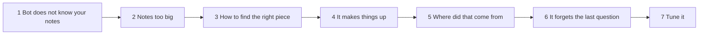
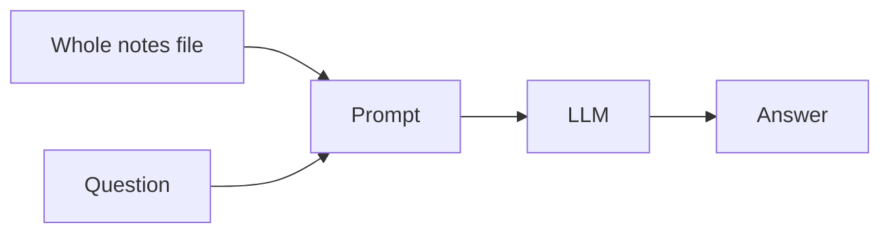
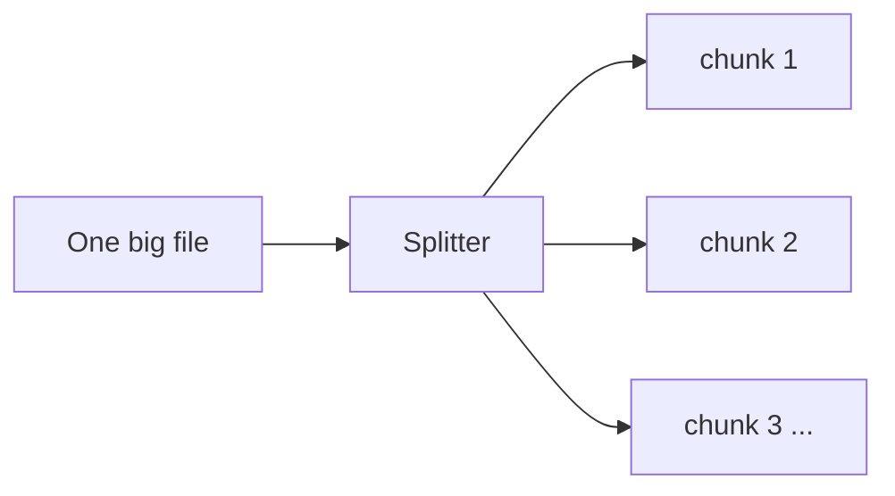
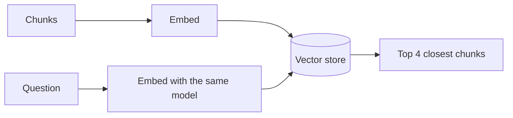
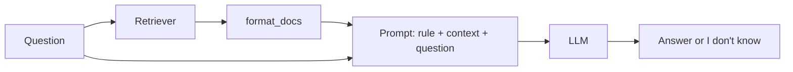
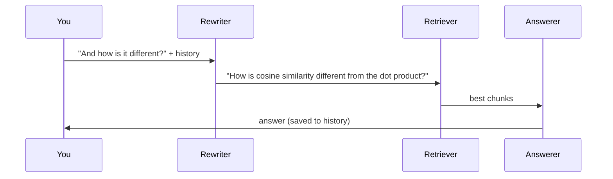
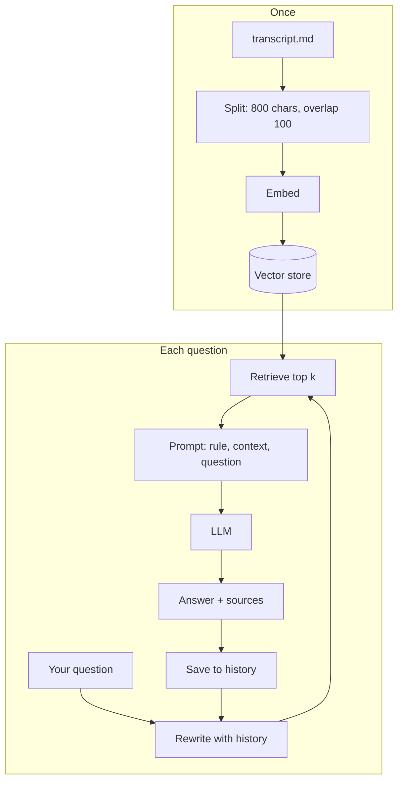

# Tutorial 2: Build a Bot That Answers From Your Study Notes

**What you build.** A small chatbot that answers questions using **your own course notes** (`transcript.md` in this folder). You can ask it things like "What is cosine similarity?" and it answers from the notes, shows where the answer came from, and says "I don't know" when the notes do not say.

**How this tutorial works.** We grow one app in small steps. Every step starts with a **problem** you just hit. The **fix** is a RAG idea. So you learn *why* each part exists, not only what it is.

Want the course order, with the lab's `RetrievalQA` and watsonx code explained and mapped to today's code? See [Tutorial 1](01-rag-study-guide-and-lab-adapted.md).

## The path



## Before you start

You need `OPENAI_API_KEY` in the repo-root `.env`. Packages are already installed (see the [root README](../../../README.md)). Open a notebook in `course2/module1/`, choose the root `.venv` kernel, and run this once:

```python
from dotenv import load_dotenv
from langchain_openai import ChatOpenAI, OpenAIEmbeddings

load_dotenv()
llm = ChatOpenAI(model="gpt-4o-mini", temperature=0, max_tokens=300)
embeddings = OpenAIEmbeddings(model="text-embedding-3-small")
```

> **Lab says / today we use:** the course lab uses IBM watsonx (`WatsonxLLM`) and Hugging Face embeddings. We use OpenAI. The ideas are identical. Full mapping in [Tutorial 1](01-rag-study-guide-and-lab-adapted.md#before-you-start).

Type each block yourself. LLM text varies, so your output will be similar, not identical.

---

## Step 1: The bot does not know your notes

### The problem

Your notes are private. The LLM never saw them. Ask it about something that is only in your notes:

```python
print(llm.invoke("In my course notes, what are the four steps of the RAG process?").content)
```

**What you should see** (example): a general answer, or "I don't have access to your notes". Even if it lists four steps, it is guessing from general knowledge, not reading your file.

### The fix: give it the text

The most direct fix: read the notes and put them in the prompt.

```python
from pathlib import Path

# Works from this folder, or from the repo root.
notes_path = next(p for p in [Path("transcript.md"), Path("course2/module1/transcript.md")] if p.exists())
text = notes_path.read_text()

print(len(text), "characters, about", len(text) // 4, "tokens")
```

**What you should see** (example): about `42000` characters, around `10000` tokens. (A token is roughly 4 characters of English.)

```python
question = "What are the four steps of the RAG process?"
print(llm.invoke(f"Notes:\n{text}\n\nQuestion: {question}").content)
```

**What you should see** (example): the four steps from the notes' summary (text embedding, retrieval, augmented query creation, model generation).



### Why it works

The model reads the text in the prompt and answers from it. This is the "long context" approach from the reading.

### Try it

Change the question to something the notes never mention (for example "Who won the 2010 World Cup?"). Notice that the bot may still answer. Keep that in mind for step 4.

---

## Step 2: The notes are too big (so we chunk)

### The problem

Step 1 sent around 10,000 tokens for **every** question. That is slow and costs more, and it grows with every file you add. A bigger library (say 50,000 documents) would not even fit. The reading names five limits: you must already have the text, capacity, noise, time and cost.

### The fix: split into chunks

Cut the notes into small pieces. Later we will send only the few pieces that matter.



### Type this

```python
from langchain_core.documents import Document
from langchain_text_splitters import RecursiveCharacterTextSplitter

splitter = RecursiveCharacterTextSplitter(chunk_size=800, chunk_overlap=100, add_start_index=True)
chunks = splitter.split_documents([Document(page_content=text, metadata={"source": notes_path.name})])

print(len(chunks))
print(chunks[10].page_content[:200])
print(chunks[10].metadata)
```

**What you should see** (example): about `77` chunks, the start of one chunk, and metadata like `{'source': 'transcript.md', 'start_index': 9021}`.

### Why it works

- `chunk_size=800`: each piece is about 800 characters, a paragraph or two.
- `chunk_overlap=100`: neighbouring pieces share 100 characters, so a sentence cut at the edge still appears whole somewhere.
- `add_start_index=True`: remembers where in the file each chunk began. We use that in step 5.
- `RecursiveCharacterTextSplitter` cuts at paragraphs first, then lines, then spaces, so pieces stay tidy.

### Try it

Print `[len(c.page_content) for c in chunks]`. Are any chunks tiny, like a lone heading? What would that do to search?

---

## Step 3: How do we find the right piece? (embeddings and a vector store)

### The problem

We have about 77 chunks. For a question we need the 3 or 4 that matter. Searching for the *same words* fails: "How do I stop a bot from inventing facts?" and the notes' "hallucination" share no words, yet mean the same.

### The fix: compare meaning with embeddings

An **embedding model** turns each text into a **vector** (a long list of numbers) so that similar meanings give similar vectors. A **vector store** keeps the vectors and finds the nearest ones.



### Type this

```python
from langchain_core.vectorstores import InMemoryVectorStore

store = InMemoryVectorStore.from_documents(chunks, embeddings)
retriever = store.as_retriever(search_kwargs={"k": 4})

for doc in retriever.invoke("How do I stop a bot from inventing facts?"):
    print("-", doc.page_content[:100].replace("\n", " "))
```

**What you should see** (example): four lines, mostly about hallucination, "no source", or the "I don't know" behaviour. The words differ from your question, but the meaning matches.

### Why it works

`from_documents` embeds each chunk once and stores `(vector, text, metadata)`. At question time the question is embedded with the **same model**, and the store returns the `k` nearest chunks. "Nearest" is usually measured with **cosine similarity** (how much two arrows point the same way, ignoring length). The video also mentions the **dot product**, which counts length too.

### Try it

Search for "What is a vector database?" and "Which distance measure ignores length?" Do the top chunks make sense?

---

## Step 4: It still makes things up (the augmented prompt)

### The problem

Retrieval works, but we have not connected it to the LLM. And remember step 1: the LLM happily answers questions the notes never cover. That is a **hallucination**, a believable but made-up answer.

### The fix: an augmented prompt with a rule

Put the retrieved chunks and the question into one prompt, and add this instruction: *use only the context, otherwise say you don't know*.



### Type this

```python
from langchain_core.output_parsers import StrOutputParser
from langchain_core.prompts import ChatPromptTemplate

def format_docs(docs):
    return "\n\n".join(d.page_content for d in docs)

prompt = ChatPromptTemplate.from_template(
    "Answer using only the context. If the answer is not in the context, "
    "say \"I don't know\".\n\nContext:\n{context}\n\nQuestion: {question}"
)
answer_chain = prompt | llm | StrOutputParser()

def ask_once(question):
    context = format_docs(retriever.invoke(question))
    return answer_chain.invoke({"context": context, "question": question})

print(ask_once("What are the four steps of the RAG process?"))
print(ask_once("Who won the 2010 World Cup?"))
```

**What you should see** (example): the first answers from the notes. The second says `I don't know.`

### Why it works

The prompt now has three parts, as the video says: the **instruction**, the **retrieved context**, and the **question**. The LLM is told to trust the context, so it declines when the context has nothing.

Warning from the video: if the retriever misses the right chunk, the bot also says "I don't know" for questions that *are* in the notes. Good RAG needs both a good retriever and a good generator.

### Try it

Remove the "If the answer is not in the context..." sentence and ask the World Cup question again. Does the model answer?

---

## Step 5: Where did that answer come from? (sources)

### The problem

The first thing the video said was that the answer must have a **source**. Right now you have to trust the bot.

### The fix: return the chunks along with the answer

We already have the chunks. Return them, and show their position in the file.

```python
def ask_with_sources(question):
    docs = retriever.invoke(question)
    answer = answer_chain.invoke({"context": format_docs(docs), "question": question})
    return answer, docs

answer, docs = ask_with_sources("What is the difference between dot product and cosine similarity?")
print(answer)
for d in docs:
    print("source:", d.metadata["source"], "| char", d.metadata["start_index"], "|", d.page_content[:70].replace("\n", " "))
```

**What you should see** (example): the answer, then four `source:` lines like `source: transcript.md | char 21504 | ...`.

### Why it works

Each chunk carries `metadata`, which we set in step 2. A user can open the file at that position and check the claim. That is how RAG gives **verifiable** answers.

> **Lab says / today we use:** the lab does this with `return_source_documents=True` on `RetrievalQA` and prints `results['source_documents'][0]`. We return the documents ourselves from the same retriever.

### Try it

Print `docs[0].page_content` in full. Does it really contain the facts the answer used?

---

## Step 6: It forgets what we just talked about (memory)

### The problem

Try a follow-up:

```python
print(ask_once("What is cosine similarity?"))
print(ask_once("And how is it different from the dot product?"))
```

The second question says "it" and "the dot product" with no topic. The retriever searches for those words and may fetch unrelated chunks. The bot has no memory.

### The fix: remember messages, and rewrite follow-ups

Keep the chat in a list. Before searching, ask the LLM to **rewrite the follow-up as a standalone question** using that history.



### Type this

```python
from langchain_core.messages import AIMessage, HumanMessage
from langchain_core.prompts import MessagesPlaceholder

rewrite_prompt = ChatPromptTemplate.from_messages([
    ("system", "Rewrite the user's last question so it makes sense on its own, using the chat history. "
               "Return only the question."),
    MessagesPlaceholder("history"),
    ("human", "{question}"),
])
rewrite = rewrite_prompt | llm | StrOutputParser()
history = []
```

```python
def chat_turn(question):
    standalone = rewrite.invoke({"history": history, "question": question}) if history else question
    docs = retriever.invoke(standalone)
    answer = answer_chain.invoke({"context": format_docs(docs), "question": standalone})
    history.extend([HumanMessage(question), AIMessage(answer)])
    return answer, docs

print(chat_turn("What is cosine similarity?")[0])
print(chat_turn("And how is it different from the dot product?")[0])
```

**What you should see** (example): the second answer compares cosine similarity and the dot product correctly, even though the question said only "it".

### Why it works

The retriever only sees what you search with. Searching for "And how is it different?" finds nothing useful. Searching for the rewritten question does. The `history` list also lets the rewriter know what "it" means.

> **Lab says / today we use:** the lab uses `ConversationBufferMemory` plus `ConversationalRetrievalChain`. Both are legacy classes. This list-plus-rewrite version is what they did inside.

### Try it

Print `history` after two turns. What types of objects does it hold?

---

## Step 7: Tune it (when answers are poor)

### The problem

If the bot says "I don't know" about something that is in your notes, or gives a half answer, the problem is usually **retrieval**, not the LLM. First look at what was retrieved.

### The fix: look, then change one knob

Look at the chunks for a question that fails:

```python
q = "What does the notes say about long context windows?"
for d in retriever.invoke(q):
    print("-", d.page_content[:90].replace("\n", " "))
```

Your three knobs:

| Knob | Try | Effect |
|---|---|---|
| `k` | 4 to 8 | More chunks: more chance the answer is included, but more noise and cost. |
| `chunk_size` | 400 to 1200 | Smaller: sharper match. Bigger: more context per chunk. |
| `chunk_overlap` | 0 to 200 | More overlap: fewer ideas cut in half. |

Change one at a time. Rebuild the store only if you change the splitter.

```python
retriever = store.as_retriever(search_kwargs={"k": 8})
print(ask_once("Summarize the main reasons RAG is used instead of long context."))
```

**What you should see** (example): a fuller answer than with `k=4`.

> **Note on summaries.** Questions like "summarize the whole document" do not match any one chunk, so RAG is weak at them. The lab shows this with "Can you summarize the document for me?". A larger `k` helps a little. Bigger fixes come later in the certificate.

### Try it

Set `chunk_size=300` and rebuild `chunks`, `store` and `retriever`. Ask the same question. Better or worse? Why?

---

## The whole app



A loop to talk to it (run `chat()` in a cell, type `quit` to stop):

```python
def chat():
    history.clear()
    while True:
        question = input("You: ")
        if question.lower() in ["quit", "exit", "bye"]:
            break
        answer, docs = chat_turn(question)
        print("Bot:", answer)
        print("     from chunks at", [d.metadata["start_index"] for d in docs])
```

Good questions to ask your own notes: *Why do we use the same embedding model for questions? What is top-k? What are the limits of long context?*

---

## Common mistakes

| Mistake | What you see | Fix |
|---|---|---|
| `FileNotFoundError: transcript.md` | Notebook is in a different folder | The `next(...)` line tries two paths. Open the notebook in `course2/module1/` or run from the repo root. |
| Missing API key | `The api_key client option must be set` | Put `OPENAI_API_KEY` in the root `.env`, run the first cell. |
| Changed chunking but not the store | Results do not change | Rebuild `chunks`, `store` and `retriever` in that order. |
| Used a different embedding model for questions | Strange matches | Use the single `embeddings` object everywhere. |
| History grows forever | Slower, costly rewrites | Keep only the last few turns: `history[-6:]` in the rewriter call. |
| Bot says "I don't know" too often | Answerable questions refused | Look at the retrieved chunks first (step 7), then raise `k`. |

## Practice

No answers shown. Ask me for a hint.

1. **Add a second file.** Add the lab notebook's text, or any `.md` file, to the store. Ask a question whose answer is only in the second file. Check the `source` metadata.
2. **Show a score.** Use `store.similarity_search_with_score` to print each chunk's score. Which scores look too low to trust?
3. **A minimum score.** Make the bot say "I don't know" without calling the LLM when the best score is below a number you choose.
4. **Compare chunk sizes.** For three questions, compare answers at `chunk_size` 300, 800 and 1500. Write down which is best for each question type.
5. **Explain to a friend.** In five sentences, explain what happens between typing a question and seeing an answer. Use the open-book exam idea.

## Cheat sheet

| Step | Problem | Part added |
|---|---|---|
| 1 | Bot does not know your notes | Put the text in the prompt |
| 2 | Too big and costly | Chunks (`RecursiveCharacterTextSplitter`) |
| 3 | Find the right chunk | Embeddings and a vector store |
| 4 | Makes things up | Augmented prompt with "say I don't know" |
| 5 | No proof | Return chunks and metadata |
| 6 | Forgets | History list plus a rewrite step |
| 7 | Poor answers | Inspect chunks; tune `k`, size, overlap |

Back to [Tutorial 1](01-rag-study-guide-and-lab-adapted.md).
