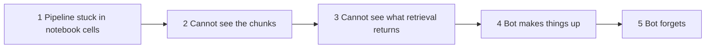
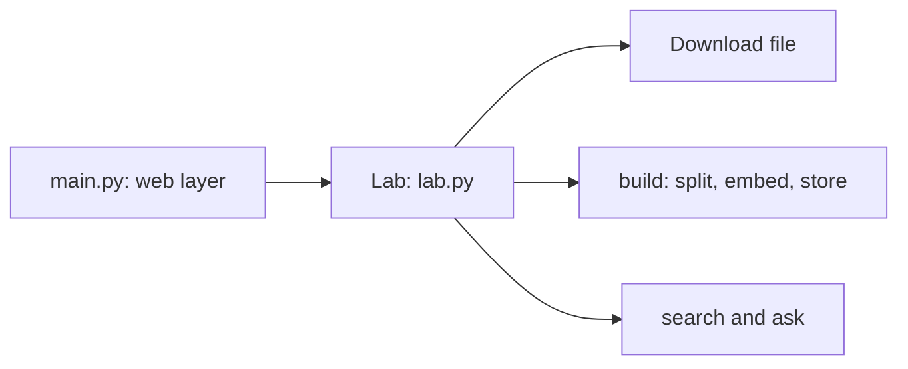
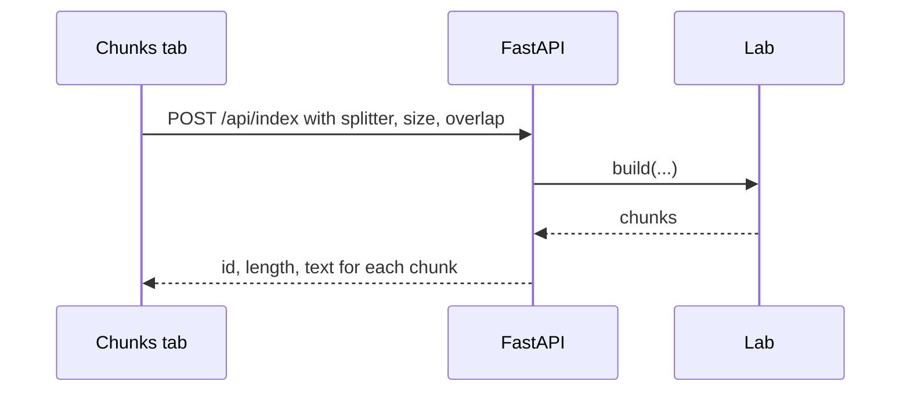
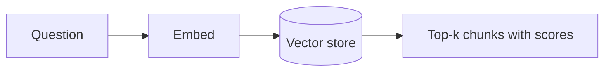
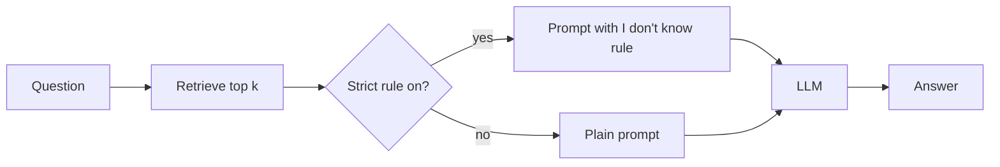
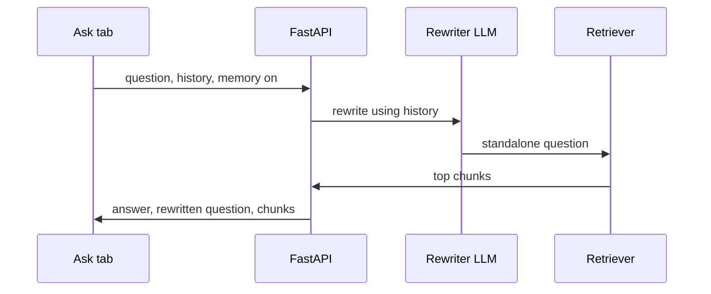
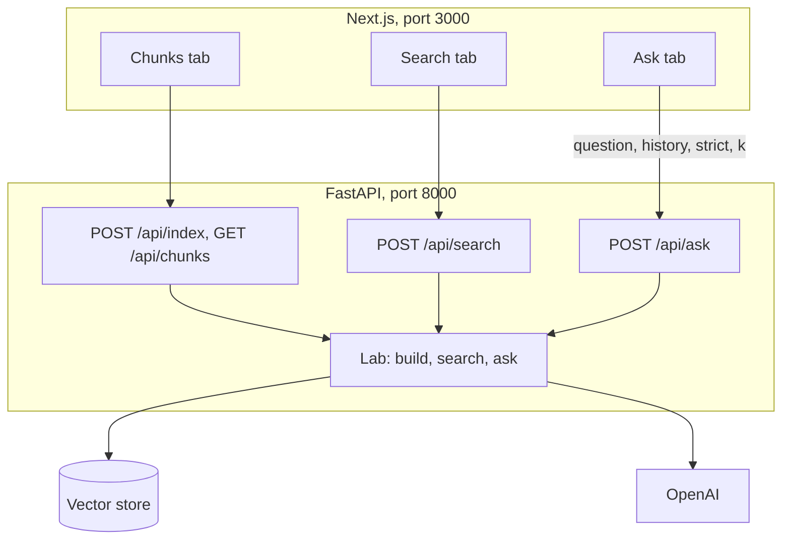

# Tutorial 3: Build the RAG Lab as a Web App (Next.js + FastAPI)

**What you build.** The Module 1 lab as a small web app, so you can *see* each stage of RAG instead of reading cell output. It has three tabs:

1. **Chunks**: change the splitter, chunk size and overlap, and see the chunks.
2. **Search**: type a question and see exactly which chunks the retriever returns, with scores. No LLM involved.
3. **Ask**: chat with the Innovatech company policies. Switch the "I don't know" rule and memory on and off.

**How this tutorial works.** One app, grown in small steps. Each step starts with a **problem**, then the **fix**. It uses the lab's own file, `companyPolicies.txt`. The LLM is OpenAI (`gpt-4o-mini`) instead of watsonx, as in [Tutorial 1](01-rag-study-guide-and-lab-adapted.md).

New to FastAPI, `fetch`, CORS or shadcn inputs? Read [module 2, Tutorial 1](../../module2/tutorials/01-gradio-concepts-adapted-to-nextjs.md) first. This tutorial reuses those ideas without re-explaining them. The module 2 [RAG web app](../../module2/tutorials/02-build-the-rag-web-app.md) answers from your own uploaded notes. This one is for **learning how RAG behaves**.

A finished copy is in [../app/](../app/). Build yours in `course2/module1/my-lab/` and compare.

## The path



## Before you start

- `OPENAI_API_KEY` in the repo-root `.env`.
- Backend packages (`fastapi`, `uvicorn`, `python-multipart`) are in the root `pyproject.toml`.
- Frontend project, from `course2/module1/my-lab/`:

```bash
npx create-next-app@latest frontend --typescript --tailwind --eslint --app --src-dir --import-alias "@/*" --use-npm --yes
cd frontend
npx shadcn@latest init -d -y
npx shadcn@latest add button card input label slider radio-group checkbox textarea badge tabs -y
```

Real API calls cost a few cents. The checks at the end are free.

---

## Step 1: The pipeline is stuck in notebook cells

### The problem

In the lab the pipeline is a row of cells: download, load, split, embed, store. A web server cannot run cells. We need one object that can **build the index** (with chosen settings) and **answer questions**.

### The fix: a `Lab` class



### Type this

Create `backend/lab.py`. Imports first:

```python
from pathlib import Path
from urllib.request import urlretrieve

from dotenv import load_dotenv
from langchain_core.documents import Document
from langchain_core.messages import AIMessage, HumanMessage
from langchain_core.output_parsers import StrOutputParser
from langchain_core.prompts import ChatPromptTemplate, MessagesPlaceholder
from langchain_core.vectorstores import InMemoryVectorStore
from langchain_openai import ChatOpenAI, OpenAIEmbeddings
from langchain_text_splitters import CharacterTextSplitter, RecursiveCharacterTextSplitter

load_dotenv()
```

The file and its download. This replaces the lab's `wget`:

```python
POLICY_URL = "https://cf-courses-data.s3.us.cloud-object-storage.appdomain.cloud/6JDbUb_L3egv_eOkouY71A.txt"
POLICY_FILE = Path("data") / "companyPolicies.txt"


def load_policies() -> str:
    # Downloaded once, like the lab's wget step.
    if not POLICY_FILE.exists():
        POLICY_FILE.parent.mkdir(exist_ok=True)
        urlretrieve(POLICY_URL, POLICY_FILE)
    return POLICY_FILE.read_text()
```

(In the finished app the path is anchored to the file's own folder, so it works from any directory. Use `Path(__file__).resolve().parent / "data" / ...` in your file.)

The class, with only the **indexing** side:

```python
class Lab:
    def __init__(self) -> None:
        self.embeddings = OpenAIEmbeddings(model="text-embedding-3-small")
        self.text = load_policies()
        self.chunks: list[Document] = []
        self.store = InMemoryVectorStore(self.embeddings)
        self.settings: dict = {}

    def build(self, splitter: str, chunk_size: int, chunk_overlap: int) -> None:
        cls = CharacterTextSplitter if splitter == "character" else RecursiveCharacterTextSplitter
        docs = cls(chunk_size=chunk_size, chunk_overlap=chunk_overlap).split_documents(
            [Document(page_content=self.text, metadata={"source": POLICY_FILE.name})]
        )
        for i, d in enumerate(docs):
            d.metadata["chunk_id"] = i
        self.chunks = docs
        self.store = InMemoryVectorStore(self.embeddings)  # fresh store, so old chunks do not linger
        self.store.add_documents(docs)
        self.settings = {"splitter": splitter, "chunk_size": chunk_size, "chunk_overlap": chunk_overlap}
```

Try it:

```python
lab = Lab()
lab.build("character", 1000, 0)
print(len(lab.chunks))
```

**What you should see:** `16`, the lab's number. (You may also see "Created a chunk of size ..." warnings.)

### Why it works

`build` is the indexing phase: load, split, embed, store. Each chunk gets a `chunk_id` so we can point at it later. A **fresh store** on every build matters. Without it, old chunks from earlier settings would stay in the index.

### Try it

Run `lab.build("recursive", 500, 50)` and print `len(lab.chunks)`. Why is the number larger?

---

## Step 2: I cannot see the chunks

### The problem

The lab prints `16` and moves on. You never see that half of those chunks are lone headings. The effect of `chunk_size` and `overlap` is invisible.

### The fix: an endpoint that returns chunks, and a page that draws them



### Type this

Create `backend/main.py`:

```python
from typing import Literal

from fastapi import FastAPI, HTTPException
from fastapi.middleware.cors import CORSMiddleware
from pydantic import BaseModel, Field

app = FastAPI(title="RAG Lab")
app.add_middleware(
    CORSMiddleware,
    allow_origins=["http://localhost:3000", "http://127.0.0.1:3000"],
    allow_methods=["*"],
    allow_headers=["*"],
)
```

At the top add `from lab import Lab`. Then a single shared lab, created on first use with the lab's own settings:

```python
the_lab = Lab()
the_lab.build("character", 1000, 0)


def chunk_summary(docs):
    return [{"id": d.metadata["chunk_id"], "length": len(d.page_content), "text": d.page_content} for d in docs]
```

> The finished app builds the lab lazily on the first request so the server starts instantly. Here we build at import to keep the code short.

The request shape and two endpoints:

```python
class IndexIn(BaseModel):
    splitter: Literal["character", "recursive"] = "character"
    chunk_size: int = Field(default=1000, ge=100, le=3000)
    chunk_overlap: int = Field(default=0, ge=0, le=500)


@app.get("/api/chunks")
def chunks():
    return {"settings": the_lab.settings, "chunks": chunk_summary(the_lab.chunks)}


@app.post("/api/index")
def index(body: IndexIn):
    if body.chunk_overlap >= body.chunk_size:
        raise HTTPException(status_code=422, detail="chunk_overlap must be smaller than chunk_size")
    the_lab.build(body.splitter, body.chunk_size, body.chunk_overlap)
    return {"settings": the_lab.settings, "chunks": chunk_summary(the_lab.chunks)}
```

Test:

```python
from fastapi.testclient import TestClient

client = TestClient(app)
lengths = [c["length"] for c in client.get("/api/chunks").json()["chunks"]]
print(lengths[:6])
print(client.post("/api/index", json={"chunk_size": 200, "chunk_overlap": 200}).status_code)
```

**What you should see:** a list starting with `[18, 1624, 21, 1885, 28, 1903]` (tiny headings between big chunks), then `422`.

**Frontend.** Create `src/lib/api.ts`:

```ts
export const API = process.env.NEXT_PUBLIC_API_URL ?? "http://localhost:8000";

export type Chunk = { id: number; length: number; text: string };
export type Hit = { id: number; score: number; text: string };
export type Turn = { role: "user" | "assistant"; content: string };
export type IndexSettings = { splitter: "character" | "recursive"; chunk_size: number; chunk_overlap: number };

async function send<T>(path: string, init?: RequestInit): Promise<T> {
  const res = await fetch(`${API}${path}`, init);
  if (!res.ok) {
    // FastAPI sends errors as { detail: ... }.
    const body = await res.json().catch(() => ({}));
    throw new Error(typeof body.detail === "string" ? body.detail : `Request failed (${res.status})`);
  }
  return res.json() as Promise<T>;
}

export const getJson = <T,>(path: string) => send<T>(path);

export const postJson = <T,>(path: string, body: unknown) =>
  send<T>(path, {
    method: "POST",
    headers: { "Content-Type": "application/json" },
    body: JSON.stringify(body),
  });
```

Create `src/components/chunks-panel.tsx`:

```tsx
"use client";

import { useEffect, useState } from "react";
import { Badge } from "@/components/ui/badge";
import { Button } from "@/components/ui/button";
import { Label } from "@/components/ui/label";
import { RadioGroup, RadioGroupItem } from "@/components/ui/radio-group";
import { Slider } from "@/components/ui/slider";
import { getJson, postJson, type Chunk, type IndexSettings } from "@/lib/api";

type Response = { settings: IndexSettings; chunks: Chunk[] };

export function ChunksPanel() {
  const [settings, setSettings] = useState<IndexSettings>({ splitter: "character", chunk_size: 1000, chunk_overlap: 0 });
  const [chunks, setChunks] = useState<Chunk[]>([]);
  const [status, setStatus] = useState("Loading...");

  useEffect(() => {
    getJson<Response>("/api/chunks")
      .then((d) => {
        setSettings(d.settings);
        setChunks(d.chunks);
        setStatus("");
      })
      .catch(() => setStatus("Cannot reach the backend. Is uvicorn running on port 8000?"));
  }, []);

  async function rebuild() {
    setStatus("Splitting and embedding...");
    try {
      const d = await postJson<Response>("/api/index", settings);
      setChunks(d.chunks);
      setStatus("");
    } catch (e) {
      setStatus((e as Error).message);
    }
  }

  const longest = Math.max(1, ...chunks.map((c) => c.length));

  return (
    <div className="grid gap-6 md:grid-cols-[18rem_1fr]">
      <div className="space-y-5">
        <div className="space-y-2">
          <Label>Splitter</Label>
          <RadioGroup
            value={settings.splitter}
            onValueChange={(v) => setSettings({ ...settings, splitter: v as IndexSettings["splitter"] })}
          >
            <div className="flex items-center gap-2">
              <RadioGroupItem value="character" id="character" />
              <Label htmlFor="character">Character (the lab)</Label>
            </div>
            <div className="flex items-center gap-2">
              <RadioGroupItem value="recursive" id="recursive" />
              <Label htmlFor="recursive">Recursive (better)</Label>
            </div>
          </RadioGroup>
        </div>
        <div className="space-y-2">
          <Label>chunk_size = {settings.chunk_size}</Label>
          <Slider
            min={100}
            max={3000}
            step={100}
            value={[settings.chunk_size]}
            onValueChange={(v) => setSettings({ ...settings, chunk_size: Array.isArray(v) ? v[0] : v })}
          />
        </div>
        <div className="space-y-2">
          <Label>chunk_overlap = {settings.chunk_overlap}</Label>
          <Slider
            min={0}
            max={500}
            step={50}
            value={[settings.chunk_overlap]}
            onValueChange={(v) => setSettings({ ...settings, chunk_overlap: Array.isArray(v) ? v[0] : v })}
          />
        </div>
        <Button onClick={rebuild}>Rebuild index</Button>
        {status && <p className="text-sm text-muted-foreground">{status}</p>}
      </div>

      <div className="space-y-2">
        <p className="text-sm font-medium">{chunks.length} chunks. Bar length = characters.</p>
        {chunks.map((c) => (
          <div key={c.id} className="space-y-1 rounded border p-2">
            <div className="flex items-center gap-2 text-xs text-muted-foreground">
              <span>#{c.id}</span>
              <span>{c.length} chars</span>
              {c.length < 60 && <Badge variant="destructive">tiny, probably a lone heading</Badge>}
            </div>
            <div className="h-1.5 rounded bg-muted">
              <div className="h-1.5 rounded bg-primary" style={{ width: `${(c.length / longest) * 100}%` }} />
            </div>
            <p className="line-clamp-2 text-sm">{c.text}</p>
          </div>
        ))}
      </div>
    </div>
  );
}
```

Show it in `src/app/page.tsx` for now:

```tsx
import { ChunksPanel } from "@/components/chunks-panel";

export default function Home() {
  return (
    <main className="mx-auto w-full max-w-6xl p-6">
      <ChunksPanel />
    </main>
  );
}
```

Run both servers (`uv run uvicorn main:app --reload --port 8000` in `backend/`, `npm run dev` in `frontend/`) and open http://localhost:3000.

**What you should see:** `16 chunks` as bars. Several are tiny with a red "tiny, probably a lone heading" badge.

### Why it works

The page asks the backend for chunks and draws a bar per chunk, scaled to the longest. Seeing it explains the lab quirk from [Tutorial 1, Concept 3](01-rag-study-guide-and-lab-adapted.md#concept-3-load-and-split-into-chunks): `CharacterTextSplitter` cuts only at blank lines, so a heading and its text end up in different chunks.

### Try it

1. Choose **Recursive**, `chunk_size = 500`, `chunk_overlap = 50`, press **Rebuild index**. How do the bars change?
2. Set overlap equal to size. Read the error. Where did that message come from?

---

## Step 3: I cannot see what retrieval returns

### The problem

When an answer is wrong you do not know why. Was the right chunk **not retrieved**, or did the LLM **ignore it**? You need to look at retrieval on its own.

### The fix: a search endpoint without the LLM



### Type this

Add the search method **inside the `Lab` class** in `lab.py`:

```python
# needs: goes inside the Lab class in your lab.py
    def search(self, question: str, k: int) -> list[tuple[Document, float]]:
        return self.store.similarity_search_with_score(question, k=k)
```

In `main.py`:

```python
class SearchIn(BaseModel):
    question: str = Field(min_length=1)
    k: int = Field(default=4, ge=1, le=10)


def hit_json(hits):
    return [{"id": d.metadata["chunk_id"], "score": round(float(s), 4), "text": d.page_content} for d, s in hits]


@app.post("/api/search")
def search(body: SearchIn):
    return {"hits": hit_json(the_lab.search(body.question, body.k))}
```

```python
# needs: your finished lab.py and main.py from the steps above, running in your own project
r = client.post("/api/search", json={"question": "Can I smoke in company vehicles?", "k": 3})
print([(h["id"], h["score"]) for h in r.json()["hits"]])
```

**What you should see:** three `(chunk id, score)` pairs. The scores are cosine similarities: higher means closer.

**Frontend.** Create `src/components/search-panel.tsx`:

```tsx
"use client";

import { useState } from "react";
import { Button } from "@/components/ui/button";
import { Input } from "@/components/ui/input";
import { Label } from "@/components/ui/label";
import { Slider } from "@/components/ui/slider";
import { postJson, type Hit } from "@/lib/api";

export function SearchPanel() {
  const [question, setQuestion] = useState("Can I smoke in company vehicles?");
  const [k, setK] = useState(4);
  const [hits, setHits] = useState<Hit[]>([]);
  const [error, setError] = useState("");

  async function run() {
    setError("");
    try {
      setHits((await postJson<{ hits: Hit[] }>("/api/search", { question, k })).hits);
    } catch (e) {
      setError((e as Error).message);
    }
  }

  return (
    <div className="space-y-4">
      <p className="text-sm text-muted-foreground">
        This is retrieval only: no LLM, no answer. You see what the retriever hands to the model.
      </p>
      <Label htmlFor="q">Question</Label>
      <Input id="q" value={question} onChange={(e) => setQuestion(e.target.value)} />
      <div className="max-w-xs space-y-2">
        <Label>k = {k}</Label>
        <Slider min={1} max={10} step={1} value={[k]} onValueChange={(v) => setK(Array.isArray(v) ? v[0] : v)} />
      </div>
      <Button onClick={run}>Search</Button>
      {error && <p className="text-sm text-destructive">{error}</p>}
      <ol className="space-y-2">
        {hits.map((h, i) => (
          <li key={h.id} className="rounded border p-3 text-sm">
            <p className="text-xs text-muted-foreground">
              rank {i + 1}, chunk #{h.id}, cosine score {h.score}
            </p>
            <p className="mt-1 line-clamp-5">{h.text}</p>
          </li>
        ))}
      </ol>
    </div>
  );
}
```

Put it in a **Tabs** layout together with the chunks panel. Replace `src/app/page.tsx`:

```tsx
"use client";

import { ChunksPanel } from "@/components/chunks-panel";
import { SearchPanel } from "@/components/search-panel";
import { Tabs, TabsContent, TabsList, TabsTrigger } from "@/components/ui/tabs";

export default function Home() {
  return (
    <main className="mx-auto w-full max-w-6xl space-y-6 p-6">
      <h1 className="text-2xl font-semibold">RAG Lab: Innovatech Policies</h1>
      <Tabs defaultValue="chunks">
        <TabsList>
          <TabsTrigger value="chunks">1. Chunks</TabsTrigger>
          <TabsTrigger value="search">2. Search</TabsTrigger>
        </TabsList>
        <TabsContent value="chunks" className="pt-4">
          <ChunksPanel />
        </TabsContent>
        <TabsContent value="search" className="pt-4">
          <SearchPanel />
        </TabsContent>
      </Tabs>
    </main>
  );
}
```

**What you should see:** on the Search tab, "Can I smoke in company vehicles?" returns the smoking policy chunk at rank 1 with the highest score.

### Why it works

`similarity_search_with_score` embeds the question with the **same** embedding model and returns the nearest chunks with their scores. No LLM is called, so it is fast and cheap.

### Try it

1. Search the same question after switching to **Recursive** chunks of 500. Do the top chunks get more focused?
2. Search "summarize the document". Are the scores all low? This is why whole-document questions are hard for simple RAG.

---

## Step 4: The bot makes things up

### The problem

Ask the lab's own trap question: "Can I eat in company vehicles?" The policies do not say. A plain prompt often answers confidently anyway.

### The fix: an answer endpoint with a switchable "I don't know" rule



### Type this

Add the two prompts to `lab.py`, above the `Lab` class. They are the lab's two versions of the prompt:

```python
LOOSE = "Use the context to answer the question.\n\nContext:\n{context}\n\nQuestion: {question}"
STRICT = (
    "Use only the context below to answer the question at the end. "
    "If the answer is not in the context, say \"I don't know\". "
    "Do not make up an answer.\n\nContext:\n{context}\n\nQuestion: {question}"
)
```

Add `ask` **inside the class**:

```python
# needs: goes inside the Lab class in your lab.py
    def ask(self, question: str, k: int, strict: bool):
        llm = ChatOpenAI(model="gpt-4o-mini", temperature=0, max_tokens=300)
        hits = self.search(question, k)
        context = "\n\n".join(d.page_content for d, _ in hits)
        prompt = ChatPromptTemplate.from_template(STRICT if strict else LOOSE)
        answer = (prompt | llm | StrOutputParser()).invoke({"context": context, "question": question})
        return answer, hits
```

In `main.py`:

```python
# needs: the Lab.ask method above, in your own project
class AskIn(SearchIn):
    strict: bool = True


@app.post("/api/ask")
def ask(body: AskIn):
    answer, hits = the_lab.ask(body.question, body.k, body.strict)
    return {"answer": answer, "hits": hit_json(hits)}
```

```python
# needs: your finished lab.py and main.py, running in your own project
r = client.post("/api/ask", json={"question": "Can I eat in company vehicles?", "strict": True})
print(r.status_code, r.json()["answer"])
```

**What you should see** (example): `200` and, with the real model, `I don't know.`

**Frontend.** For now, keep it simple: use `curl` or the docs page at http://localhost:8000/docs to try `strict: true` and `strict: false`. The full chat page comes in Step 5.

### Why it works

The only difference between the two prompts is one instruction. That instruction is the lab's whole "Using prompt template" section: the model is told to trust the context and to decline when it is not there.

### Try it

Send the eat-in-vehicles question with `strict: false`, then `true`. Compare. Which one is grounded?

---

## Step 5: The bot forgets, so we add memory and a chat page

### The problem

After "What is the mobile phone policy?", the follow-up "List the points in it" fails. The retriever searches for the words "List the points in it" and finds nothing relevant.

### The fix: send the history, rewrite the follow-up, then search



**Memory off** means the page sends an **empty history**. That is the lab's "see what happens without memory" demo.

### Type this

In `lab.py`, add the rewrite prompt above the class:

```python
REWRITE = ChatPromptTemplate.from_messages([
    ("system", "Rewrite the user's last question so it makes sense on its own, "
               "using the chat history. Return only the question."),
    MessagesPlaceholder("history"),
    ("human", "{question}"),
])
```

Replace `ask` with a version that takes `history`:

```python
# needs: replaces the ask method inside the Lab class in your lab.py
    def ask(self, question: str, k: int, strict: bool, history: list[dict]):
        llm = ChatOpenAI(model="gpt-4o-mini", temperature=0, max_tokens=300)
        messages = [HumanMessage(m["content"]) if m["role"] == "user" else AIMessage(m["content"]) for m in history]
        standalone = question
        if messages:
            standalone = (REWRITE | llm | StrOutputParser()).invoke({"history": messages, "question": question})
        hits = self.search(standalone, k)
        context = "\n\n".join(d.page_content for d, _ in hits)
        prompt = ChatPromptTemplate.from_template(STRICT if strict else LOOSE)
        answer = (prompt | llm | StrOutputParser()).invoke({"context": context, "question": standalone})
        return answer, standalone, hits
```

In `main.py`, replace `AskIn` and the endpoint:

```python
# needs: replaces AskIn and the ask endpoint from Step 4 in your main.py
class Turn(BaseModel):
    role: Literal["user", "assistant"]
    content: str


class AskIn(SearchIn):
    strict: bool = True
    history: list[Turn] = []


@app.post("/api/ask")
def ask(body: AskIn):
    history = [t.model_dump() for t in body.history]
    answer, standalone, hits = the_lab.ask(body.question, body.k, body.strict, history)
    return {"answer": answer, "standalone_question": standalone, "hits": hit_json(hits)}
```

Now the chat page. Create `src/components/ask-panel.tsx`:

```tsx
"use client";

import { useState } from "react";
import { Button } from "@/components/ui/button";
import { Card, CardContent } from "@/components/ui/card";
import { Checkbox } from "@/components/ui/checkbox";
import { Label } from "@/components/ui/label";
import { Slider } from "@/components/ui/slider";
import { Textarea } from "@/components/ui/textarea";
import { postJson, type Hit, type Turn } from "@/lib/api";

type Message = Turn & { rewritten?: string; hits?: Hit[] };

export function AskPanel() {
  const [messages, setMessages] = useState<Message[]>([]);
  const [question, setQuestion] = useState("");
  const [busy, setBusy] = useState(false);
  const [k, setK] = useState(4);
  const [strict, setStrict] = useState(true);
  const [memory, setMemory] = useState(true);

  async function send() {
    const q = question.trim();
    if (!q || busy) return;
    setBusy(true);
    setQuestion("");
    // Memory off means an empty history, which is the lab's "no memory" demo.
    const history = memory ? messages.map(({ role, content }) => ({ role, content })) : [];
    setMessages((m) => [...m, { role: "user", content: q }]);
    try {
      const d = await postJson<{ answer: string; standalone_question: string; hits: Hit[] }>("/api/ask", {
        question: q,
        k,
        strict,
        history,
      });
      const rewritten = d.standalone_question !== q ? d.standalone_question : undefined;
      setMessages((m) => [...m, { role: "assistant", content: d.answer, rewritten, hits: d.hits }]);
    } catch (e) {
      setMessages((m) => [...m, { role: "assistant", content: `Error: ${(e as Error).message}` }]);
    } finally {
      setBusy(false);
    }
  }

  return (
    <div className="grid gap-6 md:grid-cols-[1fr_16rem]">
      <div className="space-y-4">
        {messages.map((m, i) => (
          <Card key={i} className={m.role === "user" ? "bg-muted" : ""}>
            <CardContent className="space-y-2 text-sm">
              <p className="font-medium">{m.role === "user" ? "You" : "Bot"}</p>
              <p className="whitespace-pre-wrap">{m.content}</p>
              {m.rewritten && <p className="text-xs text-muted-foreground">Searched for: {m.rewritten}</p>}
              {m.hits && (
                <details>
                  <summary className="cursor-pointer text-muted-foreground">Chunks used ({m.hits.length})</summary>
                  <ul className="mt-2 space-y-2">
                    {m.hits.map((h) => (
                      <li key={h.id} className="rounded border p-2">
                        <span className="text-xs text-muted-foreground">
                          chunk #{h.id}, score {h.score}
                        </span>
                        <p className="line-clamp-4">{h.text}</p>
                      </li>
                    ))}
                  </ul>
                </details>
              )}
            </CardContent>
          </Card>
        ))}
        <Textarea
          value={question}
          placeholder="Ask about the Innovatech policies..."
          onChange={(e) => setQuestion(e.target.value)}
          onKeyDown={(e) => {
            if (e.key === "Enter" && !e.shiftKey) {
              e.preventDefault();
              send();
            }
          }}
        />
        <div className="flex gap-2">
          <Button onClick={send} disabled={busy}>
            {busy ? "Thinking..." : "Ask"}
          </Button>
          <Button variant="outline" onClick={() => setMessages([])}>
            Clear chat
          </Button>
        </div>
      </div>

      <div className="space-y-5">
        <div className="space-y-2">
          <Label>k = {k}</Label>
          <Slider min={1} max={10} step={1} value={[k]} onValueChange={(v) => setK(Array.isArray(v) ? v[0] : v)} />
        </div>
        <div className="flex items-center gap-2">
          <Checkbox id="strict" checked={strict} onCheckedChange={(c) => setStrict(c === true)} />
          <Label htmlFor="strict">Say &quot;I don&apos;t know&quot; rule</Label>
        </div>
        <div className="flex items-center gap-2">
          <Checkbox id="memory" checked={memory} onCheckedChange={(c) => setMemory(c === true)} />
          <Label htmlFor="memory">Memory</Label>
        </div>
      </div>
    </div>
  );
}
```

Finish `src/app/page.tsx` with the third tab:

```tsx
"use client";

import { AskPanel } from "@/components/ask-panel";
import { ChunksPanel } from "@/components/chunks-panel";
import { SearchPanel } from "@/components/search-panel";
import { Tabs, TabsContent, TabsList, TabsTrigger } from "@/components/ui/tabs";

export default function Home() {
  return (
    <main className="mx-auto w-full max-w-6xl space-y-6 p-6">
      <div>
        <h1 className="text-2xl font-semibold">RAG Lab: Innovatech Policies</h1>
        <p className="text-sm text-muted-foreground">
          Split, search and ask. Change one thing at a time and watch what happens.
        </p>
      </div>
      <Tabs defaultValue="chunks">
        <TabsList>
          <TabsTrigger value="chunks">1. Chunks</TabsTrigger>
          <TabsTrigger value="search">2. Search</TabsTrigger>
          <TabsTrigger value="ask">3. Ask</TabsTrigger>
        </TabsList>
        <TabsContent value="chunks" className="pt-4">
          <ChunksPanel />
        </TabsContent>
        <TabsContent value="search" className="pt-4">
          <SearchPanel />
        </TabsContent>
        <TabsContent value="ask" className="pt-4">
          <AskPanel />
        </TabsContent>
      </Tabs>
    </main>
  );
}
```

**What you should see:** on the Ask tab, ask "What is the mobile phone policy?", then "List the points in it". Under the second answer you see `Searched for: ...` with the rewritten question. Untick **Memory**, repeat, and the second answer gets worse.

### Why it works

The history lives in the browser and goes with every request, because the server keeps no chat. The rewrite step produces a complete question, so the retriever has topic words to match. The "Chunks used" block shows exactly what the model read.

### Try it

1. Tick and untick **Say "I don't know" rule** and ask "Can I eat in company vehicles?".
2. Ask a follow-up with memory off. Open **Chunks used** to see which chunks it fetched.
3. Rebuild the index with **Recursive** and `chunk_size = 500`. Do the answers improve?

---

## The whole app



| Lab section | Where |
|---|---|
| Load the document | `load_policies` |
| Splitting into chunks | `Lab.build`, Chunks tab |
| Embedding and storing | `Lab.build` (`InMemoryVectorStore`) |
| LLM model | `ChatOpenAI` inside `ask` |
| Retrieval (`RetrievalQA`) | `Lab.search` plus the prompt in `ask` |
| Prompt template | `LOOSE` and `STRICT` |
| Memory | `history` and `REWRITE` |
| Exercise 2: return the source | the "Chunks used" block |

## Common mistakes

| Mistake | What you see | Fix |
|---|---|---|
| Backend not running | "Cannot reach the backend" or `Failed to fetch` | Start `uv run uvicorn main:app --reload --port 8000`. |
| CORS missing | "blocked by CORS policy" | Add the middleware with `http://localhost:3000`. |
| Port 3000 already used by the module 2 app | Next.js picks another port, and CORS blocks it | Stop the other app, or add the new port to `allow_origins`. |
| Overlap not smaller than size | `422` with a message | Lower the overlap. |
| Old chunks after rebuilding | Strange results | Create a **fresh** `InMemoryVectorStore` in `build`. |
| Missing API key | `500` with `api_key` in the log | Put `OPENAI_API_KEY` in the root `.env`, restart uvicorn. |
| Download fails | Error on first start | Check your network and delete a half-written `data/companyPolicies.txt`. |
| Server restart | Index resets | It is in memory. Rebuild from the Chunks tab. |

## Practice

No answers shown. Ask me for a hint.

1. **Your own file.** The lab's Exercise 1 gives a second document (`XVnuuEg94sAE4S_xAsGxBA.txt`). Add a way to switch documents. What must be rebuilt?
2. **Show the file position.** Add `add_start_index=True` to the splitters and show it in the Chunks tab.
3. **Score cutoff.** In `/api/ask`, return "I don't know" without the LLM if the best score is below a number. Where should the number live?
4. **Another model.** The lab's Exercise 3 swaps the model. Add a model dropdown (allow-list it on the server).
5. **Compare splitters.** For three questions, record the top chunk id for Character and Recursive. Which splitter finds the right chunk more often? Why?
6. **Explain it.** In six sentences, tell a friend what each tab shows about the RAG pipeline.

## Cheat sheet

| Step | Problem | Added |
|---|---|---|
| 1 | Pipeline in cells | `Lab` class |
| 2 | Chunks invisible | `/api/index`, `/api/chunks`, Chunks tab |
| 3 | Retrieval invisible | `/api/search`, Search tab |
| 4 | Makes things up | `STRICT` vs `LOOSE` prompt, `/api/ask` |
| 5 | Forgets | history plus `REWRITE`, Ask tab |

Back to [Tutorial 1](01-rag-study-guide-and-lab-adapted.md) or [Tutorial 2](02-rag-build-a-notes-bot.md).
