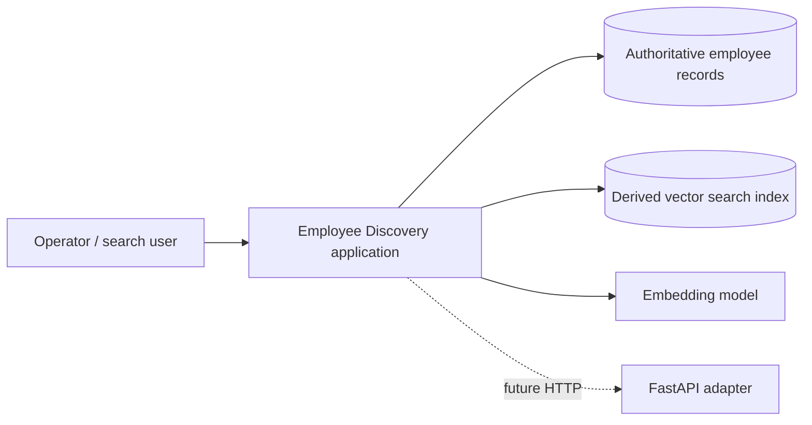

# 00 — Problem and Scope

## Problem statement

Given structured employee records, enable users to register and retrieve employee data, and to find potentially relevant employees through natural-language similarity search combined with mandatory filters. The system must not confuse semantic similarity with evidence of a required skill.

## Who is this for?

- **Operator / application client:** registers and retrieves employees.
- **Search user:** submits natural-language query and optional filters.
- **Indexing worker / application process:** creates or refreshes derived searchable representations.

Authentication and authorization are **not implemented** in the workshop. The actors describe responsibilities, not security guarantees.

## Source and extensions

| Origin | Content |
|---|---|
| IBM Coursera ChromaDB lab | 15 employees, descriptive text, SentenceTransformer embeddings, cosine distance, department/experience/location filters, combined semantic search |
| Our engineering workshop | Validation, duplicate handling, authoritative repository, use cases, ports, adapters, TDD, Docker, persistence and replaceability |

## Context and boundaries

## Scope

**In scope for the teaching sequence:** register, retrieve, index, semantic search, metadata filters, index deletion, local persistence, and testable interfaces. **Deferred:** full employee update/delete coordination, automatic reliable indexing after registration, identity and access control, privacy governance, production SLAs, and AWS migration implementation.

## Success criteria

A learner can explain why the domain cannot import ChromaDB; execute unit tests without Docker; implement registration through an outbound repository port; run real Chroma integration tests; and trace an acceptance test to a requirement and use case.

## Questions to resolve before production

1. Are employees authoritative in PostgreSQL, a HR system, or a local in-memory repository?
2. Is indexing synchronous, eventually consistent, or performed by a worker?
3. Which skill filters are mandatory factual constraints versus soft semantic preferences?
4. What access controls and retention rules apply to employee records?
5. What relevance metrics and latency targets are acceptable?

Next: [[01-Requirements-Specification]].
