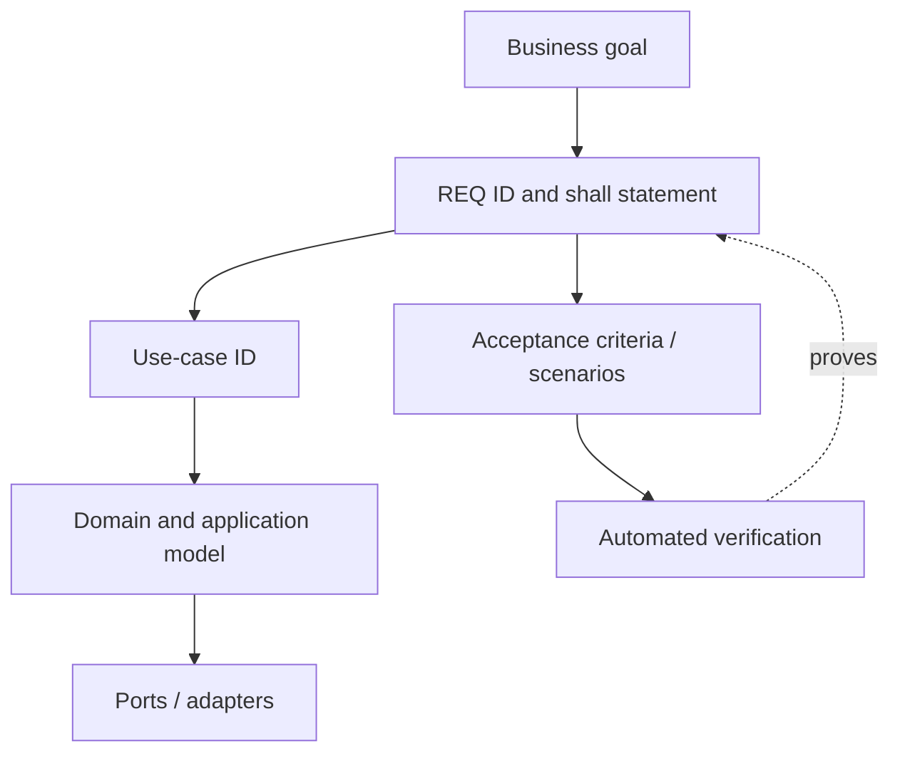

# 01 — Requirements Specification

> [!important] Status
> **Proposed workshop baseline v1.** These are testable engineering requirements inferred from the Coursera lab and our workshop design, not approved HR-product requirements. Stable IDs preserve compatibility with earlier lessons.

## Writing convention

Each requirement uses: **ID**, one verifiable **shall** statement, **origin**, **acceptance criteria**, and **verification level**. A requirement describes behavior; a use case describes an actor's goal and sequence. A single use case can satisfy several requirements.

## Functional requirements

| ID | Verifiable requirement | Origin | Primary use case | State |
|---|---|---|---|---|
| REQ-001a | System shall reject blank employee ID/name and experience that is not a nonnegative integer; zero is allowed. | Workshop | UC-001 | Existing unit lesson |
| REQ-001b | System shall register an employee under a previously unused ID and reject duplicates without overwriting. | Workshop | UC-001 | Existing unit lesson |
| REQ-002 | System shall return employees ranked by ascending vector distance for a nonblank natural-language query. | Lab + workshop | UC-004 | Existing search lesson |
| REQ-003 | System shall apply an exact department filter when requested. | Lab | UC-004 | Existing search lesson |
| REQ-004 | System shall apply an inclusive minimum-experience filter when requested. | Lab | UC-004 | Existing search lesson |
| REQ-005 | System shall combine supported mandatory filters and return no more than a positive result limit. | Lab + workshop | UC-004 | Existing search lesson |
| REQ-006 | System shall remove an indexed employee representation by ID when requested. | Workshop | UC-006 | Partial adapter lesson |
| REQ-007 | System shall retain indexed data across Chroma container restarts when persistent volume is retained. | Workshop | UC-003 | Manual verification |
| REQ-008 | System shall reject blank query, nonpositive limit, or negative minimum experience. | Workshop | UC-004 | Existing search lesson |
| REQ-009 | System shall upsert descriptive text, metadata, and embedding under stable employee ID. | Lab + workshop | UC-003 | Existing adapter lesson |
| REQ-010 | System shall support location filtering. | Lab | UC-004 | Not implemented in search contract |
| REQ-011 | System shall coordinate authoritative registration and indexing reliably. | Workshop | UC-007 | Future design |
| REQ-012 | System shall retrieve a registered employee by ID, returning an explicit not-found result for unknown IDs. | Workshop addition | UC-002 | New lesson |

## Acceptance scenarios

| Scenario ID | Requirement | Given / When / Then | Test level |
|---|---|---|---|
| AC-001 | REQ-001a | Given experience = -1, when creating Employee, then reject with ValueError. | Unit |
| AC-002 | REQ-001a | Given experience = 0 and valid fields, when creating Employee, then succeed. | Unit |
| AC-003 | REQ-001b | Given empty repository, when registering e1, then e1 is retrievable. | Unit |
| AC-004 | REQ-001b | Given e1 exists, when registering e1 again, then raise duplicate error and retain original. | Unit |
| AC-005 | REQ-012 | Given e1 exists, when retrieving e1, then return the same Employee. | Unit |
| AC-006 | REQ-012 | Given unknown ID, when retrieving, then return None (application contract). | Unit |
| AC-007 | REQ-009 | Given valid employee, when indexing, then record is stored under same stable ID. | Integration |
| AC-008 | REQ-002 | Given indexed records, when querying, then results are ordered by ascending distance. | Integration |
| AC-009 | REQ-003/004/005 | Given mixed employees, when filtering Engineering and experience >= 10, then only matching employees are returned. | Unit + integration |
| AC-010 | REQ-008 | Given blank query or limit 0, when searching, then reject before calling adapter. | Unit |
| AC-011 | REQ-007 | Given indexed record, when restarting Chroma with volume retained, then record remains available. | Manual integration |
| AC-012 | REQ-010 | Given locations, when filtering for New York, then all results are New York employees. | Future |
| AC-013 | REQ-011 | Given registered employee, when indexing is retried after transient failure, then search index eventually contains one current representation. | Future |
| AC-014 | REQ-006 | Given indexed employee, when deleting index entry, then subsequent search does not return it. | Integration |

## Nonfunctional constraints

| ID | Constraint | Verification |
|---|---|---|
| NFR-001 | Domain must not import database/HTTP SDKs. | Import review and unit tests |
| NFR-002 | Application use cases depend on ports, not concrete adapters. | Dependency review and fake tests |
| NFR-003 | Unit tests run without Docker. | `uv run pytest tests/unit -v` |
| NFR-004 | Integration tests isolate collections and clean up. | Fixture teardown |
| NFR-005 | uv lockfile is committed; environment reproducible. | `uv sync --frozen` |
| NFR-006 | Chroma service uses persistent Docker volume. | Compose and restart test |
| NFR-007 | Embedding model and distance metric are explicitly selected. | Configuration and integration tests |

> [!warning] Not yet specified
> We have no approved performance, recall@k, availability, access-control, privacy, or fairness requirements. Do not silently treat these as implemented or accepted.

Next: [[02-Use-Case-Catalog]].
