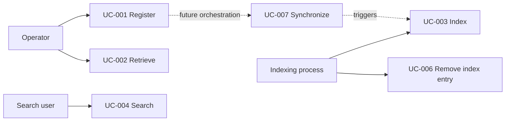
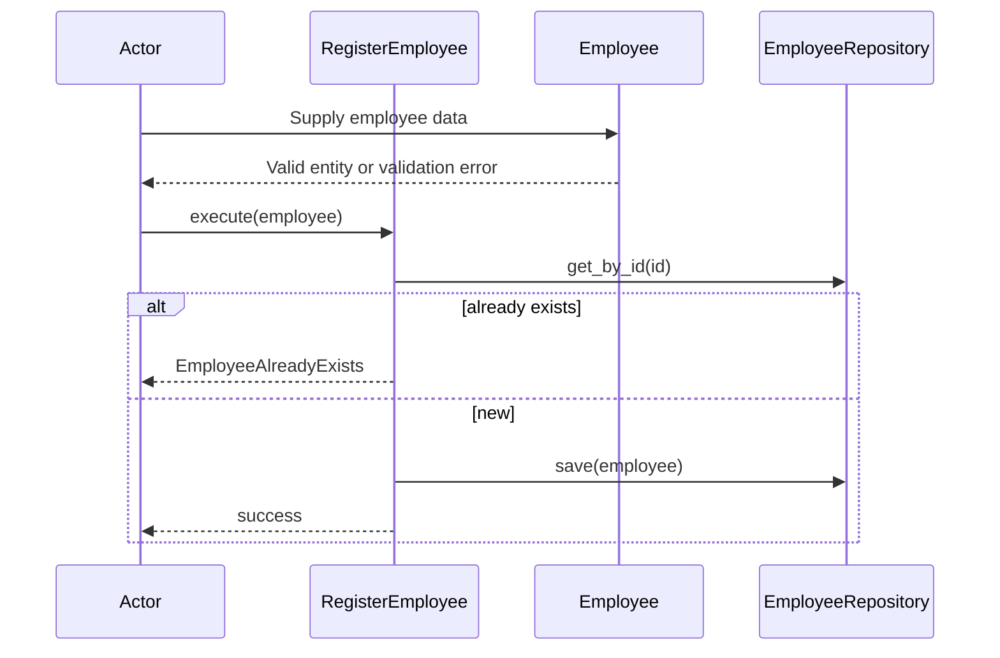
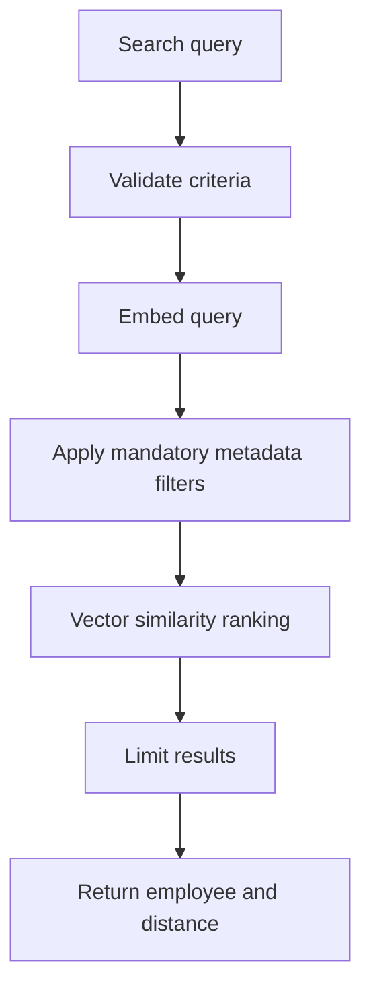

# 02 — Use-Case Catalog

## What is a use case?

A requirement is a verifiable obligation; a use case is a goal-driven interaction with a trigger, main flow, alternatives, and outcomes. **Use-case IDs and requirement IDs are different namespaces.**

## Prioritized backlog

| ID | Use case | Actor / trigger | Requirements | Status |
|---|---|---|---|---|
| UC-001 | Register Employee | Operator submits employee | REQ-001a, REQ-001b | Guided, unit-level |
| UC-002 | Retrieve Employee | Operator requests employee ID | REQ-012 | Guided, unit-level |
| UC-003 | Index Employee | Indexing process submits employee | REQ-009, REQ-007 | Adapter lesson available |
| UC-004 | Search Employees | User submits query and filters | REQ-002/003/004/005/008/010 | Search lesson; location future |
| UC-005 | Update Employee | Operator changes record | New requirements needed | Proposed only |
| UC-006 | Remove Indexed Employee | Indexing process deletes by ID | REQ-006 | Adapter-level only |
| UC-007 | Synchronize Registration and Index | Application reacts to registration | REQ-011 | Future design |

## UC-001 — Register Employee

**Actor:** Operator / application client. **Trigger:** Register employee request. **Preconditions:** Data provided; repository available. **Success:** New employee retrievable by ID.

**Main flow:** (1) Create validated Employee; (2) check ID uniqueness; (3) save Employee; (4) return successful completion.

**Alternatives:** Invalid fields → reject; duplicate ID → reject and preserve original. **Not included:** automatic Chroma indexing.

## UC-002 — Retrieve Employee

**Actor:** Operator / application client. **Trigger:** Retrieve by ID. **Precondition:** Repository available. **Success:** Employee returned. **Alternative:** Unknown ID → `None` (chosen application contract; HTTP mapping can later become 404).

## UC-003 — Index Employee

**Actor:** Indexing process. **Trigger:** Employee snapshot is available. **Success:** Upsert a derived text + metadata + vector representation under the employee's stable ID. **Alternatives:** Embedding failure or Chroma unavailable → report failure; retry policy deferred. **Important:** indexing does not establish authoritative employee existence.

## UC-004 — Search Employees

**Actor:** Search user. **Trigger:** Nonblank query with optional constraints. **Success:** At most N ranked candidates satisfying mandatory metadata filters. **Alternatives:** Invalid criteria → reject; no candidates → empty list. **Caution:** semantic similarity does not prove required skills.

## UC-005 / UC-006 / UC-007 — Planned work

UC-005 needs new business rules for which attributes may change and whether updates overwrite or version records. UC-006 currently removes the **index entry**, not the authoritative employee. UC-007 must define eventual consistency, retries, idempotency and failure handling before being marked implemented.

## Why this order?

Complete a simple vertical slice (register) before introducing vector search. Then retrieve, index, and search. Build only the ports and adapters that each slice needs; refactor the ontology and contracts when new requirements expose gaps.

Next: [[03-Domain-Ontology]] and [[UC-001-Register-Employee]].
