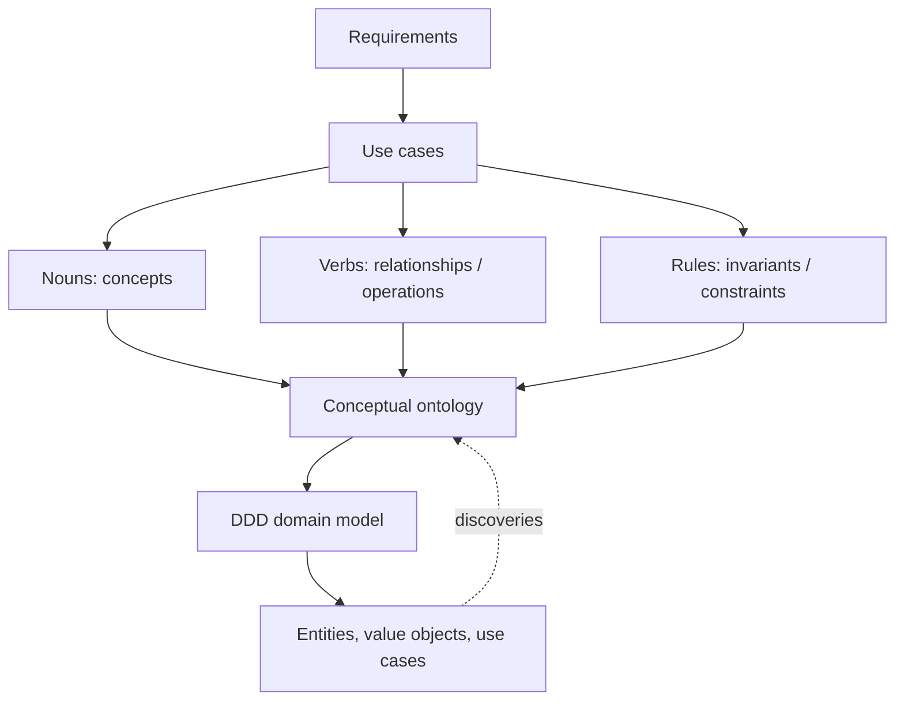
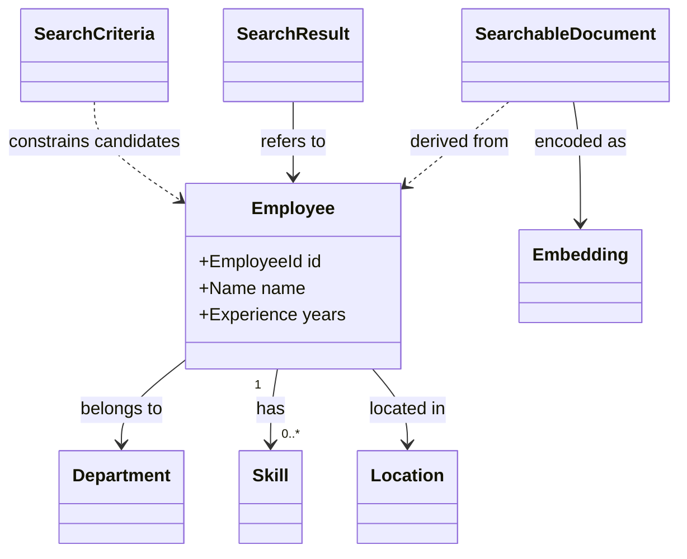

# 03 — Domain Ontology and Ubiquitous Language

## What ontology means here

A **conceptual domain ontology** is our shared vocabulary of concepts, relationships, and constraints in Employee Discovery. It is not an OWL/RDF ontology, database schema, or a list of Python classes. It is a working model that we refine as use cases expose new domain facts.

## Ubiquitous language

| Term | Meaning | Software representation today |
|---|---|---|
| Employee | Individual represented by stable ID and employment attributes | `Employee` entity |
| Employee ID | Unique identity within our registry | `str` field; uniqueness enforced by registration use case |
| Skill | Named capability attributed to an employee | Tuple of strings |
| Experience | Whole nonnegative years | `int` with invariant |
| Department | Employee's organizational grouping | String |
| Location | Employee's recorded city | String |
| Search criteria | Natural-language query and mandatory filters | Application request object |
| Search result | Employee and retrieval distance | Application result object |
| Searchable document | Text synthesized from employee attributes | Derived infrastructure representation |
| Embedding | Numeric representation of searchable document | Infrastructure data |
| Index | Derived searchable store | ChromaDB adapter |
| Repository | Authoritative employee storage capability | Outbound application port |

## Relationships

> [!note] Diagram semantics
> `EmployeeId`, `Name`, and `Experience` in the diagram are **conceptual types**; the first implementation uses strings and an integer. We are not claiming a real organizational HR hierarchy or validated skill taxonomy.

## Constraints and domain invariants

- Employee ID and name must not be blank.
- Experience must be an integer, excluding booleans, and cannot be negative.
- Duplicate employee IDs cannot overwrite existing authoritative records during registration.
- Exact filters constrain results; vector ranking does not certify factual qualification.
- The index may be rebuilt from authoritative employee data if the necessary source and embedding configuration are retained.

## Ontology vs DDD vs database

A conceptual `Skill` does not need a `Skill` Python class immediately. Likewise, an `Embedding` is usually **not** an Employee domain property: it is a derived representation for retrieval.

## Bounded contexts

**Employee Discovery** is our only implemented bounded context. A future **HR Master Data** context might own employee identity and employment facts, while Employee Discovery consumes snapshots and indexes them. Do not invent that second system as if it already exists.

## Open modeling questions

Are skills free-text or controlled vocabulary? Can an employee belong to multiple departments? Are locations cities, countries, or office IDs? Does experience mean total years or years in a skill? What is the authoritative source? These are requirements questions, not things an embedding model can decide.

Next: [[04-Architecture-and-Traceability]].
