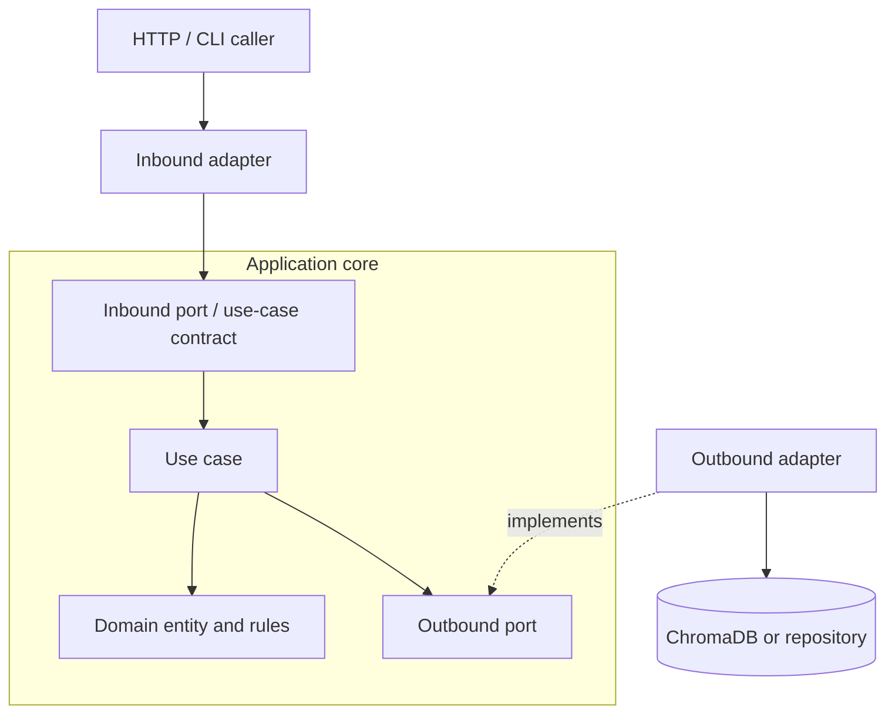
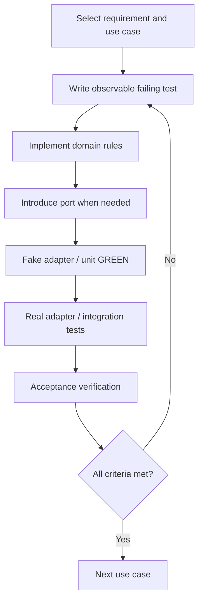

# 04 — Architecture Decisions and Traceability

## Core architecture



**Dependency direction:** inbound adapters depend on application contracts; use cases depend on outbound ports; outbound adapters implement those ports; domain has no infrastructure imports. The inbound port can be the use-case class itself in a small application—extra interfaces are optional.

## Target directory structure (created incrementally)

```text
employee-search/
├── pyproject.toml
├── uv.lock
├── compose.yaml
├── Dockerfile
├── src/employee_search/
│   ├── domain/
│   │   ├── employee.py
│   │   └── exceptions.py
│   ├── application/
│   │   ├── ports/
│   │   │   ├── inbound/
│   │   │   └── outbound/
│   │   ├── models/
│   │   └── use_cases/
│   ├── adapters/
│   │   ├── inbound/http/
│   │   └── outbound/
│   │       ├── chroma/
│   │       └── in_memory_employee_repository.py
│   ├── bootstrap/
│   └── main.py
└── tests/
    ├── unit/
    ├── integration/
    └── acceptance/
```

## Decisions (ADR-style)

| ID | Decision | Reason | Consequence |
|---|---|---|---|
| ADR-001 | Domain is framework-free | Testable invariants | No Chroma imports in domain |
| ADR-002 | Separate repository from search port | Different consistency/ownership | Registration does not automatically index |
| ADR-003 | Use in-memory fake for early use-case tests | Fast TDD | Integration tests still needed |
| ADR-004 | Chroma is a derived index | Easier replacement | Need indexing orchestration later |
| ADR-005 | Stable employee IDs across stores | Traceability and upsert | Must preserve ID mapping |
| ADR-006 | Explicit embedding model and cosine metric | Reproducibility | Re-embedding needed if model changes |

## Traceability matrix

| Requirement | Use case | Acceptance criteria | Existing / planned test |
|---|---|---|---|
| REQ-001a | UC-001 | AC-001, AC-002 | `test_employee.py` |
| REQ-001b | UC-001 | AC-003, AC-004 | `test_register_employee.py` |
| REQ-012 | UC-002 | AC-005, AC-006 | `test_retrieve_employee.py` (new) |
| REQ-009 | UC-003 | AC-007 | Chroma integration test |
| REQ-007 | UC-003 | AC-011 | Manual restart check |
| REQ-002 | UC-004 | AC-008 | Fake + Chroma search tests |
| REQ-003/004/005 | UC-004 | AC-009 | Fake + Chroma filter tests |
| REQ-008 | UC-004 | AC-010 | Criteria unit tests |
| REQ-010 | UC-004 | AC-012 | Future |
| REQ-006 | UC-006 | AC-014 | Chroma deletion integration test |
| REQ-011 | UC-007 | AC-013 | Future orchestration test |

## Test-driven use-case completion



## Caveats

A fake adapter is not proof that Chroma returns the same ranking or supports identical filter semantics. We must test adapter behavior against a real service. PostgreSQL + pgvector, OpenSearch, and ChromaDB are not drop-in equivalents; portability means replacing adapters and validating semantics, not changing one environment variable.

Next: [[UC-001-Register-Employee]].
