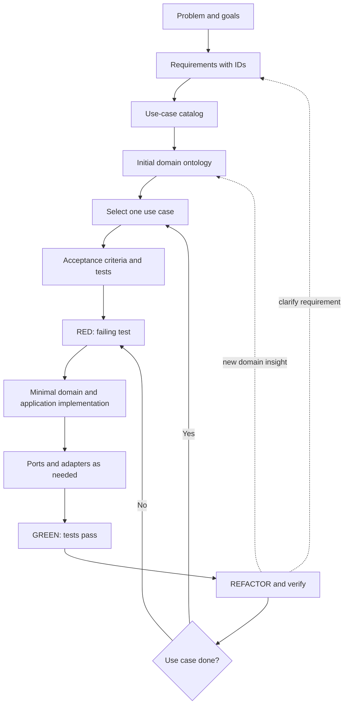

# Employee Discovery — Requirements-First Workshop

> [!important] Start here
> We now build **one complete use case at a time**, rather than implementing entire architectural layers. The earlier lessons are retained in `reference/` as technical background, not as the canonical execution order.

## Reading and execution order

1. [[00-Problem-and-Scope]] — why this application exists and what is in scope.
2. [[01-Requirements-Specification]] — stable, testable requirements and acceptance criteria.
3. [[02-Use-Case-Catalog]] — actor goals and workflows; prioritize a vertical slice.
4. [[03-Domain-Ontology]] — concepts, relationships, invariants, and boundary.
5. [[04-Architecture-and-Traceability]] — ports, adapters, design decisions, test mapping.
6. [[UC-001-Register-Employee]] — first fully guided vertical slice.
7. [[UC-002-Retrieve-Employee]] — next thin vertical slice.
8. [[UC-003-Index-Employee]] and [[UC-004-Search-Employees]] — guided implementation plans; refer to the existing Part 3 and Part 4 notes for code until the dedicated lessons are completed.

## The development loop

> [!note] What is from Coursera vs what we designed
> The IBM lab supplies employee examples, embedding and ChromaDB search techniques. Registration, repository ownership, duplicate-ID rules, ports, adapters, TDD, and Docker-based application architecture are **workshop extensions**. Proposed requirements are not externally approved stakeholder requirements.

## Completion evidence

For each use case, capture: requirement IDs; scenario IDs; failing test; passing unit tests; passing adapter/integration tests where applicable; one executable demonstration; known gaps. Do not mark a use case complete merely because a class exists.

## Legacy note crosswalk

| Earlier note | Where it now belongs |
|---|---|
| `reference/00-Setup.md` | Workspace bootstrap, before UC-001 |
| `reference/01-Part-1-Domain-and-TDD.md` | Domain portion of UC-001 |
| `reference/02-Part-2-Use-Case-and-Ports.md` | Application and repository portion of UC-001 |
| `reference/03-Part-3-Semantic-Search-Use-Case.md` | UC-004 (application search contract) |
| `reference/04-Part-4-ChromaDB-Adapter-and-Integration-Tests.md` | UC-003 and UC-004 (infrastructure) |
| `reference/00-Requirements-and-Domain-Ontology.md` | Earlier combined baseline, superseded by notes 01–04 |

> [!warning] Migration of earlier notes
> The original lessons use their own REQ IDs. The canonical IDs in [[01-Requirements-Specification]] are intentionally **the same as the earlier baseline** where possible. A use-case number is **not** a requirement number. In particular, UC-002 (retrieve) is not REQ-002 (semantic search).
