# Employee Search — Requirements and Domain Ontology

> [!abstract] Purpose
> This is the **requirements and domain-language baseline** for [[00-Setup]], [[01-Part-1-Domain-and-TDD]], [[02-Part-2-Use-Case-and-Ports]], [[03-Part-3-Semantic-Search-Use-Case]], and [[04-Part-4-ChromaDB-Adapter-and-Integration-Tests]]. Read it before coding. Requirements labeled **Workshop** are design decisions for this application, **not claims made by the Coursera lab**.

> [!important] Status
> **Proposed baseline, version 0.1.** It consolidates requirements already introduced in the lessons and identifies gaps. Items marked *future* are not implemented in Parts 1–4. The ontology is a **conceptual domain ontology**, not a formal OWL/RDF ontology or an automatically inferred schema.

## 1. Problem statement and scope

**Problem:** A user needs to discover employee records relevant to a natural-language description while applying mandatory structured constraints, such as department and minimum years of experience.

**Primary actor:** Employee search user (an internal recruiter, staffing coordinator, or developer exercising the workshop).

**System boundary:** Employee Discovery application. It validates and registers employees, stores authoritative records through a repository port, creates a searchable representation through an indexing port, and retrieves ranked candidates through a search port.

**From the Coursera lab:** 15 sample employees; text composed from employee attributes; `all-MiniLM-L6-v2` embeddings; ChromaDB cosine-distance search; filters on department, experience and location; combined search. The lab also includes a separate book-search exercise.

**Workshop extensions:** Domain invariants, registration uniqueness, stable contracts, TDD, fake adapters, deletion, persistence verification, Docker Compose, and future portability.

**Not yet in scope:** Authentication/authorization, employee data privacy policy, real HR integration, ranking fairness evaluation, automatic repository-to-index synchronization, high availability, or production SLAs.

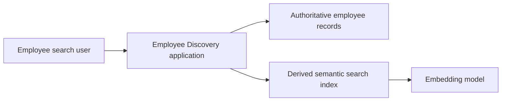

## 2. Requirements writing convention

Each requirement has: **stable ID, statement, rationale/source, acceptance criteria, and verification level**. Use one independently testable obligation per requirement. `REQ` IDs should not be repurposed after implementation. Tests reference requirement IDs.

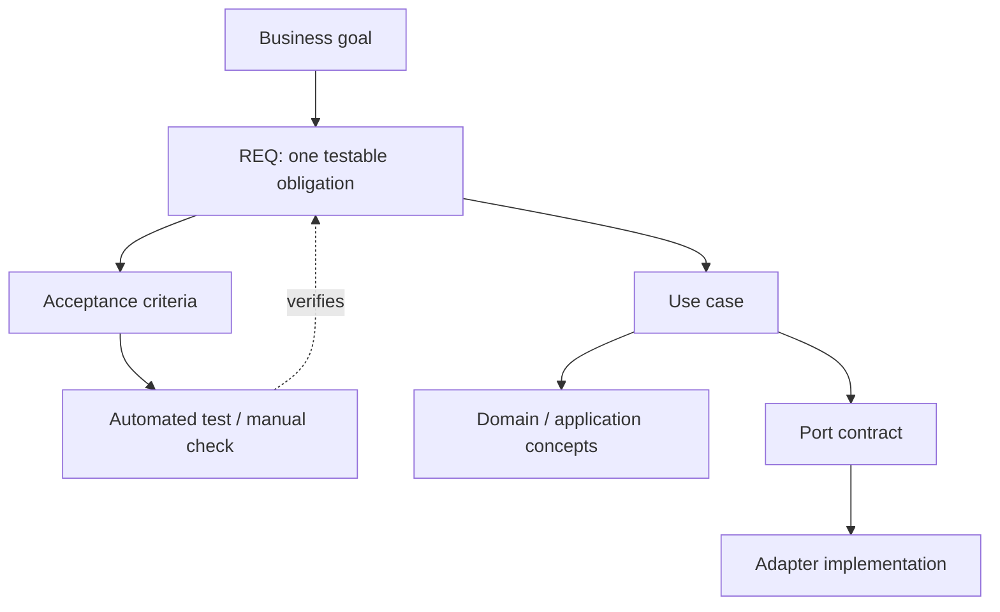

## 3. Functional requirements

| ID | Requirement | Origin | Status through Part 4 |
|---|---|---|---|
| REQ-001a | The system shall reject an employee whose ID or name is blank or whose experience is not a nonnegative integer; zero is valid. | Workshop | Domain implemented/tested in Part 1 |
| REQ-001b | The system shall register a valid employee with a previously unused ID and shall reject duplicate IDs without overwriting the existing record. | Workshop | Use case + fake repository in Part 2 |
| REQ-002 | The system shall return employees ranked by ascending vector distance for a nonblank natural-language query. | Lab + Workshop contract | Fake search in Part 3; Chroma integration in Part 4 |
| REQ-003 | The system shall restrict search results to the requested department when that filter is supplied. | Lab | Parts 3–4 |
| REQ-004 | The system shall restrict search results to employees with experience greater than or equal to a supplied minimum. | Lab | Parts 3–4 |
| REQ-005 | The system shall combine supported mandatory filters with semantic retrieval, and return at most the requested positive limit. | Lab + Workshop | Parts 3–4 for department and experience |
| REQ-006 | The search index shall remove an employee's searchable representation when instructed to delete that employee ID. | Workshop | Part 4 index adapter; not yet end-to-end employee deletion |
| REQ-007 | Indexed employee data shall survive a restart of the ChromaDB service when its persistent volume is retained. | Workshop | Manual persistence check described in Part 4 |
| REQ-008 | The system shall reject blank search queries, nonpositive limits and negative minimum experience. | Workshop | Part 3 |
| REQ-009 | The system shall support indexing an employee's descriptive text and metadata under the employee's stable ID. | Lab + Workshop | Part 4 |
| REQ-010 | The system shall support location-based filtering as demonstrated by the original lab. | Lab | **Future**: not in current `SearchCriteria` contract |
| REQ-011 | Employee registration and index updates shall be coordinated reliably so newly registered employees become searchable. | Workshop | **Future**: not implemented in Parts 1–4 |

### 3.1 Detailed acceptance criteria

**REQ-001a — Valid employee**
- Given a valid employee with `experience=0`, construction succeeds.
- Given a blank or whitespace-only ID, construction raises `ValueError`.
- Given a blank or whitespace-only name, construction raises `ValueError`.
- Given negative, fractional, or boolean experience, construction raises `ValueError`.

**REQ-001b — Register employee**
- Given an empty repository, registering `employee_1` saves and retrieves that employee.
- Given `employee_1` already exists, registering the same ID raises `EmployeeAlreadyExists` and preserves the first record.

**REQ-002 — Ranked search**
- Given deterministic fake candidates with distances `0.08`, `0.12`, and `0.32`, the use case returns them in ascending order.
- Given an indexed employee and a nonblank query, the Chroma adapter returns a `SearchResult` with the employee and a numeric distance.
- Ranking is **not** a guarantee of skill qualification or answer correctness.

**REQ-003/004/005 — Structured constraints**
- Given Engineering employees with 5 and 12 years and an HR employee with 15 years, `department=Engineering` and `minimum_experience=10` returns only the 12-year Engineering employee.
- Given `limit=1`, at most one result is returned.
- A missing filter imposes no constraint for that field.

**REQ-006 — Index deletion**
- Given an indexed employee, deleting their ID removes that employee from subsequent index searches.
- This does **not** yet mean deletion from the authoritative repository.

**REQ-007 — Persistence**
- Given a fixed collection and indexed employee, restarting the Chroma container without deleting its named volume preserves the record.

**REQ-008 — Input validation**
- Blank query, `limit=0`, and negative minimum experience are rejected before a vector database call.

**REQ-009 — Indexing**
- The indexed record uses the stable employee ID and includes searchable descriptive text plus metadata for structured filtering.
- Re-indexing the same ID updates its indexed representation (`upsert`).

**REQ-010/011 — Future acceptance criteria**
- Location filter restricts results to matching location(s), once added to the application contract.
- After successful registration, a reliable workflow eventually indexes the employee; retries must not create duplicate indexed records. The consistency policy is to be designed.

## 4. Nonfunctional and architectural constraints

| ID | Constraint | How to verify |
|---|---|---|
| NFR-001 | Domain modules shall not import FastAPI, ChromaDB, or database SDKs. | Import/dependency review; unit tests without services |
| NFR-002 | Application use cases shall depend on ports, not concrete adapters. | Fake and Chroma adapters satisfy the same search contract |
| NFR-003 | Unit tests shall run without Docker or external services. | `uv run pytest tests/unit -v` |
| NFR-004 | Chroma integration tests shall use isolated collections and clean them up. | Integration test fixture teardown |
| NFR-005 | The local environment shall use uv-managed dependencies and a reproducible lockfile. | `uv sync --frozen` |
| NFR-006 | ChromaDB shall run in Docker Compose with persistent storage. | Compose startup and REQ-007 restart check |
| NFR-007 | The embedding model and vector distance metric shall be explicit and compatible between indexing and querying. | Adapter configuration/integration tests |

> [!warning] Not established
> No quantitative latency, recall@k, throughput, availability, security, retention, or fairness targets have been agreed. Do not invent these as accepted requirements. Add them after stakeholder discussion and baseline measurement.

## 5. Ubiquitous language: glossary

| Term | Definition | Important distinction |
|---|---|---|
| Employee | A person represented by a stable employee ID and employment attributes. | Domain entity; not a Chroma document. |
| Employee ID | Stable identifier of an employee within this application. | Unique across registered employees. |
| Skill | Named capability attributed to an employee. | Semantic resemblance is not proof that a skill is present. |
| Experience | Whole, nonnegative years of professional experience in this workshop. | A hard filter, not an embedding-derived fact. |
| Department | Organizational grouping associated with an employee. | Exact metadata filter. |
| Search criteria | Query text, optional department, optional minimum experience, and result limit. | Application request model, not necessarily a domain value object. |
| Search result | Employee plus vector distance. | Retrieval result, not an employee entity. |
| Searchable document | Text generated from employee attributes for embedding. | Derived representation. |
| Embedding | Numeric vector produced from searchable text by an embedding model. | Not a domain property of the employee. |
| Search index | Storage and retrieval structure for embeddings and metadata. | Derived infrastructure; not authoritative records. |
| Repository | Port for authoritative record persistence. | Separate from semantic search. |
| Indexing | Operation that creates/updates a searchable representation. | Separate from registration until orchestrated. |

## 6. Conceptual domain ontology

### 6.1 Concepts and relationships

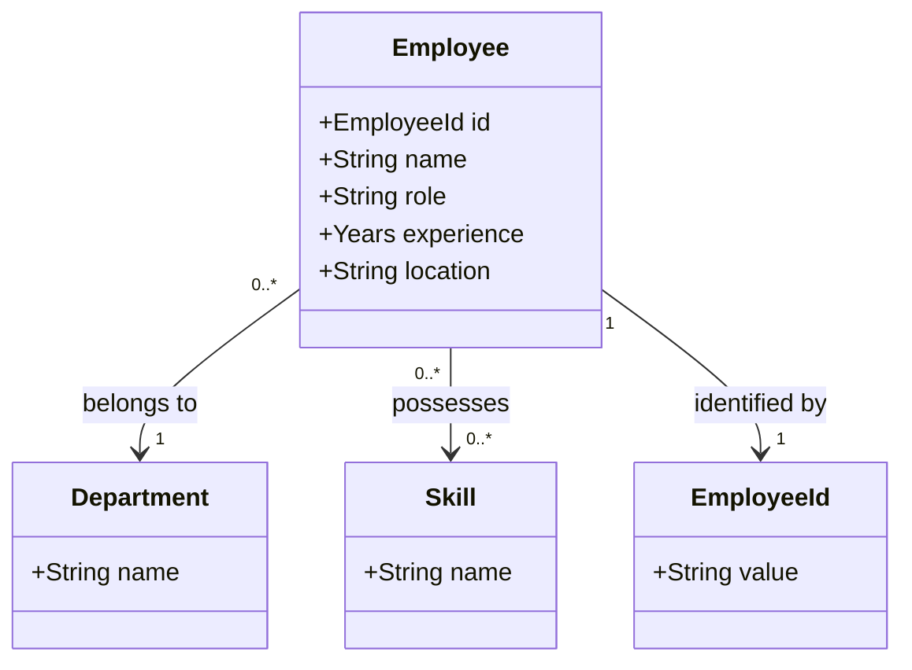

> [!note] Interpretation
> This is a **conceptual** diagram: `Department`, `Skill`, and `EmployeeId` are useful domain concepts, but the current code represents department as a string, skills as a tuple of strings, and ID as a string. The diagram does not mandate creating those classes now. Cardinality is a modeling proposal, not validated organizational policy.

### 6.2 Domain facts vs derived search representations

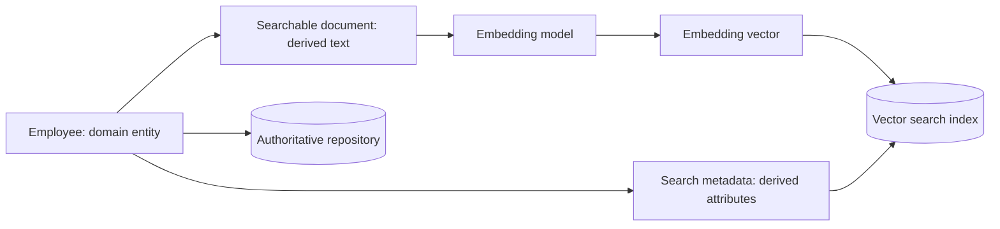

### 6.3 Predicates and constraints

| Conceptual relation / rule | Meaning | Enforcement today |
|---|---|---|
| `Employee hasIdentity EmployeeId` | Every employee has an ID. | `Employee.__post_init__` validates nonblank ID. |
| `Employee belongsTo Department` | Employee has a department attribute. | Stored as string; no nonblank invariant yet. |
| `Employee hasSkill Skill` | Employee has zero or more skill names. | Stored as tuple; no skill taxonomy yet. |
| `Employee hasExperience Years` | Experience is a nonnegative integer. | Domain invariant. |
| `SearchResult refersTo Employee` | A result identifies an employee. | `SearchResult.employee`. |
| `SearchResult hasDistance Number` | A result has a vector distance. | `SearchResult.distance`. |
| `IndexEntry represents Employee` | Search entry is derived from employee. | Stable ID in Chroma index. |

### 6.4 Why ontology is not the same as DDD

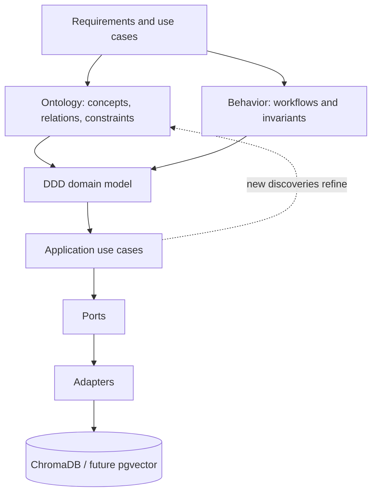

An ontology is a shared conceptual vocabulary and relationship model. DDD uses domain knowledge to choose entities, value objects, aggregates, bounded contexts, behaviors and invariants. Neither must be mechanically derived from nouns alone. Requirements, ontology, and code evolve together.

## 7. Bounded context and ownership

For this workshop, use **one bounded context: Employee Discovery**. We have not established a separate HR Master Data bounded context. A production system might receive employee records from HR instead of owning them.

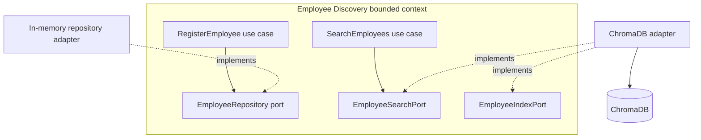

> [!important] Gap in current workshop
> Part 2 registration saves to an in-memory repository. Part 4 indexing is invoked explicitly. **Registering an employee does not automatically make it searchable.** That requires a later orchestration/synchronization use case (REQ-011).

## 8. Use-case catalog

| Use case ID | Name | Trigger | Preconditions | Success outcome | Failure/edge cases |
|---|---|---|---|---|---|
| UC-001 | Register Employee | Caller submits employee data | Valid employee; unused ID | Employee saved in repository | Invalid fields; duplicate ID |
| UC-002 | Search Employees | Caller submits search criteria | Valid query and filters | Ranked matching results, bounded by limit | Invalid query; empty results |
| UC-003 | Index Employee | Indexing coordinator/test supplies employee | Valid employee; index available | Search representation upserted | Index unavailable; embedding failure |
| UC-004 | Delete Indexed Employee | Caller/coordinator supplies employee ID | Index available | Index representation removed | Missing ID; index unavailable |
| UC-005 | Verify Persistence | Operator restarts Chroma service | Named volume retained | Previously indexed record still available | Volume deleted; configuration mismatch |

```mermaid
sequenceDiagram
  actor User
  participant UC as SearchEmployeesUseCase
  participant Port as EmployeeSearchPort
  participant Adapter as Chroma adapter
  participant DB as ChromaDB
  User->>UC: SearchCriteria(query, department, minimum_experience, limit)
  UC->>Port: search(criteria)
  Note over Port,Adapter: Adapter implements port; port is not a runtime service
  Adapter->>DB: query + metadata filters
  DB-->>Adapter: IDs, distances, metadata
  Adapter-->>UC: SearchResult[]
  UC-->>User: ranked matching employees
```

## 9. Traceability matrix

| Requirement | Use case | Domain / application type | Port | Tests / lesson |
|---|---|---|---|---|
| REQ-001a | UC-001 | `Employee` | None needed for construction | Part 1 `test_employee.py` |
| REQ-001b | UC-001 | `Employee`, `EmployeeAlreadyExists` | `EmployeeRepository` | Part 2 `test_register_employee.py` |
| REQ-002 | UC-002 | `SearchCriteria`, `SearchResult` | `EmployeeSearchPort` | Part 3 fake; Part 4 integration |
| REQ-003 | UC-002 | `SearchCriteria.department` | `EmployeeSearchPort` | Parts 3–4 |
| REQ-004 | UC-002 | `SearchCriteria.minimum_experience` | `EmployeeSearchPort` | Parts 3–4 |
| REQ-005 | UC-002 | `SearchCriteria.limit` | `EmployeeSearchPort` | Parts 3–4 |
| REQ-006 | UC-004 | `Employee.id` | `EmployeeIndexPort.delete` | Part 4 integration |
| REQ-007 | UC-005 | Stable collection/ID | Chroma adapter | Part 4 manual restart check |
| REQ-008 | UC-002 | `SearchCriteria` validation | None needed for validation | Part 3 unit tests |
| REQ-009 | UC-003 | `Employee` | `EmployeeIndexPort.index` | Part 4 integration |
| REQ-010 | UC-002 | Future `SearchCriteria.location` | Search port extension | Not yet implemented |
| REQ-011 | Future registration/index coordinator | Registration and index state | Repository + index ports | Not yet implemented |

## 10. Important modeling decisions and open questions

| ID | Question | Proposed starting point | Why it matters |
|---|---|---|---|
| DEC-001 | What owns employee records? | Repository is authoritative; Chroma is derived. | Enables future PostgreSQL migration. |
| DEC-002 | Is semantic similarity sufficient to prove Python skill? | **No**; verify mandatory skills explicitly. | Avoids false qualification. |
| DEC-003 | Is `Department` a separate entity? | Not yet; string in current code. | Avoid premature complexity. |
| DEC-004 | Should location filtering be supported? | Yes, as future REQ-010. | Coursera lab demonstrates it. |
| DEC-005 | When does indexing happen after registration? | Undecided; design in later workshop. | Consistency and retries. |
| DEC-006 | Can employee data be updated? | Not yet specified end-to-end. | Update/reindex behavior. |
| DEC-007 | What is the employee data privacy/security policy? | Undecided. | Real employee data is sensitive. |
| DEC-008 | What are retrieval quality thresholds? | Undecided; establish evaluation dataset first. | Prevents arbitrary distance cutoffs. |

## 11. How to use this document during TDD

1. Pick one requirement ID, such as `REQ-001b`.
2. Read its acceptance criteria and linked use case.
3. Write a failing test using the domain vocabulary.
4. Implement the minimum domain/application behavior.
5. Introduce a port only when the use case needs an external capability.
6. Use a fake adapter for fast unit tests, then a real adapter for integration tests.
7. Mark the requirement verified only after the corresponding tests actually pass in your environment.

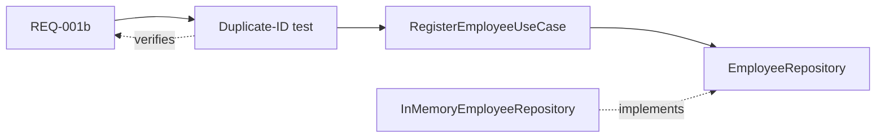

## 12. Suggested learning order

- [[00-Setup]] — Environment, package layout, dependencies.
- [[01-Part-1-Domain-and-TDD]] — `REQ-001a`, domain invariants and RED–GREEN–REFACTOR.
- [[02-Part-2-Use-Case-and-Ports]] — `REQ-001b`, use case, inbound/outbound ports, fake repository.
- [[03-Part-3-Semantic-Search-Use-Case]] — `REQ-002` through `REQ-005`, `REQ-008`, deterministic search.
- [[04-Part-4-ChromaDB-Adapter-and-Integration-Tests]] — `REQ-006`, `REQ-007`, `REQ-009`, real Chroma adapter.

> [!success] Definition of done for this specification
> Every new behavior should be assigned a stable requirement ID, an acceptance criterion, a use case (where applicable), a responsible domain/application concept, and a verification method. **Do not mark a requirement complete merely because a tutorial contains example code.**


---
title: "Employee Search Workshop — 00 Setup"
tags: [python, uv, ddd, hexagonal-architecture, tdd, chromadb, docker]
---

# 00 — Setup: A reproducible Python workspace

> [!abstract] Outcome
> Create an installable Python project, run a test, and prepare a Docker Compose service for ChromaDB. **We will not use ChromaDB until a later lesson.** This avoids confusing infrastructure problems with domain design.

**Navigation:** [[01-Part-1-Domain-and-TDD]] · [[02-Part-2-Use-Case-and-Ports]]

## 1. The journey

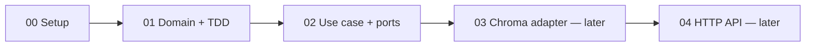

### Architecture we are working toward

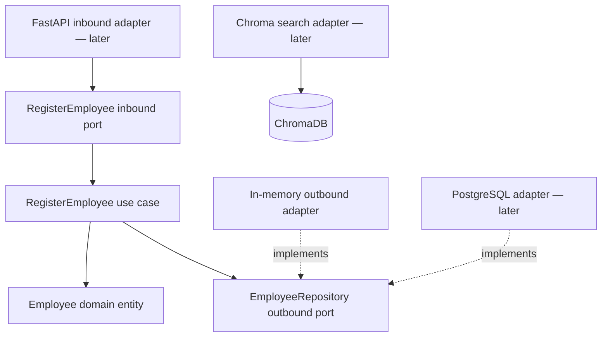

## 2. Prerequisites

Install **Python 3.11**, **uv**, **Git**, and **Docker with Compose v2**. Verify in a terminal:

```bash
python --version
uv --version
git --version
docker --version
docker compose version
```

> [!tip] Windows
> Use PowerShell, Windows Terminal, or WSL. The following `mkdir` and `uv` commands work in PowerShell and POSIX shells. Commands using `touch` are intentionally avoided: create the named files in your editor.

## 3. Initialize an installable package

```bash
mkdir employee-search
cd employee-search
uv init --package --python 3.11
uv add --dev pytest pytest-cov ruff
uv sync
```

Why `--package`? It gives us a `src/` package that can be imported reliably by tests and by future adapters. `uv.lock` pins resolved dependencies; commit it to Git.

Check:

```bash
uv run python --version
uv run pytest --version
```

## 4. Create the folders you need now

```text
employee-search/
├── pyproject.toml
├── uv.lock
├── .python-version
├── .gitignore
├── compose.yaml
├── src/
│   └── employee_search/
│       ├── __init__.py
│       ├── domain/
│       │   └── __init__.py
│       ├── application/
│       │   ├── __init__.py
│       │   ├── ports/
│       │   │   ├── __init__.py
│       │   │   ├── inbound/
│       │   │   │   └── __init__.py
│       │   │   └── outbound/
│       │   │       └── __init__.py
│       │   └── use_cases/
│       │       └── __init__.py
│       └── adapters/
│           ├── __init__.py
│           └── outbound/
│               └── __init__.py
└── tests/
    ├── unit/
    └── integration/
```

Create directories and empty `__init__.py` files using your editor. The `uv init` command may create a starter `hello()` in `src/employee_search/__init__.py`; it is fine to replace that with an empty file. We add modules as we implement them, rather than creating an entire empty architecture.

### Why these folders?

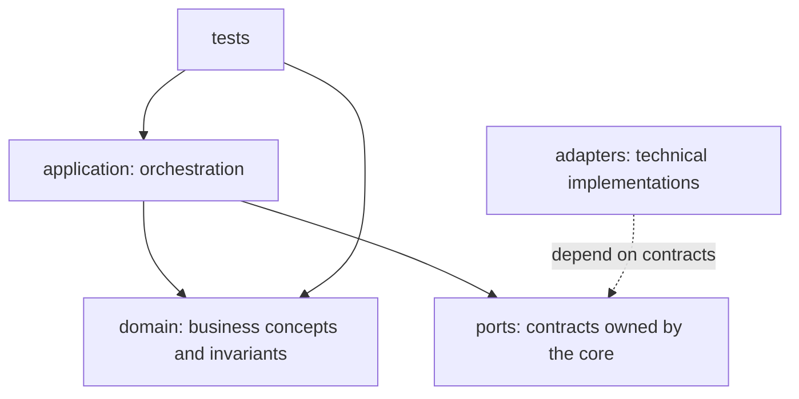

**Ports belong to the application core; adapters sit outside it.** Inbound ports describe what the application offers. Outbound ports describe what it needs.

## 5. Add a minimal Docker Compose service

Create `compose.yaml`:

```yaml
services:
  chroma:
    image: chromadb/chroma:1.0.12
    ports:
      - "8001:8000"
    volumes:
      - chroma_data:/data
    environment:
      IS_PERSISTENT: "TRUE"
      PERSIST_DIRECTORY: /data
      ANONYMIZED_TELEMETRY: "FALSE"

volumes:
  chroma_data:
```

This uses the **ChromaDB 1.0.12** release specified by the supplied Coursera lab. It is a historical teaching baseline, **not** a production version recommendation. We publish Chroma on host port **8001**, reserving 8000 for the FastAPI app later. Chroma is not yet an application dependency.

```bash
docker compose config
docker compose up -d
docker compose ps
```

Optional heartbeat check (when the container is ready):

```bash
curl http://localhost:8001/api/v2/heartbeat
```

If you cannot run Docker yet, continue with Parts 1 and 2; their tests require no containers. If your environment has an incompatible image or persistence configuration, resolve that in the Chroma integration lesson before relying on stored data.

Stop the container without deleting the named volume:

```bash
docker compose down
```

> [!warning] Persistence
> `docker compose down` preserves named volumes by default. `docker compose down -v` deletes them. This matters once we index data.

## 6. Add development hygiene

Create `.gitignore`:

```gitignore
.venv/
__pycache__/
.pytest_cache/
.ruff_cache/
.coverage
htmlcov/
.env
```

Run:

```bash
uv run ruff check .
uv run pytest -q
```

Before we add tests, pytest may report `no tests ran` (exit code 5). That is expected. Part 1 introduces our first tests.

## 7. Definition of done

- [ ] `uv run python --version` works.
- [ ] `uv run pytest --version` works.
- [ ] Package folders exist.
- [ ] `docker compose config` validates the Compose file.
- [ ] If Docker is available, Chroma starts and its heartbeat responds.

**Next:** [[01-Part-1-Domain-and-TDD]]


---
title: "Employee Search Workshop — 01 Domain and TDD"
tags: [python, ddd, tdd, domain-modeling]
---

# 01 — Model an Employee using DDD and TDD

**Prerequisite:** [[00-Setup]]  
**Next:** [[02-Part-2-Use-Case-and-Ports]]

> [!abstract] Outcome
> Write tests **before** implementation, create an `Employee` entity with domain invariants, and prove that the domain runs without ChromaDB, FastAPI, or Docker.

## 1. From requirement to test

**REQ-001a — Employee validity:** An employee must have a nonblank ID and name, and nonnegative integer years of experience. Zero years is valid. (Cross-record ID uniqueness belongs to the registration use case in Part 2.)

| Test ID | Given | When | Then |
|---|---|---|---|
| T-001 | Valid employee data | Construct employee | Entity is created |
| T-002 | Experience = -1 | Construct employee | `ValueError` |
| T-003 | Blank name | Construct employee | `ValueError` |
| T-004 | Blank ID | Construct employee | `ValueError` |
| T-005 | Experience = 0 | Construct employee | Entity is created |
| T-006 | Experience = 2.5 | Construct employee | `ValueError` |

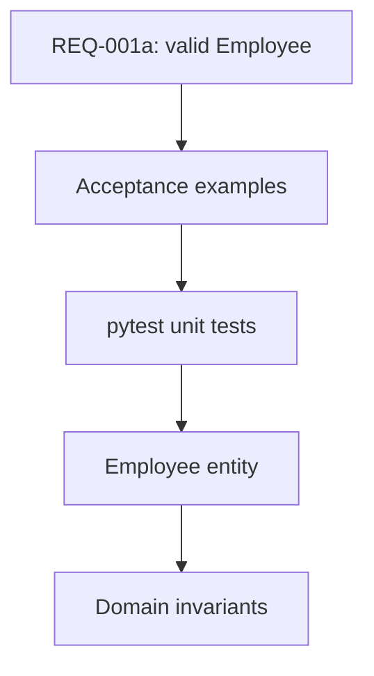

## 2. Domain concepts

An **entity** is identified by a stable identity, not just by its attributes. An **invariant** is a rule that must hold for every valid instance. `Employee` is an entity; `experience >= 0` is an invariant. We may later introduce `EmployeeId` or `Experience` value objects, but they are not necessary yet.

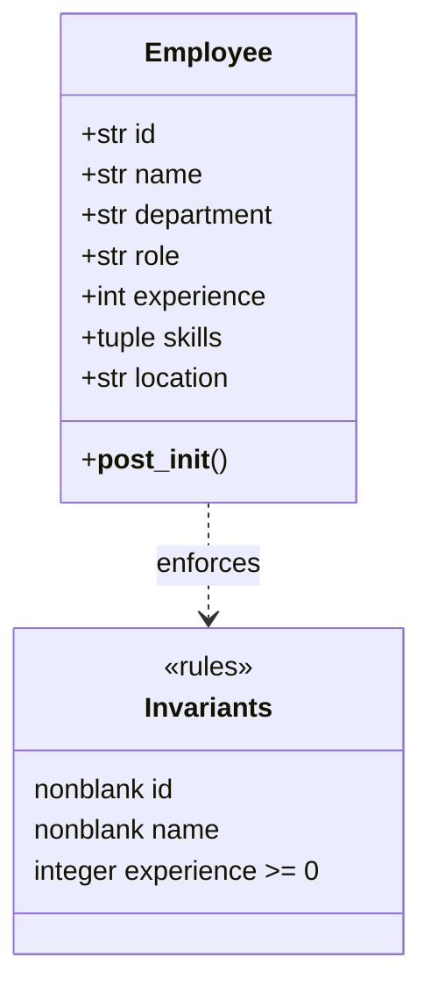

## 3. RED — write tests before the entity exists

Create `tests/unit/test_employee.py`:

```python
import pytest

from employee_search.domain.employee import Employee


def make_employee(**overrides):
    data = {
        "id": "employee_1",
        "name": "John Doe",
        "department": "Engineering",
        "role": "Software Engineer",
        "experience": 5,
        "skills": ("Python", "React"),
        "location": "New York",
    }
    data.update(overrides)
    return Employee(**data)


def test_create_valid_employee():
    employee = make_employee()
    assert employee.id == "employee_1"
    assert employee.skills == ("Python", "React")


@pytest.mark.parametrize("bad_id", ["", "   "])
def test_reject_blank_id(bad_id):
    with pytest.raises(ValueError, match="ID"):
        make_employee(id=bad_id)


@pytest.mark.parametrize("bad_name", ["", "   "])
def test_reject_blank_name(bad_name):
    with pytest.raises(ValueError, match="Name"):
        make_employee(name=bad_name)


def test_reject_negative_experience():
    with pytest.raises(ValueError, match="Experience"):
        make_employee(experience=-1)


def test_accept_zero_experience():
    assert make_employee(experience=0).experience == 0


def test_reject_fractional_experience():
    with pytest.raises(ValueError, match="Experience"):
        make_employee(experience=2.5)
```

Run:

```bash
uv run pytest tests/unit/test_employee.py -v
```

**Expected RED:** import/collection error because `employee_search.domain.employee` does not exist. This confirms the test suite is not accidentally exercising a preexisting implementation.

## 4. GREEN — write the smallest useful entity

Create `src/employee_search/domain/employee.py`:

```python
from dataclasses import dataclass


@dataclass(frozen=True)
class Employee:
    id: str
    name: str
    department: str
    role: str
    experience: int
    skills: tuple[str, ...]
    location: str

    def __post_init__(self) -> None:
        if not isinstance(self.id, str) or not self.id.strip():
            raise ValueError("Employee ID cannot be blank")
        if not isinstance(self.name, str) or not self.name.strip():
            raise ValueError("Name cannot be blank")
        if type(self.experience) is not int or self.experience < 0:
            raise ValueError("Experience must be a nonnegative integer")
```

`type(...) is int` intentionally rejects booleans (Python treats `bool` as a subclass of `int`) and fractional years. These are workshop rules, not requirements from the Coursera lab.

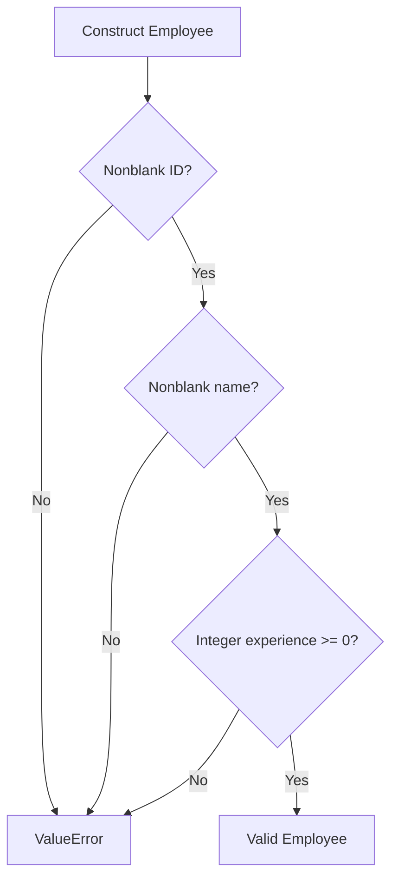

Run:

```bash
uv run pytest tests/unit/test_employee.py -v
```

**Expected GREEN:** all tests pass. Because parameterized cases are separate tests, pytest will report **8 passed**.

## 5. REFACTOR — reason about design

- `@dataclass` generates initialization, equality, and representation methods.
- `frozen=True` prevents normal field reassignment; it is **shallow** immutability.
- `skills` is a tuple to avoid a mutable list escaping the entity.
- `__post_init__` enforces invariants at the construction boundary.
- No domain file imports a framework or database library.

> [!question] Why not put validation in FastAPI?
> A future CSV importer, CLI, or background job must obey the same business rules. Domain validation applies regardless of transport.

> [!question] Why not check uniqueness in `Employee.__post_init__`?
> A single entity cannot know which IDs already exist. That rule requires coordination with a repository and belongs to the registration use case.

## 6. Verify and inspect coverage

```bash
uv run ruff check .
uv run pytest --cov=employee_search --cov-report=term-missing
```

Coverage shows executed lines, not the quality of assertions. Keep the tests behavior-focused.

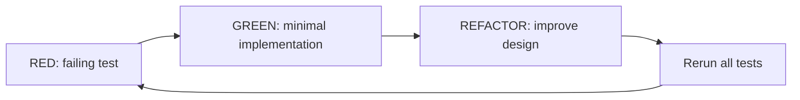

## 7. Commit the milestone

```bash
git add .
git commit -m "feat(domain): add validated Employee entity"
```

If this is your first commit, run `git init` first and configure your Git identity as needed.

## 8. Definition of done

- [ ] The tests fail before `employee.py` exists.
- [ ] All eight test cases pass after implementation.
- [ ] `ruff check .` passes.
- [ ] No ChromaDB or FastAPI imports exist in `domain/`.
- [ ] You can explain **entity**, **invariant**, and **Red–Green–Refactor**.

**Next:** [[02-Part-2-Use-Case-and-Ports]]

---
title: "Employee Search Workshop — 02 Use Cases, Ports and Adapters"
tags: [python, ddd, hexagonal-architecture, tdd, ports-and-adapters]
---

# 02 — RegisterEmployee: a use case with ports and adapters

**Prerequisites:** [[00-Setup]] · [[01-Part-1-Domain-and-TDD]]

> [!abstract] Outcome
> Register an employee through an application use case, enforce unique IDs, and test it using an in-memory outbound adapter. **No database or HTTP server is needed.**

## 1. Why a use case?

The domain entity validates **one employee**. Registration is a business operation involving **other records**: before saving an employee, we must check that its ID is not already registered.

**REQ-001b — Registration:** A valid employee with a new ID is saved. Attempting to register an existing ID is rejected without overwriting the original record.

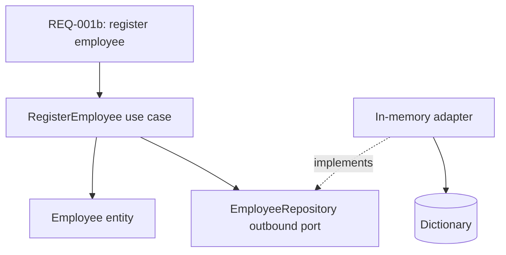

**Terms:** An **inbound port** is the contract a caller invokes. An **outbound port** is the contract a use case needs from infrastructure. An **adapter** implements a port or translates an external request into it. A **composition root** assembles implementations.

## 2. The dependency rule

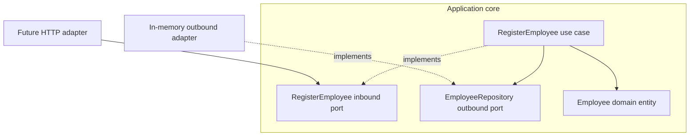

The core **never imports** `InMemoryEmployeeRepository`. The adapter imports the outbound port's domain types, and the bootstrap code wires everything together.

## 3. Extend the project tree

```text
src/employee_search/
├── domain/
│   ├── employee.py
│   └── exceptions.py                # new
├── application/
│   ├── ports/
│   │   ├── inbound/
│   │   │   └── register_employee.py # new
│   │   └── outbound/
│   │       └── employee_repository.py # new
│   └── use_cases/
│       └── register_employee.py     # new
└── adapters/
    └── outbound/
        └── in_memory_employee_repository.py # new

tests/unit/
├── test_employee.py
└── test_register_employee.py        # new
```

Keep the empty `__init__.py` files created during setup. No need to create an `infrastructure/` directory: here, infrastructure implementations live under `adapters/`.

## 4. RED — write the use-case tests first

Create `tests/unit/test_register_employee.py`:

```python
import pytest

from employee_search.application.use_cases.register_employee import (
    RegisterEmployeeUseCase,
)
from employee_search.domain.employee import Employee
from employee_search.domain.exceptions import EmployeeAlreadyExists
from employee_search.adapters.outbound.in_memory_employee_repository import (
    InMemoryEmployeeRepository,
)


def make_employee(employee_id: str = "employee_1") -> Employee:
    return Employee(
        id=employee_id,
        name="John Doe",
        department="Engineering",
        role="Software Engineer",
        experience=5,
        skills=("Python", "React"),
        location="New York",
    )


def test_register_new_employee():
    repository = InMemoryEmployeeRepository()
    use_case = RegisterEmployeeUseCase(repository)
    employee = make_employee()

    use_case.execute(employee)

    assert repository.get_by_id(employee.id) == employee


def test_duplicate_id_is_rejected_without_overwriting():
    repository = InMemoryEmployeeRepository()
    use_case = RegisterEmployeeUseCase(repository)
    original = make_employee()
    use_case.execute(original)

    duplicate = Employee(
        id="employee_1",
        name="Different Person",
        department="HR",
        role="HR Coordinator",
        experience=2,
        skills=("Recruitment",),
        location="Chicago",
    )

    with pytest.raises(EmployeeAlreadyExists):
        use_case.execute(duplicate)

    assert repository.get_by_id("employee_1") == original


def test_two_distinct_ids_can_be_registered():
    repository = InMemoryEmployeeRepository()
    use_case = RegisterEmployeeUseCase(repository)

    use_case.execute(make_employee("employee_1"))
    use_case.execute(make_employee("employee_2"))

    assert repository.get_by_id("employee_1") is not None
    assert repository.get_by_id("employee_2") is not None
```

Run:

```bash
uv run pytest tests/unit/test_register_employee.py -v
```

**Expected RED:** import error because the use case, exception, and adapter do not exist. We now implement them in small steps.

## 5. GREEN — define a domain exception

Create `src/employee_search/domain/exceptions.py`:

```python
class EmployeeAlreadyExists(Exception):
    """An employee with this identity is already registered."""
```

The domain exception expresses business meaning; it does not refer to HTTP 409 or database constraint errors.

## 6. Define the outbound port

Create `src/employee_search/application/ports/outbound/employee_repository.py`:

```python
from typing import Protocol

from employee_search.domain.employee import Employee


class EmployeeRepository(Protocol):
    def get_by_id(self, employee_id: str) -> Employee | None:
        ...

    def save(self, employee: Employee) -> None:
        ...
```

The application owns the interface because **the use case determines what persistence capabilities it needs**. A `Protocol` allows structural typing: an implementation does not have to inherit from the interface explicitly.

## 7. Define the inbound port

Create `src/employee_search/application/ports/inbound/register_employee.py`:

```python
from typing import Protocol

from employee_search.domain.employee import Employee


class RegisterEmployee(Protocol):
    def execute(self, employee: Employee) -> None:
        ...
```

This is an explicit teaching choice. In a smaller production codebase, the concrete use-case class can itself be the inbound application boundary without a separate protocol.

## 8. Implement the use case

Create `src/employee_search/application/use_cases/register_employee.py`:

```python
from employee_search.application.ports.outbound.employee_repository import (
    EmployeeRepository,
)
from employee_search.domain.employee import Employee
from employee_search.domain.exceptions import EmployeeAlreadyExists


class RegisterEmployeeUseCase:
    def __init__(self, repository: EmployeeRepository) -> None:
        self._repository = repository

    def execute(self, employee: Employee) -> None:
        if self._repository.get_by_id(employee.id) is not None:
            raise EmployeeAlreadyExists(employee.id)
        self._repository.save(employee)
```

Notice: the use case imports the **port**, not the adapter. It does not know whether records live in memory, PostgreSQL, or elsewhere.

## 9. Implement the in-memory outbound adapter

Create `src/employee_search/adapters/outbound/in_memory_employee_repository.py`:

```python
from employee_search.domain.employee import Employee


class InMemoryEmployeeRepository:
    def __init__(self) -> None:
        self._employees: dict[str, Employee] = {}

    def get_by_id(self, employee_id: str) -> Employee | None:
        return self._employees.get(employee_id)

    def save(self, employee: Employee) -> None:
        self._employees[employee.id] = employee
```

This adapter is deliberately simple. It stores entities in a dictionary and is useful for learning and fast tests. It is **not persistent** and does **not** protect against concurrent registrations.

## 10. Run tests — GREEN

```bash
uv run pytest tests/unit/test_register_employee.py -v
uv run pytest -v
uv run ruff check .
```

**Expected:** 3 registration tests pass; all 11 tests across Parts 1 and 2 pass (Part 1 has 8 parameterized cases). These are expected outcomes, not execution results from your machine.

### Sequence of a successful registration

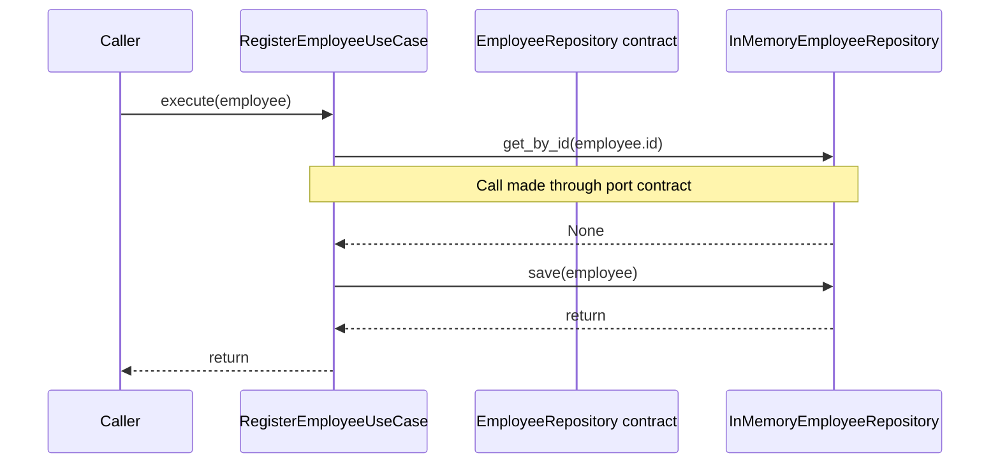

### Duplicate registration

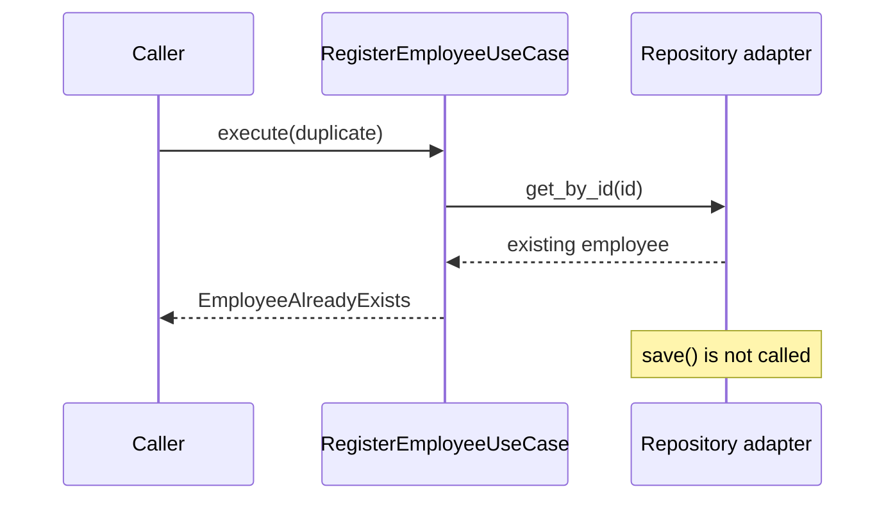

## 11. REFACTOR — check the boundaries

- Domain entity: validates one employee.
- Use case: coordinates registration and enforces the duplicate-ID rule.
- Inbound port: declares what callers can request.
- Outbound port: declares what storage operations the use case needs.
- In-memory adapter: supplies those operations for tests.
- Future HTTP adapter: will translate JSON into an `Employee` and call the inbound port.

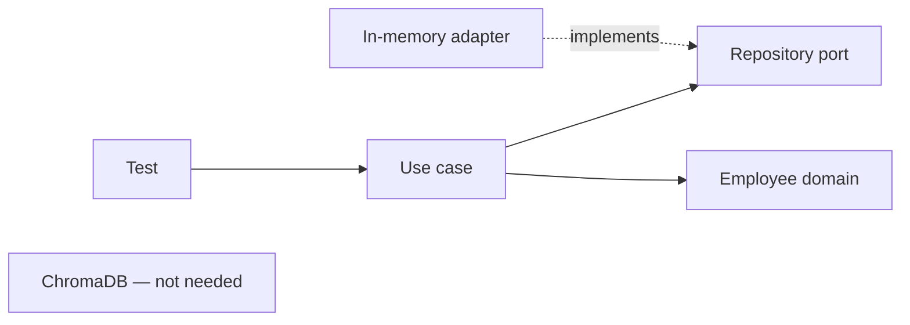

> [!warning] Concurrency and correctness
> The sequence `get_by_id()` then `save()` is **not atomic**. Two concurrent requests could both see no existing record and save the same ID. For production, enforce uniqueness atomically in the authoritative database (for example, a PostgreSQL unique constraint), and translate duplicate-key errors into `EmployeeAlreadyExists`. This exercise teaches the boundary first; we will strengthen the port contract when adding real persistence.

> [!important] Source of truth versus search index
> ChromaDB will later serve **semantic retrieval**, not necessarily authoritative employee registration. PostgreSQL can become the source of truth, with ChromaDB holding a derived index. Do not assume registering in an in-memory repository automatically indexes anything in ChromaDB.

## 12. Optional: manually wire the application

Create a temporary `demo_registration.py` in the project root:

```python
from employee_search.adapters.outbound.in_memory_employee_repository import (
    InMemoryEmployeeRepository,
)
from employee_search.application.use_cases.register_employee import (
    RegisterEmployeeUseCase,
)
from employee_search.domain.employee import Employee

repository = InMemoryEmployeeRepository()
register = RegisterEmployeeUseCase(repository)

employee = Employee(
    id="employee_1",
    name="John Doe",
    department="Engineering",
    role="Software Engineer",
    experience=5,
    skills=("Python", "React"),
    location="New York",
)

register.execute(employee)
print(repository.get_by_id("employee_1"))
```

Run:

```bash
uv run python demo_registration.py
```

This is **manual dependency injection**: the outermost code constructs the adapter and passes it into the use case. Later, our `bootstrap/` module will do the wiring for FastAPI.

## 13. Reflection questions

1. Why is `EmployeeAlreadyExists` a domain concept rather than an HTTP error?
2. Why does the use case depend on `EmployeeRepository` instead of `InMemoryEmployeeRepository`?
3. Which rule can the entity enforce alone, and which needs repository access?
4. What happens if the in-memory adapter is replaced by PostgreSQL?
5. Why is the duplicate-ID check insufficient under concurrency?

## 14. Definition of done

- [ ] Three registration tests pass.
- [ ] Part 1 tests still pass.
- [ ] The use case imports only domain and application packages.
- [ ] The adapter implements the outbound contract.
- [ ] You can explain inbound vs outbound ports and adapters.
- [ ] You can explain why ChromaDB is intentionally absent.

Commit:

```bash
git add .
git commit -m "feat(application): register employees through repository port"
```

## 15. What comes next?

**Part 3 (future):** Define `EmployeeSearchPort`, generate embeddings, implement the ChromaDB outbound adapter, and add integration tests against the Docker Compose service. We will distinguish exact metadata constraints from semantic ranking, as the Coursera lab does.

---
title: "Employee Search Workshop — Quiz: Parts 0–2"
date: 2026-11-10
tags: [quiz, python, ddd, hexagonal-architecture, tdd, ports-and-adapters]
---

# Employee Search Quiz — Parts 0–2

**Covers:** [[00-Setup]] · [[01-Part-1-Domain-and-TDD]] · [[02-Part-2-Use-Case-and-Ports]]

## Scorecard

You scored **5 / 10**: 2 / 5 on medium and 3 / 5 on hard. Your misses are about *how pieces connect* (dependency direction, Protocols, exceptions, test intent), not about what each piece is.

| # | Level | Topic | Your answer | Correct answer | Result |
| --- | --- | --- | --- | --- | --- |
| M1 | Medium | Where business rules live | Employee entity | Employee entity | Right |
| M2 | Medium | Protocol without inheritance | Runtime registration | Structural typing | Wrong |
| M3 | Medium | Allowed import direction | Port → adapter | Adapter → domain | Wrong |
| M4 | Medium | Raising a non-Exception class | Silently ignored | TypeError: must derive from BaseException | Wrong |
| M5 | Medium | `uv run pytest` blocked | Launcher blocked | Launcher blocked | Right |
| H1 | Hard | Concurrent duplicate registration | Safe: frozen | Overwrite possible; fix with DB uniqueness | Wrong |
| H2 | Hard | Why `skills` is a tuple | Shallow freeze | Shallow freeze | Right |
| H3 | Hard | `int` hint accepts 2.5 | Hints not enforced | Hints not enforced | Right |
| H4 | Hard | Why assert the original after raises | Nothing extra | Catches save-then-raise | Wrong |
| H5 | Hard | Swapping in PostgreSQL | New adapter + wiring | New adapter + wiring | Right |

### Where each question lives

Each box is a part of the code you've built. The labels show which questions test it.

```mermaid
flowchart LR
    subgraph Domain["domain/"]
        E["Employee entity<br/>M1 · H2 · H3"]
        X["EmployeeAlreadyExists<br/>M4"]
    end
    subgraph Application["application/"]
        UC["RegisterEmployeeUseCase<br/>H1 · H4"]
        P["EmployeeRepository port<br/>M2 · M3"]
    end
    subgraph Adapters["adapters/"]
        IM["InMemoryEmployeeRepository<br/>H5"]
    end
    T["Tooling: uv + pytest<br/>M5"]

    UC --> P
    UC --> E
    UC --> X
    IM -. "implements" .-> P
    IM --> E
```

## Medium questions

### M1. Where does "experience cannot be negative" belong?

**Your answer:** Employee entity. **Correct.**

The rule is true of any employee, whatever workflow created it, so it lives in `Employee.__post_init__` in `domain/employee.py`. Putting it in the use case would let a future `UpdateEmployee` use case skip it. Putting it in an adapter would tie a business rule to storage. FastAPI can add input validation later, but the entity is the last line of defence.

Every path that creates an `Employee` goes through the same check, so no caller can skip it:

```mermaid
flowchart LR
    H["FastAPI request<br/>future"] --> R["RegisterEmployee<br/>use case"]
    U["UpdateEmployee<br/>future use case"] --> E
    T["Unit tests"] --> E
    R --> E["Employee.__post_init__<br/>experience must be >= 0"]
    E -->|"valid"| OK["Employee object"]
    E -->|"invalid"| ERR["ValueError"]
```

### M2. Why does `InMemoryEmployeeRepository` count as implementing the port without inheriting from it?

**Your answer:** Runtime registration. **Correct answer:** Structural typing.

`EmployeeRepository` is a `typing.Protocol`. A Protocol describes a *shape*: any class with `get_by_id(employee_id) -> Employee | None` and `save(employee) -> None` matches it. This is static "duck typing", checked by a type checker such as mypy or Pyright, not by Python at runtime.

Nothing gets registered at import time. At runtime Python simply calls `repository.get_by_id(...)`, and it works because the method exists. Remove `save` from the adapter and Python would only fail when `save` is actually called, while a type checker would flag it immediately.

```python
class EmployeeRepository(Protocol):          # the shape
    def get_by_id(self, employee_id: str) -> Employee | None: ...
    def save(self, employee: Employee) -> None: ...

class InMemoryEmployeeRepository:            # no base class
    def get_by_id(...): ...                  # matches the shape
    def save(...): ...
```

The benefit: the adapter does not have to import the port, which keeps coupling low.

The dotted arrow means "matches the shape". It is not inheritance:

```mermaid
classDiagram
    class EmployeeRepository {
        <<Protocol>>
        +get_by_id(employee_id) Optional~Employee~
        +save(employee) None
    }
    class InMemoryEmployeeRepository {
        -_employees dict
        +get_by_id(employee_id) Optional~Employee~
        +save(employee) None
    }
    class RegisterEmployeeUseCase {
        -_repository EmployeeRepository
        +execute(employee) None
    }
    RegisterEmployeeUseCase --> EmployeeRepository : depends on
    InMemoryEmployeeRepository ..|> EmployeeRepository : same shape, no base class
```

Who checks the match, and when:

```mermaid
flowchart LR
    S["Source code"] --> TC["Type checker<br/>mypy / Pyright"]
    TC -->|"before running"| F1["Flags a missing save()"]
    S --> RT["Python runtime"]
    RT -->|"only when called"| F2["AttributeError on<br/>repository.save(...)"]
```

### M3. Which import direction is allowed?

**Your answer:** Port → adapter. **Correct answer:** Adapter → domain.

The dependency rule is that **arrows point inward**, toward the domain. Outer layers may import inner layers, never the reverse.

- Adapters → application ports and domain: allowed (`in_memory_employee_repository.py` imports `Employee`).
- Application → domain: allowed (the use case imports `Employee` and `EmployeeAlreadyExists`).
- Domain → anything: never.
- Port → adapter: never. A port is a contract the core owns. If the port imported a concrete adapter, the core would depend on infrastructure, and swapping in PostgreSQL would mean editing the core.

The one place that knows about concrete adapters is the **composition root** (the test, `demo_registration.py`, or a future `bootstrap/` module), which builds the adapter and passes it into the use case.

Solid arrows are imports that are allowed. The red dotted arrows are imports that must never exist:

```mermaid
flowchart LR
    subgraph Outside["Outside the core"]
        CR["Composition root<br/>tests · demo · bootstrap"]
        AD["adapters/outbound<br/>InMemoryEmployeeRepository"]
    end
    subgraph Core["Application core"]
        UC["application/use_cases"]
        P["application/ports"]
        D["domain<br/>Employee · exceptions"]
    end

    CR --> AD
    CR --> UC
    AD --> D
    UC --> P
    UC --> D
    P --> D
    P -. "never" .-> AD
    D -. "never" .-> UC

    linkStyle 6,7 stroke:#d33,stroke-width:2px,stroke-dasharray:5
```

### M4. What happens when you raise a class with no base class?

**Your answer:** Silently ignored. **Correct answer:** `TypeError: exceptions must derive from BaseException`.

Python never silently skips a `raise`. It checks the object, sees `EmployeeAlreadyExists` is not an exception type, and raises a `TypeError` instead. That still stops `execute()`, so `save()` would not run. But callers catching `EmployeeAlreadyExists` would miss it, and `pytest.raises(EmployeeAlreadyExists)` would fail. The fix is `class EmployeeAlreadyExists(Exception):`.

```mermaid
flowchart TD
    A["raise EmployeeAlreadyExists(id)"] --> B{"Is the class a subclass<br/>of BaseException?"}
    B -->|"Yes: class X(Exception)"| C["EmployeeAlreadyExists propagates<br/>pytest.raises and callers catch it"]
    B -->|"No: class X:"| D["Python raises TypeError instead<br/>callers waiting for EmployeeAlreadyExists miss it"]
```

### M5. Why did `uv run pytest` fail but `uv run python -m pytest` work?

**Your answer:** Launcher blocked. **Correct.**

`uv` installs a small launcher `.venv/Scripts/pytest.exe` when it installs pytest. Windows Application Control (Smart App Control) blocked that unsigned executable with OS error 4551. `python -m pytest` runs the same pytest code through the already-trusted `python.exe`, so nothing new has to be executed.

```mermaid
flowchart LR
    A["uv run pytest"] --> B[".venv/Scripts/pytest.exe<br/>new launcher"]
    B --> X["Blocked by Application Control<br/>os error 4551"]
    C["uv run python -m pytest"] --> D["python.exe<br/>already trusted"]
    D --> E["imports the pytest module"]
    E --> F["Tests run"]
```

## Hard questions

### H1. Two requests register "employee_1" at the same moment. What happens?

**Your answer:** Safe: frozen. **Correct answer:** The last write can silently win. Fix it with atomic uniqueness in the database.

`frozen=True` only stops you changing fields on an `Employee` object that already exists (`employee.name = "x"` raises). It says nothing about the repository's dictionary, where `self._employees[employee.id] = employee` happily replaces whatever is stored under that key.

The bug is that "check, then save" is two separate steps, so two requests can interleave like this:

```mermaid
sequenceDiagram
    participant A as Request A
    participant B as Request B
    participant Repo as Repository
    A->>Repo: get_by_id("employee_1")
    Repo-->>A: None
    B->>Repo: get_by_id("employee_1")
    Repo-->>B: None
    Note over A,B: Both checks pass. Neither has saved yet.
    A->>Repo: save(A)
    B->>Repo: save(B)
    Note over Repo: B silently overwrote A. No error raised.
```

Both checks pass because neither has saved yet. A `threading.Lock` would help inside one process, but production usually runs several worker processes or servers, and a lock in one doesn't block the others. The real fix is to make the **database** enforce uniqueness atomically (a PostgreSQL `UNIQUE` / primary key constraint), and have the adapter translate the duplicate-key error into `EmployeeAlreadyExists`.

With that fix, the database decides atomically and the second request gets the domain error:

```mermaid
sequenceDiagram
    participant A as Request A
    participant B as Request B
    participant PG as Postgres adapter
    participant DB as PostgreSQL (id is UNIQUE)
    A->>PG: add(A)
    PG->>DB: INSERT employee_1
    DB-->>PG: OK
    B->>PG: add(B)
    PG->>DB: INSERT employee_1
    DB-->>PG: unique violation
    PG-->>B: raise EmployeeAlreadyExists
    Note over DB: A is kept. Nothing was overwritten.
```

### H2. Why is `skills` a tuple?

**Your answer:** Shallow freeze. **Correct.**

`frozen=True` blocks `employee.skills = [...]`, but not `employee.skills.append("Go")`. With a list, anyone holding a reference, including the in-memory repository, could change a "frozen" entity in place. A tuple can't be changed, so the entity really is immutable. It's also hashable, so a frozen `Employee` can be used in a `set` or as a dict key.

`frozen` protects the box but not what is inside it. Both the caller and the repository point at the **same** object:

```mermaid
flowchart LR
    subgraph WithList["skills as list"]
        C1["Caller's employee"] --> O1["Employee<br/>frozen"]
        R1["Repository's stored employee"] --> O1
        O1 --> L1["skills list<br/>Python, React"]
        C1 -. "skills.append('Go')" .-> L1
        L1 --> X1["Repository now sees Go too"]
    end
    subgraph WithTuple["skills as tuple"]
        C2["Caller's employee"] --> O2["Employee<br/>frozen"]
        O2 --> L2["skills tuple<br/>Python, React"]
        C2 -. "skills.append('Go')" .-> L2
        L2 --> X2["AttributeError<br/>nothing changes"]
    end
```

### H3. Why does `experience: int` accept 2.5?

**Your answer:** Hints not enforced. **Correct.**

Dataclasses read type hints only to build `__init__`. They never check values. So `test_fractional_experience` passes, while the annotation says something else. Tests are executable documentation, so you should make them agree: change the hint to `float` if half-years are valid, or add a check in `__post_init__` and turn that test into a rejection test.

```mermaid
flowchart LR
    V["Employee(experience=2.5)"] --> I["dataclass __init__<br/>assigns the value<br/>no type check"]
    I --> P["__post_init__<br/>only checks experience >= 0"]
    P --> OK["Object created<br/>with 2.5"]
    TC["mypy / Pyright"] -. "would flag float vs int<br/>before running" .-> V
```

### H4. What does the extra `get_by_id(...) == original` assert catch?

**Your answer:** Nothing extra. **Correct answer:** A save-then-raise bug.

The requirement (REQ-001b) has **two** parts: duplicates are *rejected* **and** the original is *not overwritten*. `pytest.raises` only proves the first. This broken version would pass a raises-only test:

```python
def execute(self, employee):
    existing = self._repository.get_by_id(employee.id)
    self._repository.save(employee)          # oops: overwrites first
    if existing is not None:
        raise EmployeeAlreadyExists(employee.id)
```

The exception still fires, but the original record is gone. The extra assert checks the **state** after the error, not just that an error happened. In general, assert every part of the requirement, including what should *not* have changed.

Here's how the test runs against the buggy version. The first check passes; only the second catches the bug:

```mermaid
sequenceDiagram
    participant T as Test
    participant UC as Buggy use case
    participant Repo as Repository
    T->>UC: execute(duplicate)
    UC->>Repo: get_by_id("employee_1")
    Repo-->>UC: original
    UC->>Repo: save(duplicate)
    Note over Repo: original overwritten
    UC-->>T: raise EmployeeAlreadyExists
    Note over T: Check 1, pytest.raises: PASSES
    T->>Repo: get_by_id("employee_1")
    Repo-->>T: duplicate
    Note over T: Check 2, == original: FAILS, bug caught
```

### H5. What changes when PostgreSQL replaces the in-memory adapter?

**Your answer:** New adapter + wiring. **Correct.**

You write a `PostgresEmployeeRepository` with the same `get_by_id` / `save` shape and change the composition root to build it. `Employee`, `RegisterEmployeeUseCase` and both ports stay the same, and the use-case unit tests keep using the fast in-memory adapter. The Postgres adapter gets its own integration tests in `tests/integration/`. One caveat from H1: once you have a real database you may strengthen the port (for example an atomic `add()` that raises on duplicates), which is a deliberate change to the contract, not a leak of SQL into the core.

Everything inside "Unchanged core" stays exactly as it is. Only the boxes outside it are new or rewired:

```mermaid
flowchart TB
    subgraph Core["Unchanged core"]
        UC["RegisterEmployeeUseCase"] --> P["EmployeeRepository port"]
        UC --> D["Employee"]
    end
    CR["Composition root<br/>only the wiring changes"] --> UC
    CR --> PG
    M["InMemoryEmployeeRepository<br/>kept for unit tests"] -. "implements" .-> P
    PG["PostgresEmployeeRepository<br/>new adapter"] -. "implements" .-> P
    PG --> DB[(PostgreSQL)]
    IT["tests/integration<br/>new"] --> PG
    UT["tests/unit<br/>unchanged"] --> M
```

## What to review next

Your 5 misses fall into three themes. Each has a small exercise you can do in this repo.

- [ ] **Dependency direction (M3, M2).** Draw the arrows for every import in `src/`. Every arrow should point toward `domain/`. Then answer reflection question 2 in Part 2 (§13): why does the use case depend on `EmployeeRepository` and not on `InMemoryEmployeeRepository`?
- [ ] **Exceptions (M4).** In a Python REPL, run `class X: pass` then `raise X()` and read the error. Then change `exceptions.py` to subclass `Exception` (still pending from Part 2).
- [ ] **What tests prove (H4, H1).** Write `test_duplicate_id_is_rejected_without_overwriting` yourself. Temporarily swap the use case to save-then-raise and watch the second assert fail. Then answer reflection question 5: why is the duplicate check insufficient under concurrency?


---
title: "Employee Search Workshop — 03 Semantic Search Use Case"
tags: [python, ddd, tdd, hexagonal-architecture, semantic-search]
---

# 03 — Semantic Search: TDD before ChromaDB

**Prerequisites:** [[00-Setup]] · [[01-Part-1-Domain-and-TDD]] · [[02-Part-2-Use-Case-and-Ports]]

> [!abstract] Outcome
> Implement a technology-independent `SearchEmployeesUseCase` using an outbound search port and a deterministic fake adapter. Learn to distinguish semantic ranking from mandatory filters. **No embedding model or ChromaDB is needed in this part.**

## 1. Requirement and design

**REQ-002:** A caller can request a ranked list of employees relevant to a natural-language query. **REQ-003/004/005:** Department and minimum-experience constraints are mandatory. Invalid search inputs are rejected.

| Acceptance test | Expected behavior |
|---|---|
| Query has only whitespace | Reject with `ValueError` |
| `limit` is zero | Reject with `ValueError` |
| Minimum experience is negative | Reject with `ValueError` |
| Matching records | Sorted by ascending distance |
| Department + minimum experience | Only matching employees returned |
| `limit=1` | Return at most one result |

```mermaid
flowchart LR
  CLI["Caller"] --> UC["SearchEmployeesUseCase"]
  UC --> SC["SearchCriteria"]
  UC --> P["EmployeeSearchPort"]
  FA["FakeSearchAdapter"] -. "implements" .-> P
  UC --> R["SearchResult"]
```

> [!important] Boundary decision
> `EmployeeRepository` from Part 2 is about authoritative records. `EmployeeSearchPort` is about retrieving ranked search candidates. They remain separate because PostgreSQL may own employee records while ChromaDB owns a derived search index. In this part, the fake adapter has its own small fixture dataset; it is **not** automatically synchronized with Part 2's repository.

## 2. Extend the tree

```text
src/employee_search/
├── application/
│   ├── models/
│   │   └── search.py                      # new
│   ├── ports/
│   │   ├── inbound/
│   │   │   └── search_employees.py        # new
│   │   └── outbound/
│   │       └── employee_search.py         # new
│   └── use_cases/
│       └── search_employees.py           # new
└── adapters/
    └── outbound/
        └── fake_employee_search.py       # new

tests/unit/test_search_employees.py       # new
```

Create empty `__init__.py` files in the new `models` package and any other new Python package directories if you are following the setup's explicit-package convention.

## 3. RED — tests first

Create `tests/unit/test_search_employees.py`:

```python
import pytest

from employee_search.application.models.search import SearchCriteria
from employee_search.application.use_cases.search_employees import SearchEmployeesUseCase
from employee_search.adapters.outbound.fake_employee_search import FakeEmployeeSearch
from employee_search.domain.employee import Employee


def employee(id: str, department: str, experience: int) -> Employee:
    return Employee(
        id=id, name=id, department=department, role="Engineer",
        experience=experience, skills=("Python",), location="Singapore",
    )


def make_use_case() -> SearchEmployeesUseCase:
    # Distances are deterministic test data, not generated embeddings.
    fake = FakeEmployeeSearch([
        (employee("e1", "Engineering", 5), 0.12),
        (employee("e2", "Engineering", 12), 0.32),
        (employee("e3", "HR", 15), 0.08),
    ])
    return SearchEmployeesUseCase(fake)


def test_search_returns_ranked_results():
    results = make_use_case().execute(SearchCriteria(query="Python engineer"))
    assert [r.employee.id for r in results] == ["e3", "e1", "e2"]


def test_filters_are_mandatory():
    criteria = SearchCriteria(
        query="Python engineer", department="Engineering", minimum_experience=10,
    )
    results = make_use_case().execute(criteria)
    assert [r.employee.id for r in results] == ["e2"]


def test_limit_is_applied():
    results = make_use_case().execute(SearchCriteria(query="engineer", limit=1))
    assert len(results) == 1
    assert results[0].employee.id == "e3"


@pytest.mark.parametrize("kwargs", [
    {"query": " "},
    {"query": "engineer", "limit": 0},
    {"query": "engineer", "minimum_experience": -1},
])
def test_invalid_search_criteria(kwargs):
    with pytest.raises(ValueError):
        SearchCriteria(**kwargs)
```

Run `uv run pytest tests/unit/test_search_employees.py -v`. **Expected RED:** missing imports; that is intentional.

## 4. GREEN — application request and result types

Create `src/employee_search/application/models/search.py`:

```python
from dataclasses import dataclass

from employee_search.domain.employee import Employee


@dataclass(frozen=True)
class SearchCriteria:
    query: str
    department: str | None = None
    minimum_experience: int | None = None
    limit: int = 5

    def __post_init__(self) -> None:
        if not self.query.strip():
            raise ValueError("Search query cannot be empty")
        if self.limit < 1:
            raise ValueError("Search limit must be positive")
        if self.minimum_experience is not None and self.minimum_experience < 0:
            raise ValueError("Minimum experience cannot be negative")


@dataclass(frozen=True)
class SearchResult:
    employee: Employee
    distance: float
```

These are **application-facing request/result types**. They are not necessarily DDD value objects: a query limit and a vector distance describe a retrieval operation, not an intrinsic employee business concept.

## 5. Define inbound and outbound ports

Create `src/employee_search/application/ports/inbound/search_employees.py`:

```python
from typing import Protocol
from employee_search.application.models.search import SearchCriteria, SearchResult


class SearchEmployees(Protocol):
    def execute(self, criteria: SearchCriteria) -> list[SearchResult]: ...
```

Create `src/employee_search/application/ports/outbound/employee_search.py`:

```python
from typing import Protocol
from employee_search.application.models.search import SearchCriteria, SearchResult


class EmployeeSearchPort(Protocol):
    def search(self, criteria: SearchCriteria) -> list[SearchResult]: ...
```

The inbound port describes **what the application offers**. The outbound port describes **what it needs** from a search engine. The real adapter may later generate query embeddings, but the application contract does not mention ChromaDB.

## 6. Implement the use case

Create `src/employee_search/application/use_cases/search_employees.py`:

```python
from employee_search.application.models.search import SearchCriteria, SearchResult
from employee_search.application.ports.outbound.employee_search import EmployeeSearchPort


class SearchEmployeesUseCase:
    def __init__(self, search_port: EmployeeSearchPort) -> None:
        self._search_port = search_port

    def execute(self, criteria: SearchCriteria) -> list[SearchResult]:
        return self._search_port.search(criteria)
```

The use case is intentionally thin. The port's **contract** requires that filters and limit be honored and results be ordered. That contract will be tested against each adapter. Do not add a second filtering algorithm here unless your use case has an additional business policy.

## 7. Implement a deterministic fake outbound adapter

Create `src/employee_search/adapters/outbound/fake_employee_search.py`:

```python
from employee_search.application.models.search import SearchCriteria, SearchResult
from employee_search.domain.employee import Employee


class FakeEmployeeSearch:
    """Test double with preassigned distances; does not model semantic relevance."""

    def __init__(self, rows: list[tuple[Employee, float]]) -> None:
        self._rows = rows

    def search(self, criteria: SearchCriteria) -> list[SearchResult]:
        candidates = [
            SearchResult(employee=e, distance=d)
            for e, d in self._rows
            if (criteria.department is None or e.department == criteria.department)
            and (
                criteria.minimum_experience is None
                or e.experience >= criteria.minimum_experience
            )
        ]
        return sorted(candidates, key=lambda r: r.distance)[:criteria.limit]
```

> [!note] Why not embed in the fake?
> A unit test should be deterministic and fast. Embedding models introduce downloads, CPU cost, and model-dependent rankings. Integration tests will verify actual semantic search in Part 4.

## 8. GREEN — run the tests

```bash
uv run pytest tests/unit/test_search_employees.py -v
uv run pytest -v
uv run ruff check .
```

Expected: six new test cases pass (three behavior tests and three parameterized validation cases). All earlier tests should still pass. These are **expected results**, not proof of execution on your machine.

```mermaid
sequenceDiagram
  participant Caller
  participant UC as SearchEmployeesUseCase
  participant Port as EmployeeSearchPort
  participant Fake as FakeEmployeeSearch
  Caller->>UC: execute(criteria)
  UC->>Port: search(criteria)
  Note over Port,Fake: Fake supplies the port behavior
  Fake-->>UC: sorted, filtered SearchResult list
  UC-->>Caller: results
```

## 9. REFACTOR — ask the architectural questions

1. Why does `SearchEmployeesUseCase` not import `chromadb`?
2. Why are `SearchCriteria` and `SearchResult` in `application/models` instead of the Employee entity?
3. What must a second adapter guarantee to be interchangeable with the fake?
4. Why is a small cosine distance not proof of an employee's mandatory Python skill?

> [!warning] Semantic search vs factual requirements
> This workshop's structured filters cover department and experience. A mandatory skill such as *must know Python* needs a structured skills filter or verification step; vector similarity alone cannot prove it.

## 10. Definition of Done

- [ ] All six new test cases pass.
- [ ] Earlier domain and registration tests still pass.
- [ ] Search use case imports only application contracts.
- [ ] Fake adapter applies mandatory filters, ordering, and limit.
- [ ] No ChromaDB dependency is required for unit tests.
- [ ] Commit: `git add . && git commit -m "feat(search): add search use case and fake adapter"`

**Next:** [[04-Part-4-ChromaDB-Adapter-and-Integration-Tests]]

---
title: "Employee Search Workshop — 04 ChromaDB Adapter and Integration Tests"
tags: [python, chromadb, docker-compose, integration-testing, hexagonal-architecture, tdd]
---

# 04 — Replace the Fake with a ChromaDB Adapter

**Prerequisites:** [[00-Setup]] · [[01-Part-1-Domain-and-TDD]] · [[02-Part-2-Use-Case-and-Ports]] · [[03-Part-3-Semantic-Search-Use-Case]]

> [!abstract] Outcome
> Run ChromaDB in Docker Compose, build an outbound adapter, index employee descriptions, and verify real semantic retrieval and metadata filtering with integration tests. The application use case remains unchanged.

## 1. Architecture and responsibilities

```mermaid
flowchart LR
  Caller["Caller / test"] --> UC["SearchEmployeesUseCase"]
  UC --> Port["EmployeeSearchPort"]
  Adapter["ChromaEmployeeSearchAdapter"] -. "implements" .-> Port
  Adapter --> EF["Embedding function"]
  Adapter --> DB[("ChromaDB server")]
  DB --> VOL[("Docker volume")]
```

**In scope:** a search-index adapter with explicit indexing and search operations. **Out of scope:** automatic synchronization with the Part 2 repository, authentication, production observability, and FastAPI endpoints. We will add orchestration later.

## 2. Dependencies and Compose

Use the same pinned Chroma version as the original lab, **1.0.12**, for this learning step. This is not a production version recommendation. In the project root:

```bash
uv add "chromadb==1.0.12" "sentence-transformers==4.1.0"
```

If `compose.yaml` already exists from Setup, update its Chroma service instead of creating a second file. A minimal **Chroma-only** compose configuration is:

```yaml
services:
  chroma:
    image: chromadb/chroma:1.0.12
    ports:
      - "127.0.0.1:8001:8000"
    environment:
      IS_PERSISTENT: "TRUE"
      PERSIST_DIRECTORY: /data
      ANONYMIZED_TELEMETRY: "FALSE"
    volumes:
      - chroma_data:/data

volumes:
  chroma_data:
```

We publish container port 8000 on **localhost:8001** to avoid a future FastAPI port collision. A named volume survives `docker compose down` (but not `docker compose down -v`).

```bash
docker compose up -d chroma
docker compose ps
```

Check readiness using a Python standard-library request from your host:

```bash
uv run python -c "import urllib.request; print(urllib.request.urlopen('http://localhost:8001/api/v2/heartbeat').read())"
```

> [!warning] Local vs container networking
> From your **host**, use `localhost:8001`. From another service **inside Compose**, use `chroma:8000`. `localhost` inside the API container would refer to that container, not ChromaDB.

## 3. Make indexing an explicit outbound capability

We already defined `EmployeeSearchPort.search()` in Part 3. We now need to **index** an employee for later retrieval. Add a second protocol in `src/employee_search/application/ports/outbound/employee_index.py`:

```python
from typing import Protocol
from employee_search.domain.employee import Employee


class EmployeeIndexPort(Protocol):
    def index(self, employee: Employee) -> None: ...
    def delete(self, employee_id: str) -> None: ...
```

Separating search from indexing is useful: reads and writes can have different performance and consistency requirements. The same Chroma adapter will implement both protocols.

```mermaid
classDiagram
  class EmployeeSearchPort {
    <<interface>>
    +search(criteria)
  }
  class EmployeeIndexPort {
    <<interface>>
    +index(employee)
    +delete(employee_id)
  }
  class ChromaEmployeeSearchAdapter {
    +search(criteria)
    +index(employee)
    +delete(employee_id)
  }
  EmployeeSearchPort <|.. ChromaEmployeeSearchAdapter
  EmployeeIndexPort <|.. ChromaEmployeeSearchAdapter
```

## 4. RED — write the integration tests

Create `tests/integration/test_chroma_employee_search.py`:

```python
import os
import uuid

import chromadb
import pytest
from chromadb.utils import embedding_functions

from employee_search.application.models.search import SearchCriteria
from employee_search.application.use_cases.search_employees import SearchEmployeesUseCase
from employee_search.adapters.outbound.chroma.employee_search_adapter import (
    ChromaEmployeeSearchAdapter,
)
from employee_search.domain.employee import Employee


def employee(id: str, department: str, experience: int, skills: tuple[str, ...]) -> Employee:
    return Employee(
        id=id, name=id, department=department, role="Software Engineer",
        experience=experience, skills=skills, location="Singapore",
    )


@pytest.fixture
def adapter():
    client = chromadb.HttpClient(
        host=os.getenv("CHROMA_HOST", "localhost"),
        port=int(os.getenv("CHROMA_PORT", "8001")),
    )
    ef = embedding_functions.SentenceTransformerEmbeddingFunction(
        model_name="all-MiniLM-L6-v2"
    )
    name = f"employees_{uuid.uuid4().hex[:12]}"
    collection = client.create_collection(
        name=name,
        embedding_function=ef,
        configuration={"hnsw": {"space": "cosine"}},
    )
    try:
        yield ChromaEmployeeSearchAdapter(collection)
    finally:
        client.delete_collection(name=name)


def test_index_then_search_returns_record(adapter):
    adapter.index(employee("e1", "Engineering", 5, ("Python", "React")))
    results = SearchEmployeesUseCase(adapter).execute(
        SearchCriteria(query="Python web developer")
    )
    assert [r.employee.id for r in results] == ["e1"]
    assert isinstance(results[0].distance, float)


def test_combined_filters_exclude_nonmatching_records(adapter):
    adapter.index(employee("e1", "Engineering", 5, ("Python",)))
    adapter.index(employee("e2", "Engineering", 12, ("Java",)))
    adapter.index(employee("e3", "HR", 15, ("Recruitment",)))
    results = SearchEmployeesUseCase(adapter).execute(
        SearchCriteria(
            query="experienced developer",
            department="Engineering",
            minimum_experience=10,
        )
    )
    assert [r.employee.id for r in results] == ["e2"]


def test_delete_removes_record(adapter):
    adapter.index(employee("e1", "Engineering", 5, ("Python",)))
    adapter.delete("e1")
    results = adapter.search(SearchCriteria(query="Python"))
    assert results == []
```

Run:

```bash
uv run pytest tests/integration/test_chroma_employee_search.py -v
```

**Expected RED:** import failure because the adapter has not been implemented. In a real TDD cycle, verify the tests fail for the intended reason, not because ChromaDB is unreachable.

## 5. GREEN — implement the outbound adapter

Create `src/employee_search/adapters/outbound/chroma/employee_search_adapter.py` (and an empty `__init__.py` in `chroma/`):

```python
from employee_search.application.models.search import SearchCriteria, SearchResult
from employee_search.domain.employee import Employee


class ChromaEmployeeSearchAdapter:
    def __init__(self, collection) -> None:
        self._collection = collection

    @staticmethod
    def _document(employee: Employee) -> str:
        return (
            f"{employee.role} with {employee.experience} years of experience "
            f"in {employee.department}. Skills: {', '.join(employee.skills)}. "
            f"Located in {employee.location}."
        )

    def index(self, employee: Employee) -> None:
        # upsert supports indexing a new record or replacing an existing one.
        self._collection.upsert(
            ids=[employee.id],
            documents=[self._document(employee)],
            metadatas=[{
                "name": employee.name,
                "department": employee.department,
                "role": employee.role,
                "experience": employee.experience,
                "skills": ", ".join(employee.skills),
                "location": employee.location,
            }],
        )

    def delete(self, employee_id: str) -> None:
        self._collection.delete(ids=[employee_id])

    def search(self, criteria: SearchCriteria) -> list[SearchResult]:
        filters = []
        if criteria.department is not None:
            filters.append({"department": criteria.department})
        if criteria.minimum_experience is not None:
            filters.append({"experience": {"$gte": criteria.minimum_experience}})
        where = None
        if len(filters) == 1:
            where = filters[0]
        elif len(filters) > 1:
            where = {"$and": filters}

        if self._collection.count() == 0:
            return []

        response = self._collection.query(
            query_texts=[criteria.query],
            n_results=criteria.limit,
            where=where,
            include=["metadatas", "distances"],
        )
        ids = response["ids"][0]
        metadata_rows = response["metadatas"][0]
        distances = response["distances"][0]
        results = []
        for id, meta, distance in zip(ids, metadata_rows, distances):
            results.append(SearchResult(
                employee=Employee(
                    id=id,
                    name=meta["name"],
                    department=meta["department"],
                    role=meta["role"],
                    experience=meta["experience"],
                    skills=tuple(s.strip() for s in meta["skills"].split(",") if s.strip()),
                    location=meta["location"],
                ),
                distance=float(distance),
            ))
        return sorted(results, key=lambda result: result.distance)
```

> [!important] Learning trade-off
> For the lab, we reconstruct `Employee` from Chroma metadata. In a production architecture where PostgreSQL is the system of record, the search adapter would typically return **employee IDs and distances**, and the application would hydrate authoritative employee details from PostgreSQL. This avoids treating the search index as authoritative employee storage.

## 6. Why does the embedding model run where it does?

```mermaid
sequenceDiagram
  participant Test
  participant Adapter as Chroma Adapter
  participant EF as Local SentenceTransformer
  participant Server as Chroma Server
  Test->>Adapter: index(employee)
  Adapter->>EF: embed employee description
  EF-->>Adapter: vector
  Adapter->>Server: upsert(id, vector, metadata)
  Test->>Adapter: search(criteria)
  Adapter->>EF: embed query
  EF-->>Adapter: query vector
  Adapter->>Server: nearest-neighbor query + filters
  Server-->>Adapter: ids, metadata, distances
  Adapter-->>Test: SearchResult list
```

With `SentenceTransformerEmbeddingFunction` attached to the client collection, embedding is performed by the **Python client process** when text documents/query texts are supplied. The Chroma server stores/searches the vectors. The first test may download model files and take longer.

## 7. GREEN — run integration tests

```bash
uv run pytest tests/integration/test_chroma_employee_search.py -v
uv run pytest -v
uv run ruff check .
```

If the integration test fails because of an API incompatibility, check the pinned client/server versions first. In particular, embedding-function and collection configuration signatures differ across Chroma releases. The examples target **1.0.12**; they are not guaranteed to work unmodified with other versions.

> [!tip] Troubleshooting
> **Connection refused:** `docker compose ps` and confirm host port `8001`. **Model download failure:** verify internet access for the first embedding run. **Dimension mismatch:** do not mix embedding models within a collection. **Duplicate collection:** tests use random collection names and delete them in teardown. **Distance values differ:** do not assert exact model-dependent scores.

## 8. Verify persistence without confusing it with the tests

The tests intentionally delete their temporary collections. To test persistence manually, use a fixed collection name and `get_or_create_collection`, index a record, restart Chroma (`docker compose restart chroma`), and reconnect with the same collection name. The record should still be present because of the named volume. This is a **separate acceptance test** from the isolated integration tests above.

```mermaid
flowchart TD
  A["Index employee"] --> B[("Chroma persistent volume")]
  B --> C["Restart container"]
  C --> D["Reconnect to same collection"]
  D --> E{"Record exists?"}
  E -->|Yes| F["Persistence verified"]
  E -->|No| G["Inspect volume and configuration"]
```

## 9. REFACTOR and architectural reflection

- **Domain:** `Employee` knows no database or embedding SDK.
- **Application:** `SearchEmployeesUseCase` depends only on `EmployeeSearchPort`.
- **Outbound adapter:** Chroma-specific query syntax and metadata mapping live in one place.
- **Composition:** Tests inject the concrete adapter; a future bootstrap module will do the same for FastAPI.
- **Test boundaries:** Part 3 tests the contract cheaply with a fake; Part 4 tests the real Chroma integration.

**Important:** HNSW approximate search may yield different rankings from exact cosine search, especially at scale. Validate recall and filter behavior with representative data before using it for consequential decisions.

## 10. Definition of Done

- [ ] ChromaDB is running via Docker Compose.
- [ ] Integration tests index, filter, and delete successfully.
- [ ] Domain and use-case unit tests still pass.
- [ ] `SearchEmployeesUseCase` has not changed from Part 3.
- [ ] You can explain which process generates embeddings.
- [ ] You can explain why ChromaDB is a derived index rather than a source of truth.
- [ ] Commit: `git add . && git commit -m "feat(chroma): implement search adapter with integration tests"`

**Next:** Part 5 will connect registration to indexing through an application orchestration strategy, add FastAPI inbound adapters, and test HTTP behavior. We will also revisit atomic uniqueness and reliable synchronization when PostgreSQL is introduced.
