# 00 — Setup: A reproducible Python workspace

> [!abstract] Outcome
> Create an installable Python project, run a test, and prepare a Docker Compose service for ChromaDB. **We will not use ChromaDB until a later lesson.** This avoids confusing infrastructure problems with domain design.

**Navigation:** [[01-Part-1-Domain-and-TDD]] · [[02-Part-2-Use-Case-and-Ports]]

## 1. The journey

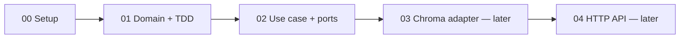

### Architecture we are working toward

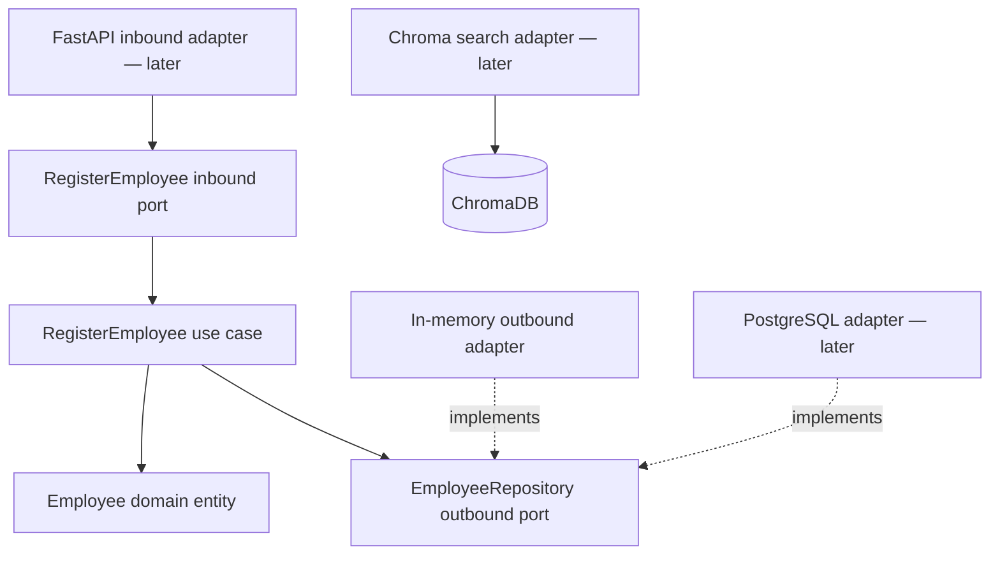

## 2. Prerequisites

Install **Python 3.11**, **uv**, **Git**, and **Docker with Compose v2**. Verify in a terminal:

```bash
python --version
uv --version
git --version
docker --version
docker compose version
```

> [!tip] Windows
> Use PowerShell, Windows Terminal, or WSL. The following `mkdir` and `uv` commands work in PowerShell and POSIX shells. Commands using `touch` are intentionally avoided: create the named files in your editor.

## 3. Initialize an installable package

```bash
mkdir employee-search
cd employee-search
uv init --package --python 3.11
uv add --dev pytest pytest-cov ruff
uv sync
```

Why `--package`? It gives us a `src/` package that can be imported reliably by tests and by future adapters. `uv.lock` pins resolved dependencies; commit it to Git.

Check:

```bash
uv run python --version
uv run pytest --version
```

## 4. Create the folders you need now

```text
employee-search/
├── pyproject.toml
├── uv.lock
├── .python-version
├── .gitignore
├── compose.yaml
├── src/
│   └── employee_search/
│       ├── __init__.py
│       ├── domain/
│       │   └── __init__.py
│       ├── application/
│       │   ├── __init__.py
│       │   ├── ports/
│       │   │   ├── __init__.py
│       │   │   ├── inbound/
│       │   │   │   └── __init__.py
│       │   │   └── outbound/
│       │   │       └── __init__.py
│       │   └── use_cases/
│       │       └── __init__.py
│       └── adapters/
│           ├── __init__.py
│           └── outbound/
│               └── __init__.py
└── tests/
    ├── unit/
    └── integration/
```

Create directories and empty `__init__.py` files using your editor. The `uv init` command may create a starter `hello()` in `src/employee_search/__init__.py`; it is fine to replace that with an empty file. We add modules as we implement them, rather than creating an entire empty architecture.

### Why these folders?

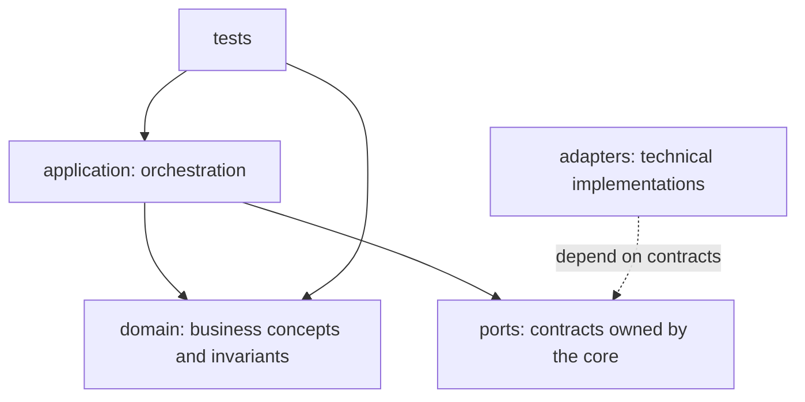

**Ports belong to the application core; adapters sit outside it.** Inbound ports describe what the application offers. Outbound ports describe what it needs.

## 5. Add a minimal Docker Compose service

Create `compose.yaml`:

```yaml
services:
  chroma:
    image: chromadb/chroma:1.0.12
    ports:
      - "8001:8000"
    volumes:
      - chroma_data:/data
    environment:
      IS_PERSISTENT: "TRUE"
      PERSIST_DIRECTORY: /data
      ANONYMIZED_TELEMETRY: "FALSE"

volumes:
  chroma_data:
```

This uses the **ChromaDB 1.0.12** release specified by the supplied Coursera lab. It is a historical teaching baseline, **not** a production version recommendation. We publish Chroma on host port **8001**, reserving 8000 for the FastAPI app later. Chroma is not yet an application dependency.

```bash
docker compose config
docker compose up -d
docker compose ps
```

Optional heartbeat check (when the container is ready):

```bash
curl http://localhost:8001/api/v2/heartbeat
```

If you cannot run Docker yet, continue with Parts 1 and 2; their tests require no containers. If your environment has an incompatible image or persistence configuration, resolve that in the Chroma integration lesson before relying on stored data.

Stop the container without deleting the named volume:

```bash
docker compose down
```

> [!warning] Persistence
> `docker compose down` preserves named volumes by default. `docker compose down -v` deletes them. This matters once we index data.

## 6. Add development hygiene

Create `.gitignore`:

```gitignore
.venv/
__pycache__/
.pytest_cache/
.ruff_cache/
.coverage
htmlcov/
.env
```

Run:

```bash
uv run ruff check .
uv run pytest -q
```

Before we add tests, pytest may report `no tests ran` (exit code 5). That is expected. Part 1 introduces our first tests.

## 7. Definition of done

- [ ] `uv run python --version` works.
- [ ] `uv run pytest --version` works.
- [ ] Package folders exist.
- [ ] `docker compose config` validates the Compose file.
- [ ] If Docker is available, Chroma starts and its heartbeat responds.

**Next:** [[01-Part-1-Domain-and-TDD]]


---
title: "Employee Search Workshop — 01 Domain and TDD"
tags: [python, ddd, tdd, domain-modeling]
---

# 01 — Model an Employee using DDD and TDD

**Prerequisite:** [[00-Setup]]  
**Next:** [[02-Part-2-Use-Case-and-Ports]]

> [!abstract] Outcome
> Write tests **before** implementation, create an `Employee` entity with domain invariants, and prove that the domain runs without ChromaDB, FastAPI, or Docker.

## 1. From requirement to test

**REQ-001a — Employee validity:** An employee must have a nonblank ID and name, and nonnegative integer years of experience. Zero years is valid. (Cross-record ID uniqueness belongs to the registration use case in Part 2.)

| Test ID | Given | When | Then |
|---|---|---|---|
| T-001 | Valid employee data | Construct employee | Entity is created |
| T-002 | Experience = -1 | Construct employee | `ValueError` |
| T-003 | Blank name | Construct employee | `ValueError` |
| T-004 | Blank ID | Construct employee | `ValueError` |
| T-005 | Experience = 0 | Construct employee | Entity is created |
| T-006 | Experience = 2.5 | Construct employee | `ValueError` |

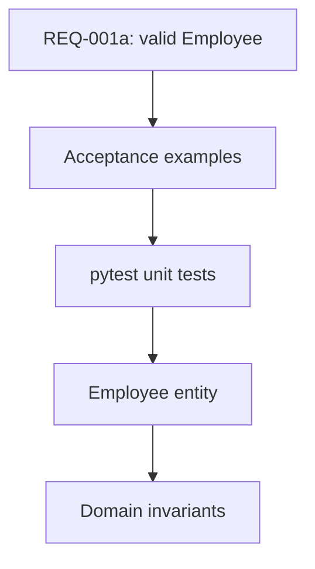

## 2. Domain concepts

An **entity** is identified by a stable identity, not just by its attributes. An **invariant** is a rule that must hold for every valid instance. `Employee` is an entity; `experience >= 0` is an invariant. We may later introduce `EmployeeId` or `Experience` value objects, but they are not necessary yet.

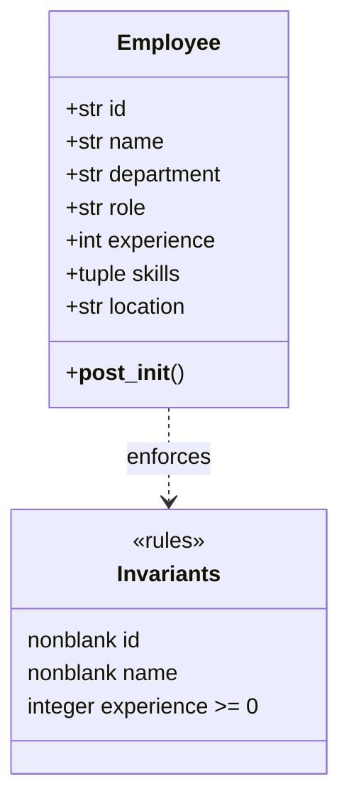

## 3. RED — write tests before the entity exists

Create `tests/unit/test_employee.py`:

```python
import pytest

from employee_search.domain.employee import Employee


def make_employee(**overrides):
    data = {
        "id": "employee_1",
        "name": "John Doe",
        "department": "Engineering",
        "role": "Software Engineer",
        "experience": 5,
        "skills": ("Python", "React"),
        "location": "New York",
    }
    data.update(overrides)
    return Employee(**data)


def test_create_valid_employee():
    employee = make_employee()
    assert employee.id == "employee_1"
    assert employee.skills == ("Python", "React")


@pytest.mark.parametrize("bad_id", ["", "   "])
def test_reject_blank_id(bad_id):
    with pytest.raises(ValueError, match="ID"):
        make_employee(id=bad_id)


@pytest.mark.parametrize("bad_name", ["", "   "])
def test_reject_blank_name(bad_name):
    with pytest.raises(ValueError, match="Name"):
        make_employee(name=bad_name)


def test_reject_negative_experience():
    with pytest.raises(ValueError, match="Experience"):
        make_employee(experience=-1)


def test_accept_zero_experience():
    assert make_employee(experience=0).experience == 0


def test_reject_fractional_experience():
    with pytest.raises(ValueError, match="Experience"):
        make_employee(experience=2.5)
```

Run:

```bash
uv run pytest tests/unit/test_employee.py -v
```

**Expected RED:** import/collection error because `employee_search.domain.employee` does not exist. This confirms the test suite is not accidentally exercising a preexisting implementation.

## 4. GREEN — write the smallest useful entity

Create `src/employee_search/domain/employee.py`:

```python
from dataclasses import dataclass


@dataclass(frozen=True)
class Employee:
    id: str
    name: str
    department: str
    role: str
    experience: int
    skills: tuple[str, ...]
    location: str

    def __post_init__(self) -> None:
        if not isinstance(self.id, str) or not self.id.strip():
            raise ValueError("Employee ID cannot be blank")
        if not isinstance(self.name, str) or not self.name.strip():
            raise ValueError("Name cannot be blank")
        if type(self.experience) is not int or self.experience < 0:
            raise ValueError("Experience must be a nonnegative integer")
```

`type(...) is int` intentionally rejects booleans (Python treats `bool` as a subclass of `int`) and fractional years. These are workshop rules, not requirements from the Coursera lab.

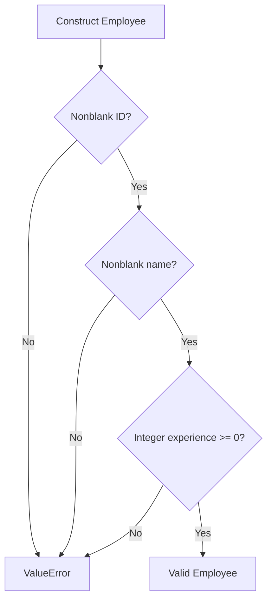

Run:

```bash
uv run pytest tests/unit/test_employee.py -v
```

**Expected GREEN:** all tests pass. Because parameterized cases are separate tests, pytest will report **8 passed**.

## 5. REFACTOR — reason about design

- `@dataclass` generates initialization, equality, and representation methods.
- `frozen=True` prevents normal field reassignment; it is **shallow** immutability.
- `skills` is a tuple to avoid a mutable list escaping the entity.
- `__post_init__` enforces invariants at the construction boundary.
- No domain file imports a framework or database library.

> [!question] Why not put validation in FastAPI?
> A future CSV importer, CLI, or background job must obey the same business rules. Domain validation applies regardless of transport.

> [!question] Why not check uniqueness in `Employee.__post_init__`?
> A single entity cannot know which IDs already exist. That rule requires coordination with a repository and belongs to the registration use case.

## 6. Verify and inspect coverage

```bash
uv run ruff check .
uv run pytest --cov=employee_search --cov-report=term-missing
```

Coverage shows executed lines, not the quality of assertions. Keep the tests behavior-focused.

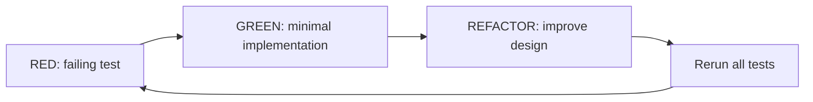

## 7. Commit the milestone

```bash
git add .
git commit -m "feat(domain): add validated Employee entity"
```

If this is your first commit, run `git init` first and configure your Git identity as needed.

## 8. Definition of done

- [ ] The tests fail before `employee.py` exists.
- [ ] All eight test cases pass after implementation.
- [ ] `ruff check .` passes.
- [ ] No ChromaDB or FastAPI imports exist in `domain/`.
- [ ] You can explain **entity**, **invariant**, and **Red–Green–Refactor**.

**Next:** [[02-Part-2-Use-Case-and-Ports]]

---
title: "Employee Search Workshop — 02 Use Cases, Ports and Adapters"
tags: [python, ddd, hexagonal-architecture, tdd, ports-and-adapters]
---

# 02 — RegisterEmployee: a use case with ports and adapters

**Prerequisites:** [[00-Setup]] · [[01-Part-1-Domain-and-TDD]]

> [!abstract] Outcome
> Register an employee through an application use case, enforce unique IDs, and test it using an in-memory outbound adapter. **No database or HTTP server is needed.**

## 1. Why a use case?

The domain entity validates **one employee**. Registration is a business operation involving **other records**: before saving an employee, we must check that its ID is not already registered.

**REQ-001b — Registration:** A valid employee with a new ID is saved. Attempting to register an existing ID is rejected without overwriting the original record.

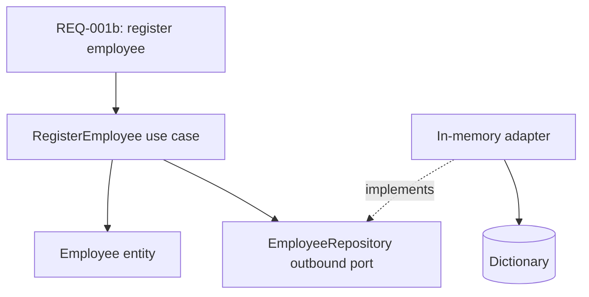

**Terms:** An **inbound port** is the contract a caller invokes. An **outbound port** is the contract a use case needs from infrastructure. An **adapter** implements a port or translates an external request into it. A **composition root** assembles implementations.

## 2. The dependency rule

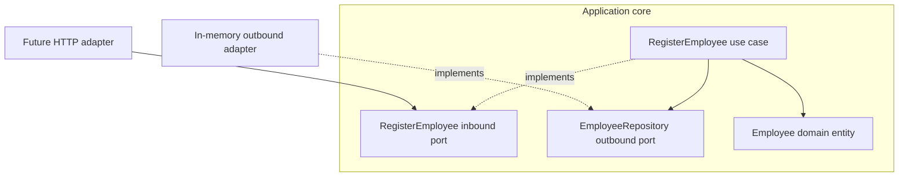

The core **never imports** `InMemoryEmployeeRepository`. The adapter imports the outbound port's domain types, and the bootstrap code wires everything together.

## 3. Extend the project tree

```text
src/employee_search/
├── domain/
│   ├── employee.py
│   └── exceptions.py                # new
├── application/
│   ├── ports/
│   │   ├── inbound/
│   │   │   └── register_employee.py # new
│   │   └── outbound/
│   │       └── employee_repository.py # new
│   └── use_cases/
│       └── register_employee.py     # new
└── adapters/
    └── outbound/
        └── in_memory_employee_repository.py # new

tests/unit/
├── test_employee.py
└── test_register_employee.py        # new
```

Keep the empty `__init__.py` files created during setup. No need to create an `infrastructure/` directory: here, infrastructure implementations live under `adapters/`.

## 4. RED — write the use-case tests first

Create `tests/unit/test_register_employee.py`:

```python
import pytest

from employee_search.application.use_cases.register_employee import (
    RegisterEmployeeUseCase,
)
from employee_search.domain.employee import Employee
from employee_search.domain.exceptions import EmployeeAlreadyExists
from employee_search.adapters.outbound.in_memory_employee_repository import (
    InMemoryEmployeeRepository,
)


def make_employee(employee_id: str = "employee_1") -> Employee:
    return Employee(
        id=employee_id,
        name="John Doe",
        department="Engineering",
        role="Software Engineer",
        experience=5,
        skills=("Python", "React"),
        location="New York",
    )


def test_register_new_employee():
    repository = InMemoryEmployeeRepository()
    use_case = RegisterEmployeeUseCase(repository)
    employee = make_employee()

    use_case.execute(employee)

    assert repository.get_by_id(employee.id) == employee


def test_duplicate_id_is_rejected_without_overwriting():
    repository = InMemoryEmployeeRepository()
    use_case = RegisterEmployeeUseCase(repository)
    original = make_employee()
    use_case.execute(original)

    duplicate = Employee(
        id="employee_1",
        name="Different Person",
        department="HR",
        role="HR Coordinator",
        experience=2,
        skills=("Recruitment",),
        location="Chicago",
    )

    with pytest.raises(EmployeeAlreadyExists):
        use_case.execute(duplicate)

    assert repository.get_by_id("employee_1") == original


def test_two_distinct_ids_can_be_registered():
    repository = InMemoryEmployeeRepository()
    use_case = RegisterEmployeeUseCase(repository)

    use_case.execute(make_employee("employee_1"))
    use_case.execute(make_employee("employee_2"))

    assert repository.get_by_id("employee_1") is not None
    assert repository.get_by_id("employee_2") is not None
```

Run:

```bash
uv run pytest tests/unit/test_register_employee.py -v
```

**Expected RED:** import error because the use case, exception, and adapter do not exist. We now implement them in small steps.

## 5. GREEN — define a domain exception

Create `src/employee_search/domain/exceptions.py`:

```python
class EmployeeAlreadyExists(Exception):
    """An employee with this identity is already registered."""
```

The domain exception expresses business meaning; it does not refer to HTTP 409 or database constraint errors.

## 6. Define the outbound port

Create `src/employee_search/application/ports/outbound/employee_repository.py`:

```python
from typing import Protocol

from employee_search.domain.employee import Employee


class EmployeeRepository(Protocol):
    def get_by_id(self, employee_id: str) -> Employee | None:
        ...

    def save(self, employee: Employee) -> None:
        ...
```

The application owns the interface because **the use case determines what persistence capabilities it needs**. A `Protocol` allows structural typing: an implementation does not have to inherit from the interface explicitly.

## 7. Define the inbound port

Create `src/employee_search/application/ports/inbound/register_employee.py`:

```python
from typing import Protocol

from employee_search.domain.employee import Employee


class RegisterEmployee(Protocol):
    def execute(self, employee: Employee) -> None:
        ...
```

This is an explicit teaching choice. In a smaller production codebase, the concrete use-case class can itself be the inbound application boundary without a separate protocol.

## 8. Implement the use case

Create `src/employee_search/application/use_cases/register_employee.py`:

```python
from employee_search.application.ports.outbound.employee_repository import (
    EmployeeRepository,
)
from employee_search.domain.employee import Employee
from employee_search.domain.exceptions import EmployeeAlreadyExists


class RegisterEmployeeUseCase:
    def __init__(self, repository: EmployeeRepository) -> None:
        self._repository = repository

    def execute(self, employee: Employee) -> None:
        if self._repository.get_by_id(employee.id) is not None:
            raise EmployeeAlreadyExists(employee.id)
        self._repository.save(employee)
```

Notice: the use case imports the **port**, not the adapter. It does not know whether records live in memory, PostgreSQL, or elsewhere.

## 9. Implement the in-memory outbound adapter

Create `src/employee_search/adapters/outbound/in_memory_employee_repository.py`:

```python
from employee_search.domain.employee import Employee


class InMemoryEmployeeRepository:
    def __init__(self) -> None:
        self._employees: dict[str, Employee] = {}

    def get_by_id(self, employee_id: str) -> Employee | None:
        return self._employees.get(employee_id)

    def save(self, employee: Employee) -> None:
        self._employees[employee.id] = employee
```

This adapter is deliberately simple. It stores entities in a dictionary and is useful for learning and fast tests. It is **not persistent** and does **not** protect against concurrent registrations.

## 10. Run tests — GREEN

```bash
uv run pytest tests/unit/test_register_employee.py -v
uv run pytest -v
uv run ruff check .
```

**Expected:** 3 registration tests pass; all 11 tests across Parts 1 and 2 pass (Part 1 has 8 parameterized cases). These are expected outcomes, not execution results from your machine.

### Sequence of a successful registration

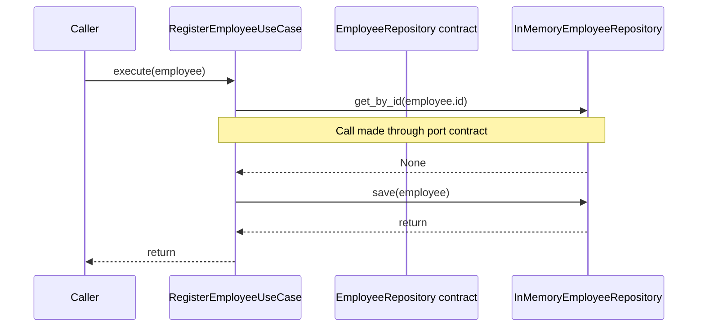

### Duplicate registration

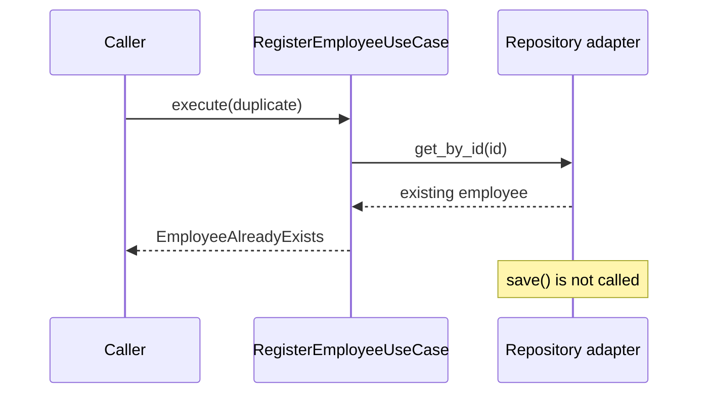

## 11. REFACTOR — check the boundaries

- Domain entity: validates one employee.
- Use case: coordinates registration and enforces the duplicate-ID rule.
- Inbound port: declares what callers can request.
- Outbound port: declares what storage operations the use case needs.
- In-memory adapter: supplies those operations for tests.
- Future HTTP adapter: will translate JSON into an `Employee` and call the inbound port.

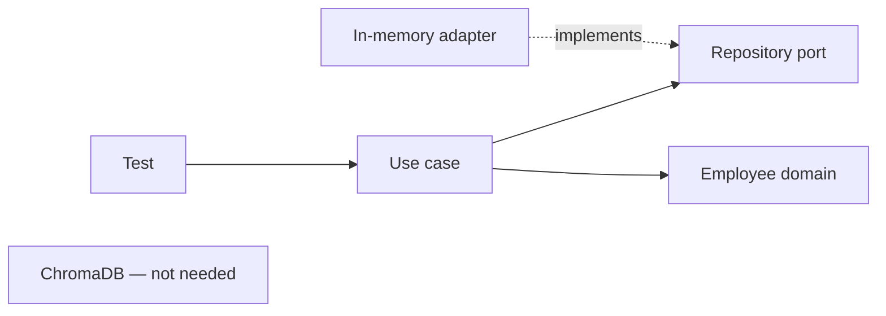

> [!warning] Concurrency and correctness
> The sequence `get_by_id()` then `save()` is **not atomic**. Two concurrent requests could both see no existing record and save the same ID. For production, enforce uniqueness atomically in the authoritative database (for example, a PostgreSQL unique constraint), and translate duplicate-key errors into `EmployeeAlreadyExists`. This exercise teaches the boundary first; we will strengthen the port contract when adding real persistence.

> [!important] Source of truth versus search index
> ChromaDB will later serve **semantic retrieval**, not necessarily authoritative employee registration. PostgreSQL can become the source of truth, with ChromaDB holding a derived index. Do not assume registering in an in-memory repository automatically indexes anything in ChromaDB.

## 12. Optional: manually wire the application

Create a temporary `demo_registration.py` in the project root:

```python
from employee_search.adapters.outbound.in_memory_employee_repository import (
    InMemoryEmployeeRepository,
)
from employee_search.application.use_cases.register_employee import (
    RegisterEmployeeUseCase,
)
from employee_search.domain.employee import Employee

repository = InMemoryEmployeeRepository()
register = RegisterEmployeeUseCase(repository)

employee = Employee(
    id="employee_1",
    name="John Doe",
    department="Engineering",
    role="Software Engineer",
    experience=5,
    skills=("Python", "React"),
    location="New York",
)

register.execute(employee)
print(repository.get_by_id("employee_1"))
```

Run:

```bash
uv run python demo_registration.py
```

This is **manual dependency injection**: the outermost code constructs the adapter and passes it into the use case. Later, our `bootstrap/` module will do the wiring for FastAPI.

## 13. Reflection questions

1. Why is `EmployeeAlreadyExists` a domain concept rather than an HTTP error?
2. Why does the use case depend on `EmployeeRepository` instead of `InMemoryEmployeeRepository`?
3. Which rule can the entity enforce alone, and which needs repository access?
4. What happens if the in-memory adapter is replaced by PostgreSQL?
5. Why is the duplicate-ID check insufficient under concurrency?

## 14. Definition of done

- [ ] Three registration tests pass.
- [ ] Part 1 tests still pass.
- [ ] The use case imports only domain and application packages.
- [ ] The adapter implements the outbound contract.
- [ ] You can explain inbound vs outbound ports and adapters.
- [ ] You can explain why ChromaDB is intentionally absent.

Commit:

```bash
git add .
git commit -m "feat(application): register employees through repository port"
```

## 15. What comes next?

**Part 3 (future):** Define `EmployeeSearchPort`, generate embeddings, implement the ChromaDB outbound adapter, and add integration tests against the Docker Compose service. We will distinguish exact metadata constraints from semantic ranking, as the Coursera lab does.

