# Building an Employee Semantic Search Application

> [!info] Workshop Overview
> **Architecture:** Domain-Driven Design (DDD) + Hexagonal Architecture (Ports and Adapters)  
> **Methodology:** Test-Driven Development (TDD)  
> **Technology:** Python 3.11, uv, ChromaDB, FastAPI, Docker, Docker Compose, pytest  
> **Domain:** Employee Discovery and Semantic Search  
> **Reference:** IBM Coursera — Similarity Search on Employee Records using Python and ChromaDB

## 1. Learning Objectives

The objective is to transform a simple ChromaDB demonstration into a maintainable software application following established software engineering principles.

By completing this workshop, we should understand:

1. How to translate requirements into domain models and use cases.
2. How Domain-Driven Design separates business concepts from technical implementations.
3. How Hexagonal Architecture isolates application logic from databases and external systems.
4. How to use TDD to develop and verify business behavior.
5. How embeddings, metadata filtering, and similarity search work.
6. How to integrate ChromaDB without coupling business logic to it.
7. How to containerize the application using Docker Compose.
8. How to replace ChromaDB with PostgreSQL + pgvector or another vector database.

### Learning Roadmap

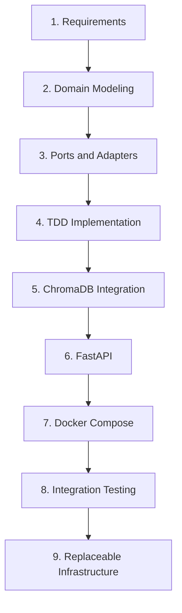

### Guiding Principles

> [!important]
> The application should depend on business abstractions, not on ChromaDB, PostgreSQL, Docker, or FastAPI.

The database is an implementation detail. Employee discovery is the business capability.

---

# Part I — Requirements and Domain Discovery

## 2. Understanding the Problem

The original Coursera lab demonstrates semantic search over employee records.

Each employee contains attributes such as:

| Attribute | Example |
|---|---|
| ID | employee_1 |
| Name | John Doe |
| Department | Engineering |
| Role | Software Engineer |
| Experience | 5 years |
| Skills | Python, React, JavaScript |
| Location | New York |
| Employment type | Full-time |

The application should support searching employees using natural language and structured constraints.

For example:

**Query:** Find experienced Python developers in New York.

This contains two kinds of requirements:

- **Semantic requirement:** Python development experience.
- **Structured requirement:** Location is New York, and experience meets a specified minimum.

These should not be confused.

Vector similarity identifies semantically relevant records, while structured filtering enforces exact constraints.

## 3. Define Requirements

We begin by expressing the expected behavior independently of technology.

| Requirement ID | Requirement | Acceptance Criteria |
|---|---|---|
| REQ-001 | Register employees | Valid employees can be registered and retrieved |
| REQ-002 | Search employees semantically | Results are ranked by vector distance |
| REQ-003 | Filter by department | All returned employees belong to the requested department |
| REQ-004 | Filter by experience | Employees below the minimum experience are excluded |
| REQ-005 | Combine similarity and filters | All mandatory structured constraints are satisfied |
| REQ-006 | Delete employees | Deleted employees no longer appear in search |
| REQ-007 | Persist indexed data | Data survives container restarts |

These requirements extend the original lab into an application with a defined lifecycle.

### Requirements Traceability

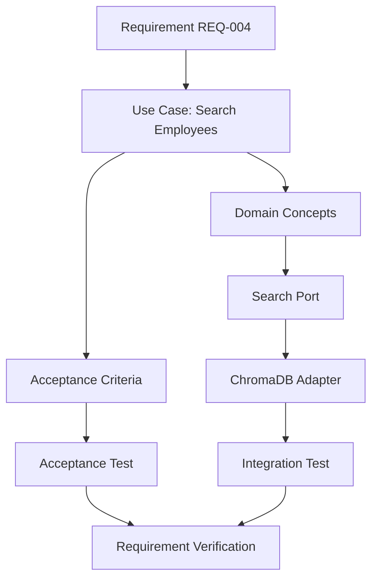

This creates a traceable relationship between requirements, behavior, implementation, and verification.

## 4. Acceptance Criteria Using Gherkin

Consider REQ-004.

```gherkin
Feature: Employee experience filtering

  Scenario: Exclude employees below minimum experience
    Given an employee with 5 years of experience
    And an employee with 12 years of experience
    When I search with a minimum of 10 years
    Then only the employee with 12 years is returned
```

The scenario describes observable business behavior.

It does not mention ChromaDB, SQL, HTTP, or Docker.

This is intentional: acceptance criteria should remain valid even if the infrastructure changes.

---

# Part II — Domain-Driven Design

## 5. What Is Domain-Driven Design?

DDD is an approach to designing software around the business domain and its rules.

Rather than starting with database tables or API endpoints, we identify the concepts that matter to the business.

For this application, the domain is **Employee Discovery**.

### Domain Discovery

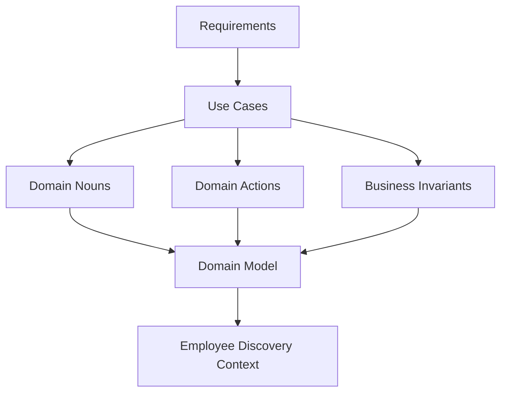

### Domain Concepts

| Concept | Responsibility |
|---|---|
| Employee | Represents an employee |
| Employee ID | Uniquely identifies an employee |
| Experience | Represents years of professional experience |
| Skills | Represents employee capabilities |
| Search Criteria | Describes search constraints |
| Search Result | Represents a retrieved employee and relevance information |

Not every concept needs to become a separate class.

We should introduce abstractions when they clarify business rules or reduce complexity.

## 6. Entity, Value Object, and Invariant

An **entity** has an identity that persists even when its attributes change.

An employee is an entity because the employee remains the same employee when their role or department changes.

A **value object** is identified by its value rather than a persistent identity.

Examples could include `EmployeeId`, `Experience`, or `SearchCriteria`.

An **invariant** is a rule that must always hold for a valid domain object.

For example:

> An employee cannot have negative years of experience.

### Employee Domain Model

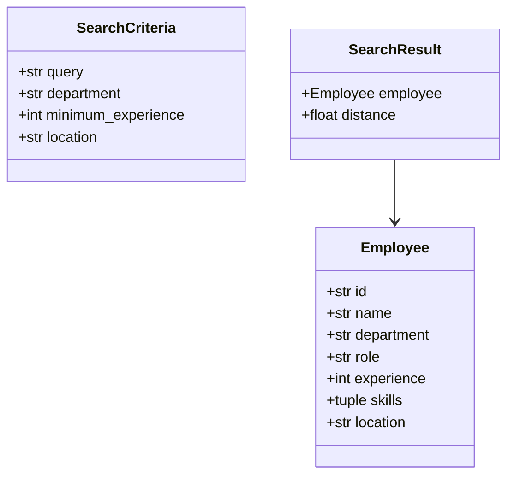

This is a conceptual model. It does not imply that every field or class must immediately exist in the first implementation.

## 7. Implement the Employee Entity

File: `src/employee_search/domain/employee.py`

```python
from dataclasses import dataclass


@dataclass(frozen=True)
class Employee:
    id: str
    name: str
    department: str
    role: str
    experience: int
    skills: tuple[str, ...]
    location: str

    def __post_init__(self):
        if self.experience < 0:
            raise ValueError(
                "Experience cannot be negative"
            )
```

### Why `dataclass`?

It provides generated constructors, equality comparison, and readable representations without unnecessary boilerplate.

### Why `frozen=True`?

It prevents ordinary attribute reassignment after construction.

For this initial model, we use immutable employee snapshots. Updating an employee can later be represented by constructing a new validated instance.

### Why validate in the domain?

Because negative experience is invalid regardless of whether the employee comes from:

- An HTTP request.
- A CSV import.
- A database.
- A message queue.
- A test fixture.

The rule belongs to the domain rather than to a specific adapter.

---

# Part III — Hexagonal Architecture

## 8. What Is Hexagonal Architecture?

Hexagonal Architecture separates application behavior from external technologies.

It consists of:

1. **Domain:** Business concepts and rules.
2. **Application:** Use cases that coordinate business operations.
3. **Ports:** Interfaces describing required capabilities.
4. **Adapters:** Implementations connecting those ports to external technologies.

### Architecture Overview

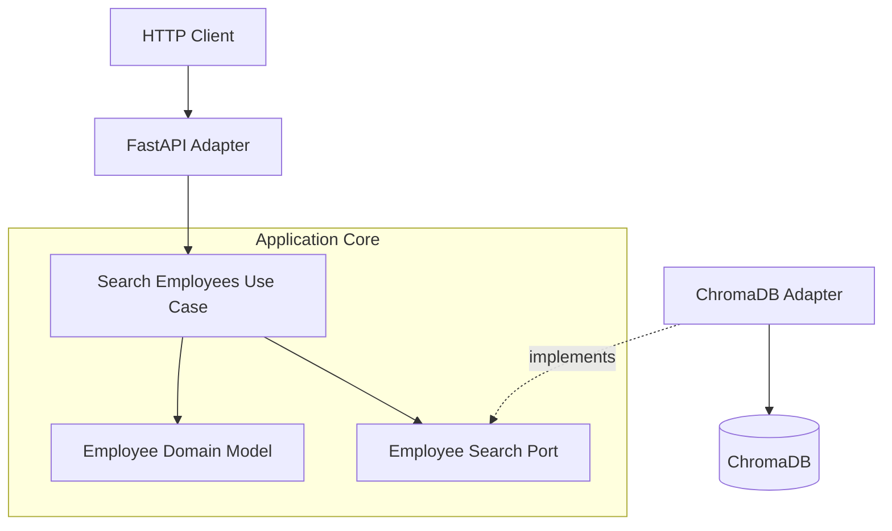

The application core must not import ChromaDB.

Instead, the ChromaDB adapter implements an interface defined by the application.

## 9. Dependency Inversion

Without dependency inversion:

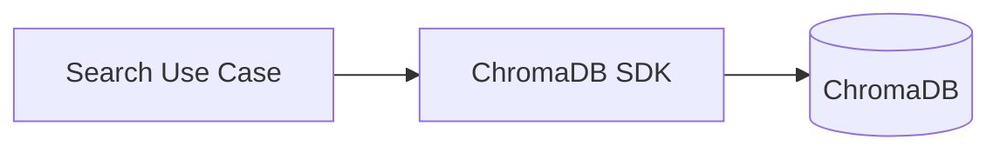

The business logic becomes coupled to ChromaDB.

With dependency inversion:

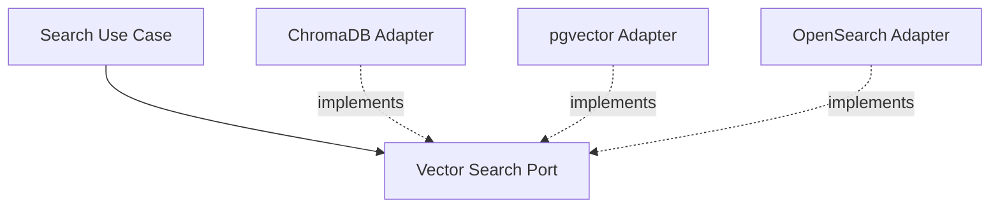

The use case remains unchanged when the infrastructure implementation changes, provided the replacement adapter satisfies the port's behavioral contract.

## 10. Define an Employee Repository Port

File: `src/employee_search/application/ports/employee_repository.py`

```python
from typing import Protocol

from employee_search.domain.employee import Employee


class EmployeeRepository(Protocol):

    def save(self, employee: Employee) -> None:
        ...

    def get_by_id(self, employee_id: str) -> Employee | None:
        ...

    def delete(self, employee_id: str) -> None:
        ...
```

### Why `Protocol`?

Python supports structural typing.

A class can satisfy the protocol by implementing the required methods, without explicitly inheriting from it.

### Repository vs Search Port

We should eventually separate two responsibilities:

| Port | Responsibility |
|---|---|
| EmployeeRepository | Save, retrieve, and delete employee records |
| EmployeeSearchPort | Perform semantic search and structured filtering |

This separation allows PostgreSQL to become the authoritative employee repository while ChromaDB remains a derived search index.

---

# Part IV — Test-Driven Development

## 11. What Is TDD?

Test-Driven Development is an iterative process where tests guide implementation.

The fundamental cycle is:

**Red → Green → Refactor**

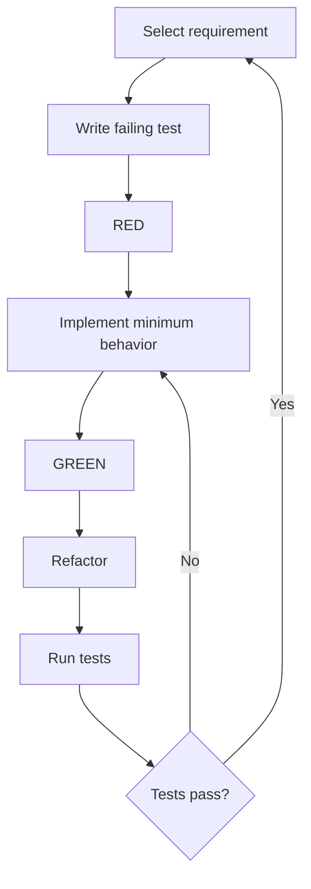

### RED

Write a test that describes behavior not yet implemented.

### GREEN

Implement the minimum code needed to satisfy the test.

### REFACTOR

Improve the design while preserving the verified behavior.

TDD is not simply writing tests before deployment. It is using tests to drive the design of the application.

## 12. First TDD Exercise

Requirement:

> An employee cannot have negative years of experience.

Create `tests/unit/test_employee.py`.

```python
import pytest

from employee_search.domain.employee import Employee


def test_employee_can_be_created():
    employee = Employee(
        id="employee_1",
        name="John Doe",
        department="Engineering",
        role="Software Engineer",
        experience=5,
        skills=("Python", "React"),
        location="New York",
    )

    assert employee.id == "employee_1"
    assert employee.experience == 5


def test_employee_cannot_have_negative_experience():
    with pytest.raises(ValueError):
        Employee(
            id="employee_1",
            name="John Doe",
            department="Engineering",
            role="Software Engineer",
            experience=-2,
            skills=("Python",),
            location="New York",
        )
```

Run:

```bash
uv run pytest tests/unit/test_employee.py -v
```

Before implementing the domain entity, the test should fail.

After implementing the entity, both tests should pass.

### Test Classification

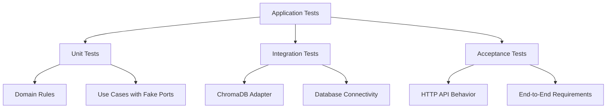

The tests have different purposes.

Unit tests should be fast and independent of infrastructure.

Integration tests verify interactions with real dependencies.

Acceptance tests verify observable requirements.

---

# Part V — Project Setup with uv

## 13. Why uv?

`uv` manages Python environments, dependencies, and project execution.

It provides:

- Dependency resolution.
- Virtual environment management.
- Lockfile-based reproducibility.
- Project execution using `uv run`.
- Development dependency management.

## 14. Initialize the Project

```bash
mkdir employee-search
cd employee-search

uv init --package --python 3.11

uv add fastapi "uvicorn[standard]" \
  "chromadb==1.0.12" \
  sentence-transformers pydantic

uv add --dev pytest pytest-cov httpx ruff
```

The pinned ChromaDB version follows the Coursera lab. For a new production application, we would review and test a current supported release instead.

## 15. Project Directory Structure

```text
employee-search/
├── pyproject.toml
├── uv.lock
├── Dockerfile
├── compose.yaml
├── .dockerignore
├── src/
│   └── employee_search/
│       ├── domain/
│       │   ├── employee.py
│       │   └── exceptions.py
│       ├── application/
│       │   ├── ports/
│       │   │   ├── employee_repository.py
│       │   │   └── employee_search.py
│       │   └── use_cases/
│       │       ├── register_employee.py
│       │       └── search_employees.py
│       ├── infrastructure/
│       │   └── chroma/
│       │       └── employee_repository.py
│       ├── presentation/
│       │   └── api.py
│       └── main.py
└── tests/
    ├── unit/
    ├── integration/
    └── acceptance/
```

### Package Dependency Rules

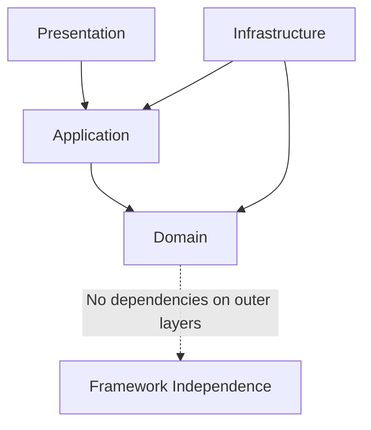

The dependency direction is inward.

The domain must not depend on FastAPI, ChromaDB, Docker, or the application layer.

The application must not depend directly on infrastructure implementations.

---

# Part VI — Understanding ChromaDB Integration

## 16. Embedding Pipeline

The employee records are converted into descriptive text.

For example:

```text
Software Engineer with 5 years of experience
in Engineering. Skills: Python, React,
JavaScript. Located in New York.
Employment type: Full-time.
```

The embedding model converts this text into a vector.

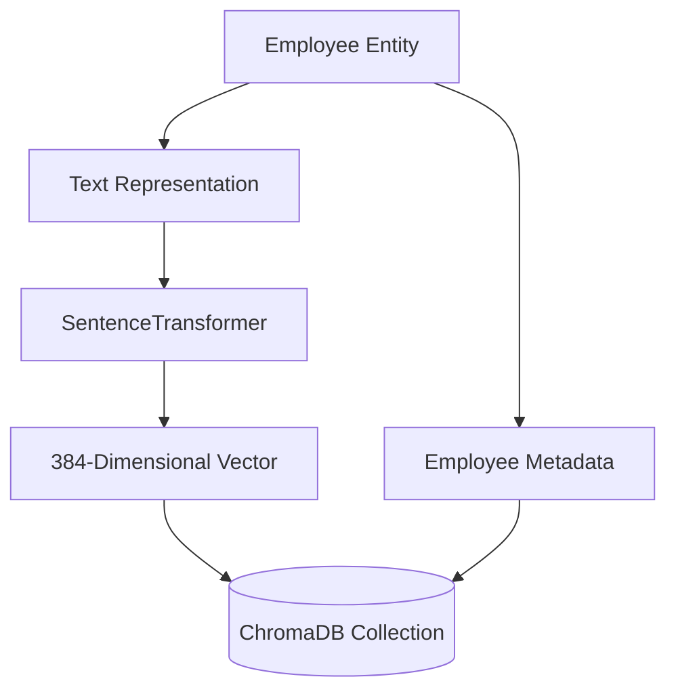

The embedding model used in the lab is `all-MiniLM-L6-v2`.

ChromaDB stores vectors and supports similarity retrieval.

## 17. Similarity Search

A search query must be converted into a vector using the same compatible embedding model.

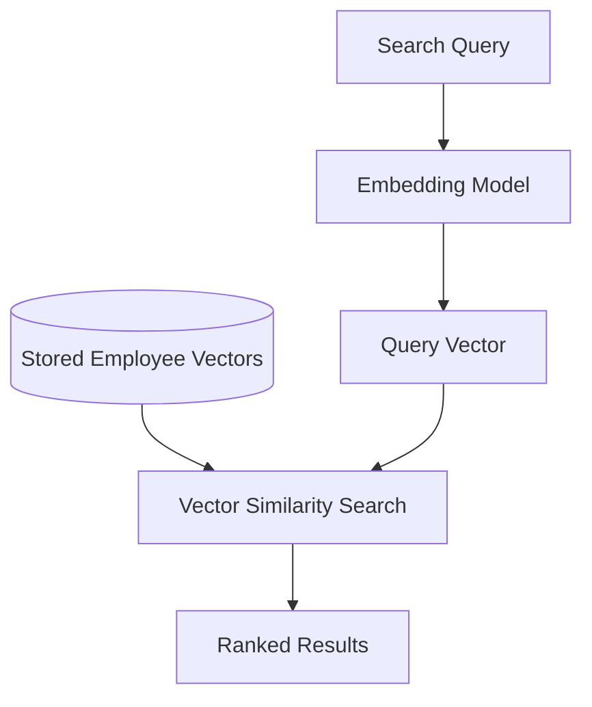

The similarity index uses a distance function such as cosine distance.

For cosine distance:

\[
d_{\text{cosine}}(a,b)
=1-\frac{a\cdot b}{\|a\|\|b\|}
\]

A smaller distance indicates greater cosine similarity.

## 18. Combining Semantic Search and Metadata Filtering

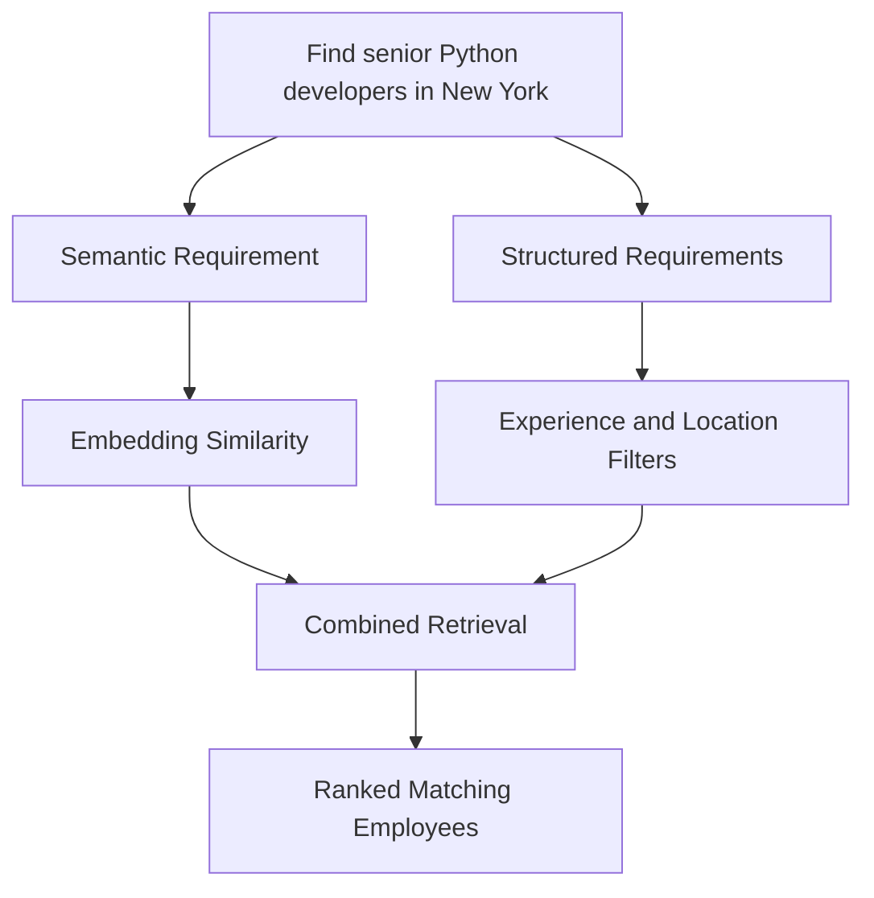

Semantic search answers:

> Which records are conceptually similar to the query?

Metadata filtering answers:

> Which records satisfy explicitly defined constraints?

A semantically similar result does not necessarily satisfy an unstated factual requirement.

For example, a Java developer might be semantically similar to a Python developer without actually having Python experience.

Mandatory skills should therefore be verified using structured data or another explicit validation step.

---

# Part VII — Docker and Docker Compose

## 19. Why Containerize?

Docker provides a consistent runtime environment.

Docker Compose coordinates the application and its infrastructure dependencies.

Our initial system contains two services:

1. FastAPI application.
2. ChromaDB server.

### Deployment Architecture

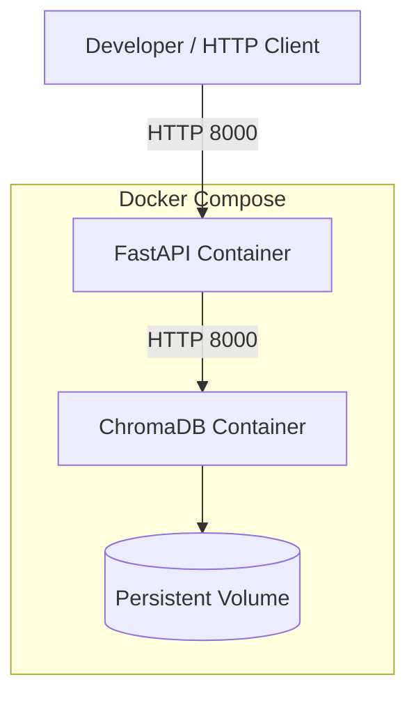

The two containers can both listen on port 8000 internally because they have separate network namespaces.

Only the API needs to publish port 8000 to the host.

## 20. Dockerfile

Create `Dockerfile`.

```dockerfile
FROM python:3.11-slim

COPY --from=ghcr.io/astral-sh/uv:latest \
    /uv /uvx /bin/

WORKDIR /app

COPY pyproject.toml uv.lock ./
COPY src/ ./src/

RUN uv sync --frozen --no-dev --no-install-project
RUN uv sync --frozen --no-dev

EXPOSE 8000

CMD ["uv", "run", "--no-sync", "uvicorn",
     "employee_search.main:app",
     "--host", "0.0.0.0",
     "--port", "8000"]
```

For reproducible builds, pin the uv image to a tested version or digest instead of relying on `latest`.

## 21. Docker Compose

Create `compose.yaml`.

```yaml
services:
  api:
    build: .
    ports:
      - "8000:8000"
    environment:
      CHROMA_HOST: chroma
      CHROMA_PORT: "8000"
    depends_on:
      chroma:
        condition: service_healthy

  chroma:
    image: chromadb/chroma:1.0.12
    volumes:
      - chroma_data:/data
    environment:
      IS_PERSISTENT: "TRUE"
      PERSIST_DIRECTORY: /data
      ANONYMIZED_TELEMETRY: "FALSE"
    healthcheck:
      test:
        - CMD
        - python
        - -c
        - "import urllib.request; urllib.request.urlopen('http://localhost:8000/api/v2/heartbeat')"
      interval: 10s
      timeout: 5s
      retries: 10

volumes:
  chroma_data:
```

> [!warning] Version and Deployment Verification
> This Compose configuration is a starting point, not a verified production deployment. Confirm the Chroma image's health-check dependencies, persistence directory, and compatibility with the pinned client version. A successful API health check alone does not prove ChromaDB connectivity.

## 22. FastAPI Entry Point

Create `src/employee_search/main.py`.

```python
from fastapi import FastAPI

app = FastAPI(title="Employee Search Service")


@app.get("/health")
def health():
    return {"status": "ok"}
```

This is a basic application-liveness endpoint.

A separate readiness endpoint should eventually check external dependencies.

## 23. Run the Application

```bash
docker compose up --build -d
```

Verify:

```bash
docker compose ps
```

Open:

```text
http://localhost:8000/docs
```

Run tests locally:

```bash
uv run pytest -v
```

Inspect logs:

```bash
docker compose logs -f api
```

Stop the services:

```bash
docker compose down
```

The named ChromaDB volume remains unless explicitly removed.

---

# Part VIII — Application Use Cases

## 24. Register Employee Use Case

The application use case coordinates registration without knowing which database stores the employee.

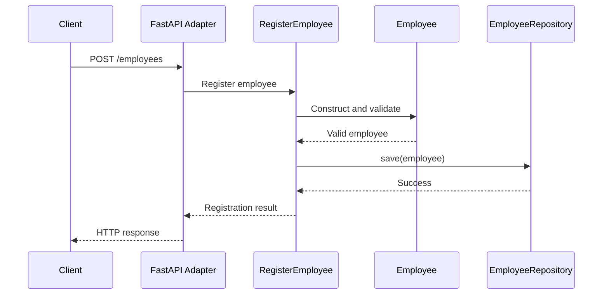

The repository is a port.

In unit tests, it can be implemented by an in-memory fake.

In integration tests, it can be implemented by ChromaDB.

## 25. Search Employees Use Case

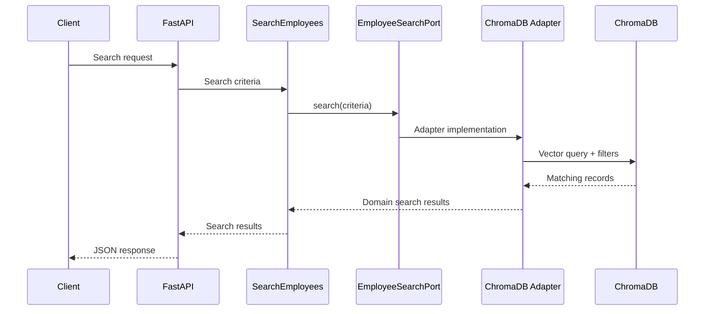

The diagram illustrates the logical port boundary. In actual Python execution, the use case calls the injected adapter through the port interface; the port itself is not a runtime service.

---

# Part IX — Portability and Future Migration

## 26. Why Keep Infrastructure Replaceable?

Our longer-term objective is to support multiple storage implementations.

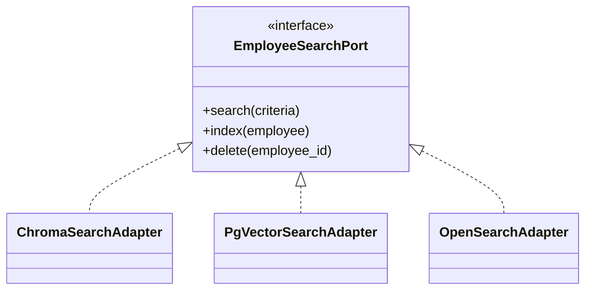

The application depends on the port.

Each adapter translates the application's search contract into the relevant database operations.

The abstraction must account for behavioral differences such as filtering, ranking, distance metrics, and update consistency.

## 27. Local Development vs AWS

### Local Development

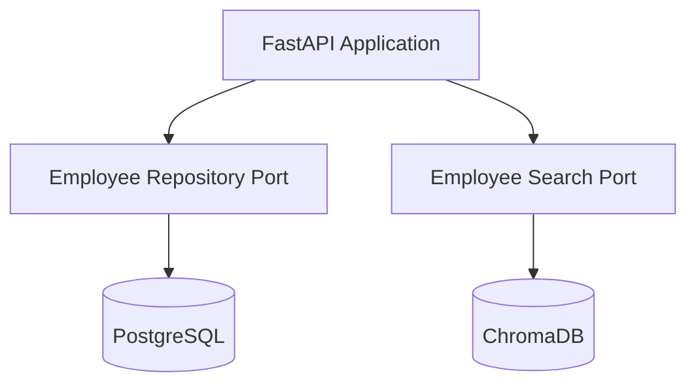

### AWS Deployment

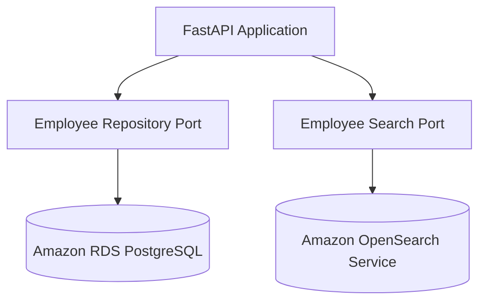

PostgreSQL can remain the authoritative employee database.

ChromaDB or OpenSearch can act as a derived search index.

A future production design should also introduce reliable synchronization between the source-of-truth database and the search index.

### Migration Strategy

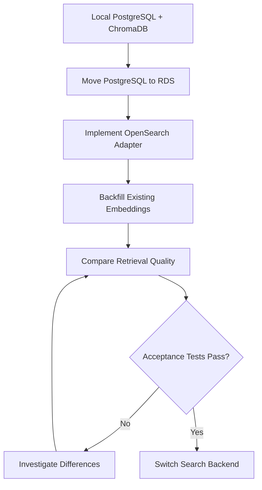

Migration requires more than changing configuration.

It also requires data migration, compatible embedding models, filtering validation, and retrieval-quality testing.

---

# Part X — Verification and Learning Milestones

## 28. Definition of Done

A feature is complete when:

- [ ] Its requirement has a stable ID.
- [ ] Acceptance criteria describe observable behavior.
- [ ] The domain model enforces relevant invariants.
- [ ] Application logic depends on ports rather than infrastructure implementations.
- [ ] Unit tests verify the behavior.
- [ ] Integration tests verify the relevant adapter.
- [ ] The feature can be exercised through the application interface.
- [ ] Tests pass in the intended development environment.

## 29. Workshop Milestones

| Milestone | Deliverable | Verification |
|---|---|---|
| M1 | Domain model | Domain unit tests pass |
| M2 | Repository port | Fake repository tests pass |
| M3 | Register employee use case | Use-case tests pass |
| M4 | Search employees use case | Search behavior tests pass |
| M5 | ChromaDB adapter | Integration tests pass |
| M6 | FastAPI endpoints | HTTP acceptance tests pass |
| M7 | Docker Compose | Services start and communicate |
| M8 | Persistence | Data survives container restart |
| M9 | Replaceable adapter | Same contract tests pass against another backend |

## 30. Key Architectural Lessons

### DDD

Model business concepts and rules independently of persistence technologies.

### Hexagonal Architecture

Define application-facing ports and implement infrastructure-specific adapters.

### TDD

Use tests to guide design and implementation, following Red → Green → Refactor.

### ChromaDB

Use embeddings and metadata to support semantic search and structured filtering.

### Docker

Package the application and its dependencies into reproducible execution environments.

### Portability

Make infrastructure replaceable through stable contracts, explicit dependency injection, and behavioral tests.

---

# Final Architectural View

```mermaid
flowchart TB
    Client["Client"]

    subgraph Presentation["Presentation Layer"]
        API["FastAPI HTTP Adapter"]
    end

    subgraph Application["Application Layer"]
        REG["Register Employee"]
        SEARCH["Search Employees"]
        RP["Repository Port"]
        SP["Search Port"]
    end

    subgraph Domain["Domain Layer"]
        EMP["Employee Entity"]
        RULES["Business Invariants"]
    end

    subgraph Infrastructure["Infrastructure Layer"]
        CR["ChromaDB Adapter"]
        PR["PostgreSQL Adapter"]
        EM["Embedding Model"]
    end

    Client --> API
    API --> REG
    API --> SEARCH

    REG --> EMP
    SEARCH --> EMP
    EMP --> RULES

    REG --> RP
    SEARCH --> SP

    PR -. implements .-> RP
    CR -. implements .-> SP

    CR --> EM
    CR --> CH[("ChromaDB")]
    PR --> PG[("PostgreSQL")]
```

> [!success] Core Takeaway
> **Requirements define what the system must do. DDD models what the business means. Use cases coordinate behavior. Ports describe what the application needs. Adapters provide technical implementations. TDD verifies behavior. Docker provides a reproducible runtime.**

## Suggested Next Lesson

**Lesson 2 — Implementing RegisterEmployee with TDD**

We will:

1. Write a failing test for employee registration.
2. Create an in-memory fake repository.
3. Implement the `RegisterEmployee` use case.
4. Introduce dependency injection.
5. Verify domain invariants and duplicate-ID behavior.
6. Refactor the design without introducing ChromaDB yet.

This will establish the core architectural pattern before adding external infrastructure.


---
title: "Workshop 01 - Employee Search: DDD, Hexagonal Architecture and TDD"
tags: [python, ddd, hexagonal-architecture, tdd, uv, chromadb, docker, workshop]
status: in-progress
---

# Workshop 01 — Employee Search: DDD, Hexagonal Architecture and TDD

> [!info] Scope
> **Hands-on Part 1:** Initialize a Python project with `uv`, derive domain rules from requirements, write failing tests, implement an `Employee` entity, and verify it. ChromaDB, FastAPI and Docker Compose are **planned for later milestones**, not prerequisites for the first tests.
>
> **Reference exercise:** IBM Coursera, *Similarity Search on Employee Records using Python and Chroma DB*. The employee-search use case comes from the lab; the DDD/TDD architecture and implementation plan are extensions for this workshop.

## Contents

- [[#1. Learning roadmap]]
- [[#2. Problem and requirements]]
- [[#3. Domain discovery (DDD)]]
- [[#4. Hexagonal architecture]]
- [[#5. TDD approach]]
- [[#6. Hands-on project setup]]
- [[#7. RED — write tests first]]
- [[#8. GREEN — implement the entity]]
- [[#9. REFACTOR and verify]]
- [[#10. Future ChromaDB retrieval flow]]
- [[#11. Future Docker Compose deployment]]
- [[#12. Milestones and definition of done]]

## 1. Learning roadmap

```mermaid
flowchart TD
    R["Requirements and acceptance criteria"] --> D["Domain-Driven Design"]
    D --> H["Hexagonal Architecture"]
    H --> T["Test-Driven Development"]
    T --> P["Python project with uv"]
    P --> U["Application use cases"]
    U --> C["ChromaDB adapter"]
    C --> A["FastAPI adapter"]
    A --> DC["Docker Compose"]
    DC --> IT["Integration and acceptance tests"]
    IT --> M["Portable database adapters"]
```

**This session's goal:** complete the domain entity and its unit tests without any database running.

## 2. Problem and requirements

The system supports employee discovery. A record has an ID, name, department, role, experience, skills and location. Future search will support natural-language similarity and exact metadata constraints.

| ID | Requirement | Verification |
|---|---|---|
| REQ-001 | Register a valid employee | A valid employee can be constructed now; persistence is tested later |
| REQ-002 | Reject invalid employee data | Empty ID/name and negative experience raise errors |
| REQ-003 | Search semantically | Ranked results are returned by a future search adapter |
| REQ-004 | Filter by department | Every result has the requested department |
| REQ-005 | Filter by experience | Every result meets the minimum experience |
| REQ-006 | Delete an employee | Deleted employee does not appear in future searches |
| REQ-007 | Persist indexed records | Data remains after ChromaDB container restart |

### Requirements traceability

```mermaid
flowchart TD
    R["REQ-002: Reject invalid employee data"] --> AC["Acceptance criteria"]
    AC --> A["Empty ID rejected"]
    AC --> B["Empty name rejected"]
    AC --> C["Negative experience rejected"]
    AC --> D["Zero experience accepted"]
    A --> UT["Unit tests"]
    B --> UT
    C --> UT
    D --> UT
    UT --> E["Employee domain entity"]
    E --> V["Verified behavior"]
```

### Example acceptance criterion

```gherkin
Feature: Employee validation
  Scenario: Reject negative experience
    Given employee details with -1 years of experience
    When an Employee is constructed
    Then construction fails with a validation error
```

> [!important] Separation of responsibilities
> The entity validates whether *one employee* is valid. The repository will later enforce whether an employee ID is already used by *another employee*. Entity construction alone cannot guarantee global ID uniqueness.

## 3. Domain discovery (DDD)

**Domain:** Employee Discovery. **Bounded context:** the part of the system responsible for registering and finding employees.

```mermaid
flowchart TB
    REQ["Requirements"] --> UC["Use cases"]
    UC --> N["Nouns: Employee, Skill, Experience"]
    UC --> V["Verbs: Register, Search, Delete"]
    UC --> I["Invariants: ID/name required; experience nonnegative"]
    N --> DM["Domain model"]
    V --> DM
    I --> DM
    DM --> BC["Employee Discovery bounded context"]
```

### Entity, value object and invariant

```mermaid
flowchart TD
    M["Domain model"] --> E["Entity: Employee"]
    M --> VO["Possible value objects: EmployeeId, Experience"]
    M --> INV["Invariants"]
    E --> ID["Identity persists as details change"]
    VO --> VALUE["Compared by value rather than identity"]
    INV --> RULES["Valid ID, valid name, experience >= 0"]
```

We will **not** create separate value-object classes yet. They are options for future refactoring if requirements warrant them.

### Domain model

```mermaid
classDiagram
    class Employee {
        +str id
        +str name
        +str department
        +str role
        +int experience
        +tuple skills
        +str location
        +__post_init__()
    }
    class DomainInvariants {
        <<rules>>
        +id must not be blank
        +name must not be blank
        +experience must be nonnegative
    }
    Employee ..> DomainInvariants : enforces
```

### Construction lifecycle

```mermaid
flowchart TD
    A["Construct Employee"] --> B["Initialize fields"]
    B --> C["Run __post_init__"]
    C --> D{"ID nonblank?"}
    D -->|No| X["Raise ValueError"]
    D -->|Yes| E{"Name nonblank?"}
    E -->|No| X
    E -->|Yes| F{"Experience >= 0?"}
    F -->|No| X
    F -->|Yes| G["Valid Employee"]
```

## 4. Hexagonal architecture

The domain describes the business. Application use cases orchestrate operations. Ports define required capabilities. Adapters connect external technologies.

```mermaid
flowchart TB
    CLIENT["HTTP client"] --> API["FastAPI inbound adapter"]
    subgraph CORE["Application core"]
        REG["RegisterEmployee use case"] --> RP["EmployeeRepository port"]
        SEARCH["SearchEmployees use case"] --> SP["EmployeeSearch port"]
        REG --> EMP["Employee domain entity"]
        SEARCH --> EMP
    end
    API --> REG
    API --> SEARCH
    PG["PostgreSQL repository adapter"] -. implements .-> RP
    CH["ChromaDB search adapter"] -. implements .-> SP
    PG --> DB1[("PostgreSQL")]
    CH --> DB2[("ChromaDB")]
```

> [!note] Current vs target architecture
> This is a **target architecture**, not code already implemented. In Part 1 only `Employee` and its tests exist. A first simple iteration may use an in-memory repository and ChromaDB alone; PostgreSQL can later become the authoritative record store.

### Dependency direction

```mermaid
flowchart TD
    PRES["Presentation"] --> APP["Application"]
    INFRA["Infrastructure adapters"] --> APP
    APP --> DOMAIN["Domain"]
    INFRA --> DOMAIN
    DOMAIN --> RULE["No imports from FastAPI, ChromaDB or PostgreSQL"]
```

The use case invokes an injected object satisfying a port; the port is an interface, **not** a separately running service.

### Future replaceable search port

```mermaid
classDiagram
    class EmployeeSearchPort {
        <<interface>>
        +index(employee)
        +search(criteria)
        +delete(employee_id)
    }
    class ChromaSearchAdapter
    class PgVectorSearchAdapter
    class OpenSearchAdapter
    EmployeeSearchPort <|.. ChromaSearchAdapter
    EmployeeSearchPort <|.. PgVectorSearchAdapter
    EmployeeSearchPort <|.. OpenSearchAdapter
```

A common interface helps portability, but a new backend still needs adapter code, data migration and retrieval-quality testing.

## 5. TDD approach

### Red → Green → Refactor

```mermaid
flowchart TD
    R["Choose a behavior"] --> T["Write failing test"]
    T --> RED["RED: Observe failure"]
    RED --> I["Implement minimum behavior"]
    I --> GREEN["GREEN: Tests pass"]
    GREEN --> REF["REFACTOR: Improve design"]
    REF --> ALL["Run tests again"]
    ALL --> Q{"All passing?"}
    Q -->|No| I
    Q -->|Yes| NEXT["Next behavior"]
    NEXT --> R
```

### Test layers

```mermaid
flowchart TB
    T["Test suite"] --> U["Unit tests"]
    T --> I["Integration tests"]
    T --> A["Acceptance tests"]
    U --> D["Domain invariants"]
    U --> F["Use cases with fake ports"]
    I --> C["Real ChromaDB adapter"]
    A --> HTTP["Observable HTTP requirements"]
```

## 6. Hands-on project setup

**Prerequisites:** Python-compatible development machine, `uv`, Git, and a terminal. Docker is needed only in a later lesson.

```bash
uv --version
mkdir employee-search
cd employee-search
uv init --package --python 3.11
uv add --dev pytest pytest-cov ruff
uv run python --version
uv run pytest --version
```

`uv init --package` creates an installable `src`-layout project. Keep the generated `pyproject.toml` and `uv.lock` under version control.

Create these files/directories in your editor:

```text
employee-search/
├── pyproject.toml
├── uv.lock
├── .python-version
├── README.md
├── src/
│   └── employee_search/
│       ├── __init__.py
│       └── domain/
│           ├── __init__.py
│           └── employee.py
└── tests/
    └── unit/
        └── test_employee.py
```

```mermaid
flowchart TD
    ROOT["employee-search/"] --> CFG["pyproject.toml + uv.lock"]
    ROOT --> SRC["src/employee_search/"]
    ROOT --> TEST["tests/unit/"]
    SRC --> DOM["domain/employee.py"]
    TEST --> UT["test_employee.py"]
    UT -. verifies .-> DOM
```

## 7. RED — write tests first

Create `tests/unit/test_employee.py`:

```python
import pytest

from employee_search.domain.employee import Employee


def make_employee(**overrides):
    """Construct a valid employee, overriding fields as needed."""
    data = {
        "id": "employee_1",
        "name": "John Doe",
        "department": "Engineering",
        "role": "Software Engineer",
        "experience": 5,
        "skills": ("Python", "React"),
        "location": "New York",
    }
    data.update(overrides)
    return Employee(**data)


def test_create_valid_employee():
    employee = make_employee()
    assert employee.id == "employee_1"
    assert employee.name == "John Doe"
    assert employee.experience == 5
    assert employee.skills == ("Python", "React")


def test_reject_negative_experience():
    with pytest.raises(ValueError, match="Experience"):
        make_employee(experience=-1)


def test_reject_empty_name():
    with pytest.raises(ValueError, match="Name"):
        make_employee(name="")


def test_reject_empty_id():
    with pytest.raises(ValueError, match="ID"):
        make_employee(id="")


def test_accept_zero_experience():
    employee = make_employee(experience=0)
    assert employee.experience == 0
```

Run:

```bash
uv run pytest tests/unit/test_employee.py -v
```

**Expected RED:** test collection fails because `employee_search.domain.employee` has not yet been implemented. This is a useful failure, not a successful test run.

### Why use a test factory?

```mermaid
flowchart LR
    F["make_employee defaults"] --> O["Apply overrides"]
    O --> A["experience = -1"]
    O --> B["name = empty"]
    O --> C["id = empty"]
    O --> D["experience = 0"]
    A --> T["Focused tests"]
    B --> T
    C --> T
    D --> T
```

## 8. GREEN — implement the entity

Create `src/employee_search/domain/employee.py`:

```python
from dataclasses import dataclass


@dataclass(frozen=True)
class Employee:
    id: str
    name: str
    department: str
    role: str
    experience: int
    skills: tuple[str, ...]
    location: str

    def __post_init__(self) -> None:
        if not self.id.strip():
            raise ValueError("Employee ID cannot be empty")
        if not self.name.strip():
            raise ValueError("Name cannot be empty")
        if self.experience < 0:
            raise ValueError("Experience cannot be negative")
```

Run:

```bash
uv run pytest tests/unit/test_employee.py -v
```

**Expected GREEN:** five tests pass.

### Dataclass concepts

```mermaid
flowchart TD
    A["@dataclass(frozen=True)"] --> INIT["Generated __init__"]
    A --> EQ["Generated equality and representation"]
    A --> IMM["Blocks ordinary field reassignment"]
    INIT --> POST["__post_init__"]
    POST --> INV["Check domain invariants"]
```

`frozen=True` is **shallow** immutability, not deep immutability. We use a tuple for `skills` to avoid keeping a mutable list there. Python type hints are not runtime validation; this introductory model assumes correctly typed inputs, and later lessons can add explicit boundary validation.

## 9. REFACTOR and verify

Ask whether each rule belongs in the domain and whether any complexity can be removed. Do **not** introduce `EmployeeId`, `Experience`, factories, services, or repositories merely for architectural appearance.

```bash
uv run pytest -v
uv run ruff check .
uv run pytest --cov=employee_search --cov-report=term-missing
```

Coverage indicates what ran, not whether the assertions are meaningful.

Suggested `.gitignore`:

```gitignore
.venv/
__pycache__/
.pytest_cache/
.ruff_cache/
.coverage
htmlcov/
```

Commit:

```bash
git init
git add .
git commit -m "feat(domain): introduce Employee entity with invariants"
```

## 10. Future ChromaDB retrieval flow

The Coursera lab constructs descriptive employee text, embeds it with `all-MiniLM-L6-v2` (384 dimensions), stores it in ChromaDB, and performs similarity search with metadata filters.

```mermaid
flowchart TB
    E["Employee"] --> TEXT["Searchable text representation"]
    TEXT --> MODEL["SentenceTransformer"]
    MODEL --> VECTOR["384-dimensional embedding"]
    VECTOR --> DB[("ChromaDB")]
    E --> META["Metadata: department, experience, location"]
    META --> DB
    Q["User query"] --> QE["Query embedding"]
    QE --> SEARCH["Similarity search"]
    DB --> SEARCH
    FILTER["Mandatory metadata filters"] --> SEARCH
    SEARCH --> RESULTS["Ranked matching employees"]
```

**Important:** semantic similarity is not proof of a required skill. A Java developer might rank near a Python query. If Python is mandatory, verify it through structured data or another explicit constraint.

### Why separate repository and search ports?

```mermaid
flowchart TD
    APP["Application"] --> REP["EmployeeRepository port"]
    APP --> SEARCH["EmployeeSearch port"]
    PG["PostgreSQL adapter"] -. implements .-> REP
    CH["ChromaDB adapter"] -. implements .-> SEARCH
    PG --> TRUTH[("Authoritative employee records")]
    CH --> INDEX[("Derived search index")]
```

This is the **longer-term** design. It introduces synchronization concerns: stable IDs, indexing retries, and eventual consistency between authoritative records and the derived index.

## 11. Future Docker Compose deployment

Docker will package the API and ChromaDB as separate services once we have an application adapter to run.

```mermaid
flowchart TB
    USER["HTTP client"] -->|"localhost:8000"| API["FastAPI container"]
    subgraph COMPOSE["Docker Compose network"]
        API -->|"internal HTTP"| CH["ChromaDB container"]
        CH --> VOL[("Named persistent volume")]
    end
```

Later, we will add a pinned Dockerfile, a `compose.yaml`, health/readiness checks, persistent Chroma storage, and integration tests. We should verify image-specific configuration and health-check commands against the selected Chroma version rather than assuming they work.

## 12. Milestones and definition of done

```mermaid
flowchart TD
    M1["M1: Employee entity + unit tests"] --> M2["M2: Repository port + fake"]
    M2 --> M3["M3: RegisterEmployee use case"]
    M3 --> M4["M4: SearchEmployees use case"]
    M4 --> M5["M5: ChromaDB adapter"]
    M5 --> M6["M6: FastAPI"]
    M6 --> M7["M7: Docker Compose"]
    M7 --> M8["M8: Integration + acceptance tests"]
    M8 --> M9["M9: PostgreSQL / AWS portability"]
```

### Part 1 checklist

- [ ] `uv init --package --python 3.11` completed
- [ ] `pytest`, `pytest-cov`, and `ruff` installed
- [ ] Tests written before the entity
- [ ] Initial test failure observed
- [ ] `Employee` entity implemented
- [ ] All five tests passing
- [ ] Ruff check passing
- [ ] Git commit created

### Final mental model

```mermaid
flowchart TB
    R["Requirements: What must happen?"] --> AC["Acceptance criteria: How do we verify it?"]
    AC --> D["DDD: What does the business mean?"]
    D --> U["Use cases: How is behavior coordinated?"]
    U --> P["Ports: What capabilities are needed?"]
    P --> A["Adapters: How are capabilities provided?"]
    A --> I["Infrastructure: ChromaDB, PostgreSQL"]
    T["TDD: Red → Green → Refactor"] -. verifies .-> D
    T -. verifies .-> U
    T -. verifies .-> A
    DOCKER["Docker: Reproducible runtime"] -. packages .-> I
```

> [!success] Key takeaway
> **Requirements** specify behavior; **DDD** models the business; **use cases** coordinate operations; **ports** define dependencies; **adapters** implement them; **TDD** verifies behavior; **Docker** packages the runtime.

### Next lesson

**Workshop 02 — RegisterEmployee using a repository port and an in-memory fake.** We will write failing use-case tests, introduce dependency injection, handle duplicate IDs, and keep ChromaDB outside the core.
