# Module 1: Introduction to Vector Databases and Chroma DB

A plain-language, cleaned-up version of the module's videos and readings: what vector databases are, how they differ from relational databases, where they are used, how similarity search measures "alike", and how **Chroma DB** puts it into practice (collections, filtering, the HNSW index).

**How to use this guide:** read top to bottom once, then use the [Cheat Sheet](#18-cheat-sheet) and [Self-Quiz](#19-self-quiz) for revision.

## Contents

1. [Why vector databases?](#1-why-vector-databases)
2. [What is a vector?](#2-what-is-a-vector)
3. [Vector databases versus relational databases](#3-vector-databases-versus-relational-databases)
4. [Vector library or vector database?](#4-vector-library-or-vector-database)
5. [Types of vector databases](#5-types-of-vector-databases)
6. [Dedicated databases versus databases with vector search](#6-dedicated-databases-versus-databases-with-vector-search)
7. [Where vector databases are used](#7-where-vector-databases-are-used)
8. [Similarity search](#8-similarity-search)
9. [L2 (Euclidean) distance](#9-l2-euclidean-distance)
10. [Dot product](#10-dot-product)
11. [Cosine similarity and distance](#11-cosine-similarity-and-distance)
12. [Choosing a metric](#12-choosing-a-metric)
13. [Chroma DB: key concepts and architecture](#13-chroma-db-key-concepts-and-architecture)
14. [Filtering in Chroma DB](#14-filtering-in-chroma-db)
15. [Vector indexes and HNSW](#15-vector-indexes-and-hnsw)
16. [Similarity search in Chroma DB](#16-similarity-search-in-chroma-db)
17. [Chroma quick reference and best practices](#17-chroma-quick-reference-and-best-practices)
18. [Cheat Sheet](#18-cheat-sheet)
19. [Self-Quiz](#19-self-quiz)

---

## Hands-on tutorials

Type-along versions with code, diagrams and exercises:

- [Tutorial 1: vector databases and similarity search, adapted](tutorials/01-vector-databases-and-similarity-search-adapted.md) follows the videos, the reading and the lab *Similarity Search by Hand* in order, with OpenAI embeddings instead of `sentence-transformers`.
- [Tutorial 2: build a mini vector database](tutorials/02-build-a-mini-vector-database.md) grows one small database over `transcript.md`: search, real embeddings, metric choice, metadata filters, update and delete, saving to disk.
- [Tutorial 3: flight plan, 30,000 ft to touchdown](tutorials/03-flight-plan-30000-ft-to-touchdown.md) tells the same module at seven levels of abstraction, from the one-sentence idea down to the NumPy lines, lands with a search you run by hand, then repeats that search in Chroma. No API key needed.
- [Tutorial 4: Chroma DB, adapted](tutorials/04-chroma-db-adapted.md) follows the Chroma lesson: collections, CRUD, metadata and document filters, the HNSW settings and the "polar bear" fix. It runs locally with Chroma's built-in embedding model, so no API key is needed.

- [Tutorial 5: the Chroma lab, adapted](tutorials/05-lab-similarity-search-on-groceries-adapted.md) walks through the lab *Similarity Search on Text Using a Chroma Vector Database* task by task (grocery list, `apple` query), flags where the lab's "score" is really a distance, and leaves the multi-query exercises as practice.

Source material in this folder: [transcript.md](transcript.md) (raw video transcripts and readings), the lab notebook `Similarity search by hand-v1.ipynb`, and [lab-instructions.md](lab-instructions.md) (the Chroma lab). Setup for the examples is in [course2 module 1](../../course2-build-rag-agents-get-started/module1/README.md#run-the-examples-yourself).

---

## The module at a glance

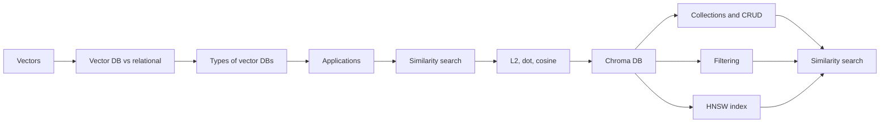

This module has two lessons of *Vector Databases for RAG*: lesson 1 (vector databases and similarity search, sections 1 to 12) and lesson 2 (exploring Chroma DB, sections 13 to 17). Module 2 (database operations, recommenders, RAG) builds on both.

---

## 1. Why vector databases?

Traditional databases were the standard for managing data. But data has become more complex: images, sounds, text, social "likes", map data, genomes. Storing that in tables needs a lot of pre-processing and transformation.

A **vector database** stores each data point as a **vector** and organises the points in a multi-dimensional space by how close they are. Close points are similar. That lets you:

- **group** items (clustering)
- **classify** items
- **suggest relationships** among items (recommendations)
- run a **similarity search**: quickly find items near a given item

Vector databases speed this up with distributed computing, indexing and parallel processing. They fit naturally into machine learning pipelines, which is why they sit under many AI apps.

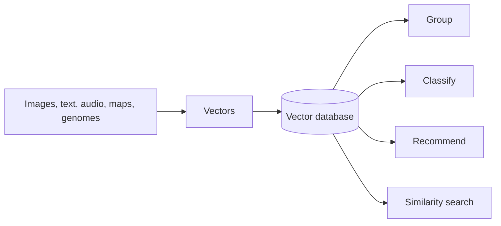

---

## 2. What is a vector?

A **vector** is an array of numbers. Each number is a **dimension**, one feature of the data point. Mathematically a vector also has a **length** (magnitude) and a **direction**.

**Video example: books.** Describe each book by four numbers: `[genre, pages, year, rating]`.

| Book | Vector | Meaning |
|---|---|---|
| Fiction | `[1, 350, 2003, 4.5]` | genre 1, 350 pages, 2003, rating 4.5 |
| Non-fiction | `[2, 250, 2015, 4.8]` | genre 2 |
| Science fiction | `[3, 400, 1990, 4.2]` | genre 3 |

Now you want a book of about 200 pages with a rating between 4.7 and 5.0. Instead of searching the whole platform, you compare the numbers of the candidates:

| Candidate | Vector |
|---|---|
| Book 1 | `[1, 180, 2010, 4.6]` |
| Book 2 | `[1, 220, 2005, 4.8]` |
| Book 3 | `[1, 210, 2015, 4.9]` |
| Book 4 | `[1, 190, 2018, 4.7]` |
| Book 5 | `[1, 200, 2012, 4.5]` |

Books 2, 3 and 4 match the rating range and the page count. (The raw video lists these with genre code `1` even though it earlier gave science fiction the code `3`. The point of the example is unchanged.)

### Vectors and the picture

A vector with two numbers is an arrow from the origin on a 2-D plane. `a = [4, 8]` goes 4 across and 8 up. Its **magnitude** is its length, the **L2 norm**:

```
|a| = sqrt(4^2 + 8^2) = sqrt(80) ≈ 8.94
```

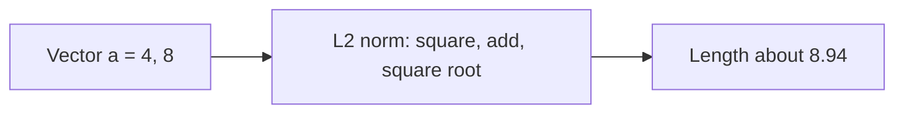

For **embeddings** (vectors produced from text, images and so on), the **direction** usually carries the *meaning* or topic, and the **magnitude** can reflect intensity, confidence or popularity.

---

## 3. Vector databases versus relational databases

A **relational database** stores data in **tables** (rows and columns) connected by primary and foreign keys. You use **SQL** (`SELECT`, `INSERT`, `UPDATE`, `DELETE`). It is excellent for structured data with well-defined relationships.

A **vector database** stores data as **vectors**. You find data by **similarity** rather than by exact match.

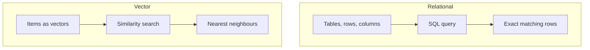

| | Traditional (relational) | Vector |
|---|---|---|
| Data representation | tables, rows, columns; structured data | multi-dimensional vectors; encodes complex, unstructured data (images, text, sensors) |
| Search and retrieval | SQL queries | similarity search; image retrieval, recommendations, anomaly detection |
| Indexing | B-trees | structures for high dimensions (metric trees, hashing, graph-based HNSW) that speed up nearest-neighbour search |
| Scalability | harder; add resources or shard data | built for big datasets; distributed architectures, horizontal scaling |
| Typical applications | business and transaction systems | large-scale analysis: research, NLP, multimedia |

**How vector data gets in.** Raw data (an image, a text string, audio) goes through the right **transformer** (embedding model), which produces a vector. That vector is stored.

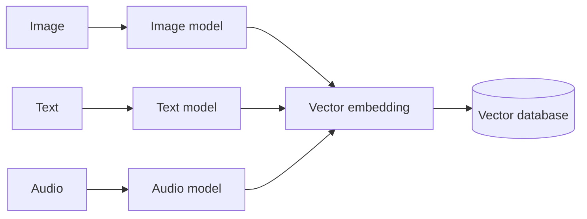

---

## 4. Vector library or vector database?

| | Vector library | Vector database |
|---|---|---|
| What it is | a tool that holds an in-memory index using pre-configured algorithms | a full data system |
| Operations | build and search | full **CRUD**: create, read, update, delete |
| Production use | usually a building block | enterprise deployments |

Rule of thumb: if data must change over time, survive restarts, or be filtered and managed, you want a database. Tutorial 2 builds both and shows what each step adds.

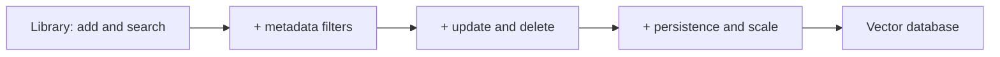

---

## 5. Types of vector databases

Five types, by where and how vectors are kept.

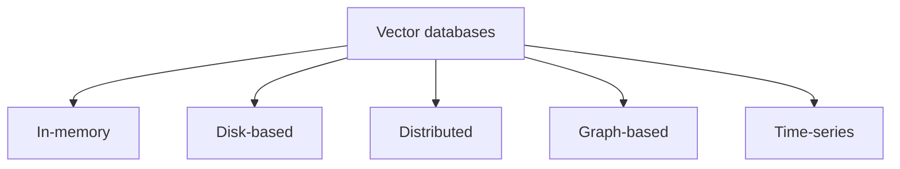

| Type | How it works | Good for | Examples in the video |
|---|---|---|---|
| **In-memory** | vectors live in RAM; very fast reads and writes | real-time analytics, recommendations | RedisAI |
| **Disk-based** | vectors on disk, with indexing and compression | data sets bigger than memory | Annoy, Milvus, ScaNN |
| **Distributed** | vectors spread over many servers | horizontal scale, fault tolerance, high throughput | FAISS, Elasticsearch with a vector plugin |
| **Graph-based** | data as graph nodes and edges; vectors as properties | relationships, graph analytics, knowledge graphs | Neo4j, Amazon Neptune, TigerGraph |
| **Time-series** | vectors stored with time stamps | temporal patterns, forecasting, anomaly detection (IoT, monitoring) | InfluxDB, TimescaleDB |

*Annoy* stands for "Approximate Nearest Neighbors Oh Yeah": fast **approximate** nearest-neighbour search, stored on disk.

---

## 6. Dedicated databases versus databases with vector search

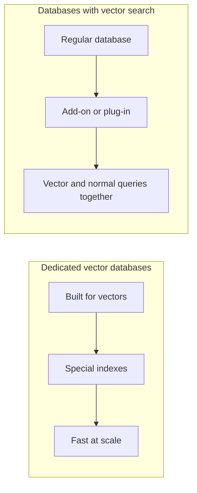

**Dedicated** vector databases (Faiss, Annoy, Milvus) are optimised from the ground up:

- special structures: **inverted indexes**, **product quantization**, **locality-sensitive hashing (LSH)**
- built-in vector operations: nearest neighbour, similarity search, distance calculation
- scalable across clusters; speed first, with tunable index and search parameters

**Databases that support vector search** are regular systems or data frameworks with vector features added. Vectors are stored as blobs, arrays or user-defined types, indexed with standard or custom indexes, and searched via plug-ins. Examples: SingleStore (which works with IBM watsonx.ai), Elasticsearch, PostgreSQL (pgvector), MySQL, RedisAI, MongoDB, Cassandra.

**Trade-off:** the second group is convenient (one database for everything) but may not be as fast or as optimised as a dedicated one. Weigh functionality, performance and scale for your needs.

---

## 7. Where vector databases are used

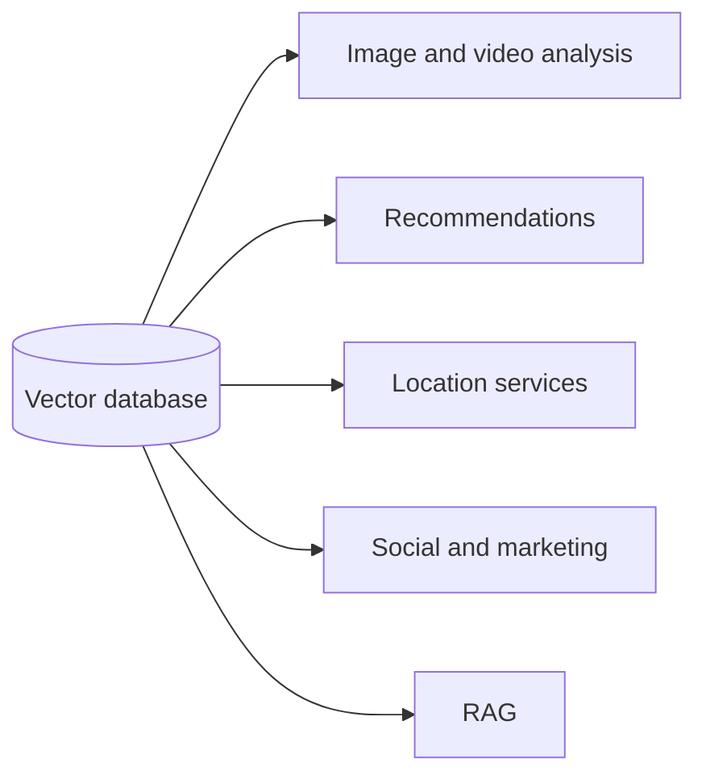

- **Image and video.** Store feature vectors (colour histograms, texture descriptions, deep learning embeddings). Find similar images, summarise video, suggest content. Real-time access supports surveillance, object recognition and live events. *Example:* a photo app compares a new photo's embedding with existing ones and suggests albums or tags.
- **Recommendations.** Store embeddings of items; nearest neighbours of what you liked become suggestions. Scales to many concurrent users and across domains. *Example:* after a film, a streaming service looks up the nearest movie embeddings.
- **Location-based services.** Index GPS points, addresses and polygons (with R-tree or quadtree style indexes). Answer closeness, range and spatial-join queries, plus real-time fleet and traffic analytics. *Example:* a navigation app lists restaurants within a distance of you.
- **Social and marketing.** Distribute data and queries across nodes; cache; autoscale. Handles user profiles and interests (cycling, running, swimming) as users grow, and delivers trend analytics fast.
- **RAG.** Find the document chunks closest to a question and give them to an LLM. This is where the whole certificate is heading.

---

## 8. Similarity search

**Similarity search** finds the items in a dataset most similar to a query item. It powers recommendations, image and video retrieval, finding similar documents or sentences, and biometrics such as face recognition.

At its core is a **metric**:

- a **distance** function gives a number where **bigger = farther apart**
- a **similarity** function gives a number where **bigger = more alike**

A similarity can often be turned into a distance with a simple formula, and the other way around.

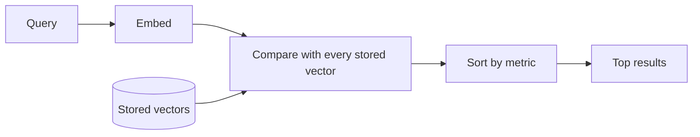

The three metrics in this module all compare two vectors `a` and `b`. We use two worked examples throughout:

- `a = [4, 8]` and `b = [11.5, 5]` (2-D)
- `q = [1, 2, 3]` and `r = [4, 5, 6]` (3-D)

### A little maths you need

The **cosine** of an angle in a right triangle is `adjacent / hypotenuse`. If the hypotenuse has length `|a|` and the angle is `α`, the adjacent side has length `|a| cos(α)`. That is the **projection** of `a` onto another direction, and it is where the dot product and cosine similarity come from.

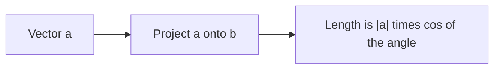

---

## 9. L2 (Euclidean) distance

The straight-line distance between the tips of two vectors:

```
L2(a, b) = sqrt( (a1-b1)^2 + (a2-b2)^2 + ... )
```

**Example 1.** `a = [4, 8]`, `b = [11.5, 5]`:

```
L2 = sqrt( (4-11.5)^2 + (8-5)^2 ) = sqrt(56.25 + 9) = sqrt(65.25) ≈ 8.08
```

**Example 2.** `q = [1, 2, 3]`, `r = [4, 5, 6]`:

```
L2 = sqrt(9 + 9 + 9) = sqrt(27) ≈ 5.20
```

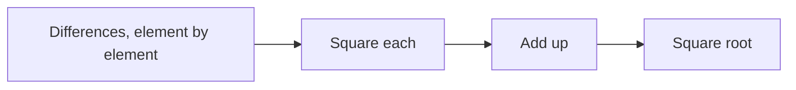

**Properties**
- smaller = closer; it is a **distance**
- sensitive to both **magnitude and direction**
- works in any number of dimensions
- common for spatial or geometric data: image analysis, computer vision, mapping

**Use case:** find the closest point to a location in 2-D or 3-D space, for example matching spatial features in computer vision.

---

## 10. Dot product

Multiply matching elements and add:

```
a . b = a1*b1 + a2*b2 + ...
```

**Example 1.** `[4, 8] . [11.5, 5] = 4*11.5 + 8*5 = 46 + 40 = 86`

**Example 2.** `[1, 2, 3] . [4, 5, 6] = 4 + 10 + 18 = 32`

**The geometric view.** Project `a` onto `b`, then multiply the length of `b` by the length of that projection:

```
a . b = |a| |b| cos(α)
```

Check with the example: `|a| ≈ 8.94`, `|b| ≈ 12.54`, `α ≈ 39.94°`, `cos(α) ≈ 0.767`. So `8.94 * 12.54 * 0.767 ≈ 86`, matching the direct calculation.

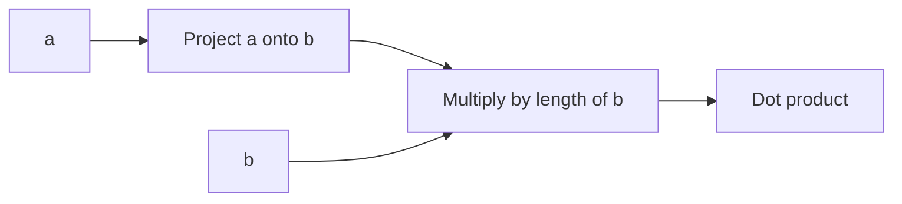

**Properties**
- a **similarity**: **bigger = more alike**
- can be positive, negative or zero depending on the angle
- to get a **distance**, take the **negative**: more negative = farther
- sensitive to **magnitude and direction**
- widely used in machine learning (neural network activations, matrix factorisation)

**Use case:** when length means something, such as relevance, confidence or popularity. In a recommender, direction says two products are about the same topic, and a larger magnitude says one is more popular, so you recommend the popular one.

---

## 11. Cosine similarity and distance

The cosine of the **angle** between two vectors:

```
cosine_similarity(a, b) = (a . b) / (|a| |b|)
cosine_distance(a, b)   = 1 - cosine_similarity(a, b)
```

Range of similarity: `-1` (opposite) to `0` (right angle) to `1` (same direction).

### Normalising makes it a dot product

To **normalise** a vector, divide it by its L2 norm. It then has length 1 and the same direction.

```
a = [4, 8],  |a| ≈ 8.94
norm(a) = [4/8.94, 8/8.94] ≈ [0.447, 0.894]
check:    0.447^2 + 0.894^2 ≈ 1
```

For two normalised vectors the denominator is 1, so:

```
cosine_similarity(a, b) = norm(a) . norm(b)
```

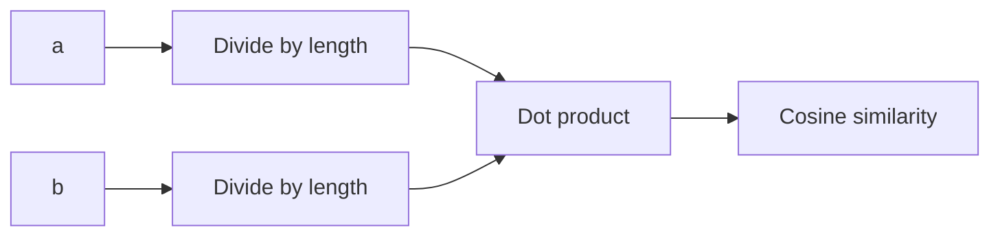

Many embedding models already return **normalised** vectors. Then the cheaper dot product is all you need for cosine comparisons, so storing normalised vectors is a good practical choice.

**Properties**
- looks at **orientation**, ignores **magnitude**
- scaling a vector up or down does not change the score
- well suited to high-dimensional, sparse data: text embeddings, term-frequency vectors

**Use case:** document similarity in NLP, finding texts with similar content regardless of their length.

---

## 12. Choosing a metric

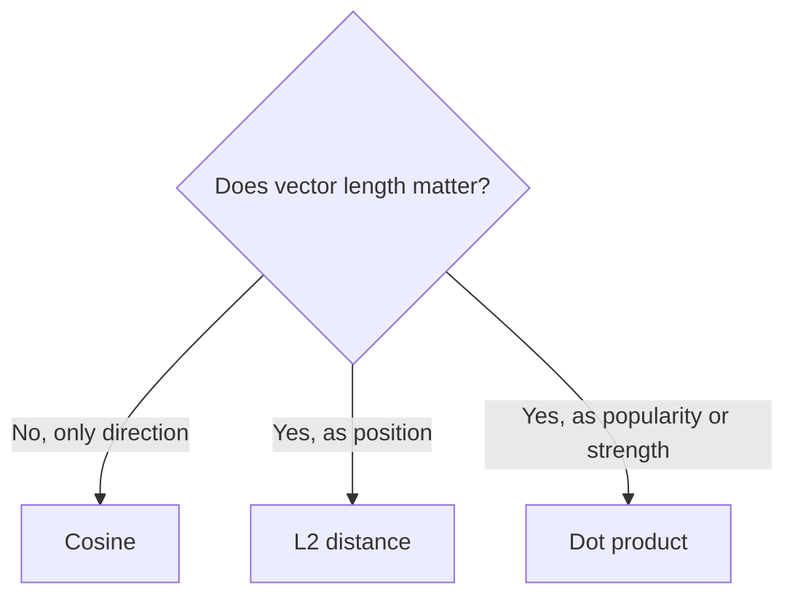

| Metric | Sensitive to magnitude | Normalised | Best for |
|---|---|---|---|
| L2 distance | yes | no | spatial data, clustering |
| Cosine distance | no | yes | text, embeddings, NLP |
| Dot product | yes | no | neural networks, recommender systems |

**Practical considerations**
- **Normalisation.** Normalise your vectors if you only ever need cosine similarity. For many NLP tasks and text embedding models this is the default.
- **High dimensions.** L2 suffers from the **curse of dimensionality**: in very high dimensions all points look about equally far apart. Prefer cosine, or reduce dimensions first.
- **Efficiency.** The dot product is a matrix operation and is fast. With normalised vectors it also gives cosine similarity.

**Summary.** L2 works well for continuous, lower-dimensional data where magnitude matters. Cosine excels with high-dimensional data where direction matters more than magnitude. The dot product is efficient and useful when both magnitude and direction count.

---

## 13. Chroma DB: key concepts and architecture

**Chroma DB** is an open-source vector database built for retrieval tasks. It offers:

| Capability | What it means |
|---|---|
| Embedding and metadata storage | stores vectors together with data about them |
| Vector search | finds text by **semantic** similarity using a distance metric such as cosine distance |
| Full text search | finds documents by **lexical** (spelling, exact word) similarity |
| Document storage | keeps the whole document, not only its embedding |
| Metadata filtering | narrows results using metadata to improve accuracy |
| Multi-modal retrieval | text, images and audio managed in one place |

### Deployment: two ways

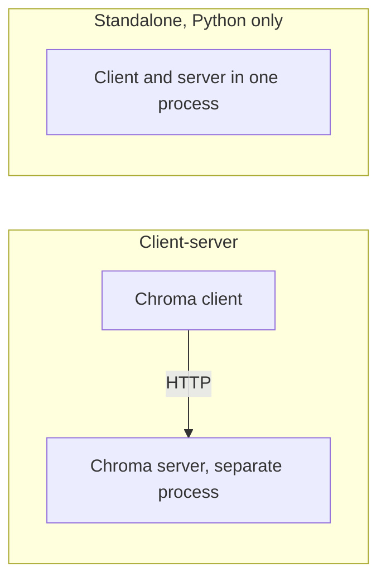

- **Client-server** (the typical setup). A client talks to a server in another process over HTTP. Start the server from the Chroma command line or from a Docker image.
- **Standalone** (Python). Client and server run inside your own program. Good for quick tests, or when the server will always be on the same machine.

### Architecture: five phases

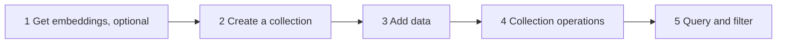

1. **Obtain embeddings (optional).** Convert text, images or data to vectors with an embedding model. Optional, because Chroma can do it for you.
2. **Create a collection.** A collection is Chroma's **table**: all data lives in collections, each with a logical name.
3. **Add data.** Send documents, metadata and ids. If you made embeddings yourself, send them too. Otherwise Chroma computes and stores them in the background.
4. **Collection operations.** Delete, update or rename collections.
5. **Query.** Search by text or by vector. Filter on metadata and on document content. Chroma embeds your query text for you.

**Default metric.** Chroma uses **squared Euclidean (L2) distance** unless you choose otherwise. It also supports cosine distance and the dot product (see [section 15](#15-vector-indexes-and-hnsw)).

### Clients and integrations

- Official clients: **Python** and **JavaScript**, maintained by the Chroma core team.
- Community clients: Ruby, Java, Go, C#, Rust, PHP.
- Integrates with **LangChain**, **LlamaIndex** and **Ollama**, and has native embedding integrations for **Hugging Face**, **Google** and **OpenAI** models.
- The core is written in **Rust**, which the video says gives roughly 3 to 5 times faster queries and writes than a Python core.

### Typical uses

Personalised **recommenders**, document **search** (vector or full text), **image retrieval** from text queries (multi-modal), and **chatbots** that fetch context for an LLM.

### How the pieces map to what you already know

| Chroma | Earlier idea |
|---|---|
| collection | table (but of vectors) |
| `add` / `get` / `update` / `delete` | CRUD (what separates a database from a library) |
| `where` | metadata filter (Tutorial 2, step 4) |
| HNSW index | the "approximate nearest neighbour" speed-up |

---

## 14. Filtering in Chroma DB

Chroma filtering differs from SQL. SQL matches **exact** values in a fixed schema. Chroma is built for unstructured data, so filters can be **combined with similarity search**.

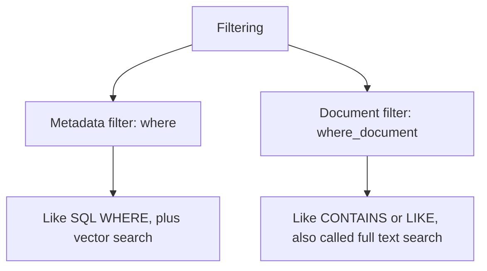

| Filter | Parameter | Compare to SQL |
|---|---|---|
| **Metadata** | `where` | `WHERE` clause, but can be combined with vector search |
| **Document** | `where_document` | `CONTAINS` or `LIKE`, but integrated with vector search |

Both go inside `.query()`, `.get()` and `.delete()`.

### Metadata filter operators

| Operator | Meaning | Types |
|---|---|---|
| `$eq` | equal to | string, int, float |
| `$ne` | not equal to | string, int, float |
| `$gt` / `$gte` | greater than / or equal | int, float |
| `$lt` / `$lte` | less than / or equal | int, float |
| `$in` | value is in a list | list |
| `$nin` | value is **not** in a list | list |
| `$and` / `$or` | combine filters | list of filters |

No operator means `$eq`, so these are the same:

```python
where={"source": "langchain.com"}
where={"source": {"$eq": "langchain.com"}}
```

Combine with `$and` or `$or`:

```python
where={"$and": [
    {"source": {"$in": ["langchain.com", "llamaindex.ai"]}},
    {"version": {"$lt": 0.3}},
]}
```

### Document filter operators

```python
where_document={"$contains": "pandas"}
where_document={"$not_contains": "library"}
where_document={"$or": [{"$contains": "LangChain"}, {"$contains": "Python"}]}
```

Document filtering is **case-sensitive**: searching for "Pandas" does not find "pandas".

### The reading's worked example

Five documents: ids `id1` to `id5`, each with `source` and `version` metadata.

| id | Document | source | version |
|---|---|---|---|
| id1 | This is a document about LangChain | langchain.com | 0.1 |
| id2 | This is a reading about LlamaIndex | llamaindex.ai | 0.2 |
| id3 | This is a book about Python | python.org | 0.3 |
| id4 | This is a document about pandas | pandas.pydata.org | 0.4 |
| id5 | This is another document about LangChain | langchain.com | 0.5 |

| Filter | Result |
|---|---|
| source equals langchain.com | id1, id5 |
| source equals langchain.com **and** version below 0.3 | id1 |
| source in (langchain.com, llamaindex.ai) **and** version below 0.3 | id1, id2 |
| document contains "pandas" | id4 |
| document contains "Pandas" | nothing (case) |
| version above 0.1 **and** document contains "LangChain" or "Python" | id3, id5 |

---

## 15. Vector indexes and HNSW

### Why an index?

Finding the most similar vector is easy maths: normalise everything, take dot products, sort. But this **brute-force** approach compares the query with **every** vector, which is too slow at scale.

A **vector index** is a data structure that organises the embeddings so a search only looks at a small, promising subset. Similar vectors are clustered or linked, so large parts of the data can be skipped early. This is how databases scale to millions or billions of vectors with low delay.

### HNSW: Hierarchical Navigable Small World

HNSW is a graph-based index for **approximate nearest neighbour (ANN)** search. It is the **only** index method the course says Chroma supports. It builds a **multi-layered graph**:

- the **upper layers** hold a sparse overview of the data, for fast moves across the space
- the **bottom layer** holds all the vectors, for the detailed search
- each vector links to a few near neighbours, forming a "small world" in which any vector is a few hops away

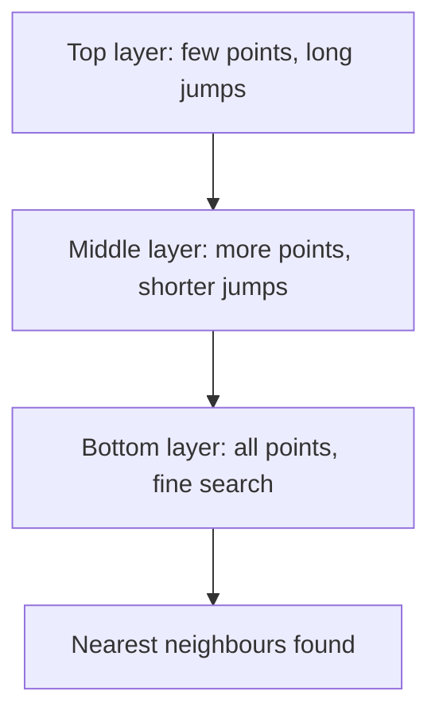

**Search.** Start at the top layer, move towards the query, drop down a layer, refine, repeat. Most of the data is never touched.

Think of finding a house: first the country, then the city, then the street, then the door.

| Benefit | Meaning |
|---|---|
| Fast | avoids scanning the data |
| Accurate | near-exact results |
| Scalable | millions to billions of vectors |
| Versatile | works with several metrics |

"Approximate" means it may occasionally miss the true nearest vector in exchange for speed.

### Configuring HNSW

HNSW is configured **when the collection is created**:

```python
collection = client.create_collection(
    name="my_collection_name",
    metadata={"topic": "query testing"},
    configuration={
        "hnsw": {
            "space": "cosine",
            "ef_search": 100,
            "ef_construction": 100,
            "max_neighbors": 16,
        },
        "embedding_function": ef,
    },
)
```

| Parameter | What it controls | Default | Higher value |
|---|---|---|---|
| `space` | distance metric: `l2` (squared L2), `ip` (inner product), `cosine` | `l2` | not a quality knob |
| `ef_search` | size of the candidate list when **searching** | 100 | better accuracy and recall, slower search |
| `ef_construction` | size of the candidate list when **building** the index | 100 | better index quality, slower build, more memory |
| `max_neighbors` | max connections per node | 16 | denser graph, better search, more memory and build time |

Two groups: `ef_search` is the **query-time** lever (recall versus speed). `ef_construction` and `max_neighbors` set the **quality of the built index** and cost memory and build time.

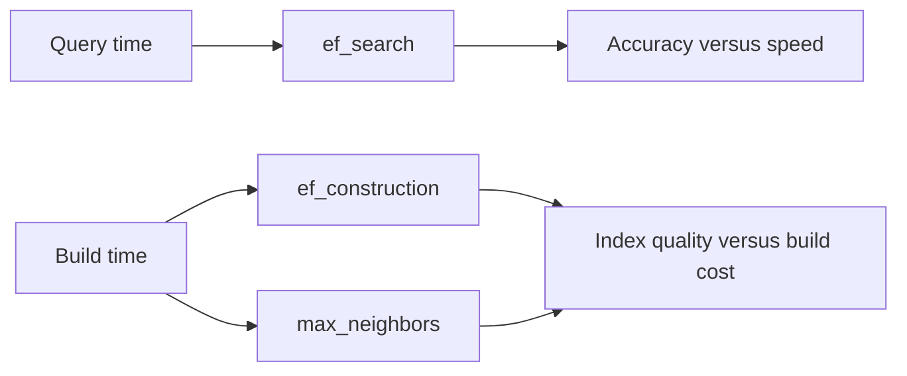

---

## 16. Similarity search in Chroma DB

### Add data, then query

The reading uses four documents that all contain the word "pandas", but with two meanings: the animal (`id1`, `id3`) and the Python library (`id2`, `id4`).

| id | Document | topic |
|---|---|---|
| id1 | Giant pandas are a bear species that lives in mountainous areas. | animals |
| id2 | A pandas DataFrame stores two-dimensional, tabular data | data analysis |
| id3 | I think everyone agrees that pandas are some of the cutest animals on the planet | animals |
| id4 | A direct comparison between pandas and polars indicates that polars is a more efficient library than pandas. | data analysis |

```python
collection.query(query_texts=["cats"], n_results=10)
```

Pass the query **in a list** to `query_texts`. `n_results` is how many to return; asking for more than exist returns all, ranked best first.

Result for "cats" (cosine distances, smaller is closer):

| Rank | id | Distance | Why |
|---|---|---|---|
| 1 | id3 | 0.738 | animals, and "cutest" matches cats being cute |
| 2 | id1 | 0.835 | animals |
| 3 | id2 | 0.863 | library |
| 4 | id4 | 0.930 | library |

The animal documents win although the query contains no word from them, because the **meaning** is closer.

### When semantic search goes wrong, and the fix

Query `"polar bear"` with `n_results=1` returns `id4`, the document about **polars** (the library), at distance 0.624. The embedding matched the word "polar" with "polars". Semantic search is not magic.

Three ways to fix it:

1. add more context to the query
2. use a different embedding model
3. **filter** (the simplest and often best)

```python
# keep only animal documents
collection.query(query_texts=["polar bear"], n_results=1, where={"topic": "animals"})

# or: drop anything that mentions "library"
collection.query(query_texts=["polar bear"], n_results=1,
                 where_document={"$not_contains": "library"})

# or: both together
collection.query(query_texts=["polar bear"], n_results=1,
                 where={"topic": "animals"},
                 where_document={"$not_contains": "library"})
```

All three return `id1` (the bears), at distance 0.710.

```mermaid
flowchart LR
    Q["polar bear"] --> S1["Search everything"] --> W["Matches polars: wrong"]
    Q --> F["Filter first: topic is animals"] --> S2["Search the rest"] --> OK["Giant pandas: right"]
```

### Reading a query result

`query` returns lists **of lists**, one inner list per query text:

```python
{'ids': [['id3', 'id1', 'id2', 'id4']],
 'documents': [[...]],
 'metadatas': [[...]],
 'distances': [[0.738, 0.835, 0.863, 0.930]]}
```

The standard loop from the cheat sheet:

```python
for i, (doc_id, score, text) in enumerate(
        zip(results['ids'][0], results['distances'][0], results['documents'][0])):
    print(f"Rank {i+1}: {doc_id}, Score: {score:.4f}, Text: {text}")
```

`[0]` selects the results for the first (only) query.

---

## 17. Chroma quick reference and best practices

```python
# 1. Setup
import chromadb
from chromadb.utils import embedding_functions
ef = embedding_functions.SentenceTransformerEmbeddingFunction(model_name="all-MiniLM-L6-v2")
client = chromadb.Client()

# 2. Collection with HNSW settings
collection = client.create_collection(
    name="collection_name",
    configuration={"hnsw": {"space": "cosine"}, "embedding_function": ef},
)

# 3. Add, 4. get, 5. query
collection.add(documents=texts, metadatas=metadata, ids=ids)
everything = collection.get()
only_one_source = collection.get(where={"source": "source1"})
results = collection.query(query_texts=["query"], n_results=5)
```

(The course uses `SentenceTransformerEmbeddingFunction`. [Tutorial 4](tutorials/04-chroma-db-adapted.md) uses Chroma's built-in `DefaultEmbeddingFunction`, which is the same `all-MiniLM-L6-v2` model, so you do not need PyTorch.)

**Best practices**
- Document filtering is **case-sensitive**.
- Combine `where` and `where_document` for precise results.
- Use `$and` and `$or` for complex logic, `$in` and `$nin` for lists.
- Pick the metric with `space` when you create the collection. Use `cosine` for text.
- Raise `ef_search` if recall is poor and you can afford slower queries.
- When a semantic match is wrong, add a filter before changing the model.

---

## 18. Cheat Sheet

| Idea | Remember |
|---|---|
| Vector | array of numbers; each number is a dimension; has length and direction |
| Vector database | stores vectors; answers by **similarity**; has CRUD |
| Vector library | in-memory index; build and search only |
| Relational database | tables and SQL; exact matching on structured data |
| Types | in-memory, disk-based, distributed, graph-based, time-series |
| Dedicated | built for vectors (Faiss, Annoy, Milvus); fastest |
| Vector search added | PostgreSQL, MySQL, MongoDB, Elasticsearch; convenient, maybe slower |
| Embedding | text, image or audio turned into a vector by a model |

| Metric | Formula | Better when | Magnitude matters |
|---|---|---|---|
| L2 distance | `sqrt(sum((a-b)^2))` | smaller | yes |
| Dot product | `sum(a*b)` | bigger (negate for a distance) | yes |
| Cosine similarity | `a.b / (norm(a) * norm(b))` | bigger | no |
| Cosine distance | `1 - cosine similarity` | smaller | no |

Key numbers to recall: for `a = [4, 8]`, `b = [11.5, 5]`: L2 ≈ 8.08, dot = 86, cosine ≈ 0.767.

| Chroma task | Code |
|---|---|
| Create a collection with settings | `client.create_collection(name=..., configuration={"hnsw": {"space": "cosine"}, "embedding_function": ef})` |
| Add | `collection.add(documents=..., metadatas=..., ids=...)` |
| Fetch by filter | `collection.get(where={...}, where_document={...})` |
| Similarity search | `collection.query(query_texts=[...], n_results=k, where=..., where_document=...)` |
| Metric (`space`) | `l2` (default, squared), `ip`, `cosine` |
| Metadata operators | `$eq $ne $gt $gte $lt $lte $in $nin $and $or` |
| Document operators | `$contains $not_contains $and $or` (case-sensitive) |
| HNSW knobs | `ef_search` (query), `ef_construction`, `max_neighbors` (build) |

| Idea | Remember |
|---|---|
| Collection | Chroma's table of vectors |
| Vector index | structure that avoids comparing the query with every vector |
| HNSW | layered graph: sparse top for jumps, full bottom for detail; approximate |
| Filter before you tune | a `where` often fixes a wrong semantic match |

## 19. Self-Quiz

1. How does a vector database store data, and how does a relational database store it?
2. What does a vector library lack compared with a vector database?
3. Name the five types of vector database and one use for each.
4. What is the difference between a dedicated vector database and a database that supports vector search?
5. Give two applications of vector databases and what is stored as vectors in each.
6. Is L2 distance a distance or a similarity? Is the dot product? Which direction is "better" for each?
7. How do you convert a dot product similarity into a distance? A cosine similarity?
8. Why does normalising vectors turn cosine similarity into a dot product?
9. Which metric would you pick for text embeddings, and why?
10. What happens to L2 distance in very high dimensions?
11. What is a collection in Chroma, and what does Chroma do for you when you `add` documents?
12. What are the two ways to deploy Chroma, and when is standalone mode useful?
13. What is the difference between `where` and `where_document`?
14. Why does `where_document={"$contains": "Pandas"}` find nothing in a collection that contains "pandas"?
15. Why does a vector index exist, and what does "approximate" mean in HNSW?
16. Which HNSW setting do you raise to improve recall at query time? Which two affect the quality of the built index?
17. The query "polar bear" returns a document about the Python library polars. Give two fixes.

<details>
<summary>Answers</summary>

1. Vectors in a multi-dimensional space; tables of rows and columns.
2. Create/update/delete (full CRUD) and production features; a library mostly builds an index and searches it.
3. In-memory (real-time recommendations), disk-based (data bigger than RAM), distributed (massive data and throughput), graph-based (social networks, knowledge graphs), time-series (anomaly detection, forecasting).
4. Dedicated ones are built and optimised for vectors; the other kind is a regular database with vector add-ons, convenient but possibly less optimised.
5. For example images (feature vectors) and movies (embeddings); also GPS points, user profiles, document chunks for RAG.
6. L2 is a distance (smaller is closer). The dot product is a similarity (bigger is closer).
7. Negate the dot product; use `1 - cosine similarity`.
8. Both lengths become 1, so the denominator `|a||b|` is 1 and only `a . b` remains.
9. Cosine, because meaning lives in direction and documents differ in length; it also behaves well in high dimensions.
10. It suffers from the curse of dimensionality: points look about equally far apart, so distances stop being useful.
11. A collection is Chroma's table. On `add` it stores the documents and metadata, and, unless you pass embeddings, computes and stores the embeddings in the background.
12. Client-server (a client talks to a server over HTTP) and standalone (client and server in one Python process). Standalone suits quick tests or a server that is always on the same machine.
13. `where` filters on metadata. `where_document` filters on the document text (full text search). Both can be combined with the vector search.
14. Document filtering is case-sensitive.
15. Brute force compares the query with every vector, which is slow at scale; an index lets the search look at a small subset. Approximate means it can occasionally miss the true nearest neighbour in exchange for speed.
16. `ef_search` at query time. `ef_construction` and `max_neighbors` set the quality of the built index.
17. Add a metadata filter such as `where={"topic": "animals"}` or a document filter such as `$not_contains: "library"`; or add context to the query, or use a different embedding model.

</details>

### The course's own quiz, with answers

| # | Question (short) | Answer |
|---|---|---|
| 1 | How do vector databases enhance recommendation systems? | by enabling efficient **similarity searches** for complex data types |
| 2 | Key difference from traditional databases? | vector databases are designed to handle **embeddings** |
| 3 | In-memory versus other types? | they store vectors directly in memory, which can give **faster query responses** |
| 4 | Which metric uses direction, not magnitude? | **cosine** distance |
| 5 | What does the direction of an embedding represent? | the **topic or semantic meaning** |
| 6 | Indexing versus querying in Chroma? | indexing **organises data for efficient retrieval**; querying retrieves by semantic similarity |
| 7 | Role of embeddings in similarity search? | they **convert data into a format that enables similarity comparison** |

---

## Corrections to the raw transcript

The raw `transcript.md` is a copy of the course page, with speech-to-text slips and a few factual mislabels. This guide fixes them. Keep this list in mind when you read the original.

| Raw transcript | This guide |
|---|---|
| "reversed indexes" | **inverted indexes** |
| "PostGIS add on for vectors in space" | PostGIS is for geographic data; vector search in PostgreSQL is **pgvector** |
| Torchserve listed as an in-memory vector database | Torchserve is a model server, not a vector database |
| Dask-ML and FAISS called distributed vector databases | FAISS is a **library**; Dask-ML is a machine learning library |
| "Apache MongoDB" | MongoDB |
| "Vector libraries within in-memory vector databases." | garbled sentence; the point is that libraries are in-memory indexes without full CRUD |
| Science fiction coded `3`, then the sci-fi books coded `1` | an inconsistency in the video; the example only needs the numbers to be comparable |
| "BAI framework" (certificate overview) | most likely the **BeeAI** framework (not certain) |
| "computatuonal", "defualt" (HNSW reading) | computational, default |
| "OLlama" | Ollama |
| the cats-query explanation appears twice, in two wordings | kept once |
| the cheat sheet lists `$in` and `$nin` among comparison operators | they are list operators (membership); section 14 lists them as such |
| "HNSW is the sole indexing method supported by Chroma" | true of the course version. Newer Chroma versions also have a distributed index (SPANN) in their configuration, but HNSW is what you use locally |
| Setup code uses `SentenceTransformerEmbeddingFunction` | needs PyTorch. Chroma's built-in `DefaultEmbeddingFunction` is the same `all-MiniLM-L6-v2` model, used in Tutorial 4 |
| the page's "Copied!", "Wrap Toggled!" and line-number columns in code | page interface text, removed |

Left out as filler: the course welcome and objectives, the certificate overview, and the "in this video you learned" recaps (their content is in the sections above).
