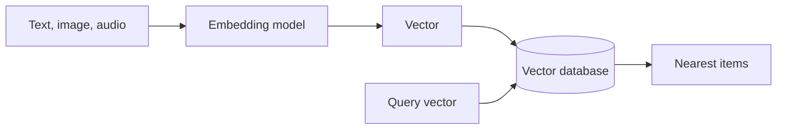
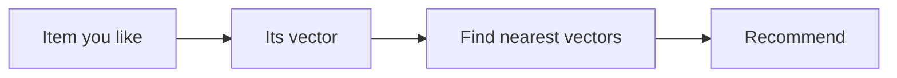
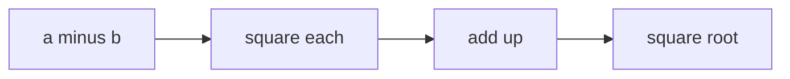
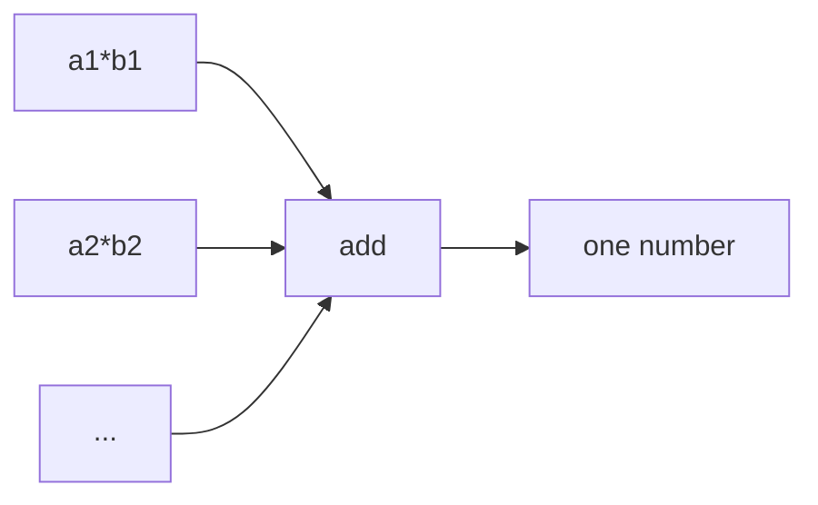
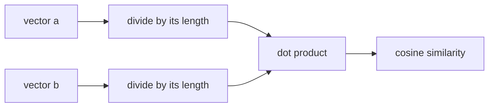
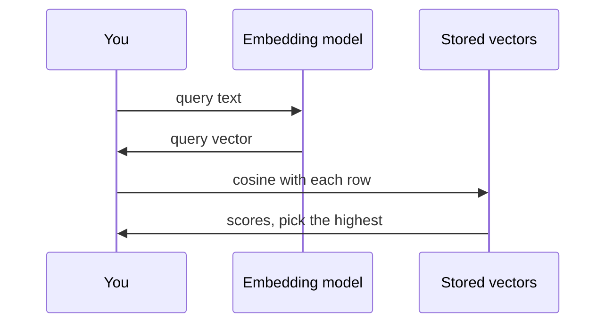

# Tutorial 1: Vector Databases and Similarity Search, Adapted From the Course

> **After this tutorial you can:**
> - explain what a vector is and why a vector database stores data as vectors
> - compare vector databases with relational databases, and vector libraries with vector databases
> - name the database types and what each is good for
> - compute **L2 distance**, **dot product** and **cosine similarity** by hand, then with NumPy
> - run a similarity search: embed a query and find the closest document

This follows the course order: the vector database videos and reading first, then the lab *Similarity Search by Hand*. Want one small app that grows step by step instead? See [Tutorial 2](02-build-a-mini-vector-database.md).

Anything marked **Beyond the video** is extra and not in the course.

## The path


## Before you start

You need `OPENAI_API_KEY` in the repo-root `.env` (see [Run the examples yourself](../../../course2-build-rag-agents-get-started/module1/README.md#run-the-examples-yourself)). Open a notebook in `course3/module1/`, pick the root `.venv` kernel, and run this once. Every `import` you need is installed already.

```python
import numpy as np
from dotenv import load_dotenv
from langchain_openai import OpenAIEmbeddings

load_dotenv()
embeddings_model = OpenAIEmbeddings(model="text-embedding-3-small")
```

> **Lab says / today we use:** the lab runs `pip install sentence-transformers` and loads `SentenceTransformer('paraphrase-MiniLM-L6-v2')`, which downloads a model and needs PyTorch (a few GB). We call OpenAI's `text-embedding-3-small` instead. The maths is identical. The only visible difference: the lab's vectors have **384** numbers, ours have **1536**.

Embedding calls cost a tiny amount of credit. LLM-style output varies, so numbers from the embedding model in this tutorial are **examples**. The hand-made vectors in Concepts 1 and 6 to 8 are exact.

---

## Concept 1: What is a vector?

**The idea.** A vector is a list of numbers. Each number is one **dimension**: one feature of the thing you describe. Think of a street address: (building, floor, door) is three numbers that place you in a building. A vector places a data point in a space. Points that sit close together are alike.

The video describes books as four numbers: genre, pages, publication year, average rating. Items that are near each other in this space are similar books.


**Type this.**

```python
fiction = np.array([1, 350, 2003, 4.5])
non_fiction = np.array([2, 250, 2015, 4.8])
sci_fi = np.array([3, 400, 1990, 4.2])
print(fiction.shape)
```

**Expected output.**

```
(4,)
```

Four numbers, so four dimensions.

Now the video's search: five books, and you want about 200 pages, rating near 4.8. Add the books and the wish:

```python
books = np.array([
    [1, 180, 2010, 4.6],
    [1, 220, 2005, 4.8],
    [1, 210, 2015, 4.9],
    [1, 190, 2018, 4.7],
    [1, 200, 2012, 4.5],
])
wish = np.array([1, 200, 2012, 4.8])
```

> **Lab says / today we use:** the video gives the genre code `3` for science fiction, then lists the "science fiction" books with code `1`. That is a slip in the video. We use `1` for all five books so they are the same genre and the wish matches.

Find the book closest to the wish by distance (details in Concept 6):

```python
distances = np.linalg.norm(books - wish, axis=1)
print(distances.round(2))
print("closest: book", distances.argmin() + 1)
```

**Expected output.**

```
[20.1  21.19 10.44 11.66  0.3 ]
closest: book 5
```

**Try it.** Book 5 has rating 4.5, yet the wish says 4.8. Why did it win? (Hint: look at the size of the `pages` and `year` numbers next to `rating`.) We fix this in Concept 6.

**Check yourself.** What does each number in a vector stand for?

<details><summary>Answer</summary>
One feature (attribute) of the data point. The count of numbers is the number of dimensions.
</details>

---

## Concept 2: Vector databases versus traditional databases

**The idea.** A relational database stores **tables** (rows and columns) and you query with **SQL**: "give me rows where price < 10". A vector database stores **vectors** and you query by **similarity**: "give me the items closest to this one". Use a relational database for exact, structured facts and transactions. Use a vector database for fuzzy "find things like this" over images, text or sounds.



| | Relational | Vector |
|---|---|---|
| Stores | tables, rows, columns | vectors in a multi-dimensional space |
| Search | SQL: exact match, filters, joins | similarity search: nearest neighbours |
| Index | B-trees | structures for high dimensions (trees, hashing, graphs) |
| Scaling | harder; add resources or shard | built to scale for big similarity workloads |
| Typical use | business and transactions | recommendations, image and text search, RAG |

**Vector library or vector database?** A **library** (for example FAISS or Annoy) is a tool for building and searching an in-memory index. A **database** adds full **CRUD** (create, read, update, delete), persistence and production features. Tutorial 2 builds both, so you feel the difference.

**Check yourself.** You need "all orders over 100 dollars from March". Which database type?

<details><summary>Answer</summary>
Relational. It is an exact, structured filter. A vector database answers "which products are like this one".
</details>

---

## Concept 3: Types of vector databases

**The idea.** Vector databases differ in where and how they keep vectors.

| Type | Idea | Examples from the video |
|---|---|---|
| In-memory | vectors live in RAM; very fast | RedisAI |
| Disk-based | vectors on disk, for sets bigger than memory | Annoy, Milvus, ScaNN |
| Distributed | spread over many servers; scales out | FAISS, Elasticsearch with a vector plugin |
| Graph-based | vectors as properties of graph nodes | Neo4j, Amazon Neptune, TigerGraph |
| Time-series | vectors with timestamps; find patterns | InfluxDB, TimescaleDB |

A second split: **dedicated** vector databases (built only for vectors, with special indexes such as inverted indexes, product quantization and locality-sensitive hashing) versus **regular databases with vector search added** (PostgreSQL, MySQL, MongoDB, Cassandra, Elasticsearch). Dedicated ones are usually faster. Regular ones let you keep one database for everything.

> **Lab says / today we use:** the video has several mislabels, so don't copy them blindly. "Reversed indexes" means **inverted indexes**. "PostGIS" is for geographic data; vector search in PostgreSQL is the **pgvector** extension. Torchserve is a model server, not a vector database. FAISS is a **library** that you can run on one machine, even though the video files it under distributed. Dask-ML is a machine-learning library, not a vector database. "Apache MongoDB" is just MongoDB.

**Check yourself.** Your data fits in RAM and you need answers in milliseconds. Which type?

<details><summary>Answer</summary>
In-memory.
</details>

---

## Concept 4: Where vector databases are used

**The idea.** Anywhere "find similar" matters:

- **Images and video.** Store each image's feature vector. Find similar photos, summarise video, recognise objects.
- **Recommendations.** After you watch a film, find films whose vectors are near it.
- **Location services.** Store GPS points and find restaurants within some distance. (Geospatial indexes such as R-trees do this.)
- **Social and marketing.** Match user profiles and interests at scale.
- **RAG.** Find the document chunks closest to a question and hand them to an LLM. This is where the rest of this course is heading.



**Try it.** Pick one app you use (music, shopping). Write which two features of an item you would put in its vector.

---

## Concept 5: Text becomes vectors (embeddings)

**The idea.** A book has easy numbers (pages, year). A sentence does not. An **embedding model** reads text and outputs a vector whose **direction encodes meaning**. Sentences with similar meaning get vectors pointing the same way. This lab uses four sentences that are hard on purpose. All start with "Bugs", but two mean software bugs and two mean insects.

**Type this.**

```python
documents = [
    "Bugs introduced by the intern had to be squashed by the lead developer.",
    "Bugs found by the quality assurance engineer were difficult to debug.",
    "Bugs are common throughout the warm summer months, according to the entomologist.",
    "Bugs, in particular spiders, are extensively studied by arachnologists.",
]
```

Embed them. `embed_documents` takes a list and returns a list of vectors:

```python
embeddings = np.array(embeddings_model.embed_documents(documents))
print(embeddings.shape)
```

**Expected output** (example; the lab prints `(4, 384)`):

```
(4, 1536)
```

Four rows (one per sentence), 1536 columns (the dimensions).

**Try it.** Add a fifth sentence to `documents`, run both cells again, and watch the first number change to 5.

**Check yourself.** Why is the lab's sentence set hard for keyword search?

<details><summary>Answer</summary>
All four share the word "Bugs", so a word match cannot tell software bugs from insects. The meaning comes from the context (developer vs entomologist), which embeddings capture.
</details>

---

## Concept 6: L2 (Euclidean) distance

**The idea.** L2 distance is the straight-line distance between two points. Smaller means more alike. It is the ruler between two arrow tips. The reading's example: a = [4, 8] and b = [11.5, 5] are about 8.08 apart.



Formula: `L2(a, b) = sqrt( (a1-b1)^2 + (a2-b2)^2 + ... )`

**Type this.** First the function from the lab, then check it against the reading's number.

```python
import math

def euclidean_distance_fn(v1, v2):
    squared_sum = sum((x - y) ** 2 for x, y in zip(v1, v2))
    return math.sqrt(squared_sum)

print(round(euclidean_distance_fn([4, 8], [11.5, 5]), 2))
```

**Expected output.**

```
8.08
```

Distance from the first sentence to the second, and the order does not matter:

```python
print(euclidean_distance_fn(embeddings[0], embeddings[1]))
print(euclidean_distance_fn(embeddings[1], embeddings[0]))
```

Now every pair, using nested loops. `i` and `j` are row positions:

```python
n = len(embeddings)
l2_manual = np.zeros((n, n))
for i in range(n):
    for j in range(n):
        l2_manual[i, j] = euclidean_distance_fn(embeddings[i], embeddings[j])
print(l2_manual.round(2))
```

**Expected output** (example numbers; yours differ):

```
[[0.   0.9  1.2  1.2 ]
 [0.9  0.   1.2  1.2 ]
 [1.2  1.2  0.   1.0 ]
 [1.2  1.2  1.0  0.  ]]
```

Read it like a table: row 0, column 1 is the distance between sentence 0 and 1. The diagonal is 0 (a point to itself). The matrix is symmetric. In the good case, sentences 0 and 1 (software) are close to each other, and 2 and 3 (insects) are close to each other.

**Practice-style step (Exercise 1 in the lab): do half the work.** Because the matrix is symmetric, you only need the upper triangle. Try writing the loop so it skips `i == j` and copies the other half. (Answer not shown. Ask me.)

**Faster: NumPy.** One line gives the same matrix with no loops:

```python
l2_numpy = np.linalg.norm(embeddings[:, None, :] - embeddings[None, :, :], axis=2)
print(np.allclose(l2_manual, l2_numpy))
```

**Expected output.**

```
True
```

> **Lab says / today we use:** the lab uses `scipy.spatial.distance.cdist(embeddings, embeddings, 'euclidean')`. That is neater, but `scipy` is not in this repo, so the block below is optional. Run `uv add scipy` at the repo root first if you want it.

```python
# needs: scipy
import scipy.spatial.distance

l2_scipy = scipy.spatial.distance.cdist(embeddings, embeddings, "euclidean")
print(np.allclose(l2_manual, l2_scipy))
```

**Back to the books.** Concept 1 picked book 5, although its rating was off. The reason: `pages` and `year` are large numbers and `rating` is tiny, so the distance is mostly about pages and year. The fix is to **scale each feature to the same range** (0 to 1) first:

```python
low = np.array([1, 100, 1950, 1.0])    # smallest plausible value per feature
high = np.array([3, 800, 2025, 5.0])   # largest plausible value per feature

def scale(x):
    return (x - low) / (high - low)

scaled = np.linalg.norm(scale(books) - scale(wish), axis=1)
print(scaled.round(3))
print("closest: book", scaled.argmin() + 1)
```

**Expected output.**

```
[0.063 0.098 0.049 0.085 0.075]
closest: book 3
```

Book 3 (210 pages, 4.9) is now the winner, which matches the video's goal (about 200 pages, rating 4.7 to 5.0). **Lesson: L2 is sensitive to the scale of each feature.**

**Check yourself.** L2 distance between q = [1, 2, 3] and r = [4, 5, 6]?

<details><summary>Answer</summary>
sqrt(9 + 9 + 9) = sqrt(27), about 5.20.
</details>

---

## Concept 7: Dot product

**The idea.** Multiply matching numbers and add them up. The result is a **similarity**: bigger means more alike (the opposite of a distance). It depends on both the **direction** and the **length** of the vectors. Use it when length carries meaning, for example a popular product having a longer vector.



`a . b = a1*b1 + a2*b2 + ...` which equals `|a| * |b| * cos(angle)`.

**Type this.**

```python
def dot_product_fn(v1, v2):
    return sum(x * y for x, y in zip(v1, v2))

print(dot_product_fn([4, 8], [11.5, 5]))
print(dot_product_fn([1, 2, 3], [4, 5, 6]))
```

**Expected output.**

```
86.0
32
```

Those are the reading's numbers (86 and 32). All pairs, with a loop and then one matrix multiplication:

```python
dot_manual = np.empty((n, n))
for i in range(n):
    for j in range(n):
        dot_manual[i, j] = dot_product_fn(embeddings[i], embeddings[j])

dot_matrix = embeddings @ embeddings.T
print(np.allclose(dot_manual, dot_matrix))
```

**Expected output.**

```
True
```

Why `embeddings @ embeddings.T` works: `embeddings` is 4 by 1536, its transpose is 1536 by 4, and the product is 4 by 4. Entry `[i, j]` is exactly row `i` dotted with row `j`. `np.matmul` and `np.dot` give the same result here, and `np.matmul` is recommended for 2-D arrays.

**Turn a similarity into a distance:** negate it. Smaller (more negative) now means closer.

```python
dot_distance = -dot_matrix
```

The diagonal (a sentence with itself) is not informative, so ignore it.

**Check yourself.** Is a bigger dot product "closer" or "farther"?

<details><summary>Answer</summary>
Closer. It is a similarity. Only the negated version is a distance.
</details>

---

## Concept 8: Cosine similarity and distance

**The idea.** Cosine similarity is the cosine of the **angle** between two vectors, and ignores length. It is 1 for the same direction, 0 for a right angle, -1 for opposite. Stretching a vector does not change it. That is why it is the default for text embeddings: a long document and a short note on the same topic still match.



Key trick: **normalise** each vector (divide by its L2 norm so its length is 1). Then cosine similarity is just the dot product.

**Type this.** Lengths first (the L2 norm of each row), then divide:

```python
norms = np.sqrt(np.sum(embeddings**2, axis=1))
print(norms.shape)
norms_col = norms.reshape(-1, 1)   # 4x1 so each row divides by its own norm
normalized = embeddings / norms_col
print(np.sqrt(np.sum(normalized**2, axis=1)).round(3))
```

**Expected output.**

```
(4,)
[1. 1. 1. 1.]
```

The last line is the lab's Exercise 2: every length is now 1.

The reading's example, a = [4, 8], normalised, is about [0.447, 0.894] (the reading shows 0.448 and 0.895 because it divides by the already-rounded 8.94):

```python
a = np.array([4, 8])
print((a / np.linalg.norm(a)).round(3))
```

**Cosine similarity for every pair**, one line:

```python
cosine_similarity = normalized @ normalized.T
print(cosine_similarity.round(2))
```

**Expected output** (example; yours differ):

```
[[1.   0.55 0.18 0.2 ]
 [0.55 1.   0.2  0.15]
 [0.18 0.2  1.   0.4 ]
 [0.2  0.15 0.4  1.  ]]
```

Cosine **distance** is `1 - similarity`. Smaller means closer, and the diagonal becomes 0:

```python
cosine_distance = 1 - cosine_similarity
```

Check the reading's example with the formula `a.b / (|a||b|)`; it should be about 0.767:

```python
a, b = np.array([4, 8]), np.array([11.5, 5])
print(round(float(a @ b / (np.linalg.norm(a) * np.linalg.norm(b))), 3))
```

> **Lab says / today we use:** the lab normalises with PyTorch, `torch.nn.functional.normalize(torch.from_numpy(x)).numpy()`. We use plain NumPy division, which gives the same result. **Beyond the video:** OpenAI embeddings already come **normalised** (length 1), so for them the dot product and cosine similarity are the same number. Check with `np.linalg.norm(embeddings, axis=1)`.

**Check yourself.** If you double every number in vector `a`, what happens to cosine similarity with `b`? And to the dot product?

<details><summary>Answer</summary>
Cosine similarity does not change (direction is the same). The dot product doubles.
</details>

---

## Concept 9: Similarity search with a query

**The idea.** A search is: embed the query with the **same model**, compare it with every stored vector, sort. This is the lab's Exercise 3. (This is also, in miniature, what every vector database does.)



**Type this.**

```python
query = "Who is responsible for a coding project and fixing others' mistakes?"
q = np.array(embeddings_model.embed_query(query))
q = q / np.linalg.norm(q)

scores = normalized @ q            # one cosine score per document
best = scores.argmax()
print(scores.round(2))
print(documents[best])
```

**Expected output** (example):

```
[0.45 0.33 0.12 0.1 ]
Bugs introduced by the intern had to be squashed by the lead developer.
```

The first sentence wins, as the lab expects: "lead developer" matches "responsible for a coding project".

**Try it.** Change the query to `"Which animal studies are done by scientists?"` and see which sentence wins. Then rank all four with `np.argsort(-scores)`.

**Check yourself.** Why must the query use the same embedding model as the documents?

<details><summary>Answer</summary>
Different models produce vectors in different spaces (and sizes). Comparing across them is meaningless.
</details>

---

## Putting it together

A tiny reusable search that does Concepts 5 to 9 in a few lines:

```python
def search(query, docs_vectors, docs, k=2):
    q = np.array(embeddings_model.embed_query(query))
    q = q / np.linalg.norm(q)
    scores = docs_vectors @ q
    top = np.argsort(-scores)[:k]
    return [(round(float(scores[i]), 3), docs[i]) for i in top]

for score, text in search("insects in summer", normalized, documents):
    print(score, text)
```

The best match should be the entomologist sentence. Tutorial 2 turns this into a small vector database with add, update and delete.

## Common mistakes

| Mistake | Why it happens | Fix |
|---|---|---|
| Treating L2 as "bigger is more similar" | L2 is a distance | Smaller is closer. Dot product and cosine similarity are the "bigger is closer" ones |
| Raw features of different sizes in L2 | pages (hundreds) swamp rating (units) | Scale features first (Concept 6) |
| `embeddings / norms` raises a shape error | `norms` has shape `(4,)`, rows need `(4, 1)` | `norms.reshape(-1, 1)` |
| Embedding the query with another model | different vector space | Same model for documents and queries |
| Using `cosine_similarity` as a distance | forgot `1 - sim` | `cosine_distance = 1 - cosine_similarity` |
| Reading dot-product diagonal as meaningful | a vector with itself is always large | Ignore the diagonal |
| `ModuleNotFoundError: scipy` | not installed here | Use the NumPy version, or `uv add scipy` |

## Cheat sheet

| Metric | Formula | Better | Cares about length? | Best for |
|---|---|---|---|---|
| L2 distance | `sqrt(sum((a-b)^2))` | smaller | yes | spatial data, clustering |
| Dot product | `sum(a*b)` | bigger (negate for distance) | yes | recommenders, when length means popularity |
| Cosine similarity | `a.b / (norm(a) norm(b))` | bigger | no | text and embeddings |
| Cosine distance | `1 - cosine similarity` | smaller | no | text and embeddings |

| Task | Code |
|---|---|
| Embed many texts | `np.array(model.embed_documents(texts))` |
| Embed a query | `np.array(model.embed_query(text))` |
| Row lengths | `np.linalg.norm(x, axis=1)` |
| Normalise rows | `x / np.linalg.norm(x, axis=1, keepdims=True)` |
| All cosine scores | `normed @ normed.T` |
| Best match | `scores.argmax()` / `np.argsort(-scores)` |

## Practice

No answers shown. Ask me for a hint.

1. Rewrite the L2 loop so it computes only the upper triangle and mirrors it (lab Exercise 1).
2. Show that scaling a vector by 10 changes its dot product with another vector but not its cosine similarity.
3. Make five sentences about cooking and sports. Predict which two will be closest, then check with cosine similarity.
4. With a normalised matrix, show that `-dot` and `1 - cosine` give the same ranking. Why?
5. Why would you pick cosine for text but possibly dot product for a "popular products" recommender?

---

Next: [Tutorial 2, build a mini vector database](02-build-a-mini-vector-database.md).
