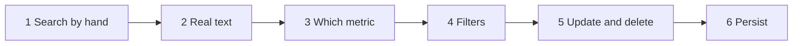
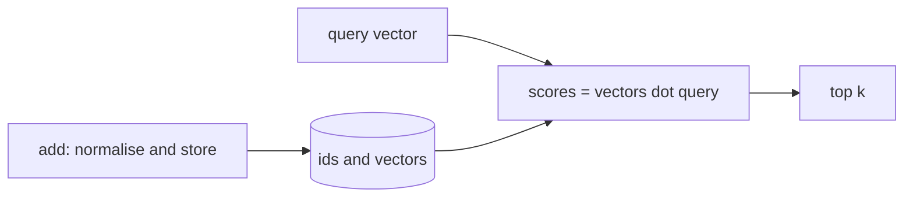
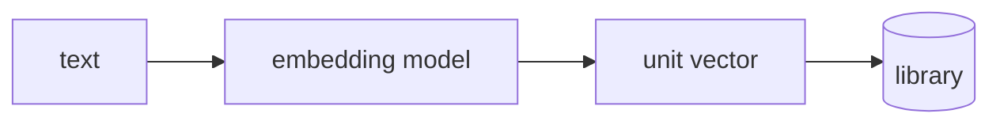
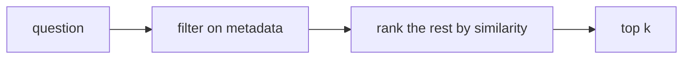
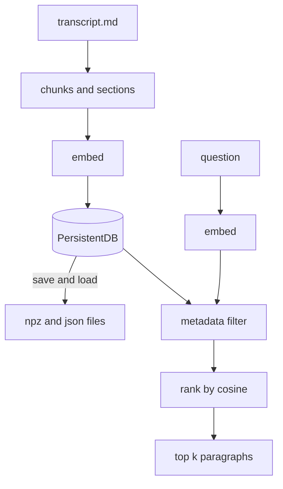

# Tutorial 2: Build a Mini Vector Database That Searches Your Course Notes

**What you build.** A small vector database, in about 60 lines of Python, that searches the module's own `transcript.md`. You can ask "what is cosine similarity?" and get back the matching paragraphs, restricted to one section if you like, and you can update or delete records and save everything to disk.

**How this tutorial works.** One thing grows in small steps. Each step starts with a **problem** you just hit, and the **fix** is a concept from the course. So each part earns its place: the *vector library* appears first, and the things that turn it into a *database* (filters, update, delete, persistence) appear only when you need them.

Prefer the course order with the lab explained? See [Tutorial 1](01-vector-databases-and-similarity-search-adapted.md). This tutorial assumes you know the three metrics from it, but each step repeats what it needs.

## The path



## Before you start

You need `OPENAI_API_KEY` in the repo-root `.env`. Open a notebook in `course3/module1/` (so `transcript.md` is in the working folder), pick the root `.venv` kernel, and run this once:

```python
import numpy as np
from dotenv import load_dotenv
from langchain_openai import OpenAIEmbeddings

load_dotenv()
embeddings_model = OpenAIEmbeddings(model="text-embedding-3-small")
```

> **Lab says / today we use:** the course embeds with a Hugging Face model (`sentence-transformers`). We use OpenAI's embedding API, so no big download. The ideas do not change.

Everything is plain NumPy. Embedding the notes costs a fraction of a cent. Output from the embedding model varies, so yours will be similar, not identical.

---

## Step 1: Search by hand (a vector library)

**The problem.** You have a few items and want "the ones most like this". A normal list cannot do that, because there is no "like" in `==`.

**The fix.** Describe each item as a vector, store the vectors, and rank by **cosine similarity**. That is a **vector library**: add and search, nothing more. We start with movies described by two hand-picked numbers, `[action, romance]`, so there is no API call.



**Type this.** One class, two methods. `add` stores a vector, `search` ranks them.

```python
class VectorLibrary:
    def __init__(self):
        self.ids, self.vectors = [], []

    def add(self, id, vector):
        v = np.asarray(vector, dtype=float)
        self.ids.append(id)
        self.vectors.append(v / np.linalg.norm(v))  # unit length: dot product == cosine

    def search(self, vector, k=2):
        q = np.asarray(vector, dtype=float)
        q = q / np.linalg.norm(q)
        scores = np.array(self.vectors) @ q
        top = np.argsort(-scores)[:k]          # minus sign: highest score first
        return [(self.ids[i], round(float(scores[i]), 3)) for i in top]
```

Now use it:

```python
library = VectorLibrary()
movies = {"Fast Cars": [9, 1], "Love Letters": [1, 9], "Spy Romance": [5, 6],
          "Explosions": [10, 0], "Rom-Com": [3, 8]}
for name, vec in movies.items():
    library.add(name, vec)

print(library.search([8, 2], k=3))
print(library.search([80, 20], k=3))
```

**What you should see.**

```
[('Fast Cars', 0.991), ('Explosions', 0.97), ('Spy Romance', 0.807)]
[('Fast Cars', 0.991), ('Explosions', 0.97), ('Spy Romance', 0.807)]
```

**Why it works.** We store unit-length vectors, so the dot product *is* the cosine similarity. The second query is the first times 10 and gives the identical answer: cosine ignores length.

**Try it.** Add `library.add("Thriller", [7, 3])` and search `[8, 2]` again. Where does it rank?

---

## Step 2: Real text, not hand-picked numbers

**The problem.** Nobody can write `[action, romance]` for a paragraph of text. There are thousands of features, and you would not know them.

**The fix.** An **embedding model** turns text into a vector whose direction carries its meaning. We embed with the model, then reuse `VectorLibrary` unchanged.



**Type this.** A helper that embeds a list of texts and normalises each row:

```python
def embed(texts):
    vectors = np.array(embeddings_model.embed_documents(texts))
    return vectors / np.linalg.norm(vectors, axis=1, keepdims=True)
```

A library that takes text:

```python
class TextIndex(VectorLibrary):
    def __init__(self):
        super().__init__()
        self.texts = {}

    def add_texts(self, ids, texts):
        for id, text, vec in zip(ids, texts, embed(texts)):  # one API call for all
            self.texts[id] = text
            self.add(id, vec)

    def search_text(self, query, k=3):
        found = self.search(embed([query])[0], k)
        return [(id, score, self.texts[id]) for id, score in found]
```

Now load the notes. `transcript.md` has headings for each video or reading. We keep paragraphs of at least 150 characters, and remember the section each came from (used in Step 4):

```python
from pathlib import Path

headings = {"Vector Database Concepts", "Vector Databases Versus Traditional Databases",
            "Vector Database Types", "Applications of Vector Databases", "Similarity Search"}
section, chunks = "intro", []
for line in Path("transcript.md").read_text().splitlines():
    line = line.replace("​", "").strip()   # the page copy has invisible characters
    if line in headings:
        section = line
    elif len(line) >= 150 and "∣∣" not in line:   # skip short lines and garbled math
        chunks.append((section, line))
print(len(chunks), "chunks")
```

**What you should see.**

```
77 chunks
```

Build the index and ask a question:

```python
index = TextIndex()
index.add_texts([f"c{i}" for i in range(len(chunks))], [text for _, text in chunks])

for id, score, text in index.search_text("When should I prefer cosine over L2?", k=2):
    print(id, score, text[:110])
```

**What you should see** (example; the `c##` numbers and scores are yours to read, and both paragraphs come from the *Similarity Search* reading):

```
c## 0.52 Cosine distance often performs better in high dimensions, and is the default choice in many ...
c## 0.49 Normalize vectors if you expect to only need to calculate cosine similarity. For many natu...
```

**Why it works.** The question shares few exact words with those paragraphs. They match because their *meaning* points the same way. This is what keyword search cannot do.

**Try it.** Ask `"what are the types of vector databases?"` and `"how do I recommend movies?"`.

---

## Step 3: Which metric?

**The problem.** The course lists three metrics (L2, dot, cosine). Does the choice change the answer here?

**The fix.** Write all three as **scores where bigger is better**, and compare them on the same data. L2 and dot product are written as one function each, with the distance negated.

```python
def scores_for(vectors, q, metric):
    if metric == "cosine":
        return vectors @ q / (np.linalg.norm(vectors, axis=1) * np.linalg.norm(q))
    if metric == "dot":
        return vectors @ q
    if metric == "l2":
        return -np.linalg.norm(vectors - q, axis=1)   # negate: smaller distance = bigger score
    raise ValueError(metric)
```

Compare the top 3 under each:

```python
q = embed(["When should I prefer cosine over L2?"])[0]
matrix = np.array(index.vectors)
for metric in ["cosine", "dot", "l2"]:
    top = np.argsort(-scores_for(matrix, q, metric))[:3]
    print(metric, [index.ids[i] for i in top])
```

**What you should see** (example):

```
cosine ['c##', 'c##', 'c##']
dot ['c##', 'c##', 'c##']
l2 ['c##', 'c##', 'c##']
```

The three lists should be identical (the ids are yours).

**Why it works.** Our vectors have length 1. For unit vectors, `dot = cosine`, and `L2^2 = 2 - 2 * cosine`, so smaller L2 means bigger cosine. The three metrics only differ when vector **lengths** differ, as in Tutorial 1's books (where scaling the features also changed the winner). That is why many embedding models normalise: you can use the fastest one, the dot product.

**Try it.** Multiply `matrix[0]` by 5 (`matrix[0] = matrix[0] * 5`) and run again. Which metrics change the result, and why? Undo it afterwards by running the index-building cell again.

---

## Step 4: Filters (library becomes a database)

**The problem.** You ask a question and want answers only from one video or reading, for example the *Similarity Search* reading. The search ranks every paragraph and ignores where it came from.

**The fix.** Store **metadata** next to each vector and filter on it before ranking. This mix of exact facts (relational style) plus similarity (vector style) is what real vector databases, including Chroma, offer.



**Type this.**

```python
class MiniVectorDB(TextIndex):
    def __init__(self):
        super().__init__()
        self.meta = {}

    def add_texts(self, ids, texts, metas=None):
        super().add_texts(ids, texts)
        for id, meta in zip(ids, metas or [{}] * len(ids)):
            self.meta[id] = meta

    # where={"section": "..."} keeps only rows whose metadata matches
    def search_text(self, query, k=3, where=None):
        keep = [i for i, id in enumerate(self.ids)
                if all(self.meta[id].get(key) == val for key, val in (where or {}).items())]
        if not keep:
            return []
        scores = np.array(self.vectors)[keep] @ embed([query])[0]
        top = np.argsort(-scores)[:k]
        return [(self.ids[keep[i]], round(float(scores[i]), 3), self.texts[self.ids[keep[i]]])
                for i in top]
```

Fill it and search twice:

```python
db = MiniVectorDB()
db.add_texts([f"c{i}" for i in range(len(chunks))],
             [text for _, text in chunks],
             [{"section": sec} for sec, _ in chunks])

question = "What kinds of databases support vector search?"
print(db.search_text(question, k=1)[0][0])
print(db.search_text(question, k=1, where={"section": "Vector Database Types"})[0][0])
```

**What you should see** (example): two ids. The first is the best match anywhere. The second is the best match **inside** the "Vector Database Types" section.

**Why it works.** The filter shrinks the candidate list first (`keep`), then similarity ranks only those rows. Filtering first means a strict filter never returns a paragraph from the wrong section, however similar it looks.

**Try it.** Use `where={"section": "nonsense"}`. You get `[]`. Why is that better than returning the nearest paragraph anyway?

---

## Step 5: Update and delete

**The problem.** A paragraph in your notes changes, or you want to remove one. A vector *library* is built once and searched. A *database* must change.

**The fix.** Full **CRUD**: create (Step 4's `add_texts`), read (`search_text`, plus `get`), **update** and **delete**. For update, the text changes, so the vector must be **recomputed**, or the old meaning would stay in the index.

```python
class EditableDB(MiniVectorDB):
    def get(self, id):
        return {"text": self.texts[id], "meta": self.meta[id]}

    def update(self, id, text=None, meta=None):
        if text is not None:
            i = self.ids.index(id)
            self.vectors[i] = embed([text])[0]    # re-embed: new text, new vector
            self.texts[id] = text
        if meta is not None:
            self.meta[id].update(meta)

    # delete removes the id from every place that stores it
    def delete(self, id):
        i = self.ids.index(id)
        self.ids.pop(i)
        self.vectors.pop(i)
        del self.texts[id], self.meta[id]
```

Test it on a copy of the data:

```python
edb = EditableDB()
edb.add_texts(["a", "b"],
              ["Cats are small furry pets that purr.", "Python is a programming language."],
              [{"topic": "animals"}, {"topic": "code"}])

q = "a computer language"
before = {id: score for id, score, _ in edb.search_text(q, k=2)}
edb.update("a", text="A compiler turns source code into a program.", meta={"topic": "code"})
after = {id: score for id, score, _ in edb.search_text(q, k=2)}
print(before["a"] < after["a"])
edb.delete("b")
print(len(edb.ids), edb.get("a")["meta"])
```

**What you should see.**

```
True
1 {'topic': 'code'}
```

Record `a` was about cats, so it scored low for "a computer language". After its text changed to a compiler sentence, its score went **up**. Then `b` is deleted and one record is left.

**Why it works.** The vector is derived from the text, so changing the text without re-embedding would leave a stale vector. Real databases do the same: update means "embed again".

**Common trap.** Deleting from `ids` but forgetting `vectors` breaks the alignment, so row `i` no longer belongs to `ids[i]`. Our `delete` keeps all four stores in step.

---

## Step 6: Persist

**The problem.** Close the notebook and everything is gone. Re-embedding 77 chunks costs time and money every time.

**The fix.** Write vectors and records to disk, and load them back. Vectors go in a NumPy `.npz` file and everything else in JSON.

```python
import json

class PersistentDB(EditableDB):
    def save(self, path):
        np.savez(f"{path}.npz", vectors=np.array(self.vectors))
        data = {"ids": self.ids, "texts": self.texts, "meta": self.meta}
        Path(f"{path}.json").write_text(json.dumps(data))

    # load builds a new object without calling the embedding API at all
    @classmethod
    def load(cls, path):
        db = cls()
        db.vectors = list(np.load(f"{path}.npz")["vectors"])
        data = json.loads(Path(f"{path}.json").read_text())
        db.ids, db.texts, db.meta = data["ids"], data["texts"], data["meta"]
        return db
```

Rebuild with the final class, save, reload and search:

```python
final = PersistentDB()
final.add_texts([f"c{i}" for i in range(len(chunks))],
                [text for _, text in chunks],
                [{"section": sec} for sec, _ in chunks])
final.save("notes_db")

again = PersistentDB.load("notes_db")
print(len(again.ids), again.search_text("what is normalisation?", k=1)[0][2][:100])
```

**What you should see** (example):

```
77 Note that many embedding models normalize vectors by default, as this allows cosine similarity or ...
```

Two new files, `notes_db.npz` and `notes_db.json`, appear next to the notebook. Delete them when you finish; they are throwaway.

**Why it works.** Only the question is embedded at search time. Stored vectors are read from disk.

---

## The whole thing



| Class | Added | Course idea |
|---|---|---|
| `VectorLibrary` | add, search | vector **library** |
| `TextIndex` | embeds text | embeddings |
| `MiniVectorDB` | metadata filters | filtering (next up in Chroma) |
| `EditableDB` | get, update, delete | CRUD, the library/database split |
| `PersistentDB` | save, load | persistence |

**What this is not.** Every search compares the question to **every** vector (brute force). That is fine for 77 paragraphs and too slow for millions. Real vector databases add an **approximate nearest neighbour index** (graph, tree or hashing structures) so they check a small fraction. They also add concurrency, scaling across machines and security. That is the "indexing and scalability" row of the course's comparison table. **Beyond the video:** the next lesson uses Chroma DB, which gives you all of this.

## Common mistakes

| Mistake | Fix |
|---|---|
| Methods pasted outside the class | Keep every `def` indented under its `class`, and type the whole class in one cell |
| Re-running Step 2's class cells but not the later ones | A subclass keeps the old parent. Re-run every class cell in order |
| `FileNotFoundError: transcript.md` | Start the notebook in `course3/module1/` |
| `embed` shape error with one text | Pass a list: `embed(["text"])[0]` |
| Updating text without re-embedding | Re-embed in `update` (Step 5) |
| Comparing vectors from two different models | Use the same model for documents and queries |
| Deleting from `ids` only | Delete from every parallel store |

## Cheat sheet

| Need | How |
|---|---|
| Normalise rows | `x / np.linalg.norm(x, axis=1, keepdims=True)` |
| Cosine for unit vectors | `vectors @ q` |
| L2 as a score | `-np.linalg.norm(vectors - q, axis=1)` |
| Top k | `np.argsort(-scores)[:k]` |
| Filter then rank | build `keep` indexes, slice, then score |
| Library vs database | database adds CRUD, filters, persistence, scale |

## Practice

No answers shown. Ask me for a hint.

1. Add `count()` and `ids_in_section(name)` to `EditableDB`.
2. Make `search_text` also return the section name, and print it.
3. Add a `metric="l2"` option to `search_text` using `scores_for`.
4. Add `upsert(id, text, meta)`: update if the id exists, else add.
5. Search a question that is not in the notes ("what is the capital of France?"). Add a `min_score` argument so weak matches return nothing. What threshold works?
6. Make the chunks smaller (split each paragraph into sentences). Do answers get better or worse?

---

Previous: [Tutorial 1, the course order](01-vector-databases-and-similarity-search-adapted.md).
