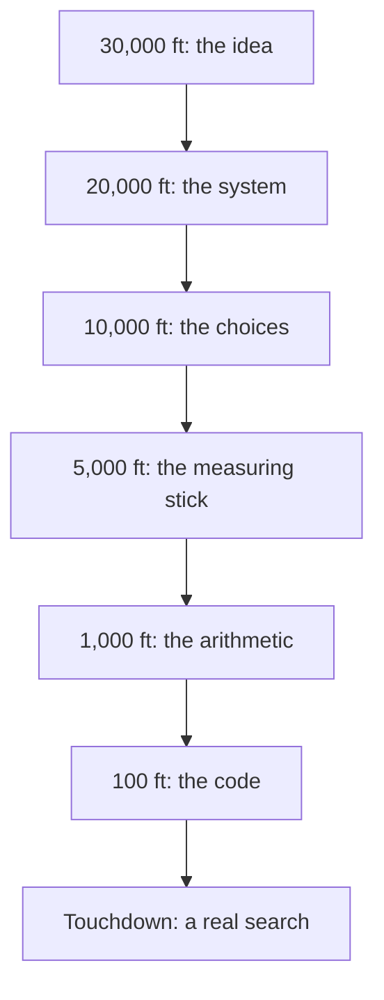
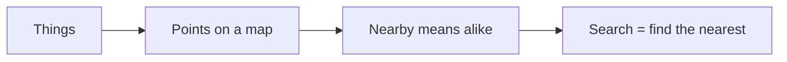
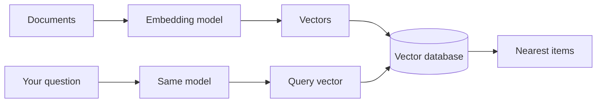
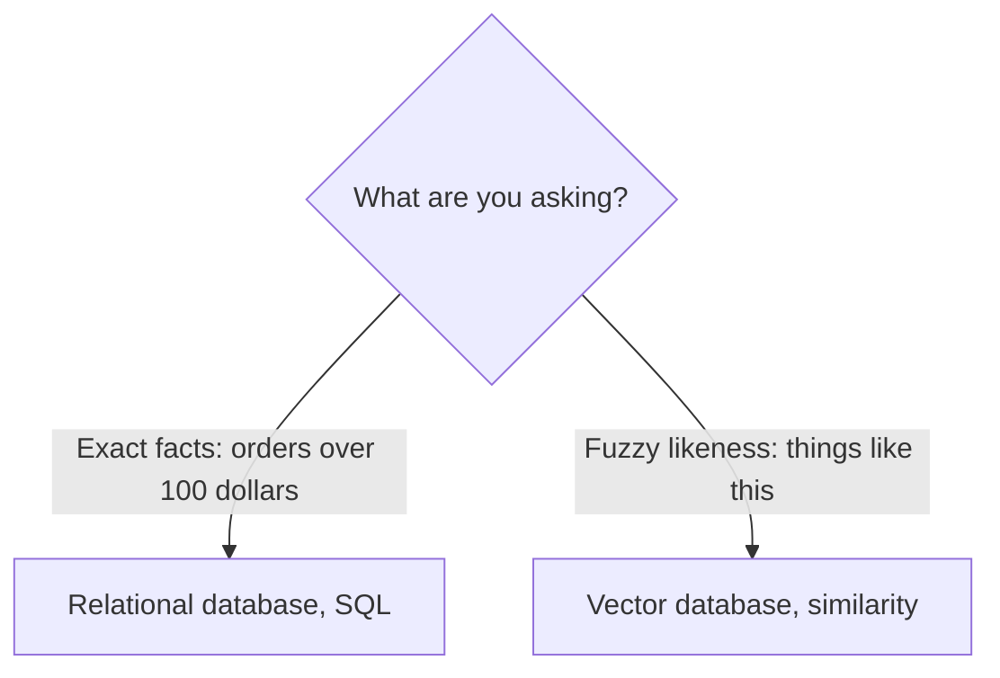
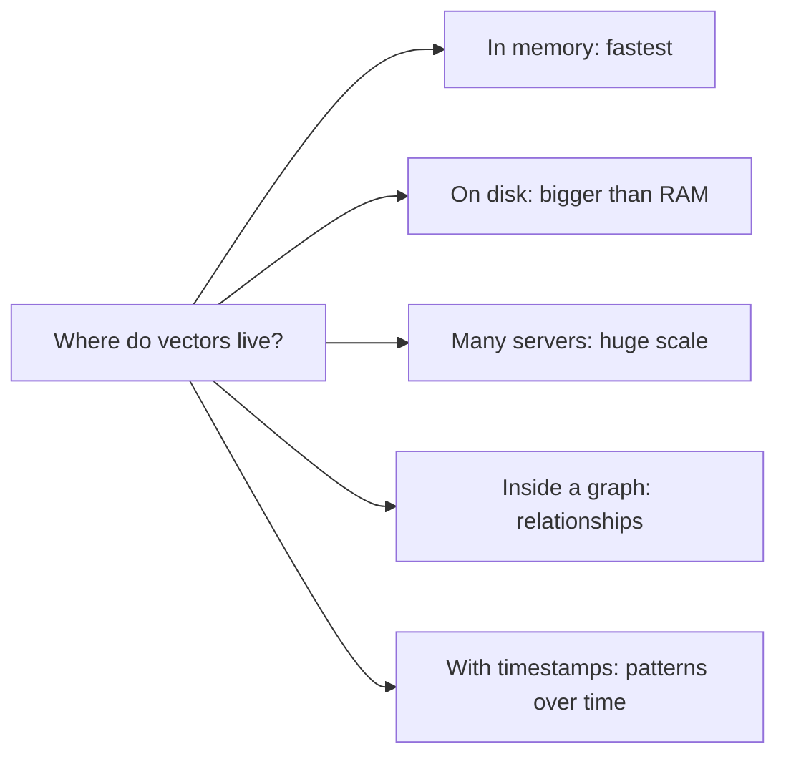
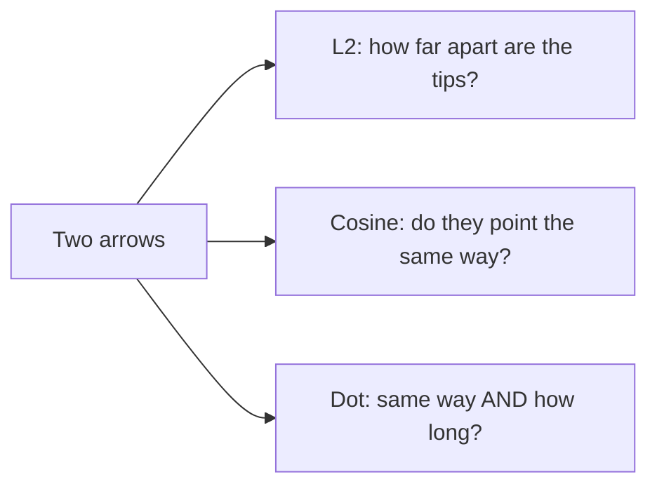
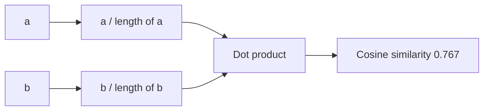

# Tutorial 3: Flight Plan, From 30,000 ft to Touchdown

> **Destination:** by touchdown you can explain vector databases and similarity search to a friend in one sentence, to a teammate in one diagram, and to a computer in ten lines of NumPy.

**How this flight works.** The same module, told six times. We start at cruising altitude, where only the shape of the idea is visible, and descend in stages. Each stage adds detail and drops the abstraction. If a stage feels confusing, climb back one level: the stage above always explains the "why" for the stage below.

Want the reference guide? See the [module README](../README.md). Want to build a small database? See [Tutorial 2](02-build-a-mini-vector-database.md). Want the course order? See [Tutorial 1](01-vector-databases-and-similarity-search-adapted.md).

## Flight path



| Altitude | You see | You can answer |
|---|---|---|
| 30,000 ft | one idea | what is this for? |
| 20,000 ft | four parts | what pieces make it work? |
| 10,000 ft | a map of options | which kind do I pick? |
| 5,000 ft | the intuition | what does "similar" mean? |
| 1,000 ft | the formulas | how is it calculated? |
| 100 ft | every line | how do I type it? |
| Touchdown | it runs | does it work? |

## Pre-flight check

Only NumPy is needed. No API key and no download. Run this once in a notebook with the root `.venv` kernel:

```python
import numpy as np
```

---

## Cruise: 30,000 ft. The idea

> *Altimeter 30,000. Visibility: the whole country, no street names.*

**Computers can't judge "alike", but they can measure "near".** So we turn every thing (a book, a photo, a sentence) into a point on a map, in such a way that alike things land close together. Then "find something like this" becomes "find the nearest points".

A **vector database** is a place that stores those points and answers "what is nearest to here?" quickly.

That is the entire module. Everything below is detail.



**Everyday picture.** A library shelved by *meaning* instead of by title: books on the same topic sit in the same corner. To find something like your favourite book, walk to it and look around.

**Descent check.** Why not just store titles and search the words? *Because "bugs" in "software bugs" and "bugs" in "insects" share a word but not a meaning. The map puts them in different corners.*

---

## 20,000 ft. The system

> *Altimeter 20,000. You can now see four buildings.*

Four parts, in order:

1. **Embedding model.** A translator from things (text, images, audio) to points (lists of numbers). It decides the map.
2. **Vectors.** The points themselves. Each is a list such as `[0.12, -0.4, ...]`.
3. **Vector database.** Holds many vectors and finds the ones near a given point.
4. **Query.** Your question, translated by the *same* model into a point.



Two rules that make or break this:

- **Same model for documents and queries**, or the points live on different maps.
- **Closeness is only meaningful if the model put alike things together.** The database does not understand meaning. The model does.

**Where it is used.** Recommendations (nearest films), image search, location search, and **RAG** (nearest document chunks to a question, handed to an LLM).

**Descent check.** Which part understands meaning, the model or the database? *The model. The database only measures distance.*

---

## 10,000 ft. The choices

> *Altimeter 10,000. The map shows roads and airports. Pick your route.*

You now choose what kind of place to keep the vectors in. Three decisions.

### Decision 1: relational or vector?



| | Relational | Vector |
|---|---|---|
| Stores | tables | vectors |
| Asked with | SQL | "nearest to this" |
| Best at | exact, structured facts | meaning, images, text |

### Decision 2: library or database?

A **library** builds an index in memory and searches it. A **database** adds **CRUD** (create, read, update, delete), persistence and production features. If data changes or must survive a restart, you want a database.

### Decision 3: which kind?



Also: **dedicated** vector databases (Faiss, Annoy, Milvus) are fastest. Ordinary databases with a vector add-on (PostgreSQL, MongoDB, Elasticsearch) are convenient, because you keep one system, but may be slower.

**Descent check.** Your product catalogue is in PostgreSQL and you have 50,000 items. What is a sensible start? *PostgreSQL with vector search: one system, small data. Move to a dedicated database if it gets slow.*

---

## 5,000 ft. The measuring stick

> *Altimeter 5,000. Houses are visible. Time to learn how distance is judged.*

"Nearest" needs a ruler. Three rulers are standard. Each answers a slightly different question.

**Picture two arrows from the same starting point.**



| Ruler | Question it answers | Ignores length? | Everyday version |
|---|---|---|---|
| **L2 distance** | how far apart are the two points? | no | the street distance between two houses |
| **Cosine** | do they point the same way? | **yes** | two people facing the same compass direction, near or far |
| **Dot product** | same direction, and how strong? | no | agreement weighted by volume |

Two words you must not mix up:

- **Distance:** bigger means *farther apart* (L2, cosine distance).
- **Similarity:** bigger means *more alike* (dot product, cosine similarity).

**Which to pick.** Text and embeddings: cosine, because meaning is in the direction and a long essay and a short note on the same topic should still match. Position or geometry: L2. When length means popularity or strength: dot product.

**Descent check.** A long article and a one-line summary say the same thing. Do their vectors point the same way, and which ruler is happy? *Yes, they point the same way. Cosine says they match; L2 might say they are far apart.*

---

## 1,000 ft. The arithmetic

> *Altimeter 1,000. You can read the street signs.*

Two worked examples carry the whole module. Keep them handy:

- `a = [4, 8]` and `b = [11.5, 5]`
- `q = [1, 2, 3]` and `r = [4, 5, 6]`

### L2 distance: subtract, square, add, root

```
L2(a, b) = sqrt( (4 - 11.5)^2 + (8 - 5)^2 )
         = sqrt( 56.25 + 9 )
         = sqrt( 65.25 )  ≈  8.08
```

And in 3-D, same recipe: `sqrt(9 + 9 + 9) = sqrt(27) ≈ 5.20`.

### Dot product: multiply pairs, add

```
a . b = 4 * 11.5  +  8 * 5  =  46 + 40  =  86
q . r = 1*4 + 2*5 + 3*6 = 4 + 10 + 18 = 32
```

### Cosine similarity: dot product, divided by both lengths

First each **length** (the L2 norm): `|a| = sqrt(16 + 64) ≈ 8.94` and `|b| = sqrt(132.25 + 25) ≈ 12.54`. Then:

```
cos(a, b) = 86 / (8.94 * 12.54)  ≈  0.767
```

Normalising first gives the same answer with less work: divide each vector by its own length (so its length is 1), then just take the dot product.



| Ruler | Result for a, b | Reads as |
|---|---|---|
| L2 distance | 8.08 | smaller is closer |
| Dot product | 86 | bigger is closer |
| Cosine similarity | 0.767 | bigger is closer, max 1 |

**Descent check.** Double every number in `a`. Which of the three results stay exactly the same? *Only cosine. L2 and the dot product both change, because the length changed.*

---

## 100 ft. The code

> *Altimeter 100. Runway lights ahead. Hands on the controls.*

Every line, in the order you would type it.

**The vectors.** NumPy arrays so we can do arithmetic on whole lists at once.

```python
a = np.array([4, 8.0])
b = np.array([11.5, 5.0])
```

**L2 distance.** Subtract, square, add, root. `np.sum` adds up the list.

```python
l2 = np.sqrt(np.sum((a - b) ** 2))
print(round(float(l2), 2))
```

```
8.08
```

**Dot product.** Multiply pairs, add.

```python
dot = np.sum(a * b)
print(float(dot))
```

```
86.0
```

**Cosine similarity.** Dot product over the two lengths. `np.linalg.norm` is the length.

```python
cosine = dot / (np.linalg.norm(a) * np.linalg.norm(b))
print(round(float(cosine), 3))
```

```
0.767
```

**Normalising.** Divide by the length. Every vector now has length 1.

```python
a_unit = a / np.linalg.norm(a)
b_unit = b / np.linalg.norm(b)
print(round(float(np.linalg.norm(a_unit)), 3), round(float(a_unit @ b_unit), 3))
```

```
1.0 0.767
```

`@` is the dot product. For unit vectors it **is** the cosine, which is why databases like to store unit vectors.

**Many at once.** Stack unit vectors as rows of a matrix. One `@` scores every row against the query.

```python
rows = np.array([[1.0, 0.0], [0.0, 1.0], [0.6, 0.8]])    # three unit vectors
query = np.array([0.6, 0.8])                              # points the same way as row 3
print((rows @ query).round(2))
```

```
[0.6 0.8 1. ]
```

Row 3 scores 1.0: identical direction. That one line is a whole database search, minus the speed tricks.

**Descent check.** What does `rows @ query` return, in words? *One similarity score per row: how well each stored vector points the same way as the query.*

---

## Touchdown. A real search

> *Altimeter 0. Gear down. Runway: five movies.*

Put it all together: store, search, rank. The movies are described by two numbers, `[action, romance]`, so we can do everything by hand with no model and no API.

**Store.** Normalise on the way in.

```python
movies = {"Fast Cars": [9, 1], "Love Letters": [1, 9], "Spy Romance": [5, 6],
          "Explosions": [10, 0], "Rom-Com": [3, 8]}
names = list(movies)
matrix = np.array(list(movies.values()), dtype=float)
matrix = matrix / np.linalg.norm(matrix, axis=1, keepdims=True)   # unit rows
```

**Search.** Normalise the query, score every row, sort best first.

```python
def search(query, k=3):
    q = np.array(query, dtype=float)
    q = q / np.linalg.norm(q)
    scores = matrix @ q
    best = np.argsort(-scores)[:k]            # minus: highest score first
    return [(names[i], round(float(scores[i]), 3)) for i in best]

print(search([8, 2]))
```

```
[('Fast Cars', 0.991), ('Explosions', 0.97), ('Spy Romance', 0.807)]
```

A person who likes action with a little romance gets the two action films first, and the mixed film third.

**The cosine promise.** Ten times the query, same answer, because length is ignored:

```python
print(search([80, 20]) == search([8, 2]))
```

```
True
```

**Landing checklist**
- [x] things become vectors
- [x] alike things sit close together
- [x] a ruler turns "close" into a number
- [x] the best-scoring rows are the answer

You have just built, in 10 lines, what a vector database does at its core.

### Swap the toy for the real thing

The only difference between this toy and a real system is where the vectors come from. Replace the hand-picked `[action, romance]` with an **embedding model**, which produces hundreds of numbers from text. [Tutorial 2](02-build-a-mini-vector-database.md) does exactly that with the module's own notes.

---

## Go-around: common mistakes

If a landing goes wrong, pull up and check:

| Symptom | Altitude of the cause | Fix |
|---|---|---|
| Bigger number but "worse" match | 5,000 ft | L2 is a distance (smaller wins). Cosine and dot are similarities (bigger wins) |
| L2 results look driven by one feature | 5,000 ft | features on different scales (pages vs rating): scale them first |
| Results are nonsense with real text | 20,000 ft | documents and query embedded with different models |
| Cosine scores all slightly above 1 | 100 ft | vectors not normalised, or rounding; normalise and check lengths |
| Shape error when dividing by lengths | 100 ft | use `keepdims=True` (or `reshape(-1, 1)`) so rows divide by their own length |
| Vector database "forgets" after a restart | 10,000 ft | you built a library, not a database: add persistence |

## Cockpit card

| Altitude | One line to remember |
|---|---|
| 30,000 | turn things into points; alike means near |
| 20,000 | model makes points, database finds the nearest, same model for query |
| 10,000 | relational for facts, vector for likeness; library vs database; pick a kind |
| 5,000 | L2 = how far, cosine = same direction, dot = direction and strength |
| 1,000 | L2 8.08, dot 86, cosine 0.767 for `[4, 8]` and `[11.5, 5]` |
| 100 | `np.sqrt(np.sum((a-b)**2))`, `np.sum(a*b)`, `dot / (norm * norm)`, `rows @ q` |
| Touchdown | normalise, score every row with `@`, sort descending |

## Practice flights

No answers shown. Ask me for a hint.

1. **30,000 ft:** explain vector search to a non-technical friend in two sentences.
2. **20,000 ft:** draw the pipeline for a photo-recommendation app. Which part is the model?
3. **10,000 ft:** pick a database kind for (a) a phone app that must answer in milliseconds, (b) a billion-item archive. Justify each.
4. **5,000 ft:** when would you choose the dot product over cosine for a shop?
5. **1,000 ft:** compute L2, dot and cosine for `q = [1, 2, 3]` and `r = [4, 5, 6]` by hand.
6. **100 ft:** add a `metric` argument to `search` that switches between cosine and L2.
7. **Touchdown:** add a sixth movie, `"Thriller": [7, 3]`, and find where it ranks for `[8, 2]`.

---

Cleared to land. Next: [Tutorial 2, build a mini vector database](02-build-a-mini-vector-database.md).
