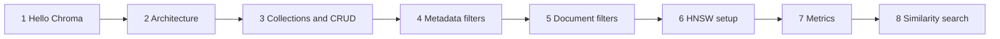
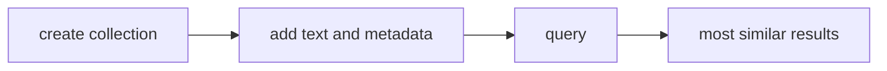
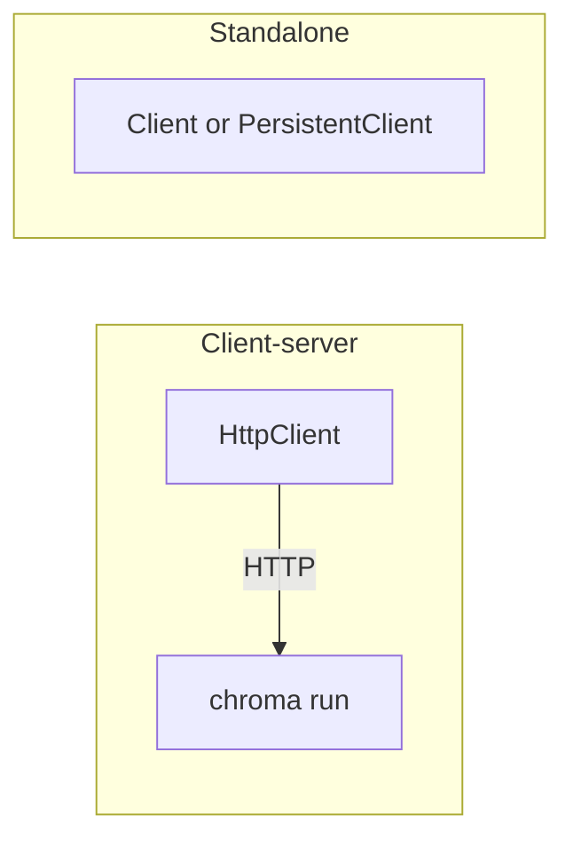
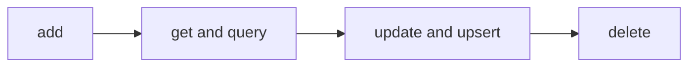
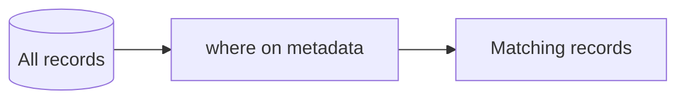
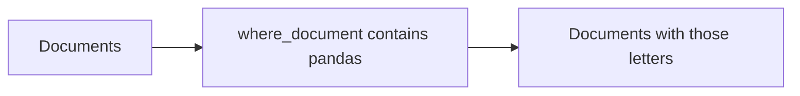
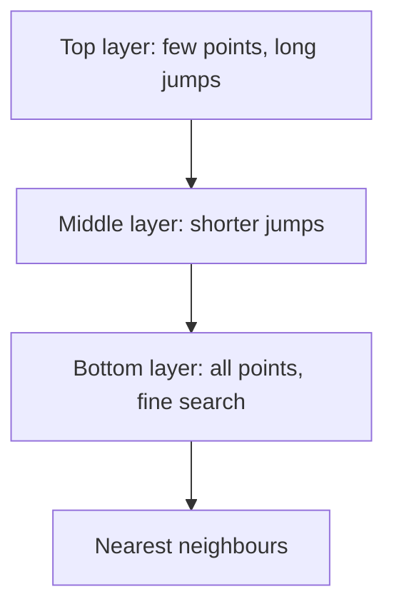
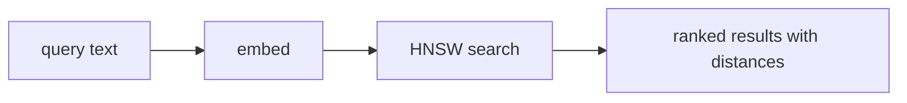

# Tutorial 4: Chroma DB, Adapted From the Course

> **After this tutorial you can:**
> - say what Chroma DB offers and how a client, a collection and an embedding function fit together
> - add, read, update and delete records, and rename or delete collections
> - filter by metadata (`where`) and by document text (`where_document`), alone or combined with similarity search
> - set up the HNSW index and choose the distance metric (`space`)
> - run a similarity search, spot a wrong semantic match, and fix it with a filter

This follows the course's Chroma lesson: key concepts and architecture, filtering, then similarity search and HNSW. It uses the **real** Chroma library. You built a small version yourself in [Tutorial 2](02-build-a-mini-vector-database.md), so each concept below says which piece of that it replaces. Want the same ideas without code? See the [module README](../README.md#13-chroma-db-key-concepts-and-architecture).

## The path



## Before you start

Chroma was added to the repo with `uv add chromadb` (one line in `pyproject.toml`). Open a notebook in `course3/module1/`, pick the root `.venv` kernel, and run this once:

```python
import chromadb
from chromadb.utils import embedding_functions

ef = embedding_functions.DefaultEmbeddingFunction()
client = chromadb.Client()
```

> **Lab says / today we use:** the course builds the embedding function with `SentenceTransformerEmbeddingFunction(model_name="all-MiniLM-L6-v2")`, which needs PyTorch. Chroma's `DefaultEmbeddingFunction` runs the **same model** (`all-MiniLM-L6-v2`) through a small ONNX runtime. No API key and no PyTorch. The first call downloads about 80 MB once and caches it. If you prefer the course version, run `uv add sentence-transformers` and swap that one line.

Because it is the same model, your distances will match the course reading's numbers (for example 0.738 for "cats"). Everything here runs on your machine.

---

## Concept 1: Hello, Chroma

**The idea.** Chroma is a vector database for retrieval. You put text in, and Chroma stores it, embeds it, and finds the pieces closest in meaning to a question. Three nouns matter. The **client** is your connection. A **collection** is a named table of vectors. The **embedding function** turns text into vectors.



This is Chroma's whole typical workflow. You never embed anything yourself: Chroma embeds the documents on `add` and the question on `query`.

**Type this.**

```python
hello = client.create_collection(
    name="hello",
    configuration={"embedding_function": ef},
)
hello.add(
    documents=["Cats purr when they are happy.",
               "Dogs bark at strangers.",
               "Python is a programming language."],
    ids=["a", "b", "c"],
)
```

Ask a question in other words:

```python
result = hello.query(query_texts=["a kitten making a noise"], n_results=1)
print(result["ids"], result["documents"])
```

**Expected output.**

```
[['a']] [['Cats purr when they are happy.']]
```

The question shares no words with the answer. The match comes from meaning.

> Results come back as lists **of lists**: one inner list per query text. That is why `[['a']]`.

**Try it.** Change the question to `"a computer program"` and see which id comes back.

**Check yourself.** In Tutorial 2 you wrote `embed(...)` and a `TextIndex` yourself. What did Chroma do for you here?

<details><summary>Answer</summary>
It embedded the three documents on <code>add</code> and the question on <code>query</code>, stored the vectors, and ranked them. All with the embedding function you gave the collection.
</details>

---

## Concept 2: Architecture and clients

**The idea.** Chroma runs in two ways. **Client-server** is the usual setup: your code (the client) talks over HTTP to a Chroma server in another process. **Standalone** (Python only) runs both inside your program, handy for tests or when the server is always on the same machine.



The architecture has five phases: (optional) get embeddings, create a collection, add data, collection operations, query.

| Client | Where data lives | Use it for |
|---|---|---|
| `chromadb.Client()` | memory; gone when the program ends | quick experiments |
| `chromadb.PersistentClient(path=...)` | a folder on disk | keeping data between runs, standalone |
| `chromadb.HttpClient(host, port)` | on a Chroma server | the client-server setup |

**Type this.** Persistent data survives. Write, close, reopen:

```python
import shutil

store = chromadb.PersistentClient(path="chroma_demo")
notes = store.get_or_create_collection("notes", configuration={"embedding_function": ef})
notes.add(documents=["Vectors live in a collection."], ids=["n1"])

reopened = chromadb.PersistentClient(path="chroma_demo")
print(reopened.get_collection("notes", embedding_function=ef).count())
shutil.rmtree("chroma_demo")           # clean up the demo folder
```

**Expected output.**

```
1
```

Each client object here opens the same folder. This replaces the `save` and `load` methods you wrote in Tutorial 2.

> **Beyond the video:** `get_collection` asks for the embedding function again, because a function is code and cannot always be stored on disk. Pass the same one you used to create the collection.

For the client-server setup, start a server in a terminal (`chroma run --path ./chroma_server_data --port 8000`) and connect to it. This block needs that server, so it is marked and skipped by the checker:

```python
# needs: a running Chroma server (chroma run --path ./chroma_server_data --port 8000)
remote = chromadb.HttpClient(host="localhost", port=8000)
print(remote.heartbeat())
```

You can run the same collection code against `remote` that you run against `client`. Only the line that creates the client changes. Chroma also has official **Python** and **JavaScript** clients, community clients for several other languages, and integrations with LangChain, LlamaIndex and Ollama.

**Check yourself.** You are testing a notebook and do not want leftover files. Which client?

<details><summary>Answer</summary>
<code>chromadb.Client()</code>, which keeps everything in memory.
</details>

---

## Concept 3: Collections and CRUD

**The idea.** A collection is Chroma's table. A vector library only adds and searches. A **database** has full CRUD, and Chroma gives you all four, plus collection-level operations (rename, delete).



**Type this.** A fresh collection and three records with metadata:

```python
crud = client.create_collection(name="crud_demo", configuration={"embedding_function": ef})
crud.add(
    documents=["Cats are small furry pets.", "Python is a language.", "Rust is fast."],
    metadatas=[{"topic": "animals"}, {"topic": "code"}, {"topic": "code"}],
    ids=["r1", "r2", "r3"],
)
print(crud.count())
print(crud.get(ids=["r2"])["documents"])
```

**Expected output.**

```
3
['Python is a language.']
```

`get` fetches by id or by filter. `query` searches by similarity. Now change and remove:

```python
crud.update(ids=["r1"], documents=["Cats purr and sleep a lot."])   # re-embeds the new text
crud.upsert(ids=["r3", "r4"], documents=["Rust is a fast systems language.", "Go is simple."])
crud.delete(ids=["r2"])
print(sorted(crud.get()["ids"]))
```

**Expected output.**

```
['r1', 'r3', 'r4']
```

`update` changes records that exist (and re-embeds a changed document, the step you wrote by hand in Tutorial 2). `upsert` updates records that exist and adds the ones that do not (`r4`). `delete` removes by id.

Collection-level operations:

```python
crud.modify(name="crud_renamed")
print([c.name for c in client.list_collections()])
client.delete_collection("crud_renamed")
print([c.name for c in client.list_collections()])
```

**Expected output** (your list also shows `hello`; extra collections from your own experiments appear too):

```
['hello', 'crud_renamed']
['hello']
```

**Try it.** Call `crud.peek(1)` before deleting the collection to see one stored record, and `crud.get(limit=2)` to page through.

**Check yourself.** What is the difference between `update` and `upsert` when the id does not exist?

<details><summary>Answer</summary>
<code>update</code> does not create it (nothing happens for an unknown id). <code>upsert</code> adds it.
</details>

---

## Concept 4: Metadata filtering

**The idea.** Metadata is a small dictionary stored beside each document, such as `{"source": "langchain.com", "version": 0.1}`. A **metadata filter** (`where`) keeps only the records whose metadata match. It works like a SQL `WHERE`, but it can also be used inside a similarity search. You can use `where` in `.get()`, `.query()` and `.delete()`.



**Type this.** The reading's five documents:

```python
demo = client.create_collection(name="filter_demo", configuration={"embedding_function": ef})
demo.add(
    documents=["This is a document about LangChain",
               "This is a reading about LlamaIndex",
               "This is a book about Python",
               "This is a document about pandas",
               "This is another document about LangChain"],
    metadatas=[{"source": "langchain.com", "version": 0.1},
               {"source": "llamaindex.ai", "version": 0.2},
               {"source": "python.org", "version": 0.3},
               {"source": "pandas.pydata.org", "version": 0.4},
               {"source": "langchain.com", "version": 0.5}],
    ids=["id1", "id2", "id3", "id4", "id5"],
)
```

Exact match. Writing a bare value means `$eq`:

```python
print(demo.get(where={"source": "langchain.com"})["ids"])
print(demo.get(where={"source": {"$eq": "langchain.com"}})["ids"])
```

**Expected output.**

```
['id1', 'id5']
['id1', 'id5']
```

Operators: `$eq $ne $gt $gte $lt $lte` (comparisons) and `$in $nin` (is, or is not, in a list). Combine filters with `$and` and `$or`:

```python
both = {"$and": [{"source": {"$eq": "langchain.com"}}, {"version": {"$lt": 0.3}}]}
print(demo.get(where=both)["ids"])
```

**Expected output.**

```
['id1']
```

LangChain **and** version below 0.3 leaves only `id1`. Now a list:

```python
in_list = {"$and": [{"source": {"$in": ["langchain.com", "llamaindex.ai"]}},
                    {"version": {"$lt": 0.3}}]}
print(demo.get(where=in_list)["ids"])
```

**Expected output.**

```
['id1', 'id2']
```

> **Beyond the video:** the metadata filter you wrote in Tutorial 2 only did equality (`where={"section": ...}`). Chroma's version adds comparisons, lists and `$and` / `$or`.

**Try it.** Write a filter for "source is not python.org" with `$ne`, and one for versions between 0.2 and 0.4 with `$and`, `$gte` and `$lte`.

**Check yourself.** What is `where={"key": "value"}` equal to?

<details><summary>Answer</summary>
<code>where={"key": {"$eq": "value"}}</code>. Not giving an operator means equals.
</details>

---

## Concept 5: Document filtering (full text search)

**The idea.** A **document filter** (`where_document`) looks inside the document's own text: `$contains` and `$not_contains`. It is the SQL `CONTAINS` / `LIKE` idea, also called **full text search**. It matches the exact letters, so it is **case-sensitive**, unlike vector search, which matches meaning.



**Type this.** On the same `demo` collection:

```python
print(demo.get(where_document={"$contains": "pandas"})["ids"])
print(demo.get(where_document={"$contains": "Pandas"})["ids"])
```

**Expected output.**

```
['id4']
[]
```

"Pandas" with a capital P finds nothing. Combine a metadata filter and a document filter, with `$or` inside the document filter:

```python
found = demo.get(
    where={"version": {"$gt": 0.1}},
    where_document={"$or": [{"$contains": "LangChain"}, {"$contains": "Python"}]},
)
print(found["ids"])
```

**Expected output.**

```
['id3', 'id5']
```

Version above 0.1 removes `id1`. Of the rest, only `id3` (Python) and `id5` (LangChain) contain one of the words.

**Try it.** Use `$not_contains` to list everything that does **not** mention "LangChain".

**Check yourself.** `where` or `where_document` for "documents that mention the word library"?

<details><summary>Answer</summary>
<code>where_document={"$contains": "library"}</code>. It looks at the text, not the metadata.
</details>

---

## Concept 6: Vector indexes and HNSW

**The idea.** Finding the nearest vector by comparing the query with **every** vector (brute force, what your Tutorial 2 database does) is too slow for millions of vectors. A **vector index** organises the vectors so a search touches only a small, promising part.

Chroma's index is **HNSW** (Hierarchical Navigable Small World), a layered graph. The top layers hold a few points, for long jumps. The bottom layer holds all of them, for detail. A search starts at the top, moves towards the query, drops a layer, and repeats. It is **approximate**: very fast, and it can rarely miss the true nearest neighbour.



HNSW is configured **when you create the collection**:

```python
tuned = client.create_collection(
    name="tuned",
    configuration={
        "hnsw": {"space": "cosine", "ef_search": 100,
                 "ef_construction": 100, "max_neighbors": 16},
        "embedding_function": ef,
    },
)
print(tuned.configuration["hnsw"]["space"], tuned.configuration["hnsw"]["max_neighbors"])
```

**Expected output.**

```
cosine 16
```

| Setting | Controls | Default | Higher means |
|---|---|---|---|
| `space` | distance metric | `l2` | (see Concept 7) |
| `ef_search` | candidates examined at **query** time | 100 | better accuracy, slower search |
| `ef_construction` | candidates examined when **building** | 100 | better index, slower build, more memory |
| `max_neighbors` | links per node | 16 | denser graph, better search, more memory |

Two groups: `ef_search` is your recall-versus-speed dial while querying. `ef_construction` and `max_neighbors` fix the quality of the index you build, at a memory and build-time cost.

**Check yourself.** Search is missing good results. Which knob first, and what do you pay?

<details><summary>Answer</summary>
Raise <code>ef_search</code>. You pay slower queries.
</details>

---

## Concept 7: Choosing the metric with `space`

**The idea.** `space` picks the distance. It decides what "closest" means.

| `space` | Distance | Note |
|---|---|---|
| `l2` (default) | **squared** Euclidean | not the square root |
| `ip` | inner (dot) product distance | `1 - dot product` |
| `cosine` | cosine distance | `1 - cosine similarity` |

**Type this.** Same documents, same query, three metrics:

```python
docs = ["Giant pandas are a bear species that lives in mountainous areas.",
        "A pandas DataFrame stores two-dimensional, tabular data",
        "I think everyone agrees that pandas are some of the cutest animals on the planet",
        "A direct comparison between pandas and polars indicates that polars is a more efficient library than pandas."]

for space in ["l2", "ip", "cosine"]:
    col = client.create_collection(
        name=f"metric_{space}",
        configuration={"hnsw": {"space": space}, "embedding_function": ef},
    )
    col.add(documents=docs, ids=["id1", "id2", "id3", "id4"])
    r = col.query(query_texts=["cats"], n_results=4)
    print(space, r["ids"][0], [round(d, 3) for d in r["distances"][0]])
```

**Expected output.**

```
l2 ['id3', 'id1', 'id2', 'id4'] [1.476, 1.67, 1.727, 1.86]
ip ['id3', 'id1', 'id2', 'id4'] [0.738, 0.835, 0.863, 0.93]
cosine ['id3', 'id1', 'id2', 'id4'] [0.738, 0.835, 0.863, 0.93]
```

The **order is identical**, only the numbers differ. This model's vectors have length 1, so `ip` equals `cosine`, and squared L2 is exactly twice the cosine distance (1.476 = 2 x 0.738). Check it with the arithmetic from [Tutorial 1](01-vector-databases-and-similarity-search-adapted.md):

```python
import numpy as np

vectors = np.array(ef(docs + ["cats"]))
doc_vecs, q = vectors[:-1], vectors[-1]
print(np.linalg.norm(vectors, axis=1).round(3))
print(((doc_vecs - q) ** 2).sum(axis=1).round(3))
print((1 - doc_vecs @ q).round(3))
```

**Expected output.**

```
[1. 1. 1. 1. 1.]
[1.67  1.727 1.476 1.86 ]
[0.835 0.863 0.738 0.93 ]
```

Those are the same numbers Chroma reported, in document order (`id1` to `id4`). Lengths are 1, which is why the three metrics agree on ranking.

**Choosing.** Use `cosine` for text. Use `ip` when your vectors are normalised or vector length means something. Use `l2` for geometric data. Set it at creation and keep it.

**Check yourself.** Why is the `l2` distance for the best match 1.476 and not about 1.2?

<details><summary>Answer</summary>
Chroma's <code>l2</code> is the <em>squared</em> distance. The square root of 1.476 is about 1.215.
</details>

---

## Concept 8: Similarity search and fixing a wrong match

**The idea.** `query` embeds your text, runs the HNSW search with the chosen metric, and returns the closest records, closest first. Smaller distance means closer. The four pandas documents are a trap on purpose: all contain "pandas", but two are about the animal and two about the Python library.



**Type this.** A cosine collection with a `topic` for each document:

```python
pandas = client.create_collection(
    name="pandas_demo",
    configuration={"hnsw": {"space": "cosine"}, "embedding_function": ef},
)
pandas.add(
    documents=docs,
    metadatas=[{"topic": "animals"}, {"topic": "data analysis"},
               {"topic": "animals"}, {"topic": "data analysis"}],
    ids=["id1", "id2", "id3", "id4"],
)
```

Search for `cats`, asking for more results than exist (so you get them all, ranked):

```python
cats = pandas.query(query_texts=["cats"], n_results=10)
for rank, (i, dist, text) in enumerate(zip(cats["ids"][0], cats["distances"][0], cats["documents"][0]), 1):
    print(f"Rank {rank}: {i}  {dist:.4f}  {text[:50]}")
```

**Expected output.**

```
Rank 1: id3  0.7380  I think everyone agrees that pandas are some of th
Rank 2: id1  0.8352  Giant pandas are a bear species that lives in moun
Rank 3: id2  0.8634  A pandas DataFrame stores two-dimensional, tabular
Rank 4: id4  0.9300  A direct comparison between pandas and polars indi
```

The animal documents rank first although the query never mentions pandas. The top one talks about "cutest animals", and cats are cute.

**The problem.** Now ask for a polar bear:

```python
bear = pandas.query(query_texts=["polar bear"], n_results=1)
print(bear["ids"], round(bear["distances"][0][0], 3))
```

**Expected output.**

```
[['id4']] 0.624
```

Wrong. `id4` is about **polars**, the data library. The embedding matched "polar" with "polars". Semantic search is not magic.

**The fixes.** You can add context to the query, or try another embedding model. The simplest is a **filter**:

```python
by_topic = pandas.query(query_texts=["polar bear"], n_results=1, where={"topic": "animals"})
no_library = pandas.query(query_texts=["polar bear"], n_results=1,
                          where_document={"$not_contains": "library"})
both = pandas.query(query_texts=["polar bear"], n_results=1,
                    where={"topic": "animals"}, where_document={"$not_contains": "library"})
print(by_topic["ids"], no_library["ids"], both["ids"])
```

**Expected output.**

```
[['id1']] [['id1']] [['id1']]
```

All three return `id1`, the document about bears, at distance 0.710. Compare with Tutorial 2, step 4: it is the same idea (filter first, then rank the rest), with more operators and an index behind it.

**Try it.** Use `where={"topic": "data analysis"}` with the query `"cats"` and see what comes back. Filters decide what is *allowed*, similarity only ranks what is left.

**Check yourself.** The filter `where={"topic": "animals"}` fixed the polar bear query. Why can that be better than changing the embedding model?

<details><summary>Answer</summary>
It is cheap, predictable and needs no re-embedding. It uses facts you already know (the topic) to remove candidates the model confuses.
</details>

---

## Putting it together

The course's workflow in one block: set up, create with HNSW settings, add, search, print.

```python
final = client.create_collection(
    name="final_demo",
    configuration={"hnsw": {"space": "cosine"}, "embedding_function": ef},
)
final.add(documents=docs, metadatas=[{"topic": "animals"}, {"topic": "data analysis"},
                                     {"topic": "animals"}, {"topic": "data analysis"}],
          ids=["id1", "id2", "id3", "id4"])

results = final.query(query_texts=["tabular data library"], n_results=2, where={"topic": "data analysis"})
for rank, (i, dist, text) in enumerate(zip(results["ids"][0], results["distances"][0], results["documents"][0]), 1):
    print(f"Rank {rank}: {i}, Score: {dist:.4f}, Text: {text[:45]}")
```

**Expected output.**

```
Rank 1: id2, Score: 0.4926, Text: A pandas DataFrame stores two-dimensional, ta
Rank 2: id4, Score: 0.7747, Text: A direct comparison between pandas and polars
```

The filter allows only the two library documents, and the search ranks them. Note that the animal documents were never candidates.

Compare it with the `MiniVectorDB` of Tutorial 2:

| You built (Tutorial 2) | Chroma gives you |
|---|---|
| `embed()` helper | an embedding function on the collection |
| `TextIndex.add_texts` | `collection.add` |
| `search_text(where=...)` | `collection.query(where=..., where_document=...)` |
| brute-force `vectors @ q` | an HNSW index |
| `update`, `delete` | `update`, `upsert`, `delete`, `modify` |
| `save`, `load` | `PersistentClient`, or a server |

## Common mistakes

| Mistake | What happens | Fix |
|---|---|---|
| `create_collection` twice with the same name | an error: the collection already exists | `get_or_create_collection`, or `delete_collection` first |
| `chromadb.Client()` and expecting data tomorrow | memory only, data is gone | use `PersistentClient(path=...)` |
| Reading `result["ids"][0]` as one id | it is a list of ids for the first query | `[0]` selects the first query, then index again |
| Searching "Pandas" with `$contains` | nothing found | document filters are case-sensitive |
| Mixing embedding functions on one collection | meaningless distances | one function for add and query, pass it again on `get_collection` |
| Reading `l2` as plain Euclidean | numbers look too large | it is squared L2 |
| `where={"version": {"$lt": "0.3"}}` | `ValueError`: `$lt` needs an int or a float | write the number, `0.3`, not the string |
| Collection name with fewer than 3 characters | validation error | use 3 to 512 characters from letters, digits, `.`, `_`, `-` |

## Cheat sheet

| Task | Code |
|---|---|
| Client | `chromadb.Client()` / `PersistentClient(path=)` / `HttpClient(host, port)` |
| Embedding function | `embedding_functions.DefaultEmbeddingFunction()` |
| Create | `client.create_collection(name=, configuration={"hnsw": {"space": "cosine"}, "embedding_function": ef})` |
| Add | `col.add(documents=, metadatas=, ids=)` |
| Read | `col.get(ids=, where=, where_document=, limit=)` |
| Search | `col.query(query_texts=[...], n_results=, where=, where_document=)` |
| Change | `col.update(...)`, `col.upsert(...)`, `col.delete(ids= or where=)` |
| Collections | `client.list_collections()`, `col.modify(name=)`, `client.delete_collection(name)` |
| Metadata operators | `$eq $ne $gt $gte $lt $lte $in $nin $and $or` |
| Document operators | `$contains $not_contains $and $or` |
| HNSW | `space`, `ef_search`, `ef_construction`, `max_neighbors` |

## Practice

No answers shown. Ask me for a hint.

1. Create a collection with `space="ip"`, add four sentences of your own, and print the distances. Predict the order before you run it.
2. Write one `where` filter that keeps versions between 0.2 and 0.4 **and** excludes `python.org`.
3. Use `where_document` to remove every document that mentions "pandas" **or** "polars".
4. Add a `year` to each record's metadata, then find documents newer than a year of your choice that also match a query.
5. Re-run the "polar bear" search with `n_results=4` and no filter. What is the full ranking? Add a sentence about polar bears and see where it lands.
6. Compare the two ways to keep data: write your collection with `PersistentClient`, close, reopen, and `query` it again.
7. Start a server with `chroma run` and run Concept 3 against an `HttpClient`.

---

Previous: [Tutorial 3, the flight plan](03-flight-plan-30000-ft-to-touchdown.md). Same ideas from the top: [module README](../README.md).
