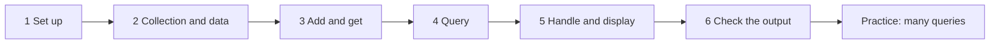
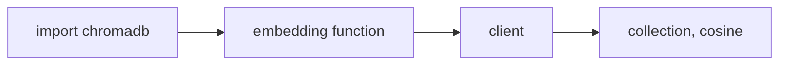
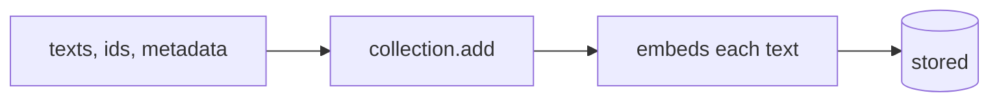
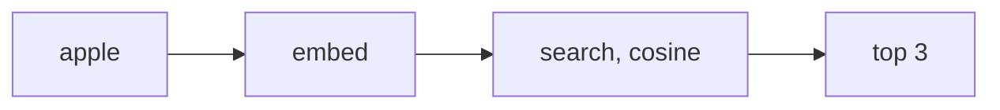

# Tutorial 5: The Lab, Similarity Search on Text With Chroma (Adapted)

> **After this tutorial you can:**
> - create a Chroma collection that scores by cosine distance and fill it with documents and metadata
> - read everything back with `get`
> - run a similarity search with `query` and show the top three results with their ids, texts and scores
> - handle "no results" and read a score correctly (it is a **distance**)
> - search with several queries at once

This follows the lab *Similarity Search on Text Using a Chroma Vector Database*, task by task, using the same grocery list and the same `apple` query. It is the hands-on partner of [Tutorial 4](04-chroma-db-adapted.md), which explains each Chroma idea. Here you only apply them.

## The path



## Task 1: Set up

> **Lab says / today we use:** the lab opens a cloud IDE terminal and runs `pip install chromadb==1.0.12`, `pip install torch ...` and `pip install sentence-transformers==4.1.0`, then creates a file `similarity_search.py` and runs it with `python3.11`. Here, Chroma is already installed in the repo's shared `.venv` (see [Tutorial 4](04-chroma-db-adapted.md#before-you-start)), and we use a notebook in `course3/module1/` with that `.venv` as the kernel. You do not need torch or sentence-transformers. The lab's note "do not close the terminal where Docker is running" belongs to an earlier lab; it does not apply.

To follow the lab exactly as a script instead, put the finished code from "Task 6" into `similarity_search.py` and run `uv run python similarity_search.py` from `course3/module1/`.

---

## Task 2: Create a collection and the data

**The problem.** You want to search grocery names by meaning. You need somewhere to store them (a collection) and something to turn text into vectors (an embedding function).

**The fix.** Import Chroma, choose the embedding function, create a client, then a collection scored by **cosine** distance.



**Type this.**

```python
import chromadb
from chromadb.utils import embedding_functions

ef = embedding_functions.DefaultEmbeddingFunction()
client = chromadb.Client()
collection_name = "my_grocery_collection"
```

> **Lab says / today we use:** the lab builds `SentenceTransformerEmbeddingFunction(model_name="all-MiniLM-L6-v2")`. `DefaultEmbeddingFunction` runs the **same model** without PyTorch, so your scores match the lab's. The first call downloads about 80 MB once.

Create the collection:

```python
collection = client.get_or_create_collection(
    name=collection_name,
    metadata={"description": "A collection for storing grocery data"},
    configuration={"hnsw": {"space": "cosine"}, "embedding_function": ef},
)
print(f"Collection created: {collection.name}")
```

**What you should see.**

```
Collection created: my_grocery_collection
```

> **Lab says / today we use:** the lab calls `client.create_collection(...)`. That fails with "Collection ... already exists" if you run the cell twice in a notebook, so we use `get_or_create_collection`. Everything else is the same.

Now the data, the lab's fourteen grocery items, and an id for each:

```python
texts = [
    "fresh red apples", "organic bananas", "ripe mangoes", "whole wheat bread",
    "farm-fresh eggs", "natural yogurt", "frozen vegetables", "grass-fed beef",
    "free-range chicken", "fresh salmon fillet", "aromatic coffee beans",
    "pure honey", "golden apple", "red fruit",
]
ids = [f"food_{index + 1}" for index in range(len(texts))]
print(ids[:3], len(ids))
```

**What you should see.**

```
['food_1', 'food_2', 'food_3'] 14
```

**Why it works.** An id must be unique per record. Building it from the position (`food_1`, `food_2`, and so on) is the simplest way. Note that `"golden apple"` and `"red fruit"` are in the list on purpose: they are close to "apple" in meaning without being the same words.

**Try it.** Add a fifteenth item, `"green pears"`, and check that `ids` grows to 15.

---

## Task 3: Add the texts and read them back

**The problem.** The collection is empty.

**The fix.** `add` the documents with their ids and metadata. Chroma embeds each text automatically with the collection's embedding function, so you never touch a vector.



**Type this.**

```python
collection.add(
    documents=texts,
    metadatas=[{"source": "grocery_store", "category": "food"} for _ in texts],
    ids=ids,
)
```

Read everything back with `get` (no filter means all records):

```python
all_items = collection.get()
print("Collection contents:")
print(f"Number of documents: {len(all_items['documents'])}")
```

**What you should see.**

```
Collection contents:
Number of documents: 14
```

`get` returns a dictionary with the ids, documents and metadata:

```python
print(list(all_items.keys()))
print(all_items["ids"][0], all_items["documents"][0], all_items["metadatas"][0])
```

**What you should see** (the order of the keys may differ):

```
['ids', 'embeddings', 'documents', 'uris', 'included', 'data', 'metadatas']
food_1 fresh red apples {'source': 'grocery_store', 'category': 'food'}
```

`embeddings` is `None` by default: Chroma stores them but does not send them back unless you ask (`include=["embeddings"]`).

**Try it.** Print `collection.count()`. Then print `collection.get(ids=["food_13"])["documents"]`.

**Check yourself.** Why is `metadatas` a list of 14 identical dictionaries here?

<details><summary>Answer</summary>
Each record needs its own metadata dictionary. The lab gives every item the same two keys, <code>source</code> and <code>category</code>, so the dictionaries happen to be equal.
</details>

---

## Task 4: Run a similarity search

**The problem.** You want the grocery items most like `"apple"`.

**The fix.** `query` takes your text in a list (`query_texts`), embeds it with the same function, and returns the `n_results` closest records.



**Type this.**

```python
query_term = "apple"

results = collection.query(
    query_texts=[query_term],
    n_results=3,
)
print(f"Query results for '{query_term}':")
print(results["ids"])
print(results["documents"])
```

**What you should see.**

```
Query results for 'apple':
[['food_13', 'food_1', 'food_14']]
[['golden apple', 'fresh red apples', 'red fruit']]
```

Everything comes back as a **list of lists**: one inner list per query text. With one query, take `[0]`.

**Why it works.** "Golden apple" is closest because it shares the word and the meaning. "Fresh red apples" is next. "Red fruit" has no "apple" in it at all, yet ranks third, because an apple is a red fruit. Bananas, bread and beef are further away.

**Try it.** Change `query_term` to `"breakfast"` and see what comes back. Then try `"meat"`.

---

## Task 5: Handle the results and display them

**The problem.** A raw dictionary is hard to read, and a query can return nothing (for example when a filter removes every record).

**The fix.** First guard against empty results, then print each result with its id, text and score.

**Type this.** The guard:

```python
if not results or not results["ids"] or len(results["ids"][0]) == 0:
    print(f'No documents found similar to "{query_term}"')
else:
    print("There are results to show")
```

Now the display loop. Notice how it indexes `[0]` (the first query):

```python
print(f'Top 3 similar documents to "{query_term}":')
for i in range(min(3, len(results["ids"][0]))):
    doc_id = results["ids"][0][i]
    score = results["distances"][0][i]
    text = results["documents"][0][i]
    print(f' - ID: {doc_id}, Text: "{text}", Score: {score:.4f}')
```

**What you should see.**

```
Top 3 similar documents to "apple":
 - ID: food_13, Text: "golden apple", Score: 0.3825
 - ID: food_1, Text: "fresh red apples", Score: 0.4809
 - ID: food_14, Text: "red fruit", Score: 0.5965
```

> **Careful with the word "score".** The lab prints these numbers as "Score" and its text calls them similarity scores, but they are **cosine distances** (`1 - similarity`). **Smaller is closer**: 0.3825 beats 0.5965. To get a similarity, use `1 - score`. See [the module README](../README.md#11-cosine-similarity-and-distance).

Show both, to build the habit:

```python
for doc_id, text, distance in zip(results["ids"][0], results["documents"][0], results["distances"][0]):
    print(f"{doc_id:8} distance {distance:.4f}  similarity {1 - distance:.4f}  {text}")
```

**What you should see.**

```
food_13  distance 0.3825  similarity 0.6175  golden apple
food_1   distance 0.4809  similarity 0.5191  fresh red apples
food_14  distance 0.5965  similarity 0.4035  red fruit
```

**Try it.** Ask for `n_results=14` (every item) and print the last three distances. They are all above 0.89: the items furthest from apple.

**Check yourself.** Why does the loop use `min(3, len(...))`?

<details><summary>Answer</summary>
So it never indexes past the end if fewer than three results came back (for example in a tiny collection or after a filter).
</details>

---

## Task 6: Put it together and check the output

The lab ends with one script. Here it is as small functions. Compared with the lab, there is no `try ... except Exception: print(...)` around everything, and nothing is defined inside `main`.

> **Lab says / today we use:** the lab wraps the whole program in `try/except Exception` and prints `Error: ...`. That keeps the program from crashing, but it **hides tracebacks**, which makes mistakes harder to find. We let errors surface while you learn. Add `try/except` later, for specific errors, when you know which ones you expect.

```python
def show_results(query_term, results, k=3):
    if not results or not results["ids"] or len(results["ids"][0]) == 0:
        print(f'No documents found similar to "{query_term}"')
        return
    print(f'Top {k} similar documents to "{query_term}":')
    for i in range(min(k, len(results["ids"][0]))):
        print(f' - ID: {results["ids"][0][i]}, Text: "{results["documents"][0][i]}", '
              f'Distance: {results["distances"][0][i]:.4f}')

def perform_similarity_search(collection, query_term, k=3):
    results = collection.query(query_texts=[query_term], n_results=k)
    show_results(query_term, results, k)

perform_similarity_search(collection, "apple")
```

**What you should see.**

```
Top 3 similar documents to "apple":
 - ID: food_13, Text: "golden apple", Distance: 0.3825
 - ID: food_1, Text: "fresh red apples", Distance: 0.4809
 - ID: food_14, Text: "red fruit", Distance: 0.5965
```

That is the lab's expected result: your first application of similarity search. The scores match the lab's (to the fourth decimal place, since it is the same model).

> **If the lab's script prints `Error: Collection ... already exists`:** you are running it twice in the same Python session. Chroma's client keeps collections in memory for the life of the session. Use `get_or_create_collection`, or restart the kernel.

To turn this into `similarity_search.py`, copy every block above into one file and end it with:

```python
if __name__ == "__main__":
    perform_similarity_search(collection, "apple")
```

(In the file version, keep the setup, the `add` call and the two functions above that line, in that order.)

---

## Practice: many queries at once

The lab's own practice exercises, as tasks. You already have everything you need. No answers are shown here. Ask me for a hint, or compare with the lab's solutions after you try.

1. Make the query `["red", "fresh"]` instead of `"apple"`, and convert a plain string to a list when someone passes one (`isinstance(query_term, str)`).
2. Pass the list to `collection.query` as `query_texts` directly (no extra brackets).
3. Print the top three for **each** query. The ids, documents and distances now hold **two** inner lists, one per query. Use an outer loop over the queries.
4. Run it. For reference, these are the first results to expect:

```
red   -> red fruit (0.3133), fresh red apples (0.4540), golden apple (0.7393)
fresh -> fresh red apples (0.4774), farm-fresh eggs (0.4854), pure honey (0.6253)
```

Notice `pure honey` as the third result for "fresh". The model has a loose idea of "fresh" and no document that is clearly about it, so a weak match still ranks third. Distances above about 0.6 are a warning sign. That motivates a `max distance` cut-off, in the extra tasks below.

### Extra tasks (beyond the lab)

5. Add a `max_distance` argument to `show_results` that drops results farther than it. What value hides `pure honey`?
6. Use a metadata filter: add `{"category": "food"}` and a second category for some items, then search only one category with `where=`. See [Tutorial 4, concept 4](04-chroma-db-adapted.md#concept-4-metadata-filtering).
7. Delete `food_13` with `collection.delete(ids=["food_13"])` and repeat the "apple" search. What replaces it?
8. Rebuild the collection with `"space": "l2"` and compare the numbers and the order with this one. See [Tutorial 4, concept 7](04-chroma-db-adapted.md#concept-7-choosing-the-metric-with-space).

## Common mistakes

| Mistake | What happens | Fix |
|---|---|---|
| Running `create_collection` twice | `Collection [my_grocery_collection] already exists` | `get_or_create_collection`, or restart the kernel |
| Treating "Score" as a similarity | the best match looks like the lowest number | it is a distance, smaller is closer; similarity is `1 - distance` |
| Forgetting `[0]` on `results["ids"]` | you print a list of lists | `results["ids"][0]` is the first query's results |
| Blanket `try/except` that only prints `Error: ...` | the real cause is hidden | let the traceback show while you learn |
| Adding the same ids twice | the second `add` is silently ignored; the old document stays | use `upsert` to replace, or new ids |
| `query_texts="apple"` expected as one query | works, but multi-query code then iterates letters | always pass a list: `["apple"]` |
| Expecting exact word matches | "red fruit" appears for "apple" | that is semantic search; use `where_document` for exact words |

## Cheat sheet

| Lab task | Code |
|---|---|
| Embedding function | `embedding_functions.DefaultEmbeddingFunction()` |
| Client | `chromadb.Client()` |
| Collection | `client.get_or_create_collection(name=, configuration={"hnsw": {"space": "cosine"}, "embedding_function": ef})` |
| Ids | `[f"food_{i + 1}" for i in range(len(texts))]` |
| Add | `collection.add(documents=, metadatas=, ids=)` |
| Read all | `collection.get()` |
| Search | `collection.query(query_texts=[...], n_results=3)` |
| Read results | `results["ids"][q][i]`, `results["documents"][q][i]`, `results["distances"][q][i]` |
| Similarity from distance | `1 - distance` (cosine) |

---

Previous: [Tutorial 4, Chroma DB](04-chroma-db-adapted.md). Back to the [module README](../README.md).
