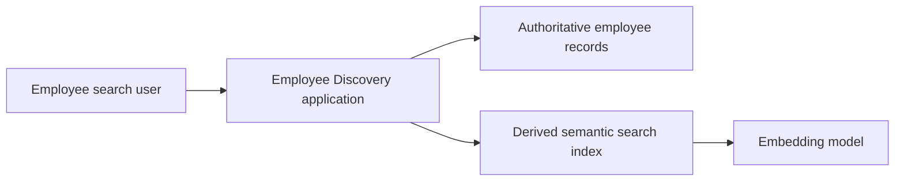
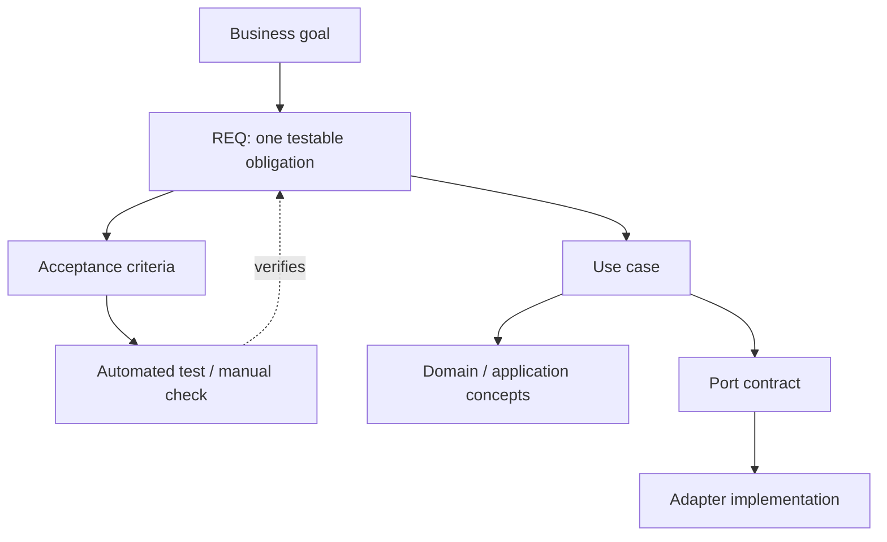
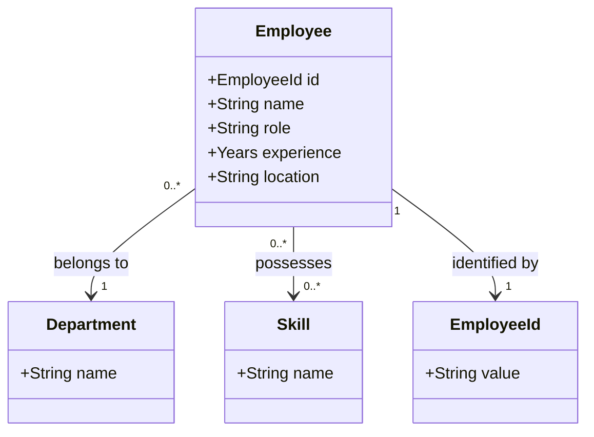
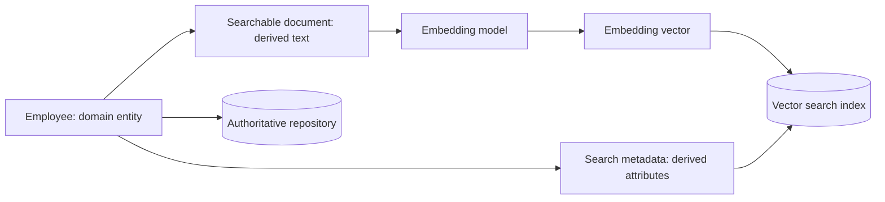
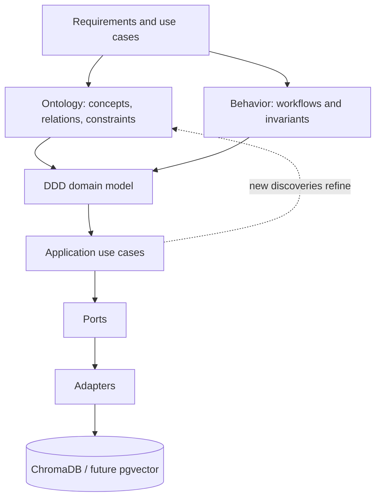
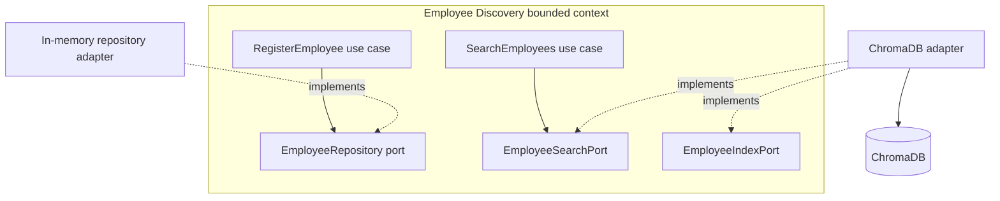
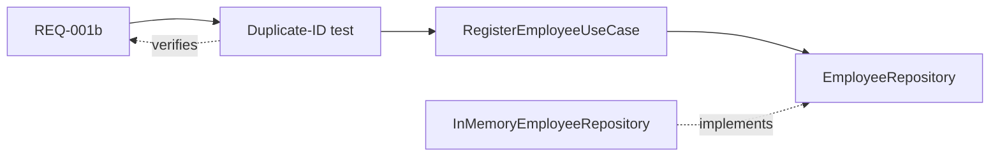

# Employee Search — Requirements and Domain Ontology

> [!abstract] Purpose
> This is the **requirements and domain-language baseline** for [[00-Setup]], [[01-Part-1-Domain-and-TDD]], [[02-Part-2-Use-Case-and-Ports]], [[03-Part-3-Semantic-Search-Use-Case]], and [[04-Part-4-ChromaDB-Adapter-and-Integration-Tests]]. Read it before coding. Requirements labeled **Workshop** are design decisions for this application, **not claims made by the Coursera lab**.

> [!important] Status
> **Proposed baseline, version 0.1.** It consolidates requirements already introduced in the lessons and identifies gaps. Items marked *future* are not implemented in Parts 1–4. The ontology is a **conceptual domain ontology**, not a formal OWL/RDF ontology or an automatically inferred schema.

## 1. Problem statement and scope

**Problem:** A user needs to discover employee records relevant to a natural-language description while applying mandatory structured constraints, such as department and minimum years of experience.

**Primary actor:** Employee search user (an internal recruiter, staffing coordinator, or developer exercising the workshop).

**System boundary:** Employee Discovery application. It validates and registers employees, stores authoritative records through a repository port, creates a searchable representation through an indexing port, and retrieves ranked candidates through a search port.

**From the Coursera lab:** 15 sample employees; text composed from employee attributes; `all-MiniLM-L6-v2` embeddings; ChromaDB cosine-distance search; filters on department, experience and location; combined search. The lab also includes a separate book-search exercise.

**Workshop extensions:** Domain invariants, registration uniqueness, stable contracts, TDD, fake adapters, deletion, persistence verification, Docker Compose, and future portability.

**Not yet in scope:** Authentication/authorization, employee data privacy policy, real HR integration, ranking fairness evaluation, automatic repository-to-index synchronization, high availability, or production SLAs.



## 2. Requirements writing convention

Each requirement has: **stable ID, statement, rationale/source, acceptance criteria, and verification level**. Use one independently testable obligation per requirement. `REQ` IDs should not be repurposed after implementation. Tests reference requirement IDs.



## 3. Functional requirements

| ID | Requirement | Origin | Status through Part 4 |
|---|---|---|---|
| REQ-001a | The system shall reject an employee whose ID or name is blank or whose experience is not a nonnegative integer; zero is valid. | Workshop | Domain implemented/tested in Part 1 |
| REQ-001b | The system shall register a valid employee with a previously unused ID and shall reject duplicate IDs without overwriting the existing record. | Workshop | Use case + fake repository in Part 2 |
| REQ-002 | The system shall return employees ranked by ascending vector distance for a nonblank natural-language query. | Lab + Workshop contract | Fake search in Part 3; Chroma integration in Part 4 |
| REQ-003 | The system shall restrict search results to the requested department when that filter is supplied. | Lab | Parts 3–4 |
| REQ-004 | The system shall restrict search results to employees with experience greater than or equal to a supplied minimum. | Lab | Parts 3–4 |
| REQ-005 | The system shall combine supported mandatory filters with semantic retrieval, and return at most the requested positive limit. | Lab + Workshop | Parts 3–4 for department and experience |
| REQ-006 | The search index shall remove an employee's searchable representation when instructed to delete that employee ID. | Workshop | Part 4 index adapter; not yet end-to-end employee deletion |
| REQ-007 | Indexed employee data shall survive a restart of the ChromaDB service when its persistent volume is retained. | Workshop | Manual persistence check described in Part 4 |
| REQ-008 | The system shall reject blank search queries, nonpositive limits and negative minimum experience. | Workshop | Part 3 |
| REQ-009 | The system shall support indexing an employee's descriptive text and metadata under the employee's stable ID. | Lab + Workshop | Part 4 |
| REQ-010 | The system shall support location-based filtering as demonstrated by the original lab. | Lab | **Future**: not in current `SearchCriteria` contract |
| REQ-011 | Employee registration and index updates shall be coordinated reliably so newly registered employees become searchable. | Workshop | **Future**: not implemented in Parts 1–4 |

### 3.1 Detailed acceptance criteria

**REQ-001a — Valid employee**
- Given a valid employee with `experience=0`, construction succeeds.
- Given a blank or whitespace-only ID, construction raises `ValueError`.
- Given a blank or whitespace-only name, construction raises `ValueError`.
- Given negative, fractional, or boolean experience, construction raises `ValueError`.

**REQ-001b — Register employee**
- Given an empty repository, registering `employee_1` saves and retrieves that employee.
- Given `employee_1` already exists, registering the same ID raises `EmployeeAlreadyExists` and preserves the first record.

**REQ-002 — Ranked search**
- Given deterministic fake candidates with distances `0.08`, `0.12`, and `0.32`, the use case returns them in ascending order.
- Given an indexed employee and a nonblank query, the Chroma adapter returns a `SearchResult` with the employee and a numeric distance.
- Ranking is **not** a guarantee of skill qualification or answer correctness.

**REQ-003/004/005 — Structured constraints**
- Given Engineering employees with 5 and 12 years and an HR employee with 15 years, `department=Engineering` and `minimum_experience=10` returns only the 12-year Engineering employee.
- Given `limit=1`, at most one result is returned.
- A missing filter imposes no constraint for that field.

**REQ-006 — Index deletion**
- Given an indexed employee, deleting their ID removes that employee from subsequent index searches.
- This does **not** yet mean deletion from the authoritative repository.

**REQ-007 — Persistence**
- Given a fixed collection and indexed employee, restarting the Chroma container without deleting its named volume preserves the record.

**REQ-008 — Input validation**
- Blank query, `limit=0`, and negative minimum experience are rejected before a vector database call.

**REQ-009 — Indexing**
- The indexed record uses the stable employee ID and includes searchable descriptive text plus metadata for structured filtering.
- Re-indexing the same ID updates its indexed representation (`upsert`).

**REQ-010/011 — Future acceptance criteria**
- Location filter restricts results to matching location(s), once added to the application contract.
- After successful registration, a reliable workflow eventually indexes the employee; retries must not create duplicate indexed records. The consistency policy is to be designed.

## 4. Nonfunctional and architectural constraints

| ID | Constraint | How to verify |
|---|---|---|
| NFR-001 | Domain modules shall not import FastAPI, ChromaDB, or database SDKs. | Import/dependency review; unit tests without services |
| NFR-002 | Application use cases shall depend on ports, not concrete adapters. | Fake and Chroma adapters satisfy the same search contract |
| NFR-003 | Unit tests shall run without Docker or external services. | `uv run pytest tests/unit -v` |
| NFR-004 | Chroma integration tests shall use isolated collections and clean them up. | Integration test fixture teardown |
| NFR-005 | The local environment shall use uv-managed dependencies and a reproducible lockfile. | `uv sync --frozen` |
| NFR-006 | ChromaDB shall run in Docker Compose with persistent storage. | Compose startup and REQ-007 restart check |
| NFR-007 | The embedding model and vector distance metric shall be explicit and compatible between indexing and querying. | Adapter configuration/integration tests |

> [!warning] Not established
> No quantitative latency, recall@k, throughput, availability, security, retention, or fairness targets have been agreed. Do not invent these as accepted requirements. Add them after stakeholder discussion and baseline measurement.

## 5. Ubiquitous language: glossary

| Term | Definition | Important distinction |
|---|---|---|
| Employee | A person represented by a stable employee ID and employment attributes. | Domain entity; not a Chroma document. |
| Employee ID | Stable identifier of an employee within this application. | Unique across registered employees. |
| Skill | Named capability attributed to an employee. | Semantic resemblance is not proof that a skill is present. |
| Experience | Whole, nonnegative years of professional experience in this workshop. | A hard filter, not an embedding-derived fact. |
| Department | Organizational grouping associated with an employee. | Exact metadata filter. |
| Search criteria | Query text, optional department, optional minimum experience, and result limit. | Application request model, not necessarily a domain value object. |
| Search result | Employee plus vector distance. | Retrieval result, not an employee entity. |
| Searchable document | Text generated from employee attributes for embedding. | Derived representation. |
| Embedding | Numeric vector produced from searchable text by an embedding model. | Not a domain property of the employee. |
| Search index | Storage and retrieval structure for embeddings and metadata. | Derived infrastructure; not authoritative records. |
| Repository | Port for authoritative record persistence. | Separate from semantic search. |
| Indexing | Operation that creates/updates a searchable representation. | Separate from registration until orchestrated. |

## 6. Conceptual domain ontology

### 6.1 Concepts and relationships



> [!note] Interpretation
> This is a **conceptual** diagram: `Department`, `Skill`, and `EmployeeId` are useful domain concepts, but the current code represents department as a string, skills as a tuple of strings, and ID as a string. The diagram does not mandate creating those classes now. Cardinality is a modeling proposal, not validated organizational policy.

### 6.2 Domain facts vs derived search representations



### 6.3 Predicates and constraints

| Conceptual relation / rule | Meaning | Enforcement today |
|---|---|---|
| `Employee hasIdentity EmployeeId` | Every employee has an ID. | `Employee.__post_init__` validates nonblank ID. |
| `Employee belongsTo Department` | Employee has a department attribute. | Stored as string; no nonblank invariant yet. |
| `Employee hasSkill Skill` | Employee has zero or more skill names. | Stored as tuple; no skill taxonomy yet. |
| `Employee hasExperience Years` | Experience is a nonnegative integer. | Domain invariant. |
| `SearchResult refersTo Employee` | A result identifies an employee. | `SearchResult.employee`. |
| `SearchResult hasDistance Number` | A result has a vector distance. | `SearchResult.distance`. |
| `IndexEntry represents Employee` | Search entry is derived from employee. | Stable ID in Chroma index. |

### 6.4 Why ontology is not the same as DDD



An ontology is a shared conceptual vocabulary and relationship model. DDD uses domain knowledge to choose entities, value objects, aggregates, bounded contexts, behaviors and invariants. Neither must be mechanically derived from nouns alone. Requirements, ontology, and code evolve together.

## 7. Bounded context and ownership

For this workshop, use **one bounded context: Employee Discovery**. We have not established a separate HR Master Data bounded context. A production system might receive employee records from HR instead of owning them.



> [!important] Gap in current workshop
> Part 2 registration saves to an in-memory repository. Part 4 indexing is invoked explicitly. **Registering an employee does not automatically make it searchable.** That requires a later orchestration/synchronization use case (REQ-011).

## 8. Use-case catalog

| Use case ID | Name | Trigger | Preconditions | Success outcome | Failure/edge cases |
|---|---|---|---|---|---|
| UC-001 | Register Employee | Caller submits employee data | Valid employee; unused ID | Employee saved in repository | Invalid fields; duplicate ID |
| UC-002 | Search Employees | Caller submits search criteria | Valid query and filters | Ranked matching results, bounded by limit | Invalid query; empty results |
| UC-003 | Index Employee | Indexing coordinator/test supplies employee | Valid employee; index available | Search representation upserted | Index unavailable; embedding failure |
| UC-004 | Delete Indexed Employee | Caller/coordinator supplies employee ID | Index available | Index representation removed | Missing ID; index unavailable |
| UC-005 | Verify Persistence | Operator restarts Chroma service | Named volume retained | Previously indexed record still available | Volume deleted; configuration mismatch |

```mermaid
sequenceDiagram
  actor User
  participant UC as SearchEmployeesUseCase
  participant Port as EmployeeSearchPort
  participant Adapter as Chroma adapter
  participant DB as ChromaDB
  User->>UC: SearchCriteria(query, department, minimum_experience, limit)
  UC->>Port: search(criteria)
  Note over Port,Adapter: Adapter implements port; port is not a runtime service
  Adapter->>DB: query + metadata filters
  DB-->>Adapter: IDs, distances, metadata
  Adapter-->>UC: SearchResult[]
  UC-->>User: ranked matching employees
```

## 9. Traceability matrix

| Requirement | Use case | Domain / application type | Port | Tests / lesson |
|---|---|---|---|---|
| REQ-001a | UC-001 | `Employee` | None needed for construction | Part 1 `test_employee.py` |
| REQ-001b | UC-001 | `Employee`, `EmployeeAlreadyExists` | `EmployeeRepository` | Part 2 `test_register_employee.py` |
| REQ-002 | UC-002 | `SearchCriteria`, `SearchResult` | `EmployeeSearchPort` | Part 3 fake; Part 4 integration |
| REQ-003 | UC-002 | `SearchCriteria.department` | `EmployeeSearchPort` | Parts 3–4 |
| REQ-004 | UC-002 | `SearchCriteria.minimum_experience` | `EmployeeSearchPort` | Parts 3–4 |
| REQ-005 | UC-002 | `SearchCriteria.limit` | `EmployeeSearchPort` | Parts 3–4 |
| REQ-006 | UC-004 | `Employee.id` | `EmployeeIndexPort.delete` | Part 4 integration |
| REQ-007 | UC-005 | Stable collection/ID | Chroma adapter | Part 4 manual restart check |
| REQ-008 | UC-002 | `SearchCriteria` validation | None needed for validation | Part 3 unit tests |
| REQ-009 | UC-003 | `Employee` | `EmployeeIndexPort.index` | Part 4 integration |
| REQ-010 | UC-002 | Future `SearchCriteria.location` | Search port extension | Not yet implemented |
| REQ-011 | Future registration/index coordinator | Registration and index state | Repository + index ports | Not yet implemented |

## 10. Important modeling decisions and open questions

| ID | Question | Proposed starting point | Why it matters |
|---|---|---|---|
| DEC-001 | What owns employee records? | Repository is authoritative; Chroma is derived. | Enables future PostgreSQL migration. |
| DEC-002 | Is semantic similarity sufficient to prove Python skill? | **No**; verify mandatory skills explicitly. | Avoids false qualification. |
| DEC-003 | Is `Department` a separate entity? | Not yet; string in current code. | Avoid premature complexity. |
| DEC-004 | Should location filtering be supported? | Yes, as future REQ-010. | Coursera lab demonstrates it. |
| DEC-005 | When does indexing happen after registration? | Undecided; design in later workshop. | Consistency and retries. |
| DEC-006 | Can employee data be updated? | Not yet specified end-to-end. | Update/reindex behavior. |
| DEC-007 | What is the employee data privacy/security policy? | Undecided. | Real employee data is sensitive. |
| DEC-008 | What are retrieval quality thresholds? | Undecided; establish evaluation dataset first. | Prevents arbitrary distance cutoffs. |

## 11. How to use this document during TDD

1. Pick one requirement ID, such as `REQ-001b`.
2. Read its acceptance criteria and linked use case.
3. Write a failing test using the domain vocabulary.
4. Implement the minimum domain/application behavior.
5. Introduce a port only when the use case needs an external capability.
6. Use a fake adapter for fast unit tests, then a real adapter for integration tests.
7. Mark the requirement verified only after the corresponding tests actually pass in your environment.



## 12. Suggested learning order

- [[00-Setup]] — Environment, package layout, dependencies.
- [[01-Part-1-Domain-and-TDD]] — `REQ-001a`, domain invariants and RED–GREEN–REFACTOR.
- [[02-Part-2-Use-Case-and-Ports]] — `REQ-001b`, use case, inbound/outbound ports, fake repository.
- [[03-Part-3-Semantic-Search-Use-Case]] — `REQ-002` through `REQ-005`, `REQ-008`, deterministic search.
- [[04-Part-4-ChromaDB-Adapter-and-Integration-Tests]] — `REQ-006`, `REQ-007`, `REQ-009`, real Chroma adapter.

> [!success] Definition of done for this specification
> Every new behavior should be assigned a stable requirement ID, an acceptance criterion, a use case (where applicable), a responsible domain/application concept, and a verification method. **Do not mark a requirement complete merely because a tutorial contains example code.**
