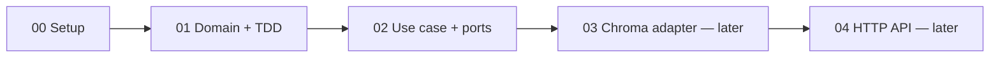
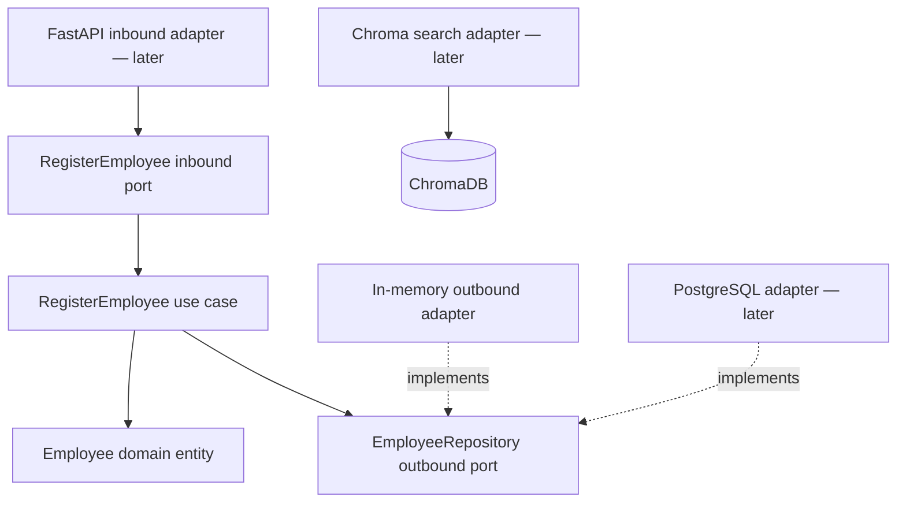
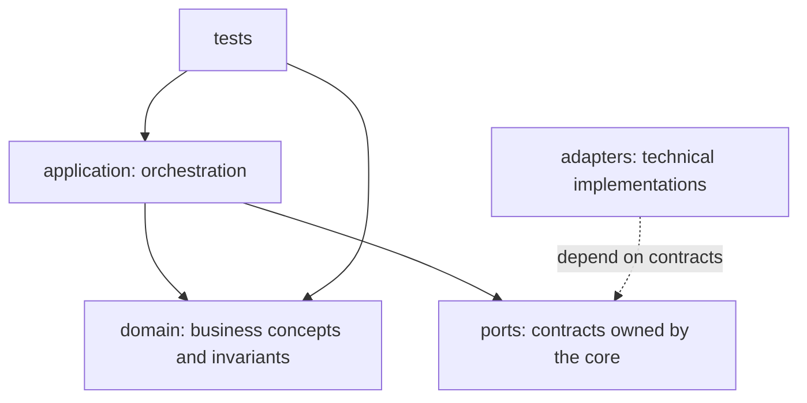

# 00 — Setup: A reproducible Python workspace

> [!abstract] Outcome
> Create an installable Python project, run a test, and prepare a Docker Compose service for ChromaDB. **We will not use ChromaDB until a later lesson.** This avoids confusing infrastructure problems with domain design.

**Navigation:** [[01-Part-1-Domain-and-TDD]] · [[02-Part-2-Use-Case-and-Ports]]

## 1. The journey



### Architecture we are working toward



## 2. Prerequisites

Install **Python 3.11**, **uv**, **Git**, and **Docker with Compose v2**. Verify in a terminal:

```bash
python --version
uv --version
git --version
docker --version
docker compose version
```

> [!tip] Windows
> Use PowerShell, Windows Terminal, or WSL. The following `mkdir` and `uv` commands work in PowerShell and POSIX shells. Commands using `touch` are intentionally avoided: create the named files in your editor.

## 3. Initialize an installable package

```bash
mkdir employee-search
cd employee-search
uv init --package --python 3.11
uv add --dev pytest pytest-cov ruff
uv sync
```

Why `--package`? It gives us a `src/` package that can be imported reliably by tests and by future adapters. `uv.lock` pins resolved dependencies; commit it to Git.

Check:

```bash
uv run python --version
uv run pytest --version
```

## 4. Create the folders you need now

```text
employee-search/
├── pyproject.toml
├── uv.lock
├── .python-version
├── .gitignore
├── compose.yaml
├── src/
│   └── employee_search/
│       ├── __init__.py
│       ├── domain/
│       │   └── __init__.py
│       ├── application/
│       │   ├── __init__.py
│       │   ├── ports/
│       │   │   ├── __init__.py
│       │   │   ├── inbound/
│       │   │   │   └── __init__.py
│       │   │   └── outbound/
│       │   │       └── __init__.py
│       │   └── use_cases/
│       │       └── __init__.py
│       └── adapters/
│           ├── __init__.py
│           └── outbound/
│               └── __init__.py
└── tests/
    ├── unit/
    └── integration/
```

Create directories and empty `__init__.py` files using your editor. The `uv init` command may create a starter `hello()` in `src/employee_search/__init__.py`; it is fine to replace that with an empty file. We add modules as we implement them, rather than creating an entire empty architecture.

### Why these folders?



**Ports belong to the application core; adapters sit outside it.** Inbound ports describe what the application offers. Outbound ports describe what it needs.

## 5. Add a minimal Docker Compose service

Create `compose.yaml`:

```yaml
services:
  chroma:
    image: chromadb/chroma:1.0.12
    ports:
      - "8001:8000"
    volumes:
      - chroma_data:/data
    environment:
      IS_PERSISTENT: "TRUE"
      PERSIST_DIRECTORY: /data
      ANONYMIZED_TELEMETRY: "FALSE"

volumes:
  chroma_data:
```

This uses the **ChromaDB 1.0.12** release specified by the supplied Coursera lab. It is a historical teaching baseline, **not** a production version recommendation. We publish Chroma on host port **8001**, reserving 8000 for the FastAPI app later. Chroma is not yet an application dependency.

```bash
docker compose config
docker compose up -d
docker compose ps
```

Optional heartbeat check (when the container is ready):

```bash
curl http://localhost:8001/api/v2/heartbeat
```

If you cannot run Docker yet, continue with Parts 1 and 2; their tests require no containers. If your environment has an incompatible image or persistence configuration, resolve that in the Chroma integration lesson before relying on stored data.

Stop the container without deleting the named volume:

```bash
docker compose down
```

> [!warning] Persistence
> `docker compose down` preserves named volumes by default. `docker compose down -v` deletes them. This matters once we index data.

## 6. Add development hygiene

Create `.gitignore`:

```gitignore
.venv/
__pycache__/
.pytest_cache/
.ruff_cache/
.coverage
htmlcov/
.env
```

Run:

```bash
uv run ruff check .
uv run pytest -q
```

Before we add tests, pytest may report `no tests ran` (exit code 5). That is expected. Part 1 introduces our first tests.

## 7. Definition of done

- [ ] `uv run python --version` works.
- [ ] `uv run pytest --version` works.
- [ ] Package folders exist.
- [ ] `docker compose config` validates the Compose file.
- [ ] If Docker is available, Chroma starts and its heartbeat responds.

**Next:** [[01-Part-1-Domain-and-TDD]]
