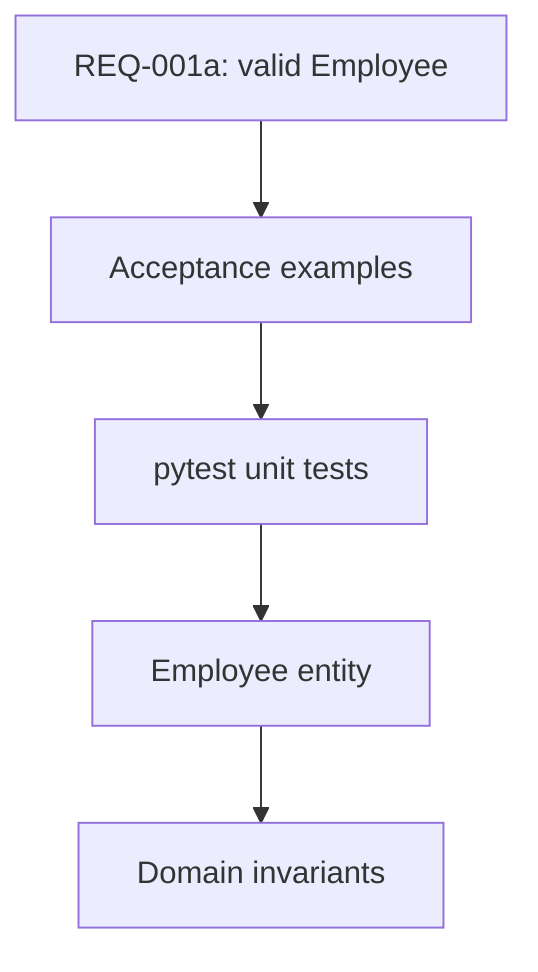
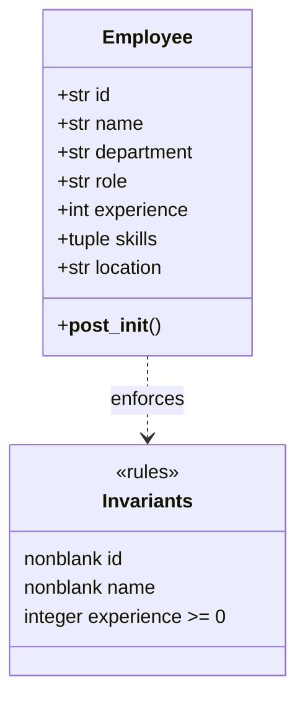
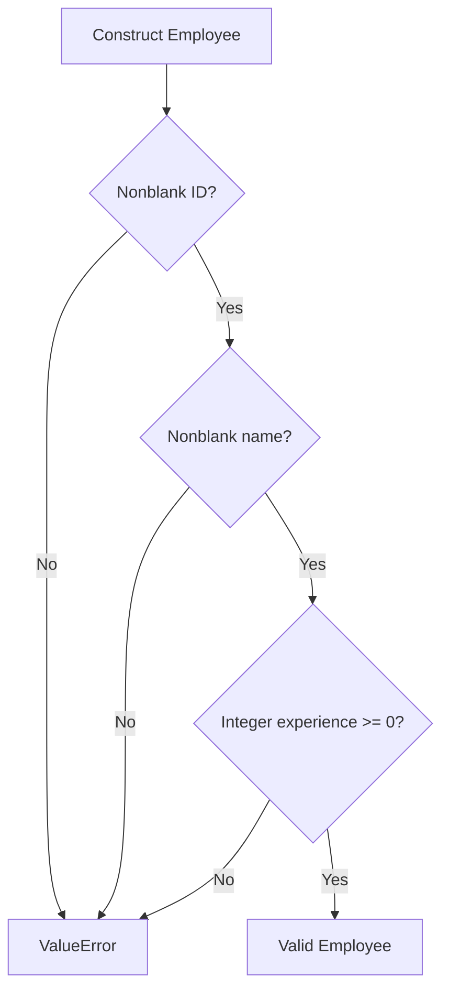
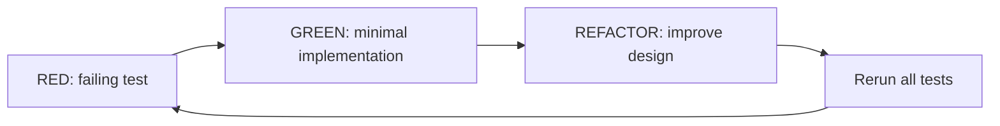

# 01 — Model an Employee using DDD and TDD

**Prerequisite:** [[00-Setup]]  
**Next:** [[02-Part-2-Use-Case-and-Ports]]

> [!abstract] Outcome
> Write tests **before** implementation, create an `Employee` entity with domain invariants, and prove that the domain runs without ChromaDB, FastAPI, or Docker.

## 1. From requirement to test

**REQ-001a — Employee validity:** An employee must have a nonblank ID and name, and nonnegative integer years of experience. Zero years is valid. (Cross-record ID uniqueness belongs to the registration use case in Part 2.)

| Test ID | Given | When | Then |
|---|---|---|---|
| T-001 | Valid employee data | Construct employee | Entity is created |
| T-002 | Experience = -1 | Construct employee | `ValueError` |
| T-003 | Blank name | Construct employee | `ValueError` |
| T-004 | Blank ID | Construct employee | `ValueError` |
| T-005 | Experience = 0 | Construct employee | Entity is created |
| T-006 | Experience = 2.5 | Construct employee | `ValueError` |



## 2. Domain concepts

An **entity** is identified by a stable identity, not just by its attributes. An **invariant** is a rule that must hold for every valid instance. `Employee` is an entity; `experience >= 0` is an invariant. We may later introduce `EmployeeId` or `Experience` value objects, but they are not necessary yet.



## 3. RED — write tests before the entity exists

Create `tests/unit/test_employee.py`:

```python
import pytest

from employee_search.domain.employee import Employee


def make_employee(**overrides):
    data = {
        "id": "employee_1",
        "name": "John Doe",
        "department": "Engineering",
        "role": "Software Engineer",
        "experience": 5,
        "skills": ("Python", "React"),
        "location": "New York",
    }
    data.update(overrides)
    return Employee(**data)


def test_create_valid_employee():
    employee = make_employee()
    assert employee.id == "employee_1"
    assert employee.skills == ("Python", "React")


@pytest.mark.parametrize("bad_id", ["", "   "])
def test_reject_blank_id(bad_id):
    with pytest.raises(ValueError, match="ID"):
        make_employee(id=bad_id)


@pytest.mark.parametrize("bad_name", ["", "   "])
def test_reject_blank_name(bad_name):
    with pytest.raises(ValueError, match="Name"):
        make_employee(name=bad_name)


def test_reject_negative_experience():
    with pytest.raises(ValueError, match="Experience"):
        make_employee(experience=-1)


def test_accept_zero_experience():
    assert make_employee(experience=0).experience == 0


def test_reject_fractional_experience():
    with pytest.raises(ValueError, match="Experience"):
        make_employee(experience=2.5)
```

Run:

```bash
uv run pytest tests/unit/test_employee.py -v
```

**Expected RED:** import/collection error because `employee_search.domain.employee` does not exist. This confirms the test suite is not accidentally exercising a preexisting implementation.

## 4. GREEN — write the smallest useful entity

Create `src/employee_search/domain/employee.py`:

```python
from dataclasses import dataclass


@dataclass(frozen=True)
class Employee:
    id: str
    name: str
    department: str
    role: str
    experience: int
    skills: tuple[str, ...]
    location: str

    def __post_init__(self) -> None:
        if not isinstance(self.id, str) or not self.id.strip():
            raise ValueError("Employee ID cannot be blank")
        if not isinstance(self.name, str) or not self.name.strip():
            raise ValueError("Name cannot be blank")
        if type(self.experience) is not int or self.experience < 0:
            raise ValueError("Experience must be a nonnegative integer")
```

`type(...) is int` intentionally rejects booleans (Python treats `bool` as a subclass of `int`) and fractional years. These are workshop rules, not requirements from the Coursera lab.



Run:

```bash
uv run pytest tests/unit/test_employee.py -v
```

**Expected GREEN:** all tests pass. Because parameterized cases are separate tests, pytest will report **8 passed**.

## 5. REFACTOR — reason about design

- `@dataclass` generates initialization, equality, and representation methods.
- `frozen=True` prevents normal field reassignment; it is **shallow** immutability.
- `skills` is a tuple to avoid a mutable list escaping the entity.
- `__post_init__` enforces invariants at the construction boundary.
- No domain file imports a framework or database library.

> [!question] Why not put validation in FastAPI?
> A future CSV importer, CLI, or background job must obey the same business rules. Domain validation applies regardless of transport.

> [!question] Why not check uniqueness in `Employee.__post_init__`?
> A single entity cannot know which IDs already exist. That rule requires coordination with a repository and belongs to the registration use case.

## 6. Verify and inspect coverage

```bash
uv run ruff check .
uv run pytest --cov=employee_search --cov-report=term-missing
```

Coverage shows executed lines, not the quality of assertions. Keep the tests behavior-focused.



## 7. Commit the milestone

```bash
git add .
git commit -m "feat(domain): add validated Employee entity"
```

If this is your first commit, run `git init` first and configure your Git identity as needed.

## 8. Definition of done

- [ ] The tests fail before `employee.py` exists.
- [ ] All eight test cases pass after implementation.
- [ ] `ruff check .` passes.
- [ ] No ChromaDB or FastAPI imports exist in `domain/`.
- [ ] You can explain **entity**, **invariant**, and **Red–Green–Refactor**.

**Next:** [[02-Part-2-Use-Case-and-Ports]]
