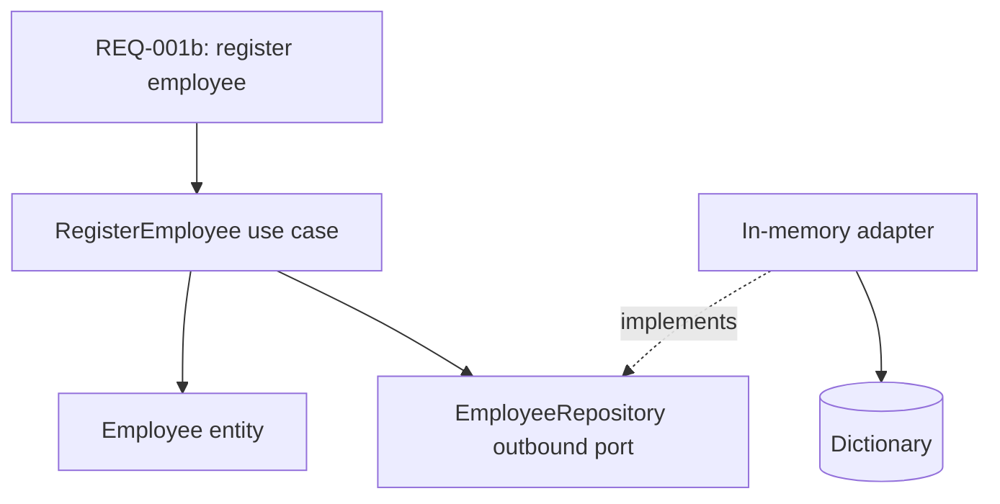
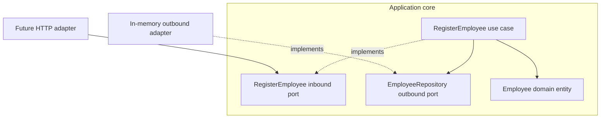
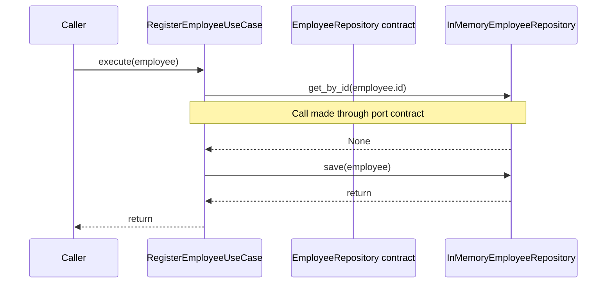
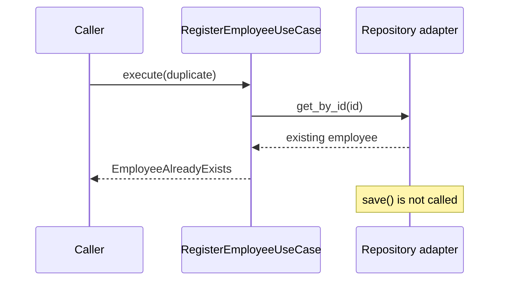
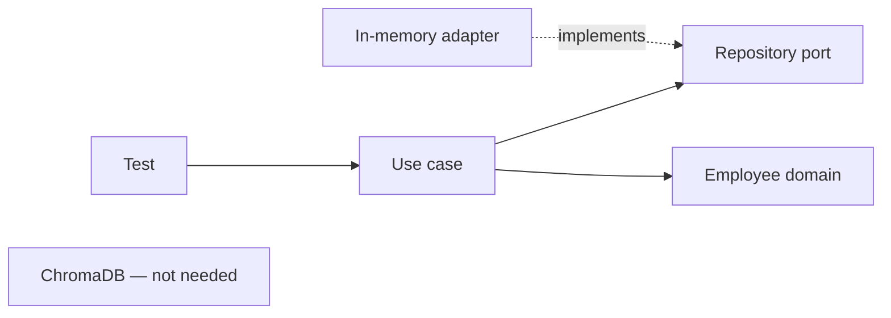

# 02 — RegisterEmployee: a use case with ports and adapters

**Prerequisites:** [[00-Setup]] · [[01-Part-1-Domain-and-TDD]]

> [!abstract] Outcome
> Register an employee through an application use case, enforce unique IDs, and test it using an in-memory outbound adapter. **No database or HTTP server is needed.**

## 1. Why a use case?

The domain entity validates **one employee**. Registration is a business operation involving **other records**: before saving an employee, we must check that its ID is not already registered.

**REQ-001b — Registration:** A valid employee with a new ID is saved. Attempting to register an existing ID is rejected without overwriting the original record.



**Terms:** An **inbound port** is the contract a caller invokes. An **outbound port** is the contract a use case needs from infrastructure. An **adapter** implements a port or translates an external request into it. A **composition root** assembles implementations.

## 2. The dependency rule



The core **never imports** `InMemoryEmployeeRepository`. The adapter imports the outbound port's domain types, and the bootstrap code wires everything together.

## 3. Extend the project tree

```text
src/employee_search/
├── domain/
│   ├── employee.py
│   └── exceptions.py                # new
├── application/
│   ├── ports/
│   │   ├── inbound/
│   │   │   └── register_employee.py # new
│   │   └── outbound/
│   │       └── employee_repository.py # new
│   └── use_cases/
│       └── register_employee.py     # new
└── adapters/
    └── outbound/
        └── in_memory_employee_repository.py # new

tests/unit/
├── test_employee.py
└── test_register_employee.py        # new
```

Keep the empty `__init__.py` files created during setup. No need to create an `infrastructure/` directory: here, infrastructure implementations live under `adapters/`.

## 4. RED — write the use-case tests first

Create `tests/unit/test_register_employee.py`:

```python
import pytest

from employee_search.application.use_cases.register_employee import (
    RegisterEmployeeUseCase,
)
from employee_search.domain.employee import Employee
from employee_search.domain.exceptions import EmployeeAlreadyExists
from employee_search.adapters.outbound.in_memory_employee_repository import (
    InMemoryEmployeeRepository,
)


def make_employee(employee_id: str = "employee_1") -> Employee:
    return Employee(
        id=employee_id,
        name="John Doe",
        department="Engineering",
        role="Software Engineer",
        experience=5,
        skills=("Python", "React"),
        location="New York",
    )


def test_register_new_employee():
    repository = InMemoryEmployeeRepository()
    use_case = RegisterEmployeeUseCase(repository)
    employee = make_employee()

    use_case.execute(employee)

    assert repository.get_by_id(employee.id) == employee


def test_duplicate_id_is_rejected_without_overwriting():
    repository = InMemoryEmployeeRepository()
    use_case = RegisterEmployeeUseCase(repository)
    original = make_employee()
    use_case.execute(original)

    duplicate = Employee(
        id="employee_1",
        name="Different Person",
        department="HR",
        role="HR Coordinator",
        experience=2,
        skills=("Recruitment",),
        location="Chicago",
    )

    with pytest.raises(EmployeeAlreadyExists):
        use_case.execute(duplicate)

    assert repository.get_by_id("employee_1") == original


def test_two_distinct_ids_can_be_registered():
    repository = InMemoryEmployeeRepository()
    use_case = RegisterEmployeeUseCase(repository)

    use_case.execute(make_employee("employee_1"))
    use_case.execute(make_employee("employee_2"))

    assert repository.get_by_id("employee_1") is not None
    assert repository.get_by_id("employee_2") is not None
```

Run:

```bash
uv run pytest tests/unit/test_register_employee.py -v
```

**Expected RED:** import error because the use case, exception, and adapter do not exist. We now implement them in small steps.

## 5. GREEN — define a domain exception

Create `src/employee_search/domain/exceptions.py`:

```python
class EmployeeAlreadyExists(Exception):
    """An employee with this identity is already registered."""
```

The domain exception expresses business meaning; it does not refer to HTTP 409 or database constraint errors.

## 6. Define the outbound port

Create `src/employee_search/application/ports/outbound/employee_repository.py`:

```python
from typing import Protocol

from employee_search.domain.employee import Employee


class EmployeeRepository(Protocol):
    def get_by_id(self, employee_id: str) -> Employee | None:
        ...

    def save(self, employee: Employee) -> None:
        ...
```

The application owns the interface because **the use case determines what persistence capabilities it needs**. A `Protocol` allows structural typing: an implementation does not have to inherit from the interface explicitly.

## 7. Define the inbound port

Create `src/employee_search/application/ports/inbound/register_employee.py`:

```python
from typing import Protocol

from employee_search.domain.employee import Employee


class RegisterEmployee(Protocol):
    def execute(self, employee: Employee) -> None:
        ...
```

This is an explicit teaching choice. In a smaller production codebase, the concrete use-case class can itself be the inbound application boundary without a separate protocol.

## 8. Implement the use case

Create `src/employee_search/application/use_cases/register_employee.py`:

```python
from employee_search.application.ports.outbound.employee_repository import (
    EmployeeRepository,
)
from employee_search.domain.employee import Employee
from employee_search.domain.exceptions import EmployeeAlreadyExists


class RegisterEmployeeUseCase:
    def __init__(self, repository: EmployeeRepository) -> None:
        self._repository = repository

    def execute(self, employee: Employee) -> None:
        if self._repository.get_by_id(employee.id) is not None:
            raise EmployeeAlreadyExists(employee.id)
        self._repository.save(employee)
```

Notice: the use case imports the **port**, not the adapter. It does not know whether records live in memory, PostgreSQL, or elsewhere.

## 9. Implement the in-memory outbound adapter

Create `src/employee_search/adapters/outbound/in_memory_employee_repository.py`:

```python
from employee_search.domain.employee import Employee


class InMemoryEmployeeRepository:
    def __init__(self) -> None:
        self._employees: dict[str, Employee] = {}

    def get_by_id(self, employee_id: str) -> Employee | None:
        return self._employees.get(employee_id)

    def save(self, employee: Employee) -> None:
        self._employees[employee.id] = employee
```

This adapter is deliberately simple. It stores entities in a dictionary and is useful for learning and fast tests. It is **not persistent** and does **not** protect against concurrent registrations.

## 10. Run tests — GREEN

```bash
uv run pytest tests/unit/test_register_employee.py -v
uv run pytest -v
uv run ruff check .
```

**Expected:** 3 registration tests pass; all 11 tests across Parts 1 and 2 pass (Part 1 has 8 parameterized cases). These are expected outcomes, not execution results from your machine.

### Sequence of a successful registration



### Duplicate registration



## 11. REFACTOR — check the boundaries

- Domain entity: validates one employee.
- Use case: coordinates registration and enforces the duplicate-ID rule.
- Inbound port: declares what callers can request.
- Outbound port: declares what storage operations the use case needs.
- In-memory adapter: supplies those operations for tests.
- Future HTTP adapter: will translate JSON into an `Employee` and call the inbound port.



> [!warning] Concurrency and correctness
> The sequence `get_by_id()` then `save()` is **not atomic**. Two concurrent requests could both see no existing record and save the same ID. For production, enforce uniqueness atomically in the authoritative database (for example, a PostgreSQL unique constraint), and translate duplicate-key errors into `EmployeeAlreadyExists`. This exercise teaches the boundary first; we will strengthen the port contract when adding real persistence.

> [!important] Source of truth versus search index
> ChromaDB will later serve **semantic retrieval**, not necessarily authoritative employee registration. PostgreSQL can become the source of truth, with ChromaDB holding a derived index. Do not assume registering in an in-memory repository automatically indexes anything in ChromaDB.

## 12. Optional: manually wire the application

Create a temporary `demo_registration.py` in the project root:

```python
from employee_search.adapters.outbound.in_memory_employee_repository import (
    InMemoryEmployeeRepository,
)
from employee_search.application.use_cases.register_employee import (
    RegisterEmployeeUseCase,
)
from employee_search.domain.employee import Employee

repository = InMemoryEmployeeRepository()
register = RegisterEmployeeUseCase(repository)

employee = Employee(
    id="employee_1",
    name="John Doe",
    department="Engineering",
    role="Software Engineer",
    experience=5,
    skills=("Python", "React"),
    location="New York",
)

register.execute(employee)
print(repository.get_by_id("employee_1"))
```

Run:

```bash
uv run python demo_registration.py
```

This is **manual dependency injection**: the outermost code constructs the adapter and passes it into the use case. Later, our `bootstrap/` module will do the wiring for FastAPI.

## 13. Reflection questions

1. Why is `EmployeeAlreadyExists` a domain concept rather than an HTTP error?
2. Why does the use case depend on `EmployeeRepository` instead of `InMemoryEmployeeRepository`?
3. Which rule can the entity enforce alone, and which needs repository access?
4. What happens if the in-memory adapter is replaced by PostgreSQL?
5. Why is the duplicate-ID check insufficient under concurrency?

## 14. Definition of done

- [ ] Three registration tests pass.
- [ ] Part 1 tests still pass.
- [ ] The use case imports only domain and application packages.
- [ ] The adapter implements the outbound contract.
- [ ] You can explain inbound vs outbound ports and adapters.
- [ ] You can explain why ChromaDB is intentionally absent.

Commit:

```bash
git add .
git commit -m "feat(application): register employees through repository port"
```

## 15. What comes next?

**Part 3 (future):** Define `EmployeeSearchPort`, generate embeddings, implement the ChromaDB outbound adapter, and add integration tests against the Docker Compose service. We will distinguish exact metadata constraints from semantic ranking, as the Coursera lab does.
