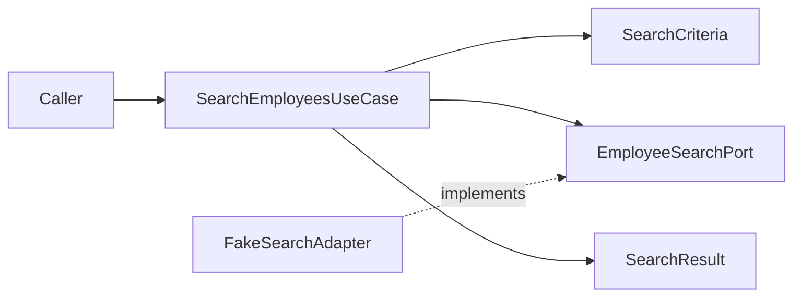
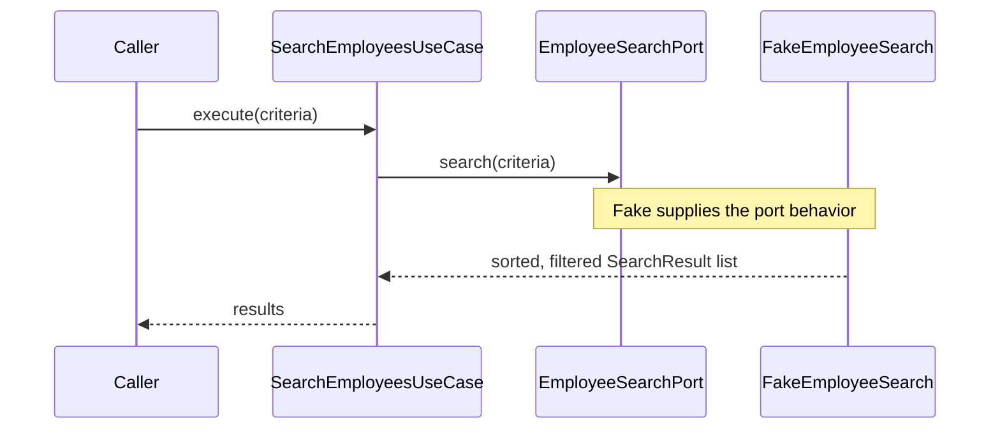

# 03 — Semantic Search: TDD before ChromaDB

**Prerequisites:** [[00-Setup]] · [[01-Part-1-Domain-and-TDD]] · [[02-Part-2-Use-Case-and-Ports]]

> [!abstract] Outcome
> Implement a technology-independent `SearchEmployeesUseCase` using an outbound search port and a deterministic fake adapter. Learn to distinguish semantic ranking from mandatory filters. **No embedding model or ChromaDB is needed in this part.**

## 1. Requirement and design

**REQ-002:** A caller can request a ranked list of employees relevant to a natural-language query. **REQ-003/004/005:** Department and minimum-experience constraints are mandatory. Invalid search inputs are rejected.

| Acceptance test | Expected behavior |
|---|---|
| Query has only whitespace | Reject with `ValueError` |
| `limit` is zero | Reject with `ValueError` |
| Minimum experience is negative | Reject with `ValueError` |
| Matching records | Sorted by ascending distance |
| Department + minimum experience | Only matching employees returned |
| `limit=1` | Return at most one result |



> [!important] Boundary decision
> `EmployeeRepository` from Part 2 is about authoritative records. `EmployeeSearchPort` is about retrieving ranked search candidates. They remain separate because PostgreSQL may own employee records while ChromaDB owns a derived search index. In this part, the fake adapter has its own small fixture dataset; it is **not** automatically synchronized with Part 2's repository.

## 2. Extend the tree

```text
src/employee_search/
├── application/
│   ├── models/
│   │   └── search.py                      # new
│   ├── ports/
│   │   ├── inbound/
│   │   │   └── search_employees.py        # new
│   │   └── outbound/
│   │       └── employee_search.py         # new
│   └── use_cases/
│       └── search_employees.py           # new
└── adapters/
    └── outbound/
        └── fake_employee_search.py       # new

tests/unit/test_search_employees.py       # new
```

Create empty `__init__.py` files in the new `models` package and any other new Python package directories if you are following the setup's explicit-package convention.

## 3. RED — tests first

Create `tests/unit/test_search_employees.py`:

```python
import pytest

from employee_search.application.models.search import SearchCriteria
from employee_search.application.use_cases.search_employees import SearchEmployeesUseCase
from employee_search.adapters.outbound.fake_employee_search import FakeEmployeeSearch
from employee_search.domain.employee import Employee


def employee(id: str, department: str, experience: int) -> Employee:
    return Employee(
        id=id, name=id, department=department, role="Engineer",
        experience=experience, skills=("Python",), location="Singapore",
    )


def make_use_case() -> SearchEmployeesUseCase:
    # Distances are deterministic test data, not generated embeddings.
    fake = FakeEmployeeSearch([
        (employee("e1", "Engineering", 5), 0.12),
        (employee("e2", "Engineering", 12), 0.32),
        (employee("e3", "HR", 15), 0.08),
    ])
    return SearchEmployeesUseCase(fake)


def test_search_returns_ranked_results():
    results = make_use_case().execute(SearchCriteria(query="Python engineer"))
    assert [r.employee.id for r in results] == ["e3", "e1", "e2"]


def test_filters_are_mandatory():
    criteria = SearchCriteria(
        query="Python engineer", department="Engineering", minimum_experience=10,
    )
    results = make_use_case().execute(criteria)
    assert [r.employee.id for r in results] == ["e2"]


def test_limit_is_applied():
    results = make_use_case().execute(SearchCriteria(query="engineer", limit=1))
    assert len(results) == 1
    assert results[0].employee.id == "e3"


@pytest.mark.parametrize("kwargs", [
    {"query": " "},
    {"query": "engineer", "limit": 0},
    {"query": "engineer", "minimum_experience": -1},
])
def test_invalid_search_criteria(kwargs):
    with pytest.raises(ValueError):
        SearchCriteria(**kwargs)
```

Run `uv run pytest tests/unit/test_search_employees.py -v`. **Expected RED:** missing imports; that is intentional.

## 4. GREEN — application request and result types

Create `src/employee_search/application/models/search.py`:

```python
from dataclasses import dataclass

from employee_search.domain.employee import Employee


@dataclass(frozen=True)
class SearchCriteria:
    query: str
    department: str | None = None
    minimum_experience: int | None = None
    limit: int = 5

    def __post_init__(self) -> None:
        if not self.query.strip():
            raise ValueError("Search query cannot be empty")
        if self.limit < 1:
            raise ValueError("Search limit must be positive")
        if self.minimum_experience is not None and self.minimum_experience < 0:
            raise ValueError("Minimum experience cannot be negative")


@dataclass(frozen=True)
class SearchResult:
    employee: Employee
    distance: float
```

These are **application-facing request/result types**. They are not necessarily DDD value objects: a query limit and a vector distance describe a retrieval operation, not an intrinsic employee business concept.

## 5. Define inbound and outbound ports

Create `src/employee_search/application/ports/inbound/search_employees.py`:

```python
from typing import Protocol
from employee_search.application.models.search import SearchCriteria, SearchResult


class SearchEmployees(Protocol):
    def execute(self, criteria: SearchCriteria) -> list[SearchResult]: ...
```

Create `src/employee_search/application/ports/outbound/employee_search.py`:

```python
from typing import Protocol
from employee_search.application.models.search import SearchCriteria, SearchResult


class EmployeeSearchPort(Protocol):
    def search(self, criteria: SearchCriteria) -> list[SearchResult]: ...
```

The inbound port describes **what the application offers**. The outbound port describes **what it needs** from a search engine. The real adapter may later generate query embeddings, but the application contract does not mention ChromaDB.

## 6. Implement the use case

Create `src/employee_search/application/use_cases/search_employees.py`:

```python
from employee_search.application.models.search import SearchCriteria, SearchResult
from employee_search.application.ports.outbound.employee_search import EmployeeSearchPort


class SearchEmployeesUseCase:
    def __init__(self, search_port: EmployeeSearchPort) -> None:
        self._search_port = search_port

    def execute(self, criteria: SearchCriteria) -> list[SearchResult]:
        return self._search_port.search(criteria)
```

The use case is intentionally thin. The port's **contract** requires that filters and limit be honored and results be ordered. That contract will be tested against each adapter. Do not add a second filtering algorithm here unless your use case has an additional business policy.

## 7. Implement a deterministic fake outbound adapter

Create `src/employee_search/adapters/outbound/fake_employee_search.py`:

```python
from employee_search.application.models.search import SearchCriteria, SearchResult
from employee_search.domain.employee import Employee


class FakeEmployeeSearch:
    """Test double with preassigned distances; does not model semantic relevance."""

    def __init__(self, rows: list[tuple[Employee, float]]) -> None:
        self._rows = rows

    def search(self, criteria: SearchCriteria) -> list[SearchResult]:
        candidates = [
            SearchResult(employee=e, distance=d)
            for e, d in self._rows
            if (criteria.department is None or e.department == criteria.department)
            and (
                criteria.minimum_experience is None
                or e.experience >= criteria.minimum_experience
            )
        ]
        return sorted(candidates, key=lambda r: r.distance)[:criteria.limit]
```

> [!note] Why not embed in the fake?
> A unit test should be deterministic and fast. Embedding models introduce downloads, CPU cost, and model-dependent rankings. Integration tests will verify actual semantic search in Part 4.

## 8. GREEN — run the tests

```bash
uv run pytest tests/unit/test_search_employees.py -v
uv run pytest -v
uv run ruff check .
```

Expected: six new test cases pass (three behavior tests and three parameterized validation cases). All earlier tests should still pass. These are **expected results**, not proof of execution on your machine.



## 9. REFACTOR — ask the architectural questions

1. Why does `SearchEmployeesUseCase` not import `chromadb`?
2. Why are `SearchCriteria` and `SearchResult` in `application/models` instead of the Employee entity?
3. What must a second adapter guarantee to be interchangeable with the fake?
4. Why is a small cosine distance not proof of an employee's mandatory Python skill?

> [!warning] Semantic search vs factual requirements
> This workshop's structured filters cover department and experience. A mandatory skill such as *must know Python* needs a structured skills filter or verification step; vector similarity alone cannot prove it.

## 10. Definition of Done

- [ ] All six new test cases pass.
- [ ] Earlier domain and registration tests still pass.
- [ ] Search use case imports only application contracts.
- [ ] Fake adapter applies mandatory filters, ordering, and limit.
- [ ] No ChromaDB dependency is required for unit tests.
- [ ] Commit: `git add . && git commit -m "feat(search): add search use case and fake adapter"`

**Next:** [[04-Part-4-ChromaDB-Adapter-and-Integration-Tests]]
