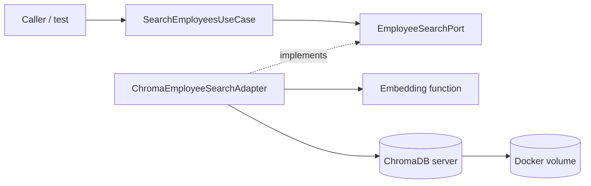
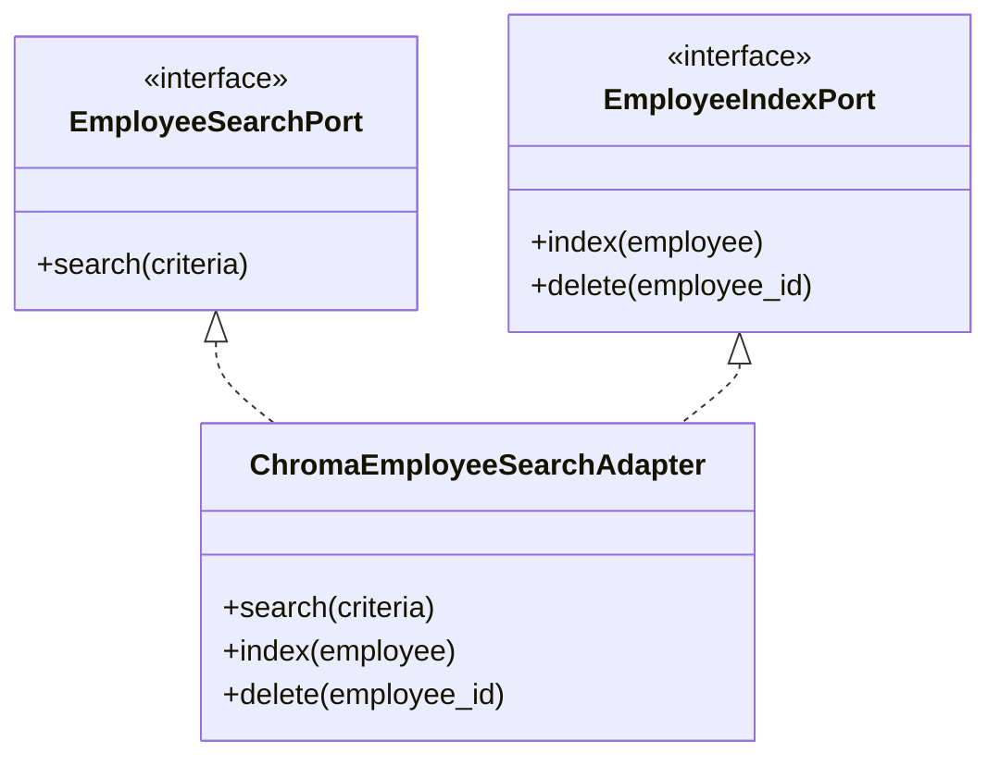
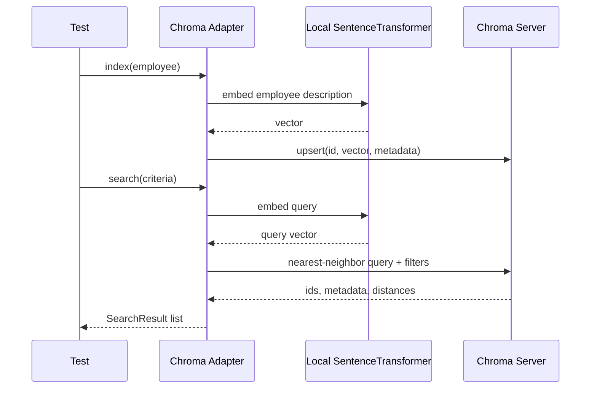
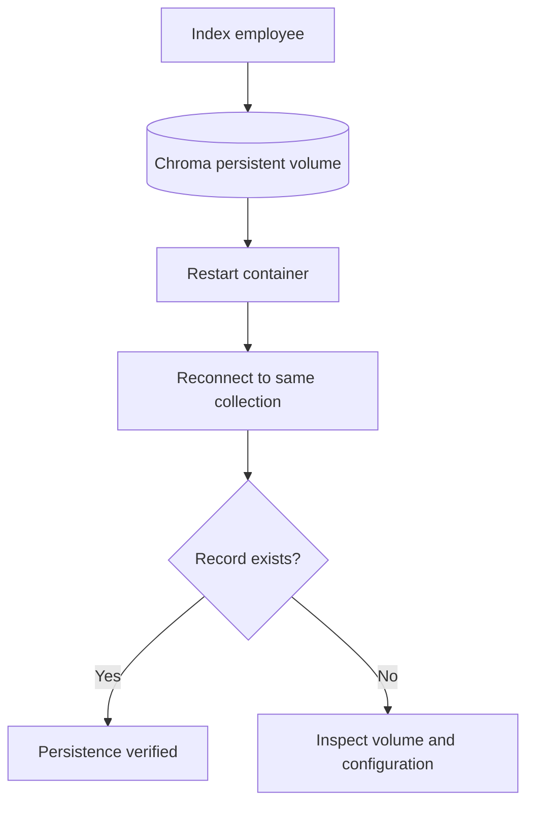

# 04 — Replace the Fake with a ChromaDB Adapter

**Prerequisites:** [[00-Setup]] · [[01-Part-1-Domain-and-TDD]] · [[02-Part-2-Use-Case-and-Ports]] · [[03-Part-3-Semantic-Search-Use-Case]]

> [!abstract] Outcome
> Run ChromaDB in Docker Compose, build an outbound adapter, index employee descriptions, and verify real semantic retrieval and metadata filtering with integration tests. The application use case remains unchanged.

## 1. Architecture and responsibilities



**In scope:** a search-index adapter with explicit indexing and search operations. **Out of scope:** automatic synchronization with the Part 2 repository, authentication, production observability, and FastAPI endpoints. We will add orchestration later.

## 2. Dependencies and Compose

Use the same pinned Chroma version as the original lab, **1.0.12**, for this learning step. This is not a production version recommendation. In the project root:

```bash
uv add "chromadb==1.0.12" "sentence-transformers==4.1.0"
```

If `compose.yaml` already exists from Setup, update its Chroma service instead of creating a second file. A minimal **Chroma-only** compose configuration is:

```yaml
services:
  chroma:
    image: chromadb/chroma:1.0.12
    ports:
      - "127.0.0.1:8001:8000"
    environment:
      IS_PERSISTENT: "TRUE"
      PERSIST_DIRECTORY: /data
      ANONYMIZED_TELEMETRY: "FALSE"
    volumes:
      - chroma_data:/data

volumes:
  chroma_data:
```

We publish container port 8000 on **localhost:8001** to avoid a future FastAPI port collision. A named volume survives `docker compose down` (but not `docker compose down -v`).

```bash
docker compose up -d chroma
docker compose ps
```

Check readiness using a Python standard-library request from your host:

```bash
uv run python -c "import urllib.request; print(urllib.request.urlopen('http://localhost:8001/api/v2/heartbeat').read())"
```

> [!warning] Local vs container networking
> From your **host**, use `localhost:8001`. From another service **inside Compose**, use `chroma:8000`. `localhost` inside the API container would refer to that container, not ChromaDB.

## 3. Make indexing an explicit outbound capability

We already defined `EmployeeSearchPort.search()` in Part 3. We now need to **index** an employee for later retrieval. Add a second protocol in `src/employee_search/application/ports/outbound/employee_index.py`:

```python
from typing import Protocol
from employee_search.domain.employee import Employee


class EmployeeIndexPort(Protocol):
    def index(self, employee: Employee) -> None: ...
    def delete(self, employee_id: str) -> None: ...
```

Separating search from indexing is useful: reads and writes can have different performance and consistency requirements. The same Chroma adapter will implement both protocols.



## 4. RED — write the integration tests

Create `tests/integration/test_chroma_employee_search.py`:

```python
import os
import uuid

import chromadb
import pytest
from chromadb.utils import embedding_functions

from employee_search.application.models.search import SearchCriteria
from employee_search.application.use_cases.search_employees import SearchEmployeesUseCase
from employee_search.adapters.outbound.chroma.employee_search_adapter import (
    ChromaEmployeeSearchAdapter,
)
from employee_search.domain.employee import Employee


def employee(id: str, department: str, experience: int, skills: tuple[str, ...]) -> Employee:
    return Employee(
        id=id, name=id, department=department, role="Software Engineer",
        experience=experience, skills=skills, location="Singapore",
    )


@pytest.fixture
def adapter():
    client = chromadb.HttpClient(
        host=os.getenv("CHROMA_HOST", "localhost"),
        port=int(os.getenv("CHROMA_PORT", "8001")),
    )
    ef = embedding_functions.SentenceTransformerEmbeddingFunction(
        model_name="all-MiniLM-L6-v2"
    )
    name = f"employees_{uuid.uuid4().hex[:12]}"
    collection = client.create_collection(
        name=name,
        embedding_function=ef,
        configuration={"hnsw": {"space": "cosine"}},
    )
    try:
        yield ChromaEmployeeSearchAdapter(collection)
    finally:
        client.delete_collection(name=name)


def test_index_then_search_returns_record(adapter):
    adapter.index(employee("e1", "Engineering", 5, ("Python", "React")))
    results = SearchEmployeesUseCase(adapter).execute(
        SearchCriteria(query="Python web developer")
    )
    assert [r.employee.id for r in results] == ["e1"]
    assert isinstance(results[0].distance, float)


def test_combined_filters_exclude_nonmatching_records(adapter):
    adapter.index(employee("e1", "Engineering", 5, ("Python",)))
    adapter.index(employee("e2", "Engineering", 12, ("Java",)))
    adapter.index(employee("e3", "HR", 15, ("Recruitment",)))
    results = SearchEmployeesUseCase(adapter).execute(
        SearchCriteria(
            query="experienced developer",
            department="Engineering",
            minimum_experience=10,
        )
    )
    assert [r.employee.id for r in results] == ["e2"]


def test_delete_removes_record(adapter):
    adapter.index(employee("e1", "Engineering", 5, ("Python",)))
    adapter.delete("e1")
    results = adapter.search(SearchCriteria(query="Python"))
    assert results == []
```

Run:

```bash
uv run pytest tests/integration/test_chroma_employee_search.py -v
```

**Expected RED:** import failure because the adapter has not been implemented. In a real TDD cycle, verify the tests fail for the intended reason, not because ChromaDB is unreachable.

## 5. GREEN — implement the outbound adapter

Create `src/employee_search/adapters/outbound/chroma/employee_search_adapter.py` (and an empty `__init__.py` in `chroma/`):

```python
from employee_search.application.models.search import SearchCriteria, SearchResult
from employee_search.domain.employee import Employee


class ChromaEmployeeSearchAdapter:
    def __init__(self, collection) -> None:
        self._collection = collection

    @staticmethod
    def _document(employee: Employee) -> str:
        return (
            f"{employee.role} with {employee.experience} years of experience "
            f"in {employee.department}. Skills: {', '.join(employee.skills)}. "
            f"Located in {employee.location}."
        )

    def index(self, employee: Employee) -> None:
        # upsert supports indexing a new record or replacing an existing one.
        self._collection.upsert(
            ids=[employee.id],
            documents=[self._document(employee)],
            metadatas=[{
                "name": employee.name,
                "department": employee.department,
                "role": employee.role,
                "experience": employee.experience,
                "skills": ", ".join(employee.skills),
                "location": employee.location,
            }],
        )

    def delete(self, employee_id: str) -> None:
        self._collection.delete(ids=[employee_id])

    def search(self, criteria: SearchCriteria) -> list[SearchResult]:
        filters = []
        if criteria.department is not None:
            filters.append({"department": criteria.department})
        if criteria.minimum_experience is not None:
            filters.append({"experience": {"$gte": criteria.minimum_experience}})
        where = None
        if len(filters) == 1:
            where = filters[0]
        elif len(filters) > 1:
            where = {"$and": filters}

        if self._collection.count() == 0:
            return []

        response = self._collection.query(
            query_texts=[criteria.query],
            n_results=criteria.limit,
            where=where,
            include=["metadatas", "distances"],
        )
        ids = response["ids"][0]
        metadata_rows = response["metadatas"][0]
        distances = response["distances"][0]
        results = []
        for id, meta, distance in zip(ids, metadata_rows, distances):
            results.append(SearchResult(
                employee=Employee(
                    id=id,
                    name=meta["name"],
                    department=meta["department"],
                    role=meta["role"],
                    experience=meta["experience"],
                    skills=tuple(s.strip() for s in meta["skills"].split(",") if s.strip()),
                    location=meta["location"],
                ),
                distance=float(distance),
            ))
        return sorted(results, key=lambda result: result.distance)
```

> [!important] Learning trade-off
> For the lab, we reconstruct `Employee` from Chroma metadata. In a production architecture where PostgreSQL is the system of record, the search adapter would typically return **employee IDs and distances**, and the application would hydrate authoritative employee details from PostgreSQL. This avoids treating the search index as authoritative employee storage.

## 6. Why does the embedding model run where it does?



With `SentenceTransformerEmbeddingFunction` attached to the client collection, embedding is performed by the **Python client process** when text documents/query texts are supplied. The Chroma server stores/searches the vectors. The first test may download model files and take longer.

## 7. GREEN — run integration tests

```bash
uv run pytest tests/integration/test_chroma_employee_search.py -v
uv run pytest -v
uv run ruff check .
```

If the integration test fails because of an API incompatibility, check the pinned client/server versions first. In particular, embedding-function and collection configuration signatures differ across Chroma releases. The examples target **1.0.12**; they are not guaranteed to work unmodified with other versions.

> [!tip] Troubleshooting
> **Connection refused:** `docker compose ps` and confirm host port `8001`. **Model download failure:** verify internet access for the first embedding run. **Dimension mismatch:** do not mix embedding models within a collection. **Duplicate collection:** tests use random collection names and delete them in teardown. **Distance values differ:** do not assert exact model-dependent scores.

## 8. Verify persistence without confusing it with the tests

The tests intentionally delete their temporary collections. To test persistence manually, use a fixed collection name and `get_or_create_collection`, index a record, restart Chroma (`docker compose restart chroma`), and reconnect with the same collection name. The record should still be present because of the named volume. This is a **separate acceptance test** from the isolated integration tests above.



## 9. REFACTOR and architectural reflection

- **Domain:** `Employee` knows no database or embedding SDK.
- **Application:** `SearchEmployeesUseCase` depends only on `EmployeeSearchPort`.
- **Outbound adapter:** Chroma-specific query syntax and metadata mapping live in one place.
- **Composition:** Tests inject the concrete adapter; a future bootstrap module will do the same for FastAPI.
- **Test boundaries:** Part 3 tests the contract cheaply with a fake; Part 4 tests the real Chroma integration.

**Important:** HNSW approximate search may yield different rankings from exact cosine search, especially at scale. Validate recall and filter behavior with representative data before using it for consequential decisions.

## 10. Definition of Done

- [ ] ChromaDB is running via Docker Compose.
- [ ] Integration tests index, filter, and delete successfully.
- [ ] Domain and use-case unit tests still pass.
- [ ] `SearchEmployeesUseCase` has not changed from Part 3.
- [ ] You can explain which process generates embeddings.
- [ ] You can explain why ChromaDB is a derived index rather than a source of truth.
- [ ] Commit: `git add . && git commit -m "feat(chroma): implement search adapter with integration tests"`

**Next:** Part 5 will connect registration to indexing through an application orchestration strategy, add FastAPI inbound adapters, and test HTTP behavior. We will also revisit atomic uniqueness and reliable synchronization when PostgreSQL is introduced.
