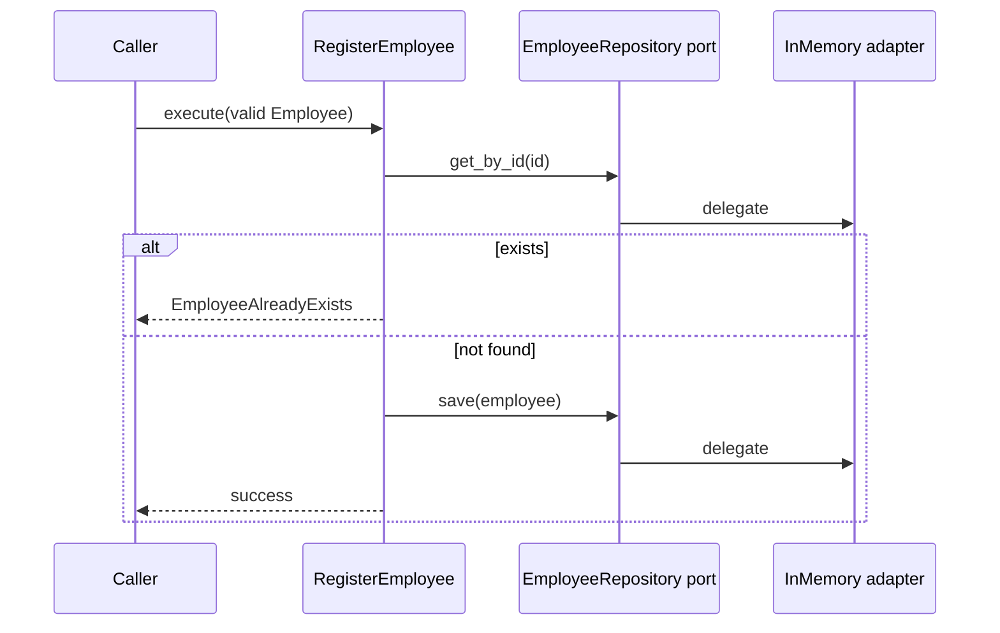
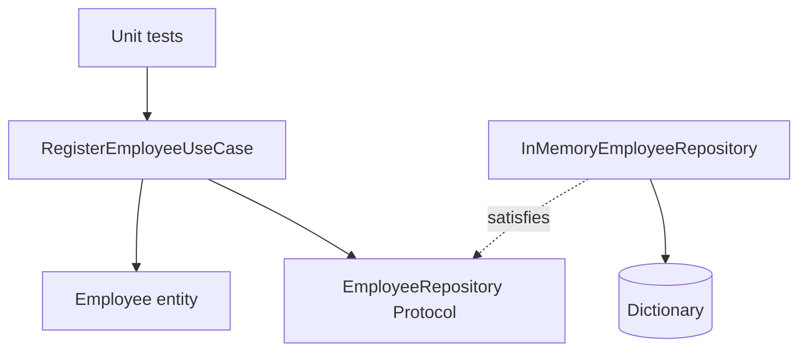

# UC-001 — Register Employee

**Requirements:** REQ-001a, REQ-001b. **Scenarios:** AC-001 through AC-004. **Prerequisites:** [[00-Problem-and-Scope]], [[01-Requirements-Specification]], and uv installed.

> [!abstract] Outcome
> Register a valid employee, reject invalid data and duplicate IDs, and retrieve the saved record from an in-memory adapter. Unit tests run without ChromaDB or Docker. This is a *unit-level vertical slice*; HTTP and production persistence are deferred.

## 1. Use-case specification

| Field | Value |
|---|---|
| Actor | Operator / application client |
| Trigger | Submit employee details |
| Preconditions | Employee data supplied, repository available |
| Main flow | Validate employee → check ID → save → success |
| Alternative A | Invalid attributes → ValueError |
| Alternative B | Duplicate ID → EmployeeAlreadyExists; existing record unchanged |
| Postcondition | Registered employee is retrievable by ID |



## 2. Bootstrap project

```bash
mkdir employee-search && cd employee-search
uv init --package --python 3.11
uv add --dev pytest pytest-cov ruff
mkdir -p src/employee_search/domain src/employee_search/application/ports/outbound src/employee_search/application/use_cases src/employee_search/adapters/outbound tests/unit
```

Create empty `__init__.py` files in each package directory if not present. This follows the earlier setup lesson; do not repeat `uv init` if you already have the project.

## 3. RED — domain tests

Create `tests/unit/test_employee.py`:

```python
import pytest
from employee_search.domain.employee import Employee


def make_employee(**overrides):
    data = dict(id="e1", name="John Doe", department="Engineering",
                role="Engineer", experience=5, skills=("Python",),
                location="New York")
    data.update(overrides)
    return Employee(**data)


def test_valid_employee():
    assert make_employee(experience=0).experience == 0


@pytest.mark.parametrize("changes", [
    {"id": " "}, {"name": " "}, {"experience": -1},
    {"experience": 2.5}, {"experience": True},
])
def test_invalid_employee(changes):
    with pytest.raises(ValueError):
        make_employee(**changes)
```

Run `uv run pytest tests/unit/test_employee.py -v`. Expect import failure because the entity does not yet exist.

## 4. GREEN — domain entity

Create `src/employee_search/domain/employee.py`:

```python
from dataclasses import dataclass


@dataclass(frozen=True)
class Employee:
    id: str
    name: str
    department: str
    role: str
    experience: int
    skills: tuple[str, ...]
    location: str

    def __post_init__(self) -> None:
        if not isinstance(self.id, str) or not self.id.strip():
            raise ValueError("Employee ID must not be blank")
        if not isinstance(self.name, str) or not self.name.strip():
            raise ValueError("Employee name must not be blank")
        if type(self.experience) is not int or self.experience < 0:
            raise ValueError("Experience must be a nonnegative integer")
```

Run the same test. Expect six passing test cases (one positive + five parameterized negative cases).

## 5. RED — registration use-case tests

Create `tests/unit/test_register_employee.py`:

```python
import pytest
from employee_search.domain.employee import Employee
from employee_search.domain.exceptions import EmployeeAlreadyExists
from employee_search.application.use_cases.register_employee import RegisterEmployeeUseCase
from employee_search.adapters.outbound.in_memory_employee_repository import InMemoryEmployeeRepository


def employee(name="John Doe"):
    return Employee("e1", name, "Engineering", "Engineer", 5,
                    ("Python",), "New York")


def test_register_new_employee():
    repository = InMemoryEmployeeRepository()
    RegisterEmployeeUseCase(repository).execute(employee())
    assert repository.get_by_id("e1") == employee()


def test_duplicate_does_not_overwrite():
    repository = InMemoryEmployeeRepository()
    use_case = RegisterEmployeeUseCase(repository)
    use_case.execute(employee())
    with pytest.raises(EmployeeAlreadyExists):
        use_case.execute(employee("Different Person"))
    assert repository.get_by_id("e1").name == "John Doe"
```

Run `uv run pytest tests/unit/test_register_employee.py -v`. Expect failure: the use case, exception and adapter are not implemented.

## 6. GREEN — define the outbound port

Create `src/employee_search/application/ports/outbound/employee_repository.py`:

```python
from typing import Protocol
from employee_search.domain.employee import Employee


class EmployeeRepository(Protocol):
    def get_by_id(self, employee_id: str) -> Employee | None: ...
    def save(self, employee: Employee) -> None: ...
```

**Why here?** The application owns the persistence capability it needs. ChromaDB or PostgreSQL does not get to dictate the use-case contract.

## 7. GREEN — domain exception and use case

Create `src/employee_search/domain/exceptions.py`:

```python
class EmployeeAlreadyExists(Exception):
    pass
```

Create `src/employee_search/application/use_cases/register_employee.py`:

```python
from employee_search.application.ports.outbound.employee_repository import EmployeeRepository
from employee_search.domain.employee import Employee
from employee_search.domain.exceptions import EmployeeAlreadyExists


class RegisterEmployeeUseCase:
    def __init__(self, repository: EmployeeRepository):
        self.repository = repository

    def execute(self, employee: Employee) -> None:
        if self.repository.get_by_id(employee.id) is not None:
            raise EmployeeAlreadyExists(employee.id)
        self.repository.save(employee)
```

> [!warning] Concurrency caveat
> The `get_by_id` then `save` sequence is not atomic in a concurrent production database. The authoritative repository must enforce a unique ID constraint, and the adapter must translate duplicate-key failures into the application contract. This is deliberately deferred for the in-memory teaching exercise.

## 8. GREEN — implement the outbound adapter

Create `src/employee_search/adapters/outbound/in_memory_employee_repository.py`:

```python
from employee_search.domain.employee import Employee


class InMemoryEmployeeRepository:
    def __init__(self):
        self._employees: dict[str, Employee] = {}

    def get_by_id(self, employee_id: str) -> Employee | None:
        return self._employees.get(employee_id)

    def save(self, employee: Employee) -> None:
        self._employees[employee.id] = employee
```

This is an **outbound adapter**, not a domain service. The use case only depends on the `EmployeeRepository` protocol.

## 9. Verify and refactor

```bash
uv run pytest tests/unit -v
uv run ruff check .
uv run pytest --cov=employee_search --cov-report=term-missing
```

Expected: eight passing test cases (six domain + two registration), assuming the code above is followed exactly. Test results are expected, not independently executed in your machine.

## 10. Architecture check



Explain aloud: why does `Employee` not import the repository? Why does `RegisterEmployeeUseCase` not import the in-memory adapter? What changes when replacing the adapter with PostgreSQL?

## Definition of Done

- [ ] REQ-001a covered by domain tests.
- [ ] REQ-001b covered by registration tests.
- [ ] Duplicate registration preserves the original record.
- [ ] Use case imports only the port and domain.
- [ ] All eight unit tests pass without Docker.
- [ ] Commit the milestone: `git commit -am "feat: implement UC-001 registration"` (stage new files with `git add .` first).

Next: [[UC-002-Retrieve-Employee]].
