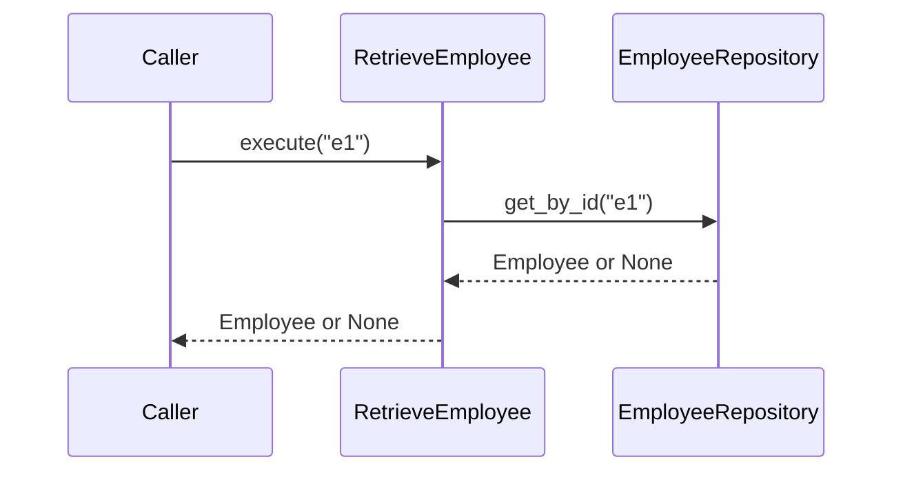
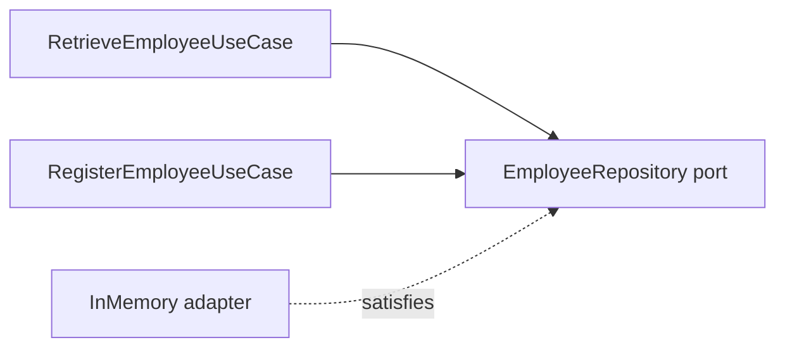

# UC-002 — Retrieve Employee

**Requirement:** REQ-012. **Acceptance scenarios:** AC-005, AC-006, AC-015. **Prerequisite:** [[UC-001-Register-Employee]] completed.

## 1. Use-case contract

**Actor:** Operator / application client. **Trigger:** Employee ID supplied. **Main flow:** validate ID → ask repository → return Employee. **Alternative A:** ID not found → return `None`. **Alternative B:** blank ID → `ValueError`. This is an application-level contract; a future HTTP adapter can translate `None` into HTTP 404.



## 2. Acceptance criteria

Write **one test per scenario**. Each scenario has exactly one Given, one When and one Then, so each maps directly to the Arrange, Act and Assert steps of a test.

| ID | Scenario | Given (Arrange) | When (Act) | Then (Assert) |
|---|---|---|---|---|
| **AC-005** | Existing employee is found | The repository contains employee `e1` | `execute("e1")` | Returns an `Employee` **equal** to the saved one |
| **AC-006** | Unknown ID is not an error | The repository is empty | `execute("missing")` | Returns `None`; no exception is raised |
| **AC-015** | Blank ID is rejected | Any repository | `execute("")` or `execute("   ")` | Raises `ValueError` |

```gherkin
Scenario: AC-005 Retrieve an existing employee
  Given employee "e1" has been saved in the repository
  When I retrieve employee "e1"
  Then I receive that same employee

Scenario: AC-006 Retrieve an unknown employee
  Given the repository is empty
  When I retrieve employee "missing"
  Then I receive None

Scenario Outline: AC-015 Reject a blank employee ID
  When I retrieve employee <id>
  Then a ValueError is raised
  Examples:
    | id    | meaning         |
    | ""    | empty string    |
    | "   " | whitespace only |
```

### Mapping scenarios to tests

| AC | Tag | Suggested test name | Inputs | Expected | Test cases |
|---|---|---|---|---|---|
| AC-005 | `@pytest.mark.ac("AC-005")` | `test_retrieve_existing_employee` | Save `e1`, then retrieve `"e1"` | `== employee` | 1 |
| AC-006 | `@pytest.mark.ac("AC-006")` | `test_retrieve_unknown_employee_returns_none` | Empty repository, retrieve `"missing"` | `is None` | 1 |
| AC-015 | `@pytest.mark.ac("AC-015")` | `test_retrieve_rejects_blank_id` (parametrized) | `""`, `"   "` | `pytest.raises(ValueError)` | 2 |

**Total: 4 new test cases.**

### Tagging tests with their acceptance criteria

Every test carries an `ac` marker naming the scenario it proves. The marker is registered in `pyproject.toml`, and `tests/conftest.py` uses it to:

- print an **acceptance criteria** table at the end of every run, with one line per AC showing `PASS`, `FAIL` or `SKIP`
- run only the tests for chosen ACs, with `--ac AC-005 --ac AC-006`
- reject malformed IDs such as `"AC-5"`, and misspelt markers such as `@pytest.mark.acc`

```python
@pytest.mark.ac("AC-005")                  # tag a whole test
def test_retrieve_existing_employee(): ...

pytest.param("", id="empty",               # or tag one parametrize case
             marks=pytest.mark.ac("AC-015"))
```

Because the AC ID is in the tag, the test name can stay descriptive. It doesn't need `ac005` in it.

### Notes for writing the tests

- **Use `is None` for AC-006, not `== None` or `not result`.** The contract is specifically `None`, not just something falsy.
- **AC-005 compares with `==`.** `Employee` is a dataclass, so `==` compares every field. That proves you got back the right employee, not just *an* employee.
- **AC-015 is input validation in the application layer**, not a domain invariant. No `Employee` is constructed, so the use case checks the ID string itself.
- **Not in scope:** non-string IDs such as `None` or `123`. The `isinstance` check below rejects them too, but no acceptance criterion requires it yet. If you want that guaranteed, add a scenario to the spec first, then a test.

### Out of scope for UC-002

- Searching by name, department or skill: that's UC-004 (semantic search).
- Translating `None` into HTTP 404: that's the job of a future inbound HTTP adapter.
- Any change to `EmployeeRepository` or the in-memory adapter: this use case reuses them unchanged.

## 3. RED — tests first

Create `tests/unit/test_retrieve_employee.py`:

```python
import pytest

from employee_search.adapters.outbound.in_memory_employee_repository import (
    InMemoryEmployeeRepository,
)
from employee_search.application.use_cases.retrieve_employee import (
    RetrieveEmployeeUseCase,
)
from employee_search.domain.employee import Employee


@pytest.mark.ac("AC-005")
def test_retrieve_existing_employee():
    # Arrange
    repo = InMemoryEmployeeRepository()
    employee = Employee("e1", "John Doe", "Engineering", "Engineer", 5,
                        ("Python",), "New York")
    repo.save(employee)

    # Act
    result = RetrieveEmployeeUseCase(repo).execute("e1")

    # Assert
    assert result == employee


@pytest.mark.ac("AC-006")
def test_retrieve_unknown_employee_returns_none():
    repo = InMemoryEmployeeRepository()

    result = RetrieveEmployeeUseCase(repo).execute("missing")

    assert result is None


@pytest.mark.ac("AC-015")
@pytest.mark.parametrize(
    "employee_id",
    [
        pytest.param("", id="empty"),
        pytest.param("   ", id="whitespace"),
    ],
)
def test_retrieve_rejects_blank_id(employee_id):
    use_case = RetrieveEmployeeUseCase(InMemoryEmployeeRepository())

    with pytest.raises(ValueError):
        use_case.execute(employee_id)
```

Run only this use case's acceptance criteria:

```bash
uv run python -m pytest --ac AC-005 --ac AC-006 --ac AC-015 -v
```

**Expected RED:** a collection error, `ModuleNotFoundError: No module named 'employee_search.application.use_cases.retrieve_employee'`. The use case doesn't exist yet. That proves the tests really depend on the code you're about to write.

If you've already created a skeleton class without `execute`, you'll get `AttributeError: 'RetrieveEmployeeUseCase' object has no attribute 'execute'` instead. That's an equally valid RED. What matters is that each test fails **for a reason you expected**, and the acceptance-criteria table shows AC-005, AC-006 and AC-015 as `FAIL`.

> [!tip] Why `uv run python -m pytest`?
> It runs pytest through `python.exe`. On Windows machines with Application Control enabled, the `.venv/Scripts/pytest.exe` launcher behind `uv run pytest` can be blocked. Both commands behave the same otherwise.

## 4. GREEN — use the existing outbound port

Create `src/employee_search/application/use_cases/retrieve_employee.py`:

```python
from employee_search.application.ports.outbound.employee_repository import EmployeeRepository
from employee_search.domain.employee import Employee


class RetrieveEmployeeUseCase:
    def __init__(self, repository: EmployeeRepository):
        self.repository = repository

    def execute(self, employee_id: str) -> Employee | None:
        if not isinstance(employee_id, str) or not employee_id.strip():
            raise ValueError("Employee ID must not be blank")
        return self.repository.get_by_id(employee_id)
```

No new adapter is necessary. We **reuse the existing port** rather than inventing another interface just to match a directory structure.

## 5. Verify

First, only this use case's acceptance criteria:

```bash
uv run python -m pytest --ac AC-005 --ac AC-006 --ac AC-015 -v
```

**Expected GREEN:** 4 passed, the rest deselected, and this table at the end:

```
----------------------------- acceptance criteria -----------------------------
AC-005  PASS  1 test
AC-006  PASS  1 test
AC-015  PASS  2 tests
```

Then the full suite, to prove nothing else broke:

```bash
uv run python -m pytest -v
uv run ruff check .
```

Expected: **four new passing test cases** from UC-002, plus every UC-001 test still passing. The acceptance-criteria table should now list AC-001 to AC-006 and AC-015, all `PASS`. Your exact total depends on how many UC-001 tests you wrote. No ChromaDB needed.

## 6. Architectural reflection



Why reuse the repository port? Because both use cases need the same persistence capability. A use-case boundary is not automatically a reason to create a new outbound interface.

## Definition of Done

- [ ] AC-005: an existing employee is returned unchanged.
- [ ] AC-006: an unknown ID returns `None`.
- [ ] AC-015: blank IDs (`""`, `"   "`) raise `ValueError`.
- [ ] Every UC-002 test is tagged with `@pytest.mark.ac(...)`, and the acceptance-criteria table shows AC-005, AC-006 and AC-015 as `PASS`.
- [ ] No new infrastructure dependency is introduced.
- [ ] Existing registration tests remain green.

Next: [[UC-003-Index-Employee]].
