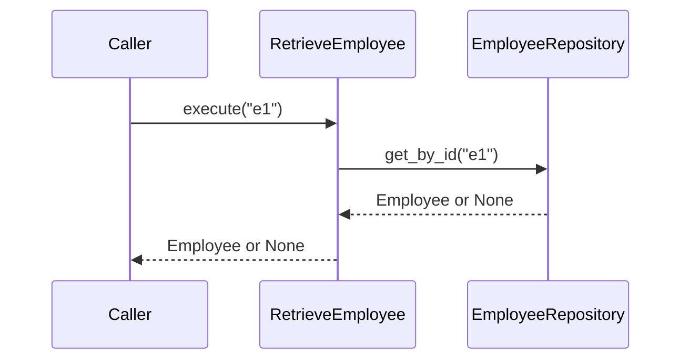
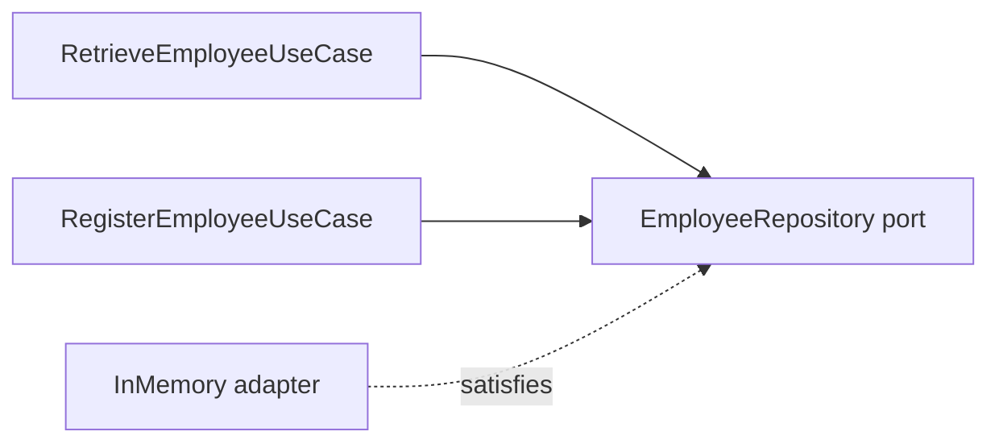

# UC-002 — Retrieve Employee

**Requirement:** REQ-012. **Acceptance scenarios:** AC-005, AC-006. **Prerequisite:** [[UC-001-Register-Employee]] completed.

## 1. Use-case contract

**Actor:** Operator / application client. **Trigger:** Employee ID supplied. **Main flow:** validate ID → ask repository → return Employee. **Alternative:** ID not found → return `None`. This is an application-level contract; a future HTTP adapter can translate `None` into HTTP 404.



## 2. RED — tests first

Create `tests/unit/test_retrieve_employee.py`:

```python
import pytest
from employee_search.domain.employee import Employee
from employee_search.application.use_cases.retrieve_employee import RetrieveEmployeeUseCase
from employee_search.adapters.outbound.in_memory_employee_repository import InMemoryEmployeeRepository


def test_retrieve_existing_employee():
    repo = InMemoryEmployeeRepository()
    employee = Employee("e1", "John Doe", "Engineering", "Engineer", 5,
                        ("Python",), "New York")
    repo.save(employee)
    assert RetrieveEmployeeUseCase(repo).execute("e1") == employee


def test_retrieve_unknown_employee_returns_none():
    repo = InMemoryEmployeeRepository()
    assert RetrieveEmployeeUseCase(repo).execute("missing") is None


@pytest.mark.parametrize("employee_id", ["", "  "])
def test_retrieve_rejects_blank_id(employee_id):
    with pytest.raises(ValueError):
        RetrieveEmployeeUseCase(InMemoryEmployeeRepository()).execute(employee_id)
```

Run `uv run pytest tests/unit/test_retrieve_employee.py -v`. The missing use-case import should fail.

## 3. GREEN — use the existing outbound port

Create `src/employee_search/application/use_cases/retrieve_employee.py`:

```python
from employee_search.application.ports.outbound.employee_repository import EmployeeRepository
from employee_search.domain.employee import Employee


class RetrieveEmployeeUseCase:
    def __init__(self, repository: EmployeeRepository):
        self.repository = repository

    def execute(self, employee_id: str) -> Employee | None:
        if not isinstance(employee_id, str) or not employee_id.strip():
            raise ValueError("Employee ID must not be blank")
        return self.repository.get_by_id(employee_id)
```

No new adapter is necessary. We **reuse the existing port** rather than inventing another interface just to match a directory structure.

## 4. Verify

```bash
uv run pytest tests/unit -v
uv run ruff check .
```

Expected: twelve passing test cases (eight from UC-001 + four from UC-002). No ChromaDB needed.

## 5. Architectural reflection



Why reuse the repository port? Because both use cases need the same persistence capability. A use-case boundary is not automatically a reason to create a new outbound interface.

## Definition of Done

- [ ] AC-005 and AC-006 pass.
- [ ] Blank IDs are rejected.
- [ ] Unknown IDs return `None`.
- [ ] No new infrastructure dependency is introduced.
- [ ] Existing registration tests remain green.

Next: [[UC-003-Index-Employee]].
