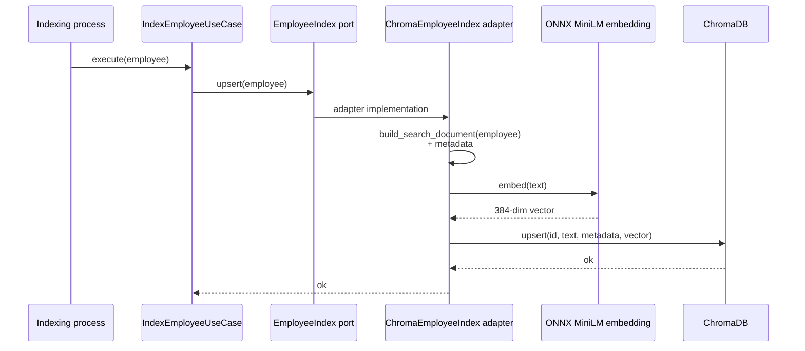
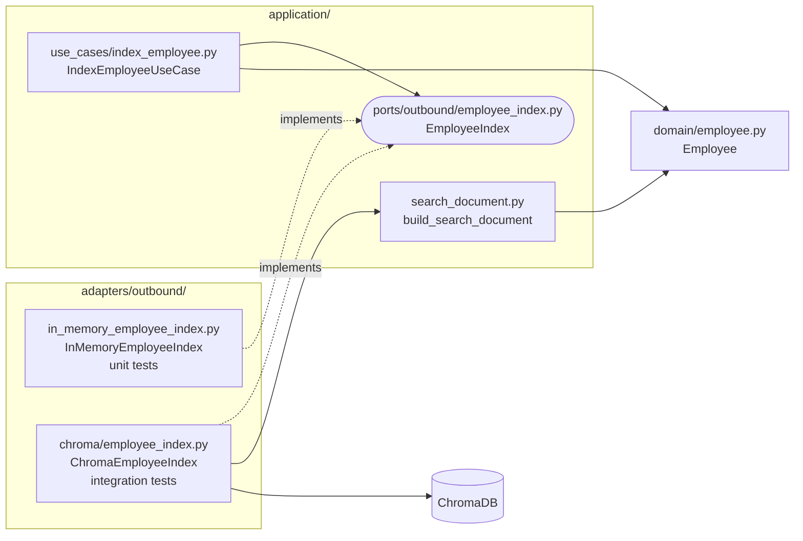
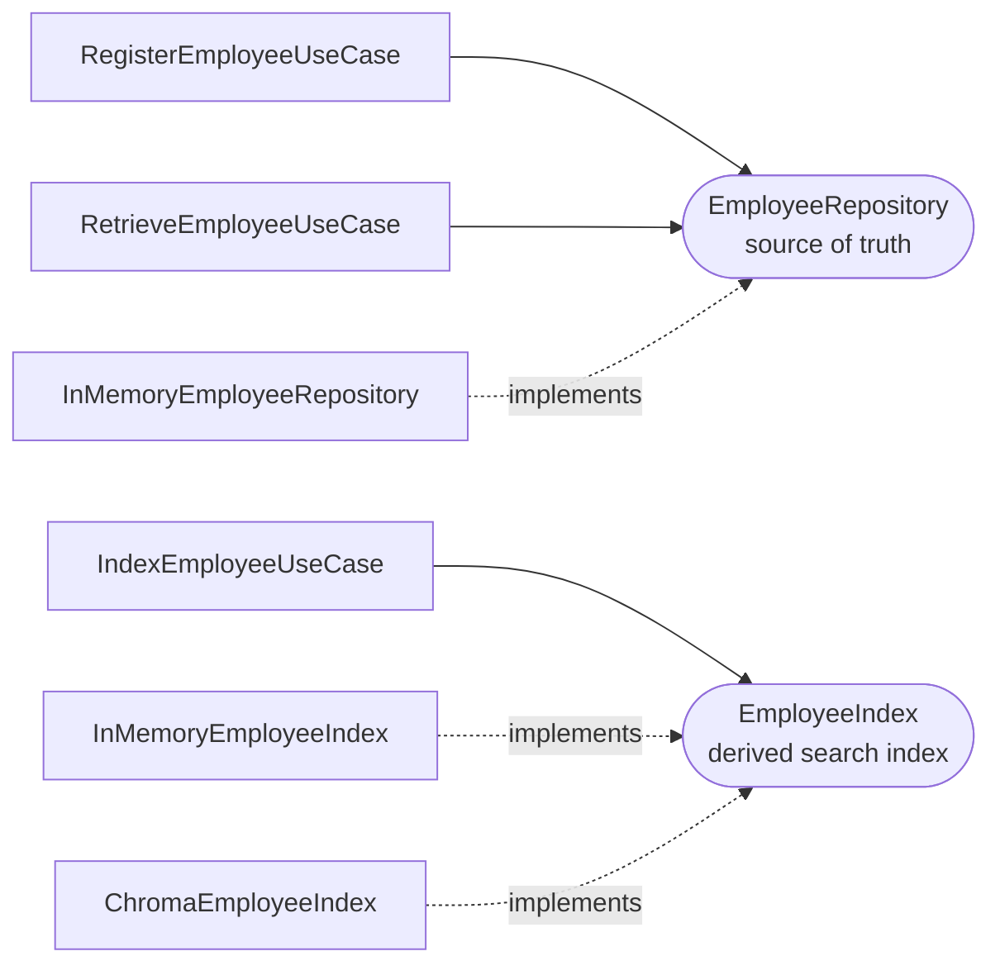

# UC-003 — Index Employee

**Requirements:** REQ-009, REQ-007. **Acceptance scenarios:** AC-007, AC-016, AC-017, AC-011. **Prerequisite:** [[UC-002-Retrieve-Employee]] completed.

> [!abstract] Outcome
> Turn an `Employee` into a **searchable representation** (descriptive text, filter metadata and an embedding vector) and store it in ChromaDB under the employee's stable ID. Re-indexing the same ID replaces the entry instead of duplicating it. UC-003 only **writes** to the index; it never queries it.

## 0. Before you start: environment checklist

UC-003 is the first use case that needs real infrastructure. Check these first, or the integration tests will fail for reasons that have nothing to do with your code.

| Check | Command | Expected |
|---|---|---|
| Docker Desktop is running | `docker info` | Server details, not "failed to connect to the docker API" |
| Chroma is reachable from the host | see §3 | `compose.yaml` publishes Chroma on `localhost:8001` |
| Embeddings work without PyTorch | `uv run python -c "from chromadb.utils import embedding_functions as ef; ef.ONNXMiniLM_L6_V2()"` | No error |

> [!warning] Windows Application Control and PyTorch
> On machines with Application Control (Smart App Control), `sentence-transformers` can fail with `WinError 4551 … torch\lib\c10.dll`, because PyTorch's DLLs are blocked. This guide uses Chroma's **`ONNXMiniLM_L6_V2`** embedding function instead. It's the **same `all-MiniLM-L6-v2` model** (384 dimensions), run through ONNX Runtime with no PyTorch. The first run downloads about 80 MB of model files into `~/.cache/chroma`.

## 1. Use-case contract

| Field | Value |
|---|---|
| Actor | Indexing process (a test or script today; a registration workflow later, REQ-011) |
| Trigger | A valid `Employee` is submitted for indexing |
| Preconditions | `Employee` is valid (its invariants already hold); the index is available |
| Main flow | Build descriptive text → build filter metadata → embed text → upsert under `employee.id` |
| Alternative A | Same ID indexed again → the entry is **replaced**; still exactly one entry |
| Alternative B | Index unavailable → the adapter's error propagates; no retry yet (that's REQ-011) |
| Postcondition | The index holds exactly one current entry for `employee.id` |
| Not affected | The `EmployeeRepository`. Indexing never creates or changes the authoritative record |



### Where each piece lives



**Three design decisions in this use case:**

1. **A new outbound port, `EmployeeIndex`.** In UC-002 you reused `EmployeeRepository`, because it was the same capability. Indexing is a *different* capability with a different store (a derived search index, not the source of truth; see DEC-001). New capability, new port.
2. **The port has only `upsert` for now.** Deleting an index entry is REQ-006 / AC-014, which belongs to UC-006. Add `delete` to the port when a use case needs it, not before.
3. **`build_search_document` lives in the application layer, not the Chroma adapter.** The text that gets embedded is a *product* decision: which fields make an employee findable. If you later swap Chroma for pgvector, the text must stay identical, or search behaviour changes. Only Chroma-specific details, like flattening skills into a string, belong in the adapter.

## 2. Acceptance criteria

Write **one test per scenario**. AC-007 is tested twice: once in a unit test against the fake, to prove the **use case** wiring, and once in an integration test against Chroma, to prove the **adapter**.

| ID | Scenario | Given (Arrange) | When (Act) | Then (Assert) | Level |
|---|---|---|---|---|---|
| **AC-007** | Employee is indexed under its stable ID | A valid employee `e1`; an empty index | Index `e1` | The index contains exactly one entry, with ID `"e1"` | Unit + integration |
| **AC-016** | Re-indexing replaces, never duplicates | `e1` is already indexed with role "Engineer" | Index `e1` again with role "Lead" | Still exactly one entry for `"e1"`, and it reflects "Lead" | Unit + integration |
| **AC-017** | Entry holds text, metadata and embedding | A valid employee `e1` | Index `e1` | The text mentions role, experience, department, every skill and location; the metadata holds `department` (string) and `experience` (integer); the embedding has 384 dimensions | Unit + integration |
| **AC-011** | Index survives a restart | `e1` is indexed in a fixed collection | Restart the Chroma container, keeping its volume | `e1` is still there | Manual |

```gherkin
Scenario: AC-007 Index an employee under its stable ID
  Given an empty employee index
  When I index employee "e1"
  Then the index contains exactly one entry
  And that entry has ID "e1"

Scenario: AC-016 Re-indexing replaces the entry
  Given employee "e1" is indexed with role "Engineer"
  When I index employee "e1" again with role "Lead"
  Then the index still contains exactly one entry for "e1"
  And that entry reflects role "Lead"

Scenario: AC-017 Indexed entry holds text, metadata and embedding
  When I index employee "e1"
  Then its descriptive text mentions its role, experience, department, skills and location
  And its metadata holds department as text and experience as an integer
  And its embedding has 384 dimensions

Scenario: AC-011 Index survives a Chroma restart
  Given employee "e1" is indexed in collection "persistence_check"
  When I restart the Chroma container without deleting its volume
  Then employee "e1" is still in collection "persistence_check"
```

### Mapping scenarios to tests

| AC | Tag | Test | File | Cases |
|---|---|---|---|---|
| AC-007 | `@pytest.mark.ac("AC-007")` | `test_index_stores_employee_under_its_id` | `tests/unit/test_index_employee.py` | 1 |
| AC-016 | `@pytest.mark.ac("AC-016")` | `test_reindex_replaces_entry` | `tests/unit/test_index_employee.py` | 1 |
| AC-017 | `@pytest.mark.ac("AC-017")` | `test_search_document_describes_employee` | `tests/unit/test_search_document.py` | 1 |
| AC-007 | `@pytest.mark.ac("AC-007")` | `test_chroma_stores_employee_under_its_id` | `tests/integration/test_chroma_employee_index.py` | 1 |
| AC-016 | `@pytest.mark.ac("AC-016")` | `test_chroma_reindex_replaces_entry` | `tests/integration/test_chroma_employee_index.py` | 1 |
| AC-017 | `@pytest.mark.ac("AC-017")` | `test_chroma_entry_holds_text_metadata_and_embedding` | `tests/integration/test_chroma_employee_index.py` | 1 |
| AC-011 | not automated | manual script in §9 | `scripts/persistence_check.py` | manual |

**Total: 3 unit tests + 3 integration tests + 1 manual check.**

### Notes for writing the tests

- **"Exactly one entry" is the heart of AC-007 and AC-016.** Assert on the *count*, not just that `e1` exists. A buggy `add` instead of `upsert` would leave `e1` present *and* duplicated, or fail on the second call.
- **Never assert exact embedding values or distances.** They depend on the model and its version. Assert on shape (384 dimensions) and on IDs, text and metadata.
- **Metadata keeps each value's type: `experience` stays an `int`.** Chroma metadata accepts `str`, `int`, `float` and `bool`, so there's no need to stringify it. An adapter that stored `"5"` would quietly change the data, which is why AC-017 checks the type and not just the value.
- **Integration tests use a fresh, randomly named collection and delete it afterwards** (NFR-004), so tests can't see each other's data and leave nothing behind.
- **Integration tests skip, rather than fail, when Chroma isn't running.** Unit tests must run without Docker (NFR-003).

### Out of scope for UC-003

- **Querying the index:** UC-003 verifies entries by ID with `collection.get(...)`. No query text, no ranking.
- **Deleting index entries:** REQ-006 / AC-014, in UC-006.
- **Indexing automatically when an employee is registered:** REQ-011 / AC-013, a future orchestration use case. In UC-003, indexing is called explicitly.
- **Retries and failure handling** when Chroma is down: also REQ-011.

## 3. Setup: Chroma reachable from your machine

Your `compose.yaml` runs Chroma for the API container, but it doesn't publish a port to your host. Add one to the `chroma` service:

```yaml
  chroma:
    image: chromadb/chroma:1.0.12
    ports:
      - "127.0.0.1:8001:8000"   # host 8001 → container 8000; 8000 stays free for FastAPI
    volumes:
      - chroma_data:/data
    environment:
      ANONYMIZED_TELEMETRY: "FALSE"
```

Start Docker Desktop, then start only Chroma and check it's alive:

```bash
docker compose up -d chroma
docker compose ps
uv run python -c "import urllib.request; print(urllib.request.urlopen('http://localhost:8001/api/v2/heartbeat').read())"
```

> [!warning] Host vs container networking
> From **your machine** (tests, scripts), Chroma is `localhost:8001`. From **another Compose service** (the `api` container), it's `chroma:8000`. Inside a container, `localhost` means that container itself.

**Test levels come from the folder.** `tests/conftest.py` marks everything in `tests/unit/` as `unit` and everything in `tests/integration/` as `integration`, and both markers are registered in `pyproject.toml`. You don't add these markers to test files; putting the file in the right folder is enough.

```bash
uv run python -m pytest -m "not integration"   # fast loop, no Docker
uv run python -m pytest -m integration         # only the Chroma tests
```

## 4. RED: unit tests (no Docker)

Create `tests/unit/test_index_employee.py`:

```python
import pytest

from employee_search.adapters.outbound.in_memory_employee_index import (
    InMemoryEmployeeIndex,
)
from employee_search.application.use_cases.index_employee import IndexEmployeeUseCase
from employee_search.domain.employee import Employee


def make_employee(role: str = "Engineer") -> Employee:
    return Employee("e1", "John Doe", "Engineering", role, 5,
                    ("Python", "React"), "New York")


@pytest.mark.ac("AC-007")
def test_index_stores_employee_under_its_id():
    # Arrange
    index = InMemoryEmployeeIndex()
    employee = make_employee()

    # Act
    IndexEmployeeUseCase(index).execute(employee)

    # Assert
    assert index.count() == 1
    assert index.get("e1") == employee


@pytest.mark.ac("AC-016")
def test_reindex_replaces_entry():
    # Arrange
    index = InMemoryEmployeeIndex()
    use_case = IndexEmployeeUseCase(index)
    use_case.execute(make_employee(role="Engineer"))

    # Act
    use_case.execute(make_employee(role="Lead"))

    # Assert
    assert index.count() == 1
    assert index.get("e1").role == "Lead"
```

Create `tests/unit/test_search_document.py`:

```python
import pytest

from employee_search.application.search_document import build_search_document
from employee_search.domain.employee import Employee


@pytest.mark.ac("AC-017")
def test_search_document_describes_employee():
    employee = Employee("e1", "John Doe", "Engineering", "Software Engineer", 5,
                        ("Python", "React"), "New York")

    text = build_search_document(employee)

    for expected in ["Software Engineer", "5 years", "Engineering",
                     "Python", "React", "New York"]:
        assert expected in text
```

Run:

```bash
uv run python -m pytest --ac AC-007 --ac AC-016 --ac AC-017 -v
```

**Expected RED:** `ModuleNotFoundError` for `in_memory_employee_index`, `index_employee` and `search_document`. Nothing exists yet.

## 5. GREEN: port, use case, fake and search document

`src/employee_search/application/ports/outbound/employee_index.py`:

```python
from typing import Protocol

from employee_search.domain.employee import Employee


class EmployeeIndex(Protocol):
    def upsert(self, employee: Employee) -> None:
        """Create or replace the searchable entry for employee.id.

        Indexing the same ID again must replace the entry, never duplicate it.
        """
        ...
```

`src/employee_search/application/use_cases/index_employee.py`:

```python
from employee_search.application.ports.outbound.employee_index import EmployeeIndex
from employee_search.domain.employee import Employee


class IndexEmployeeUseCase:
    def __init__(self, index: EmployeeIndex) -> None:
        self._index = index

    def execute(self, employee: Employee) -> None:
        """Make this employee findable by semantic search."""
        self._index.upsert(employee)
```

`src/employee_search/adapters/outbound/in_memory_employee_index.py`:

```python
from employee_search.domain.employee import Employee


class InMemoryEmployeeIndex:
    """Test double for EmployeeIndex: stores entries in a dict keyed by ID."""

    def __init__(self) -> None:
        self._entries: dict[str, Employee] = {}

    def upsert(self, employee: Employee) -> None:
        self._entries[employee.id] = employee

    def get(self, employee_id: str) -> Employee | None:
        return self._entries.get(employee_id)

    def count(self) -> int:
        return len(self._entries)
```

`src/employee_search/application/search_document.py`:

```python
from employee_search.domain.employee import Employee


def build_search_document(employee: Employee) -> str:
    """The text that gets embedded. Changing it changes search behaviour."""
    return (
        f"{employee.role} with {employee.experience} years of experience "
        f"in {employee.department}. Skills: {', '.join(employee.skills)}. "
        f"Located in {employee.location}."
    )
```

The name is deliberately **left out** of the text. A name carries almost no meaning for a query like "Python developer", and would only add noise to the vector. It's still kept in metadata.

Run the same command as in §4. **Expected GREEN:** 3 passed, with AC-007, AC-016 and AC-017 each `PASS  1 test`.

> [!question] Isn't `IndexEmployeeUseCase` too thin?
> Yes: it's one line today. It earns its place as the **inbound boundary**. Callers depend on "index an employee", not on Chroma. Later (REQ-011) this is where "only index registered employees" or "record that indexing happened" goes, without touching any caller.

## 6. RED: integration tests (needs Chroma)

Create `tests/integration/__init__.py` (empty) and `tests/integration/test_chroma_employee_index.py`:

```python
import os
import uuid

import chromadb
import pytest
from chromadb.config import Settings
from chromadb.utils import embedding_functions

from employee_search.adapters.outbound.chroma.employee_index import ChromaEmployeeIndex
from employee_search.application.search_document import build_search_document
from employee_search.domain.employee import Employee

# No `pytestmark = pytest.mark.integration` needed: tests/conftest.py marks
# everything in tests/integration/ automatically.

CHROMA_HOST = os.getenv("CHROMA_HOST", "localhost")
CHROMA_PORT = int(os.getenv("CHROMA_PORT", "8001"))


def make_employee(role: str = "Software Engineer") -> Employee:
    return Employee("e1", "John Doe", "Engineering", role, 5,
                    ("Python", "React"), "New York")


@pytest.fixture(scope="session")
def chroma_client():
    try:
        client = chromadb.HttpClient(
            host=CHROMA_HOST,
            port=CHROMA_PORT,
            settings=Settings(anonymized_telemetry=False),
        )
        client.heartbeat()
    except Exception as exc:
        pytest.skip(f"ChromaDB not reachable at {CHROMA_HOST}:{CHROMA_PORT}: {exc}")
    return client


@pytest.fixture
def collection(chroma_client):
    name = f"test_employees_{uuid.uuid4().hex[:12]}"
    collection = chroma_client.create_collection(
        name=name,
        embedding_function=embedding_functions.ONNXMiniLM_L6_V2(),
        configuration={"hnsw": {"space": "cosine"}},
    )
    try:
        yield collection
    finally:
        chroma_client.delete_collection(name=name)


@pytest.mark.ac("AC-007")
def test_chroma_stores_employee_under_its_id(collection):
    ChromaEmployeeIndex(collection).upsert(make_employee())

    assert collection.count() == 1
    assert collection.get(ids=["e1"])["ids"] == ["e1"]


@pytest.mark.ac("AC-016")
def test_chroma_reindex_replaces_entry(collection):
    index = ChromaEmployeeIndex(collection)
    index.upsert(make_employee(role="Engineer"))

    index.upsert(make_employee(role="Lead"))

    assert collection.count() == 1
    stored = collection.get(ids=["e1"], include=["metadatas"])
    assert stored["metadatas"][0]["role"] == "Lead"


@pytest.mark.ac("AC-017")
def test_chroma_entry_holds_text_metadata_and_embedding(collection):
    employee = make_employee()

    ChromaEmployeeIndex(collection).upsert(employee)

    stored = collection.get(ids=["e1"], include=["documents", "metadatas", "embeddings"])
    assert stored["documents"][0] == build_search_document(employee)
    metadata = stored["metadatas"][0]
    assert metadata["department"] == "Engineering"
    assert metadata["experience"] == 5
    assert isinstance(metadata["experience"], int)
    assert len(stored["embeddings"][0]) == 384
```

Run (with Chroma up):

```bash
uv run python -m pytest -m integration -v
```

**Expected RED:** `ModuleNotFoundError: No module named 'employee_search.adapters.outbound.chroma'`. If you see `SKIPPED … ChromaDB not reachable` instead, Chroma isn't running: go back to §3. A skip is **not** a RED; the tests never ran.

## 7. GREEN: the Chroma adapter

Create `src/employee_search/adapters/outbound/chroma/__init__.py` (empty) and `src/employee_search/adapters/outbound/chroma/employee_index.py`:

```python
from employee_search.application.search_document import build_search_document
from employee_search.domain.employee import Employee


class ChromaEmployeeIndex:
    """EmployeeIndex backed by a Chroma collection.

    The collection is injected already configured with its embedding function and
    distance metric, so this class never chooses a model.
    """

    def __init__(self, collection) -> None:
        self._collection = collection

    def upsert(self, employee: Employee) -> None:
        # upsert, not add: add would fail or duplicate on re-indexing (AC-016).
        self._collection.upsert(
            ids=[employee.id],
            documents=[build_search_document(employee)],
            metadatas=[_metadata(employee)],
        )


def _metadata(employee: Employee) -> dict[str, str | int]:
    # Chroma metadata values must be str, int, float or bool, so a tuple can't be stored.
    return {
        "name": employee.name,
        "department": employee.department,
        "role": employee.role,
        "experience": employee.experience,  # keep as int; Chroma stores numbers natively
        "skills": ", ".join(employee.skills),
        "location": employee.location,
    }
```

Notice that the adapter **doesn't import `chromadb`**. It receives a ready-made collection. Choosing the model and the cosine metric happens where the collection is created: in the test fixture today, and in a bootstrap module later. Changing the model is then a single change in one place (NFR-007).

Run `uv run python -m pytest -m integration -v` again. **Expected GREEN:** 3 passed. The first run is slower while the ONNX model downloads.

## 8. Verify

```bash
# fast loop: everything except integration, no Docker needed
uv run python -m pytest -m "not integration"

# only this use case's acceptance criteria, unit + integration
uv run python -m pytest --ac AC-007 --ac AC-016 --ac AC-017 -v

# everything
uv run python -m pytest -v
uv run ruff check .
```

**Expected:** the AC table shows each UC-003 criterion covered at both levels:

```
----------------------------- acceptance criteria -----------------------------
AC-007  PASS  2 tests
AC-016  PASS  2 tests
AC-017  PASS  2 tests
```

If Chroma is down, those lines show `SKIP` for the integration half. That's a reminder, not a pass.

## 9. AC-011: verify persistence manually

The integration tests delete their collections on purpose, so persistence needs its own check, using a **fixed** collection name.

Create `scripts/persistence_check.py`:

```python
"""AC-011: run `write`, restart Chroma, then run `check`."""
import sys

import chromadb
from chromadb.config import Settings
from chromadb.utils import embedding_functions

from employee_search.adapters.outbound.chroma.employee_index import ChromaEmployeeIndex
from employee_search.domain.employee import Employee

client = chromadb.HttpClient(host="localhost", port=8001,
                             settings=Settings(anonymized_telemetry=False))
collection = client.get_or_create_collection(
    name="persistence_check",
    embedding_function=embedding_functions.ONNXMiniLM_L6_V2(),
    configuration={"hnsw": {"space": "cosine"}},
)

if sys.argv[1:] == ["write"]:
    ChromaEmployeeIndex(collection).upsert(
        Employee("e1", "John Doe", "Engineering", "Engineer", 5, ("Python",), "New York")
    )
    print("written:", collection.get(ids=["e1"])["ids"])
elif sys.argv[1:] == ["check"]:
    ids = collection.get(ids=["e1"])["ids"]
    print("AC-011 PASS" if ids == ["e1"] else f"AC-011 FAIL: found {ids}")
else:
    print("usage: persistence_check.py write|check")
```

```bash
uv run python scripts/persistence_check.py write
docker compose restart chroma        # keeps the named volume
uv run python scripts/persistence_check.py check    # → AC-011 PASS
```

> [!warning] What *not* to run
> `docker compose down -v` deletes the named volume, so `check` would then **correctly** report a failure. That's a useful experiment: it shows the data lives in the volume, not in the container.

## 10. Architectural reflection



Questions to answer aloud:

1. Why did UC-002 reuse a port, while UC-003 needs a new one?
2. Registering `e1` doesn't make it searchable. Which requirement closes that gap, and why is it hard to get right?
3. Why does `build_search_document` live in `application/` rather than in the Chroma adapter?
4. Which process computes the embeddings: your Python process or the Chroma server? (Hint: the embedding function is attached to the client-side collection.)
5. Why does the adapter call `upsert` and not `add`? What would AC-016 catch if it used `add`?

## Definition of Done

- [ ] AC-007: unit and integration tests prove exactly one entry under the stable ID.
- [ ] AC-016: unit and integration tests prove re-indexing replaces, without duplicating.
- [ ] AC-017: the text, metadata types and 384-dim embedding are verified.
- [ ] AC-011: `persistence_check.py check` prints `AC-011 PASS` after `docker compose restart chroma`.
- [ ] Every UC-003 test is tagged with `@pytest.mark.ac(...)`; integration tests live in `tests/integration/`, so they're marked `integration` automatically.
- [ ] `pytest -m "not integration"` passes with Docker stopped (NFR-003).
- [ ] No domain module imports `chromadb` (NFR-001), and the use case imports only the port (NFR-002).
- [ ] Commit: `git add . && git commit -m "feat: implement UC-003 index employee with Chroma adapter"`

Next: [[UC-004-Search-Employees]].
