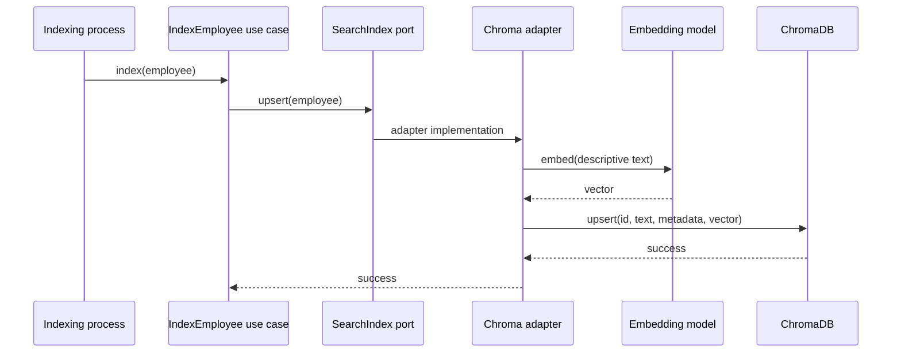

# UC-003 — Index Employee

**Requirements:** REQ-009, REQ-007. **Acceptance:** AC-007, AC-011. **Status:** guided implementation plan; the earlier adapter lesson contains the detailed code.

## Actor and outcome

An indexing process receives an employee snapshot and writes a searchable representation under the same stable ID. It does **not** create or modify the authoritative employee record.

## What to implement

1. Define an outbound indexing port with `upsert(employee)` and `delete(employee_id)` operations.
2. Build searchable text from role, experience, department, skills, location, and employment type if modeled.
3. Choose `all-MiniLM-L6-v2` consistently for document and query embeddings.
4. Use cosine distance in the collection configuration.
5. Use stable IDs and `upsert` rather than assuming `add` updates existing records.
6. Test against a real ChromaDB service, using an isolated collection and cleanup fixture.
7. Verify persistence across a service restart while retaining the named Docker volume.

## TDD scenarios

| Scenario | Expected result |
|---|---|
| First index | Employee ID exists in index |
| Re-index same ID | Existing representation updated; no duplicate |
| Delete indexed ID | Search no longer returns it |
| Restart Chroma | Index record remains when volume retained |

> [!warning] Important distinction
> The previous `reference/04-Part-4-ChromaDB-Adapter-and-Integration-Tests.md` directly tests an adapter. That is useful, but it is **not yet a complete indexing use-case implementation**. Add an application `IndexEmployeeUseCase` before declaring UC-003 finished. An explicit indexing port can be separate from the semantic search port.

## Follow-along source

Read [[04-Part-4-ChromaDB-Adapter-and-Integration-Tests]] for the existing Chroma setup, adapter implementation and integration tests. Align naming and method signatures to the ports introduced in this use-case series; do not copy both competing port contracts into the same application.

## Definition of Done

- [ ] Indexing use case has a failing-then-passing unit test using a fake port.
- [ ] Real Chroma adapter passes isolated integration tests.
- [ ] Re-indexing is idempotent for a stable ID.
- [ ] Persistence is manually verified.
- [ ] No domain module imports ChromaDB.

Next: [[UC-004-Search-Employees]].
