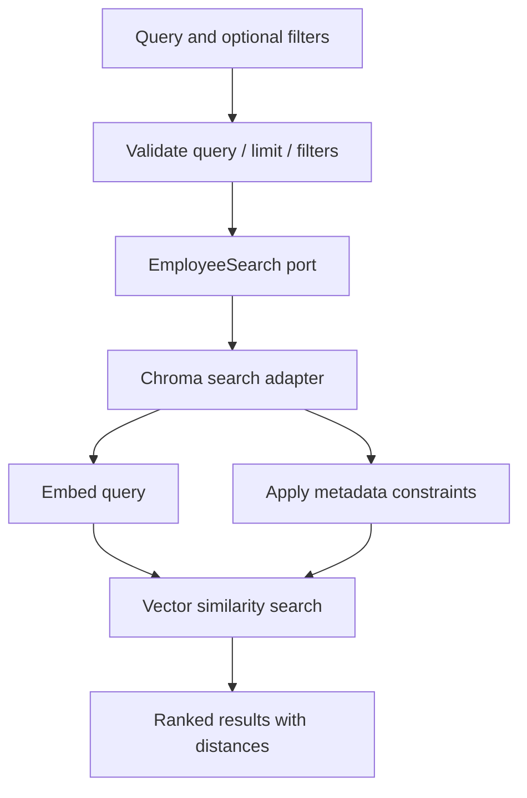

# UC-004 — Search Employees

**Requirements:** REQ-002, REQ-003, REQ-004, REQ-005, REQ-008, and future REQ-010. **Acceptance:** AC-008 through AC-010, future AC-012.

## Use-case goal

A search user provides a natural-language query and optional mandatory filters. The system returns at most the requested number of employees, ranked by ascending vector distance.

## Behavioral scenarios

- Blank query, nonpositive limit, or negative minimum experience → `ValueError` before adapter call.
- Search without filters → rank available employees by ascending distance.
- Department filter → all returned employees match department exactly.
- Minimum experience filter → all returned employees meet the inclusive threshold.
- Combined filters → all constraints hold simultaneously.
- Location filter → **not yet implemented** in the existing application search contract.

## TDD strategy

1. Write unit tests with a deterministic fake search adapter. This avoids fragile assumptions about embedding rankings.
2. Introduce `SearchCriteria` and `SearchResult` application models.
3. Define outbound search port, implement `SearchEmployeesUseCase`, and verify validation, ranking and limiting.
4. Implement Chroma adapter; write real integration tests for filters, query shape and returned IDs.
5. Do **not** assert that a semantic score proves an employee has a particular skill.

## Follow-along code

- [[03-Part-3-Semantic-Search-Use-Case]] — complete fake-adapter and TDD implementation.
- [[04-Part-4-ChromaDB-Adapter-and-Integration-Tests]] — real ChromaDB integration.

These are retained reference lessons. Their class names and port methods may differ from the UC-003 plan; choose **one** consistent search/indexing port design before combining them.

## Design challenge

A user asks for a **Python developer with at least 10 years of experience in New York**. Which requirements are hard constraints? Which are semantic preferences? If Python is mandatory, should it be represented by an explicit skills filter? Explain why nearest-neighbor ranking alone is insufficient.

## Definition of Done

- [ ] Unit tests validate criteria and ranking with fake data.
- [ ] Integration tests validate metadata filters with Chroma.
- [ ] Search results contain employee ID and numeric distance.
- [ ] Unsupported location filtering is not claimed complete.
- [ ] Requirements-to-test mapping is updated.
