# Module 2: LangChain Study Guide

A plain-language guide to LangChain: what it is, its building blocks, and how to combine them.

**How to use this guide:** read top to bottom once, then use the [Cheat Sheet](#9-cheat-sheet) and [Self-Quiz](#10-self-quiz) for revision.

## Contents

1. [What is LangChain?](#1-what-is-langchain)
2. [The big picture](#2-the-big-picture)
3. [Language Models vs Chat Models](#3-language-models-vs-chat-models)
4. [Chat Messages](#4-chat-messages)
5. [Prompt Templates](#5-prompt-templates)
6. [Output Parsers](#6-output-parsers)
7. [Chains and Memory](#7-chains-and-memory)
8. [Agents](#8-agents)
9. [Cheat Sheet](#9-cheat-sheet)
10. [Self-Quiz](#10-self-quiz)

---

## 1. What is LangChain?

**LangChain is an open-source toolkit that makes it easier to build apps on top of LLMs.**

Calling an LLM is easy. Building a real app is harder. You need to format prompts, remember the conversation, clean up the output, search documents and call tools. LangChain gives you ready-made, snap-together pieces for each of these jobs.

> **Analogy:** LangChain is a box of LEGO bricks for LLM apps. You don't mould each brick yourself. You pick bricks and connect them.

### Why use it?

| Benefit | In plain words | Example |
|---|---|---|
| **Modularity** | Small parts you can swap and reuse | Swap OpenAI for IBM watsonx without rewriting your app |
| **Step-by-step reasoning** | Break a big task into small steps | "Find dish" → "Get recipe" → "Estimate time" |
| **Vector database support** | Search by *meaning*, not just keywords | Find the doc about "refunds" even if the user typed "money back" |
| **Extensibility** | Add new tools and integrations | Plug in your own database or API |

### What do people build with it?

| Use case | Example |
|---|---|
| **Summarization** | Shrink a 30-page report into 5 bullet points |
| **Data extraction** | Pull "revenue = $4.2M" out of a messy PDF |
| **Question answering** | A support bot that answers from your company docs |
| **Content generation** | Draft emails or technical docs |

---

## 2. The big picture

These are the core components. The rest of this guide covers them one by one.

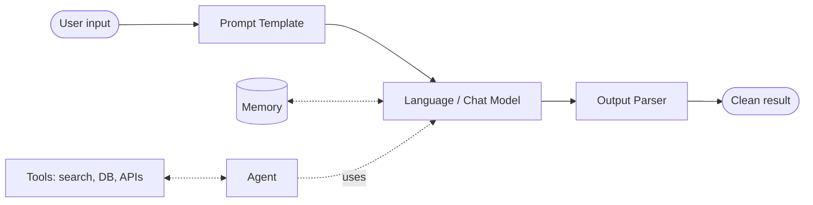

Reading the diagram:

- **Solid line (main pipeline):** input is formatted by a **prompt template**, answered by a **model**, then tidied by an **output parser**.
- **Dotted lines:** optional extras. **Memory** lets the model recall earlier turns. An **agent** lets the model decide when to use **tools**.

| Component | One-line job |
|---|---|
| Language Model | Text in, text out |
| Chat Model | Conversation in, reply out |
| Chat Message | One turn in a conversation (has a role and content) |
| Prompt Template | Fill-in-the-blank prompt |
| Output Parser | Turns the raw reply into a usable format (list, JSON, ...) |
| Chain | A fixed sequence of steps |
| Memory | Stores past messages |
| Agent | The LLM decides which steps and tools to use |
| Documents | Chunks of text your app can load and search |

---

## 3. Language Models vs Chat Models

|  | **Language Model (LLM)** | **Chat Model** |
|---|---|---|
| Input | A single string | A list of messages |
| Output | A string | A message |
| Best for | Completing or summarizing text | Back-and-forth conversation |
| Feels like | Autocomplete | Talking to a person |

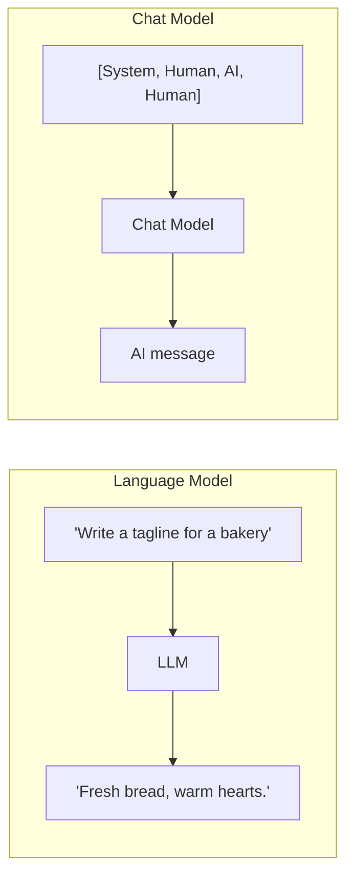

**Providers.** LangChain works with IBM, OpenAI, Google, Meta and others. The course uses **IBM watsonx.ai** with the **Mixtral 8x7B Instruct** model.

**Settings you can tune** (the course highlights two):

- `max_new_tokens`: the maximum length of the reply.
- `temperature`: creativity. Low (about 0) is focused and predictable. High (about 1) is more varied and creative.

```python
# Sketch only: the exact imports depend on your version and provider
llm = WatsonxLLM(
    model_id="mistralai/mixtral-8x7b-instruct-v01",
    params={"max_new_tokens": 256, "temperature": 0.5},
)
llm.invoke("Suggest a new sales approach for a coffee shop.")
```

> **Remember:** the *model* is the brain. Everything else in LangChain helps feed it good input and handle its output.

---

## 4. Chat Messages

A chat model reads a **list of messages**. Every message has two fields:

- **`role`**: who is speaking
- **`content`**: what they said

### The 5 message types

| Type | Who/what | Purpose | Example |
|---|---|---|---|
| **SystemMessage** | You (developer) | Sets the model's behaviour and personality | "You are a fitness coach. Reply in one sentence." |
| **HumanMessage** | The user | The user's question | "What should I eat before a run?" |
| **AIMessage** | The model | The model's earlier replies | "A banana and some water." |
| **FunctionMessage** | A function | Result of a function call (has a `name`) | `{"name": "get_weather", ...}` |
| **ToolMessage** | A tool | Result of a tool call | Search results |

### Example: a fitness bot

```python
from langchain_core.messages import SystemMessage, HumanMessage, AIMessage

messages = [
    SystemMessage(content="You are a fitness activity bot. Be brief."),
    HumanMessage(content="I want to get stronger."),
    AIMessage(content="Try squats, push-ups and rows 3x a week."),
    HumanMessage(content="How many sets of each?"),   # the model answers THIS
]
reply = chat_model.invoke(messages)
```

Because the earlier turns are in the list, the model knows "each" means squats, push-ups and rows.

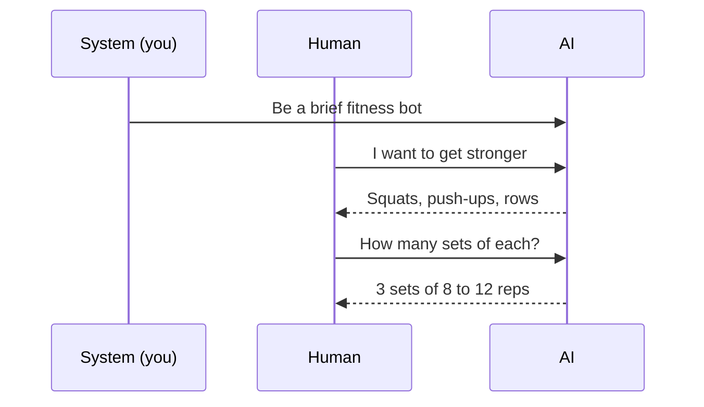

**Tip:** `SystemMessage` and `AIMessage` are optional. You can send just a `HumanMessage` and the model replies directly.

---

## 5. Prompt Templates

A **prompt template** is a prompt with **blanks** that you fill in later. This lets you reuse one prompt for many inputs.

> **Analogy:** a mail-merge letter. "Dear `{name}`, your order `{item}` has shipped."

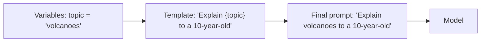

### Types of prompt templates

| Type | Use it when... |
|---|---|
| **String prompt template** | You need one formatted string |
| **Chat prompt template** | You need a list of messages with roles |
| **Message prompt templates** (System / Human / AI / Chat) | You want a template for one specific message. "Chat" lets you choose the role yourself |
| **MessagesPlaceholder** | You want full control over where a list of messages gets inserted (e.g. chat history) |
| **Few-shot prompt template** | You want to show the model examples ("shots") first |

### Example: string template

```python
from langchain_core.prompts import PromptTemplate

prompt = PromptTemplate.from_template("Tell me a fun fact about {animal}.")
prompt.format(animal="octopus")
# -> "Tell me a fun fact about octopus."
```

### Example: chat template

```python
from langchain_core.prompts import ChatPromptTemplate

prompt = ChatPromptTemplate.from_messages([
    ("system", "You are a {style} assistant."),
    ("human", "{question}"),
])
prompt.invoke({"style": "pirate", "question": "What is the capital of France?"})
```

### Few-shot prompts and example selectors

**Few-shot** means giving the model a few worked examples so it copies the pattern.

```text
Word: happy  -> Opposite: sad
Word: hot    -> Opposite: cold
Word: tall   -> Opposite: ???        <- the model completes this
```

If you have **hundreds** of examples, you can't paste them all in. An **example selector** picks only the most useful ones for each question.

| Selector | Picks examples that are... | Good for |
|---|---|---|
| **Semantic similarity** | Closest in *meaning* to the input | The most relevant examples |
| **Max marginal relevance (MMR)** | Relevant *and* different from each other | Variety |
| **Length-based** | Short enough to fit the space available | Staying under length limits (the transcript calls this "efficient prompts") |
| **N-gram overlap** | Sharing the most words/phrases with the input | Simple text matching |

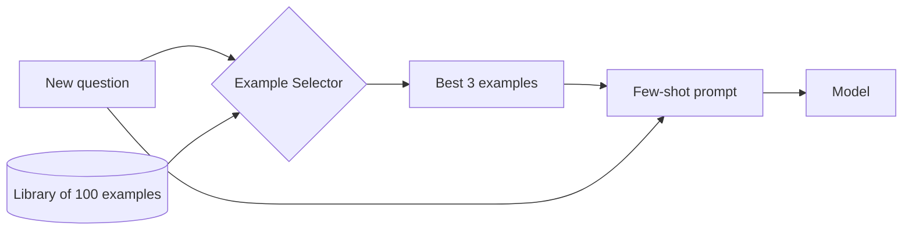

---

## 6. Output Parsers

LLMs return **plain text**. Your code often needs **structured data** (a list, JSON, a table). An **output parser** does that conversion.

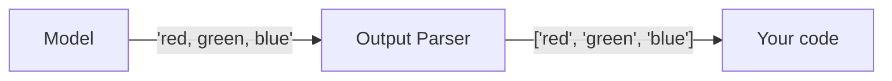

Formats available include **JSON, XML, CSV and Pandas DataFrames**.

### Example: comma-separated list

```python
from langchain_core.output_parsers import CommaSeparatedListOutputParser

parser = CommaSeparatedListOutputParser()
parser.parse("apple, banana, cherry")
# -> ['apple', 'banana', 'cherry']
```

Now you can loop over the list or drop it into a spreadsheet.

---

## 7. Chains and Memory

### 7.1 Chains

A **chain** is a **sequence of steps**. In a *sequential chain*, the **output of one step becomes the input of the next**.

> **Analogy:** an assembly line. Each station does one job and passes the result along.

### Worked example: "Dish → Recipe → Cooking time"

The course builds three small chains and links them:

| Chain | Input | Output (stored under key) | Example |
|---|---|---|---|
| 1. `location_chain` | `location` | `meal` | China → *Peking Duck* |
| 2. `dish_chain` | `meal` | `recipe` | Peking Duck → *step-by-step recipe* |
| 3. `recipe_chain` | `recipe` | `time` | recipe → *about 3 hours* |

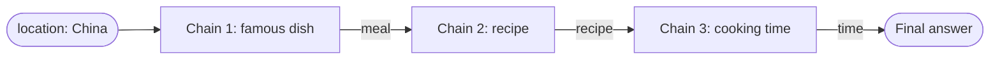

**How each chain is built (3 steps, the same every time):**

1. Write a **template string** for the prompt.
2. Wrap it in a **PromptTemplate** and name its input variable.
3. Create an **LLMChain** from the model and the template, with an `output_key` (the name for its result).

Then wrap all three chains in a **SequentialChain**. Setting `verbose=True` prints every step so you can watch the data flow.

```python
# Course style (older API). Works, but now considered legacy.
location_chain = LLMChain(llm=llm, prompt=location_prompt, output_key="meal")
dish_chain     = LLMChain(llm=llm, prompt=dish_prompt,     output_key="recipe")
recipe_chain   = LLMChain(llm=llm, prompt=time_prompt,     output_key="time")

overall = SequentialChain(
    chains=[location_chain, dish_chain, recipe_chain],
    input_variables=["location"],
    output_variables=["meal", "recipe", "time"],
    verbose=True,
)
overall.invoke({"location": "China"})
```

> **Heads-up:** newer LangChain versions use the **pipe `|` syntax (LCEL)** instead of `LLMChain`. The idea is identical, only the spelling differs:
>
> ```python
> chain = prompt | llm | StrOutputParser()
> chain.invoke({"location": "China"})
> ```
>
> Read it as: prompt → model → parser. The `|` is the arrow.

### 7.2 Memory

LLMs are **stateless**. They forget everything between calls. **Memory** fixes this by storing past messages and re-feeding them.

Each run of a chain does two things with memory:

1. **Read:** load past messages to enrich the new input.
2. **Write:** save the new input and output afterwards.

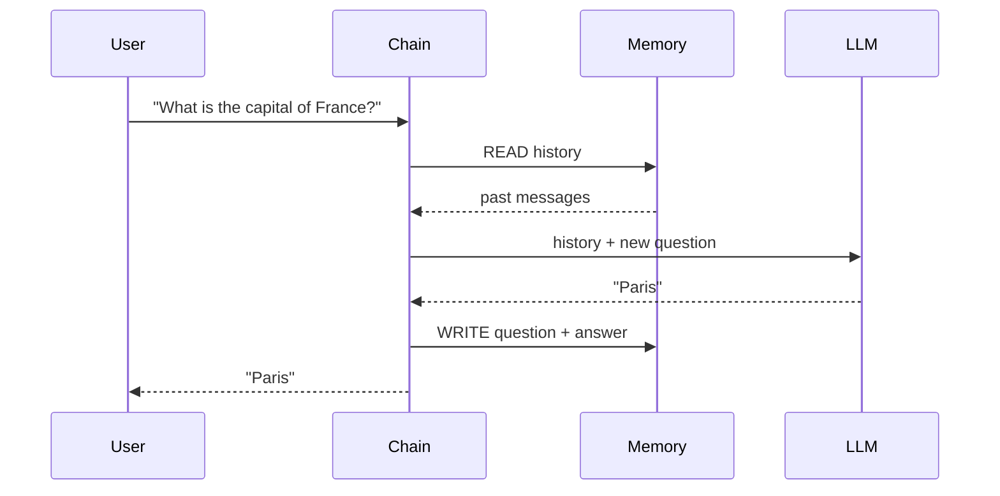

**Example with `ChatMessageHistory`:**

```python
from langchain_community.chat_message_histories import ChatMessageHistory

history = ChatMessageHistory()
history.add_ai_message("Hi!")
history.add_user_message("What is the capital of France?")
history.messages
# [AIMessage('Hi!'), HumanMessage('What is the capital of France?')]
```

Without memory, a follow-up like "What's its population?" fails because the model doesn't know what "its" refers to.

---

## 8. Agents

A chain follows a **fixed** path that you design. An **agent** lets the **LLM decide** what to do next.

|  | **Chain** | **Agent** |
|---|---|---|
| Steps | Fixed in advance | Chosen by the LLM at run time |
| Flexibility | Low | High |
| Predictability | High | Lower |
| Analogy | Following a recipe | A chef who decides what to cook from what's in the fridge |

**Important:** the LLM **only produces text** that says what to do. The agent framework **runs the tools**. The model never executes anything directly.

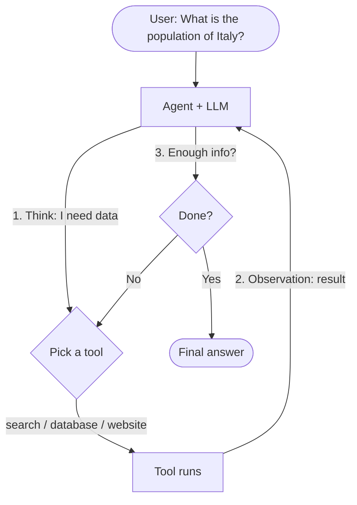

### Example: Pandas DataFrame agent

Ask questions about a table in plain English.

```python
from langchain_experimental.agents import create_pandas_dataframe_agent

agent = create_pandas_dataframe_agent(llm, df, verbose=True, allow_dangerous_code=True)
agent.invoke("How many rows are in the dataframe?")
```

What happens behind the scenes:

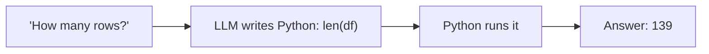

`verbose=True` lets you see the LLM's reasoning. The course's example returned **139 rows**.

> **Safety note:** this agent *executes code the LLM writes*. Only use it on data and in environments you trust. Recent versions require `allow_dangerous_code=True` to make you acknowledge that.

---

## 9. Cheat Sheet

| Concept | Remember it as | Key point |
|---|---|---|
| LangChain | LEGO for LLM apps | Open-source, modular |
| Language model | Autocomplete | String in, string out |
| Chat model | A conversation partner | List of messages in |
| Message | `role` + `content` | System, Human, AI, Function, Tool |
| Prompt template | Mail-merge | Blanks like `{topic}` |
| Few-shot | "Learn from examples" | Selectors pick the best examples |
| Output parser | Text → structure | JSON, CSV, list, DataFrame |
| Chain | Assembly line | Output of step N → input of step N+1 |
| Memory | Notebook | Read before, write after each run |
| Agent | A chef who decides | LLM picks tools; framework runs them |

**The core pipeline in one line:**

```text
Prompt Template  →  Model  →  Output Parser      (this is a chain)
```

**When to use which:**

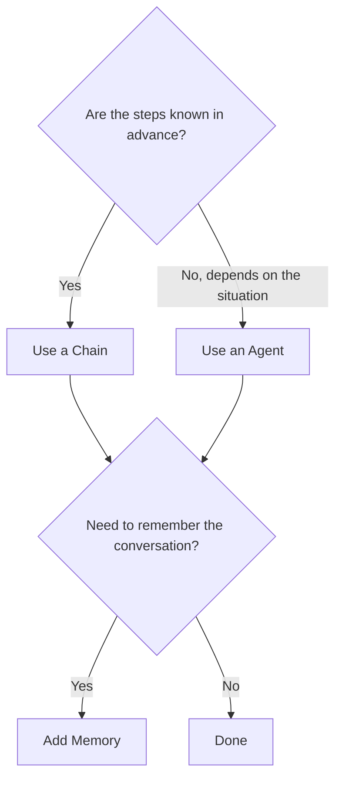

---

## 10. Self-Quiz

Try answering **before** you open the answers.

1. What is the difference between a language model and a chat model?
2. What two properties does every chat message have?
3. Which message type sets the model's behaviour?
4. Why use a prompt template instead of a plain string?
5. When do you need an example selector?
6. What does an output parser do?
7. In a sequential chain, how does data move between steps?
8. Why do LLM apps need memory?
9. What is the key difference between a chain and an agent?
10. Does the LLM itself run a tool in an agent?

<details>
<summary>Show answers</summary>

1. A language model takes a string and returns a string. A chat model takes a list of messages and returns a message.
2. `role` (who is speaking) and `content` (what is said).
3. `SystemMessage`.
4. It makes the prompt reusable. You fill in variables instead of rewriting the text.
5. When you have many few-shot examples and want only the most relevant ones in the prompt.
6. It converts the model's raw text into a structured format such as a list, JSON, CSV or a DataFrame.
7. The output of one step becomes the input of the next, passed via named keys (`meal`, `recipe`, `time`).
8. LLMs are stateless, so memory stores and re-supplies past messages to keep context.
9. A chain's steps are fixed in advance. An agent's steps are chosen by the LLM at run time.
10. No. The LLM only outputs text that says what to do. The agent framework runs the tool.

</details>

---

### Notes on this guide

- Code snippets are **simplified** to teach the idea. Import paths and class names change between LangChain versions, so check the [LangChain docs](https://python.langchain.com) for your installed version.
- The course demos use **IBM watsonx.ai + Mixtral 8x7B Instruct**. The concepts apply to any provider.
- `LLMChain` and `SequentialChain` are the older style shown in the course. The `|` (LCEL) style is the modern equivalent.
